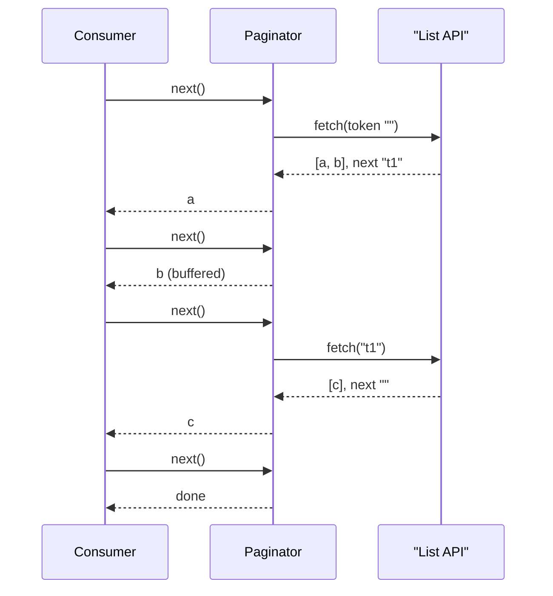

## In one minute
- An iterator gives sequential access to the elements of something (a list, a tree, a file, a database result, a paginated API) without exposing how that something is stored. The caller sees "give me the next one" and "there are no more".
- The pattern's real value is laziness: elements are produced on demand, so memory stays constant, work stops when the caller stops, and the consumer sets the pace. That last property is backpressure.
- Every mainstream language has an iterator protocol built in: Python's `__iter__` and `__next__`, JavaScript's `Symbol.iterator` and `{value, done}`, Java's `hasNext` and `next`, and Go's `Next`/`Err` types plus, since Go 1.23, range-over-func iterators ([Go 1.23 notes](https://go.dev/doc/go1.23)).
- The hard parts are state and lifetime: what happens if the collection changes during iteration, who closes the underlying resource when the caller stops early, and how an iterator resumes after an error or across processes (pagination tokens, cursors, offsets).
- Agents often write `rows = list(fetch_all())` and loop over it, or pagination loops with no exit guard. In review, ask what the peak memory is, what happens if the caller breaks early, and what stops the loop if the server returns the same token twice.

## How it works

### The problem
A billing team exports invoices to a data warehouse. The first version calls `repo.all_invoices()`, which returns a list. At 200,000 invoices it took 400 MB and 20 seconds before the first row was written. At 30 million it ran out of memory. A second consumer, a fraud check, needs only the first 1,000 invoices that match a rule, and still waits for all 30 million.

The iterator answer: `repo.invoices()` returns an iterator that fetches 5,000 rows at a time from a server-side cursor. The export writes as it reads in constant memory, and the fraud check stops after 1,000 matches, so no more batches are fetched.

### External and internal iterators
An **external** (pull) iterator is an object the caller advances: `next(it)`, `it.next()`, `rows.Next()`. The caller controls the loop, so it can stop, interleave two iterators (merging two sorted streams) or hand the iterator to another function. An **internal** (push) iterator is a function that takes a callback and calls it per element: `list.forEach(fn)`, Go's `func(yield func(T) bool)`. The producer controls the loop, which makes producers easy to write, because their state lives in ordinary local variables and the call stack, but makes merging two of them awkward.

Generators bridge the two. A Python or JavaScript generator is written like a push iterator (a loop with `yield`) and consumed like a pull iterator, because the runtime suspends the function at each `yield` and resumes it on the next `next()`. Go 1.23's `iter.Pull` converts a push iterator into a pull one by running it as a coroutine, and returns a `next` and a `stop` function. If you do not consume the sequence to the end you must call `stop`, conventionally with `defer`, or the iterator never gets to clean up ([iter package docs](https://pkg.go.dev/iter)). The same package documents a convention worth copying: an iterator over a stream that cannot be rewound should say in its doc comment that it is single-use.

### Protocols in four languages
Python calls `__iter__()`, then `__next__()` until it raises `StopIteration`. JavaScript calls `x[Symbol.iterator]()`, then `next()` until `{done: true}`; `for...of` calls the optional `return()` on early exit so the iterator can release resources ([MDN](https://developer.mozilla.org/en-US/docs/Web/JavaScript/Reference/Iteration_protocols)). JavaScript also has an async twin, `Symbol.asyncIterator`, whose `next()` returns a promise and which `for await` consumes. Anything that fetches pages over a network belongs there, because a blocking `next()` would freeze the event loop. Java has `hasNext()` and `next()`. Go's standard library uses `Next() bool` with accessors and an `Err()` checked after the loop (`bufio.Scanner`, `sql.Rows`), and Go 1.23 added `iter.Seq[V]`, a function type `for range` loops over directly.

### Mutation during iteration
What should happen if the list changes while someone iterates it? There are three common answers. **Fail-fast**: Java's `ArrayList` iterator throws `ConcurrentModificationException`, but the Javadoc calls this best-effort and says it should only be used to detect bugs, never relied on for correctness ([Javadoc](https://docs.oracle.com/en/java/javase/21/docs/api/java.base/java/util/ConcurrentModificationException.html)). Python is looser: iterating a dict view while adding or deleting entries "may raise a RuntimeError or fail to iterate over all entries" ([Python docs](https://docs.python.org/3/library/stdtypes.html)). **Snapshot**: Java's `CopyOnWriteArrayList` iterates the array as it was when the iterator was created and never throws ([Javadoc](https://docs.oracle.com/en/java/javase/21/docs/api/java.base/java/util/concurrent/CopyOnWriteArrayList.html)); RocksDB iterators read a consistent point-in-time view even while compactions rewrite files (see LSM Trees) ([RocksDB wiki](https://github.com/facebook/rocksdb/wiki/Iterator)). **Weakly consistent**: Java's `ConcurrentHashMap` iterators never throw and may or may not see concurrent changes ([Javadoc](https://docs.oracle.com/en/java/javase/21/docs/api/java.base/java/util/concurrent/ConcurrentHashMap.html)). Pick one deliberately and document it; "undefined" is the answer that produces skipped or duplicated elements in production.

### Iterators that outlive a process
A pagination token, a cursor name and a Kafka consumer offset are iterator state serialised so iteration can resume in another request or after a crash. The token must capture position, not page number: offset pages skip or repeat rows when earlier rows change, while "after id 81723" stays correct. Real APIs show both styles. S3's `ListObjectsV2` returns up to 1,000 keys per request and hands back a `NextContinuationToken` ([AWS docs](https://docs.aws.amazon.com/AmazonS3/latest/API/API_ListObjectsV2.html)); Stripe's list endpoints take `starting_after`, the ID of the last object you saw, with a default `limit` of 10 and a maximum of 100 ([Stripe docs](https://docs.stripe.com/api/pagination)). Both ship client helpers (boto3 paginators, Stripe auto-pagination) that wrap the token loop in an ordinary iterator ([boto3 docs](https://boto3.amazonaws.com/v1/documentation/api/latest/guide/paginators.html)). Clients must also guard against a buggy server returning the same token forever.

### Reviewing agent-written code
Agents reach for `list(...)` and `.all()` because they make the next line simple; ask for peak memory at production volume. Pagination loops need an exit on an empty token, a repeated-token guard and a page cap. Iterators over files, `sql.Rows` or HTTP streams must close on early exit: `defer rows.Close()`, `with` or `try/finally`, or `return()` in JavaScript.

### The same shape elsewhere
A pull iterator solves the *overload* problem shape by letting the consumer set the rate: nothing is produced until it is asked for. TCP flow control does the same between machines, where the receiver's advertised window limits how much the sender may transmit, and Reactive Streams makes it explicit with `request(n)`, where a subscriber asks for the next `n` elements and the publisher may not send more ([specification](https://github.com/reactive-streams/reactive-streams-jvm/blob/master/README.md)).

## Down the stack

### Layer 1: The contract
An iterator yields each element of its source at most once, in a documented order, and signals exhaustion in a defined way that it repeats if asked again. It documents its behaviour under concurrent modification (fail-fast, snapshot or weakly consistent), whether it can be restarted (an iterable can produce a fresh iterator; an iterator usually cannot), and who releases underlying resources on early exit. For remote iterators, it documents whether a failed step can be retried without skipping or repeating elements.

### Layer 2: The mechanism
Java's `ArrayList.Itr` holds three ints: `cursor` (next index), `lastRet` (index last returned, for `remove`) and `expectedModCount`. Every structural change to the list increments its `modCount`, and each `next()` compares the two and throws on mismatch ([OpenJDK source](https://github.com/openjdk/jdk/blob/master/src/java.base/share/classes/java/util/ArrayList.java)). That is the whole fail-fast mechanism: one integer comparison per step, best-effort and not a concurrency guarantee.

A CPython generator object holds its suspended frame: local variables, the evaluation stack and the instruction offset. `YIELD_VALUE` stores the value and returns control to the caller; `next()` resumes the frame at the saved instruction. Since PEP 479 (opt-in in 3.5, a warning in 3.6, always on from 3.7) a `StopIteration` raised inside a generator body becomes a `RuntimeError`, so a stray `next()` on an exhausted inner iterator no longer ends the outer generator silently ([PEP 479](https://peps.python.org/pep-0479/)). Calling `close()` raises `GeneratorExit` at the suspension point, which runs `finally` blocks.

In Go 1.23, `for x := range seq` over a function compiles the loop body into a closure passed as `yield`; `break` makes `yield` return false, and the iterator must stop calling it. `iter.Pull` runs the push function on a runtime coroutine and switches to it on each call to `next`.

Database cursors work in batches. PostgreSQL's JDBC driver fetches the entire result set by default (fetch size 0); setting a fetch size with autocommit off makes it use a cursor and fetch that many rows per round trip ([pgJDBC docs](https://jdbc.postgresql.org/documentation/query/)). Python's psycopg2 also buffers the whole result unless you use a named cursor, which wraps a server-side `DECLARE`/`FETCH` cursor; its `itersize` (default 2000) sets how many rows each round trip brings back during iteration ([psycopg2 docs](https://www.psycopg.org/docs/usage.html)).

### Layer 3: The machine
Per-element cost decides where iterators hurt. An index loop over a Go slice is a few nanoseconds per element and vectorisable. A range-over-func loop is usually inlined to similar cost. A pull iterator through an interface is an indirect call per element. A CPython `next()` on a generator costs tens of nanoseconds, and `iter.Pull` pays a coroutine switch per element, far above an inlined loop.

Memory is where iterators win. A list of 30 million invoice rows at around 120 bytes each as Python objects is over 3.6 GB; an iterator fetching 5,000 rows at a time holds about 600 KB. Batching also amortises round trips: at 0.5 ms per round trip, fetching one row at a time costs 15,000 seconds for 30 million rows, while batches of 5,000 need 6,000 round trips, or 3 seconds of latency.

Concurrency: an iterator is single-consumer state. Two goroutines calling `Next` on the same `sql.Rows` race on its cursor. Fan out by having one consumer read and send items to workers over a channel, or partition the source (key ranges) and give each worker its own iterator.

### Why it's built this way
1. Collections can exceed memory or be infinite, so consumers process one element at a time.
2. Consumers should not depend on storage, so traversal sits behind a small interface.
3. Hand-written traversal state is error-prone, so languages added generators that keep it on a suspended stack.
4. Round trips dominate remote sources, so iterators fetch in batches and yield one element at a time.
5. Iteration spans requests and crashes, so position is serialised as tokens and offsets.

## Diagram


## Worked example
The invoice export reads 30 million rows from PostgreSQL and writes Parquet files. The first version used the ORM's `.all()`: 3.6 GB of Python objects, a 14-minute delay before the first write, and an out-of-memory kill on the 8 GB worker when another job shared the node.

The rewrite used a named server-side cursor with `itersize = 5000`, wrapped in a generator that yields rows and closes the cursor in `finally`. Peak memory dropped to 180 MB, mostly the Parquet writer's row group buffer, and the first file appeared in 2 seconds. Total time fell from 31 to 22 minutes, because writing now overlapped reading.

Two bugs surfaced. The fraud check broke out of the loop after 1,000 matches, but the generator was never closed, so the cursor and its transaction stayed open until the connection pool recycled the connection, holding back vacuum on the invoices table. Wrapping the iteration in `with closing(...)` fixed it. The second came from a partner API used for enrichment: during an incident it returned the same `next_page_token` repeatedly, and the paginator fetched the same page 400,000 times in an hour. A guard that remembers seen tokens and fails on a repeat, plus a page cap, stopped it.

## In the wild
- **Python 3.5 to 3.7: generators that ended silently.** A stray `StopIteration` from an unguarded `next()` several frames down used to terminate the enclosing generator without any traceback, and it broke the promise that a sub-generator can be factored out with `yield from`. PEP 479 turned it into a `RuntimeError`, phased in over three releases: opt-in with a future import in 3.5, a warning in 3.6, mandatory in 3.7 ([PEP 479](https://peps.python.org/pep-0479/)).
- **AWS S3 and boto3: every listing is an iterator over tokens.** `ListObjectsV2` returns at most 1,000 keys per call and a continuation token, so any tool that lists a large bucket is a pull iterator whether it admits it or not. boto3 paginators wrap that loop as a `PageIterator` so callers never handle tokens by hand ([AWS docs](https://docs.aws.amazon.com/AmazonS3/latest/API/API_ListObjectsV2.html), [boto3 docs](https://boto3.amazonaws.com/v1/documentation/api/latest/guide/paginators.html)).
- **RocksDB: a forgotten iterator pins disk and memory.** An iterator itself is small, but it pins the memtables and SST files that existed when it was created, so files that compaction has already replaced stay on disk until the iterator is released, and it holds the data block at its current position in memory ([RocksDB wiki](https://github.com/facebook/rocksdb/wiki/Iterator)). It is the same leak as the unclosed database cursor in the worked example above, one layer down.

## Trade-offs
| Option | Strengths | Weaknesses | Choose when |
| --- | --- | --- | --- |
| Materialised list | Simple; random access; reusable | Memory grows with size; first result waits for all | Small, bounded results |
| External (pull) iterator | Caller controls pace; can merge and stop early | Hand-written state machine; cleanup on early exit | Merging streams, resumable reads |
| Internal (push) iterator or callback | Easy to write; fast in Go and compiled languages | Hard to merge two or pause | Simple full traversals |
| Generator | Pull interface with push-style code | Per-step overhead; hidden suspended state | Python and JavaScript pipelines |
| Server cursor or pagination token | Constant memory; resumable across requests | Server state or token design; consistency under writes | Large or remote result sets |

## Pitfalls in production
- Loading whole result sets by default (`.all()`, JDBC without a fetch size). Fix: stream with server-side cursors and batch sizes, and test with production-sized data.
- Early exit leaking resources: open cursors, transactions or file handles from abandoned generators. Fix: `defer rows.Close()`, context managers, and `finally` in generators.
- Mutating a collection while iterating it, producing exceptions or skipped elements. Fix: iterate a copy, collect changes and apply them after, or use a snapshot iterator.
- Offset pagination over changing data, skipping or repeating rows. Fix: keyset tokens that encode the last seen sort key.
- Paginators that trust the server forever. Fix: detect repeated tokens and cap pages per run.
- Reusing an exhausted iterator and silently getting nothing, for example passing a generator to two functions. Fix: pass the iterable, not the iterator, or materialise deliberately.

## Leadership lens
- Ask for peak memory and time-to-first-result at production volume in design review for any batch or export job; iterators change both by orders of magnitude.
- Treat pagination tokens as a public API: opaque, versioned, stable under inserts and deletes. Changing their meaning breaks clients mid-iteration.
- Decide and document the mutation semantics of shared collections and caches. "It depends on timing" is a defect report waiting to happen.
- Make streaming the default in shared data-access libraries, so teams opt in to materialising, not into streaming.

## Check yourself
1. Why can a pull iterator merge two sorted streams easily while a push iterator cannot?
   **Answer:** With pull, the consumer advances whichever stream has the smaller head; with push, each producer drives its own loop, so interleaving needs threads, coroutines or buffering.
2. What does Java's fail-fast iterator actually guarantee?
   **Answer:** Nothing under concurrency; it compares a modification counter on each step and throws on a detected mismatch, which catches most single-threaded mistakes but is explicitly best-effort.
3. Why do keyset pagination tokens survive inserts while offset pages do not?
   **Answer:** A keyset token says "after this sort key", which still identifies the same position after rows are inserted earlier, while an offset counts rows and shifts when earlier rows appear or disappear.
4. What leaks when a consumer breaks out of a loop over a database-backed generator, and how is it prevented?
   **Answer:** The cursor and its transaction stay open until the generator is collected or closed; close it explicitly with a context manager, `finally`, or `defer rows.Close()`.

## Practice
**Task:** Build an iterator over a paginated API. `fetch(token)` returns `(items, next_token)`; the first call uses token `""`, and an empty `next_token` means the last page. `Paginator(fetch)` yields items one at a time in order, fetching nothing until the first item is requested and only when its buffer is empty; pages with no items are skipped. If `fetch` fails, the error propagates, nothing is skipped, and the next request retries the same token. If a page returns a `next_token` that has already been fetched, fail with `token cycle: <token>` (that page's items are discarded). `pages` counts successful fetches. `take(it, n)` returns up to `n` items without requesting more than it needs. Python implements `__iter__`/`__next__`; TypeScript implements `next()` returning `{value, done}` and `[Symbol.iterator]`; Go uses `Next() bool`, `Item()` and `Err()`, where calling `Next` again after a fetch error retries.

```python starter
class Paginator:
    def __init__(self, fetch):
        self.fetch = fetch
        self.pages = 0

    def __iter__(self):
        return self

    def __next__(self):
        # TODO
        raise NotImplementedError


def take(it, n):
    # TODO
    raise NotImplementedError
```

```python tests
class Api:
    def __init__(self, pages, fail_on=()):
        self.pages = pages
        self.fail_on = list(fail_on)
        self.calls = []

    def __call__(self, token):
        self.calls.append(token)
        if token in self.fail_on:
            self.fail_on.remove(token)
            raise RuntimeError("timeout")
        return self.pages[token]


THREE = {"": (["a", "b"], "t1"), "t1": (["c", "d"], "t2"), "t2": (["e"], "")}


def test_iterates_lazily_across_pages():
    api = Api(THREE)
    p = Paginator(api)
    assert api.calls == []
    assert list(p) == ["a", "b", "c", "d", "e"]
    assert p.pages == 3
    assert list(p) == []


def test_skips_empty_pages():
    api = Api({"": ([], "t1"), "t1": ([], "t2"), "t2": (["x"], "")})
    assert list(Paginator(api)) == ["x"]


def test_empty_result():
    p = Paginator(Api({"": ([], "")}))
    assert list(p) == []
    assert p.pages == 1


def test_take_does_not_overfetch():
    api = Api(THREE)
    assert take(Paginator(api), 3) == ["a", "b", "c"]
    assert api.calls == ["", "t1"]
    api2 = Api(THREE)
    assert take(Paginator(api2), 2) == ["a", "b"]
    assert api2.calls == [""]
    api3 = Api(THREE)
    assert take(Paginator(api3), 0) == []
    assert api3.calls == []


def test_take_more_than_available():
    assert take(Paginator(Api(THREE)), 99) == ["a", "b", "c", "d", "e"]


def test_failure_retries_same_token():
    api = Api(THREE, fail_on=["t1"])
    p = Paginator(api)
    assert next(p) == "a" and next(p) == "b"
    try:
        next(p)
        assert False, "expected timeout"
    except RuntimeError as e:
        assert str(e) == "timeout"
    assert list(p) == ["c", "d", "e"]
    assert api.calls == ["", "t1", "t1", "t2"]


def test_token_cycle_detected():
    api = Api({"": (["a"], "t1"), "t1": (["b"], "t1")})
    p = Paginator(api)
    assert next(p) == "a"
    try:
        next(p)
        assert False, "expected cycle"
    except ValueError as e:
        assert str(e) == "token cycle: t1"
```

```python solution
class Paginator:
    def __init__(self, fetch):
        self.fetch = fetch
        self.pages = 0
        self._buf = []
        self._token = ""
        self._done = False
        self._seen = set()

    def __iter__(self):
        return self

    def __next__(self):
        while not self._buf:
            if self._done:
                raise StopIteration
            items, nxt = self.fetch(self._token)
            self._seen.add(self._token)
            self.pages += 1
            if nxt != "" and nxt in self._seen:
                raise ValueError("token cycle: " + nxt)
            self._buf = list(items)
            self._token = nxt
            if nxt == "":
                self._done = True
        return self._buf.pop(0)


def take(it, n):
    out = []
    if n <= 0:
        return out
    for x in it:
        out.append(x)
        if len(out) == n:
            break
    return out
```

```typescript starter
export type Fetch = (token: string) => [string[], string];

export class Paginator implements IterableIterator<string> {
  pages = 0;
  constructor(private fetch: Fetch) {}
  next(): IteratorResult<string> { throw new Error("TODO"); }
  [Symbol.iterator](): IterableIterator<string> { return this; }
}

export function take(it: Iterator<string>, n: number): string[] {
  throw new Error("TODO");
}
```

```typescript tests
class Api {
  calls: string[] = [];
  constructor(private pagesByToken: Record<string, [string[], string]>, private failOn: string[] = []) {}
  fetch = (token: string): [string[], string] => {
    this.calls.push(token);
    const i = this.failOn.indexOf(token);
    if (i >= 0) { this.failOn.splice(i, 1); throw new Error("timeout"); }
    return this.pagesByToken[token];
  };
}

const THREE: Record<string, [string[], string]> = { "": [["a", "b"], "t1"], t1: [["c", "d"], "t2"], t2: [["e"], ""] };

function errorOf(fn: () => unknown): string | undefined {
  try { fn(); } catch (e) { return (e as Error).message; }
  return undefined;
}

test("iterates lazily across pages", () => {
  const api = new Api(THREE);
  const p = new Paginator(api.fetch);
  assertEqual(api.calls, []);
  assertEqual([...p], ["a", "b", "c", "d", "e"]);
  assertEqual(p.pages, 3);
  assertEqual([...p], []);
});

test("skips empty pages", () => {
  const api = new Api({ "": [[], "t1"], t1: [[], "t2"], t2: [["x"], ""] });
  assertEqual([...new Paginator(api.fetch)], ["x"]);
});

test("empty result", () => {
  const p = new Paginator(new Api({ "": [[], ""] }).fetch);
  assertEqual([...p], []);
  assertEqual(p.pages, 1);
});

test("take does not overfetch", () => {
  const api = new Api(THREE);
  assertEqual(take(new Paginator(api.fetch), 3), ["a", "b", "c"]);
  assertEqual(api.calls, ["", "t1"]);
  const api2 = new Api(THREE);
  assertEqual(take(new Paginator(api2.fetch), 2), ["a", "b"]);
  assertEqual(api2.calls, [""]);
  const api3 = new Api(THREE);
  assertEqual(take(new Paginator(api3.fetch), 0), []);
  assertEqual(api3.calls, []);
});

test("take more than available", () => {
  assertEqual(take(new Paginator(new Api(THREE).fetch), 99), ["a", "b", "c", "d", "e"]);
});

test("failure retries same token", () => {
  const api = new Api(THREE, ["t1"]);
  const p = new Paginator(api.fetch);
  assertEqual(p.next().value, "a");
  assertEqual(p.next().value, "b");
  assertEqual(errorOf(() => p.next()), "timeout");
  assertEqual([...p], ["c", "d", "e"]);
  assertEqual(api.calls, ["", "t1", "t1", "t2"]);
});

test("token cycle detected", () => {
  const api = new Api({ "": [["a"], "t1"], t1: [["b"], "t1"] });
  const p = new Paginator(api.fetch);
  assertEqual(p.next().value, "a");
  assertEqual(errorOf(() => p.next()), "token cycle: t1");
});
```

```typescript solution
export type Fetch = (token: string) => [string[], string];

export class Paginator implements IterableIterator<string> {
  pages = 0;
  private buf: string[] = [];
  private token = "";
  private done = false;
  private seen = new Set<string>();
  constructor(private fetch: Fetch) {}

  next(): IteratorResult<string> {
    while (this.buf.length === 0) {
      if (this.done) return { value: undefined, done: true };
      const [items, nxt] = this.fetch(this.token);
      this.seen.add(this.token);
      this.pages++;
      if (nxt !== "" && this.seen.has(nxt)) throw new Error("token cycle: " + nxt);
      this.buf = [...items];
      this.token = nxt;
      if (nxt === "") this.done = true;
    }
    return { value: this.buf.shift() as string, done: false };
  }

  [Symbol.iterator](): IterableIterator<string> { return this; }
}

export function take(it: Iterator<string>, n: number): string[] {
  const out: string[] = [];
  while (out.length < n) {
    const r = it.next();
    if (r.done) break;
    out.push(r.value);
  }
  return out;
}
```

```go starter
package practice

// Fetch returns one page of items and the next token ("" on the last page).
type Fetch func(token string) ([]string, string, error)

type Paginator struct {
	Pages int
	fetch Fetch
}

func NewPaginator(fetch Fetch) *Paginator { return &Paginator{fetch: fetch} }

func (p *Paginator) Next() bool   { panic("TODO") }
func (p *Paginator) Item() string { panic("TODO") }
func (p *Paginator) Err() error   { panic("TODO") }

func Take(p *Paginator, n int) ([]string, error) { panic("TODO") }
```

```go tests
package practice

import (
	"errors"
	"reflect"
	"testing"
)

type page struct {
	items []string
	next  string
}

type api struct {
	pages  map[string]page
	failOn map[string]bool
	calls  []string
}

func (a *api) fetch(token string) ([]string, string, error) {
	a.calls = append(a.calls, token)
	if a.failOn[token] {
		delete(a.failOn, token)
		return nil, "", errors.New("timeout")
	}
	pg := a.pages[token]
	return pg.items, pg.next, nil
}

func three() *api {
	return &api{pages: map[string]page{
		"":   {[]string{"a", "b"}, "t1"},
		"t1": {[]string{"c", "d"}, "t2"},
		"t2": {[]string{"e"}, ""},
	}}
}

func drain(p *Paginator) []string {
	out := []string{}
	for p.Next() {
		out = append(out, p.Item())
	}
	return out
}

func TestIteratesLazilyAcrossPages(t *testing.T) {
	a := three()
	p := NewPaginator(a.fetch)
	if len(a.calls) != 0 {
		t.Fatal("fetched before Next")
	}
	if got := drain(p); !reflect.DeepEqual(got, []string{"a", "b", "c", "d", "e"}) {
		t.Fatalf("got %v", got)
	}
	if p.Err() != nil || p.Pages != 3 || p.Next() {
		t.Fatalf("err %v pages %d", p.Err(), p.Pages)
	}
}

func TestSkipsEmptyPages(t *testing.T) {
	a := &api{pages: map[string]page{"": {nil, "t1"}, "t1": {nil, "t2"}, "t2": {[]string{"x"}, ""}}}
	if got := drain(NewPaginator(a.fetch)); !reflect.DeepEqual(got, []string{"x"}) {
		t.Fatalf("got %v", got)
	}
}

func TestEmptyResult(t *testing.T) {
	a := &api{pages: map[string]page{"": {nil, ""}}}
	p := NewPaginator(a.fetch)
	if got := drain(p); len(got) != 0 || p.Pages != 1 || p.Err() != nil {
		t.Fatalf("got %v pages %d", got, p.Pages)
	}
}

func TestTakeDoesNotOverfetch(t *testing.T) {
	a := three()
	got, err := Take(NewPaginator(a.fetch), 3)
	if err != nil || !reflect.DeepEqual(got, []string{"a", "b", "c"}) || !reflect.DeepEqual(a.calls, []string{"", "t1"}) {
		t.Fatalf("got %v calls %v err %v", got, a.calls, err)
	}
	a2 := three()
	got, _ = Take(NewPaginator(a2.fetch), 2)
	if !reflect.DeepEqual(got, []string{"a", "b"}) || len(a2.calls) != 1 {
		t.Fatalf("got %v calls %v", got, a2.calls)
	}
	a3 := three()
	got, _ = Take(NewPaginator(a3.fetch), 0)
	if len(got) != 0 || len(a3.calls) != 0 {
		t.Fatalf("got %v calls %v", got, a3.calls)
	}
}

func TestTakeMoreThanAvailable(t *testing.T) {
	got, err := Take(NewPaginator(three().fetch), 99)
	if err != nil || !reflect.DeepEqual(got, []string{"a", "b", "c", "d", "e"}) {
		t.Fatalf("got %v err %v", got, err)
	}
}

func TestFailureRetriesSameToken(t *testing.T) {
	a := three()
	a.failOn = map[string]bool{"t1": true}
	p := NewPaginator(a.fetch)
	if !p.Next() || p.Item() != "a" || !p.Next() || p.Item() != "b" {
		t.Fatal("first page")
	}
	if p.Next() || p.Err() == nil || p.Err().Error() != "timeout" {
		t.Fatalf("want timeout, got %v", p.Err())
	}
	if got := drain(p); !reflect.DeepEqual(got, []string{"c", "d", "e"}) || p.Err() != nil {
		t.Fatalf("got %v err %v", got, p.Err())
	}
	if !reflect.DeepEqual(a.calls, []string{"", "t1", "t1", "t2"}) {
		t.Fatalf("calls %v", a.calls)
	}
}

func TestTokenCycleDetected(t *testing.T) {
	a := &api{pages: map[string]page{"": {[]string{"a"}, "t1"}, "t1": {[]string{"b"}, "t1"}}}
	p := NewPaginator(a.fetch)
	if !p.Next() || p.Item() != "a" {
		t.Fatal("first item")
	}
	if p.Next() || p.Err() == nil || p.Err().Error() != "token cycle: t1" {
		t.Fatalf("got %v", p.Err())
	}
}
```

```go solution
package practice

import "errors"

// Fetch returns one page of items and the next token ("" on the last page).
type Fetch func(token string) ([]string, string, error)

type Paginator struct {
	Pages int
	fetch Fetch
	buf   []string
	item  string
	token string
	done  bool
	fatal bool
	err   error
	seen  map[string]bool
}

func NewPaginator(fetch Fetch) *Paginator {
	return &Paginator{fetch: fetch, seen: map[string]bool{}}
}

func (p *Paginator) Next() bool {
	if p.fatal {
		return false
	}
	p.err = nil
	for len(p.buf) == 0 {
		if p.done {
			return false
		}
		items, next, err := p.fetch(p.token)
		if err != nil {
			p.err = err
			return false
		}
		p.seen[p.token] = true
		p.Pages++
		if next != "" && p.seen[next] {
			p.err = errors.New("token cycle: " + next)
			p.fatal = true
			return false
		}
		p.buf = append([]string(nil), items...)
		p.token = next
		p.done = next == ""
	}
	p.item = p.buf[0]
	p.buf = p.buf[1:]
	return true
}

func (p *Paginator) Item() string { return p.item }
func (p *Paginator) Err() error   { return p.err }

func Take(p *Paginator, n int) ([]string, error) {
	out := []string{}
	for len(out) < n && p.Next() {
		out = append(out, p.Item())
	}
	return out, p.Err()
}
```

## Mock interview
**Prompt:** Design a client library that lets internal teams iterate over all objects in a storage service holding 2 billion objects, listed through an API that returns up to 1,000 keys per page with a continuation token. Teams want to process everything, process the first N matches, or resume a run after a crash.

- Follow-up: The listing takes 9 hours at one page per 15 ms. How do you make it faster without breaking resume?
- Follow-up: A page request times out halfway through a run. What exactly happens to the iteration?
- Follow-up: Objects are created and deleted during the listing. What does a consumer see, and what can it rely on?

**A strong answer covers:**
- A pull iterator with page buffering, lazy fetching, and early exit that stops further requests, plus an internal iterator form for simple full scans.
- Resume by persisting the last continuation token (or last key) after processed pages, not item counts, and idempotent processing for the page that was in flight.
- Parallelism by partitioning the key space (prefixes or key ranges), each with its own iterator and token, and prefetching the next page while the current one is processed.
- Retries of the same token with backoff, a guard against repeated tokens, and a page cap.
- Explicit consistency semantics: keyset order, objects created behind the cursor may be missed, and no element is returned twice within one run.

## Sources and further study

**Primary**
- [PEP 479: Change StopIteration handling inside generators](https://peps.python.org/pep-0479/): the failure that motivated the change and the three-release migration plan.
- [Package iter (Go standard library)](https://pkg.go.dev/iter): `Seq`, `Seq2`, `Pull`, single-use iterators and the rule to call `stop`.
- [ConcurrentModificationException (Java SE 21 Javadoc)](https://docs.oracle.com/en/java/javase/21/docs/api/java.base/java/util/ConcurrentModificationException.html): what fail-fast does and does not promise.

**Systems docs**
- [Query data (pgJDBC documentation)](https://jdbc.postgresql.org/documentation/query/): fetch size, cursor mode and the autocommit requirement.
- [Usage (psycopg2 documentation)](https://www.psycopg.org/docs/usage.html): named cursors, `itersize` and server-side fetching.
- [ListObjectsV2 (Amazon S3 API reference)](https://docs.aws.amazon.com/AmazonS3/latest/API/API_ListObjectsV2.html): a real paginated listing with continuation tokens.
- [Pagination (Stripe API reference)](https://docs.stripe.com/api/pagination): cursor pagination by object ID, with auto-pagination helpers in the client libraries.
- [Reactive Streams specification](https://github.com/reactive-streams/reactive-streams-jvm/blob/master/README.md): demand-driven iteration across asynchronous boundaries.

**Books**
- *Design Patterns* (Gamma, Helm, Johnson, Vlissides, 1994), Ch 5: Behavioral Patterns, the original Iterator with external and internal iterators.
- *Head First Design Patterns* (2nd ed., 2020), Ch 9: Well-Managed Collections, the Iterator and Composite Patterns.

**Other curricula**
- [Boto3 paginators (AWS SDK guide)](https://boto3.amazonaws.com/v1/documentation/api/latest/guide/paginators.html): shows the iterator as an abstraction over truncated API results.

## Watch
- [Iterator Pattern, Design Patterns ep 16 (Christopher Okhravi)](https://www.youtube.com/watch?v=uNTNEfwYXhI): the Gang of Four structure and the separation of traversal from collection.
- [Iterator Design Pattern (Derek Banas)](https://www.youtube.com/watch?v=VKIzUuMdmag): a code walkthrough of iterating different collection types through one interface.

## Free resources
- [PEP 234: Iterators](https://peps.python.org/pep-0234/): the design of Python's iterator protocol and why it uses `StopIteration`.
- [PEP 255: Simple Generators](https://peps.python.org/pep-0255/): generators as resumable functions, with the rationale for `yield`.
- [Iteration protocols (MDN)](https://developer.mozilla.org/en-US/docs/Web/JavaScript/Reference/Iteration_protocols): JavaScript's iterable and iterator protocols, including `return()`.
- [Range over function types (Go blog)](https://go.dev/blog/range-functions): Go 1.23 push iterators, `iter.Pull`, and the design reasoning.
- [Iterator (RocksDB wiki)](https://github.com/facebook/rocksdb/wiki/Iterator): snapshot semantics, pinned resources and the cost of long-lived iterators in a real storage engine.
- [Iterator (Refactoring Guru)](https://refactoring.guru/design-patterns/iterator): the classic structure and its relation to Composite and Factory Method.
