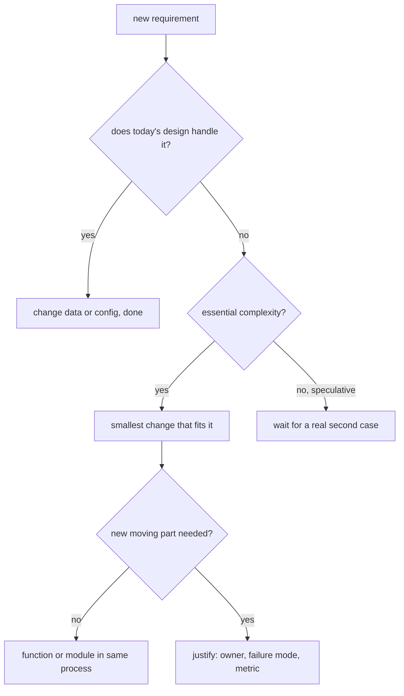

## In one minute
- KISS ("Keep It Simple, Stupid") says a design should have no more moving parts than the problem requires. Every extra layer, option or service is something to read, test, operate and debug.
- Simple is not the same as easy. Simple means few things tangled together; easy means familiar or close at hand. A framework can be easy to start with and leave a design far from simple.
- Complexity is either essential (the problem really has those rules) or accidental (we added it). KISS targets the accidental part; you cannot simplify away a tax code.
- Complexity costs at runtime too: indirect calls the compiler cannot inline, reflection at startup, larger binaries and dependency trees, and network hops where a function call would do.
- Agents produce plausible complexity cheaply: a factory, a strategy hierarchy and a config system for a feature with one case. The review question is "what is the smallest design that meets today's requirement and does not block tomorrow's?"

## How it works

### Where the phrase comes from
The phrase is commonly attributed to Kelly Johnson, the engineer who led Lockheed's Skunk Works, and to the idea that an aircraft should be repairable in the field by an average mechanic with basic tools. The software lesson is the same: the person who matters is the one fixing the system at 3 a.m. with partial knowledge, not the one who designed it with full context.

### Simple versus easy
Rich Hickey's distinction is the most useful lens. *Simple* is about structure: one role, one concept, not interleaved with others. *Easy* is about familiarity: a library you already know, a generator that writes the code for you. Easy things can produce complex results. An ORM that lazily loads relations is easy to use, and it tangles data access with object navigation, so a loop over 200 orders can quietly issue 201 queries. A plain SQL query with a join is less easy and more simple: what it does is visible where it is written.

### Essential and accidental complexity
Fred Brooks split complexity into essential (inherent in the problem) and accidental (introduced by our tools and choices). Payroll rules, timezone handling and currency rounding are essential; you can organise them well but not delete them. A message bus between two functions in the same process, a plugin system with one plugin, or a configuration language for three settings are accidental. KISS is the discipline of noticing which kind you are adding.

### What a simple design looks like
Consider feature flags. A team designs a rule engine: a DSL parsed into an AST, a plugin registry for operators, and a caching layer. The actual requirement is: enable a flag for internal users, exclude one country, and roll out to a percentage of everyone else. A list of rules evaluated in order, first match wins, does that:

```python
def evaluate(name, flag, user):
    for rule in flag["rules"]:
        if matches(rule, name, user):
            return rule["value"]
    return flag["default"]
```

The list is data, so it can live in a JSON file or a database row. It is easy to explain to a product manager, to show in a UI and to test. If the requirements later need nested conditions, the list can grow into a tree; that change is cheap because nothing else depends on an engine that was never built. The practice task builds this evaluator.

### How to measure "simple"
There is no single metric, but these work in review:

- **Concepts a reader must hold** to understand one request path. Count files opened and types traced.
- **Moving parts that can fail independently**: processes, queues, caches, background jobs.
- **Branches per function**: cyclomatic complexity above about 10 to 15 is a common review threshold.
- **Indirection depth**: how many calls from the handler to the line that does the work.

### KISS and its neighbours
KISS pulls in the same direction as YAGNI ("you aren't gonna need it"), which says not to build for speculative requirements. It sometimes pulls against DRY: removing duplication can introduce an abstraction harder to read than the two copies. Kent Beck's design rules give a useful priority order: passes the tests, reveals intention, has no duplication, has the fewest elements. Clarity comes before deduplication; fewest elements comes last but still counts.

### Reviewing agent-written code
Asked for a payment retry, an agent may produce a `RetryPolicyFactory`, three strategy classes, an abstract base and a YAML loader, all for one retry rule. Each piece is reasonable in isolation, and the whole is 400 lines where 30 would do. The fix is to ask for the minimal version first and add structure when a second real case appears. Agents also add defensive layers (a cache "for performance", a retry around an idempotency-unsafe call) without measuring; ask what problem each layer solves and what evidence shows it exists.

### The same shape elsewhere
KISS is the *partial failure* shape seen from the design side. Each independent component is another thing that can be slow, down or inconsistent, and failures multiply: five components at 99.9 percent availability each, all on the request path, give about 99.5 percent. The same reasoning drives "choose boring technology" in infrastructure, and checklists over improvisation in aviation and surgery: fewer novel parts, fewer novel failures.

## Down the stack

### Layer 1: The contract
KISS makes no promise to the machine; its contract is with the reader and the operator. A testable form: a new engineer can trace a request from entry point to storage by reading a bounded number of files, every runtime component appears in one architecture diagram, and every configuration option is exercised by a test. When any of these fails, complexity has outgrown what the team can hold.

### Layer 2: The mechanism
Most accidental complexity enters through mechanisms that do work invisibly. Reflection-based frameworks (DI containers, ORMs, serialisers driven by annotations) inspect types at startup or per call. Dynamic plugin registries resolve implementations by name at runtime, so the compiler cannot check that the plugin exists. Configuration languages become small interpreters with their own bugs. Each third-party dependency brings its transitive tree: a typical npm project resolves hundreds of packages, each a build input, a supply-chain risk and an upgrade task.

On the build side, every module and package is a node in the build graph. More nodes mean more edges, longer incremental rebuilds when a widely imported package changes, and more targets in CI. Splitting code across deploy units is the most expensive form of structure: an interface between two services needs a schema, versioning, retries, timeouts and an on-call owner, where an interface between two packages needs only a function signature.

### Layer 3: The machine
A direct function call costs about a nanosecond and is often inlined to nothing. An indirect call through an interface or function pointer is similar when predicted, and costs roughly 15 to 20 cycles on a misprediction; more importantly, it blocks inlining and the optimisations that follow. A reflection-based call in Java or Go is commonly tens to hundreds of times slower than a direct call. Each layer also tends to allocate: wrapper objects, boxed values, intermediate collections, which become GC work.

The step change is the network. A call to another process in the same data centre costs on the order of 0.1 to 1 ms once serialisation, the kernel network stack and a TCP round trip are included, which is five to six orders of magnitude slower than an in-process call, and it can fail halfway. Binary size and startup also grow with complexity: a service that pulls in a large framework can take seconds to start, which matters for autoscaling and serverless cold starts. Simple designs are usually fast designs because the machine, like the reader, does less.

### Why it's built this way
1. People hold only a few things in working memory at once, so understanding degrades sharply as concepts per path grow.
2. Most of a system's cost is in maintenance and operation, done by people with less context than the original author.
3. Every component is a failure mode and every layer is work for the machine, so cost grows with parts, not with lines.
4. So add parts only when a present requirement forces them, and prefer mechanisms (plain calls, data, one process) whose behaviour is visible where they are used.

## Diagram


## Worked example
A team builds email and push notifications for an app that sends about 50 messages per second, peaking at 200. The first design uses Kafka, three microservices (intake, templating, delivery), a rules DSL for who gets what, and a Redis cache for templates. It takes four engineers a quarter to build. In the first six months it has nine incidents: two consumer-lag pile-ups, a schema mismatch between intake and templating, a cache returning stale templates after an edit, and several deploy-ordering failures. End-to-end p99 latency is 1.8 seconds, mostly queueing.

A rewrite keeps the essential parts: templates, user preferences, provider retries. It drops the rest. Messages go into a Postgres table with a `status` column; one worker process selects pending rows with `FOR UPDATE SKIP LOCKED`, renders the template in-process and calls the provider. Postgres handles a few thousand simple inserts per second on modest hardware, so 200 per second is far below its limits. The rules DSL becomes a list of preference checks in code. The new system is about 1,500 lines instead of 9,000, runs as one deployable, and has had one incident in the following six months (a provider outage, handled by retries). p99 latency fell to 300 ms. If volume ever grows a hundredfold, partitioning the table or adding a queue is a known, bounded change.

## Trade-offs
| Option | Strengths | Weaknesses | Choose when |
| --- | --- | --- | --- |
| Minimal design, grow later | Fast to build, easy to read and operate | May need a rewrite of one part when needs change | Requirements are uncertain or volumes are modest |
| General framework up front | Handles many future cases | Accidental complexity now for cases that may not come | Several real use cases already exist |
| Data-driven rules (tables, lists) | Changeable without deploys, inspectable | Limited expressiveness | Rules are mostly lookups and ordered conditions |
| Embedded DSL or rule engine | Very expressive | A language to maintain, debug and secure | Non-engineers must author complex logic at scale |
| One process, many modules | Function calls, one deploy, simple debugging | Shared release cadence | Most products until team or scale forces a split |

## Pitfalls in production
- Abstractions built for a second case that never arrives. Fix: wait for the second real case before generalising, and delete unused extension points.
- Configuration options nobody tests, which fail when finally used. Fix: remove options without a current user, and test every option that remains.
- A cache added "for performance" without measurement, introducing staleness bugs. Fix: measure first; add caching with an explicit invalidation rule and a metric for hit rate.
- Microservices split along technical layers for a small team, turning function calls into RPCs with partial failure. Fix: split only along ownership or scaling boundaries.
- "Simplifying" by deleting essential handling (timezones, retries, idempotency) and moving the complexity onto users or operators. Fix: separate essential from accidental before cutting.
- Clever one-liners that save lines and cost readers minutes. Fix: optimise for the reader; prefer the obvious loop.

## Leadership lens
- In design review, ask for the simplest design that meets the current requirement, then ask what would make it insufficient. If the answer is speculative, the simple design wins.
- Make every new moving part (service, queue, cache, framework) justify an owner, a failure mode and a metric. If nobody will be paged for it, it should not exist.
- Count operational cost, not build cost. A design that takes a week longer to simplify but removes an on-call rotation pays back quickly.
- With AI agents writing more code, the cost of producing complexity has dropped and the cost of maintaining it has not. Set norms: smallest working change first, structure added in a separate, justified step.
- Reward deletion. Removing a service, a flag or an abstraction is a real deliverable and should be visible in planning and recognition.

## Check yourself
1. Why can an "easy" tool produce a complex design?
   **Answer:** Easy means familiar or quick to start; simple means few concerns tangled together. A tool can be quick to adopt and still interleave concerns, such as an ORM mixing data access into object navigation.
2. What is the difference between essential and accidental complexity, and which does KISS target?
   **Answer:** Essential complexity comes from the problem itself; accidental complexity comes from tools and design choices. KISS targets the accidental part and organises the essential part well.
3. Five services on a request path each have 99.9 percent availability. Roughly what is the path's availability, and what does that imply?
   **Answer:** About 0.999 to the fifth power, roughly 99.5 percent. Each added component multiplies in its failure rate, so extra moving parts have a direct reliability cost.
4. Why does replacing an in-process call with a network call change more than latency?
   **Answer:** The call can now fail partially or time out with unknown outcome, so you need retries, idempotency, versioning and monitoring. It also adds serialisation and five to six orders of magnitude more latency.

## Practice
**Task:** Build a feature-flag evaluator with the simplest design that meets the requirement: an ordered list of rules, first match wins. `fnv1a(s)` returns the 32-bit FNV-1a hash of an ASCII string (offset basis 2166136261, prime 16777619). `bucket(flag, user_id)` returns `fnv1a(flag + ":" + user_id) % 100`. A flag has a `default` value and a list of `rules`; a rule either has `attr` and `in` (matches when the user's attribute exists and is in the list) or has `percent` (matches when the user's bucket for this flag is below `percent`), plus the `value` to return. `evaluate(flags, name, user)` returns the first matching rule's value, or the default. An unknown flag fails with `unknown flag: <name>`; before evaluating, any percent rule outside 0 to 100 in that flag fails with `bad percent: <p> in <name>`. Python raises `ValueError`, TypeScript throws `Error`, Go returns an error.

```python starter
def fnv1a(s):
    # TODO: 32-bit FNV-1a over the bytes of s
    raise NotImplementedError

def bucket(flag, user_id):
    # TODO
    raise NotImplementedError

def evaluate(flags, name, user):
    # TODO: validate, then first matching rule wins, else default
    raise NotImplementedError
```

```python tests
FLAGS = {
    "new-checkout": {"default": False, "rules": [
        {"attr": "plan", "in": ["internal"], "value": True},
        {"attr": "country", "in": ["BR"], "value": False},
        {"percent": 50, "value": True},
    ]},
    "dark-mode": {"default": True, "rules": []},
}

def user(uid, **attrs):
    return {"id": uid, "attrs": attrs}

def test_fnv1a_known_values():
    assert fnv1a("") == 2166136261
    assert fnv1a("a") == 3826002220

def test_bucket_is_stable_per_flag():
    assert bucket("new-checkout", "alice") == 2
    assert bucket("new-checkout", "bob") == 93
    assert bucket("dark-mode", "alice") == 29

def test_first_match_wins():
    assert evaluate(FLAGS, "new-checkout", user("u1", plan="internal")) is True
    assert evaluate(FLAGS, "new-checkout", user("u2", country="BR")) is False
    assert evaluate(FLAGS, "new-checkout", user("u3", country="DE")) is True
    assert evaluate(FLAGS, "new-checkout", user("u1", country="DE")) is False

def test_default_and_missing_attribute():
    assert evaluate(FLAGS, "dark-mode", user("u1")) is True
    assert evaluate(FLAGS, "new-checkout", user("bob")) is False

def test_rollout_share():
    on = [u for u in ["u1", "u2", "u3", "u4", "u5", "u6", "u7", "u8"]
          if evaluate(FLAGS, "new-checkout", user(u))]
    assert on == ["u2", "u3", "u6", "u8"]

def test_zero_and_full_percent():
    flags = {"none": {"default": False, "rules": [{"percent": 0, "value": True}]},
             "all": {"default": False, "rules": [{"percent": 100, "value": True}]}}
    assert evaluate(flags, "none", user("alice")) is False
    assert evaluate(flags, "all", user("bob")) is True

def test_errors():
    try:
        evaluate(FLAGS, "missing", user("u1"))
        assert False, "expected ValueError"
    except ValueError as e:
        assert str(e) == "unknown flag: missing"
    bad = {"beta": {"default": False, "rules": [
        {"attr": "plan", "in": ["internal"], "value": True},
        {"percent": 120, "value": True}]}}
    try:
        evaluate(bad, "beta", user("u1", plan="internal"))
        assert False, "expected ValueError"
    except ValueError as e:
        assert str(e) == "bad percent: 120 in beta"
```

```python solution
def fnv1a(s):
    h = 2166136261
    for b in s.encode("ascii"):
        h ^= b
        h = (h * 16777619) & 0xFFFFFFFF
    return h

def bucket(flag, user_id):
    return fnv1a(flag + ":" + user_id) % 100

def _matches(rule, name, user):
    if "attr" in rule:
        attrs = user.get("attrs", {})
        return rule["attr"] in attrs and attrs[rule["attr"]] in rule["in"]
    return bucket(name, user["id"]) < rule["percent"]

def evaluate(flags, name, user):
    if name not in flags:
        raise ValueError("unknown flag: " + name)
    flag = flags[name]
    for rule in flag["rules"]:
        if "percent" in rule and not 0 <= rule["percent"] <= 100:
            raise ValueError("bad percent: " + str(rule["percent"]) + " in " + name)
    for rule in flag["rules"]:
        if _matches(rule, name, user):
            return rule["value"]
    return flag["default"]
```

```typescript starter
export interface Rule { attr?: string; in?: string[]; percent?: number; value: boolean; }
export interface Flag { default: boolean; rules: Rule[]; }
export interface User { id: string; attrs: Record<string, string>; }

export function fnv1a(s: string): number {
  throw new Error("TODO");
}

export function bucket(flag: string, userId: string): number {
  throw new Error("TODO");
}

export function evaluate(flags: Record<string, Flag>, name: string, user: User): boolean {
  throw new Error("TODO");
}
```

```typescript tests
const FLAGS: Record<string, Flag> = {
  "new-checkout": { default: false, rules: [
    { attr: "plan", in: ["internal"], value: true },
    { attr: "country", in: ["BR"], value: false },
    { percent: 50, value: true },
  ] },
  "dark-mode": { default: true, rules: [] },
};

function user(id: string, attrs: Record<string, string> = {}): User {
  return { id, attrs };
}

function errorOf(fn: () => unknown): string {
  try { fn(); } catch (e) { return (e as Error).message; }
  return "no error";
}

test("fnv1a known values", () => {
  assertEqual(fnv1a(""), 2166136261);
  assertEqual(fnv1a("a"), 3826002220);
});

test("bucket is stable per flag", () => {
  assertEqual(bucket("new-checkout", "alice"), 2);
  assertEqual(bucket("new-checkout", "bob"), 93);
  assertEqual(bucket("dark-mode", "alice"), 29);
});

test("first match wins", () => {
  assertEqual(evaluate(FLAGS, "new-checkout", user("u1", { plan: "internal" })), true);
  assertEqual(evaluate(FLAGS, "new-checkout", user("u2", { country: "BR" })), false);
  assertEqual(evaluate(FLAGS, "new-checkout", user("u3", { country: "DE" })), true);
  assertEqual(evaluate(FLAGS, "new-checkout", user("u1", { country: "DE" })), false);
});

test("default and missing attribute", () => {
  assertEqual(evaluate(FLAGS, "dark-mode", user("u1")), true);
  assertEqual(evaluate(FLAGS, "new-checkout", user("bob")), false);
});

test("rollout share", () => {
  const on = ["u1", "u2", "u3", "u4", "u5", "u6", "u7", "u8"].filter((u) => evaluate(FLAGS, "new-checkout", user(u)));
  assertEqual(on, ["u2", "u3", "u6", "u8"]);
});

test("zero and full percent", () => {
  const flags: Record<string, Flag> = {
    none: { default: false, rules: [{ percent: 0, value: true }] },
    all: { default: false, rules: [{ percent: 100, value: true }] },
  };
  assertEqual(evaluate(flags, "none", user("alice")), false);
  assertEqual(evaluate(flags, "all", user("bob")), true);
});

test("errors", () => {
  assertEqual(errorOf(() => evaluate(FLAGS, "missing", user("u1"))), "unknown flag: missing");
  const bad: Record<string, Flag> = { beta: { default: false, rules: [
    { attr: "plan", in: ["internal"], value: true },
    { percent: 120, value: true },
  ] } };
  assertEqual(errorOf(() => evaluate(bad, "beta", user("u1", { plan: "internal" }))), "bad percent: 120 in beta");
});
```

```typescript solution
export interface Rule { attr?: string; in?: string[]; percent?: number; value: boolean; }
export interface Flag { default: boolean; rules: Rule[]; }
export interface User { id: string; attrs: Record<string, string>; }

export function fnv1a(s: string): number {
  let h = 2166136261;
  for (let i = 0; i < s.length; i++) {
    h ^= s.charCodeAt(i);
    h = Math.imul(h, 16777619) >>> 0;
  }
  return h >>> 0;
}

export function bucket(flag: string, userId: string): number {
  return fnv1a(flag + ":" + userId) % 100;
}

function matches(rule: Rule, name: string, user: User): boolean {
  if (rule.attr !== undefined) {
    const v = user.attrs[rule.attr];
    return v !== undefined && (rule.in ?? []).includes(v);
  }
  return bucket(name, user.id) < (rule.percent ?? 0);
}

export function evaluate(flags: Record<string, Flag>, name: string, user: User): boolean {
  if (!Object.prototype.hasOwnProperty.call(flags, name)) throw new Error("unknown flag: " + name);
  const flag = flags[name];
  for (const rule of flag.rules) {
    if (rule.percent !== undefined && (rule.percent < 0 || rule.percent > 100)) {
      throw new Error("bad percent: " + rule.percent + " in " + name);
    }
  }
  for (const rule of flag.rules) {
    if (matches(rule, name, user)) return rule.value;
  }
  return flag.default;
}
```

```go starter
package practice

// A rule with a non-empty Attr matches on In; otherwise it matches on Percent.
type Rule struct {
	Attr    string
	In      []string
	Percent int
	Value   bool
}

type Flag struct {
	Default bool
	Rules   []Rule
}

type User struct {
	ID    string
	Attrs map[string]string
}

func FNV1a(s string) uint32 {
	panic("TODO")
}

func Bucket(flag, userID string) int {
	panic("TODO")
}

func Evaluate(flags map[string]Flag, name string, u User) (bool, error) {
	panic("TODO")
}
```

```go tests
package practice

import (
	"reflect"
	"testing"
)

var flags = map[string]Flag{
	"new-checkout": {Default: false, Rules: []Rule{
		{Attr: "plan", In: []string{"internal"}, Value: true},
		{Attr: "country", In: []string{"BR"}, Value: false},
		{Percent: 50, Value: true},
	}},
	"dark-mode": {Default: true},
}

func user(id string, kv ...string) User {
	attrs := map[string]string{}
	for i := 0; i+1 < len(kv); i += 2 {
		attrs[kv[i]] = kv[i+1]
	}
	return User{ID: id, Attrs: attrs}
}

func mustEval(t *testing.T, fl map[string]Flag, name string, u User) bool {
	t.Helper()
	v, err := Evaluate(fl, name, u)
	if err != nil {
		t.Fatalf("unexpected error %v", err)
	}
	return v
}

func TestFNV1aKnownValues(t *testing.T) {
	if FNV1a("") != 2166136261 || FNV1a("a") != 3826002220 {
		t.Fatalf("got %d %d", FNV1a(""), FNV1a("a"))
	}
}

func TestBucketIsStablePerFlag(t *testing.T) {
	if Bucket("new-checkout", "alice") != 2 || Bucket("new-checkout", "bob") != 93 || Bucket("dark-mode", "alice") != 29 {
		t.Fatal("unexpected buckets")
	}
}

func TestFirstMatchWins(t *testing.T) {
	cases := []struct {
		u    User
		want bool
	}{
		{user("u1", "plan", "internal"), true},
		{user("u2", "country", "BR"), false},
		{user("u3", "country", "DE"), true},
		{user("u1", "country", "DE"), false},
	}
	for i, c := range cases {
		if got := mustEval(t, flags, "new-checkout", c.u); got != c.want {
			t.Errorf("case %d: got %v", i, got)
		}
	}
}

func TestDefaultAndMissingAttribute(t *testing.T) {
	if !mustEval(t, flags, "dark-mode", user("u1")) || mustEval(t, flags, "new-checkout", user("bob")) {
		t.Fatal("wrong default handling")
	}
}

func TestRolloutShare(t *testing.T) {
	var on []string
	for _, id := range []string{"u1", "u2", "u3", "u4", "u5", "u6", "u7", "u8"} {
		if mustEval(t, flags, "new-checkout", user(id)) {
			on = append(on, id)
		}
	}
	if !reflect.DeepEqual(on, []string{"u2", "u3", "u6", "u8"}) {
		t.Fatalf("got %v", on)
	}
}

func TestZeroAndFullPercent(t *testing.T) {
	fl := map[string]Flag{
		"none": {Rules: []Rule{{Percent: 0, Value: true}}},
		"all":  {Rules: []Rule{{Percent: 100, Value: true}}},
	}
	if mustEval(t, fl, "none", user("alice")) || !mustEval(t, fl, "all", user("bob")) {
		t.Fatal("wrong edge percent handling")
	}
}

func TestErrors(t *testing.T) {
	if _, err := Evaluate(flags, "missing", user("u1")); err == nil || err.Error() != "unknown flag: missing" {
		t.Fatalf("got %v", err)
	}
	bad := map[string]Flag{"beta": {Rules: []Rule{
		{Attr: "plan", In: []string{"internal"}, Value: true},
		{Percent: 120, Value: true},
	}}}
	if _, err := Evaluate(bad, "beta", user("u1", "plan", "internal")); err == nil || err.Error() != "bad percent: 120 in beta" {
		t.Fatalf("got %v", err)
	}
}
```

```go solution
package practice

import (
	"fmt"
	"slices"
)

// A rule with a non-empty Attr matches on In; otherwise it matches on Percent.
type Rule struct {
	Attr    string
	In      []string
	Percent int
	Value   bool
}

type Flag struct {
	Default bool
	Rules   []Rule
}

type User struct {
	ID    string
	Attrs map[string]string
}

func FNV1a(s string) uint32 {
	h := uint32(2166136261)
	for i := 0; i < len(s); i++ {
		h ^= uint32(s[i])
		h *= 16777619
	}
	return h
}

func Bucket(flag, userID string) int {
	return int(FNV1a(flag+":"+userID) % 100)
}

func matches(r Rule, name string, u User) bool {
	if r.Attr != "" {
		v, ok := u.Attrs[r.Attr]
		return ok && slices.Contains(r.In, v)
	}
	return Bucket(name, u.ID) < r.Percent
}

func Evaluate(flags map[string]Flag, name string, u User) (bool, error) {
	f, ok := flags[name]
	if !ok {
		return false, fmt.Errorf("unknown flag: %s", name)
	}
	for _, r := range f.Rules {
		if r.Attr == "" && (r.Percent < 0 || r.Percent > 100) {
			return false, fmt.Errorf("bad percent: %d in %s", r.Percent, name)
		}
	}
	for _, r := range f.Rules {
		if matches(r, name, u) {
			return r.Value, nil
		}
	}
	return f.Default, nil
}
```

## Mock interview
**Prompt:** Your team is asked to build an internal job scheduler for about 2,000 jobs, most running hourly or daily, with retries and a status page. A senior engineer proposes a distributed design with a leader-elected scheduler cluster, a message queue and a workflow DSL. Argue for the design you would build first.

- Follow-up: What specific signals would tell you the simple design has reached its limit?
- Follow-up: How do you prevent the same job running twice if the single scheduler restarts mid-run?
- Follow-up: The senior engineer says "we will need it eventually". How do you respond?

**A strong answer covers:**
- Sizing first: 2,000 jobs, mostly hourly, is on average under one job start per second, well within one process and one database.
- A simple design: jobs in a database table, one scheduler process selecting due rows with row locks, workers as processes or threads, a status page reading the same table.
- Keeping the essential complexity: idempotent job runs or a lease with expiry, retries with backoff, and a clear owner for alerts.
- Named upgrade triggers (scheduling lag above a threshold, single-process CPU saturation, a need for cross-region execution) and the bounded change each would require.
- Answering "eventually" with cost: the distributed design adds leader election, queue operations and a DSL to maintain now, for a scale that may never arrive.

## Watch
- [Simple Made Easy (Rich Hickey, Strange Loop 2011)](https://www.youtube.com/watch?v=SxdOUGdseq4): the distinction between simple and easy, and how familiar tools can produce tangled systems.

## Free resources
- [Simple Made Easy (InfoQ)](https://www.infoq.com/presentations/Simple-Made-Easy/): the same talk with slides, worth rewatching for its vocabulary.
- [No Silver Bullet (Fred Brooks, 1986, PDF)](https://worrydream.com/refs/Brooks_1986_-_No_Silver_Bullet.pdf): the original essential versus accidental complexity argument.
- [Yagni (Martin Fowler)](https://martinfowler.com/bliki/Yagni.html): the costs of building presumptive features, broken down precisely.
- [Beck Design Rules (Martin Fowler)](https://martinfowler.com/bliki/BeckDesignRules.html): Kent Beck's four rules of simple design and their priority order.
- [Choose Boring Technology (Dan McKinley)](https://mcfunley.com/choose-boring-technology): KISS applied to technology choices, with "innovation tokens" as a budget.
- [KISS principle (Wikipedia)](https://en.wikipedia.org/wiki/KISS_principle): origin of the phrase and related principles.
