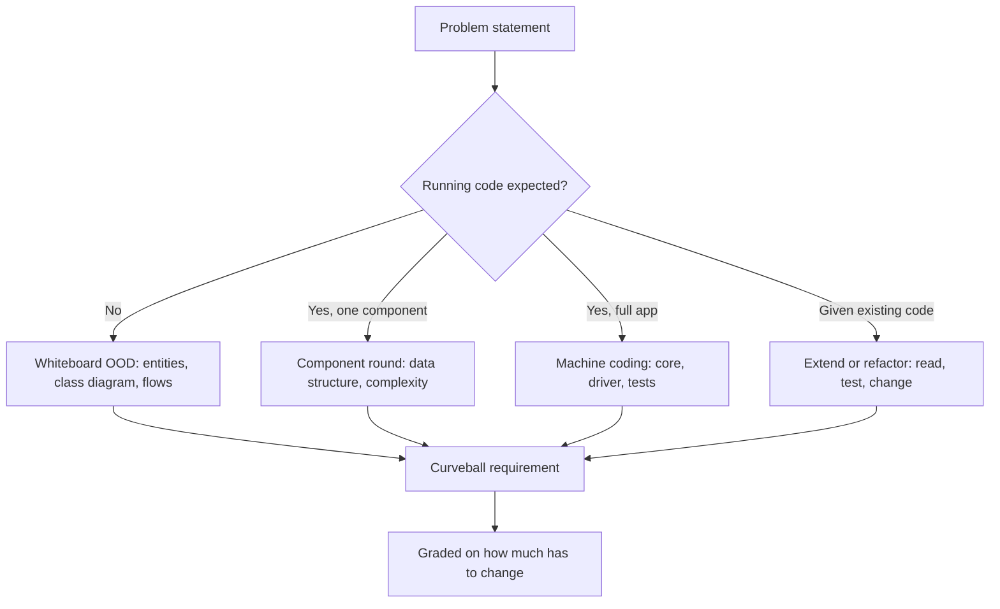

## In one minute
- "Low-level design interview" covers several formats that test different things: the whiteboard object-oriented design round, the machine coding round, the component or API design round, the extend-or-refactor round, and the concurrency round. Take-homes and AI-assisted rounds are variations on these.
- The formats differ in one dimension above all: how much running code is expected. A whiteboard round grades the model and the reasoning; a machine coding round grades working, readable, extensible code in 60 to 120 minutes.
- Every format hides a curveball: a second requirement arrives late ("now add nested transactions", "now support two elevators"). The interviewer is measuring how much of your design has to change.
- The winning habit is the same everywhere: pin the requirements, name the entities and invariants, build the smallest core that runs, then extend through the seams you planned.
- With AI assistants now allowed in some rounds (Meta told staff in July 2025 it would let some candidates use one, [404 Media](https://www.404media.co/meta-is-going-to-let-job-candidates-use-ai-during-coding-tests/)), the grade moves from typing speed to judgment: what you ask for, what you reject, and whether you can explain every line.

## How it works

### The whiteboard object-oriented design round
The classic prompt is "Design a parking lot" or "Design an elevator system", with 45 to 60 minutes, a whiteboard or a shared document, and little or no compiled code. You clarify requirements, identify entities, draw a class diagram, walk through one or two flows with a sequence diagram, and discuss which patterns fit and why. Interviewers grade the domain model (are the responsibilities in the right classes?), the handling of edge cases (a full lot, a vehicle that leaves without paying), and how the design absorbs a change. This course's design lessons follow this format: Design Parking Lot, Design Elevator System, Design Vending Machine, Design Movie Booking System. Class Diagram and Sequence Diagram cover the notation you will draw.

### The machine coding round
Here the deliverable is a program that runs. You get a written problem statement (a snake and ladder game, a Splitwise clone, an in-memory key-value store with transactions), 60 to 120 minutes, your own IDE, and usually no database or network: everything is in memory, driven by a `main` or by tests. Often a 30-minute review follows, in which the interviewer reads the code, asks for a new feature and watches how many files you touch.

Graders look at, in order: does it run; is it modular (no 400-line `main`); does the late requirement fit without a rewrite; is it readable; is it tested. Over-engineering costs as much as under-engineering: 40 minutes on an abstract factory and no working `get` is a fail. Design Snake and Ladder, Design Tic Tac Toe and Design Splitwise are good rehearsal problems.

### The component or API design round
A narrower prompt: "Design an LRU cache", "Design a rate limiter", "Design a logging framework", "Design a task scheduler". The scope is one library-sized component with a precise API and performance target ("`get` and `put` in O(1)"). Expect to write the core data structure, state its complexity, and discuss thread safety and configuration. Design LRU Cache, Design Rate Limiter, Design Logging Framework, Design Task Scheduler and Design Bloom Filter are this shape. The trap is spending the round on class hierarchy when the interviewer wanted the data structure.

### The extend-or-refactor round
You are handed existing code, often deliberately messy, and asked to add a feature or review it. This is the round closest to real work and the one most affected by coding agents, because reading and judging code is now a larger share of the job. Interviewers look for whether you read before typing, find the seam where the change belongs, add a test first, and avoid rewriting what works. The principles lessons are the toolkit here: Single Responsibility Principle, Open/Closed Principle, Coupling and Cohesion, DRY and KISS.

### The concurrency round
Some LLD rounds center on shared state: a thread-safe bounded queue, a seat-booking service where two users race for one seat, a rate limiter under concurrent requests. You are graded on identifying the critical section, choosing between a lock, an atomic, a channel or an optimistic version check, and explaining what happens under contention. The design lessons' "Concurrency and edge cases" sections prepare for this.

### Take-homes and AI-assisted rounds
A take-home is a machine coding round with a weekend instead of 90 minutes, so expect to add tests, a README and clean commits. In AI-assisted rounds generating code is cheap, so you are graded on the requirements you pin down, the design you steer toward, the bugs you catch in the assistant's output, and whether you can explain and modify every line when the curveball arrives.

### Reading the format before you start
Ask two questions in the first minute: "Do you want running code, or a design we discuss?" and "Should I optimise for extensibility or for finishing the core?". The answers tell you which format you are in. Then budget time. For a 90-minute machine coding round, a workable split is 10 minutes on requirements and entities, 50 on the core with a driver, 15 on the extension, 15 on tests and cleanup. How to Learn LLD? covers the long-term preparation; LLD vs HLD explains why talking about load balancers in any of these rounds is answering the wrong question.

### The same shape elsewhere
Every format eventually asks for *multi-step consistency*: an operation made of several steps must either complete or leave no trace. In the key-value store it is a transaction; in Splitwise it is an expense that updates several balances; in a booking system it is holding seats then charging a card. The same shape appears in databases (savepoints), editors (undo groups) and infrastructure (Terraform plans that apply or roll back). The Practice builds the smallest version: nested transactions with rollback over an in-memory map.

## Down the stack

### Layer 1: The contract
The interview itself has a contract, and it is worth stating as precisely as an API. Input: a problem statement, a time limit, and an interviewer who will answer clarifying questions. Output: a design or program that meets the stated requirements, plus evidence of how it handles a change. The rubric, whether written down or not, scores requirement gathering, modelling, code quality, correctness on edge cases, extensibility and communication. For the Practice problem the code contract is: `rollback` restores every key and every `count` to exactly what they were at the matching `begin`; a nested `commit` keeps changes only as long as its parent does; with no open transaction, `commit` and `rollback` fail without changing anything.

### Layer 2: The mechanism
Two mechanisms implement transactions in memory, and choosing between them is the core decision of the classic machine coding problem. A **snapshot** copies the whole map at `begin`; rollback swaps the copy back. It is simple and wrong for scale: each `begin` costs O(n). An **undo log** (SQLite's rollback journal is the disk version: it saves original pages before they are overwritten, and flushes that journal first, [SQLite docs](https://www.sqlite.org/atomiccommit.html)) records, for each write, the key and its previous value or "absent". Rollback replays the innermost log backwards; a nested commit appends its log to the parent's, so an outer rollback can still undo it; an outermost commit discards the log. SQLite documents exactly this behaviour for savepoints: an inner `RELEASE` can still be undone by a `ROLLBACK` of an outer one, and work is durable only when the outermost one commits ([SQLite docs](https://www.sqlite.org/lang_savepoint.html)). Secondary indexes such as a value-to-count map are maintained by the same `set` and `delete` primitives that rollback uses, so they cannot drift. The alternative, a stack of overlay maps with tombstones, makes `begin` and `commit` cheap but makes `get` walk the stack and makes `count` hard. Postgres takes a third route: it never overwrites rows in place (MVCC), and implements `SAVEPOINT` with subtransactions, each with its own transaction id, and a backend caches only 64 subtransaction ids per transaction. Past that the cache overflows and other backends must consult the subtransaction SLRU, a lookup that can queue. GitLab saw this at scale: its application used at most about 10 nested savepoints, yet a long-running transaction plus heavy writes caused database stalls, and it removed all `SAVEPOINT` use ([GitLab](https://about.gitlab.com/blog/2021/09/29/why-we-spent-the-last-month-eliminating-postgresql-subtransactions/)). Redis goes the other way: its transactions queue commands, run them without interleaving, and do not roll back when one fails, because rollback would cost simplicity and performance ([Redis docs](https://redis.io/docs/latest/develop/using-commands/transactions/)).

### Layer 3: The machine
The costs are concrete. A Python dict entry costs roughly 100 bytes including the key and value objects, so snapshotting a 1-million-key store at every `begin` copies around 100 MB and takes tens of milliseconds; a Go map of string to string is closer to 50 to 70 bytes per entry plus string data. An undo log entry is a key reference, a value reference and a flag: about 24 to 40 bytes, written only for keys that change. A transaction that touches 10 keys in a 1-million-key store costs 10 log entries with an undo log and a full copy with a snapshot, a ratio of 100,000 to 1. In a concurrent version a single mutex around the store serialises operations at roughly 20 to 50 ns per uncontended lock, which is fine for an interview and a reason Redis serves all requests from one thread, with only slow disk I/O in the background ([Redis docs](https://redis.io/docs/latest/operate/oss_and_stack/management/optimization/latency/)).

### Why it's built this way
1. Interviewers have one hour and want a signal close to real work, so they pick a small domain that fits in memory and needs no infrastructure.
2. Working code is harder to fake than a diagram, so machine coding rounds ask for it; a diagram is quicker to discuss, so whiteboard rounds keep it for senior-level trade-off talk.
3. Real requirements change, so the round adds a requirement late and measures how much code moves.
4. Copying state is the obvious way to undo and scales with the store, so good answers record changes instead, and the same reasoning gives databases their undo logs and journals.
5. Generated code is now cheap, so rounds are shifting to grade the judgment that code generation cannot supply.

## Diagram


## Worked example
A machine coding prompt: "Build an in-memory key-value store with `set`, `get`, `delete`, `count(value)`, and transactions with `begin`, `commit` and `rollback`. Transactions can nest. 90 minutes."

Minutes 0 to 8: clarify. Does `commit` close only the innermost transaction? (Yes; changes become permanent at the outermost.) `rollback` with nothing open? (Error, no change.) Must `count` be O(1)? (Yes.) Writing the answers at the top of the file prevents the most common failure: building the wrong semantics.

Minutes 8 to 15: model. One `TxStore` class with a `data` map, a `counts` map, and a stack of undo logs. Two private primitives, `_put` and `_remove`, are the only code that touches `data` and `counts`, so the count index cannot drift. State the complexity: every operation O(1) except `rollback`, which is O(writes in that transaction).

Minutes 15 to 55: implement, driven by tests that mirror the clarified rules. Minutes 55 to 75: the curveball, "readers outside the transaction must not see uncommitted writes", is a real redesign (per-session overlays); the strong answer says so and sketches what it costs `get`. Minutes 75 to 90: clean up and walk through one rollback trace. That is about 60 lines of core logic and 50 of tests; the candidate who snapshotted the map at every `begin` finished faster and was asked "what about a million keys?".

## In the wild
- **GitLab, 2021: savepoints stall the database.** Starting 24 June, GitLab.com's PostgreSQL database stalled intermittently for minutes, causing HTTP 500s and a growing CI backlog. Queries waited on the subtransaction SLRU lock. A long-running transaction on the primary, plus a single `SAVEPOINT` on replicas under heavy writes, was enough to trigger it. GitLab removed every `SAVEPOINT`, rewrote affected code to use `INSERT ... ON CONFLICT`, and added an alert on any savepoint ([GitLab](https://about.gitlab.com/blog/2021/09/29/why-we-spent-the-last-month-eliminating-postgresql-subtransactions/)). The interview's tidy nested transaction has a production cost.
- **Meta, 2025: AI-enabled coding interviews.** Internal messages reported in July 2025 said Meta would let some coding candidates use an AI assistant, and asked employees to volunteer for a mock "AI-enabled" interview ([404 Media](https://www.404media.co/meta-is-going-to-let-job-candidates-use-ai-during-coding-tests/)). The article is partly paywalled and the scale of the rollout is not public, so treat it as evidence that the format is being tried, not that it is standard.
- **Redis, documented design: transactions without rollback.** Redis queues commands between `MULTI` and `EXEC`, refuses to run a transaction with a queuing error, and still runs the remaining commands if one fails at execution time. Its docs say rollback is not supported because it would hurt simplicity and performance ([Redis docs](https://redis.io/docs/latest/develop/using-commands/transactions/)). It is a useful contrast to the undo-log design in the Practice.

## Trade-offs
| Format | What it measures | Typical length | Main risk for the candidate | Prepare with |
| --- | --- | --- | --- | --- |
| Whiteboard OOD | Modelling, responsibilities, patterns, communication | 45 to 60 min | Drawing classes without behaviour or edge cases | Design Parking Lot, Class Diagram |
| Machine coding | Working, modular, extensible code under time pressure | 60 to 120 min | Over-engineering and not finishing the core | Design Snake and Ladder, Design Splitwise |
| Component / API | Data structures, complexity, API contract | 45 to 60 min | Building a class hierarchy instead of the data structure | Design LRU Cache, Design Rate Limiter |
| Extend or refactor | Reading code, finding seams, testing first | 45 to 60 min | Rewriting what works | SRP, OCP, Coupling and Cohesion |
| Concurrency | Critical sections, races, contention | 45 to 60 min | Locking everything or nothing | Design Movie Booking System |
| Take-home | Completeness, tests, documentation | Hours to days | Gold-plating; mismatched effort | Any design problem, fully tested |

## Pitfalls in production
- Starting to code before pinning semantics, then rebuilding at minute 60 when "commit" turns out to mean something else. Fix: write the clarified rules at the top of the file and turn each into a test.
- A 400-line `main` that mixes parsing, state and printing. Fix: separate the model from the driver from the start; the driver should be the thinnest file.
- Patterns used as decoration: a factory for one class, a strategy with one implementation. Fix: introduce an interface only where the prompt or the likely curveball names a variation.
- Ignoring failure paths: `rollback` with nothing open crashes or silently succeeds. Fix: treat errors as part of the API and test them.
- In AI-assisted rounds, accepting generated code you cannot explain. Fix: ask for small pieces, read every line, and run tests after each addition.

## Leadership lens
- Choose the format by the job. A team that mostly extends a large codebase learns more from an extend-or-refactor round than from "design a parking lot".
- Write the rubric down, including what "extensible" means for each problem, and calibrate with mock interviews before using a new problem.
- Rotate problems and keep each one's curveball private; once a problem's semantics circulate online, the round measures memory.
- Decide your policy on AI assistants explicitly and tell candidates. Then grade what the policy makes scarce: requirements, design judgment and verification.

## Check yourself
1. In a machine coding round you have 20 minutes left and two features unbuilt. What do you do?
   **Answer:** Make what exists run and pass its tests, then sketch where each missing feature would plug in. A running, extensible core scores better than two half-built features.
2. Why does an undo log scale better than a snapshot for nested transactions?
   **Answer:** A snapshot copies the whole store at every `begin`, so its cost grows with the store; an undo log records only the keys a transaction writes, so its cost grows with the transaction.
3. How should an inner `commit` interact with an outer `rollback`, and how does the undo log achieve it?
   **Answer:** The outer rollback must undo the inner transaction's changes too. The inner commit appends its log entries to the parent's log instead of discarding them, so the parent replays them on rollback.
4. You are told "design a rate limiter" in an LLD round. What is the likely format, and what should you spend most time on?
   **Answer:** A component round: spend the time on the algorithm and its data structure (token bucket or sliding window), the API, complexity and thread safety, not on a class hierarchy or on distributed infrastructure.

## Practice
**Task:** Build the classic machine coding problem: an in-memory key-value store with nested transactions. `TxStore()` supports `set(key, value)`, `get(key)` (the value, or `None` / `undefined` / Go `("", false)` if missing), `delete(key)` (no-op if missing), and `count(value)`, the number of keys whose current value equals `value`, in O(1). `begin()` opens a transaction, possibly inside another. `rollback()` undoes every change since the matching `begin` and closes it. `commit()` closes the innermost transaction keeping its changes, but they stay undoable by an enclosing `rollback`; once no transaction is open they are permanent. `depth()` returns the number of open transactions. `commit` and `rollback` with no open transaction fail with `no transaction` and change nothing. Python raises `ValueError`, TypeScript throws `Error`, Go returns an error.

```python starter
class TxStore:
    def set(self, key, value):
        # TODO
        raise NotImplementedError

    def get(self, key):
        # TODO
        raise NotImplementedError

    def delete(self, key):
        # TODO
        raise NotImplementedError

    def count(self, value):
        # TODO
        raise NotImplementedError

    def begin(self):
        # TODO
        raise NotImplementedError

    def commit(self):
        # TODO
        raise NotImplementedError

    def rollback(self):
        # TODO
        raise NotImplementedError

    def depth(self):
        # TODO
        raise NotImplementedError
```

```python tests
def error_of(fn):
    try:
        fn()
    except ValueError as e:
        return str(e)
    return None

def test_basic_operations():
    s = TxStore()
    s.set("a", "x")
    s.set("b", "x")
    s.set("a", "x")
    assert s.get("a") == "x" and s.count("x") == 2
    s.delete("a")
    s.delete("missing")
    assert s.get("a") is None and s.count("x") == 1 and s.count("y") == 0

def test_rollback_restores_values_and_counts():
    s = TxStore()
    s.set("a", "1")
    s.set("b", "2")
    s.begin()
    s.set("a", "2")
    s.delete("b")
    s.set("c", "2")
    assert s.count("2") == 2 and s.count("1") == 0
    s.rollback()
    assert (s.get("a"), s.get("b"), s.get("c")) == ("1", "2", None)
    assert s.count("1") == 1 and s.count("2") == 1 and s.depth() == 0

def test_nested_rollbacks():
    s = TxStore()
    s.begin()
    s.set("a", "1")
    s.begin()
    s.set("a", "2")
    assert s.depth() == 2
    s.rollback()
    assert s.get("a") == "1"
    s.rollback()
    assert s.get("a") is None and s.count("1") == 0

def test_outer_rollback_undoes_inner_commit():
    s = TxStore()
    s.set("a", "0")
    s.begin()
    s.set("a", "1")
    s.begin()
    s.set("a", "2")
    s.set("b", "2")
    s.commit()
    assert s.get("a") == "2" and s.depth() == 1
    s.rollback()
    assert s.get("a") == "0" and s.get("b") is None and s.count("2") == 0

def test_outermost_commit_is_permanent():
    s = TxStore()
    s.begin()
    s.set("a", "1")
    s.begin()
    s.delete("a")
    s.commit()
    s.commit()
    assert s.depth() == 0 and s.get("a") is None
    assert error_of(s.rollback) == "no transaction"
    assert s.get("a") is None

def test_errors_without_transaction_change_nothing():
    s = TxStore()
    s.set("k", "v")
    assert error_of(s.commit) == "no transaction"
    assert error_of(s.rollback) == "no transaction"
    assert s.get("k") == "v" and s.count("v") == 1

def test_many_writes_to_one_key_roll_back_to_original():
    s = TxStore()
    s.set("k", "start")
    s.begin()
    for i in range(50):
        s.set("k", str(i))
        if i % 7 == 0:
            s.delete("k")
    s.rollback()
    assert s.get("k") == "start" and s.count("start") == 1 and s.count("49") == 0
```

```python solution
class TxStore:
    def __init__(self):
        self.data = {}
        self.counts = {}
        self.logs = []  # one undo log per open transaction

    def _put(self, key, value):
        old = self.data.get(key)
        if old is not None:
            self.counts[old] -= 1
        self.data[key] = value
        self.counts[value] = self.counts.get(value, 0) + 1

    def _remove(self, key):
        old = self.data.pop(key)
        self.counts[old] -= 1

    def _record(self, key):
        if self.logs:
            self.logs[-1].append((key, self.data.get(key)))

    def set(self, key, value):
        self._record(key)
        self._put(key, value)

    def get(self, key):
        return self.data.get(key)

    def delete(self, key):
        if key in self.data:
            self._record(key)
            self._remove(key)

    def count(self, value):
        return self.counts.get(value, 0)

    def begin(self):
        self.logs.append([])

    def commit(self):
        if not self.logs:
            raise ValueError("no transaction")
        log = self.logs.pop()
        if self.logs:
            self.logs[-1].extend(log)

    def rollback(self):
        if not self.logs:
            raise ValueError("no transaction")
        for key, old in reversed(self.logs.pop()):
            if old is None:
                if key in self.data:
                    self._remove(key)
            else:
                self._put(key, old)

    def depth(self):
        return len(self.logs)
```

```typescript starter
export class TxStore {
  set(key: string, value: string): void { throw new Error("TODO"); }
  get(key: string): string | undefined { throw new Error("TODO"); }
  delete(key: string): void { throw new Error("TODO"); }
  count(value: string): number { throw new Error("TODO"); }
  begin(): void { throw new Error("TODO"); }
  commit(): void { throw new Error("TODO"); }
  rollback(): void { throw new Error("TODO"); }
  depth(): number { throw new Error("TODO"); }
}
```

```typescript tests
function errorOf(fn: () => unknown): string | undefined {
  try { fn(); } catch (e) { return (e as Error).message; }
  return undefined;
}

test("basic operations", () => {
  const s = new TxStore();
  s.set("a", "x");
  s.set("b", "x");
  s.set("a", "x");
  assertEqual([s.get("a"), s.count("x")], ["x", 2]);
  s.delete("a");
  s.delete("missing");
  assert(s.get("a") === undefined, "a deleted");
  assertEqual([s.count("x"), s.count("y")], [1, 0]);
});

test("rollback restores values and counts", () => {
  const s = new TxStore();
  s.set("a", "1");
  s.set("b", "2");
  s.begin();
  s.set("a", "2");
  s.delete("b");
  s.set("c", "2");
  assertEqual([s.count("2"), s.count("1")], [2, 0]);
  s.rollback();
  assertEqual([s.get("a"), s.get("b")], ["1", "2"]);
  assert(s.get("c") === undefined, "c gone");
  assertEqual([s.count("1"), s.count("2"), s.depth()], [1, 1, 0]);
});

test("nested rollbacks", () => {
  const s = new TxStore();
  s.begin();
  s.set("a", "1");
  s.begin();
  s.set("a", "2");
  assertEqual(s.depth(), 2);
  s.rollback();
  assertEqual(s.get("a"), "1");
  s.rollback();
  assert(s.get("a") === undefined, "a gone");
  assertEqual(s.count("1"), 0);
});

test("outer rollback undoes inner commit", () => {
  const s = new TxStore();
  s.set("a", "0");
  s.begin();
  s.set("a", "1");
  s.begin();
  s.set("a", "2");
  s.set("b", "2");
  s.commit();
  assertEqual([s.get("a"), s.depth()], ["2", 1]);
  s.rollback();
  assertEqual(s.get("a"), "0");
  assert(s.get("b") === undefined, "b gone");
  assertEqual(s.count("2"), 0);
});

test("outermost commit is permanent", () => {
  const s = new TxStore();
  s.begin();
  s.set("a", "1");
  s.begin();
  s.delete("a");
  s.commit();
  s.commit();
  assertEqual(s.depth(), 0);
  assertEqual(errorOf(() => s.rollback()), "no transaction");
  assert(s.get("a") === undefined, "a stays deleted");
});

test("errors without transaction change nothing", () => {
  const s = new TxStore();
  s.set("k", "v");
  assertEqual(errorOf(() => s.commit()), "no transaction");
  assertEqual(errorOf(() => s.rollback()), "no transaction");
  assertEqual([s.get("k"), s.count("v")], ["v", 1]);
});

test("many writes to one key roll back to original", () => {
  const s = new TxStore();
  s.set("k", "start");
  s.begin();
  for (let i = 0; i < 50; i++) {
    s.set("k", String(i));
    if (i % 7 === 0) s.delete("k");
  }
  s.rollback();
  assertEqual([s.get("k"), s.count("start"), s.count("49")], ["start", 1, 0]);
});
```

```typescript solution
type Undo = [string, string | undefined];

export class TxStore {
  private data = new Map<string, string>();
  private counts = new Map<string, number>();
  private logs: Undo[][] = [];

  private put(key: string, value: string): void {
    const old = this.data.get(key);
    if (old !== undefined) this.counts.set(old, (this.counts.get(old) ?? 0) - 1);
    this.data.set(key, value);
    this.counts.set(value, (this.counts.get(value) ?? 0) + 1);
  }

  private remove(key: string): void {
    const old = this.data.get(key);
    if (old === undefined) return;
    this.data.delete(key);
    this.counts.set(old, (this.counts.get(old) ?? 0) - 1);
  }

  private record(key: string): void {
    if (this.logs.length > 0) this.logs[this.logs.length - 1].push([key, this.data.get(key)]);
  }

  set(key: string, value: string): void {
    this.record(key);
    this.put(key, value);
  }

  get(key: string): string | undefined { return this.data.get(key); }

  delete(key: string): void {
    if (!this.data.has(key)) return;
    this.record(key);
    this.remove(key);
  }

  count(value: string): number { return this.counts.get(value) ?? 0; }

  begin(): void { this.logs.push([]); }

  commit(): void {
    const log = this.logs.pop();
    if (log === undefined) throw new Error("no transaction");
    if (this.logs.length > 0) this.logs[this.logs.length - 1].push(...log);
  }

  rollback(): void {
    const log = this.logs.pop();
    if (log === undefined) throw new Error("no transaction");
    for (let i = log.length - 1; i >= 0; i--) {
      const [key, old] = log[i];
      if (old === undefined) this.remove(key); else this.put(key, old);
    }
  }

  depth(): number { return this.logs.length; }
}
```

```go starter
package practice

type TxStore struct{}

func NewTxStore() *TxStore { return &TxStore{} }

func (s *TxStore) Set(key, value string)          { panic("TODO") }
func (s *TxStore) Get(key string) (string, bool) { panic("TODO") }
func (s *TxStore) Delete(key string)             { panic("TODO") }
func (s *TxStore) Count(value string) int        { panic("TODO") }
func (s *TxStore) Begin()                        { panic("TODO") }
func (s *TxStore) Commit() error                 { panic("TODO") }
func (s *TxStore) Rollback() error               { panic("TODO") }
func (s *TxStore) Depth() int                    { panic("TODO") }
```

```go tests
package practice

import (
	"strconv"
	"testing"
)

func want(t *testing.T, s *TxStore, key, value string, present bool) {
	t.Helper()
	v, ok := s.Get(key)
	if ok != present || v != value {
		t.Fatalf("get %q = %q %v, want %q %v", key, v, ok, value, present)
	}
}

func wantCount(t *testing.T, s *TxStore, value string, n int) {
	t.Helper()
	if got := s.Count(value); got != n {
		t.Fatalf("count %q = %d, want %d", value, got, n)
	}
}

func wantErr(t *testing.T, err error) {
	t.Helper()
	if err == nil || err.Error() != "no transaction" {
		t.Fatalf("want no transaction, got %v", err)
	}
}

func TestBasicOperations(t *testing.T) {
	s := NewTxStore()
	s.Set("a", "x")
	s.Set("b", "x")
	s.Set("a", "x")
	want(t, s, "a", "x", true)
	wantCount(t, s, "x", 2)
	s.Delete("a")
	s.Delete("missing")
	want(t, s, "a", "", false)
	wantCount(t, s, "x", 1)
	wantCount(t, s, "y", 0)
}

func TestRollbackRestoresValuesAndCounts(t *testing.T) {
	s := NewTxStore()
	s.Set("a", "1")
	s.Set("b", "2")
	s.Begin()
	s.Set("a", "2")
	s.Delete("b")
	s.Set("c", "2")
	wantCount(t, s, "2", 2)
	wantCount(t, s, "1", 0)
	if err := s.Rollback(); err != nil {
		t.Fatal(err)
	}
	want(t, s, "a", "1", true)
	want(t, s, "b", "2", true)
	want(t, s, "c", "", false)
	wantCount(t, s, "1", 1)
	wantCount(t, s, "2", 1)
	if s.Depth() != 0 {
		t.Fatal("depth should be 0")
	}
}

func TestNestedRollbacks(t *testing.T) {
	s := NewTxStore()
	s.Begin()
	s.Set("a", "1")
	s.Begin()
	s.Set("a", "2")
	if s.Depth() != 2 {
		t.Fatal("depth should be 2")
	}
	s.Rollback()
	want(t, s, "a", "1", true)
	s.Rollback()
	want(t, s, "a", "", false)
	wantCount(t, s, "1", 0)
}

func TestOuterRollbackUndoesInnerCommit(t *testing.T) {
	s := NewTxStore()
	s.Set("a", "0")
	s.Begin()
	s.Set("a", "1")
	s.Begin()
	s.Set("a", "2")
	s.Set("b", "2")
	if err := s.Commit(); err != nil {
		t.Fatal(err)
	}
	want(t, s, "a", "2", true)
	if s.Depth() != 1 {
		t.Fatal("depth should be 1")
	}
	s.Rollback()
	want(t, s, "a", "0", true)
	want(t, s, "b", "", false)
	wantCount(t, s, "2", 0)
}

func TestOutermostCommitIsPermanent(t *testing.T) {
	s := NewTxStore()
	s.Begin()
	s.Set("a", "1")
	s.Begin()
	s.Delete("a")
	s.Commit()
	s.Commit()
	if s.Depth() != 0 {
		t.Fatal("depth should be 0")
	}
	wantErr(t, s.Rollback())
	want(t, s, "a", "", false)
}

func TestErrorsWithoutTransactionChangeNothing(t *testing.T) {
	s := NewTxStore()
	s.Set("k", "v")
	wantErr(t, s.Commit())
	wantErr(t, s.Rollback())
	want(t, s, "k", "v", true)
	wantCount(t, s, "v", 1)
}

func TestManyWritesToOneKeyRollBackToOriginal(t *testing.T) {
	s := NewTxStore()
	s.Set("k", "start")
	s.Begin()
	for i := 0; i < 50; i++ {
		s.Set("k", strconv.Itoa(i))
		if i%7 == 0 {
			s.Delete("k")
		}
	}
	s.Rollback()
	want(t, s, "k", "start", true)
	wantCount(t, s, "start", 1)
	wantCount(t, s, "49", 0)
}
```

```go solution
package practice

import (
	"errors"
	"sync"
)

var errNoTx = errors.New("no transaction")

type undo struct {
	key     string
	old     string
	present bool
}

type TxStore struct {
	mu     sync.Mutex
	data   map[string]string
	counts map[string]int
	logs   [][]undo
}

func NewTxStore() *TxStore {
	return &TxStore{data: map[string]string{}, counts: map[string]int{}}
}

func (s *TxStore) put(key, value string) {
	if old, ok := s.data[key]; ok {
		s.counts[old]--
	}
	s.data[key] = value
	s.counts[value]++
}

func (s *TxStore) remove(key string) {
	if old, ok := s.data[key]; ok {
		delete(s.data, key)
		s.counts[old]--
	}
}

func (s *TxStore) record(key string) {
	if n := len(s.logs); n > 0 {
		old, ok := s.data[key]
		s.logs[n-1] = append(s.logs[n-1], undo{key, old, ok})
	}
}

func (s *TxStore) Set(key, value string) {
	s.mu.Lock()
	defer s.mu.Unlock()
	s.record(key)
	s.put(key, value)
}

func (s *TxStore) Get(key string) (string, bool) {
	s.mu.Lock()
	defer s.mu.Unlock()
	v, ok := s.data[key]
	return v, ok
}

func (s *TxStore) Delete(key string) {
	s.mu.Lock()
	defer s.mu.Unlock()
	if _, ok := s.data[key]; ok {
		s.record(key)
		s.remove(key)
	}
}

func (s *TxStore) Count(value string) int {
	s.mu.Lock()
	defer s.mu.Unlock()
	return s.counts[value]
}

func (s *TxStore) Begin() {
	s.mu.Lock()
	defer s.mu.Unlock()
	s.logs = append(s.logs, nil)
}

func (s *TxStore) Commit() error {
	s.mu.Lock()
	defer s.mu.Unlock()
	n := len(s.logs)
	if n == 0 {
		return errNoTx
	}
	log := s.logs[n-1]
	s.logs = s.logs[:n-1]
	if n > 1 {
		s.logs[n-2] = append(s.logs[n-2], log...)
	}
	return nil
}

func (s *TxStore) Rollback() error {
	s.mu.Lock()
	defer s.mu.Unlock()
	n := len(s.logs)
	if n == 0 {
		return errNoTx
	}
	log := s.logs[n-1]
	s.logs = s.logs[:n-1]
	for i := len(log) - 1; i >= 0; i-- {
		u := log[i]
		if u.present {
			s.put(u.key, u.old)
		} else {
			s.remove(u.key)
		}
	}
	return nil
}

func (s *TxStore) Depth() int {
	s.mu.Lock()
	defer s.mu.Unlock()
	return len(s.logs)
}
```

## Mock interview
**Prompt:** You have 90 minutes to build an in-memory key-value store with `set`, `get`, `delete`, `count(value)` and nested transactions, in the language of your choice, runnable from tests. Start by telling me what you need to clarify, then build it.

- Follow-up: The store holds 5 million keys and a batch job opens a transaction, writes 20 keys and rolls back. What does that cost in your design?
- Follow-up: Two threads use the store at once, one inside a transaction. What do they see, and what would you change to give each session its own isolation?
- Follow-up: Why an undo log rather than a stack of overlay maps? When would you choose the overlays?

**A strong answer covers:**
- Clarified semantics written down first: what inner `commit` means, errors with no transaction, and the complexity required of `count`.
- An undo log per open transaction, with nested commit appending to the parent's log and rollback replaying backwards.
- A single pair of write primitives that maintain both the data map and the count index, so rollback cannot desynchronise them.
- Cost analysis: O(1) per operation, rollback O(writes), memory proportional to changes, against the snapshot alternative.
- Honest scoping of the curveball: per-session isolation needs overlays or MVCC versions and is a redesign, with what it costs `get`.

## Sources and further study
**Primary**
- [SQLite: atomic commit](https://www.sqlite.org/atomiccommit.html): the rollback journal, the disk-level undo log, and why it is flushed first.
- [SQLite: SAVEPOINT](https://www.sqlite.org/lang_savepoint.html): precise nested-transaction semantics, including an outer rollback undoing a released inner savepoint.

**Systems docs**
- [PostgreSQL: SAVEPOINT](https://www.postgresql.org/docs/current/sql-savepoint.html): savepoint behaviour in a database where each one is a subtransaction.
- [GitLab: eliminating PostgreSQL subtransactions](https://about.gitlab.com/blog/2021/09/29/why-we-spent-the-last-month-eliminating-postgresql-subtransactions/): the 64-entry cache limit and the production stalls it contributed to.
- [Redis: transactions](https://redis.io/docs/latest/develop/using-commands/transactions/): queued commands, `WATCH` for optimistic locking, and no rollback.
- [Redis: diagnosing latency](https://redis.io/docs/latest/operate/oss_and_stack/management/optimization/latency/): the mostly single-threaded model and why slow commands hurt everyone.

**Books**
- *Cracking the Coding Interview*, Gayle Laakmann McDowell: chapter 7, Object-Oriented Design, the whiteboard format in its classic form.
- *Refactoring*, Martin Fowler (2nd ed.): chapter 4, Building Tests, the habit the extend-or-refactor round rewards.
- *Designing Data-Intensive Applications* (1st ed.), Martin Kleppmann: chapter 7, Transactions, on atomicity and rollback in real databases.

**Other curricula**
- [donnemartin/system-design-primer](https://github.com/donnemartin/system-design-primer): includes object-oriented design exercises, but treats them as a side topic to system design and has no round formats.
- [roadmap.sh: software design and architecture](https://roadmap.sh/software-design-architecture): a topic checklist; unlike this lesson it does not say how interview formats differ.

## Watch
- [Flipkart Machine Coding Round Interview For SDE 2 & 3: Logging Library (Shubham Haritash)](https://www.youtube.com/watch?v=zuJsBoGPhJ4): a full machine coding round on a logging library, showing the pace and what gets built first.
- [How to prepare Low level design for Interviews? Machine Coding rounds (Ayushi Sharma)](https://www.youtube.com/watch?v=r3ivxbiiy4M): an overview of the LLD round formats and a preparation plan.

## Free resources
- [SAVEPOINT (PostgreSQL documentation)](https://www.postgresql.org/docs/current/sql-savepoint.html): nested rollback points in a real database, the production version of the Practice problem.
- [SAVEPOINT, RELEASE and ROLLBACK TO (SQLite documentation)](https://www.sqlite.org/lang_savepoint.html): precise semantics for nested transactions, including what an inner release means.
- [Atomic Commit In SQLite](https://www.sqlite.org/atomiccommit.html): how a rollback journal records old pages so a transaction can be undone, the undo log at the disk level.
- [Transactions (Redis documentation)](https://redis.io/docs/latest/develop/interact/transactions/): a contrasting design with queued commands and no rollback, worth comparing in the follow-up discussion.
- [How we hire (Google Careers)](https://www.google.com/about/careers/applications/how-we-hire/): how one large employer describes its interview process and what it assesses.
