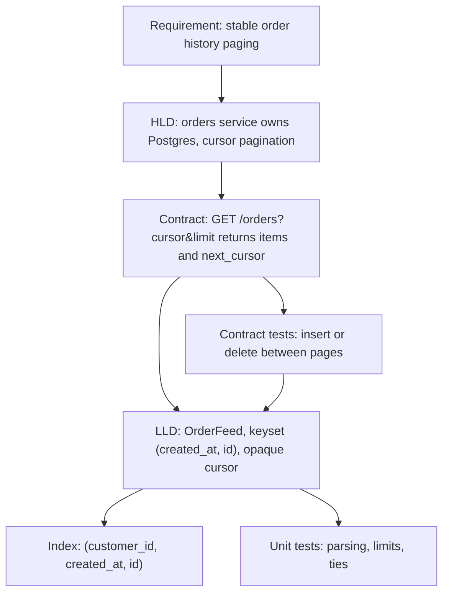

## In one minute
- High-level design (HLD) decides which components exist (services, datastores, queues, caches), what each owns, and the contracts between them. Low-level design (LLD) decides how one component is built inside: classes, interfaces, state, invariants and errors.
- The split shows in cost and failure: a call inside an LLD costs nanoseconds and returns or throws; a call across an HLD boundary costs about a millisecond, can time out, run twice or see stale data.
- They meet at the interface. HLD fixes the shape of an API (`GET /orders?cursor=&limit=` returns items and a `next_cursor`) and the promises around it; LLD chooses the data structure, the cursor encoding and the error messages that keep those promises.
- Most bad designs are a level mismatch: an HLD that names classes but no failure modes, or an LLD that quietly changes a contract the HLD fixed.
- In review and with coding agents, give each level its own document and its own tests: contract tests at the boundary, unit tests inside.

## How it works

### Two questions at two zoom levels
Take an online shop's order history page. The HLD asks: does the orders service own its Postgres database? Are reads served from a replica, behind a cache? Is the public API paginated by page number or by cursor? What does the page show when the database is down?

The LLD of the orders service asks: is there an `OrderFeed` class, or does the handler build SQL? What is inside a cursor? Which object rejects a `limit` of 0, and with what message? What does "newest first" mean when two orders share a timestamp?

Both are design. They differ in the unit they reason about (a service versus a class), the failures they plan for (a region outage versus an invalid argument), and the people who read them (several teams versus the team that owns the code).

### What each level produces
An HLD contains a component diagram, read and write data flows, a data ownership table, capacity estimates, the external API, consistency and availability targets, and a failure analysis. The System Design Interviews course (What are System Design Interviews?, Answering Framework) works at this level.

An LLD contains entities and relationships, the public methods of each class with their preconditions and errors, invariants, lifecycle state machines and the call sequence of the main flows. What is LLD? walks through one end to end; Class Diagram, Sequence Diagram and State Machine Diagram are its notations.

### The interface is where they meet
The two levels are joined by contracts. The HLD says "the orders API uses cursor pagination; a client that pages through the full history while new orders arrive sees every order that existed when it started exactly once." That sentence is an HLD decision because it affects clients, caches and the database's index design. It is also a requirement on the LLD, which now has to pick a cursor that survives inserts and deletes.

If the LLD implements the cursor as an offset (`page=3` means skip 40 rows), it breaks the promise: a new order at the top shifts every row down by one and the client sees one order twice. Nothing in the class diagram looks wrong. The bug is a level mismatch, and the fix is a keyset cursor that encodes the last seen sort key, which the Practice section builds.

### Which decisions belong where
A useful test: a decision is high level if changing it later requires coordination between teams or a data migration, and low level if one team can change it in one deploy without anyone outside noticing. Kafka versus a database outbox is high level; a `dict` versus a sorted list inside a service is low level. Some decisions start low and become high: an error message is low level until clients parse it, and then it is part of the contract. That is why HLD documents should list the observable behaviour (status codes, error codes, ordering, idempotency) and LLD documents should mark which of their choices are visible outside.

### In interviews
System design interviews ask for HLD: scale, components, trade-offs. LLD interviews ask for classes and working code for one component, as in Design Parking Lot, Design LRU Cache and Design Rate Limiter; Types of LLD interviews describes the formats. The common mistake is the wrong zoom level: classes in an HLD round, load balancers in an LLD round. State the level out loud ("storage is a repository interface; I'll focus on booking logic") and move between levels deliberately.

### Reviewing agent-written code
Coding agents work at LLD scale: they read a few files and change classes. Asked to "add pagination to the orders endpoint", an agent will usually add `offset` and `limit`, the most common pattern, and its unit tests will pass. The HLD promise about stable paging lives in a document it never opened. Put the contract where the agent will see it: the interface's doc comment and a contract test that inserts a row between two page fetches.

### The same shape elsewhere
Two levels that must agree is a *multi-step consistency* problem. In networking, TCP's RFC 9293 is the high-level contract and the Linux stack's `struct sock` and timers are one low-level design that satisfies it. In building, the architect places load-bearing walls and the structural engineer sizes the beams. The expensive mistakes come from the lower level breaking a promise the upper level made.

## Down the stack

### Layer 1: The contract
The HLD-to-LLD contract for the orders feed can be written so that it is testable. Ordering is total: newest `created_at` first, ties broken by higher `id`. A page returns at most `min(limit, max_limit)` items and a `next_cursor`, which is empty exactly when no later item exists. Paging from an empty cursor to the end returns every order that existed for the whole walk exactly once, in order; orders inserted during the walk may or may not appear but never cause a duplicate or a skip; a deleted order disappears without shifting others. A malformed cursor or a `limit` below 1 is a client error (HTTP 400 with a stable error code), not a 500. Each of these sentences is one test.

### Layer 2: The mechanism
The LLD keeps the contract with a keyset. The sort key `(created_at, id)` is unique because `id` is. The cursor encodes the last key returned, for example `c1:1718000000:4821`, with a version prefix. The next page is the first `limit` keys strictly less than the cursor key. In Postgres this is a row-value comparison, `WHERE (created_at, id) < ($1, $2) ORDER BY created_at DESC, id DESC LIMIT $3`, served by a composite B-tree index on `(created_at, id)` (scoped by customer, in practice `(customer_id, created_at, id)`). Fetching `limit + 1` rows tells you whether a next page exists without a second query. In memory, a sorted array with `bisect` or `sort.Search` finds the cursor's position in O(log n).

The cursor is opaque by contract: clients must not build or parse it. That gives the LLD freedom to change the encoding (adding a shard id, or signing it with an HMAC so clients cannot forge positions) without an HLD change.

### Layer 3: The machine
A method call inside a service costs 1 to 5 ns (a few more through a Go itab or C++ vtable), a cache miss about 100 ns. A round trip to another service in the same data centre is 0.2 to 1 ms, and across regions 30 to 150 ms. That gap is why HLD worries about chattiness, batching and timeouts while LLD worries about allocation and readability.

The pagination choice shows up on disk. `OFFSET 100000 LIMIT 20` makes Postgres walk the index and fetch and discard 100,000 rows before returning 20; with 8 KB heap pages and rows of about 200 bytes, that can be 2,500 page reads for one request, and deep pages get linearly slower. The keyset query descends the B-tree in 3 or 4 page reads (a tree of fanout around 300 holds tens of millions of keys in 3 levels) and reads 21 rows. Invisible at page 1, decisive at page 5,000, where export jobs live.

### Why it's built this way
1. Teams, networks and datastores fail and change independently, so the system needs a map of components and contracts that outlives any one implementation; that map is the HLD.
2. Inside a component, change is cheap and failures are local, so the useful questions are about state, invariants and extensibility; that is the LLD.
3. The two must agree, but the people and the time scales differ, so they agree through explicit interfaces rather than shared knowledge.
4. Interfaces are only as good as their tests, so contract tests sit at the boundary and run against every implementation.
5. Network calls cost a million times more than method calls, so where to draw a boundary is itself an economic decision, made at the HLD level and paid for in every LLD below it.

## Diagram


## Worked example
A marketplace exposes order history to 40,000 merchants with `page` and `page_size`. Two problems surfaced in one quarter. Merchants syncing into accounting tools saw duplicates: a sync of 600 orders at 50 per page takes 12 requests over about 8 seconds, and a busy merchant's 3 new orders a minute push rows down so a page repeats the previous page's last row. That cost about 70 support tickets a month. And exports were slow: for a merchant with 2.4 million orders, page 40,000 took 1.9 s and a full export over 11 hours of database time.

The HLD change needed sign-off from the API, mobile and partner teams: replace `page` with an opaque `cursor`, document ordering and stability, keep `page` for six months with a deprecation header. The LLD change was one team's work: an `OrderFeed` with keyset logic, a versioned cursor codec, a composite index built concurrently, and a contract suite that inserts and deletes between fetches. Deep pages dropped from 1.9 s to 4 ms, the export took 9 minutes, and duplicate tickets stopped once partners migrated. The HLD meeting never discussed bisect; the LLD review never discussed the deprecation window.

## Trade-offs
| Concern | HLD | LLD | Who should own it |
| --- | --- | --- | --- |
| Unit of design | Services, datastores, queues | Classes, interfaces, functions | HLD: architects and tech leads; LLD: the owning team |
| Failure model | Timeouts, partial failure, retries, outages | Invalid input, broken invariants, races | Both, at their own level |
| Change cost | Cross-team, migrations, deprecation windows | One team, one deploy | Whoever pays for the change |
| Main artefacts | Component and data flow diagrams, capacity math, API specs | Class, sequence and state diagrams, method contracts | The level's audience |
| Testing | Load tests, chaos, contract tests across services | Unit tests, property tests, contract tests per implementation | Contract tests are shared |
| Typical mistake | Naming classes, skipping failure modes | Silently changing an observable behaviour | Review at the boundary |

## Pitfalls in production
- An LLD changes observable behaviour (sort order, an error message clients parse, a default page size) without anyone noticing it was part of the contract. Fix: list observable behaviour in the HLD and cover each item with a contract test.
- An HLD that fixes class names inside services, freezing choices and going stale in a month. Fix: stop the HLD at the service boundary and its API.
- Offset pagination behind a promise of stable paging. Fix: keyset cursors with a total order, as in the Practice.
- Treating a remote call like a local one in the LLD, for example calling a pricing service inside a loop over 500 cart lines. Fix: make the boundary visible in the interface (batch methods, explicit timeouts, a `Result` type), so the cost is obvious at the call site.
- No owner for an invariant, so two services each assume the other enforces "one active subscription per user". Fix: the HLD names the owner; that service's LLD enforces it.

## Leadership lens
- Ask every design document which level it is at, and send detail that belongs at the other level to its own document. Mixed documents get reviewed by the wrong people.
- Make boundary contracts executable: a contract suite in CI is cheaper than a review that hunts the same bugs by reading.
- Budget HLD changes as cross-team projects with deprecation windows, and LLD changes as normal team work. Misclassifying one as the other is how projects slip by a quarter.
- When delegating to coding agents, put HLD promises into code they will read: interface docs, types and tests. An agent that cannot see the contract will optimise for the local unit test.

## Check yourself
1. An engineer proposes switching the orders service from a Postgres table to DynamoDB "as an internal LLD change". When is that true, and when is it not?
   **Answer:** Only if no other service reads the table and the API's observable behaviour (ordering, consistency, latency) is unchanged. Otherwise it is an HLD change that needs the affected teams.
2. Why does offset pagination break the "every order exactly once" promise while keyset pagination keeps it?
   **Answer:** An offset counts positions, and inserts or deletes before the position shift which row sits there. A keyset cursor names the last key seen, and "keys strictly less than this one" does not move when other rows are added or removed.
3. In an LLD interview you are asked to design a URL shortener. How do you keep the answer at the right level?
   **Answer:** Treat storage and ID generation as interfaces and spend the time on classes, invariants (unique codes, expiry) and working flows. Mention sharding only to say which interface hides it.
4. What makes a cursor opaque, and why does that matter for the LLD?
   **Answer:** The contract says clients must not parse or build it, so the server may change its encoding. Versioning and optionally signing it gives the LLD freedom to evolve without an HLD change.

## Practice
**Task:** The HLD fixes this contract for the orders feed: newest first by `created_at`, ties broken by higher `id`; `page(cursor, limit)` returns `(ids, next_cursor)`; paging from `""` to the end returns every order that existed throughout exactly once, even if orders are added or removed between calls. Implement the LLD piece, `OrderFeed(max_limit)`. `add(order_id, created_at)` takes non-negative integers and fails with `duplicate id: <id>`; `remove(order_id)` fails with `no such order: <id>`. `page(cursor, limit)` fails with `bad limit: <limit>` if `limit < 1` and clamps `limit` to `max_limit`. The cursor is `""` for the start, or `c1:<created_at>:<id>` naming the last item returned; anything else (missing prefix, wrong number of parts, an empty part, or a non-digit character) fails with `bad cursor: <cursor>`. A page holds the next items strictly after the cursor's key, and `next_cursor` is the cursor of its last item if any item exists after it, else `""`. The cursor's order need not still exist. Python raises `ValueError`, TypeScript throws `Error`, Go returns an error.

```python starter
class OrderFeed:
    def __init__(self, max_limit):
        self.max_limit = max_limit

    def add(self, order_id, created_at):
        # TODO
        raise NotImplementedError

    def remove(self, order_id):
        # TODO
        raise NotImplementedError

    def page(self, cursor, limit):
        # TODO: return (ids, next_cursor)
        raise NotImplementedError
```

```python tests
def error_of(fn):
    try:
        fn()
    except ValueError as e:
        return str(e)
    return None

def feed_of(pairs, max_limit=50):
    f = OrderFeed(max_limit)
    for oid, ts in pairs:
        f.add(oid, ts)
    return f

def walk(f, limit):
    out, cur = [], ""
    while True:
        ids, cur = f.page(cur, limit)
        out.extend(ids)
        if cur == "":
            return out

def test_newest_first_with_tie_break():
    f = feed_of([(1, 100), (2, 300), (3, 200), (4, 300)])
    assert f.page("", 10) == ([4, 2, 3, 1], "")

def test_pages_and_cursor_format():
    f = feed_of([(1, 100), (2, 200), (3, 300)])
    assert f.page("", 2) == ([3, 2], "c1:200:2")
    assert f.page("c1:200:2", 2) == ([1], "")

def test_exact_fit_has_no_next_cursor():
    f = feed_of([(1, 100), (2, 200)])
    assert f.page("", 2) == ([2, 1], "")
    assert feed_of([]).page("", 5) == ([], "")

def test_insert_between_pages_causes_no_duplicates():
    f = feed_of([(i, i * 10) for i in range(1, 7)])
    ids, cur = f.page("", 3)
    assert ids == [6, 5, 4]
    f.add(7, 70)
    f.add(8, 15)
    rest, cur2 = f.page(cur, 3)
    assert rest == [3, 2, 8], "new newest order is not repeated, older insert appears in place"
    assert f.page(cur2, 3) == ([1], "")

def test_removing_cursor_item_does_not_skip():
    f = feed_of([(i, i * 10) for i in range(1, 6)])
    ids, cur = f.page("", 2)
    f.remove(4)
    assert f.page(cur, 2) == ([3, 2], "c1:20:2")

def test_limit_clamped_and_full_walk():
    f = feed_of([(i, (i * 7) % 5) for i in range(1, 12)], max_limit=3)
    assert len(f.page("", 100)[0]) == 3
    assert walk(f, 4) == walk(f, 1)
    assert sorted(walk(f, 2)) == list(range(1, 12))

def test_errors():
    f = feed_of([(1, 100)])
    assert error_of(lambda: f.add(1, 5)) == "duplicate id: 1"
    assert error_of(lambda: f.remove(9)) == "no such order: 9"
    assert error_of(lambda: f.page("", 0)) == "bad limit: 0"
    for bad in ["x", "c1:5", "c2:5:1", "c1::1", "c1:5:-1", "c1:5:1:2", "c1:+5:1"]:
        assert error_of(lambda: f.page(bad, 1)) == "bad cursor: " + bad
```

```python solution
import bisect

class OrderFeed:
    def __init__(self, max_limit):
        self.max_limit = max_limit
        self.keys = []      # ascending (created_at, id)
        self.created = {}   # id -> created_at

    def add(self, order_id, created_at):
        if order_id in self.created:
            raise ValueError("duplicate id: %d" % order_id)
        self.created[order_id] = created_at
        bisect.insort(self.keys, (created_at, order_id))

    def remove(self, order_id):
        if order_id not in self.created:
            raise ValueError("no such order: %d" % order_id)
        key = (self.created.pop(order_id), order_id)
        del self.keys[bisect.bisect_left(self.keys, key)]

    def _parse(self, cursor):
        parts = cursor.split(":")
        if len(parts) != 3 or parts[0] != "c1":
            raise ValueError("bad cursor: " + cursor)
        for p in parts[1:]:
            if p == "" or any(ch not in "0123456789" for ch in p):
                raise ValueError("bad cursor: " + cursor)
        return (int(parts[1]), int(parts[2]))

    def page(self, cursor, limit):
        if limit < 1:
            raise ValueError("bad limit: %d" % limit)
        limit = min(limit, self.max_limit)
        end = len(self.keys) if cursor == "" else bisect.bisect_left(self.keys, self._parse(cursor))
        start = max(0, end - limit)
        chosen = self.keys[start:end][::-1]
        ids = [k[1] for k in chosen]
        nxt = ""
        if chosen and start > 0:
            nxt = "c1:%d:%d" % chosen[-1]
        return (ids, nxt)
```

```typescript starter
export class OrderFeed {
  constructor(public readonly maxLimit: number) {}
  add(orderId: number, createdAt: number): void { throw new Error("TODO"); }
  remove(orderId: number): void { throw new Error("TODO"); }
  page(cursor: string, limit: number): [number[], string] { throw new Error("TODO"); }
}
```

```typescript tests
function errorOf(fn: () => unknown): string | undefined {
  try { fn(); } catch (e) { return (e as Error).message; }
  return undefined;
}

function feedOf(pairs: [number, number][], maxLimit = 50): OrderFeed {
  const f = new OrderFeed(maxLimit);
  for (const [id, ts] of pairs) f.add(id, ts);
  return f;
}

function walk(f: OrderFeed, limit: number): number[] {
  const out: number[] = [];
  let cur = "";
  for (;;) {
    const [ids, next] = f.page(cur, limit);
    out.push(...ids);
    cur = next;
    if (cur === "") return out;
  }
}

function range(n: number): [number, number][] {
  const r: [number, number][] = [];
  for (let i = 1; i <= n; i++) r.push([i, i * 10]);
  return r;
}

test("newest first with tie break", () => {
  const f = feedOf([[1, 100], [2, 300], [3, 200], [4, 300]]);
  assertEqual(f.page("", 10), [[4, 2, 3, 1], ""]);
});

test("pages and cursor format", () => {
  const f = feedOf([[1, 100], [2, 200], [3, 300]]);
  assertEqual(f.page("", 2), [[3, 2], "c1:200:2"]);
  assertEqual(f.page("c1:200:2", 2), [[1], ""]);
});

test("exact fit has no next cursor", () => {
  assertEqual(feedOf([[1, 100], [2, 200]]).page("", 2), [[2, 1], ""]);
  assertEqual(feedOf([]).page("", 5), [[], ""]);
});

test("insert between pages causes no duplicates", () => {
  const f = feedOf(range(6));
  const [ids, cur] = f.page("", 3);
  assertEqual(ids, [6, 5, 4]);
  f.add(7, 70);
  f.add(8, 15);
  const [rest, cur2] = f.page(cur, 3);
  assertEqual(rest, [3, 2, 8], "new newest order is not repeated");
  assertEqual(f.page(cur2, 3), [[1], ""]);
});

test("removing cursor item does not skip", () => {
  const f = feedOf(range(5));
  const [, cur] = f.page("", 2);
  f.remove(4);
  assertEqual(f.page(cur, 2), [[3, 2], "c1:20:2"]);
});

test("limit clamped and full walk", () => {
  const pairs: [number, number][] = [];
  for (let i = 1; i <= 11; i++) pairs.push([i, (i * 7) % 5]);
  const f = feedOf(pairs, 3);
  assertEqual(f.page("", 100)[0].length, 3);
  assertEqual(walk(f, 4), walk(f, 1));
  assertEqual(walk(f, 2).slice().sort((a, b) => a - b), [1, 2, 3, 4, 5, 6, 7, 8, 9, 10, 11]);
});

test("errors", () => {
  const f = feedOf([[1, 100]]);
  assertEqual(errorOf(() => f.add(1, 5)), "duplicate id: 1");
  assertEqual(errorOf(() => f.remove(9)), "no such order: 9");
  assertEqual(errorOf(() => f.page("", 0)), "bad limit: 0");
  for (const bad of ["x", "c1:5", "c2:5:1", "c1::1", "c1:5:-1", "c1:5:1:2", "c1:+5:1"]) {
    assertEqual(errorOf(() => f.page(bad, 1)), "bad cursor: " + bad);
  }
});
```

```typescript solution
type Key = [number, number];

function less(a: Key, b: Key): boolean {
  return a[0] < b[0] || (a[0] === b[0] && a[1] < b[1]);
}

export class OrderFeed {
  private keys: Key[] = [];
  private created = new Map<number, number>();

  constructor(public readonly maxLimit: number) {}

  private lowerBound(k: Key): number {
    let lo = 0, hi = this.keys.length;
    while (lo < hi) {
      const mid = (lo + hi) >> 1;
      if (less(this.keys[mid], k)) lo = mid + 1; else hi = mid;
    }
    return lo;
  }

  add(orderId: number, createdAt: number): void {
    if (this.created.has(orderId)) throw new Error("duplicate id: " + orderId);
    this.created.set(orderId, createdAt);
    const k: Key = [createdAt, orderId];
    this.keys.splice(this.lowerBound(k), 0, k);
  }

  remove(orderId: number): void {
    const ts = this.created.get(orderId);
    if (ts === undefined) throw new Error("no such order: " + orderId);
    this.created.delete(orderId);
    this.keys.splice(this.lowerBound([ts, orderId]), 1);
  }

  private parse(cursor: string): Key {
    const parts = cursor.split(":");
    if (parts.length !== 3 || parts[0] !== "c1") throw new Error("bad cursor: " + cursor);
    for (const p of parts.slice(1)) {
      if (!/^[0-9]+$/.test(p)) throw new Error("bad cursor: " + cursor);
    }
    return [Number(parts[1]), Number(parts[2])];
  }

  page(cursor: string, limit: number): [number[], string] {
    if (limit < 1) throw new Error("bad limit: " + limit);
    limit = Math.min(limit, this.maxLimit);
    const end = cursor === "" ? this.keys.length : this.lowerBound(this.parse(cursor));
    const start = Math.max(0, end - limit);
    const chosen = this.keys.slice(start, end).reverse();
    const ids = chosen.map((k) => k[1]);
    let next = "";
    if (chosen.length > 0 && start > 0) {
      const last = chosen[chosen.length - 1];
      next = "c1:" + last[0] + ":" + last[1];
    }
    return [ids, next];
  }
}
```

```go starter
package practice

type OrderFeed struct {
	MaxLimit int
}

func NewOrderFeed(maxLimit int) *OrderFeed { return &OrderFeed{MaxLimit: maxLimit} }

func (f *OrderFeed) Add(orderID, createdAt int) error { panic("TODO") }
func (f *OrderFeed) Remove(orderID int) error         { panic("TODO") }

// Page returns the ids on the page and the next cursor ("" at the end).
func (f *OrderFeed) Page(cursor string, limit int) ([]int, string, error) { panic("TODO") }
```

```go tests
package practice

import (
	"reflect"
	"sort"
	"testing"
)

func feedOf(t *testing.T, maxLimit int, pairs [][2]int) *OrderFeed {
	t.Helper()
	f := NewOrderFeed(maxLimit)
	for _, p := range pairs {
		if err := f.Add(p[0], p[1]); err != nil {
			t.Fatal(err)
		}
	}
	return f
}

func mustPage(t *testing.T, f *OrderFeed, cursor string, limit int) ([]int, string) {
	t.Helper()
	ids, next, err := f.Page(cursor, limit)
	if err != nil {
		t.Fatalf("page %q: %v", cursor, err)
	}
	if ids == nil {
		ids = []int{}
	}
	return ids, next
}

func expectPage(t *testing.T, f *OrderFeed, cursor string, limit int, want []int, wantNext string) {
	t.Helper()
	ids, next := mustPage(t, f, cursor, limit)
	if !reflect.DeepEqual(ids, want) || next != wantNext {
		t.Fatalf("page(%q, %d) = %v %q, want %v %q", cursor, limit, ids, next, want, wantNext)
	}
}

func walk(t *testing.T, f *OrderFeed, limit int) []int {
	out, cur := []int{}, ""
	for {
		ids, next := mustPage(t, f, cur, limit)
		out = append(out, ids...)
		if next == "" {
			return out
		}
		cur = next
	}
}

func tens(n int) [][2]int {
	var r [][2]int
	for i := 1; i <= n; i++ {
		r = append(r, [2]int{i, i * 10})
	}
	return r
}

func TestNewestFirstWithTieBreak(t *testing.T) {
	f := feedOf(t, 50, [][2]int{{1, 100}, {2, 300}, {3, 200}, {4, 300}})
	expectPage(t, f, "", 10, []int{4, 2, 3, 1}, "")
}

func TestPagesAndCursorFormat(t *testing.T) {
	f := feedOf(t, 50, [][2]int{{1, 100}, {2, 200}, {3, 300}})
	expectPage(t, f, "", 2, []int{3, 2}, "c1:200:2")
	expectPage(t, f, "c1:200:2", 2, []int{1}, "")
}

func TestExactFitHasNoNextCursor(t *testing.T) {
	expectPage(t, feedOf(t, 50, [][2]int{{1, 100}, {2, 200}}), "", 2, []int{2, 1}, "")
	expectPage(t, feedOf(t, 50, nil), "", 5, []int{}, "")
}

func TestInsertBetweenPagesCausesNoDuplicates(t *testing.T) {
	f := feedOf(t, 50, tens(6))
	ids, cur := mustPage(t, f, "", 3)
	if !reflect.DeepEqual(ids, []int{6, 5, 4}) {
		t.Fatalf("first page %v", ids)
	}
	f.Add(7, 70)
	f.Add(8, 15)
	rest, cur2 := mustPage(t, f, cur, 3)
	if !reflect.DeepEqual(rest, []int{3, 2, 8}) {
		t.Fatalf("second page %v", rest)
	}
	expectPage(t, f, cur2, 3, []int{1}, "")
}

func TestRemovingCursorItemDoesNotSkip(t *testing.T) {
	f := feedOf(t, 50, tens(5))
	_, cur := mustPage(t, f, "", 2)
	if err := f.Remove(4); err != nil {
		t.Fatal(err)
	}
	expectPage(t, f, cur, 2, []int{3, 2}, "c1:20:2")
}

func TestLimitClampedAndFullWalk(t *testing.T) {
	var pairs [][2]int
	for i := 1; i <= 11; i++ {
		pairs = append(pairs, [2]int{i, (i * 7) % 5})
	}
	f := feedOf(t, 3, pairs)
	if ids, _ := mustPage(t, f, "", 100); len(ids) != 3 {
		t.Fatalf("not clamped: %v", ids)
	}
	if !reflect.DeepEqual(walk(t, f, 4), walk(t, f, 1)) {
		t.Fatal("walks differ")
	}
	all := walk(t, f, 2)
	sort.Ints(all)
	if !reflect.DeepEqual(all, []int{1, 2, 3, 4, 5, 6, 7, 8, 9, 10, 11}) {
		t.Fatalf("walk %v", all)
	}
}

func TestErrors(t *testing.T) {
	f := feedOf(t, 50, [][2]int{{1, 100}})
	check := func(err error, want string) {
		t.Helper()
		if err == nil || err.Error() != want {
			t.Errorf("want %q, got %v", want, err)
		}
	}
	check(f.Add(1, 5), "duplicate id: 1")
	check(f.Remove(9), "no such order: 9")
	_, _, err := f.Page("", 0)
	check(err, "bad limit: 0")
	for _, bad := range []string{"x", "c1:5", "c2:5:1", "c1::1", "c1:5:-1", "c1:5:1:2", "c1:+5:1"} {
		_, _, err := f.Page(bad, 1)
		check(err, "bad cursor: "+bad)
	}
}
```

```go solution
package practice

import (
	"fmt"
	"sort"
	"strconv"
	"strings"
)

type key struct{ ts, id int }

func less(a, b key) bool { return a.ts < b.ts || (a.ts == b.ts && a.id < b.id) }

type OrderFeed struct {
	MaxLimit int
	keys     []key // ascending
	created  map[int]int
}

func NewOrderFeed(maxLimit int) *OrderFeed {
	return &OrderFeed{MaxLimit: maxLimit, created: map[int]int{}}
}

func (f *OrderFeed) lowerBound(k key) int {
	return sort.Search(len(f.keys), func(i int) bool { return !less(f.keys[i], k) })
}

func (f *OrderFeed) Add(orderID, createdAt int) error {
	if _, ok := f.created[orderID]; ok {
		return fmt.Errorf("duplicate id: %d", orderID)
	}
	f.created[orderID] = createdAt
	k := key{createdAt, orderID}
	i := f.lowerBound(k)
	f.keys = append(f.keys, key{})
	copy(f.keys[i+1:], f.keys[i:])
	f.keys[i] = k
	return nil
}

func (f *OrderFeed) Remove(orderID int) error {
	ts, ok := f.created[orderID]
	if !ok {
		return fmt.Errorf("no such order: %d", orderID)
	}
	delete(f.created, orderID)
	i := f.lowerBound(key{ts, orderID})
	f.keys = append(f.keys[:i], f.keys[i+1:]...)
	return nil
}

func parseCursor(cursor string) (key, error) {
	bad := fmt.Errorf("bad cursor: %s", cursor)
	parts := strings.Split(cursor, ":")
	if len(parts) != 3 || parts[0] != "c1" {
		return key{}, bad
	}
	var nums [2]int
	for i, p := range parts[1:] {
		if p == "" || strings.Trim(p, "0123456789") != "" {
			return key{}, bad
		}
		n, err := strconv.Atoi(p)
		if err != nil {
			return key{}, bad
		}
		nums[i] = n
	}
	return key{nums[0], nums[1]}, nil
}

func (f *OrderFeed) Page(cursor string, limit int) ([]int, string, error) {
	if limit < 1 {
		return nil, "", fmt.Errorf("bad limit: %d", limit)
	}
	if limit > f.MaxLimit {
		limit = f.MaxLimit
	}
	end := len(f.keys)
	if cursor != "" {
		k, err := parseCursor(cursor)
		if err != nil {
			return nil, "", err
		}
		end = f.lowerBound(k)
	}
	start := end - limit
	if start < 0 {
		start = 0
	}
	ids := []int{}
	for i := end - 1; i >= start; i-- {
		ids = append(ids, f.keys[i].id)
	}
	next := ""
	if len(ids) > 0 && start > 0 {
		last := f.keys[start]
		next = fmt.Sprintf("c1:%d:%d", last.ts, last.id)
	}
	return ids, next, nil
}
```

## Mock interview
**Prompt:** You are the tech lead for a public orders API used by 40,000 merchants, and partners report duplicate orders when syncing while deep pages take seconds. Walk through which parts of the fix are HLD decisions and which are LLD decisions, and design both.

- Follow-up: The orders table is sharded by merchant next year. What changes in the cursor, and does the API contract change?
- Follow-up: A partner stores cursors for a week and replays them. What can go wrong, and what do you promise?
- Follow-up: Why not sort by `id` alone?

**A strong answer covers:**
- HLD: cursor pagination in the public contract, the ordering and stability guarantee, a deprecation window, and who signs off.
- LLD: a total order with a unique tie-breaker, a keyset query with `limit + 1`, an opaque versioned cursor, validation errors as 400s.
- The composite index that makes the keyset cheap, with deep-page latency numbers.
- Contract tests that insert and delete between fetches, run against every implementation.
- Evolution: opaque cursors can gain a shard id or signature; old versions are accepted or rejected clearly, never misread.

## Watch
- [Pagination in MySQL: offset vs. cursor (PlanetScale)](https://www.youtube.com/watch?v=zwDIN04lIpc): why deep offsets get slow and how a keyset cursor fixes it, with query plans.

## Free resources
- [Use the Index, Luke: Paging Through Results](https://use-the-index-luke.com/no-offset): the definitive explanation of keyset pagination and why offsets do not scale.
- [Google API Improvement Proposal 158: Pagination](https://google.aip.dev/158): how Google fixes the pagination contract at the API level (opaque page tokens, page size limits).
- [Latency Numbers Every Programmer Should Know (Colin Scott)](https://colin-scott.github.io/personal_website/research/interactive_latency.html): the cost gap between a method call and a network round trip.
- [Consumer-Driven Contracts (Ian Robinson, martinfowler.com)](https://martinfowler.com/articles/consumerDrivenContracts.html): how teams make boundary contracts executable.
- [The C4 model for visualising software architecture](https://c4model.com/): a vocabulary for drawing systems at different zoom levels, from context down to code.
