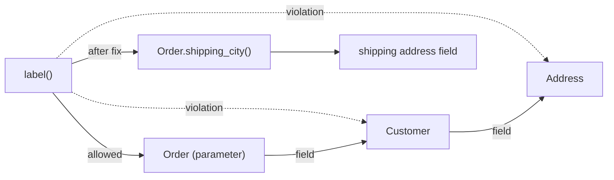

## In one minute
- The Law of Demeter (LoD), or "principle of least knowledge", says a method should only call methods on its close collaborators: its own object, its parameters, objects it creates, and its object's fields. It should not reach through them to objects they return.
- `order.customer().address().city()` breaks it. The calling code now depends on the structure of three classes it does not own, and any change to that structure ripples out to every such chain.
- The fix is usually to ask a neighbour to do the work (`order.shipping_city()`, or better, `order.ship_with(courier)`), or to pass in the one thing the method actually needs.
- It is not "count the dots". Fluent builders, stream pipelines and operations on plain values are fine, because each call returns the same object or a value, not a stranger's internals.
- Long chains also cost at runtime: dependent pointer loads, a null check per hop, and in ORMs or service calls, one query or network round trip per hop.

## How it works

### The rule, precisely
The rule comes from the Demeter project at Northeastern University in 1987. Inside a method `m` of object `o`, you may call methods on:
1. `o` itself.
2. Parameters of `m`.
3. Objects created inside `m`.
4. `o`'s direct fields (its components).

Objects that those calls *return* are strangers. You may hold them and pass them on, but calling methods on them means you know how your neighbour is built.

### The train wreck
A shipping label service needs a city:

```python
def label(order):
    city = order.customer().address().city()
    if order.customer().account().tier() == "gold":
        return Label(city, priority=True)
    return Label(city, priority=False)
```

`label` now knows that orders have customers, customers have one address and an account, accounts have tiers, and that shipping goes to the customer's address. That last one is wrong as soon as a customer can ship to a different address per order, and the fix has to touch every chain like this in the codebase. In the worked example below, the team found 37 of them.

### Three fixes
**Tell, don't ask.** Move the decision to the object that has the data: `order.make_label()`. The order knows where it ships and how urgent it is.

**Delegate one level.** If callers truly need the value, add `order.shipping_city()`. The order can answer from its own shipping address, its customer's default, or a cached field, and callers do not care.

**Pass the narrow thing.** If `label` only needs a city and a priority, make those the parameters: `label(city, priority)`. The caller that already has the order extracts them once, and `label` becomes trivial to test.

### Where the law does not apply
- **Fluent interfaces.** `query.where(...).order_by(...).limit(10)` returns the same builder each time. You are talking to one object.
- **Values and data structures.** `name.strip().lower()` operates on strings. A parsed JSON config or a DTO has no behaviour to hide; walking it is reading data, not reaching into an object's internals.
- **Collections and pipelines.** `items.filter(...).map(...)` is the same.

Over-applying the law produces a different smell: classes full of one-line forwarders like `getCustomerAddressCityName()`. If an object grows ten of these, the callers probably want a behaviour on that object, not more getters.

### Mocks expose violations
A test for the train-wreck `label` needs a mock order that returns a mock customer that returns a mock address that returns a city. Three levels of stubs to test one line of logic is a reliable sign that the code knows too much. With `label(city, priority)`, the test needs no mocks at all.

### Reviewing agent-written code
Agents produce train wrecks because they navigate whatever object graph they can see in context: `ctx.request.user.org.settings.billing.currency`. The code works, so tests pass. In review, look for chains through domain objects, especially those that appear in several files, and ask for a method on the nearest owner or a narrower parameter. Telling an agent "functions take the values they use, not the objects that contain them" prevents most of it.

### The same shape elsewhere
LoD is the *coupling* problem that networks solved with layering. An IP host does not know the routers between it and its destination; it hands packets to its default gateway, and each router knows only its next hop. Routes change constantly without any host noticing. Service architectures follow the same rule: a client that calls the order service, then uses an ID from the response to call the customer service, then the address service, is a train wreck across the network.

## Down the stack

### Layer 1: The contract
A method that follows LoD depends only on the interfaces of its immediate collaborators. The testable promise: if a class changes its internal structure (its fields and the types of objects it holds) without changing its own public methods, no method outside it that obeys LoD needs to change. The original paper distinguishes a strict form, which counts only fields declared in the class itself, and a weaker form, which also allows inherited fields.

### Layer 2: The mechanism
Languages offer tools to obey the law without writing every forwarder by hand. Rails' `delegate :city, to: :address` generates forwarding methods. Kotlin's `by` keyword delegates a whole interface to a field. Go struct embedding promotes the inner type's methods onto the outer type, which shortens chains but also publishes the inner API, so embedding a type is a public commitment to its whole method set.

Static analysis can flag violations. PMD for Java has a `LawOfDemeter` rule that tracks whether each receiver is a field, parameter, local created in the method, or a returned value. It is noisy on fluent APIs, which is why it is rarely enabled by default.

ORMs turn chains into queries. With lazy loading in Django or ActiveRecord, `order.customer.address.city` issues a `SELECT` for the customer and another for the address, the first time each is touched. Inside a loop, that is the N+1 query problem. `select_related` in Django and `includes` in ActiveRecord fix it with a join, but only if the code that knows what will be read is the code that loads it, which is exactly what a method like `Order.shipping_city()` centralises.

Null propagation multiplies too. Each hop is a place where the value can be missing. Optional chaining (`order?.customer?.address?.city` in TypeScript or Kotlin) stops the crash, but it hides which link was missing and silently turns "no address" into `undefined`.

### Layer 3: The machine
Each hop in `a.b.c.d` is a load whose address depends on the previous load. The CPU cannot start loading `c` until `b` arrives, so out-of-order execution cannot overlap them. An L1 hit costs about 1 ns, but an object graph that is spread across the heap can miss to main memory at roughly 80 to 100 ns per hop. Three hops over cold objects can cost several hundred nanoseconds per call; in a loop over a million orders, that is a visible fraction of a second.

LoD does not fix pointer chasing by itself. A delegating method in Go or on the JVM is inlined, so `order.ShippingCity()` compiles to the same loads as the chain. In CPython there is no inlining, and each extra Python-level call adds very roughly 50 to 100 ns. What the law does enable is changing the representation: once only `Order` knows where the city lives, it can cache it in its own field and turn three dependent loads into one.

Across processes, every hop becomes a round trip. A client that calls three services in sequence pays three network latencies, about 0.5 to 1 ms each inside one data centre, and depends on three schemas deployed by three teams. A protobuf response read as `resp.order.customer.address.city` couples the client to the nesting of messages it does not own; moving `address` breaks it on the next release.

### Why it's built this way
1. Internal structure changes more often than public behaviour, because representations get optimised and requirements reshape relationships.
2. Every caller that knows a structure must change when it changes, so the cost of change grows with how far that knowledge spreads.
3. Limiting each method to its immediate neighbours bounds that spread to one level.
4. Wrapping every path costs boilerplate, so the law is applied to objects with behaviour and relaxed for values, builders and data.

## Diagram


## Worked example
An order history page shows 50 orders, each with its shipping city. The template does `order.customer.address.city`. With lazy loading, that is 1 query for orders, 50 for customers and 50 for addresses: 101 queries. At about 1 ms per round trip to the database, the page spends roughly 100 ms on queries before rendering.

The team adds `Order.shipping_city()` and a repository method `recent_with_shipping(user_id, limit)` that joins orders to addresses in one query. The page drops to 1 query at about 3 ms. The template now calls one method on its own parameter.

Six months later, orders gain a per-order shipping address, separate from the customer's default. The change touches `Order.shipping_city()` and the repository query. Before the refactor, a search found 37 chains through `customer.address` in templates, emails, the label service and two reports. Each would have kept printing the customer's default address, silently wrong, after the schema change.

## Trade-offs
| Option | Strengths | Weaknesses | Choose when |
| --- | --- | --- | --- |
| Chain through objects | No extra code | Callers coupled to structure; N+1 queries; null at every hop | Plain data, DTOs, config |
| Tell, don't ask | Behaviour lives with data; callers stay small | Owner class grows | The caller is making a decision the owner could make |
| Delegate method | One place knows the path | Forwarders can pile up | A few values many callers need |
| Pass the narrow value | Simplest to test; no mocks | Caller does the extraction | Functions that use one or two fields |
| Read model or view | Shaped for the consumer, one query | Another model to keep in sync | Pages and reports that read across many objects |

## Pitfalls in production
- N+1 queries hidden behind attribute chains in templates. Fix: expose a method that loads what it needs with one query, and set a query-count assertion in tests for list pages.
- Optional chaining that turns missing data into `undefined` and then into "undefined" on a shipping label. Fix: make the owner return an explicit result or error when a link is missing.
- Wrapper explosion: dozens of `getXofYofZ()` forwarders. Fix: replace them with behaviours the callers actually need, or pass narrow values.
- Treating builders, streams and data as violations, which makes code worse. Fix: apply the law to objects with behaviour and invariants.
- Client code that walks nested API responses across service boundaries. Fix: have the owning service return the field the client needs, or give the client its own read model.
- Tests with mocks returning mocks. Fix: change the code under test to take what it uses; the mocks disappear.

## Leadership lens
- Count chains through a core domain object before a schema change. The number of call sites that know its structure is the real size of the migration.
- In design review, ask "what does this function actually need?" Narrow parameters make code easier to test, review and reuse, including for agents.
- Treat cross-service chains as an architecture smell: each hop adds latency, a failure point and a team that can break you.
- Do not enforce the law with a linter on every chain. Teams then wrap builders and data access in forwarders, and the codebase gets bigger without getting less coupled.

## Check yourself
1. Why is `items.filter(...).map(...).sum()` not a Law of Demeter violation?
   **Answer:** Each step works on a collection or a value that the caller already holds, not on a stranger's internal parts; no domain object's structure is exposed.
2. A delegating method in Go compiles to the same loads as the chain it replaced. So what did the refactor buy?
   **Answer:** Only one class now knows the path, so the representation can change in one place, for example to cache the value or load it with a join.
3. How do long chains through ORM objects cause performance problems?
   **Answer:** Each hop through a lazily loaded relation can issue a query, so a chain inside a loop becomes N+1 queries.
4. Why does a test needing mocks that return mocks suggest a design problem?
   **Answer:** The code under test is navigating its collaborators' structure, so the test must rebuild that structure; taking the needed values directly removes both the coupling and the mocks.

## Practice
**Task:** Build a simple Law of Demeter checker for one method. A `Method` lists its object's `fields`, its `params`, the `locals` it creates, a set of `fluent` method names (that return the same object), and the call expressions in its body, such as `"order.customer().address().city()"` (dot-separated, no arguments; strip a trailing `()` from each segment). Resolve each expression's receiver: if it starts with `self` and the next segment is a field with more segments after it, the field is the receiver and the rest follows it; otherwise for `self`, everything after `self` follows it. A param or local as the first segment is a receiver; anything else gives `unknown receiver: <expr>`. Skip leading fluent segments after the receiver; the remaining segment count is the number of hops, and more than 1 gives `too deep: <expr> (<n> hops)`. `check_method` returns the messages in input order.

```python starter
from dataclasses import dataclass

@dataclass
class Method:
    fields: list
    params: list
    locals: list
    fluent: list
    calls: list

def check_method(m):
    # TODO: return a list of violation messages in input order
    raise NotImplementedError
```

```python tests
def make(calls):
    return Method(["repo", "clock"], ["order"], ["receipt", "builder"],
                  ["with_item", "with_note"], calls)

def test_friends_are_allowed():
    calls = ["self.save()", "self.repo.save()", "order.total()", "receipt.print()", "self.clock", "order"]
    assert check_method(make(calls)) == []

def test_train_wrecks_are_flagged():
    got = check_method(make(["order.customer().address().city()", "self.repo.find().name()"]))
    assert got == ["too deep: order.customer().address().city() (3 hops)",
                   "too deep: self.repo.find().name() (2 hops)"]

def test_fluent_prefix_is_allowed():
    assert check_method(make(["builder.with_item().with_item().with_note().build()"])) == []
    got = check_method(make(["builder.with_item().build().send()"]))
    assert got == ["too deep: builder.with_item().build().send() (2 hops)"]

def test_fluent_after_a_stranger_still_counts():
    got = check_method(make(["order.customer().with_item()"]))
    assert got == ["too deep: order.customer().with_item() (2 hops)"]

def test_result_of_own_method_is_a_stranger():
    assert check_method(make(["self.helper().value()"])) == ["too deep: self.helper().value() (2 hops)"]

def test_unknown_receivers():
    got = check_method(make(["Config.instance().timeout()", "repo.save()"]))
    assert got == ["unknown receiver: Config.instance().timeout()", "unknown receiver: repo.save()"]

def test_mixed_keeps_input_order():
    got = check_method(make(["order.lines().first()", "order.ship()", "ghost.x()"]))
    assert got == ["too deep: order.lines().first() (2 hops)", "unknown receiver: ghost.x()"]
```

```python solution
from dataclasses import dataclass

@dataclass
class Method:
    fields: list
    params: list
    locals: list
    fluent: list
    calls: list

def _segments(expr):
    out = []
    for s in expr.split("."):
        out.append(s[:-2] if s.endswith("()") else s)
    return out

def check_method(m):
    problems = []
    for expr in m.calls:
        segs = _segments(expr)
        if segs[0] == "self":
            if len(segs) > 2 and segs[1] in m.fields:
                rest = segs[2:]
            else:
                rest = segs[1:]
        elif segs[0] in m.params or segs[0] in m.locals:
            rest = segs[1:]
        else:
            problems.append("unknown receiver: " + expr)
            continue
        i = 0
        while i < len(rest) and rest[i] in m.fluent:
            i += 1
        hops = len(rest) - i
        if hops > 1:
            problems.append("too deep: %s (%d hops)" % (expr, hops))
    return problems
```

```typescript starter
export interface Method {
  fields: string[];
  params: string[];
  locals: string[];
  fluent: string[];
  calls: string[];
}

export function checkMethod(m: Method): string[] {
  throw new Error("TODO");
}
```

```typescript tests
function make(calls: string[]): Method {
  return {
    fields: ["repo", "clock"], params: ["order"], locals: ["receipt", "builder"],
    fluent: ["with_item", "with_note"], calls,
  };
}

test("friends are allowed", () => {
  const calls = ["self.save()", "self.repo.save()", "order.total()", "receipt.print()", "self.clock", "order"];
  assertEqual(checkMethod(make(calls)), []);
});

test("train wrecks are flagged", () => {
  assertEqual(checkMethod(make(["order.customer().address().city()", "self.repo.find().name()"])), [
    "too deep: order.customer().address().city() (3 hops)",
    "too deep: self.repo.find().name() (2 hops)",
  ]);
});

test("fluent prefix is allowed", () => {
  assertEqual(checkMethod(make(["builder.with_item().with_item().with_note().build()"])), []);
  assertEqual(checkMethod(make(["builder.with_item().build().send()"])),
    ["too deep: builder.with_item().build().send() (2 hops)"]);
});

test("fluent after a stranger still counts", () => {
  assertEqual(checkMethod(make(["order.customer().with_item()"])),
    ["too deep: order.customer().with_item() (2 hops)"]);
});

test("result of own method is a stranger", () => {
  assertEqual(checkMethod(make(["self.helper().value()"])), ["too deep: self.helper().value() (2 hops)"]);
});

test("unknown receivers", () => {
  assertEqual(checkMethod(make(["Config.instance().timeout()", "repo.save()"])),
    ["unknown receiver: Config.instance().timeout()", "unknown receiver: repo.save()"]);
});

test("mixed keeps input order", () => {
  assertEqual(checkMethod(make(["order.lines().first()", "order.ship()", "ghost.x()"])),
    ["too deep: order.lines().first() (2 hops)", "unknown receiver: ghost.x()"]);
});
```

```typescript solution
export interface Method {
  fields: string[];
  params: string[];
  locals: string[];
  fluent: string[];
  calls: string[];
}

function segments(expr: string): string[] {
  return expr.split(".").map(s => (s.endsWith("()") ? s.slice(0, -2) : s));
}

export function checkMethod(m: Method): string[] {
  const problems: string[] = [];
  for (const expr of m.calls) {
    const segs = segments(expr);
    let rest: string[];
    if (segs[0] === "self") {
      rest = segs.length > 2 && m.fields.includes(segs[1]) ? segs.slice(2) : segs.slice(1);
    } else if (m.params.includes(segs[0]) || m.locals.includes(segs[0])) {
      rest = segs.slice(1);
    } else {
      problems.push(`unknown receiver: ${expr}`);
      continue;
    }
    let i = 0;
    while (i < rest.length && m.fluent.includes(rest[i])) i++;
    const hops = rest.length - i;
    if (hops > 1) problems.push(`too deep: ${expr} (${hops} hops)`);
  }
  return problems;
}
```

```go starter
package practice

// Method describes one method body for a Law of Demeter check.
type Method struct {
	Fields []string
	Params []string
	Locals []string
	Fluent []string
	Calls  []string
}

func CheckMethod(m Method) []string { panic("TODO") }
```

```go tests
package practice

import (
	"reflect"
	"testing"
)

func mk(calls ...string) Method {
	return Method{
		Fields: []string{"repo", "clock"},
		Params: []string{"order"},
		Locals: []string{"receipt", "builder"},
		Fluent: []string{"with_item", "with_note"},
		Calls:  calls,
	}
}

func expect(t *testing.T, got, want []string) {
	t.Helper()
	if len(got) == 0 && len(want) == 0 {
		return
	}
	if !reflect.DeepEqual(got, want) {
		t.Fatalf("want %q, got %q", want, got)
	}
}

func TestFriendsAreAllowed(t *testing.T) {
	got := CheckMethod(mk("self.save()", "self.repo.save()", "order.total()", "receipt.print()", "self.clock", "order"))
	expect(t, got, nil)
}

func TestTrainWrecksAreFlagged(t *testing.T) {
	got := CheckMethod(mk("order.customer().address().city()", "self.repo.find().name()"))
	expect(t, got, []string{
		"too deep: order.customer().address().city() (3 hops)",
		"too deep: self.repo.find().name() (2 hops)",
	})
}

func TestFluentPrefixIsAllowed(t *testing.T) {
	expect(t, CheckMethod(mk("builder.with_item().with_item().with_note().build()")), nil)
	expect(t, CheckMethod(mk("builder.with_item().build().send()")),
		[]string{"too deep: builder.with_item().build().send() (2 hops)"})
}

func TestFluentAfterAStrangerStillCounts(t *testing.T) {
	expect(t, CheckMethod(mk("order.customer().with_item()")),
		[]string{"too deep: order.customer().with_item() (2 hops)"})
}

func TestResultOfOwnMethodIsAStranger(t *testing.T) {
	expect(t, CheckMethod(mk("self.helper().value()")),
		[]string{"too deep: self.helper().value() (2 hops)"})
}

func TestUnknownReceivers(t *testing.T) {
	expect(t, CheckMethod(mk("Config.instance().timeout()", "repo.save()")),
		[]string{"unknown receiver: Config.instance().timeout()", "unknown receiver: repo.save()"})
}

func TestMixedKeepsInputOrder(t *testing.T) {
	expect(t, CheckMethod(mk("order.lines().first()", "order.ship()", "ghost.x()")),
		[]string{"too deep: order.lines().first() (2 hops)", "unknown receiver: ghost.x()"})
}
```

```go solution
package practice

import (
	"fmt"
	"slices"
	"strings"
)

// Method describes one method body for a Law of Demeter check.
type Method struct {
	Fields []string
	Params []string
	Locals []string
	Fluent []string
	Calls  []string
}

func segments(expr string) []string {
	parts := strings.Split(expr, ".")
	for i, p := range parts {
		parts[i] = strings.TrimSuffix(p, "()")
	}
	return parts
}

func CheckMethod(m Method) []string {
	problems := []string{}
	for _, expr := range m.Calls {
		segs := segments(expr)
		var rest []string
		switch {
		case segs[0] == "self":
			if len(segs) > 2 && slices.Contains(m.Fields, segs[1]) {
				rest = segs[2:]
			} else {
				rest = segs[1:]
			}
		case slices.Contains(m.Params, segs[0]) || slices.Contains(m.Locals, segs[0]):
			rest = segs[1:]
		default:
			problems = append(problems, "unknown receiver: "+expr)
			continue
		}
		i := 0
		for i < len(rest) && slices.Contains(m.Fluent, rest[i]) {
			i++
		}
		if hops := len(rest) - i; hops > 1 {
			problems = append(problems, fmt.Sprintf("too deep: %s (%d hops)", expr, hops))
		}
	}
	return problems
}
```

## Mock interview
**Prompt:** You are reviewing a checkout service of about 80,000 lines. Templates, emails and three background jobs read values like `cart.user.profile.preferences.currency` and `order.payment.card.issuer.country`. Product now wants per-order currency, and the team estimates three weeks. How do you approach the change and the design?

- Follow-up: The order list endpoint got slower last quarter and now runs about 120 queries per page. How is that related?
- Follow-up: A teammate proposes adding 40 getter methods to `Order` to fix the chains. What do you think?
- Follow-up: Some of these chains go through responses from the payments service. What changes there?

**A strong answer covers:**
- Finding every chain through `user.profile.preferences` and `payment.card` first; their count is the real cost of the change.
- Introducing owner methods such as `order.currency()` or behaviours like `order.format_total()`, then moving callers to them, then changing the representation in one place.
- Linking chains through lazy relations to N+1 queries, and fixing them with one owner method that loads with a join or a read model.
- Rejecting blanket forwarders in favour of behaviours and narrow parameters, with fluent APIs and plain data excluded.
- Asking the payments service to return the fields checkout needs, instead of walking its nested response, so its schema can evolve.

## Watch
- [Clean Code: The Law of Demeter (Harmony in Code)](https://www.youtube.com/watch?v=ad9aHgO907g): explains the rule with code, including its downsides and a practical middle ground.
- [Clean Code: Explained, Episode 14: Law of Demeter (CodeBuster)](https://www.youtube.com/watch?v=bxlkbS_qiXg): a short walkthrough of the rule and how to refactor chains.

## Free resources
- [Object-Oriented Programming: An Objective Sense of Style (Lieberherr, Holland, Riel, OOPSLA 1988)](https://www.ccs.neu.edu/research/demeter/papers/law-of-demeter/oopsla88-law-of-demeter.pdf): the original paper with the formal definitions and the strict and weak forms.
- [Law of Demeter (Karl Lieberherr, Northeastern)](https://www.ccs.neu.edu/home/lieber/LoD.html): the Demeter project's own page on the law, with history and examples.
- [General formulation of the Law of Demeter (Northeastern)](https://www2.ccs.neu.edu/research/demeter/demeter-method/LawOfDemeter/general-formulation.html): the short, language-independent statement of the rule.
- [TellDontAsk (Martin Fowler)](https://martinfowler.com/bliki/TellDontAsk.html): the companion idea of moving behaviour to the data, and its limits.
- [Optional chaining (MDN)](https://developer.mozilla.org/en-US/docs/Web/JavaScript/Reference/Operators/Optional_chaining): how `?.` short-circuits a chain, useful to understand what it hides.
- [Law of Demeter (Wikipedia)](https://en.wikipedia.org/wiki/Law_of_Demeter): background, the formal rule and common criticisms.
