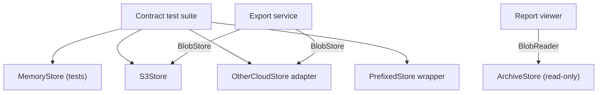

## In one minute
- If code works with a type, it must keep working with any subtype or any implementation of that interface, without knowing which one it got. That is the Liskov Substitution Principle.
- "Works" means the behaviour the caller relies on, not just matching method signatures. Compilers check signatures; nobody checks behaviour unless you write tests for it.
- Precisely: an implementation may accept more inputs than promised and may promise more in its results, but must never demand more or deliver less, and must keep the type's invariants.
- The tell-tale sign of a violation is a caller that checks the concrete type (`isinstance`, a Go type switch, `instanceof`) to work around one implementation's quirks.
- The practical defence is a contract test suite that every implementation must pass. It matters more now that agents write adapters quickly, and often stub the hard methods.

## How it works

### A realistic "before"
An export service writes customer reports to blob storage through an interface:

```python
class BlobStore(Protocol):
    def put(self, key: str, data: bytes) -> None: ...
    def get(self, key: str) -> bytes | None: ...      # None if missing
    def delete(self, key: str) -> None: ...           # no-op if missing
    def list_keys(self, prefix: str) -> list[str]: ...  # sorted
```

There is an S3 implementation for production and a local-disk one for development. Over a year, three more arrive. An archive store for cold data raises `NotImplementedError` from `put`, because archives are written by a batch job. A second cloud provider's adapter raises on `delete` of a missing key, because that is what its API does. A caching wrapper keeps serving a deleted report for five minutes. Each class has the right method names, so every type checker is happy.

The callers are not. The retention job crashes on the second provider when a report was already deleted. A user deletes a report, refreshes and sees it again. The export service grows this:

```python
if isinstance(store, ArchiveStore):
    raise ExportError("archive is read-only")
if isinstance(store, OtherCloudStore):
    try: store.delete(key)
    except NotFound: pass
```

Now every new implementation means editing callers. An LSP violation has turned into an Open/Closed violation, which is how it usually shows up in a codebase.

### The "after"
Three fixes, in order of importance:
- **Write the contract down and test it.** "`get` after `put` returns the same bytes; `put` overwrites; `get` of a missing key returns `None`; `delete` of a missing key is a no-op; `list_keys` returns matching keys in ascending order." Then run one shared test suite against every implementation, including fakes used in other tests.
- **Make adapters absorb provider quirks.** The second cloud adapter catches the provider's 404 on delete. The cache wrapper invalidates on delete. The interface does not bend to the provider; the adapter does.
- **Split interfaces that some implementations cannot honour.** The archive is not a `BlobStore`. It is a `BlobReader`. Callers that only read take a `BlobReader`; the type system now stops anyone handing an archive to the export writer.

### What the principle actually says
Barbara Liskov stated the idea in a 1987 keynote, and Liskov and Jeannette Wing made it precise in 1994: a subtype must satisfy its supertype's specification. Concretely, for each operation:
- **Preconditions cannot be strengthened.** If the interface accepts any key, an implementation cannot reject keys longer than 64 characters.
- **Postconditions cannot be weakened.** If `list_keys` promises sorted output, returning keys in insertion order is a violation, even if it is "faster".
- **Invariants must be preserved.** If a store promises read-your-writes, a cache that serves stale data breaks it.
- **History constraint.** A subtype cannot allow state changes the supertype forbids. An "immutable" config that has a mutable subtype is not immutable to anyone holding it.

The famous square-and-rectangle puzzle is the history constraint in miniature: a `Square` that keeps width and height equal breaks a caller that sets the width and expects the height to stay put. In backend code the same thing appears as read-only collections, eventually consistent replicas and "lite" API clients.

### When following it too zealously hurts
- **Over-specified contracts.** If the contract says "`put` completes in under 5 ms" or "errors are `S3Error`", only one implementation can ever satisfy it. Specify what callers need; leave room for variation in latency, consistency details and error types. Hyrum's law says callers will depend on unspecified behaviour anyway, which is a reason to state what is promised and test exactly that.
- **Forcing everything into one hierarchy.** If two things are only similar, do not make one a subtype of the other to reuse code. Compose instead.
- **Interface explosion.** Splitting every interface into one-method pieces to avoid any possible violation makes signatures unreadable. Split along what callers actually use: readers and writers is a common, useful line.
- **Rejecting known, documented compromises.** Java's `List` declares `add` as an "optional operation" that may throw `UnsupportedOperationException`. That is a weak contract, but a stated one. Sometimes a stated weakness beats a type hierarchy with forty interfaces.

### Reviewing agent-written code
Ask an agent to "add a Google Cloud implementation of `BlobStore`" and it will produce a class with every method present. Look for the methods that were hard: `raise NotImplementedError`, `return nil` with a `// TODO`, an empty list where pagination was needed, an error swallowed to make a test pass. Each is a substitution failure waiting for production traffic. Also check the fakes an agent writes for tests: a fake store that never fails and always returns sorted results makes the caller's tests pass against behaviour no real store has. The review rule is simple: every implementation, including fakes, must run the shared contract suite in CI, and any new `isinstance` or type switch on an implementation type needs a written justification.

### The same shape elsewhere
LSP is "trust but verify" applied to types. HTTP has the same rule at protocol level: RFC 9110 says GET is safe and idempotent, so caches, proxies and crawlers repeat GETs freely. A server that deletes data on GET is a substitution violation, and the bug report arrives when a link prefetcher deletes a customer's records. Payment gateway adapters, message queue clients and database drivers all carry the same risk.

## Down the stack

### Layer 1: The contract
For the store interface, the contract is a list of testable statements: round trip (`get(k)` returns what `put(k, v)` wrote), overwrite, missing keys return "not found" rather than an error, delete is idempotent, and listing returns exactly the matching keys in sorted order. Each implementation may add guarantees (stronger consistency, versioning) but may not drop one. Concurrency is part of the contract too: Go's standard library says when a type is "safe for concurrent use by multiple goroutines", and an implementation that is not safe breaks callers that rely on that sentence.

### Layer 2: The mechanism
Type systems check only the structural part of substitutability. Go and TypeScript use structural typing: any type with the right method set satisfies the interface, with no declaration of intent. Python's `typing.Protocol` does the same for mypy, and mypy also flags overrides whose signatures are incompatible with the base class. Signature rules follow variance: parameters may be widened (contravariance) and return types narrowed (covariance). TypeScript deliberately relaxes this: methods declared with method syntax are checked bivariantly in their parameters even under `--strict`, so an implementation that accepts a narrower argument type compiles. None of these checkers know that `list_keys` must be sorted. Behavioural rules live in documentation and in contract tests, the way Go's `io.Reader` docs spell out how `n` and `err` may combine and every reader in the standard library is tested against that.

### Layer 3: The machine
A call through an interface reaches the implementation by data, not by name. In C++ and Java the object header points to a vtable and the call reads a fixed slot. In Go an interface value is two machine words: a pointer to an itab (the concrete type plus its method pointers, built once per type and interface pair and cached in a global hash table) and a pointer to the data. Assigning a non-pointer struct to an interface may copy it to the heap. A call costs a couple of dependent loads plus an indirect branch, around 1 to 2 ns when predicted. In V8 the call site's inline cache records object shapes; a site that only sees one implementation is monomorphic and fast. In CPython the method is found through the type's MRO and a per-type cache.

Violations add cost the dispatch never had. A caller that works around a quirk with a type switch adds a comparison of type pointers per call and, more expensively, a branch that only one implementation exercises and that tests rarely cover. A cache wrapper that breaks read-your-writes typically does so for a performance reason: invalidation across processes needs a network round trip (0.5 ms or more in a data centre), and skipping it is the shortcut. The fix makes that cost explicit in the contract instead of hiding it.

### Why it's built this way
1. Large systems are assembled from parts written at different times by different people (and now agents), joined by interfaces.
2. Callers are written once against the interface and cannot be updated each time an implementation appears.
3. So each implementation must honour everything the callers were promised, or the callers break in production.
4. Compilers verify only signatures, because behaviour is undecidable in general.
5. So the behavioural promise has to be written down and enforced by a shared test suite every implementation runs.

## Diagram


## Worked example
A SaaS company stores 30 million report files across two clouds behind one `BlobStore` interface. Over six months it has four storage-related incidents: a retention job crash (delete raised on a missing key), stale reports after deletion (cache wrapper), a failed migration (one adapter's `list_keys` returned the first 1,000 keys only, because the agent that wrote it never handled pagination), and a dev environment that passed tests a production adapter would have failed (the in-memory fake sorted keys; the real adapter did not).

The team writes a contract suite of 14 tests and runs it against all five implementations. On the first run it fails 9 assertions across three of them. Fixes take two days: catch 404 on delete, invalidate the cache on delete and overwrite, implement pagination in `list_keys`, and sort in the adapter. Two `isinstance` checks in the export service are deleted. The archive store moves to a separate `BlobReader` interface, and the compiler finds one caller that was passing it where writes were expected.

Cost: the suite runs in 0.3 seconds against the in-memory store and about 20 seconds against real cloud buckets in a nightly job. In the following six months, storage incidents drop to zero, and a third provider's adapter (written mostly by an agent) passes the suite on its second attempt.

## Trade-offs
| Option | Strengths | Weaknesses | Choose when |
| --- | --- | --- | --- |
| One wide interface, documented optional operations | Few types, simple signatures | Callers must handle "unsupported" at runtime | Optional capabilities are rare and clearly documented |
| Split interfaces (reader, writer, lister) | Compiler prevents invalid substitution | More types; signatures get longer | Some implementations genuinely cannot honour part of the contract |
| Contract test suite for all implementations | Catches behavioural violations, including in fakes | Must be maintained; slow against real backends | Any interface with more than one implementation |
| Type checks in callers | Quick local fix | Every new implementation edits callers; hidden coupling | Almost never; only as a temporary, ticketed workaround |
| Inheritance for code reuse | Less code | Creates subtype promises nobody intended | Rarely; prefer composition and delegation |

## Pitfalls in production
- Stubbing hard methods with `NotImplementedError` or a silent no-op so the class "satisfies" the interface. Fix: split the interface, or implement the method properly before merging.
- Test fakes that are better behaved than production (never fail, always sorted, always consistent). Fix: run the fake through the same contract suite, and add failure injection to it.
- Wrappers (caches, retries, metrics) that quietly change semantics, such as serving stale reads or retrying non-idempotent writes. Fix: wrappers run the contract suite too, with the inner store underneath.
- Adapters that leak provider errors, so callers start matching on `S3Error` strings. Fix: map provider errors to the interface's own error values, such as a not-found sentinel.
- Pagination, limits and size caps missing in one implementation, discovered only on a large tenant. Fix: contract tests that include more items than one page.

## Leadership lens
- Treat interfaces with several implementations as products: a written contract, an owner and a shared test suite that every new implementation must pass before it merges.
- Count type checks on implementations in the codebase. Each one is an LSP debt with a known cost: the next implementation will need another.
- When agents generate adapters, make the contract suite the acceptance criterion. It turns "looks complete" into "behaves like the others", which is the property you actually need.
- Decide explicitly what is allowed to vary between implementations (latency, consistency window, error detail) and put it in the contract, so teams do not over-specify around one vendor.

## Check yourself
1. An implementation of `BlobStore` accepts keys of any length, where the interface only promised keys up to 1,024 bytes. Is that a violation?
   **Answer:** No. It weakens a precondition (accepts more), which is allowed; callers that respect the 1,024-byte limit still work.
2. A caching wrapper returns a deleted object for up to 60 seconds. Which part of the contract does it break, and what are the fixes?
   **Answer:** It breaks the postcondition that `get` after `delete` returns not found (read-your-writes). Fix it by invalidating on delete, or state a weaker consistency contract that callers are designed for.
3. Why does an LSP violation tend to become an Open/Closed violation?
   **Answer:** Callers compensate with type checks for the misbehaving implementation, so every new implementation forces edits in the callers instead of being purely additive.
4. Why can't the Go or TypeScript compiler catch the "list must be sorted" violation?
   **Answer:** They check method names and signatures structurally; ordering is a behavioural promise, which only tests or documentation can express.

## Practice
**Task:** Build a substitutable key-value store and the contract suite that proves it. Implement `MemoryStore` with `put(key, value)`, `get(key)` (the value, or `None` / `undefined` / Go `ErrNotFound` if missing), `delete(key)` (no-op if missing) and `list_keys(prefix)` (matching keys, ascending). Implement `PrefixedStore(inner, prefix)`, a wrapper that namespaces every key under `prefix` in the inner store and strips it again in `list_keys`. Then implement `check_contract(make_store)`: using a fresh store from the factory for each rule, check `"roundtrip"`, `"overwrite"`, `"missing"`, `"delete"` (delete then get is missing, and deleting a missing key succeeds) and `"list"` (put `a/1`, `b/1`, `a/0`, `a/2`; `list_keys("a/")` is `["a/0", "a/1", "a/2"]` and `list_keys("zzz/")` is empty). Return the names of failed rules in that order; any exception or returned error counts as a failure. Tests run the suite against correct and deliberately broken stores.

```python starter
class MemoryStore:
    def put(self, key, value):
        raise NotImplementedError
    def get(self, key):
        raise NotImplementedError
    def delete(self, key):
        raise NotImplementedError
    def list_keys(self, prefix):
        raise NotImplementedError

class PrefixedStore:
    def __init__(self, inner, prefix):
        self.inner, self.prefix = inner, prefix
    def put(self, key, value):
        raise NotImplementedError
    def get(self, key):
        raise NotImplementedError
    def delete(self, key):
        raise NotImplementedError
    def list_keys(self, prefix):
        raise NotImplementedError

def check_contract(make_store):
    # TODO: return the names of failed rules
    raise NotImplementedError
```

```python tests
class DictStore:
    def __init__(self):
        self.d = {}
    def put(self, key, value):
        self.d[key] = value
    def get(self, key):
        return self.d.get(key)
    def delete(self, key):
        self.d.pop(key, None)
    def list_keys(self, prefix):
        return sorted(k for k in self.d if k.startswith(prefix))

class UnsortedList(DictStore):
    def list_keys(self, prefix):
        return [k for k in self.d if k.startswith(prefix)]

class ReadOnly(DictStore):
    def put(self, key, value):
        raise PermissionError("read-only")

class StrictDelete(DictStore):
    def delete(self, key):
        del self.d[key]

class FirstWriteWins(DictStore):
    def put(self, key, value):
        self.d.setdefault(key, value)

class RaisesOnMissing(DictStore):
    def get(self, key):
        return self.d[key]

def test_reference_store_passes():
    assert check_contract(DictStore) == []

def test_memory_store_passes():
    assert check_contract(MemoryStore) == []

def test_prefixed_store_passes():
    assert check_contract(lambda: PrefixedStore(MemoryStore(), "tenant1/")) == []

def test_prefixed_isolation():
    inner = MemoryStore()
    a, b = PrefixedStore(inner, "a:"), PrefixedStore(inner, "b:")
    a.put("x", "1")
    assert b.get("x") is None
    assert inner.get("a:x") == "1"
    assert a.list_keys("") == ["x"]
    assert inner.list_keys("") == ["a:x"]

def test_detects_unsorted_list():
    assert check_contract(UnsortedList) == ["list"]

def test_detects_read_only():
    assert check_contract(ReadOnly) == ["roundtrip", "overwrite", "delete", "list"]

def test_detects_strict_delete_and_first_write_wins():
    assert check_contract(StrictDelete) == ["delete"]
    assert check_contract(FirstWriteWins) == ["overwrite"]

def test_detects_raising_get():
    assert check_contract(RaisesOnMissing) == ["missing", "delete"]
```

```python solution
class MemoryStore:
    def __init__(self):
        self.data = {}
    def put(self, key, value):
        self.data[key] = value
    def get(self, key):
        return self.data.get(key)
    def delete(self, key):
        self.data.pop(key, None)
    def list_keys(self, prefix):
        return sorted(k for k in self.data if k.startswith(prefix))

class PrefixedStore:
    def __init__(self, inner, prefix):
        self.inner, self.prefix = inner, prefix
    def put(self, key, value):
        self.inner.put(self.prefix + key, value)
    def get(self, key):
        return self.inner.get(self.prefix + key)
    def delete(self, key):
        self.inner.delete(self.prefix + key)
    def list_keys(self, prefix):
        n = len(self.prefix)
        return [k[n:] for k in self.inner.list_keys(self.prefix + prefix)]

def _roundtrip(s):
    s.put("k", "v1")
    return s.get("k") == "v1"

def _overwrite(s):
    s.put("k", "v1")
    s.put("k", "v2")
    return s.get("k") == "v2"

def _missing(s):
    return s.get("nope") is None

def _delete(s):
    s.put("k", "v1")
    s.delete("k")
    if s.get("k") is not None:
        return False
    s.delete("never-existed")
    return True

def _list(s):
    for k in ["a/1", "b/1", "a/0", "a/2"]:
        s.put(k, "x")
    return s.list_keys("a/") == ["a/0", "a/1", "a/2"] and s.list_keys("zzz/") == []

RULES = [("roundtrip", _roundtrip), ("overwrite", _overwrite), ("missing", _missing),
         ("delete", _delete), ("list", _list)]

def check_contract(make_store):
    failed = []
    for name, rule in RULES:
        try:
            ok = rule(make_store())
        except Exception:
            ok = False
        if not ok:
            failed.append(name)
    return failed
```

```typescript starter
export interface Store {
  put(key: string, value: string): void;
  get(key: string): string | undefined;
  delete(key: string): void;
  listKeys(prefix: string): string[];
}

export class MemoryStore implements Store {
  put(key: string, value: string): void { throw new Error("TODO"); }
  get(key: string): string | undefined { throw new Error("TODO"); }
  delete(key: string): void { throw new Error("TODO"); }
  listKeys(prefix: string): string[] { throw new Error("TODO"); }
}

export class PrefixedStore implements Store {
  constructor(private inner: Store, private prefix: string) {}
  put(key: string, value: string): void { throw new Error("TODO"); }
  get(key: string): string | undefined { throw new Error("TODO"); }
  delete(key: string): void { throw new Error("TODO"); }
  listKeys(prefix: string): string[] { throw new Error("TODO"); }
}

export function checkContract(makeStore: () => Store): string[] {
  throw new Error("TODO");
}
```

```typescript tests
class MapStore implements Store {
  m = new Map<string, string>();
  put(key: string, value: string): void { this.m.set(key, value); }
  get(key: string): string | undefined { return this.m.get(key); }
  delete(key: string): void { this.m.delete(key); }
  listKeys(prefix: string): string[] { return [...this.m.keys()].filter((k) => k.startsWith(prefix)).sort(); }
}

class UnsortedList extends MapStore {
  listKeys(prefix: string): string[] { return [...this.m.keys()].filter((k) => k.startsWith(prefix)); }
}
class ReadOnly extends MapStore {
  put(key: string, value: string): void { throw new Error("read-only"); }
}
class StrictDelete extends MapStore {
  delete(key: string): void {
    if (!this.m.has(key)) throw new Error("not found");
    this.m.delete(key);
  }
}
class FirstWriteWins extends MapStore {
  put(key: string, value: string): void { if (!this.m.has(key)) this.m.set(key, value); }
}
class RaisesOnMissing extends MapStore {
  get(key: string): string | undefined {
    const v = this.m.get(key);
    if (v === undefined) throw new Error("not found");
    return v;
  }
}

test("reference store passes", () => {
  assertEqual(checkContract(() => new MapStore()), []);
});

test("memory store passes", () => {
  assertEqual(checkContract(() => new MemoryStore()), []);
});

test("prefixed store passes", () => {
  assertEqual(checkContract(() => new PrefixedStore(new MemoryStore(), "tenant1/")), []);
});

test("prefixed isolation", () => {
  const inner = new MemoryStore();
  const a = new PrefixedStore(inner, "a:"), b = new PrefixedStore(inner, "b:");
  a.put("x", "1");
  assertEqual(b.get("x"), undefined);
  assertEqual(inner.get("a:x"), "1");
  assertEqual(a.listKeys(""), ["x"]);
  assertEqual(inner.listKeys(""), ["a:x"]);
});

test("detects unsorted list", () => {
  assertEqual(checkContract(() => new UnsortedList()), ["list"]);
});

test("detects read-only", () => {
  assertEqual(checkContract(() => new ReadOnly()), ["roundtrip", "overwrite", "delete", "list"]);
});

test("detects strict delete and first write wins", () => {
  assertEqual(checkContract(() => new StrictDelete()), ["delete"]);
  assertEqual(checkContract(() => new FirstWriteWins()), ["overwrite"]);
});

test("detects raising get", () => {
  assertEqual(checkContract(() => new RaisesOnMissing()), ["missing", "delete"]);
});
```

```typescript solution
export interface Store {
  put(key: string, value: string): void;
  get(key: string): string | undefined;
  delete(key: string): void;
  listKeys(prefix: string): string[];
}

export class MemoryStore implements Store {
  private data = new Map<string, string>();
  put(key: string, value: string): void { this.data.set(key, value); }
  get(key: string): string | undefined { return this.data.get(key); }
  delete(key: string): void { this.data.delete(key); }
  listKeys(prefix: string): string[] {
    return [...this.data.keys()].filter((k) => k.startsWith(prefix)).sort();
  }
}

export class PrefixedStore implements Store {
  constructor(private inner: Store, private prefix: string) {}
  put(key: string, value: string): void { this.inner.put(this.prefix + key, value); }
  get(key: string): string | undefined { return this.inner.get(this.prefix + key); }
  delete(key: string): void { this.inner.delete(this.prefix + key); }
  listKeys(prefix: string): string[] {
    return this.inner.listKeys(this.prefix + prefix).map((k) => k.slice(this.prefix.length));
  }
}

const RULES: [string, (s: Store) => boolean][] = [
  ["roundtrip", (s) => { s.put("k", "v1"); return s.get("k") === "v1"; }],
  ["overwrite", (s) => { s.put("k", "v1"); s.put("k", "v2"); return s.get("k") === "v2"; }],
  ["missing", (s) => s.get("nope") === undefined],
  ["delete", (s) => {
    s.put("k", "v1");
    s.delete("k");
    if (s.get("k") !== undefined) return false;
    s.delete("never-existed");
    return true;
  }],
  ["list", (s) => {
    for (const k of ["a/1", "b/1", "a/0", "a/2"]) s.put(k, "x");
    return JSON.stringify(s.listKeys("a/")) === JSON.stringify(["a/0", "a/1", "a/2"]) && s.listKeys("zzz/").length === 0;
  }],
];

export function checkContract(makeStore: () => Store): string[] {
  const failed: string[] = [];
  for (const [name, rule] of RULES) {
    let ok = false;
    try { ok = rule(makeStore()); } catch (e) { ok = false; }
    if (!ok) failed.push(name);
  }
  return failed;
}
```

```go starter
package practice

import "errors"

var ErrNotFound = errors.New("not found")

type Store interface {
	Put(key, value string) error
	Get(key string) (string, error) // ErrNotFound if missing
	Delete(key string) error        // nil if missing
	List(prefix string) ([]string, error)
}

type MemoryStore struct{}

func NewMemoryStore() *MemoryStore { return &MemoryStore{} }

func (m *MemoryStore) Put(key, value string) error          { panic("TODO") }
func (m *MemoryStore) Get(key string) (string, error)       { panic("TODO") }
func (m *MemoryStore) Delete(key string) error              { panic("TODO") }
func (m *MemoryStore) List(prefix string) ([]string, error) { panic("TODO") }

type PrefixedStore struct {
	Inner  Store
	Prefix string
}

func (p PrefixedStore) Put(key, value string) error          { panic("TODO") }
func (p PrefixedStore) Get(key string) (string, error)       { panic("TODO") }
func (p PrefixedStore) Delete(key string) error              { panic("TODO") }
func (p PrefixedStore) List(prefix string) ([]string, error) { panic("TODO") }

func CheckContract(newStore func() Store) []string {
	panic("TODO")
}
```

```go tests
package practice

import (
	"errors"
	"reflect"
	"sort"
	"strings"
	"testing"
)

type mapStore struct {
	m     map[string]string
	order []string
}

func newMapStore() *mapStore { return &mapStore{m: map[string]string{}} }

func (s *mapStore) Put(k, v string) error {
	if _, ok := s.m[k]; !ok {
		s.order = append(s.order, k)
	}
	s.m[k] = v
	return nil
}
func (s *mapStore) Get(k string) (string, error) {
	v, ok := s.m[k]
	if !ok {
		return "", ErrNotFound
	}
	return v, nil
}
func (s *mapStore) Delete(k string) error { delete(s.m, k); return nil }
func (s *mapStore) unsorted(p string) []string {
	out := []string{}
	for _, k := range s.order {
		if _, ok := s.m[k]; ok && strings.HasPrefix(k, p) {
			out = append(out, k)
		}
	}
	return out
}
func (s *mapStore) List(p string) ([]string, error) {
	out := s.unsorted(p)
	sort.Strings(out)
	return out, nil
}

type unsortedList struct{ *mapStore }

func (s unsortedList) List(p string) ([]string, error) { return s.unsorted(p), nil }

type readOnly struct{ *mapStore }

func (readOnly) Put(k, v string) error { return errors.New("read-only") }

type strictDelete struct{ *mapStore }

func (s strictDelete) Delete(k string) error {
	if _, ok := s.m[k]; !ok {
		return ErrNotFound
	}
	delete(s.m, k)
	return nil
}

type firstWriteWins struct{ *mapStore }

func (s firstWriteWins) Put(k, v string) error {
	if _, ok := s.m[k]; ok {
		return nil
	}
	return s.mapStore.Put(k, v)
}

type wrongMissingError struct{ *mapStore }

func (s wrongMissingError) Get(k string) (string, error) {
	v, ok := s.m[k]
	if !ok {
		return "", errors.New("no such key")
	}
	return v, nil
}

func check(t *testing.T, name string, f func() Store, want []string) {
	t.Helper()
	got := CheckContract(f)
	if len(got) == 0 && len(want) == 0 {
		return
	}
	if !reflect.DeepEqual(got, want) {
		t.Fatalf("%s: got %v want %v", name, got, want)
	}
}

func TestReferenceStorePasses(t *testing.T) {
	check(t, "map", func() Store { return newMapStore() }, nil)
}

func TestMemoryStorePasses(t *testing.T) {
	check(t, "memory", func() Store { return NewMemoryStore() }, nil)
}

func TestPrefixedStorePasses(t *testing.T) {
	check(t, "prefixed", func() Store { return PrefixedStore{NewMemoryStore(), "tenant1/"} }, nil)
}

func TestPrefixedIsolation(t *testing.T) {
	inner := NewMemoryStore()
	a, b := PrefixedStore{inner, "a:"}, PrefixedStore{inner, "b:"}
	if err := a.Put("x", "1"); err != nil {
		t.Fatal(err)
	}
	if _, err := b.Get("x"); !errors.Is(err, ErrNotFound) {
		t.Fatalf("b sees a's key: %v", err)
	}
	if v, err := inner.Get("a:x"); err != nil || v != "1" {
		t.Fatalf("inner %q %v", v, err)
	}
	if keys, _ := a.List(""); !reflect.DeepEqual(keys, []string{"x"}) {
		t.Fatalf("a.List %v", keys)
	}
	if keys, _ := inner.List(""); !reflect.DeepEqual(keys, []string{"a:x"}) {
		t.Fatalf("inner.List %v", keys)
	}
}

func TestDetectsUnsortedList(t *testing.T) {
	check(t, "unsorted", func() Store { return unsortedList{newMapStore()} }, []string{"list"})
}

func TestDetectsReadOnly(t *testing.T) {
	check(t, "readonly", func() Store { return readOnly{newMapStore()} },
		[]string{"roundtrip", "overwrite", "delete", "list"})
}

func TestDetectsStrictDeleteAndFirstWriteWins(t *testing.T) {
	check(t, "strict", func() Store { return strictDelete{newMapStore()} }, []string{"delete"})
	check(t, "first", func() Store { return firstWriteWins{newMapStore()} }, []string{"overwrite"})
}

func TestDetectsWrongMissingError(t *testing.T) {
	check(t, "missing", func() Store { return wrongMissingError{newMapStore()} }, []string{"missing", "delete"})
}
```

```go solution
package practice

import (
	"errors"
	"reflect"
	"sort"
	"strings"
)

var ErrNotFound = errors.New("not found")

type Store interface {
	Put(key, value string) error
	Get(key string) (string, error) // ErrNotFound if missing
	Delete(key string) error        // nil if missing
	List(prefix string) ([]string, error)
}

type MemoryStore struct{ data map[string]string }

func NewMemoryStore() *MemoryStore { return &MemoryStore{data: map[string]string{}} }

func (m *MemoryStore) Put(key, value string) error { m.data[key] = value; return nil }
func (m *MemoryStore) Get(key string) (string, error) {
	v, ok := m.data[key]
	if !ok {
		return "", ErrNotFound
	}
	return v, nil
}
func (m *MemoryStore) Delete(key string) error { delete(m.data, key); return nil }
func (m *MemoryStore) List(prefix string) ([]string, error) {
	out := []string{}
	for k := range m.data {
		if strings.HasPrefix(k, prefix) {
			out = append(out, k)
		}
	}
	sort.Strings(out)
	return out, nil
}

type PrefixedStore struct {
	Inner  Store
	Prefix string
}

func (p PrefixedStore) Put(key, value string) error    { return p.Inner.Put(p.Prefix+key, value) }
func (p PrefixedStore) Get(key string) (string, error) { return p.Inner.Get(p.Prefix + key) }
func (p PrefixedStore) Delete(key string) error        { return p.Inner.Delete(p.Prefix + key) }
func (p PrefixedStore) List(prefix string) ([]string, error) {
	keys, err := p.Inner.List(p.Prefix + prefix)
	if err != nil {
		return nil, err
	}
	out := make([]string, len(keys))
	for i, k := range keys {
		out[i] = strings.TrimPrefix(k, p.Prefix)
	}
	return out, nil
}

type rule struct {
	name  string
	check func(s Store) bool
}

var rules = []rule{
	{"roundtrip", func(s Store) bool {
		if s.Put("k", "v1") != nil {
			return false
		}
		v, err := s.Get("k")
		return err == nil && v == "v1"
	}},
	{"overwrite", func(s Store) bool {
		if s.Put("k", "v1") != nil || s.Put("k", "v2") != nil {
			return false
		}
		v, err := s.Get("k")
		return err == nil && v == "v2"
	}},
	{"missing", func(s Store) bool {
		_, err := s.Get("nope")
		return errors.Is(err, ErrNotFound)
	}},
	{"delete", func(s Store) bool {
		if s.Put("k", "v1") != nil || s.Delete("k") != nil {
			return false
		}
		if _, err := s.Get("k"); !errors.Is(err, ErrNotFound) {
			return false
		}
		return s.Delete("never-existed") == nil
	}},
	{"list", func(s Store) bool {
		for _, k := range []string{"a/1", "b/1", "a/0", "a/2"} {
			if s.Put(k, "x") != nil {
				return false
			}
		}
		got, err := s.List("a/")
		if err != nil || !reflect.DeepEqual(got, []string{"a/0", "a/1", "a/2"}) {
			return false
		}
		none, err := s.List("zzz/")
		return err == nil && len(none) == 0
	}},
}

func CheckContract(newStore func() Store) []string {
	failed := []string{}
	for _, r := range rules {
		if !r.check(newStore()) {
			failed = append(failed, r.name)
		}
	}
	return failed
}
```

## Mock interview
**Prompt:** Your payments platform supports three card processors behind one `PaymentGateway` interface (`authorize`, `capture`, `refund`). A fourth processor only supports asynchronous refunds that complete up to 24 hours later, and its sandbox returns success for everything. Product wants it live in two weeks. How do you integrate it without breaking the callers?

- Follow-up: The existing contract says `refund` returns a final status. What are your options, and which callers change under each?
- Follow-up: How would you test that all four adapters behave the same, given that sandboxes are unreliable?
- Follow-up: A caller already has `if gateway.name == "processor_b"` in it. What do you do about that?

**A strong answer covers:**
- Recognising that a synchronous `refund` contract cannot be honoured, so either the interface changes (refund returns pending plus a status query or webhook) for all adapters, or the new processor gets a different capability interface.
- Weakening the contract deliberately and updating callers, rather than having one adapter pretend (block, poll or lie about status).
- A shared contract suite run against every adapter, using recorded or simulated processor responses with failure injection, plus reconciliation in production.
- Removing name or type checks in callers by moving the difference behind the interface, with a deadline for doing so.
- Idempotency keys on refunds so the retries that async completion invites cannot double-refund.

## Watch
- [The Power of Abstraction (Barbara Liskov, NC State)](https://www.youtube.com/watch?v=GDVAHA0oyJU): Liskov on data abstraction, its history and where the substitution idea came from.
- [Breaking Dependencies: The SOLID Principles (Klaus Iglberger, CppCon 2020)](https://www.youtube.com/watch?v=Ntraj80qN2k): LSP explained as behavioural expectations, with examples beyond the square and rectangle.

## Free resources
- [A Behavioral Notion of Subtyping (Liskov and Wing, 1994)](https://www.cs.cmu.edu/~wing/publications/LiskovWing94.pdf): the precise definition, including the history constraint.
- [Data Abstraction and Hierarchy (Barbara Liskov, 1987)](https://www.cs.tufts.edu/~nr/cs257/archive/barbara-liskov/data-abstraction-and-hierarchy.pdf): the keynote where the principle first appeared.
- [Contract Test (Martin Fowler)](https://martinfowler.com/bliki/ContractTest.html): testing that a substitute behaves like the real thing.
- [io.Reader documentation (Go)](https://pkg.go.dev/io#Reader): a real interface whose behavioural contract is spelled out in its docs.
- [Hyrum's Law](https://www.hyrumslaw.com/): why callers end up depending on behaviour you never promised.
- [Liskov substitution principle (Wikipedia)](https://en.wikipedia.org/wiki/Liskov_substitution_principle): the variance and pre/postcondition rules in summary.
