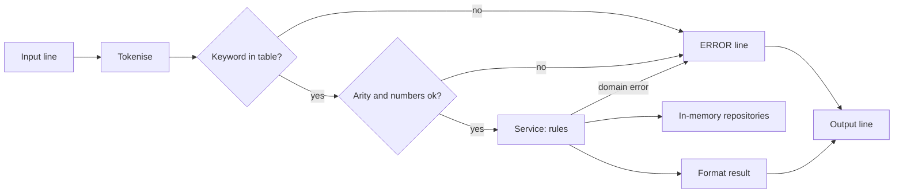

## In one minute
- A machine-coding round gives you a one or two page spec and 90 to 120 minutes to produce working code. The evaluator runs it against sample input, then reads it. Code that does not run scores close to zero, however elegant the classes.
- Spend the first 10 to 15 minutes reading, listing commands and turning the sample input and output into a test. Then build thin vertical slices: one command working end to end before the next starts.
- Scaffold in a fixed order: models, in-memory repositories, services that hold the rules, a parser with a dispatch table, and a thin driver.
- Errors are output, not crashes. A bad line prints an error, the loop keeps going, and a failed command changes no state.
- Most rounds end with "now add X". A dispatch table, a strategy for the one rule most likely to change, and repositories behind an interface make that a 10-minute change.

## How it works

### What the round is and how it differs from OOD
Many product companies, especially in India, run a machine-coding round: a problem such as a parking lot, a meeting room booker or a Splitwise clone, your own IDE, and a fixed window. At the end you demo it, the evaluator feeds it inputs, then reviews the code for structure and how easily it absorbs a change. The object-oriented design round (covered in the companion lesson on approaching OOD interviews) is a conversation with diagrams where code is optional. Here working code is required, and the design is judged by reading it. The score depends on three things, in order: does it run and print the right output, can a reviewer find each rule in one place, and does the next requirement fit without surgery.

### A time plan
For a 90-minute round:

| Minutes | Activity | Output |
|---|---|---|
| 0 to 10 | Read twice, list commands, ask questions | Commands with exact output formats |
| 10 to 15 | Sample input as a failing test; sketch entities | One golden test, a few class names |
| 15 to 30 | Models, repositories, parser, first command end to end | Something that runs |
| 30 to 65 | One vertical slice per remaining command | All happy paths pass |
| 65 to 80 | Validation, error lines, edge-case tests | Bad input never crashes |
| 80 to 90 | Run the full sample, rename, delete dead code | Demo ready |

For 120 minutes, keep the shape and spend the extra time on edge cases and the "optional" requirement. If two commands are missing at minute 60, stop polishing and finish them.

Ask only questions that change structure or output: case-sensitive keywords, exact error text, half-open intervals, tie-breaks, id reuse. Write each answer at the top of the test file; it becomes your spec.

### Scaffolding order
1. **Models.** Plain data: `Room(name, capacity)`, `Booking(id, user, room, start, end)`.
2. **Repositories.** In-memory stores with `add`, `get`, `remove` and the one or two queries the rules need (`for_room`). They own id generation and contain no business rules.
3. **Services.** Every rule lives here: "smallest room that fits", "only the owner can cancel". They take repositories in the constructor, raise domain errors, and never print or parse.
4. **Parser and dispatcher.** Tokenise, look the keyword up in a table of `name -> (arity, handler)`, check the count, convert numbers, call the service, format the result. This is the Command pattern in its lightest form (see Command).
5. **Driver.** Read lines, call `execute`, print. No logic, so no test needed.

### In-memory repositories
A map keyed by id gives O(1) lookups, which is enough for nearly every round. Hiding the map behind methods (Fowler's [Repository](https://martinfowler.com/eaaCatalog/repository.html) pattern) lets you answer "how would you persist this?" with "implement this interface against a table" rather than "rewrite the service". Advance the id counter only when a write succeeds, so a rejected command does not shift every later output.

### Command parsing that does not crash
Treat every line as hostile: blank, extra spaces, lowercase keyword, wrong argument count, a word where a number belongs. Validate in a fixed order (keyword, arity, number format, domain rules) so the error for a bad line is predictable. Unvalidated input is how real software fails: Heartbleed was a missing check on a length field in a TLS heartbeat request, which let a client read up to 64 KiB of server memory per request ([Wikipedia](https://en.wikipedia.org/wiki/Heartbleed)). Domain errors share one type; the dispatcher catches that type, prints `ERROR <message>` and moves on.

### Tests
A **golden test** feeds the spec's sample input and compares the full output; it catches format slips that evaluators' scripts are unforgiving about. **Focused tests** cover each rule and its edges: ties, boundaries, owner checks, and "a failed command changes nothing". Inject anything nondeterministic so tests repeat, as Design Snake and Ladder Game does with its dice and Design Movie Booking System with hold expiry.

### Extensibility the evaluator will probe
With a dispatch table a new command is one entry plus a service method. The rule most likely to vary (which spot, which room, how to split) belongs behind a strategy: Design Parking Lot does this for spot choice and Design Splitwise for split types. Do not pre-build interfaces for everything; make the two likely changes cheap (see YAGNI Principle).

### The same shape elsewhere
An interpreter over in-memory state is the **finding things fast** shape (keyword to handler, id to entity) wrapped around a state machine. Redis is exactly this: a command table mapping each name to a handler and an arity ([Redis docs](https://redis.io/docs/latest/commands/command/)), and a loop that parses, checks and runs each request against in-memory data.

## Down the stack

### Layer 1: The contract
Every input line produces exactly one output line, or none for a blank or comment line. Output is a pure function of the lines seen so far. A rejected command emits `ERROR ...` and leaves every repository and id counter unchanged. No input line can terminate the process. The practice tests check each statement.

### Layer 2: The mechanism
Whitespace tokenising is O(line length). The dispatcher is a hash map from the uppercased keyword to an arity and a handler. Redis stores the same idea: a positive arity means exactly that many arguments including the name, a negative one means at least that many ([COMMAND docs](https://redis.io/docs/latest/commands/command/)), and the server checks it before running the command: `INCR a b c` is rejected with `wrong number of arguments for 'incr' command` ([Redis transactions docs](https://redis.io/docs/latest/develop/using-commands/transactions/)). Numbers pass a strict digits-only check, so `-5`, `1e3` and `12abc` fail the same way. The service reads repositories and writes only after every check passes, which makes a failed command atomic without rollback code.

### Layer 3: The machine
Go's `bufio.Scanner` stops with "token too long" on lines over `MaxScanTokenSize`, 64 KiB, unless you call `Buffer` ([bufio docs](https://pkg.go.dev/bufio)), a surprise when a sample file holds one huge line. Writing is the bigger trap: Go's `os.Stdout` is unbuffered, so `fmt.Println` per line is one `write` syscall, around a microsecond each; 100,000 lines spend a tenth of a second in syscalls alone. Wrap it in a `bufio.Writer` and flush at exit; the docs say buffered data is not guaranteed to reach the destination until `Flush` ([bufio docs](https://pkg.go.dev/bufio)). Splitting allocates: Python creates a new string object (about 50 bytes of header) per token, while Go's `strings.Fields` returns substrings sharing the line's bytes.

### Why it's built this way
1. Evaluators judge by running sample input, so exact output and "never crash" matter more than any pattern.
2. Running something early is the only defence against the clock, so build vertical slices, not one layer at a time.
3. Each rule must be findable and testable alone, so rules live in services, away from parsing and printing.
4. The last 20 minutes usually bring a change request, so commands, the main allocation rule and storage sit behind a table, a strategy and a repository.

## Diagram



## Worked example
The spec: a meeting room booker with `ADD_ROOM`, `BOOK`, `CANCEL`, `FREE` and `SCHEDULE`; book the smallest room that fits, ties by name; 90 minutes. Minutes 0 to 10: the candidate asks whether intervals are half-open (yes), whether ids advance on failed bookings (no) and whether lowercase keywords are allowed (yes). Minutes 10 to 15: the sample goes into a golden test:

```text
ADD_ROOM big 10      -> ADDED big
ADD_ROOM small 4     -> ADDED small
BOOK alice 540 600 3 -> BOOKED B1 small
BOOK bob 540 600 3   -> BOOKED B2 big
BOOK cara 540 600 3  -> ERROR no room available
```

Minutes 15 to 30: models, two repositories and the dispatcher with only `ADD_ROOM`; it runs. Minutes 30 to 60: the other four commands, about 7 minutes each. Minutes 60 to 80: error paths, half-open boundaries (`540-600` and `600-660` coexist) and a test that a rejected booking does not consume `B3`. The change request, "rooms can go under maintenance", is one dispatch entry, a `blocked` flag and one condition in the free check.

## In the wild
- **OpenSSL, 2014: Heartbleed.** The TLS heartbeat extension code (CVE-2014-0160) did not check a length field in the request, so each malformed request could return up to 64 KiB of the server's memory. The flaw entered the code on 31 December 2011, shipped in OpenSSL 1.0.1 on 14 March 2012, and was disclosed on 7 April 2014 with the fix in 1.0.1g. At disclosure about 17% of trusted secure web servers were believed vulnerable ([heartbleed.com](https://heartbleed.com/); [Wikipedia](https://en.wikipedia.org/wiki/Heartbleed)). A machine-coding parser has the same job on a smaller scale: validate every field before using it.
- **Redis, documented design: a command table that rejects bad input before running it.** Each command declares its name and arity, and the server answers a wrong argument count with an error instead of running the handler. Inside `MULTI`, an error found while queuing makes `EXEC` refuse the whole transaction ([Redis docs](https://redis.io/docs/latest/develop/using-commands/transactions/)). This is the dispatch table plus "a failed command changes nothing" that the round rewards.

## Trade-offs

| Choice | Strengths | Weaknesses | Choose when |
|---|---|---|---|
| Single file | Fast to start | Hard to read past 300 lines | Two or three commands |
| Layered (models, repos, services, commands) | Each rule has one home | Ten minutes of scaffolding first | Almost every round |
| Exceptions for domain errors | One catch in the dispatcher | A broad catch hides bugs | Python, TypeScript, Java |
| Secondary index | Fast queries | Kept in sync on every write | Spec mentions large inputs |

## Pitfalls in production
- **Printing inside services.** Rules become untestable without capturing stdout. Fix: services return values, the dispatcher formats.
- **One giant `if` chain on the keyword.** Each new command edits a 200-line function. Fix: a dispatch table.
- **Ids that advance on failure.** One rejected line shifts every later id and the golden output diverges. Fix: allocate the id after validation.
- **A broad catch.** A `KeyError` in your own code becomes a plausible `ERROR` line. Fix: catch only the domain error type.
- **Unbuffered output in Go.** Large inputs time out in the harness. Fix: a `bufio.Writer` flushed at exit.

## Leadership lens
- Machine coding is a fair proxy for daily work: a vague ticket, a deadline, and code a teammate extends next week. Calibrate interviewers to grade "runs and is extendable" over "used many patterns".
- Put concrete signals in the rubric: golden test present, rules isolated from I/O, failed commands leave no trace, change request absorbed in a few files.
- When an assistant writes the scaffolding, check its boundaries: generated code tends to print from services and catch every exception.

## Check yourself
1. At minute 60 you have three of five commands working and want to refactor a long handler. What should you do?
   **Answer:** Finish the two missing commands first. A missing command fails the evaluator's run outright, while a long handler costs a little readability.
2. Why should the repository own id generation, and when should the counter advance?
   **Answer:** Ids are a storage concern and must be unique across all writers. The counter advances only when a write happens, so rejected commands do not shift later ids.
3. Your dispatcher catches all exceptions and prints `ERROR` plus the message. What is the risk?
   **Answer:** A real bug prints a plausible error line and tests may still pass. Catch only the domain error type so bugs crash in tests.
4. How do you make a failed `BOOK` leave no trace without rollback code?
   **Answer:** Run every validation and the room search before any write, so the only write is the final insert.

## Practice
**Task:** Build a meeting room booking interpreter. `Interpreter().execute(line)` returns one output string, or `None` (TypeScript `null`; Go `ok == false`) for a blank line or one whose first token starts with `#`. `run(lines)` feeds a fresh interpreter and returns the outputs. Tokens split on whitespace; keywords are case-insensitive. `ADD_ROOM room capacity` gives `ADDED room` (errors `room exists <room>`, then `invalid capacity` below 1). `BOOK user start end people` books the free room with the smallest sufficient capacity, ties by name, giving `BOOKED B<n> <room>`; ids start at 1 and advance only on success; intervals are half-open with `start < end <= 1440` (else `invalid interval`), `people >= 1` (else `invalid people`), else `no room available`. `CANCEL id user` gives `CANCELLED <id>` (errors `unknown booking <id>`, `not owner`). `FREE start end` gives sorted free room names joined by spaces, or `NONE`. `SCHEDULE room` gives `<id> <user> <start>-<end>` entries by start, joined with `, `, or `EMPTY` (error `unknown room <room>`). Other errors: `unknown command <token>`, `wrong arguments for <KEYWORD>`, and `invalid number <token>` for a token that is not all digits. Errors print as `ERROR <message>` and change nothing.

```python starter
class Interpreter:
    def execute(self, line):
        # TODO: tokenise, dispatch, call the service, format
        raise NotImplementedError


def run(lines):
    # TODO: feed lines to one Interpreter, keep non-None outputs
    raise NotImplementedError
```

```python tests
def test_book_picks_smallest_fitting_room():
    out = run(["ADD_ROOM big 10", "ADD_ROOM small 4", "ADD_ROOM tiny 2",
               "BOOK alice 540 600 3", "BOOK bob 540 600 3", "BOOK cara 540 600 3"])
    assert out == ["ADDED big", "ADDED small", "ADDED tiny", "BOOKED B1 small",
                   "BOOKED B2 big", "ERROR no room available"]


def test_intervals_are_half_open_and_ids_advance_only_on_success():
    out = run(["ADD_ROOM beta 4", "ADD_ROOM alpha 4", "BOOK x 540 600 2", "BOOK y 600 660 9",
               "BOOK y 600 660 2", "BOOK z 599 601 1", "BOOK z 599 601 1", "BOOK w 599 601 1"])
    assert out == ["ADDED beta", "ADDED alpha", "BOOKED B1 alpha", "ERROR no room available",
                   "BOOKED B2 alpha", "BOOKED B3 beta", "ERROR no room available",
                   "ERROR no room available"]


def test_cancel_checks_owner_and_frees_room():
    out = run(["ADD_ROOM a 4", "BOOK ana 60 120 2", "CANCEL B1 bob", "CANCEL B9 ana",
               "CANCEL B1 ana", "BOOK bob 60 120 2", "CANCEL B1 ana"])
    assert out == ["ADDED a", "BOOKED B1 a", "ERROR not owner", "ERROR unknown booking B9",
                   "CANCELLED B1", "BOOKED B2 a", "ERROR unknown booking B1"]


def test_free_and_schedule_formatting():
    out = run(["ADD_ROOM b 6", "ADD_ROOM a 4", "BOOK u1 600 660 2", "BOOK u2 480 540 2",
               "BOOK u3 600 630 5", "FREE 610 620", "FREE 540 600", "SCHEDULE a",
               "SCHEDULE b", "SCHEDULE c"])
    assert out[2:] == ["BOOKED B1 a", "BOOKED B2 a", "BOOKED B3 b", "NONE", "a b",
                       "B2 u2 480-540, B1 u1 600-660", "B3 u3 600-630", "ERROR unknown room c"]


def test_validation_errors_change_nothing():
    out = run(["ADD_ROOM a 0", "ADD_ROOM a x1", "ADD_ROOM a 3", "ADD_ROOM a 5",
               "BOOK u 60 60 1", "BOOK u 60 1441 1", "BOOK u 60 -5 1", "BOOK u 0 30 0",
               "SCHEDULE a", "FREE 0 1440"])
    assert out == ["ERROR invalid capacity", "ERROR invalid number x1", "ADDED a",
                   "ERROR room exists a", "ERROR invalid interval", "ERROR invalid interval",
                   "ERROR invalid number -5", "ERROR invalid people", "EMPTY", "a"]


def test_parser_handles_case_whitespace_comments_and_unknowns():
    out = run(["", "   ", "# setup", "  add_room   a   4  ", "Book ana 0 30 2", "PARK car",
               "BOOK ana 0 30", "FREE 0 30 extra"])
    assert out == ["ADDED a", "BOOKED B1 a", "ERROR unknown command PARK",
                   "ERROR wrong arguments for BOOK", "ERROR wrong arguments for FREE"]


def test_interpreter_keeps_state_between_lines():
    it = Interpreter()
    assert it.execute("ADD_ROOM a 4") == "ADDED a"
    assert it.execute("# note") is None
    assert it.execute("BOOK ana 0 30 2") == "BOOKED B1 a"
    assert Interpreter().execute("SCHEDULE a") == "ERROR unknown room a", "each interpreter has its own state"
```

```python solution
DAY_MINUTES = 1440


class CommandError(Exception):
    pass


class Room:
    def __init__(self, name, capacity):
        self.name = name
        self.capacity = capacity


class Booking:
    def __init__(self, booking_id, user, room, start, end):
        self.id = booking_id
        self.user = user
        self.room = room
        self.start = start
        self.end = end


class RoomRepository:
    def __init__(self):
        self._rooms = {}

    def add(self, room):
        self._rooms[room.name] = room

    def get(self, name):
        return self._rooms.get(name)

    def all(self):
        return list(self._rooms.values())


class BookingRepository:
    def __init__(self):
        self._bookings = {}
        self._next = 1

    def add(self, user, room, start, end):
        booking = Booking("B%d" % self._next, user, room, start, end)
        self._next += 1
        self._bookings[booking.id] = booking
        return booking

    def get(self, booking_id):
        return self._bookings.get(booking_id)

    def remove(self, booking_id):
        del self._bookings[booking_id]

    def for_room(self, room):
        return [b for b in self._bookings.values() if b.room == room]


def _check_interval(start, end):
    if start >= end or end > DAY_MINUTES:
        raise CommandError("invalid interval")


class BookingService:
    def __init__(self, rooms, bookings):
        self.rooms = rooms
        self.bookings = bookings

    def add_room(self, name, capacity):
        if self.rooms.get(name) is not None:
            raise CommandError("room exists " + name)
        if capacity < 1:
            raise CommandError("invalid capacity")
        self.rooms.add(Room(name, capacity))

    def _is_free(self, room, start, end):
        return all(b.end <= start or end <= b.start for b in self.bookings.for_room(room))

    def book(self, user, start, end, people):
        _check_interval(start, end)
        if people < 1:
            raise CommandError("invalid people")
        fits = [r for r in self.rooms.all()
                if r.capacity >= people and self._is_free(r.name, start, end)]
        if not fits:
            raise CommandError("no room available")
        room = min(fits, key=lambda r: (r.capacity, r.name))
        return self.bookings.add(user, room.name, start, end)

    def cancel(self, booking_id, user):
        booking = self.bookings.get(booking_id)
        if booking is None:
            raise CommandError("unknown booking " + booking_id)
        if booking.user != user:
            raise CommandError("not owner")
        self.bookings.remove(booking_id)

    def free(self, start, end):
        _check_interval(start, end)
        return sorted(r.name for r in self.rooms.all() if self._is_free(r.name, start, end))

    def schedule(self, name):
        if self.rooms.get(name) is None:
            raise CommandError("unknown room " + name)
        return sorted(self.bookings.for_room(name), key=lambda b: b.start)


def parse_int(token):
    if token == "" or any(c not in "0123456789" for c in token):
        raise CommandError("invalid number " + token)
    return int(token)


class Interpreter:
    def __init__(self):
        self.service = BookingService(RoomRepository(), BookingRepository())
        self._commands = {
            "ADD_ROOM": (2, self._add_room),
            "BOOK": (4, self._book),
            "CANCEL": (2, self._cancel),
            "FREE": (2, self._free),
            "SCHEDULE": (1, self._schedule),
        }

    def execute(self, line):
        tokens = line.split()
        if not tokens or tokens[0].startswith("#"):
            return None
        keyword = tokens[0].upper()
        if keyword not in self._commands:
            return "ERROR unknown command " + tokens[0]
        arity, handler = self._commands[keyword]
        if len(tokens) - 1 != arity:
            return "ERROR wrong arguments for " + keyword
        try:
            return handler(tokens[1:])
        except CommandError as e:
            return "ERROR " + str(e)

    def _add_room(self, args):
        capacity = parse_int(args[1])
        self.service.add_room(args[0], capacity)
        return "ADDED " + args[0]

    def _book(self, args):
        start, end, people = parse_int(args[1]), parse_int(args[2]), parse_int(args[3])
        booking = self.service.book(args[0], start, end, people)
        return "BOOKED %s %s" % (booking.id, booking.room)

    def _cancel(self, args):
        self.service.cancel(args[0], args[1])
        return "CANCELLED " + args[0]

    def _free(self, args):
        names = self.service.free(parse_int(args[0]), parse_int(args[1]))
        return " ".join(names) if names else "NONE"

    def _schedule(self, args):
        items = ["%s %s %d-%d" % (b.id, b.user, b.start, b.end) for b in self.service.schedule(args[0])]
        return ", ".join(items) if items else "EMPTY"


def run(lines):
    interpreter = Interpreter()
    outputs = [interpreter.execute(line) for line in lines]
    return [o for o in outputs if o is not None]
```

```typescript starter
export class Interpreter {
  execute(line: string): string | null {
    throw new Error("TODO");
  }
}

export function run(lines: string[]): string[] {
  throw new Error("TODO");
}
```

```typescript tests
test("book picks smallest fitting room", () => {
  const out = run(["ADD_ROOM big 10", "ADD_ROOM small 4", "ADD_ROOM tiny 2",
    "BOOK alice 540 600 3", "BOOK bob 540 600 3", "BOOK cara 540 600 3"]);
  assertEqual(out, ["ADDED big", "ADDED small", "ADDED tiny", "BOOKED B1 small",
    "BOOKED B2 big", "ERROR no room available"]);
});

test("intervals are half-open and ids advance only on success", () => {
  const out = run(["ADD_ROOM beta 4", "ADD_ROOM alpha 4", "BOOK x 540 600 2", "BOOK y 600 660 9",
    "BOOK y 600 660 2", "BOOK z 599 601 1", "BOOK z 599 601 1", "BOOK w 599 601 1"]);
  assertEqual(out, ["ADDED beta", "ADDED alpha", "BOOKED B1 alpha", "ERROR no room available",
    "BOOKED B2 alpha", "BOOKED B3 beta", "ERROR no room available", "ERROR no room available"]);
});

test("cancel checks owner and frees room", () => {
  const out = run(["ADD_ROOM a 4", "BOOK ana 60 120 2", "CANCEL B1 bob", "CANCEL B9 ana",
    "CANCEL B1 ana", "BOOK bob 60 120 2", "CANCEL B1 ana"]);
  assertEqual(out, ["ADDED a", "BOOKED B1 a", "ERROR not owner", "ERROR unknown booking B9",
    "CANCELLED B1", "BOOKED B2 a", "ERROR unknown booking B1"]);
});

test("free and schedule formatting", () => {
  const out = run(["ADD_ROOM b 6", "ADD_ROOM a 4", "BOOK u1 600 660 2", "BOOK u2 480 540 2",
    "BOOK u3 600 630 5", "FREE 610 620", "FREE 540 600", "SCHEDULE a", "SCHEDULE b", "SCHEDULE c"]);
  assertEqual(out.slice(2), ["BOOKED B1 a", "BOOKED B2 a", "BOOKED B3 b", "NONE", "a b",
    "B2 u2 480-540, B1 u1 600-660", "B3 u3 600-630", "ERROR unknown room c"]);
});

test("validation errors change nothing", () => {
  const out = run(["ADD_ROOM a 0", "ADD_ROOM a x1", "ADD_ROOM a 3", "ADD_ROOM a 5",
    "BOOK u 60 60 1", "BOOK u 60 1441 1", "BOOK u 60 -5 1", "BOOK u 0 30 0", "SCHEDULE a", "FREE 0 1440"]);
  assertEqual(out, ["ERROR invalid capacity", "ERROR invalid number x1", "ADDED a",
    "ERROR room exists a", "ERROR invalid interval", "ERROR invalid interval",
    "ERROR invalid number -5", "ERROR invalid people", "EMPTY", "a"]);
});

test("parser handles case, whitespace, comments and unknowns", () => {
  const out = run(["", "   ", "# setup", "  add_room   a   4  ", "Book ana 0 30 2", "PARK car",
    "BOOK ana 0 30", "FREE 0 30 extra"]);
  assertEqual(out, ["ADDED a", "BOOKED B1 a", "ERROR unknown command PARK",
    "ERROR wrong arguments for BOOK", "ERROR wrong arguments for FREE"]);
});

test("interpreter keeps state between lines", () => {
  const it = new Interpreter();
  assertEqual(it.execute("ADD_ROOM a 4"), "ADDED a");
  assertEqual(it.execute("# note"), null);
  assertEqual(it.execute("BOOK ana 0 30 2"), "BOOKED B1 a");
  assertEqual(new Interpreter().execute("SCHEDULE a"), "ERROR unknown room a", "each interpreter has its own state");
});
```

```typescript solution
const DAY_MINUTES = 1440;

export class CommandError extends Error {}

interface Room {
  name: string;
  capacity: number;
}

interface Booking {
  id: string;
  user: string;
  room: string;
  start: number;
  end: number;
}

export class RoomRepository {
  private rooms = new Map<string, Room>();
  add(room: Room): void {
    this.rooms.set(room.name, room);
  }
  get(name: string): Room | undefined {
    return this.rooms.get(name);
  }
  all(): Room[] {
    return [...this.rooms.values()];
  }
}

export class BookingRepository {
  private bookings = new Map<string, Booking>();
  private next = 1;
  add(user: string, room: string, start: number, end: number): Booking {
    const booking = { id: `B${this.next++}`, user, room, start, end };
    this.bookings.set(booking.id, booking);
    return booking;
  }
  get(id: string): Booking | undefined {
    return this.bookings.get(id);
  }
  remove(id: string): void {
    this.bookings.delete(id);
  }
  forRoom(room: string): Booking[] {
    return [...this.bookings.values()].filter((b) => b.room === room);
  }
}

function checkInterval(start: number, end: number): void {
  if (start >= end || end > DAY_MINUTES) throw new CommandError("invalid interval");
}

export class BookingService {
  constructor(private rooms: RoomRepository, private bookings: BookingRepository) {}

  addRoom(name: string, capacity: number): void {
    if (this.rooms.get(name)) throw new CommandError(`room exists ${name}`);
    if (capacity < 1) throw new CommandError("invalid capacity");
    this.rooms.add({ name, capacity });
  }

  private isFree(room: string, start: number, end: number): boolean {
    return this.bookings.forRoom(room).every((b) => b.end <= start || end <= b.start);
  }

  book(user: string, start: number, end: number, people: number): Booking {
    checkInterval(start, end);
    if (people < 1) throw new CommandError("invalid people");
    const fits = this.rooms.all()
      .filter((r) => r.capacity >= people && this.isFree(r.name, start, end))
      .sort((x, y) => x.capacity - y.capacity || (x.name < y.name ? -1 : x.name > y.name ? 1 : 0));
    if (fits.length === 0) throw new CommandError("no room available");
    return this.bookings.add(user, fits[0].name, start, end);
  }

  cancel(id: string, user: string): void {
    const booking = this.bookings.get(id);
    if (!booking) throw new CommandError(`unknown booking ${id}`);
    if (booking.user !== user) throw new CommandError("not owner");
    this.bookings.remove(id);
  }

  free(start: number, end: number): string[] {
    checkInterval(start, end);
    return this.rooms.all().filter((r) => this.isFree(r.name, start, end)).map((r) => r.name).sort();
  }

  schedule(name: string): Booking[] {
    if (!this.rooms.get(name)) throw new CommandError(`unknown room ${name}`);
    return this.bookings.forRoom(name).sort((x, y) => x.start - y.start);
  }
}

export function parseInt10(token: string): number {
  if (!/^[0-9]+$/.test(token)) throw new CommandError(`invalid number ${token}`);
  return Number(token);
}

type Handler = (args: string[]) => string;

export class Interpreter {
  private service = new BookingService(new RoomRepository(), new BookingRepository());
  private commands = new Map<string, [number, Handler]>([
    ["ADD_ROOM", [2, (a) => {
      const capacity = parseInt10(a[1]);
      this.service.addRoom(a[0], capacity);
      return `ADDED ${a[0]}`;
    }]],
    ["BOOK", [4, (a) => {
      const start = parseInt10(a[1]);
      const end = parseInt10(a[2]);
      const people = parseInt10(a[3]);
      const b = this.service.book(a[0], start, end, people);
      return `BOOKED ${b.id} ${b.room}`;
    }]],
    ["CANCEL", [2, (a) => {
      this.service.cancel(a[0], a[1]);
      return `CANCELLED ${a[0]}`;
    }]],
    ["FREE", [2, (a) => {
      const start = parseInt10(a[0]);
      const end = parseInt10(a[1]);
      const names = this.service.free(start, end);
      return names.length > 0 ? names.join(" ") : "NONE";
    }]],
    ["SCHEDULE", [1, (a) => {
      const items = this.service.schedule(a[0]).map((b) => `${b.id} ${b.user} ${b.start}-${b.end}`);
      return items.length > 0 ? items.join(", ") : "EMPTY";
    }]],
  ]);

  execute(line: string): string | null {
    const tokens = line.trim().split(/\s+/).filter((t) => t.length > 0);
    if (tokens.length === 0 || tokens[0].startsWith("#")) return null;
    const keyword = tokens[0].toUpperCase();
    const entry = this.commands.get(keyword);
    if (!entry) return `ERROR unknown command ${tokens[0]}`;
    const [arity, handler] = entry;
    if (tokens.length - 1 !== arity) return `ERROR wrong arguments for ${keyword}`;
    try {
      return handler(tokens.slice(1));
    } catch (e) {
      if (e instanceof CommandError) return `ERROR ${e.message}`;
      throw e;
    }
  }
}

export function run(lines: string[]): string[] {
  const interpreter = new Interpreter();
  const out: string[] = [];
  for (const line of lines) {
    const result = interpreter.execute(line);
    if (result !== null) out.push(result);
  }
  return out;
}
```

```go starter
package practice

type Interpreter struct{}

func NewInterpreter() *Interpreter { return &Interpreter{} }

// Execute returns the output line, or ok == false for a blank or comment line.
func (it *Interpreter) Execute(line string) (out string, ok bool) {
	panic("TODO")
}

func Run(lines []string) []string {
	panic("TODO")
}
```

```go tests
package practice

import (
	"reflect"
	"testing"
)

func expect(t *testing.T, got, want []string) {
	t.Helper()
	if !reflect.DeepEqual(got, want) {
		t.Fatalf("got  %q\nwant %q", got, want)
	}
}

func TestBookPicksSmallestFittingRoom(t *testing.T) {
	out := Run([]string{"ADD_ROOM big 10", "ADD_ROOM small 4", "ADD_ROOM tiny 2",
		"BOOK alice 540 600 3", "BOOK bob 540 600 3", "BOOK cara 540 600 3"})
	expect(t, out, []string{"ADDED big", "ADDED small", "ADDED tiny", "BOOKED B1 small",
		"BOOKED B2 big", "ERROR no room available"})
}

func TestHalfOpenIntervalsAndIdsAdvanceOnlyOnSuccess(t *testing.T) {
	out := Run([]string{"ADD_ROOM beta 4", "ADD_ROOM alpha 4", "BOOK x 540 600 2", "BOOK y 600 660 9",
		"BOOK y 600 660 2", "BOOK z 599 601 1", "BOOK z 599 601 1", "BOOK w 599 601 1"})
	expect(t, out, []string{"ADDED beta", "ADDED alpha", "BOOKED B1 alpha", "ERROR no room available",
		"BOOKED B2 alpha", "BOOKED B3 beta", "ERROR no room available", "ERROR no room available"})
}

func TestCancelChecksOwnerAndFreesRoom(t *testing.T) {
	out := Run([]string{"ADD_ROOM a 4", "BOOK ana 60 120 2", "CANCEL B1 bob", "CANCEL B9 ana",
		"CANCEL B1 ana", "BOOK bob 60 120 2", "CANCEL B1 ana"})
	expect(t, out, []string{"ADDED a", "BOOKED B1 a", "ERROR not owner", "ERROR unknown booking B9",
		"CANCELLED B1", "BOOKED B2 a", "ERROR unknown booking B1"})
}

func TestFreeAndScheduleFormatting(t *testing.T) {
	out := Run([]string{"ADD_ROOM b 6", "ADD_ROOM a 4", "BOOK u1 600 660 2", "BOOK u2 480 540 2",
		"BOOK u3 600 630 5", "FREE 610 620", "FREE 540 600", "SCHEDULE a", "SCHEDULE b", "SCHEDULE c"})
	expect(t, out[2:], []string{"BOOKED B1 a", "BOOKED B2 a", "BOOKED B3 b", "NONE", "a b",
		"B2 u2 480-540, B1 u1 600-660", "B3 u3 600-630", "ERROR unknown room c"})
}

func TestValidationErrorsChangeNothing(t *testing.T) {
	out := Run([]string{"ADD_ROOM a 0", "ADD_ROOM a x1", "ADD_ROOM a 3", "ADD_ROOM a 5",
		"BOOK u 60 60 1", "BOOK u 60 1441 1", "BOOK u 60 -5 1", "BOOK u 0 30 0", "SCHEDULE a", "FREE 0 1440"})
	expect(t, out, []string{"ERROR invalid capacity", "ERROR invalid number x1", "ADDED a",
		"ERROR room exists a", "ERROR invalid interval", "ERROR invalid interval",
		"ERROR invalid number -5", "ERROR invalid people", "EMPTY", "a"})
}

func TestParserHandlesCaseWhitespaceCommentsAndUnknowns(t *testing.T) {
	out := Run([]string{"", "   ", "# setup", "  add_room   a   4  ", "Book ana 0 30 2", "PARK car",
		"BOOK ana 0 30", "FREE 0 30 extra"})
	expect(t, out, []string{"ADDED a", "BOOKED B1 a", "ERROR unknown command PARK",
		"ERROR wrong arguments for BOOK", "ERROR wrong arguments for FREE"})
}

func TestInterpreterKeepsStateBetweenLines(t *testing.T) {
	it := NewInterpreter()
	if out, ok := it.Execute("ADD_ROOM a 4"); !ok || out != "ADDED a" {
		t.Fatalf("got %q %v", out, ok)
	}
	if _, ok := it.Execute("# note"); ok {
		t.Fatal("comment should produce no output")
	}
	if out, _ := it.Execute("BOOK ana 0 30 2"); out != "BOOKED B1 a" {
		t.Fatalf("got %q", out)
	}
	if out, _ := NewInterpreter().Execute("SCHEDULE a"); out != "ERROR unknown room a" {
		t.Fatalf("each interpreter has its own state, got %q", out)
	}
}
```

```go solution
package practice

import (
	"errors"
	"fmt"
	"sort"
	"strconv"
	"strings"
)

const dayMinutes = 1440

// CommandError is a domain error that becomes an "ERROR ..." line.
type CommandError struct{ Msg string }

func (e *CommandError) Error() string { return e.Msg }

func fail(format string, args ...any) error { return &CommandError{fmt.Sprintf(format, args...)} }

type Room struct {
	Name     string
	Capacity int
}

type Booking struct {
	ID, User, Room string
	Start, End     int
}

type RoomRepository struct{ rooms map[string]Room }

func (r *RoomRepository) Add(room Room) { r.rooms[room.Name] = room }

func (r *RoomRepository) Get(name string) (Room, bool) {
	room, ok := r.rooms[name]
	return room, ok
}

func (r *RoomRepository) All() []Room {
	out := make([]Room, 0, len(r.rooms))
	for _, room := range r.rooms {
		out = append(out, room)
	}
	return out
}

type BookingRepository struct {
	bookings map[string]Booking
	next     int
}

func (r *BookingRepository) Add(user, room string, start, end int) Booking {
	b := Booking{ID: fmt.Sprintf("B%d", r.next), User: user, Room: room, Start: start, End: end}
	r.next++
	r.bookings[b.ID] = b
	return b
}

func (r *BookingRepository) Get(id string) (Booking, bool) {
	b, ok := r.bookings[id]
	return b, ok
}

func (r *BookingRepository) Remove(id string) { delete(r.bookings, id) }

func (r *BookingRepository) ForRoom(room string) []Booking {
	var out []Booking
	for _, b := range r.bookings {
		if b.Room == room {
			out = append(out, b)
		}
	}
	return out
}

type BookingService struct {
	rooms    *RoomRepository
	bookings *BookingRepository
}

func checkInterval(start, end int) error {
	if start >= end || end > dayMinutes {
		return fail("invalid interval")
	}
	return nil
}

func (s *BookingService) AddRoom(name string, capacity int) error {
	if _, ok := s.rooms.Get(name); ok {
		return fail("room exists %s", name)
	}
	if capacity < 1 {
		return fail("invalid capacity")
	}
	s.rooms.Add(Room{name, capacity})
	return nil
}

func (s *BookingService) isFree(room string, start, end int) bool {
	for _, b := range s.bookings.ForRoom(room) {
		if b.Start < end && start < b.End {
			return false
		}
	}
	return true
}

func (s *BookingService) Book(user string, start, end, people int) (Booking, error) {
	if err := checkInterval(start, end); err != nil {
		return Booking{}, err
	}
	if people < 1 {
		return Booking{}, fail("invalid people")
	}
	var best *Room
	for _, r := range s.rooms.All() {
		r := r
		if r.Capacity < people || !s.isFree(r.Name, start, end) {
			continue
		}
		if best == nil || r.Capacity < best.Capacity || (r.Capacity == best.Capacity && r.Name < best.Name) {
			best = &r
		}
	}
	if best == nil {
		return Booking{}, fail("no room available")
	}
	return s.bookings.Add(user, best.Name, start, end), nil
}

func (s *BookingService) Cancel(id, user string) error {
	b, ok := s.bookings.Get(id)
	if !ok {
		return fail("unknown booking %s", id)
	}
	if b.User != user {
		return fail("not owner")
	}
	s.bookings.Remove(id)
	return nil
}

func (s *BookingService) Free(start, end int) ([]string, error) {
	if err := checkInterval(start, end); err != nil {
		return nil, err
	}
	var names []string
	for _, r := range s.rooms.All() {
		if s.isFree(r.Name, start, end) {
			names = append(names, r.Name)
		}
	}
	sort.Strings(names)
	return names, nil
}

func (s *BookingService) Schedule(name string) ([]Booking, error) {
	if _, ok := s.rooms.Get(name); !ok {
		return nil, fail("unknown room %s", name)
	}
	list := s.bookings.ForRoom(name)
	sort.Slice(list, func(i, j int) bool { return list[i].Start < list[j].Start })
	return list, nil
}

func parseInt(token string) (int, error) {
	for i := 0; i < len(token); i++ {
		if token[i] < '0' || token[i] > '9' {
			return 0, fail("invalid number %s", token)
		}
	}
	n, err := strconv.Atoi(token)
	if err != nil || token == "" {
		return 0, fail("invalid number %s", token)
	}
	return n, nil
}

func parseInts(tokens ...string) ([]int, error) {
	out := make([]int, len(tokens))
	for i, t := range tokens {
		n, err := parseInt(t)
		if err != nil {
			return nil, err
		}
		out[i] = n
	}
	return out, nil
}

type command struct {
	arity   int
	handler func(args []string) (string, error)
}

type Interpreter struct {
	service  *BookingService
	commands map[string]command
}

func NewInterpreter() *Interpreter {
	s := &BookingService{
		rooms:    &RoomRepository{rooms: map[string]Room{}},
		bookings: &BookingRepository{bookings: map[string]Booking{}, next: 1},
	}
	it := &Interpreter{service: s}
	it.commands = map[string]command{
		"ADD_ROOM": {2, func(a []string) (string, error) {
			n, err := parseInts(a[1])
			if err != nil {
				return "", err
			}
			if err := s.AddRoom(a[0], n[0]); err != nil {
				return "", err
			}
			return "ADDED " + a[0], nil
		}},
		"BOOK": {4, func(a []string) (string, error) {
			n, err := parseInts(a[1], a[2], a[3])
			if err != nil {
				return "", err
			}
			b, err := s.Book(a[0], n[0], n[1], n[2])
			if err != nil {
				return "", err
			}
			return fmt.Sprintf("BOOKED %s %s", b.ID, b.Room), nil
		}},
		"CANCEL": {2, func(a []string) (string, error) {
			if err := s.Cancel(a[0], a[1]); err != nil {
				return "", err
			}
			return "CANCELLED " + a[0], nil
		}},
		"FREE": {2, func(a []string) (string, error) {
			n, err := parseInts(a[0], a[1])
			if err != nil {
				return "", err
			}
			names, err := s.Free(n[0], n[1])
			if err != nil {
				return "", err
			}
			if len(names) == 0 {
				return "NONE", nil
			}
			return strings.Join(names, " "), nil
		}},
		"SCHEDULE": {1, func(a []string) (string, error) {
			list, err := s.Schedule(a[0])
			if err != nil {
				return "", err
			}
			if len(list) == 0 {
				return "EMPTY", nil
			}
			items := make([]string, len(list))
			for i, b := range list {
				items[i] = fmt.Sprintf("%s %s %d-%d", b.ID, b.User, b.Start, b.End)
			}
			return strings.Join(items, ", "), nil
		}},
	}
	return it
}

// Execute returns the output line, or ok == false for a blank or comment line.
func (it *Interpreter) Execute(line string) (out string, ok bool) {
	tokens := strings.Fields(line)
	if len(tokens) == 0 || strings.HasPrefix(tokens[0], "#") {
		return "", false
	}
	keyword := strings.ToUpper(tokens[0])
	cmd, found := it.commands[keyword]
	if !found {
		return "ERROR unknown command " + tokens[0], true
	}
	if len(tokens)-1 != cmd.arity {
		return "ERROR wrong arguments for " + keyword, true
	}
	res, err := cmd.handler(tokens[1:])
	var ce *CommandError
	if errors.As(err, &ce) {
		return "ERROR " + ce.Msg, true
	}
	if err != nil {
		panic(err)
	}
	return res, true
}

func Run(lines []string) []string {
	it := NewInterpreter()
	out := []string{}
	for _, line := range lines {
		if res, ok := it.Execute(line); ok {
			out = append(out, res)
		}
	}
	return out
}
```

## Mock interview
**Prompt:** In 90 minutes, build a parking garage manager driven by text commands: `CREATE levels spots_per_level`, `PARK plate size`, `LEAVE plate minute`, `STATUS level`. Spots are chosen lowest level first, then lowest number. The evaluator will run a 2,000-line input file, then review your code.

- Follow-up: at minute 70 the evaluator adds "VIP vehicles go to a reserved level". Which files change?
- Follow-up: a line reads `PARK KA01 large extra`. What is printed, and which layer decided it?
- Follow-up: the input grows to 5 million lines and the Go version takes 9 seconds. Where does the time go?

**A strong answer covers:**
- A time plan stated up front, and a golden test from the sample input before any model code.
- Models, repositories owning ids, services owning every rule, a dispatch table with arity, and a thin driver.
- The allocation rule behind a strategy, so VIP is a new strategy plus one dispatch entry.
- Errors as output lines from one place, validation before writes, and real bugs still crashing.
- I/O cost: buffered output, scanner line limits, and when a scan should become an index such as a min-heap of free spots per level.

## Sources and further study
**Primary**
- [Go bufio package](https://pkg.go.dev/bufio): `Scanner` token limits and `Writer` flushing, the two I/O details that bite in timed rounds.
- [heartbleed.com](https://heartbleed.com/): the official write-up of an input-validation failure and its scope.

**Systems docs**
- [Redis: COMMAND](https://redis.io/docs/latest/commands/command/): how a real server describes each command's name, arity and flags.
- [Redis: transactions](https://redis.io/docs/latest/develop/using-commands/transactions/): queue-time errors versus execution-time errors, and the no-rollback choice.

**Books**
- *Patterns of Enterprise Application Architecture*, Martin Fowler: the Repository pattern, which the in-memory stores here follow (the online catalogue entry is linked under Free resources).
- *Refactoring*, Martin Fowler (2nd ed.): chapter 4, Building Tests, on writing the test before the change.
- *Design Patterns*, Gamma, Helm, Johnson and Vlissides: chapter 5, Behavioral Patterns, which includes Command and Strategy.
- *Head First Design Patterns* (2nd ed.), Freeman and Robson: chapter 6, The Command Pattern.

**Other curricula**
- [donnemartin/system-design-primer](https://github.com/donnemartin/system-design-primer): has object-oriented design solutions but no timed, run-the-sample-input format.
- [roadmap.sh: software design and architecture](https://roadmap.sh/software-design-architecture): lists patterns and principles to know; it says nothing about pacing a 90-minute round.

## Watch
- [Machine Coding Round Interview: Flipkart, Uber, Udaan, Dunzo (CodeBuddy Official)](https://www.youtube.com/watch?v=Naf8KCy2lgM): what companies expect in the round and how candidates are evaluated.
- [Machine Coding Interview Round: Design and Code a Stock Broker App (Keerti Purswani)](https://www.youtube.com/watch?v=OVkxdFJLgwE): a live, timed walkthrough from requirements to running code.
- [Machine coding round: A Step-by-Step Guide (Engineerhoon)](https://www.youtube.com/watch?v=MAFsVJgdkRc): a step-by-step approach to pacing and structuring a solution.

## Free resources
- [Repository (Martin Fowler, Patterns of Enterprise Application Architecture)](https://martinfowler.com/eaaCatalog/repository.html): the pattern behind in-memory stores that can later be swapped for a database.
- [Command pattern (Refactoring.Guru)](https://refactoring.guru/design-patterns/command): commands as objects, the idea behind a dispatch table of handlers.
- [COMMAND (Redis docs)](https://redis.io/docs/latest/commands/command/): how a real server describes each command's name, arity and flags in its command table.
- [cmd: support for line-oriented command interpreters (Python docs)](https://docs.python.org/3/library/cmd.html): the standard library's own interpreter skeleton, with dispatch by method name.
- [bufio (Go docs)](https://pkg.go.dev/bufio): `Scanner` limits and `Writer` buffering, the two I/O details that bite in timed rounds.
- [The Practical Test Pyramid (Martin Fowler)](https://martinfowler.com/articles/practical-test-pyramid.html): how focused unit tests and a few broad end-to-end tests fit together.
