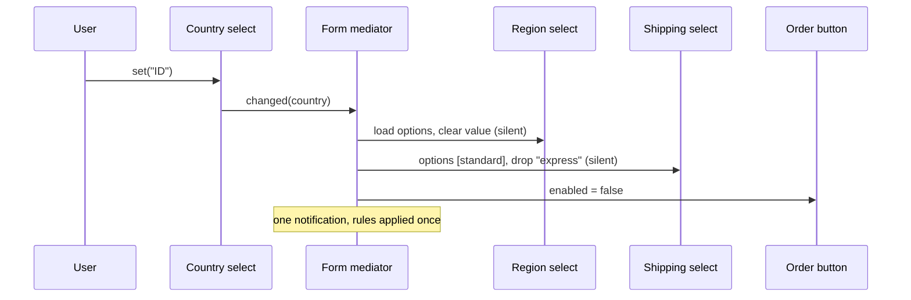

## In one minute
- Mediator stops a group of objects from talking to each other directly. Each one knows only the mediator; when something happens it tells the mediator, and the mediator decides who else must react and how.
- It turns a mesh of up to N(N-1)/2 pairwise links into a star of N links, and it puts the interaction rules ("changing the country resets the region and may remove express shipping") in one readable place instead of scattering them across event handlers.
- Unlike Observer, which is only a notification mechanism, a mediator holds policy. Unlike a Facade, the parts know the mediator and call into it.
- The risk is a god object: every new interaction lands in the mediator until it is the hardest file in the codebase. Split mediators by interaction cluster and keep components dumb.
- The classic bugs are cascades. A mediator that updates a component, which notifies the mediator, which updates another component, can loop or apply rules twice. Mediator-initiated updates must not re-enter the mediator.

## How it works

### The problem
A checkout form has four controls: a country select, a region select, a shipping-method select and a "terms accepted" checkbox, plus a Place order button. The rules are simple to state. Region options depend on the country, and the region is cleared when the country changes. Some countries have no regions. Express shipping exists only in some countries. The button is enabled only when everything required is filled in.

The first implementation wires the controls to each other. The country handler clears the region, reloads its options, filters shipping and re-checks the button; the other three handlers each re-check the button too. Every control holds references to three or four others, the "is the form complete?" logic is copied four times, and the copies disagree. A new promo code field that affects shipping means hunting for every handler that should consider it.

### Put the rules in the middle
With a mediator, each control knows one thing: whom to tell when its value changes.

```python
class Widget:
    def set(self, value):
        self._check(value)          # disabled? valid option?
        if value != self.value:
            self.value = value
            self.mediator.changed(self)
```

The form object is the mediator. Its `changed(widget)` method is the only place that knows the rules: if the sender is the country, reset the region, load its options and filter shipping; in every case, recompute whether the button is enabled. Controls are now reusable (the same select works on the address book page with a different mediator) and testable alone. The rules can be read top to bottom in one method.

### Mediator, Observer, Facade, event bus
These are easy to confuse because they all reduce direct references.
- **Observer** is a mechanism: a subject broadcasts, observers react, and the subject has no opinion about what they do. A mediator often uses observer-style notifications to hear from components, but it adds policy about what happens next.
- **Facade** (see that lesson) sits in front of a subsystem whose parts do not know it exists; callers go through it. In a mediated group, the parts know the mediator and talk to each other through it.
- **An event bus** routes messages by topic without knowing the participants or the rules. It decouples more and explains less: the interaction logic is spread across subscribers again, just without imports.

A useful test: if you can point to one place and say "this is where the rules about how these components interact live", you have a mediator.

### Where you already use it
- **React's "lifting state up".** Two sibling components that must agree do not reference each other; their closest common parent owns the state and passes it down as props ([React docs](https://react.dev/learn/sharing-state-between-components)). The parent is the mediator.
- **Kubernetes controllers.** The Deployment controller does not call the ReplicaSet controller, and neither calls the scheduler. Each reads and writes objects through the API server and watches for changes, so the API server and its stored state mediate every interaction between them ([Kubernetes docs](https://kubernetes.io/docs/concepts/architecture/controller/)). The docs add a caveat: a controller that manages something outside the cluster talks to that external system directly, so the mediator covers cluster state only.
- **Exchanges and air traffic control.** Buyers and sellers never contact each other, and aircraft do not negotiate runways; the matching engine and the tower decide.

### Keeping the mediator from becoming a god object
A mediator absorbs complexity on purpose, so it grows. Three habits keep it healthy. First, keep components ignorant: they report what happened ("value changed") and never what should happen next ("please reset the region"). Second, split by cluster: an address section mediator and a payment section mediator, each owning their rules, with a thin form-level mediator joining them. Third, when rules become numerous and regular, express them as data (a dependency table: "region depends on country; shipping depends on country and weight") and let the mediator evaluate the table.

### Reviewing agent-written code
Asked to "clear the region when the country changes", an agent will add `regionSelect.clear()` to the country's change handler: one more direct link. Asked for something more decoupled, it often reaches for a global event bus with string topics, which hides the links instead of removing them. In review, ask where the interaction rules live and whether a component imports or calls a sibling. Check for re-entrancy: does setting a value from inside the mediator trigger the mediator again? Check that the "is it complete?" logic exists once.

### The same shape elsewhere
A mediator is a *contention* and *ordering* answer: every interaction goes through one point, so interactions are serialised and applied in a known order. The same trade appears in distributed systems as coordinator versus peer-to-peer designs. A coordinator (a leader, a lock service like etcd, an orchestrator for a saga) is easy to reason about and becomes a bottleneck and a single point of failure; gossip and choreography avoid the bottleneck and make the global behaviour harder to see. The choice inside a form and the choice across 40 services follow the same reasoning.

## Down the stack

### Layer 1: The contract
Components promise to report their own changes to the mediator and to never reference sibling components. The mediator promises that after it finishes handling any notification, the group's invariants hold: the region is valid for the country, shipping is valid for the country, and the button is enabled exactly when the form is complete. It also promises that its own updates to components do not generate new notifications, so handling one user action runs the rules once. Handling is synchronous and in a defined order, so a test can set a value and immediately assert the whole group's state.

### Layer 2: The mechanism
The structure is a star: the mediator holds typed references to each component, and each component holds one reference to the mediator, usually through a small interface (`changed(sender)`) so components do not depend on the concrete form. Re-entrancy is handled in one of two ways. Either components expose a silent setter that the mediator uses (the practice solution's approach), or the mediator sets an "updating" flag and ignores notifications that arrive while it is applying rules.

In React, the parent's state setter schedules a re-render rather than mutating children. Before React 18 only updates inside React event handlers were batched into one render; React 18 batches automatically, including updates inside promises and timeouts ([React 18 announcement](https://react.dev/blog/2022/03/29/react-v18)). Children receive new props. In Kubernetes, controllers use informers that list and watch resources into a local cache and queue the keys that changed; reconciliation writes through the API server with optimistic concurrency, where a stale `resourceVersion` makes the API server return a 409 Conflict and the controller retries ([Kubernetes API concepts](https://kubernetes.io/docs/reference/using-api/api-concepts/)). The API server never calls controllers; the interaction emerges from shared state. In Go programs, a common in-process mediator is a single goroutine that owns the state and serves requests from channels in a `select` loop, so no lock is needed because only one goroutine touches the data; the Go team's slogan for this is to share memory by communicating ([Go blog](https://go.dev/blog/codelab-share)).

### Layer 3: The machine
The star costs N references instead of up to N(N-1)/2, and each interaction costs one indirect call into the mediator plus the rule evaluation, a few nanoseconds in Go and well under a microsecond in a browser. The memory effect worth knowing is cycles: components point to the mediator and the mediator points to components. Tracing collectors (V8, the JVM, Go) reclaim such cycles once nothing outside reaches them, but CPython frees most objects by reference counting and needs its cyclic collector to reclaim them, which runs later. A long-lived global mediator, like a lapsed observer, keeps every registered component alive until it is explicitly removed.

Concurrency is where the mediator's centrality shows. Because every interaction passes through it, it is a natural serialisation point: one mutex or one owner goroutine. That makes it correct by construction and limits throughput to one interaction at a time. If each interaction holds the lock for 20 microseconds, the ceiling is 50,000 interactions per second no matter how many cores there are. An uncontended Go channel send and receive costs on the order of 100 ns, cheap in a form and noticeable in a market data path. When the ceiling bites, partition: one mediator per order book, per chat room, per document, so unrelated interactions do not contend.

### Why it's built this way
1. Components that react to each other directly need links that grow quadratically with their number.
2. Interaction rules scattered across handlers disagree and cannot be read as a whole, so they move to one object.
3. Components then know only that object, which makes them reusable and testable alone.
4. One object applying all rules serialises interactions, which makes the rules easy to reason about and makes the mediator a bottleneck and a growth hotspot.
5. So mediators are kept per cluster or per partition, and kept free of re-entrant cascades.

## Diagram


## Worked example
A travel site's booking page had 14 interactive controls (dates, travellers, cabin, fare family, seats, bags, insurance, promo code and others). An audit counted 31 change handlers reaching into other controls and 6 different copies of the "can the user continue?" check. Over two quarters, 9 production bugs came from these interactions, such as a promo code unlocking a fare family whose bag allowance was not re-applied when travellers changed.

The rewrite made every control report only its own changes, to a trip-section mediator or an extras-section mediator, joined by a page mediator that owns the continue check. The dependency rules became a table of 22 entries such as "bags depends on fare family and travellers", and sibling references per control fell from 3.2 on average to zero.

Interaction bugs fell to 1 in the next two quarters. Rule handling took about 0.3 ms per user action against a 16 ms frame budget, and a change that once touched 7 handlers became one table row and one test.

## In the wild
- **Kubernetes, ongoing: the API server as mediator.** Built-in controllers such as the Job controller do not call each other. They read desired state from the API server and write changes back to it, so the server and its stored objects are the only meeting point ([Kubernetes docs](https://kubernetes.io/docs/concepts/architecture/controller/)). Concurrent writers are kept honest by `resourceVersion`: a stale write gets a 409 Conflict ([API concepts](https://kubernetes.io/docs/reference/using-api/api-concepts/)).
- **Google Docs, 2010: the server relays every edit.** In the rebuilt editor each document is a revision log of InsertText, DeleteText and ApplyStyle changes. Editors send changes through the server and transform incoming ones against their own, so concurrent users never talk peer to peer ([Google Drive blog](https://drive.googleblog.com/2010/09/whats-different-about-new-google-docs_22.html)).
- **GitHub, 2018: a coordinator promotes the wrong primaries.** A 43-second network partition cut the US East hub off from the main East Coast data center. Orchestrator, which had quorum, promoted West Coast MySQL primaries, so both coasts held writes the other lacked. Service was degraded for 24h11m, and GitHub said it would reconfigure Orchestrator to stop promoting primaries across regional boundaries ([GitHub post-incident analysis](https://github.blog/2018-10-30-oct21-post-incident-analysis/)). A central decider is only as safe as the view it decides from.

## Trade-offs
| Option | Strengths | Weaknesses | Choose when |
| --- | --- | --- | --- |
| Direct references between components | Obvious for two or three parts | Quadratic links; rules scattered and duplicated | Two components with one interaction |
| Observer between components | No imports between parts | Rules still spread across subscribers; cascades hard to see | One source, many independent reactions |
| Global event bus | Maximum decoupling; plugins can join | Rules invisible; string topics; ordering surprises | Cross-module notifications without shared policy |
| Mediator object | One place for rules; components reusable | Can grow into a god object; serialisation point | A cluster of components with real interaction rules |
| Central state store (Redux style) | State and transitions explicit and replayable | Boilerplate; everything global | Large apps where many views share state |

## Pitfalls in production
- Cascading notifications: the mediator updates the region, the region notifies, the rules run again. Fix: silent setters for mediator updates, or a re-entrancy flag, plus a test that one user action runs the rules once.
- The mediator becomes the place for all logic, including validation and formatting that belong in components. Fix: keep components responsible for their own validity; the mediator only coordinates.
- Components that "help" by calling siblings directly, reintroducing the mesh. Fix: no component may import another; enforce with a lint rule or package boundaries.
- A single global mediator for the whole app, creating contention and leaks. Fix: one mediator per screen, room, document or partition, with explicit teardown.
- Rules that depend on the order of notifications from asynchronous sources (two API responses arriving in either order). Fix: have the mediator recompute from current state rather than applying deltas, so order does not matter.

## Leadership lens
- Ask in design review: "Where do the rules about how these parts interact live?" If the answer is "in several handlers", ask for a mediator; if it is "in a 2,000-line mediator", ask for a split.
- Treat the mediator as a team boundary. A form section owned by one team can have its own mediator; cross-team interactions go through a thin, reviewed top-level mediator.
- Watch the serialisation point in backend mediators. Know the per-interaction cost and the partition key before it becomes a hotspot.
- Coordinator versus choreography is the same decision at system scale. A team that understands why a form uses a mediator will make better calls on sagas and orchestration.
- For agents, "components only report changes; all cross-component rules go in the mediator" is a precise instruction that a reviewer can check with a grep for sibling imports.

## Check yourself
1. How does a mediator differ from an observer?
   **Answer:** Observer is a broadcast mechanism with no policy about what reactions do. A mediator receives notifications and decides, by explicit rules, which other components change and how.
2. Why must updates made by the mediator not notify the mediator again?
   **Answer:** Otherwise one user action triggers the rules repeatedly or recursively, which wastes work, can apply resets twice, and can loop forever when rules depend on each other.
3. A chat server uses one mediator object for all rooms and slows down at peak. What do you change?
   **Answer:** Partition the mediator by room, so unrelated rooms do not contend on the same lock or goroutine, and keep any cross-room coordination separate and small.
4. In what sense is the Kubernetes API server a mediator?
   **Answer:** Controllers never call each other; they watch and write shared objects through the API server, so all coordination between them happens through that one component and its stored state.

## Practice
**Task:** Build a checkout form whose widgets coordinate only through a mediator. `CheckoutForm(regions, express)` takes a map from country to its list of regions (possibly empty) and a list of countries with express shipping. `widget(name)` returns the widget named `country`, `region`, `shipping`, `terms` or `submit`, or fails with `unknown widget: <name>`. A widget has a value (initially empty), an enabled flag and a list of options. Initially `country` is enabled with the sorted country names, `terms` is enabled with option `yes`, and `region`, `shipping` and `submit` are disabled with no options. `set(value)` on a widget fails with `disabled: <name>` if disabled, then with `invalid option: <name>=<value>` if the value is non-empty and not an option; setting the current value does nothing; otherwise it stores the value and notifies the mediator, which counts the notification in `changes`. When the country changes, the mediator sets region options to that country's regions, clears the region and enables it only if there are options, and sets shipping options to `standard` and `express` (express countries) or just `standard`, enabling shipping and clearing it if its value is no longer an option; clearing the country disables and clears region and shipping and empties their options. Mediator updates never notify. After every notification `submit` is enabled exactly when the form is complete. `submit()` fails with `incomplete: <field>` for the first missing of `country`, `region` (only when enabled), `shipping` and `terms`, and otherwise returns `country`, `region` and `shipping`. Python raises `ValueError`, TypeScript throws `Error`, Go returns an error.

```python starter
class Widget:
    def __init__(self, name, mediator, enabled=False, options=None):
        self.name = name
        self.mediator = mediator
        self.value = ""
        self.enabled = enabled
        self.options = list(options or [])

    def set(self, value):
        # TODO: validate, store, notify the mediator
        raise NotImplementedError

class CheckoutForm:
    def __init__(self, regions, express):
        # TODO: create the widgets with self as their mediator
        self.changes = 0

    def widget(self, name):
        # TODO
        raise NotImplementedError

    def changed(self, widget):
        # TODO: apply the rules
        raise NotImplementedError

    def submit(self):
        # TODO
        raise NotImplementedError
```

```python tests
def error_of(fn):
    try:
        fn()
    except ValueError as e:
        return str(e)
    return None

REGIONS = {"US": ["CA", "NY", "TX"], "ID": ["Bali", "Jakarta"], "SG": []}

def make():
    return CheckoutForm(REGIONS, ["US", "SG"])

def state(form, name):
    w = form.widget(name)
    return (w.value, w.enabled, w.options)

def test_initial_state():
    f = make()
    assert state(f, "country") == ("", True, ["ID", "SG", "US"])
    assert state(f, "region") == ("", False, [])
    assert state(f, "shipping") == ("", False, [])
    assert state(f, "terms") == ("", True, ["yes"])
    assert f.widget("submit").enabled is False
    assert error_of(lambda: f.widget("region").set("CA")) == "disabled: region"
    assert error_of(lambda: f.widget("promo")) == "unknown widget: promo"

def test_country_populates_dependents():
    f = make()
    f.widget("country").set("US")
    assert state(f, "region") == ("", True, ["CA", "NY", "TX"])
    assert state(f, "shipping") == ("", True, ["standard", "express"])
    f.widget("country").set("SG")
    assert state(f, "region") == ("", False, [])
    f.widget("country").set("ID")
    assert state(f, "shipping") == ("", True, ["standard"])

def test_country_change_resets_dependents():
    f = make()
    f.widget("country").set("US")
    f.widget("region").set("CA")
    f.widget("shipping").set("express")
    f.widget("country").set("ID")
    assert state(f, "region") == ("", True, ["Bali", "Jakarta"])
    assert state(f, "shipping") == ("", True, ["standard"])
    f.widget("country").set("US")
    f.widget("shipping").set("standard")
    f.widget("country").set("SG")
    assert f.widget("shipping").value == "standard", "still valid, kept"

def test_invalid_options():
    f = make()
    assert error_of(lambda: f.widget("country").set("FR")) == "invalid option: country=FR"
    f.widget("country").set("US")
    assert error_of(lambda: f.widget("region").set("Bali")) == "invalid option: region=Bali"
    assert f.widget("region").value == ""

def test_submit_enabled_only_when_complete():
    f = make()
    steps = [("country", "US", "region"), ("region", "NY", "shipping"),
             ("shipping", "express", "terms")]
    assert error_of(f.submit) == "incomplete: country"
    for name, value, missing in steps:
        f.widget(name).set(value)
        assert f.widget("submit").enabled is False
        assert error_of(f.submit) == "incomplete: " + missing
    f.widget("terms").set("yes")
    assert f.widget("submit").enabled is True
    assert f.submit() == {"country": "US", "region": "NY", "shipping": "express"}
    f.widget("terms").set("")
    assert f.widget("submit").enabled is False

def test_country_without_regions_can_submit():
    f = make()
    f.widget("country").set("SG")
    f.widget("shipping").set("standard")
    f.widget("terms").set("yes")
    assert f.submit() == {"country": "SG", "region": "", "shipping": "standard"}

def test_only_user_changes_notify():
    f = make()
    f.widget("country").set("US")
    f.widget("region").set("TX")
    f.widget("country").set("ID")
    assert f.changes == 3, "mediator resets must not notify"
    f.widget("country").set("ID")
    assert f.changes == 3, "same value is a no-op"

def test_clearing_country_disables_dependents():
    f = make()
    f.widget("country").set("US")
    f.widget("shipping").set("express")
    f.widget("country").set("")
    assert state(f, "region") == ("", False, [])
    assert state(f, "shipping") == ("", False, [])
    assert error_of(f.submit) == "incomplete: country"
```

```python solution
class Widget:
    def __init__(self, name, mediator, enabled=False, options=None):
        self.name = name
        self.mediator = mediator
        self.value = ""
        self.enabled = enabled
        self.options = list(options or [])

    def set(self, value):
        if not self.enabled:
            raise ValueError("disabled: " + self.name)
        if value != "" and value not in self.options:
            raise ValueError("invalid option: " + self.name + "=" + value)
        if value == self.value:
            return
        self.value = value
        self.mediator.changed(self)

class CheckoutForm:
    def __init__(self, regions, express):
        self.regions = {k: list(v) for k, v in regions.items()}
        self.express = set(express)
        self.changes = 0
        self.widgets = {
            "country": Widget("country", self, True, sorted(self.regions)),
            "region": Widget("region", self),
            "shipping": Widget("shipping", self),
            "terms": Widget("terms", self, True, ["yes"]),
            "submit": Widget("submit", self),
        }

    def widget(self, name):
        if name not in self.widgets:
            raise ValueError("unknown widget: " + name)
        return self.widgets[name]

    def changed(self, widget):
        self.changes += 1
        if widget.name == "country":
            self._on_country(widget.value)
        self.widgets["submit"].enabled = self._missing() is None

    def _on_country(self, country):
        region, shipping = self.widgets["region"], self.widgets["shipping"]
        # Direct field writes: mediator updates never notify.
        region.value = ""
        if country == "":
            region.options, region.enabled = [], False
            shipping.options, shipping.enabled, shipping.value = [], False, ""
            return
        region.options = list(self.regions[country])
        region.enabled = len(region.options) > 0
        shipping.options = ["standard", "express"] if country in self.express else ["standard"]
        shipping.enabled = True
        if shipping.value not in shipping.options:
            shipping.value = ""

    def _missing(self):
        w = self.widgets
        if w["country"].value == "":
            return "country"
        if w["region"].enabled and w["region"].value == "":
            return "region"
        if w["shipping"].value == "":
            return "shipping"
        if w["terms"].value != "yes":
            return "terms"
        return None

    def submit(self):
        missing = self._missing()
        if missing is not None:
            raise ValueError("incomplete: " + missing)
        w = self.widgets
        return {"country": w["country"].value, "region": w["region"].value,
                "shipping": w["shipping"].value}
```

```typescript starter
export interface Mediator { changed(w: Widget): void; }

export class Widget {
  value = "";
  constructor(
    readonly name: string,
    private mediator: Mediator,
    public enabled = false,
    public options: string[] = [],
  ) {}
  set(value: string): void { throw new Error("TODO"); }
}

export class CheckoutForm implements Mediator {
  changes = 0;
  constructor(regions: Record<string, string[]>, express: string[]) {}
  widget(name: string): Widget { throw new Error("TODO"); }
  changed(w: Widget): void { throw new Error("TODO"); }
  submit(): { country: string; region: string; shipping: string } { throw new Error("TODO"); }
}
```

```typescript tests
function errorOf(fn: () => unknown): string | undefined {
  try { fn(); } catch (e) { return (e as Error).message; }
  return undefined;
}

const REGIONS: Record<string, string[]> = { US: ["CA", "NY", "TX"], ID: ["Bali", "Jakarta"], SG: [] };
const makeForm = () => new CheckoutForm(REGIONS, ["US", "SG"]);
const stateOf = (f: CheckoutForm, name: string) => {
  const w = f.widget(name);
  return [w.value, w.enabled, w.options];
};

test("initial state", () => {
  const f = makeForm();
  assertEqual(stateOf(f, "country"), ["", true, ["ID", "SG", "US"]]);
  assertEqual(stateOf(f, "region"), ["", false, []]);
  assertEqual(stateOf(f, "shipping"), ["", false, []]);
  assertEqual(stateOf(f, "terms"), ["", true, ["yes"]]);
  assertEqual(f.widget("submit").enabled, false);
  assertEqual(errorOf(() => f.widget("region").set("CA")), "disabled: region");
  assertEqual(errorOf(() => f.widget("promo")), "unknown widget: promo");
});

test("country populates dependents", () => {
  const f = makeForm();
  f.widget("country").set("US");
  assertEqual(stateOf(f, "region"), ["", true, ["CA", "NY", "TX"]]);
  assertEqual(stateOf(f, "shipping"), ["", true, ["standard", "express"]]);
  f.widget("country").set("SG");
  assertEqual(stateOf(f, "region"), ["", false, []]);
  f.widget("country").set("ID");
  assertEqual(stateOf(f, "shipping"), ["", true, ["standard"]]);
});

test("country change resets dependents", () => {
  const f = makeForm();
  f.widget("country").set("US");
  f.widget("region").set("CA");
  f.widget("shipping").set("express");
  f.widget("country").set("ID");
  assertEqual(stateOf(f, "region"), ["", true, ["Bali", "Jakarta"]]);
  assertEqual(stateOf(f, "shipping"), ["", true, ["standard"]]);
  f.widget("country").set("US");
  f.widget("shipping").set("standard");
  f.widget("country").set("SG");
  assertEqual(f.widget("shipping").value, "standard", "still valid, kept");
});

test("invalid options", () => {
  const f = makeForm();
  assertEqual(errorOf(() => f.widget("country").set("FR")), "invalid option: country=FR");
  f.widget("country").set("US");
  assertEqual(errorOf(() => f.widget("region").set("Bali")), "invalid option: region=Bali");
  assertEqual(f.widget("region").value, "");
});

test("submit enabled only when complete", () => {
  const f = makeForm();
  assertEqual(errorOf(() => f.submit()), "incomplete: country");
  const steps: [string, string, string][] = [
    ["country", "US", "region"], ["region", "NY", "shipping"], ["shipping", "express", "terms"],
  ];
  for (const [name, value, missing] of steps) {
    f.widget(name).set(value);
    assertEqual(f.widget("submit").enabled, false);
    assertEqual(errorOf(() => f.submit()), "incomplete: " + missing);
  }
  f.widget("terms").set("yes");
  assertEqual(f.widget("submit").enabled, true);
  assertEqual(f.submit(), { country: "US", region: "NY", shipping: "express" });
  f.widget("terms").set("");
  assertEqual(f.widget("submit").enabled, false);
});

test("country without regions can submit", () => {
  const f = makeForm();
  f.widget("country").set("SG");
  f.widget("shipping").set("standard");
  f.widget("terms").set("yes");
  assertEqual(f.submit(), { country: "SG", region: "", shipping: "standard" });
});

test("only user changes notify", () => {
  const f = makeForm();
  f.widget("country").set("US");
  f.widget("region").set("TX");
  f.widget("country").set("ID");
  assertEqual(f.changes, 3, "mediator resets must not notify");
  f.widget("country").set("ID");
  assertEqual(f.changes, 3, "same value is a no-op");
});

test("clearing country disables dependents", () => {
  const f = makeForm();
  f.widget("country").set("US");
  f.widget("shipping").set("express");
  f.widget("country").set("");
  assertEqual(stateOf(f, "region"), ["", false, []]);
  assertEqual(stateOf(f, "shipping"), ["", false, []]);
  assertEqual(errorOf(() => f.submit()), "incomplete: country");
});
```

```typescript solution
export interface Mediator { changed(w: Widget): void; }

export class Widget {
  value = "";
  constructor(
    readonly name: string,
    private mediator: Mediator,
    public enabled = false,
    public options: string[] = [],
  ) {}

  set(value: string): void {
    if (!this.enabled) throw new Error("disabled: " + this.name);
    if (value !== "" && !this.options.includes(value)) {
      throw new Error("invalid option: " + this.name + "=" + value);
    }
    if (value === this.value) return;
    this.value = value;
    this.mediator.changed(this);
  }
}

export class CheckoutForm implements Mediator {
  changes = 0;
  private regions: Record<string, string[]>;
  private express: Set<string>;
  private widgets: Map<string, Widget>;

  constructor(regions: Record<string, string[]>, express: string[]) {
    this.regions = regions;
    this.express = new Set(express);
    this.widgets = new Map([
      ["country", new Widget("country", this, true, Object.keys(regions).sort())],
      ["region", new Widget("region", this)],
      ["shipping", new Widget("shipping", this)],
      ["terms", new Widget("terms", this, true, ["yes"])],
      ["submit", new Widget("submit", this)],
    ]);
  }

  widget(name: string): Widget {
    const w = this.widgets.get(name);
    if (!w) throw new Error("unknown widget: " + name);
    return w;
  }

  changed(w: Widget): void {
    this.changes++;
    if (w.name === "country") this.onCountry(w.value);
    this.widget("submit").enabled = this.missing() === null;
  }

  // Direct field writes: mediator updates never notify.
  private onCountry(country: string): void {
    const region = this.widget("region");
    const shipping = this.widget("shipping");
    region.value = "";
    if (country === "") {
      region.options = [];
      region.enabled = false;
      shipping.options = [];
      shipping.enabled = false;
      shipping.value = "";
      return;
    }
    region.options = [...this.regions[country]];
    region.enabled = region.options.length > 0;
    shipping.options = this.express.has(country) ? ["standard", "express"] : ["standard"];
    shipping.enabled = true;
    if (!shipping.options.includes(shipping.value)) shipping.value = "";
  }

  private missing(): string | null {
    if (this.widget("country").value === "") return "country";
    const region = this.widget("region");
    if (region.enabled && region.value === "") return "region";
    if (this.widget("shipping").value === "") return "shipping";
    if (this.widget("terms").value !== "yes") return "terms";
    return null;
  }

  submit(): { country: string; region: string; shipping: string } {
    const m = this.missing();
    if (m !== null) throw new Error("incomplete: " + m);
    return {
      country: this.widget("country").value,
      region: this.widget("region").value,
      shipping: this.widget("shipping").value,
    };
  }
}
```

```go starter
package practice

type Mediator interface {
	Changed(w *Widget)
}

type Widget struct {
	name     string
	mediator Mediator
	value    string
	enabled  bool
	options  []string
}

func (w *Widget) Value() string     { return w.value }
func (w *Widget) Enabled() bool     { return w.enabled }
func (w *Widget) Options() []string { return append([]string{}, w.options...) }
func (w *Widget) Set(value string) error {
	panic("TODO")
}

type CheckoutForm struct {
	changes int
}

func NewCheckoutForm(regions map[string][]string, express []string) *CheckoutForm {
	return &CheckoutForm{}
}

func (f *CheckoutForm) Widget(name string) (*Widget, error) { panic("TODO") }
func (f *CheckoutForm) Changed(w *Widget)                   { panic("TODO") }
func (f *CheckoutForm) Changes() int                        { return f.changes }
func (f *CheckoutForm) Submit() (map[string]string, error)  { panic("TODO") }
```

```go tests
package practice

import (
	"reflect"
	"testing"
)

func makeForm() *CheckoutForm {
	return NewCheckoutForm(map[string][]string{
		"US": {"CA", "NY", "TX"}, "ID": {"Bali", "Jakarta"}, "SG": {},
	}, []string{"US", "SG"})
}

func w(t *testing.T, f *CheckoutForm, name string) *Widget {
	t.Helper()
	x, err := f.Widget(name)
	if err != nil {
		t.Fatal(err)
	}
	return x
}

func set(t *testing.T, f *CheckoutForm, name, value string) {
	t.Helper()
	if err := w(t, f, name).Set(value); err != nil {
		t.Fatalf("set %s=%s: %v", name, value, err)
	}
}

func expectState(t *testing.T, f *CheckoutForm, name, value string, enabled bool, options []string) {
	t.Helper()
	x := w(t, f, name)
	if x.Value() != value || x.Enabled() != enabled || !reflect.DeepEqual(x.Options(), options) {
		t.Fatalf("%s: got (%q, %v, %v), want (%q, %v, %v)",
			name, x.Value(), x.Enabled(), x.Options(), value, enabled, options)
	}
}

func errText(err error) string {
	if err == nil {
		return ""
	}
	return err.Error()
}

func submitErr(f *CheckoutForm) string {
	_, err := f.Submit()
	return errText(err)
}

func TestInitialState(t *testing.T) {
	f := makeForm()
	expectState(t, f, "country", "", true, []string{"ID", "SG", "US"})
	expectState(t, f, "region", "", false, []string{})
	expectState(t, f, "shipping", "", false, []string{})
	expectState(t, f, "terms", "", true, []string{"yes"})
	if w(t, f, "submit").Enabled() {
		t.Fatal("submit should start disabled")
	}
	if got := errText(w(t, f, "region").Set("CA")); got != "disabled: region" {
		t.Fatalf("got %q", got)
	}
	if _, err := f.Widget("promo"); errText(err) != "unknown widget: promo" {
		t.Fatalf("got %v", err)
	}
}

func TestCountryPopulatesDependents(t *testing.T) {
	f := makeForm()
	set(t, f, "country", "US")
	expectState(t, f, "region", "", true, []string{"CA", "NY", "TX"})
	expectState(t, f, "shipping", "", true, []string{"standard", "express"})
	set(t, f, "country", "SG")
	expectState(t, f, "region", "", false, []string{})
	set(t, f, "country", "ID")
	expectState(t, f, "shipping", "", true, []string{"standard"})
}

func TestCountryChangeResetsDependents(t *testing.T) {
	f := makeForm()
	set(t, f, "country", "US")
	set(t, f, "region", "CA")
	set(t, f, "shipping", "express")
	set(t, f, "country", "ID")
	expectState(t, f, "region", "", true, []string{"Bali", "Jakarta"})
	expectState(t, f, "shipping", "", true, []string{"standard"})
	set(t, f, "country", "US")
	set(t, f, "shipping", "standard")
	set(t, f, "country", "SG")
	if v := w(t, f, "shipping").Value(); v != "standard" {
		t.Fatalf("still valid, should be kept; got %q", v)
	}
}

func TestInvalidOptions(t *testing.T) {
	f := makeForm()
	if got := errText(w(t, f, "country").Set("FR")); got != "invalid option: country=FR" {
		t.Fatalf("got %q", got)
	}
	set(t, f, "country", "US")
	if got := errText(w(t, f, "region").Set("Bali")); got != "invalid option: region=Bali" {
		t.Fatalf("got %q", got)
	}
	if v := w(t, f, "region").Value(); v != "" {
		t.Fatalf("got %q", v)
	}
}

func TestSubmitEnabledOnlyWhenComplete(t *testing.T) {
	f := makeForm()
	if got := submitErr(f); got != "incomplete: country" {
		t.Fatalf("got %q", got)
	}
	steps := [][3]string{{"country", "US", "region"}, {"region", "NY", "shipping"}, {"shipping", "express", "terms"}}
	for _, s := range steps {
		set(t, f, s[0], s[1])
		if w(t, f, "submit").Enabled() {
			t.Fatalf("after %s: submit should be disabled", s[0])
		}
		if got := submitErr(f); got != "incomplete: "+s[2] {
			t.Fatalf("after %s: got %q", s[0], got)
		}
	}
	set(t, f, "terms", "yes")
	if !w(t, f, "submit").Enabled() {
		t.Fatal("submit should be enabled")
	}
	got, err := f.Submit()
	want := map[string]string{"country": "US", "region": "NY", "shipping": "express"}
	if err != nil || !reflect.DeepEqual(got, want) {
		t.Fatalf("got %v %v", got, err)
	}
	set(t, f, "terms", "")
	if w(t, f, "submit").Enabled() {
		t.Fatal("submit should be disabled again")
	}
}

func TestCountryWithoutRegionsCanSubmit(t *testing.T) {
	f := makeForm()
	set(t, f, "country", "SG")
	set(t, f, "shipping", "standard")
	set(t, f, "terms", "yes")
	got, err := f.Submit()
	want := map[string]string{"country": "SG", "region": "", "shipping": "standard"}
	if err != nil || !reflect.DeepEqual(got, want) {
		t.Fatalf("got %v %v", got, err)
	}
}

func TestOnlyUserChangesNotify(t *testing.T) {
	f := makeForm()
	set(t, f, "country", "US")
	set(t, f, "region", "TX")
	set(t, f, "country", "ID")
	if f.Changes() != 3 {
		t.Fatalf("mediator resets must not notify: %d", f.Changes())
	}
	set(t, f, "country", "ID")
	if f.Changes() != 3 {
		t.Fatalf("same value is a no-op: %d", f.Changes())
	}
}

func TestClearingCountryDisablesDependents(t *testing.T) {
	f := makeForm()
	set(t, f, "country", "US")
	set(t, f, "shipping", "express")
	set(t, f, "country", "")
	expectState(t, f, "region", "", false, []string{})
	expectState(t, f, "shipping", "", false, []string{})
	if got := submitErr(f); got != "incomplete: country" {
		t.Fatalf("got %q", got)
	}
}
```

```go solution
package practice

import (
	"errors"
	"slices"
	"sort"
)

type Mediator interface {
	Changed(w *Widget)
}

type Widget struct {
	name     string
	mediator Mediator
	value    string
	enabled  bool
	options  []string
}

func (w *Widget) Value() string     { return w.value }
func (w *Widget) Enabled() bool     { return w.enabled }
func (w *Widget) Options() []string { return append([]string{}, w.options...) }

func (w *Widget) Set(value string) error {
	if !w.enabled {
		return errors.New("disabled: " + w.name)
	}
	if value != "" && !slices.Contains(w.options, value) {
		return errors.New("invalid option: " + w.name + "=" + value)
	}
	if value == w.value {
		return nil
	}
	w.value = value
	w.mediator.Changed(w)
	return nil
}

type CheckoutForm struct {
	changes int
	regions map[string][]string
	express map[string]bool
	widgets map[string]*Widget
}

func NewCheckoutForm(regions map[string][]string, express []string) *CheckoutForm {
	f := &CheckoutForm{regions: regions, express: map[string]bool{}, widgets: map[string]*Widget{}}
	for _, c := range express {
		f.express[c] = true
	}
	countries := []string{}
	for c := range regions {
		countries = append(countries, c)
	}
	sort.Strings(countries)
	add := func(name string, enabled bool, options []string) {
		f.widgets[name] = &Widget{name: name, mediator: f, enabled: enabled, options: options}
	}
	add("country", true, countries)
	add("region", false, nil)
	add("shipping", false, nil)
	add("terms", true, []string{"yes"})
	add("submit", false, nil)
	return f
}

func (f *CheckoutForm) Widget(name string) (*Widget, error) {
	w, ok := f.widgets[name]
	if !ok {
		return nil, errors.New("unknown widget: " + name)
	}
	return w, nil
}

func (f *CheckoutForm) Changes() int { return f.changes }

func (f *CheckoutForm) Changed(w *Widget) {
	f.changes++
	if w.name == "country" {
		f.onCountry(w.value)
	}
	f.widgets["submit"].enabled = f.missing() == ""
}

// onCountry writes fields directly: mediator updates never notify.
func (f *CheckoutForm) onCountry(country string) {
	region, shipping := f.widgets["region"], f.widgets["shipping"]
	region.value = ""
	if country == "" {
		region.options, region.enabled = nil, false
		shipping.options, shipping.enabled, shipping.value = nil, false, ""
		return
	}
	region.options = append([]string{}, f.regions[country]...)
	region.enabled = len(region.options) > 0
	if f.express[country] {
		shipping.options = []string{"standard", "express"}
	} else {
		shipping.options = []string{"standard"}
	}
	shipping.enabled = true
	if !slices.Contains(shipping.options, shipping.value) {
		shipping.value = ""
	}
}

func (f *CheckoutForm) missing() string {
	w := f.widgets
	switch {
	case w["country"].value == "":
		return "country"
	case w["region"].enabled && w["region"].value == "":
		return "region"
	case w["shipping"].value == "":
		return "shipping"
	case w["terms"].value != "yes":
		return "terms"
	}
	return ""
}

func (f *CheckoutForm) Submit() (map[string]string, error) {
	if m := f.missing(); m != "" {
		return nil, errors.New("incomplete: " + m)
	}
	return map[string]string{
		"country":  f.widgets["country"].value,
		"region":   f.widgets["region"].value,
		"shipping": f.widgets["shipping"].value,
	}, nil
}
```

## Mock interview
**Prompt:** You are designing the in-memory core of a collaborative whiteboard. Each board has up to 50 connected users moving, creating and locking shapes; locked shapes cannot be edited by others, and selecting a group of shapes must update a shared toolbar, a layers panel and every user's presence indicator. The service hosts 200,000 active boards. Design how the components on a board coordinate.

- Follow-up: Two users try to lock the same shape within the same millisecond. What decides, and where?
- Follow-up: The board mediator has grown to 3,000 lines. How do you split it without reintroducing direct links?
- Follow-up: Would you use an event bus instead? What would you gain and lose?

**A strong answer covers:**
- One mediator per board that owns the interaction rules (locks, selection, presence), with components reporting changes and never calling each other.
- Serialisation per board, via a single owner goroutine or actor or a per-board lock, so lock conflicts are decided by arrival order at the mediator, and partitioning by board so 200,000 boards do not contend.
- Re-entrancy handled explicitly: updates issued by the mediator do not trigger the mediator again, and rules recompute from current state.
- Splitting by interaction cluster (locking, selection, presence) behind a thin board-level coordinator, with the dependency rules readable as data.
- The event bus trade: easier to add listeners, but the rules scatter across subscribers and ordering becomes implicit; keep a bus for cross-board notifications only.

## Sources and further study
**Primary**
- [React 18 announcement](https://react.dev/blog/2022/03/29/react-v18): automatic batching, which decides how often a parent-as-mediator re-renders.
- [Kubernetes API concepts](https://kubernetes.io/docs/reference/using-api/api-concepts/): `resourceVersion` and the 409 Conflict that guards a shared-state mediator.

**Systems docs**
- [Kubernetes controllers](https://kubernetes.io/docs/concepts/architecture/controller/): controllers coordinating through the API server, and the exception for external systems.
- [React: sharing state between components](https://react.dev/learn/sharing-state-between-components): lifting state to the closest common parent.
- [Go blog: share memory by communicating](https://go.dev/blog/codelab-share): one goroutine owning state, a mediator without a lock.
- [Google Drive blog: the new Google Docs](https://drive.googleblog.com/2010/09/whats-different-about-new-google-docs_22.html): a server that orders and transforms concurrent edits.

**Books**
- *Design Patterns*, Gamma, Helm, Johnson and Vlissides (1st ed.), chapter 5 "Behavioral Patterns": the original Mediator, with its trade-off between decoupled colleagues and a complex mediator.

**Other curricula**
- [Refactoring.Guru: Mediator](https://refactoring.guru/design-patterns/mediator): frames it as removing chaotic dependencies and names the god-object risk.
- [SourceMaking: Mediator](https://sourcemaking.com/design_patterns/mediator): compares it with Observer and Facade.

## Watch
- [Mediator Design Pattern (Derek Banas)](https://www.youtube.com/watch?v=8DxIpdKd41A): a code walkthrough of components talking only through a mediator.
- [Mediator, Design Patterns in 5 minutes (levonog)](https://www.youtube.com/watch?v=eOfamFLGqIM): a short visual summary of the star structure.
- [Javascript Design Patterns: Mediator Pattern (DevSage)](https://www.youtube.com/watch?v=ZuhgOu-DGA4): the pattern in JavaScript, close to how UI code uses it.

## Free resources
- [Mediator (Refactoring.Guru)](https://refactoring.guru/design-patterns/mediator): the canonical structure with a form dialog example and comparisons with Observer and Facade.
- [Sharing State Between Components (React docs)](https://react.dev/learn/sharing-state-between-components): lifting state up, the mediator idiom in React.
- [Controllers (Kubernetes docs)](https://kubernetes.io/docs/concepts/architecture/controller/): controllers that coordinate through the API server rather than with each other.
- [Share Memory By Communicating (Go blog)](https://go.dev/blog/codelab-share): a single goroutine owning state and serving requests over channels.
- [Mediator pattern (Wikipedia)](https://en.wikipedia.org/wiki/Mediator_pattern): background and the original Gang of Four framing.
