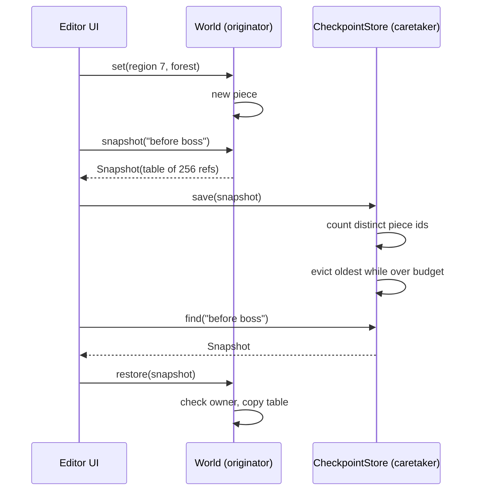

## In one minute
- A memento is a snapshot of an object's internal state, created by the object itself, stored by someone else, and handed back later to restore that state. The holder can keep, label and discard snapshots but cannot read or change what is inside them.
- There are three roles: the *originator* (the object whose state is saved), the *memento* (the opaque snapshot) and the *caretaker* (the history, checkpoint store or save-game slot list that decides which snapshots to keep).
- It is the alternative to the inverse-operation undo in the Command lesson. Commands store what changed; mementos store what was. Mementos are simpler to get right and cost memory proportional to state, unless snapshots share the parts that did not change.
- Structural sharing is what makes mementos affordable: with immutable pieces, a snapshot is a table of pointers, and two snapshots that differ in one region share every other region. Redux undo, persistent vectors and copy-on-write `fork()` all work this way.
- Agents write `history.append(self.state)` and call it done. Review asks: is that a copy or an alias, how big is one snapshot, and what bounds the history?

## How it works

### The problem
A level editor for a 2D game holds a world split into 256 regions. Designers place tiles, scripts and spawn points, and they want three things: undo for the last few minutes, named checkpoints ("before boss rework"), and a "playtest from here" button that runs the game and then puts the world back exactly as it was. Some operations are easy to invert (move a tile), but many are not: a procedural "fill with forest" brush touches thousands of tiles with random choices, and a script compiler rewrites internal indexes. Writing a correct inverse for each is a project in itself.

The shortcut is to let the history copy the world's fields itself. Then the history knows the world's private layout, and any code holding it can edit a saved state.

### The three roles
Memento keeps the knowledge of the layout inside the object that owns it:

```python
class World:
    def snapshot(self, label):
        return Snapshot(self, tuple(self._regions), label)   # originator writes it
    def restore(self, snap):
        if snap._owner is not self:
            raise ValueError("foreign snapshot")
        self._regions = list(snap._regions)                  # originator reads it

class CheckpointStore:          # caretaker: keeps, labels, evicts, never looks inside
    def save(self, snap): ...
```

The caretaker sees a narrow interface: a label, a version, perhaps a size for a memory budget. The originator sees everything. C++ does this with `friend`, Java with a nested class, Go with unexported fields in one package, TypeScript with `#private` fields, and Python by the leading-underscore convention.

### A snapshot must not alias live state
The most common memento bug is storing a reference instead of a value. If `snapshot()` returns the live list, the next edit changes the "saved" state and undo silently does nothing. The mirror bug is `restore()` installing the snapshot's list directly, so the next edit mutates the memento and restoring the same checkpoint twice gives two different worlds. Both `snapshot` and `restore` copy the container.

### Structural sharing
Copying the whole world on every snapshot is correct and expensive. If the world is 256 regions of 64 KB each (16 MB) and the editor snapshots every 2 seconds for a 10-minute undo window, that is 300 snapshots and 4.8 GB. But a designer working for 2 seconds touches one or two regions. If regions are immutable values and an edit replaces a region with a new one, a snapshot only has to copy the table of 256 pointers (2 KB on a 64-bit machine). Every unchanged region is shared by every snapshot that saw it. The 300 snapshots then cost 600 KB of tables plus the regions actually edited, typically tens of megabytes instead of gigabytes.

Redux's undo history works the same way: `past`, `present` and `future` arrays of states, where reducers return new objects only along the changed path. Clojure's persistent vectors are 32-way trees, so changing one element of a million copies about four nodes and shares the rest.

### Bounding the caretaker
A history without a bound is a memory leak with an undo button. Real caretakers bound by count (the last 100 states), by time (the last 10 minutes), by bytes (500 MB), or by some mix, and they protect a few snapshots from eviction: named checkpoints, the last autosave, the state a playtest must return to. With structural sharing, "bytes" means *distinct* bytes: evicting the oldest snapshot frees only the regions no remaining snapshot references, so the caretaker needs per-snapshot size metadata (piece IDs and sizes), not the content. That metadata is the right amount of leakage from the memento.

### Memento versus Command
Command stores the edit and its inverse; Memento stores the state before. Commands are small, but every operation needs a correct inverse. Mementos need no inverse logic, but cost memory and capture *everything*, including things you did not want rolled back, such as a cursor position. Serious editors combine them: commands for fine-grained undo, periodic mementos as checkpoints so recovery replays only a short tail. Databases do the same with a write-ahead log plus checkpoints.

### Reviewing agent-written code
Asked to "add undo", an agent usually writes `self.history.append(copy.deepcopy(self.state))` on every change, or appends without a copy. Ask three questions in review. Does a test edit the object after a snapshot and then restore? How big is one snapshot of the largest realistic state, and what bounds the history? Can code outside the originator modify a snapshot? The fix is usually small: immutable pieces, a pointer-table snapshot, and a bounded caretaker.

### The same shape elsewhere
Memento is the *multi-step consistency* shape: save a known-good point so a failed sequence of steps can be rolled back as a unit. Database savepoints (`ROLLBACK TO s1`), VM snapshots before an upgrade and `kubectl rollout undo` all do it. ZFS and Btrfs snapshots are copy-on-write trees, created in constant time and costing nothing until blocks diverge: structural sharing on disk.

## Down the stack

### Layer 1: The contract
The originator promises: `restore(snapshot(x))` returns the object to a state observably equal to the state when the snapshot was taken, no matter what happened in between, and restoring the same snapshot twice gives the same result. A memento is immutable and opaque: no code outside the originator can change what it will restore. Restoring a snapshot from a different originator, or from an incompatible version, fails without changing the object. The caretaker promises a bound (count, bytes, age) and an eviction order, and documents which snapshots are pinned.

### Layer 2: The mechanism
A pointer-table memento needs two things from the state: it is split into pieces, and pieces are never mutated in place. An edit allocates a new piece and swaps the pointer in the live table; the snapshot copies the table. Persistent data structures generalise this to trees. A hash array mapped trie (HAMT), used by Clojure, Scala and Immutable.js maps, branches 32 ways using 5 bits of the key's hash per level, with a 32-bit bitmap per node recording which children exist. Updating one key copies the nodes on one root-to-leaf path, so a snapshot of a million-entry map is one root pointer, and an edit afterwards costs about four node copies. Immer gets the same effect with JavaScript `Proxy` objects: the draft records which nested objects were written, and only those and their ancestors are copied when the producer finishes.

The operating system offers a memento for a whole process. Redis's `BGSAVE` calls `fork()`: the child gets the parent's address space as copy-on-write pages, serialises a frozen view of the dataset to an RDB file, and the parent keeps serving writes. Only pages written after the fork are physically copied.

### Layer 3: The machine
A full copy is bounded by memory bandwidth: `memcpy` runs at roughly 10 to 20 GB/s per core, so copying 16 MB takes about 1 ms, fine once and painful every keystroke. Object-graph copies are far slower than raw bytes. CPython's `copy.deepcopy` visits every object, keeps a memo dict keyed by `id()` to preserve shared references and cycles, and costs on the order of 1 to 3 microseconds per object, so a state with 200,000 small objects takes about half a second. JavaScript's `structuredClone` is similar in spirit and also walks the graph. A pointer-table snapshot of 256 regions is a 2 KB allocation and a copy that fits in L1 cache: well under a microsecond.

Go has a trap here. Copying a struct copies its fields, but slices and maps are headers that point at shared backing storage. `snap := *w` shares the regions slice's backing array with the live world, so a later `w.regions[0] = r` changes the snapshot. A correct Go memento uses `slices.Clone` or `copy` for slices and `maps.Clone` for maps, and the pieces themselves must be immutable or cloned.

The `fork()` memento is paid in page tables and copy-on-write faults. With 4 KB pages, each GB of resident memory needs 2 MB of page-table entries, copied at fork time. After that, each page the parent writes takes a fault and a 4 KB copy, so a write-heavy Redis can nearly double its memory during a save.

### Why it's built this way
1. Saving state should not require the saver to know the layout, or the layout leaks into every caller, so the owner of the state creates and reads snapshots.
2. A snapshot that can be modified, or that aliases live state, makes restore wrong, so mementos are immutable and opaque.
3. Full copies cost memory and bandwidth proportional to the whole state while edits touch a small part, so state is split into immutable pieces that snapshots share.
4. Even shared snapshots accumulate, so the caretaker enforces a bound, measured in distinct pieces or bytes, and pins the snapshots that matter.
5. Restoring a whole state also restores things you wanted to keep, so fine-grained undo often uses commands with mementos as periodic checkpoints.

## Diagram


## Worked example
A web-based level editor kept undo as a list of full JSON copies of the world, taken after every brush stroke. A medium level serialised to 9 MB, designers made about 25 strokes a minute, and the history held 200 entries: 1.8 GB in the worst case. Browser tabs crashed on 8 GB laptops after about an hour, and each stroke spent 70 ms in `JSON.parse(JSON.stringify(world))`, which designers felt as a stutter.

The team split the world into 512 regions of about 18 KB each, made regions immutable (an edit produces a new region object), and made a snapshot a frozen array of 512 region references with a monotonic ID per region. The history became a caretaker with two bounds: 200 snapshots and 300 MB of distinct regions, computed from the set of region IDs across retained snapshots with each region's size stored beside it. Named checkpoints and the pre-playtest snapshot were pinned.

A typical stroke touches 1 to 3 regions, so 200 snapshots retained about 450 regions beyond the base 512: under 20 MB in total against 1.8 GB before, and 4 microseconds per snapshot instead of 70 ms. The one regression was "regenerate terrain", which replaces every region and evicted most of the history; the fix was a warning and a pinned snapshot before the operation.

## Trade-offs
| Option | Strengths | Weaknesses | Choose when |
| --- | --- | --- | --- |
| Full-copy memento | Simple; always correct if the copy is deep | Memory and time proportional to whole state | Small state, infrequent snapshots |
| Pointer-table memento with immutable pieces | Snapshot is O(pieces); unchanged pieces shared | State must be split and pieces kept immutable | Editors, games, large documents |
| Persistent data structures (HAMT, persistent vector) | O(log n) edits; snapshot is one pointer | Slower reads and writes than mutable structures; allocation churn | Functional state stores, Redux-style apps |
| Inverse commands | Memory proportional to edits | Every operation needs a correct inverse | Fine-grained undo with well-defined operations |
| Log plus periodic checkpoints | Bounded recovery time and bounded memory | Two mechanisms to build and test | Databases, collaborative editors, long sessions |

## Pitfalls in production
- Snapshots that alias live state, so undo restores the current state. Fix: copy the container in both `snapshot` and `restore`, and test edit-after-snapshot.
- Shallow copies of nested mutable pieces: the table is copied but a region is edited in place. Fix: make pieces immutable (frozen dataclasses, `Object.freeze` in development, no setters), or deep-copy on write.
- Unbounded history that turns a long session into an out-of-memory crash. Fix: bound by count and distinct bytes, and measure the largest realistic state.
- Mementos that capture things that should not roll back, such as an auto-incrementing ID counter, a network connection or a selection. Fix: decide explicitly which fields belong to the snapshot and keep the rest outside it.
- `fork()`-based snapshots doubling memory on write-heavy hosts. Fix: leave headroom, disable transparent huge pages, and schedule saves off-peak.

## Leadership lens
- Ask for the memory budget first. "How big is one snapshot of the largest real document, and how many do we keep?" turns undo from a feature into an engineering decision.
- Choose deliberately between commands and mementos, or both. Inverse commands are cheaper but every new operation becomes a correctness risk; snapshots are safe but cost memory. That is a staffing and testing question as much as a design one.
- Treat persisted mementos (save games, checkpoints) as a public format: version them and test restoring old ones in CI.
- Give agents a concrete spec: immutable pieces, snapshot is a table of references, caretaker with count and byte limits, tests for aliasing and eviction. Without it you will get a deep copy per keystroke.

## Check yourself
1. Why must the originator, not the caretaker, create and read the snapshot?
   **Answer:** Only the originator knows its internal layout and invariants. If the caretaker copied fields directly, the layout would leak into it, and any change to the originator would need matching changes in every caretaker.
2. A snapshot copies a list of 256 region references. What property of the regions makes that a correct snapshot rather than an alias?
   **Answer:** Regions must be immutable, so an edit replaces a reference in the live list instead of changing a region shared with the snapshot.
3. With structural sharing, why does evicting the oldest snapshot sometimes free nothing?
   **Answer:** Every piece it references may still be referenced by newer snapshots, so memory is freed only for pieces that no retained snapshot uses.
4. When would you combine mementos with commands instead of picking one?
   **Answer:** When you want small, fine-grained undo but also bounded recovery or replay time: commands for each edit, periodic mementos as checkpoints so a restore replays only the commands since the last one.

## Practice
**Task:** Build a game-world checkpoint system with structural sharing. `World(regions)` has `regions` slots, each holding an immutable chunk with an integer ID and a string value; initially chunk IDs are `1..regions` with value `""`, and each later `set` creates a chunk with the next ID. A size below 1 fails with `bad size: <n>`. `set(region, value)` and `get(region)` fail with `bad region: <region>` outside `0..regions-1`. `snapshot(label)` returns an immutable `Snapshot` with `label`, `version` (1 for the world's first snapshot, then 2, ...) and `chunk_ids()` (the IDs per region, in order); later edits must not affect it. `restore(snapshot)` makes the world equal to the snapshot, and fails with `foreign snapshot` without changes if another world took it. `CheckpointStore(max_snapshots, max_chunks)` fails with `bad limits` if either is below 1. `save(snapshot)` appends, then evicts the oldest while there are more than `max_snapshots`, then evicts the oldest while more than one snapshot remains and the number of distinct chunk IDs across retained snapshots exceeds `max_chunks`; it returns the evicted labels, oldest first. Also `retained_chunks()`, `labels()` (oldest first), `latest()` and `find(label)` (the newest with that label), returning `None`, `undefined` or `(nil, false)` when absent. Python raises `ValueError`, TypeScript throws `Error`, Go returns an error.

```python starter
class Snapshot:
    def __init__(self, owner, chunks, label, version):
        self._owner = owner
        self._chunks = chunks
        self.label = label
        self.version = version

    def chunk_ids(self):
        # TODO
        raise NotImplementedError

class World:
    def __init__(self, regions):
        # TODO
        raise NotImplementedError

    def set(self, region, value):
        raise NotImplementedError

    def get(self, region):
        raise NotImplementedError

    def snapshot(self, label):
        raise NotImplementedError

    def restore(self, snap):
        raise NotImplementedError

class CheckpointStore:
    def __init__(self, max_snapshots, max_chunks):
        # TODO
        raise NotImplementedError

    def save(self, snap):
        raise NotImplementedError

    def retained_chunks(self):
        raise NotImplementedError

    def labels(self):
        raise NotImplementedError

    def latest(self):
        raise NotImplementedError

    def find(self, label):
        raise NotImplementedError
```

```python tests
def error_of(fn):
    try:
        fn()
    except ValueError as e:
        return str(e)
    return None

def test_set_get_and_restore():
    w = World(3)
    w.set(0, "spawn")
    w.set(2, "boss")
    s = w.snapshot("start")
    w.set(0, "moved")
    w.set(1, "door open")
    assert [w.get(i) for i in range(3)] == ["moved", "door open", "boss"]
    w.restore(s)
    assert [w.get(i) for i in range(3)] == ["spawn", "", "boss"]

def test_snapshot_is_unaffected_by_later_edits():
    w = World(2)
    s = w.snapshot("a")
    w.set(1, "x")
    assert s.label == "a" and s.version == 1
    assert w.snapshot("b").version == 2
    w.restore(s)
    assert w.get(1) == ""
    w.set(1, "y")
    w.restore(s)
    assert w.get(1) == "", "restoring must not let later edits leak into the snapshot"

def test_unchanged_regions_are_shared():
    w = World(4)
    s1 = w.snapshot("s1")
    w.set(0, "a")
    s2 = w.snapshot("s2")
    assert list(s1.chunk_ids()) == [1, 2, 3, 4]
    assert list(s2.chunk_ids()) == [5, 2, 3, 4]
    w.restore(s1)
    w.set(3, "z")
    assert list(w.snapshot("s3").chunk_ids()) == [1, 2, 3, 6]
    store = CheckpointStore(10, 100)
    store.save(s1)
    store.save(s2)
    assert store.retained_chunks() == 5

def test_evicts_oldest_by_count():
    w = World(1)
    store = CheckpointStore(2, 100)
    evicted = []
    for name in ["a", "b", "c"]:
        w.set(0, name)
        evicted = store.save(w.snapshot(name))
    assert evicted == ["a"]
    assert store.labels() == ["b", "c"]

def test_evicts_by_chunk_budget_but_keeps_newest():
    w = World(3)
    store = CheckpointStore(10, 4)
    assert store.save(w.snapshot("base")) == []
    w.set(0, "x")
    assert store.save(w.snapshot("one")) == []
    w.set(1, "y")
    assert store.save(w.snapshot("two")) == ["base"]
    assert store.retained_chunks() == 4
    small = CheckpointStore(10, 2)
    assert small.save(w.snapshot("solo")) == []
    assert small.labels() == ["solo"], "the newest snapshot is always kept"

def test_find_and_latest():
    w = World(1)
    store = CheckpointStore(5, 50)
    assert store.latest() is None and store.find("x") is None
    for label, value in [("save", "1"), ("auto", "2"), ("save", "3")]:
        w.set(0, value)
        store.save(w.snapshot(label))
    assert store.latest().label == "save" and store.latest().version == 3
    assert store.find("save").version == 3
    assert store.find("auto").version == 2
    w.restore(store.find("auto"))
    assert w.get(0) == "2"

def test_errors():
    w = World(2)
    assert error_of(lambda: w.set(2, "x")) == "bad region: 2"
    assert error_of(lambda: w.get(-1)) == "bad region: -1"
    assert error_of(lambda: World(0)) == "bad size: 0"
    assert error_of(lambda: CheckpointStore(0, 5)) == "bad limits"
    assert error_of(lambda: CheckpointStore(5, 0)) == "bad limits"

def test_foreign_snapshot_rejected():
    w = World(2)
    other = World(2)
    other.set(0, "theirs")
    w.set(0, "mine")
    assert error_of(lambda: w.restore(other.snapshot("o"))) == "foreign snapshot"
    assert w.get(0) == "mine"
```

```python solution
class _Chunk:
    __slots__ = ("id", "value")

    def __init__(self, cid, value):
        self.id = cid
        self.value = value

class Snapshot:
    def __init__(self, owner, chunks, label, version):
        self._owner = owner
        self._chunks = chunks
        self.label = label
        self.version = version

    def chunk_ids(self):
        return tuple(c.id for c in self._chunks)

class World:
    def __init__(self, regions):
        if regions < 1:
            raise ValueError("bad size: %d" % regions)
        self._chunks = [_Chunk(i + 1, "") for i in range(regions)]
        self._next_id = regions + 1
        self._version = 0

    def _check(self, region):
        if region < 0 or region >= len(self._chunks):
            raise ValueError("bad region: %d" % region)

    def set(self, region, value):
        self._check(region)
        self._chunks[region] = _Chunk(self._next_id, value)
        self._next_id += 1

    def get(self, region):
        self._check(region)
        return self._chunks[region].value

    def snapshot(self, label):
        self._version += 1
        return Snapshot(self, tuple(self._chunks), label, self._version)

    def restore(self, snap):
        if snap._owner is not self:
            raise ValueError("foreign snapshot")
        self._chunks = list(snap._chunks)

class CheckpointStore:
    def __init__(self, max_snapshots, max_chunks):
        if max_snapshots < 1 or max_chunks < 1:
            raise ValueError("bad limits")
        self._max_snapshots = max_snapshots
        self._max_chunks = max_chunks
        self._snaps = []

    def save(self, snap):
        self._snaps.append(snap)
        evicted = []
        while len(self._snaps) > self._max_snapshots:
            evicted.append(self._snaps.pop(0).label)
        while len(self._snaps) > 1 and self.retained_chunks() > self._max_chunks:
            evicted.append(self._snaps.pop(0).label)
        return evicted

    def retained_chunks(self):
        ids = set()
        for s in self._snaps:
            ids.update(s.chunk_ids())
        return len(ids)

    def labels(self):
        return [s.label for s in self._snaps]

    def latest(self):
        return self._snaps[-1] if self._snaps else None

    def find(self, label):
        for s in reversed(self._snaps):
            if s.label == label:
                return s
        return None
```

```typescript starter
export class Snapshot {
  constructor(
    readonly owner: object,
    readonly chunks: ReadonlyArray<{ readonly id: number; readonly value: string }>,
    readonly label: string,
    readonly version: number,
  ) {}
  chunkIds(): number[] { throw new Error("TODO"); }
}

export class World {
  constructor(regions: number) { throw new Error("TODO"); }
  set(region: number, value: string): void { throw new Error("TODO"); }
  get(region: number): string { throw new Error("TODO"); }
  snapshot(label: string): Snapshot { throw new Error("TODO"); }
  restore(snap: Snapshot): void { throw new Error("TODO"); }
}

export class CheckpointStore {
  constructor(maxSnapshots: number, maxChunks: number) { throw new Error("TODO"); }
  save(snap: Snapshot): string[] { throw new Error("TODO"); }
  retainedChunks(): number { throw new Error("TODO"); }
  labels(): string[] { throw new Error("TODO"); }
  latest(): Snapshot | undefined { throw new Error("TODO"); }
  find(label: string): Snapshot | undefined { throw new Error("TODO"); }
}
```

```typescript tests
function errorOf(fn: () => unknown): string | undefined {
  try { fn(); } catch (e) { return (e as Error).message; }
  return undefined;
}

function values(w: World, n: number): string[] {
  const out: string[] = [];
  for (let i = 0; i < n; i++) out.push(w.get(i));
  return out;
}

test("set get and restore", () => {
  const w = new World(3);
  w.set(0, "spawn");
  w.set(2, "boss");
  const s = w.snapshot("start");
  w.set(0, "moved");
  w.set(1, "door open");
  assertEqual(values(w, 3), ["moved", "door open", "boss"]);
  w.restore(s);
  assertEqual(values(w, 3), ["spawn", "", "boss"]);
});

test("snapshot is unaffected by later edits", () => {
  const w = new World(2);
  const s = w.snapshot("a");
  w.set(1, "x");
  assert(s.label === "a" && s.version === 1, "label and version");
  assertEqual(w.snapshot("b").version, 2);
  w.restore(s);
  assertEqual(w.get(1), "");
  w.set(1, "y");
  w.restore(s);
  assertEqual(w.get(1), "", "restoring must not let later edits leak into the snapshot");
});

test("unchanged regions are shared", () => {
  const w = new World(4);
  const s1 = w.snapshot("s1");
  w.set(0, "a");
  const s2 = w.snapshot("s2");
  assertEqual(s1.chunkIds(), [1, 2, 3, 4]);
  assertEqual(s2.chunkIds(), [5, 2, 3, 4]);
  w.restore(s1);
  w.set(3, "z");
  assertEqual(w.snapshot("s3").chunkIds(), [1, 2, 3, 6]);
  const store = new CheckpointStore(10, 100);
  store.save(s1);
  store.save(s2);
  assertEqual(store.retainedChunks(), 5);
});

test("evicts oldest by count", () => {
  const w = new World(1);
  const store = new CheckpointStore(2, 100);
  let evicted: string[] = [];
  for (const name of ["a", "b", "c"]) {
    w.set(0, name);
    evicted = store.save(w.snapshot(name));
  }
  assertEqual(evicted, ["a"]);
  assertEqual(store.labels(), ["b", "c"]);
});

test("evicts by chunk budget but keeps newest", () => {
  const w = new World(3);
  const store = new CheckpointStore(10, 4);
  assertEqual(store.save(w.snapshot("base")), []);
  w.set(0, "x");
  assertEqual(store.save(w.snapshot("one")), []);
  w.set(1, "y");
  assertEqual(store.save(w.snapshot("two")), ["base"]);
  assertEqual(store.retainedChunks(), 4);
  const small = new CheckpointStore(10, 2);
  assertEqual(small.save(w.snapshot("solo")), []);
  assertEqual(small.labels(), ["solo"], "the newest snapshot is always kept");
});

test("find and latest", () => {
  const w = new World(1);
  const store = new CheckpointStore(5, 50);
  assert(store.latest() === undefined && store.find("x") === undefined, "empty store");
  for (const [label, value] of [["save", "1"], ["auto", "2"], ["save", "3"]]) {
    w.set(0, value);
    store.save(w.snapshot(label));
  }
  assert(store.latest()!.label === "save" && store.latest()!.version === 3, "latest");
  assertEqual(store.find("save")!.version, 3);
  assertEqual(store.find("auto")!.version, 2);
  w.restore(store.find("auto")!);
  assertEqual(w.get(0), "2");
});

test("errors", () => {
  const w = new World(2);
  assertEqual(errorOf(() => w.set(2, "x")), "bad region: 2");
  assertEqual(errorOf(() => w.get(-1)), "bad region: -1");
  assertEqual(errorOf(() => new World(0)), "bad size: 0");
  assertEqual(errorOf(() => new CheckpointStore(0, 5)), "bad limits");
  assertEqual(errorOf(() => new CheckpointStore(5, 0)), "bad limits");
});

test("foreign snapshot rejected", () => {
  const w = new World(2);
  const other = new World(2);
  other.set(0, "theirs");
  w.set(0, "mine");
  assertEqual(errorOf(() => w.restore(other.snapshot("o"))), "foreign snapshot");
  assertEqual(w.get(0), "mine");
});
```

```typescript solution
type Chunk = { readonly id: number; readonly value: string };

export class Snapshot {
  constructor(
    readonly owner: object,
    readonly chunks: ReadonlyArray<Chunk>,
    readonly label: string,
    readonly version: number,
  ) {}
  chunkIds(): number[] { return this.chunks.map((c) => c.id); }
}

export class World {
  #chunks: Chunk[] = [];
  #nextId: number;
  #version = 0;

  constructor(regions: number) {
    if (regions < 1) throw new Error("bad size: " + regions);
    for (let i = 0; i < regions; i++) this.#chunks.push(Object.freeze({ id: i + 1, value: "" }));
    this.#nextId = regions + 1;
  }

  #check(region: number): void {
    if (region < 0 || region >= this.#chunks.length) throw new Error("bad region: " + region);
  }

  set(region: number, value: string): void {
    this.#check(region);
    this.#chunks[region] = Object.freeze({ id: this.#nextId++, value });
  }

  get(region: number): string {
    this.#check(region);
    return this.#chunks[region].value;
  }

  snapshot(label: string): Snapshot {
    this.#version++;
    return new Snapshot(this, Object.freeze(this.#chunks.slice()), label, this.#version);
  }

  restore(snap: Snapshot): void {
    if (snap.owner !== this) throw new Error("foreign snapshot");
    this.#chunks = snap.chunks.slice();
  }
}

export class CheckpointStore {
  #snaps: Snapshot[] = [];

  constructor(private readonly maxSnapshots: number, private readonly maxChunks: number) {
    if (maxSnapshots < 1 || maxChunks < 1) throw new Error("bad limits");
  }

  save(snap: Snapshot): string[] {
    this.#snaps.push(snap);
    const evicted: string[] = [];
    while (this.#snaps.length > this.maxSnapshots) evicted.push(this.#snaps.shift()!.label);
    while (this.#snaps.length > 1 && this.retainedChunks() > this.maxChunks) {
      evicted.push(this.#snaps.shift()!.label);
    }
    return evicted;
  }

  retainedChunks(): number {
    const ids = new Set<number>();
    for (const s of this.#snaps) for (const id of s.chunkIds()) ids.add(id);
    return ids.size;
  }

  labels(): string[] { return this.#snaps.map((s) => s.label); }

  latest(): Snapshot | undefined { return this.#snaps[this.#snaps.length - 1]; }

  find(label: string): Snapshot | undefined {
    for (let i = this.#snaps.length - 1; i >= 0; i--) {
      if (this.#snaps[i].label === label) return this.#snaps[i];
    }
    return undefined;
  }
}
```

```go starter
package practice

type chunk struct {
	id    int
	value string
}

type Snapshot struct {
	owner   *World
	chunks  []*chunk
	label   string
	version int
}

func (s *Snapshot) Label() string { return s.label }
func (s *Snapshot) Version() int  { return s.version }
func (s *Snapshot) ChunkIDs() []int { panic("TODO") }

type World struct {
	chunks  []*chunk
	nextID  int
	version int
}

func NewWorld(regions int) (*World, error)            { panic("TODO") }
func (w *World) Set(region int, value string) error   { panic("TODO") }
func (w *World) Get(region int) (string, error)       { panic("TODO") }
func (w *World) Snapshot(label string) *Snapshot      { panic("TODO") }
func (w *World) Restore(s *Snapshot) error            { panic("TODO") }

type CheckpointStore struct {
	maxSnapshots, maxChunks int
	snaps                   []*Snapshot
}

func NewCheckpointStore(maxSnapshots, maxChunks int) (*CheckpointStore, error) { panic("TODO") }
func (c *CheckpointStore) Save(s *Snapshot) []string                         { panic("TODO") }
func (c *CheckpointStore) RetainedChunks() int                               { panic("TODO") }
func (c *CheckpointStore) Labels() []string                                  { panic("TODO") }
func (c *CheckpointStore) Latest() (*Snapshot, bool)                         { panic("TODO") }
func (c *CheckpointStore) Find(label string) (*Snapshot, bool)               { panic("TODO") }
```

```go tests
package practice

import (
	"reflect"
	"testing"
)

func mustWorld(t *testing.T, n int) *World {
	t.Helper()
	w, err := NewWorld(n)
	if err != nil {
		t.Fatal(err)
	}
	return w
}

func mustStore(t *testing.T, a, b int) *CheckpointStore {
	t.Helper()
	c, err := NewCheckpointStore(a, b)
	if err != nil {
		t.Fatal(err)
	}
	return c
}

func values(t *testing.T, w *World, n int) []string {
	t.Helper()
	out := []string{}
	for i := 0; i < n; i++ {
		v, err := w.Get(i)
		if err != nil {
			t.Fatal(err)
		}
		out = append(out, v)
	}
	return out
}

func get(t *testing.T, w *World, i int) string {
	t.Helper()
	v, err := w.Get(i)
	if err != nil {
		t.Fatal(err)
	}
	return v
}

func TestSetGetAndRestore(t *testing.T) {
	w := mustWorld(t, 3)
	w.Set(0, "spawn")
	w.Set(2, "boss")
	s := w.Snapshot("start")
	w.Set(0, "moved")
	w.Set(1, "door open")
	if got := values(t, w, 3); !reflect.DeepEqual(got, []string{"moved", "door open", "boss"}) {
		t.Fatalf("got %v", got)
	}
	if err := w.Restore(s); err != nil {
		t.Fatal(err)
	}
	if got := values(t, w, 3); !reflect.DeepEqual(got, []string{"spawn", "", "boss"}) {
		t.Fatalf("got %v", got)
	}
}

func TestSnapshotUnaffectedByLaterEdits(t *testing.T) {
	w := mustWorld(t, 2)
	s := w.Snapshot("a")
	w.Set(1, "x")
	if s.Label() != "a" || s.Version() != 1 {
		t.Fatalf("got %s %d", s.Label(), s.Version())
	}
	if v := w.Snapshot("b").Version(); v != 2 {
		t.Fatalf("version %d", v)
	}
	w.Restore(s)
	if get(t, w, 1) != "" {
		t.Fatal("restore failed")
	}
	w.Set(1, "y")
	w.Restore(s)
	if get(t, w, 1) != "" {
		t.Fatal("restoring must not let later edits leak into the snapshot")
	}
}

func TestUnchangedRegionsAreShared(t *testing.T) {
	w := mustWorld(t, 4)
	s1 := w.Snapshot("s1")
	w.Set(0, "a")
	s2 := w.Snapshot("s2")
	if !reflect.DeepEqual(s1.ChunkIDs(), []int{1, 2, 3, 4}) || !reflect.DeepEqual(s2.ChunkIDs(), []int{5, 2, 3, 4}) {
		t.Fatalf("got %v %v", s1.ChunkIDs(), s2.ChunkIDs())
	}
	w.Restore(s1)
	w.Set(3, "z")
	if got := w.Snapshot("s3").ChunkIDs(); !reflect.DeepEqual(got, []int{1, 2, 3, 6}) {
		t.Fatalf("got %v", got)
	}
	c := mustStore(t, 10, 100)
	c.Save(s1)
	c.Save(s2)
	if c.RetainedChunks() != 5 {
		t.Fatalf("retained %d", c.RetainedChunks())
	}
}

func TestEvictsOldestByCount(t *testing.T) {
	w := mustWorld(t, 1)
	c := mustStore(t, 2, 100)
	var evicted []string
	for _, name := range []string{"a", "b", "c"} {
		w.Set(0, name)
		evicted = c.Save(w.Snapshot(name))
	}
	if !reflect.DeepEqual(evicted, []string{"a"}) || !reflect.DeepEqual(c.Labels(), []string{"b", "c"}) {
		t.Fatalf("evicted %v labels %v", evicted, c.Labels())
	}
}

func TestEvictsByChunkBudgetButKeepsNewest(t *testing.T) {
	w := mustWorld(t, 3)
	c := mustStore(t, 10, 4)
	if e := c.Save(w.Snapshot("base")); len(e) != 0 {
		t.Fatalf("evicted %v", e)
	}
	w.Set(0, "x")
	if e := c.Save(w.Snapshot("one")); len(e) != 0 {
		t.Fatalf("evicted %v", e)
	}
	w.Set(1, "y")
	if e := c.Save(w.Snapshot("two")); !reflect.DeepEqual(e, []string{"base"}) {
		t.Fatalf("evicted %v", e)
	}
	if c.RetainedChunks() != 4 {
		t.Fatalf("retained %d", c.RetainedChunks())
	}
	small := mustStore(t, 10, 2)
	if e := small.Save(w.Snapshot("solo")); len(e) != 0 || !reflect.DeepEqual(small.Labels(), []string{"solo"}) {
		t.Fatalf("the newest snapshot is always kept: %v %v", e, small.Labels())
	}
}

func TestFindAndLatest(t *testing.T) {
	w := mustWorld(t, 1)
	c := mustStore(t, 5, 50)
	if _, ok := c.Latest(); ok {
		t.Fatal("empty store has no latest")
	}
	if _, ok := c.Find("x"); ok {
		t.Fatal("empty store finds nothing")
	}
	for _, p := range [][2]string{{"save", "1"}, {"auto", "2"}, {"save", "3"}} {
		w.Set(0, p[1])
		c.Save(w.Snapshot(p[0]))
	}
	if s, ok := c.Latest(); !ok || s.Label() != "save" || s.Version() != 3 {
		t.Fatal("latest")
	}
	if s, ok := c.Find("save"); !ok || s.Version() != 3 {
		t.Fatal("find save")
	}
	s, ok := c.Find("auto")
	if !ok || s.Version() != 2 {
		t.Fatal("find auto")
	}
	w.Restore(s)
	if get(t, w, 0) != "2" {
		t.Fatal("restore auto")
	}
}

func TestErrors(t *testing.T) {
	w := mustWorld(t, 2)
	if err := w.Set(2, "x"); err == nil || err.Error() != "bad region: 2" {
		t.Fatalf("got %v", err)
	}
	if _, err := w.Get(-1); err == nil || err.Error() != "bad region: -1" {
		t.Fatalf("got %v", err)
	}
	if _, err := NewWorld(0); err == nil || err.Error() != "bad size: 0" {
		t.Fatalf("got %v", err)
	}
	if _, err := NewCheckpointStore(0, 5); err == nil || err.Error() != "bad limits" {
		t.Fatalf("got %v", err)
	}
	if _, err := NewCheckpointStore(5, 0); err == nil || err.Error() != "bad limits" {
		t.Fatalf("got %v", err)
	}
}

func TestForeignSnapshotRejected(t *testing.T) {
	w := mustWorld(t, 2)
	other := mustWorld(t, 2)
	other.Set(0, "theirs")
	w.Set(0, "mine")
	if err := w.Restore(other.Snapshot("o")); err == nil || err.Error() != "foreign snapshot" {
		t.Fatalf("got %v", err)
	}
	if get(t, w, 0) != "mine" {
		t.Fatal("state changed")
	}
}
```

```go solution
package practice

import (
	"errors"
	"fmt"
)

type chunk struct {
	id    int
	value string
}

type Snapshot struct {
	owner   *World
	chunks  []*chunk
	label   string
	version int
}

func (s *Snapshot) Label() string { return s.label }
func (s *Snapshot) Version() int  { return s.version }
func (s *Snapshot) ChunkIDs() []int {
	ids := make([]int, len(s.chunks))
	for i, c := range s.chunks {
		ids[i] = c.id
	}
	return ids
}

type World struct {
	chunks  []*chunk
	nextID  int
	version int
}

func NewWorld(regions int) (*World, error) {
	if regions < 1 {
		return nil, fmt.Errorf("bad size: %d", regions)
	}
	w := &World{chunks: make([]*chunk, regions), nextID: regions + 1}
	for i := range w.chunks {
		w.chunks[i] = &chunk{id: i + 1}
	}
	return w, nil
}

func (w *World) check(region int) error {
	if region < 0 || region >= len(w.chunks) {
		return fmt.Errorf("bad region: %d", region)
	}
	return nil
}

func (w *World) Set(region int, value string) error {
	if err := w.check(region); err != nil {
		return err
	}
	w.chunks[region] = &chunk{id: w.nextID, value: value}
	w.nextID++
	return nil
}

func (w *World) Get(region int) (string, error) {
	if err := w.check(region); err != nil {
		return "", err
	}
	return w.chunks[region].value, nil
}

func (w *World) Snapshot(label string) *Snapshot {
	w.version++
	table := make([]*chunk, len(w.chunks))
	copy(table, w.chunks) // copy the pointer table; chunks are shared and never mutated
	return &Snapshot{owner: w, chunks: table, label: label, version: w.version}
}

func (w *World) Restore(s *Snapshot) error {
	if s.owner != w {
		return errors.New("foreign snapshot")
	}
	table := make([]*chunk, len(s.chunks))
	copy(table, s.chunks)
	w.chunks = table
	return nil
}

type CheckpointStore struct {
	maxSnapshots, maxChunks int
	snaps                   []*Snapshot
}

func NewCheckpointStore(maxSnapshots, maxChunks int) (*CheckpointStore, error) {
	if maxSnapshots < 1 || maxChunks < 1 {
		return nil, errors.New("bad limits")
	}
	return &CheckpointStore{maxSnapshots: maxSnapshots, maxChunks: maxChunks}, nil
}

func (c *CheckpointStore) Save(s *Snapshot) []string {
	c.snaps = append(c.snaps, s)
	evicted := []string{}
	for len(c.snaps) > c.maxSnapshots {
		evicted = append(evicted, c.snaps[0].label)
		c.snaps = c.snaps[1:]
	}
	for len(c.snaps) > 1 && c.RetainedChunks() > c.maxChunks {
		evicted = append(evicted, c.snaps[0].label)
		c.snaps = c.snaps[1:]
	}
	return evicted
}

func (c *CheckpointStore) RetainedChunks() int {
	ids := map[int]struct{}{}
	for _, s := range c.snaps {
		for _, ch := range s.chunks {
			ids[ch.id] = struct{}{}
		}
	}
	return len(ids)
}

func (c *CheckpointStore) Labels() []string {
	out := make([]string, len(c.snaps))
	for i, s := range c.snaps {
		out[i] = s.label
	}
	return out
}

func (c *CheckpointStore) Latest() (*Snapshot, bool) {
	if len(c.snaps) == 0 {
		return nil, false
	}
	return c.snaps[len(c.snaps)-1], true
}

func (c *CheckpointStore) Find(label string) (*Snapshot, bool) {
	for i := len(c.snaps) - 1; i >= 0; i-- {
		if c.snaps[i].label == label {
			return c.snaps[i], true
		}
	}
	return nil, false
}
```

## Mock interview
**Prompt:** You are designing undo and checkpoints for a browser-based spreadsheet. Sheets reach 2 million cells, users make about one edit per second, and product wants 30 minutes of undo plus named versions that survive a reload. Tabs must stay under 1 GB of memory.

- Follow-up: How big is one snapshot in your design, and what is your memory estimate for 30 minutes of history?
- Follow-up: A "sort by column" operation rewrites a million cells. What happens to your history budget, and what do you do about it?
- Follow-up: Would you use inverse commands, mementos, or both? Where does persistence for named versions fit?

**A strong answer covers:**
- Splitting the sheet into immutable chunks (for example 1,024-row blocks per column) so a snapshot is a table of chunk references and an edit copies one chunk.
- A concrete estimate: about 2,000 chunk pointers per snapshot (16 KB), 1,800 snapshots in 30 minutes is about 29 MB of tables plus the edited chunks, well under budget.
- A caretaker bounded by count and distinct bytes, with pinned named versions and a warning or coalescing for whole-sheet operations.
- Commands for fine-grained undo and collaboration, mementos as periodic checkpoints that bound replay and back named versions.
- A versioned, persisted snapshot format for named versions, with tests that restore old versions after schema changes.

## Watch
- [Memento Design Pattern (Derek Banas)](https://www.youtube.com/watch?v=jOnxYT8Iaoo): the originator, memento and caretaker roles built step by step in Java.
- [Memento Design Pattern: Easy Guide for Beginners (Hello Byte)](https://www.youtube.com/watch?v=4H8qeYPn8iM): a short walkthrough of the pattern's structure and an undo example.

## Free resources
- [Memento (Refactoring.Guru)](https://refactoring.guru/design-patterns/memento): the three roles and the nested-class and interface variants for keeping snapshots opaque.
- [Implementing Undo History (Redux docs)](https://redux.js.org/usage/implementing-undo-history): past, present and future arrays of immutable states, a memento history with structural sharing.
- [Understanding Clojure's Persistent Vectors (hypirion)](https://hypirion.com/musings/understanding-persistent-vector-pt-1): how 32-way trees make a snapshot a single pointer and an update a few node copies.
- [Immer documentation](https://immerjs.github.io/immer/): producing structurally shared immutable states from code that looks like mutation.
- [Redis persistence (Redis docs)](https://redis.io/docs/latest/operate/oss_and_stack/management/persistence/): how `fork()` and copy-on-write give a consistent snapshot of a live dataset, and what it costs.
- [copy module (Python docs)](https://docs.python.org/3/library/copy.html): shallow versus deep copies and the memo dictionary that preserves shared references.
