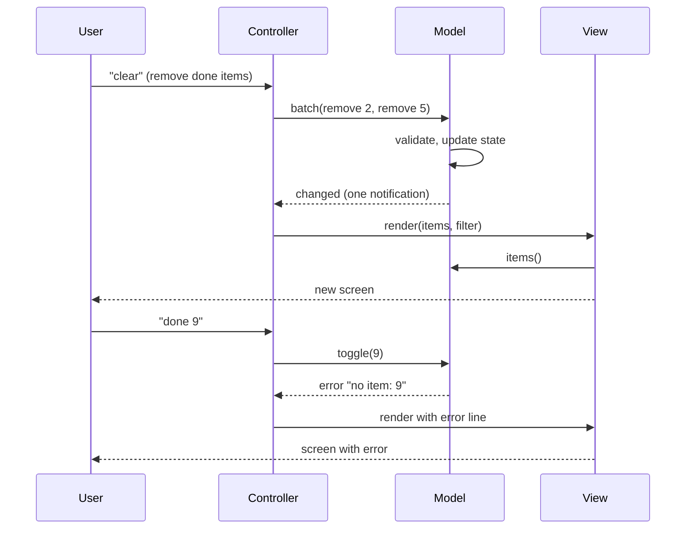

## In one minute
- Model-View-Controller splits an interactive program into three roles: the **model** holds state and the rules that change it, the **view** turns state into something a person sees, and the **controller** turns input (clicks, keystrokes, HTTP requests) into operations on the model.
- The one rule that matters most: the model knows nothing about views or controllers. It can be tested, reused behind a CLI, a web page and an API, and changed without touching presentation.
- There are two quite different "MVCs". Desktop and browser MVC keeps a live model that notifies its views through Observer. Server-side "web MVC" (Rails, Django, Spring MVC) has no live notification: a request comes in, the controller loads the model, picks a view and renders it once.
- MVP, MVVM and unidirectional data flow (Elm, Redux) are descendants that move the same three responsibilities around. Learn the responsibilities, not the letters.
- The common failure is the fat controller: business rules written inside request handlers or UI event callbacks, where nothing else can reuse or test them. Agent-generated code drifts there by default.

## How it works

### The problem
A to-do app starts with everything in the click handler: read the text box, reject blanks, push to an array, rebuild the list, update the "3 left" counter. Then come a keyboard shortcut, a mobile layout and a public API, and each copies the validation and the counter logic. Within a month the API accepts blank titles the UI rejects, and the counter is wrong after bulk delete.

Three concerns with different rates of change are tangled. The rules of a valid to-do change rarely, the look changes every sprint, and the ways people interact keep multiplying. MVC gives each concern a home.

### The three roles
The **model** is the state plus the operations allowed on it: `add(title)`, `toggle(id)`, `remove(id)`, each enforcing invariants such as "titles are not blank" and "ids are unique". It exposes queries (`items()`) and a way to learn about changes (`subscribe`). It imports nothing from the UI.

The **view** is a function from model state (plus UI state, such as the current filter) to output: DOM nodes, an HTML string, terminal lines, a JSON document. A good view holds no business logic. If a view decides whether an order is refundable, that decision will be missing from the API.

The **controller** receives raw input, interprets it, and calls the model. It parses `"done 3"` into `toggle(3)`, maps a form post to `add(title)`, and decides which screen comes next. It also owns presentation state that is not part of the domain: which filter is selected, which row is focused, what error message to show.

### Classic MVC: views observe the model
Trygve Reenskaug described MVC in 1979 while working on Smalltalk at Xerox PARC, and Smalltalk-80 shipped it. The model kept a list of dependents; any change called `self changed: #aspect`, which sent `update: #aspect` to every dependent view. Each view then pulled what it needed from the model and redrew. This is the [Observer](observer.md) pattern doing the wiring, and it is what lets two views of the same model (a chart and a table of the same spreadsheet range) stay consistent without knowing about each other. Martin Fowler, who studied a running Smalltalk-80, argues that two ideas from MVC clearly worked: separated presentation, where domain objects know nothing of the UI, and observer synchronization. He also warns that observer behaviour is implicit and hard to trace by reading code ([Fowler, GUI Architectures](https://martinfowler.com/eaaDev/uiArchs.html)).

The data flow is a loop: input goes to the controller, the controller mutates the model, the model notifies, views re-render. Controllers never draw, and views never mutate.

### Web MVC: a request is the loop
Rails, Django and Spring MVC adopted the names for request/response servers, where there is no long-lived view to notify. The router maps `POST /todos` to `TodosController#create`; the action builds a model object, asks it to validate and save, then either redirects or renders a template with the model's data. The "notification" is the next HTTP request. Django's FAQ is candid about the naming: its "view" is the Python callback that decides which data is presented, its templates decide how it looks, and the "controller" is the framework itself, the URL dispatcher that routes a request to a view. It calls the result MTV, for model, template and view ([Django FAQ](https://docs.djangoproject.com/en/stable/faq/general/)).

The lesson for web MVC is the same: keep validation and business rules in the model or in a service layer under it, keep controllers thin (parse, call, choose a response), and keep templates free of queries and decisions.

### The descendants
- **MVP** (Model-View-Presenter) makes the view passive: it forwards events to a presenter and exposes setters such as `showItems(list)`. All logic sits in the presenter, which can be tested without a UI toolkit.
- **MVVM** (Model-View-ViewModel) adds a view model that exposes display-ready properties and commands; a binding engine keeps the view in sync automatically. The view knows the view model, the view model knows the model, and neither of those knows what is above it ([Microsoft Learn](https://learn.microsoft.com/en-us/dotnet/architecture/maui/mvvm)).
- **Unidirectional flow** (Flux, Redux, the Elm architecture) replaces many small model mutations with one rule: an action goes into a pure `update(state, action)` function, which returns new state, and the view is re-rendered from it. It is MVC with the controller split into "turn input into an action" and "reduce the action into state", and with observation reduced to one subscription. Facebook's Flux docs give the motivation: in a large MVC app, two-way bindings produced cascading updates, such as marking a thread read also having to update an unread-count model, which made one interaction's outcome hard to predict ([Flux overview](https://facebookarchive.github.io/flux/docs/in-depth-overview)). The Elm guide says Redux was inspired by its model, view and update split ([Elm guide](https://guide.elm-lang.org/architecture/)).

### Reviewing agent-written code
Ask an agent to "add a bulk complete button" and it will usually write the loop, the validation and the counter update inside the button handler, because that is where the request lands. It will also happily call the database from a template helper. Steer it with three review questions. Is every rule enforced in the model, so the API and the UI cannot disagree? Does the view only read state? Does the controller only parse input, call the model and choose a response? A useful instruction for an agent is: "new interaction = new controller code that calls existing model operations; new rule = model change plus a model test".

### The same shape elsewhere
MVC is a special case of a more general shape: **one source of truth, many derived projections, and changes that flow in one direction**. Kubernetes uses the same vocabulary for the same idea at cluster scale: desired state is the model (objects stored in etcd), controllers watch it and act to reconcile the world, and `kubectl get` and dashboards are views. A database with [materialized views](../sd/materialized-views.md) is another instance, as is [CQRS](../sd/cqrs.md), which separates the write model from read models. In each case, bugs appear when a projection is written to directly or when two components both believe they own the truth.

## Down the stack

### Layer 1: The contract
The model promises that every public operation either leaves state valid and notifies observers, or fails with an error and leaves state unchanged with no notification. Notifications arrive after the state is consistent, never halfway through an operation, so a view that reads the model during `update` sees a coherent snapshot. A view promises to be a function of its inputs: the same model state and UI state give the same output. The controller promises that every input either becomes a model operation or produces a visible error. These are testable: count notifications, compare renders, and feed bad input.

### Layer 2: The mechanism
In interactive MVC the mechanism is a subscriber list on the model and a dirty flag in the UI. Smalltalk-80 kept a plain object's dependents in a class-level dictionary keyed by the object, while the `Model` class held its own dependents collection. Modern UI libraries go further: React's `setState` marks a component dirty and schedules a re-render. Before React 18 only updates inside React event handlers were batched; since 18, updates inside promises, timeouts and native event handlers are batched too ([React 18 post](https://react.dev/blog/2022/03/29/react-v18)). That batching is the in-process version of a model's `batch` operation: three changes, one notification, one redraw. Virtual DOM diffing then turns "re-render everything" into a minimal set of DOM mutations.

In web MVC the mechanism is a dispatch table and a template engine. Rails' router resolves `POST /todos` to a controller class and action; the action sets instance variables that ActionView exposes to an ERB template. Go's `html/template` parses templates once into a tree, then on each request walks it with the data and applies context-aware escaping (HTML body, attribute, URL, JavaScript), a security property you keep only if data flows into views through template parameters ([Go html/template docs](https://pkg.go.dev/html/template)). Microsoft's MVVM guidance has the matching rule for rich clients: raise a change notification only when the object is in a safe state, never in the middle of an operation, and never more than once per property in one method ([Microsoft Learn](https://learn.microsoft.com/en-us/dotnet/architecture/maui/mvvm)).

### Layer 3: The machine
On a 60 Hz display a frame is 16.7 ms, and the browser needs part of that for style, layout and paint. A model that notifies on every one of 500 changes in a bulk action can trigger 500 re-renders, and if each view reads layout properties (`offsetHeight`) after writing to the DOM, every read forces a synchronous layout. That is layout thrashing, and it turns a 2 ms update into 200 ms of jank. Batching notifications and having views read state, then write the DOM once, keeps the work to one layout per frame.

On the server the cost hides in the view. A template that walks `posts` and prints `post.author.name` makes a lazy-loading ORM issue one query per row: 100 rows at 0.5 ms per round trip is 50 ms added to a request that should take 5. That is the N+1 query problem, and it exists because the view reached into the model's persistence layer. The Rails guide's own example is 10 books with their authors costing 11 queries, and `includes(:author)` cutting it to 2 ([Rails Guides](https://guides.rubyonrails.org/active_record_querying.html)). The fix (`includes(:author)` in Rails, `select_related` in Django) belongs in the controller or model, which is the MVC rule enforcing itself in performance terms. Observer dispatch itself is cheap: an indirect call costs a few nanoseconds, so notification cost is dominated by what observers do, never by the loop.

### Why it's built this way
1. Business rules, presentation and input methods change at different rates and are owned by different people, so they belong in different modules.
2. Rules must hold for every entry point, so they live in the one place every entry point passes through: the model.
3. A model that imported its views could not be reused or tested headless, so the dependency points one way and change is announced through Observer.
4. Redrawing is expensive relative to state changes, so notifications are coalesced and views re-render from state, not from a stream of deltas.
5. Servers have no persistent screen to update, so web MVC collapses the loop into one request, keeping the separation but dropping the observation.

## Diagram


## Worked example
A logistics company has an internal dispatch board: a model of 2,000 shipments, a table view, a map view and a counters strip. Dispatchers select 300 shipments and click "assign to driver". The original code updated each shipment through the model's `assign` method, and every call notified all three views. That was 900 renders, each one reading the full model: about 300 x 3 x 2,000 = 1.8 million row visits, and the browser froze for 4.2 seconds.

The team made two changes. `assign_many(ids, driver)` runs inside `model.batch`, so the model sends one notification after all 300 updates, and the table view renders only the visible 40 rows. The bulk action now costs about 4,040 row visits and completes in 35 ms. `assign_many` was then exposed through the public API with no new validation code, because the rules (driver on shift, shipment not delivered) were already in the model.

## In the wild
- **Facebook, Flux docs: unidirectional flow replaces cascading MVC updates.** Facebook's own Flux overview describes a large MVC application in which models updated other models and views, so that marking one thread read had to ripple into an unread-count model. Its answer was a single direction of data flow through a dispatcher, with stores as the only holders of state ([Flux overview](https://facebookarchive.github.io/flux/docs/in-depth-overview)).
- **Django, ongoing: the framework as the controller.** Django's FAQ explains why it does not use the standard MVC names: the view is the callback choosing which data to present, templates handle presentation, and the URL dispatcher plays the controller. ([Django FAQ](https://docs.djangoproject.com/en/stable/faq/general/)).
- **React 18, 2022: batching all updates.** React 18 made batching automatic outside its own event handlers, so a `setTimeout` callback that sets two pieces of state now renders once, not twice. It is the in-process version of this lesson's "one notification per bulk action" rule ([React 18 post](https://react.dev/blog/2022/03/29/react-v18)).

## Trade-offs
| Option | Strengths | Weaknesses | Choose when |
| --- | --- | --- | --- |
| No separation (logic in handlers) | Fastest to write; one file | Rules duplicated per entry point; untestable without UI | Prototypes and throwaway scripts |
| Classic MVC with Observer | Many views stay in sync; model reusable | Notification storms; update order subtleties | Desktop and rich client apps with several views of one model |
| Web MVC (Rails, Django) | Simple request loop; huge ecosystem | Fat controllers and logic in templates if undisciplined | Server-rendered apps and CRUD APIs |
| MVP / MVVM | View is passive and logic is testable; binding removes boilerplate | Extra class per screen; binding magic hard to debug | Large UI codebases, mobile, WPF and Android |
| Unidirectional (Elm, Redux) | One state tree; every change is an action you can log and replay | Boilerplate; everything global unless split carefully | Complex client state, time-travel debugging, many contributors |

## Pitfalls in production
- Fat controllers: validation and pricing logic in request handlers, so the batch job and the API disagree. Fix: move rules into the model or a service the controllers call, and test them there.
- Views that query: templates or components that lazy-load associations and cause N+1 queries. Fix: load everything the view needs in the controller, and make lazy loading raise in tests: Rails' `strict_loading` raises `StrictLoadingViolationError` on a lazy load and can be set globally with `strict_loading_by_default` ([Rails Guides](https://guides.rubyonrails.org/active_record_querying.html)).
- Notification storms: one user action fires hundreds of change events and redraws. Fix: batch mutations and notify once, or schedule rendering per frame.
- Re-entrant updates: a view's `update` handler mutates the model, which notifies again mid-delivery. Fix: views only read; send user intents through the controller.
- UI state stored in the model: the selected tab or the sort order saved alongside business data, which then leaks into the API and other users' sessions. Fix: keep presentation state in the controller or view model.

## Leadership lens
- Draw the dependency arrows in design review: the model must not import UI or framework code. This is the cheapest architectural rule to check automatically, with an import linter in CI.
- Count the entry points. If a rule is enforced in the web controller but the app also has an API, a CLI and a batch job, the rule is enforced in one place out of four. Put it in the model.
- Pick one variant per codebase and write it down, and assert render counts and query counts per request in CI; both regress silently.
- When delegating UI work to agents, specify which layer each change belongs in. "Add a button" without that instruction produces business logic in a click handler.

## Check yourself
1. Why does classic MVC need Observer, while Rails does not?
   **Answer:** A desktop view lives across many changes and must learn when to redraw, so the model announces changes. A Rails view is rendered once per request from freshly loaded data, so the next request plays the role of the notification.
2. A to-do app stores "current filter = active" in the model. What goes wrong?
   **Answer:** The filter is presentation state for one screen; in the model it is shared by every view and user of that model, leaks into persistence and APIs, and changing it triggers model notifications that have nothing to do with the domain.
3. A template prints `order.customer.name` for 200 orders and the page takes 120 ms. What is the likely cause and which layer should fix it?
   **Answer:** N+1 lazy loads, one query per order. The controller (or a model query method) should eager-load customers so the view only reads in-memory data.
4. How is the Elm architecture still MVC?
   **Answer:** The model is the state, `view` is a pure function of it, and the controller role is split between turning input into messages and the `update` function that applies them. Changes flow one way, as in MVC.

## Practice
**Task:** Build a text-mode to-do app with MVC. `TodoModel` has `add(title)` (trims the title; fails with `empty title` if nothing is left; returns ids 1, 2, 3 and so on), `toggle(id)` and `remove(id)` (fail with `no item: <id>`), `items()` (copies of `[id, title, done]` in insertion order), `subscribe(fn)` and `batch(fn)`. Every successful mutation notifies all subscribers once, failed ones never do; inside `batch` (which may nest) notifications are held and sent once when the outermost batch ends, only if something changed, even if `fn` failed (its error is then passed on). `render(items, filter)` is a pure view: lines `"[ ] <id> <title>"` or `"[x] <id> <title>"` for the items the filter shows (`all`, `active` = not done, `done`), then `"<n> left"` counting every not-done item. `Controller(model)` subscribes to the model, starts with filter `all` and no error, renders once at construction, and `handle(line)` dispatches `add <title>`, `done <id>`, `rm <id>`, `clear` (removes all done items in one batch), and `filter <name>`. An id must be one or more ASCII digits, else `bad id: <text>`; bad filters give `bad filter: <name>`; anything else gives `unknown command: <word>`. A failing command sets the error, a successful one clears it. After each command the controller re-renders exactly once if the model notified or the filter or error changed, and not at all otherwise. `screen()` returns the last render, with `"error: <msg>"` appended when there is an error. Python raises `ValueError`, TypeScript throws `Error`, Go returns errors.

```python starter
class TodoModel:
    def __init__(self):
        self._items = []

    def subscribe(self, fn):
        raise NotImplementedError

    def items(self):
        raise NotImplementedError

    def add(self, title):
        raise NotImplementedError

    def toggle(self, item_id):
        raise NotImplementedError

    def remove(self, item_id):
        raise NotImplementedError

    def batch(self, fn):
        raise NotImplementedError


def render(items, flt):
    raise NotImplementedError


class Controller:
    def __init__(self, model):
        self.model = model
        self.renders = 0

    def handle(self, line):
        raise NotImplementedError

    def screen(self):
        raise NotImplementedError
```

```python tests
def error_of(fn):
    try:
        fn()
    except ValueError as e:
        return str(e)
    return None

def counted(model):
    box = [0]
    def bump():
        box[0] += 1
    model.subscribe(bump)
    return box

def test_model_add_items_and_errors():
    m = TodoModel()
    seen = counted(m)
    assert m.add("  buy milk ") == 1 and m.add("call mum") == 2
    assert m.items() == [[1, "buy milk", False], [2, "call mum", False]]
    assert error_of(lambda: m.add("   ")) == "empty title"
    assert error_of(lambda: m.toggle(9)) == "no item: 9"
    assert error_of(lambda: m.remove(9)) == "no item: 9"
    assert seen[0] == 2, "failed operations do not notify"
    m.items()[0][1] = "hacked"
    assert m.items()[0][1] == "buy milk", "items() returns copies"

def test_every_subscriber_is_notified():
    m = TodoModel()
    a, b = counted(m), counted(m)
    m.add("x")
    m.toggle(1)
    m.remove(1)
    assert a[0] == 3 and b[0] == 3 and m.items() == []

def test_batch_notifies_once_and_nests():
    m = TodoModel()
    seen = counted(m)
    def inner():
        m.add("b")
        m.add("c")
    def outer():
        m.add("a")
        m.batch(inner)
        assert seen[0] == 0, "held until outermost batch ends"
    m.batch(outer)
    assert seen[0] == 1 and len(m.items()) == 3
    m.batch(lambda: None)
    assert seen[0] == 1, "empty batch is silent"
    def failing():
        m.add("d")
        m.toggle(42)
    assert error_of(lambda: m.batch(failing)) == "no item: 42"
    assert seen[0] == 2 and len(m.items()) == 4

def test_render_is_pure_and_filters():
    items = [[1, "a", False], [2, "b", True], [3, "c", False]]
    assert render(items, "all") == ["[ ] 1 a", "[x] 2 b", "[ ] 3 c", "2 left"]
    assert render(items, "active") == ["[ ] 1 a", "[ ] 3 c", "2 left"]
    assert render(items, "done") == ["[x] 2 b", "2 left"]
    assert render([], "all") == ["0 left"]

def test_controller_renders_after_commands():
    c = Controller(TodoModel())
    assert c.screen() == ["0 left"] and c.renders == 1
    c.handle("add buy milk")
    c.handle("add  walk dog ")
    c.handle("done 1")
    assert c.screen() == ["[x] 1 buy milk", "[ ] 2 walk dog", "1 left"]
    assert c.renders == 4

def test_errors_are_shown_then_cleared():
    c = Controller(TodoModel())
    c.handle("done 7")
    assert c.screen() == ["0 left", "error: no item: 7"]
    c.handle("rm abc")
    assert c.screen()[-1] == "error: bad id: abc"
    c.handle("done -1")
    assert c.screen()[-1] == "error: bad id: -1"
    c.handle("frobnicate now")
    assert c.screen()[-1] == "error: unknown command: frobnicate"
    c.handle("add")
    assert c.screen()[-1] == "error: empty title"
    n = c.renders
    c.handle("add")
    assert c.renders == n, "same error again: nothing changed, no render"
    c.handle("add tea")
    assert c.screen() == ["[ ] 1 tea", "1 left"]

def test_clear_is_one_render():
    m = TodoModel()
    c = Controller(m)
    seen = counted(m)
    for t in ("a", "b", "c", "d"):
        c.handle("add " + t)
    c.handle("done 1")
    c.handle("done 3")
    before, notes = c.renders, seen[0]
    c.handle("clear")
    assert c.renders == before + 1 and seen[0] == notes + 1
    assert c.screen() == ["[ ] 2 b", "[ ] 4 d", "2 left"]
    c.handle("clear")
    assert c.renders == before + 1, "nothing to clear, no render"

def test_filter_is_controller_state():
    m = TodoModel()
    c = Controller(m)
    c.handle("add a")
    c.handle("add b")
    c.handle("done 2")
    seen = counted(m)
    c.handle("filter done")
    assert c.screen() == ["[x] 2 b", "1 left"] and seen[0] == 0
    n = c.renders
    c.handle("filter done")
    assert c.renders == n
    c.handle("filter urgent")
    assert c.screen() == ["[x] 2 b", "1 left", "error: bad filter: urgent"]
    m.add("from the api")
    c.handle("filter active")
    assert c.screen() == ["[ ] 1 a", "[ ] 3 from the api", "2 left"]
```

```python solution
class TodoModel:
    def __init__(self):
        self._items = []
        self._next = 1
        self._subs = []
        self._depth = 0
        self._dirty = False

    def subscribe(self, fn):
        self._subs.append(fn)

    def items(self):
        return [list(it) for it in self._items]

    def _find(self, item_id):
        for it in self._items:
            if it[0] == item_id:
                return it
        raise ValueError("no item: " + str(item_id))

    def _changed(self):
        if self._depth > 0:
            self._dirty = True
            return
        for fn in list(self._subs):
            fn()

    def add(self, title):
        t = title.strip()
        if not t:
            raise ValueError("empty title")
        item_id = self._next
        self._next += 1
        self._items.append([item_id, t, False])
        self._changed()
        return item_id

    def toggle(self, item_id):
        it = self._find(item_id)
        it[2] = not it[2]
        self._changed()

    def remove(self, item_id):
        self._items.remove(self._find(item_id))
        self._changed()

    def batch(self, fn):
        self._depth += 1
        try:
            fn()
        finally:
            self._depth -= 1
            if self._depth == 0 and self._dirty:
                self._dirty = False
                self._changed()


def render(items, flt):
    lines = []
    for item_id, title, done in items:
        if (flt == "active" and done) or (flt == "done" and not done):
            continue
        lines.append(("[x] " if done else "[ ] ") + str(item_id) + " " + title)
    left = sum(1 for it in items if not it[2])
    lines.append(str(left) + " left")
    return lines


FILTERS = ("all", "active", "done")


def parse_id(text):
    if text == "" or any(ch not in "0123456789" for ch in text):
        raise ValueError("bad id: " + text)
    return int(text)


class Controller:
    def __init__(self, model):
        self.model = model
        self.filter = "all"
        self.error = ""
        self.renders = 0
        self._notified = False
        self._screen = []
        model.subscribe(self._on_change)
        self._render()

    def _on_change(self):
        self._notified = True

    def _render(self):
        self._screen = render(self.model.items(), self.filter)
        if self.error:
            self._screen.append("error: " + self.error)
        self.renders += 1

    def screen(self):
        return list(self._screen)

    def handle(self, line):
        before = (self.filter, self.error)
        self._notified = False
        try:
            self._dispatch(line.strip())
            self.error = ""
        except ValueError as e:
            self.error = str(e)
        if self._notified or (self.filter, self.error) != before:
            self._render()

    def _dispatch(self, line):
        cmd, _, rest = line.partition(" ")
        rest = rest.strip()
        if cmd == "add":
            self.model.add(rest)
        elif cmd == "done":
            self.model.toggle(parse_id(rest))
        elif cmd == "rm":
            self.model.remove(parse_id(rest))
        elif cmd == "clear":
            def drop():
                for it in self.model.items():
                    if it[2]:
                        self.model.remove(it[0])
            self.model.batch(drop)
        elif cmd == "filter":
            if rest not in FILTERS:
                raise ValueError("bad filter: " + rest)
            self.filter = rest
        else:
            raise ValueError("unknown command: " + cmd)
```

```typescript starter
export type Item = [number, string, boolean];

export class TodoModel {
  subscribe(fn: () => void): void { throw new Error("TODO"); }
  items(): Item[] { throw new Error("TODO"); }
  add(title: string): number { throw new Error("TODO"); }
  toggle(id: number): void { throw new Error("TODO"); }
  remove(id: number): void { throw new Error("TODO"); }
  batch(fn: () => void): void { throw new Error("TODO"); }
}

export function render(items: Item[], filter: string): string[] {
  throw new Error("TODO");
}

export class Controller {
  renders = 0;
  constructor(private model: TodoModel) {}
  handle(line: string): void { throw new Error("TODO"); }
  screen(): string[] { throw new Error("TODO"); }
}
```

```typescript tests
function errorOf(fn: () => unknown): string | undefined {
  try { fn(); } catch (e) { return (e as Error).message; }
  return undefined;
}

function counted(m: TodoModel): { n: number } {
  const box = { n: 0 };
  m.subscribe(() => { box.n++; });
  return box;
}

test("model add, items and errors", () => {
  const m = new TodoModel();
  const seen = counted(m);
  assertEqual(m.add("  buy milk "), 1);
  assertEqual(m.add("call mum"), 2);
  assertEqual(m.items(), [[1, "buy milk", false], [2, "call mum", false]]);
  assertEqual(errorOf(() => m.add("   ")), "empty title");
  assertEqual(errorOf(() => m.toggle(9)), "no item: 9");
  assertEqual(errorOf(() => m.remove(9)), "no item: 9");
  assertEqual(seen.n, 2, "failed operations do not notify");
  m.items()[0][1] = "hacked";
  assertEqual(m.items()[0][1], "buy milk", "items() returns copies");
});

test("every subscriber is notified", () => {
  const m = new TodoModel();
  const a = counted(m), b = counted(m);
  m.add("x");
  m.toggle(1);
  m.remove(1);
  assert(a.n === 3 && b.n === 3, "both saw three changes");
  assertEqual(m.items(), []);
});

test("batch notifies once and nests", () => {
  const m = new TodoModel();
  const seen = counted(m);
  m.batch(() => {
    m.add("a");
    m.batch(() => { m.add("b"); m.add("c"); });
    assertEqual(seen.n, 0, "held until outermost batch ends");
  });
  assertEqual(seen.n, 1);
  assertEqual(m.items().length, 3);
  m.batch(() => {});
  assertEqual(seen.n, 1, "empty batch is silent");
  assertEqual(errorOf(() => m.batch(() => { m.add("d"); m.toggle(42); })), "no item: 42");
  assertEqual(seen.n, 2);
  assertEqual(m.items().length, 4);
});

test("render is pure and filters", () => {
  const items: Item[] = [[1, "a", false], [2, "b", true], [3, "c", false]];
  assertEqual(render(items, "all"), ["[ ] 1 a", "[x] 2 b", "[ ] 3 c", "2 left"]);
  assertEqual(render(items, "active"), ["[ ] 1 a", "[ ] 3 c", "2 left"]);
  assertEqual(render(items, "done"), ["[x] 2 b", "2 left"]);
  assertEqual(render([], "all"), ["0 left"]);
});

test("controller renders after commands", () => {
  const c = new Controller(new TodoModel());
  assertEqual(c.screen(), ["0 left"]);
  assertEqual(c.renders, 1);
  c.handle("add buy milk");
  c.handle("add  walk dog ");
  c.handle("done 1");
  assertEqual(c.screen(), ["[x] 1 buy milk", "[ ] 2 walk dog", "1 left"]);
  assertEqual(c.renders, 4);
});

test("errors are shown then cleared", () => {
  const c = new Controller(new TodoModel());
  c.handle("done 7");
  assertEqual(c.screen(), ["0 left", "error: no item: 7"]);
  c.handle("rm abc");
  assertEqual(c.screen()[1], "error: bad id: abc");
  c.handle("done -1");
  assertEqual(c.screen()[1], "error: bad id: -1");
  c.handle("frobnicate now");
  assertEqual(c.screen()[1], "error: unknown command: frobnicate");
  c.handle("add");
  assertEqual(c.screen()[1], "error: empty title");
  const n = c.renders;
  c.handle("add");
  assertEqual(c.renders, n, "same error again: nothing changed, no render");
  c.handle("add tea");
  assertEqual(c.screen(), ["[ ] 1 tea", "1 left"]);
});

test("clear is one render", () => {
  const m = new TodoModel();
  const c = new Controller(m);
  const seen = counted(m);
  for (const t of ["a", "b", "c", "d"]) c.handle("add " + t);
  c.handle("done 1");
  c.handle("done 3");
  const before = c.renders, notes = seen.n;
  c.handle("clear");
  assertEqual(c.renders, before + 1);
  assertEqual(seen.n, notes + 1);
  assertEqual(c.screen(), ["[ ] 2 b", "[ ] 4 d", "2 left"]);
  c.handle("clear");
  assertEqual(c.renders, before + 1, "nothing to clear, no render");
});

test("filter is controller state", () => {
  const m = new TodoModel();
  const c = new Controller(m);
  c.handle("add a");
  c.handle("add b");
  c.handle("done 2");
  const seen = counted(m);
  c.handle("filter done");
  assertEqual(c.screen(), ["[x] 2 b", "1 left"]);
  assertEqual(seen.n, 0);
  const n = c.renders;
  c.handle("filter done");
  assertEqual(c.renders, n);
  c.handle("filter urgent");
  assertEqual(c.screen(), ["[x] 2 b", "1 left", "error: bad filter: urgent"]);
  m.add("from the api");
  c.handle("filter active");
  assertEqual(c.screen(), ["[ ] 1 a", "[ ] 3 from the api", "2 left"]);
});
```

```typescript solution
export type Item = [number, string, boolean];

export class TodoModel {
  private list: Item[] = [];
  private nextId = 1;
  private subs: Array<() => void> = [];
  private depth = 0;
  private dirty = false;

  subscribe(fn: () => void): void { this.subs.push(fn); }

  items(): Item[] { return this.list.map((it) => [it[0], it[1], it[2]] as Item); }

  private find(id: number): Item {
    const it = this.list.find((x) => x[0] === id);
    if (!it) throw new Error("no item: " + id);
    return it;
  }

  private changed(): void {
    if (this.depth > 0) { this.dirty = true; return; }
    for (const fn of [...this.subs]) fn();
  }

  add(title: string): number {
    const t = title.trim();
    if (t === "") throw new Error("empty title");
    const id = this.nextId++;
    this.list.push([id, t, false]);
    this.changed();
    return id;
  }

  toggle(id: number): void {
    const it = this.find(id);
    it[2] = !it[2];
    this.changed();
  }

  remove(id: number): void {
    const it = this.find(id);
    this.list.splice(this.list.indexOf(it), 1);
    this.changed();
  }

  batch(fn: () => void): void {
    this.depth++;
    try {
      fn();
    } finally {
      this.depth--;
      if (this.depth === 0 && this.dirty) {
        this.dirty = false;
        this.changed();
      }
    }
  }
}

export function render(items: Item[], filter: string): string[] {
  const lines: string[] = [];
  for (const [id, title, done] of items) {
    if ((filter === "active" && done) || (filter === "done" && !done)) continue;
    lines.push((done ? "[x] " : "[ ] ") + id + " " + title);
  }
  lines.push(items.filter((it) => !it[2]).length + " left");
  return lines;
}

const FILTERS = ["all", "active", "done"];

function parseId(text: string): number {
  if (!/^[0-9]+$/.test(text)) throw new Error("bad id: " + text);
  return Number(text);
}

export class Controller {
  renders = 0;
  filter = "all";
  error = "";
  private notified = false;
  private lines: string[] = [];

  constructor(private model: TodoModel) {
    model.subscribe(() => { this.notified = true; });
    this.draw();
  }

  private draw(): void {
    this.lines = render(this.model.items(), this.filter);
    if (this.error) this.lines.push("error: " + this.error);
    this.renders++;
  }

  screen(): string[] { return [...this.lines]; }

  handle(line: string): void {
    const beforeFilter = this.filter, beforeError = this.error;
    this.notified = false;
    try {
      this.dispatch(line.trim());
      this.error = "";
    } catch (e) {
      this.error = (e as Error).message;
    }
    if (this.notified || this.filter !== beforeFilter || this.error !== beforeError) this.draw();
  }

  private dispatch(line: string): void {
    const i = line.indexOf(" ");
    const cmd = i < 0 ? line : line.slice(0, i);
    const rest = i < 0 ? "" : line.slice(i + 1).trim();
    if (cmd === "add") this.model.add(rest);
    else if (cmd === "done") this.model.toggle(parseId(rest));
    else if (cmd === "rm") this.model.remove(parseId(rest));
    else if (cmd === "clear") {
      this.model.batch(() => {
        for (const it of this.model.items()) if (it[2]) this.model.remove(it[0]);
      });
    } else if (cmd === "filter") {
      if (!FILTERS.includes(rest)) throw new Error("bad filter: " + rest);
      this.filter = rest;
    } else throw new Error("unknown command: " + cmd);
  }
}
```

```go starter
package practice

type Item struct {
	ID    int
	Title string
	Done  bool
}

type TodoModel struct{}

func NewTodoModel() *TodoModel { return &TodoModel{} }

func (m *TodoModel) Subscribe(fn func())           { panic("TODO") }
func (m *TodoModel) Items() []Item                  { panic("TODO") }
func (m *TodoModel) Add(title string) (int, error)  { panic("TODO") }
func (m *TodoModel) Toggle(id int) error            { panic("TODO") }
func (m *TodoModel) Remove(id int) error            { panic("TODO") }
func (m *TodoModel) Batch(fn func() error) error    { panic("TODO") }

func Render(items []Item, filter string) []string { panic("TODO") }

type Controller struct {
	Renders int
}

func NewController(m *TodoModel) *Controller { return &Controller{} }

func (c *Controller) Handle(line string)  { panic("TODO") }
func (c *Controller) Screen() []string    { panic("TODO") }
```

```go tests
package practice

import (
	"reflect"
	"testing"
)

func counted(m *TodoModel) *int {
	n := new(int)
	m.Subscribe(func() { *n++ })
	return n
}

func errText(err error) string {
	if err == nil {
		return ""
	}
	return err.Error()
}

func same(t *testing.T, got, want any) {
	t.Helper()
	if !reflect.DeepEqual(got, want) {
		t.Fatalf("got %#v, want %#v", got, want)
	}
}

func TestModelAddItemsAndErrors(t *testing.T) {
	m := NewTodoModel()
	seen := counted(m)
	a, _ := m.Add("  buy milk ")
	b, _ := m.Add("call mum")
	same(t, []int{a, b}, []int{1, 2})
	same(t, m.Items(), []Item{{1, "buy milk", false}, {2, "call mum", false}})
	_, err := m.Add("   ")
	same(t, errText(err), "empty title")
	same(t, errText(m.Toggle(9)), "no item: 9")
	same(t, errText(m.Remove(9)), "no item: 9")
	same(t, *seen, 2)
	m.Items()[0].Title = "hacked"
	same(t, m.Items()[0].Title, "buy milk")
}

func TestEverySubscriberIsNotified(t *testing.T) {
	m := NewTodoModel()
	a, b := counted(m), counted(m)
	m.Add("x")
	m.Toggle(1)
	m.Remove(1)
	same(t, []int{*a, *b, len(m.Items())}, []int{3, 3, 0})
}

func TestBatchNotifiesOnceAndNests(t *testing.T) {
	m := NewTodoModel()
	seen := counted(m)
	m.Batch(func() error {
		m.Add("a")
		m.Batch(func() error {
			m.Add("b")
			m.Add("c")
			return nil
		})
		if *seen != 0 {
			t.Fatal("held until outermost batch ends")
		}
		return nil
	})
	same(t, []int{*seen, len(m.Items())}, []int{1, 3})
	m.Batch(func() error { return nil })
	same(t, *seen, 1)
	err := m.Batch(func() error {
		m.Add("d")
		return m.Toggle(42)
	})
	same(t, errText(err), "no item: 42")
	same(t, []int{*seen, len(m.Items())}, []int{2, 4})
}

func TestRenderIsPureAndFilters(t *testing.T) {
	items := []Item{{1, "a", false}, {2, "b", true}, {3, "c", false}}
	same(t, Render(items, "all"), []string{"[ ] 1 a", "[x] 2 b", "[ ] 3 c", "2 left"})
	same(t, Render(items, "active"), []string{"[ ] 1 a", "[ ] 3 c", "2 left"})
	same(t, Render(items, "done"), []string{"[x] 2 b", "2 left"})
	same(t, Render(nil, "all"), []string{"0 left"})
}

func TestControllerRendersAfterCommands(t *testing.T) {
	c := NewController(NewTodoModel())
	same(t, c.Screen(), []string{"0 left"})
	same(t, c.Renders, 1)
	c.Handle("add buy milk")
	c.Handle("add  walk dog ")
	c.Handle("done 1")
	same(t, c.Screen(), []string{"[x] 1 buy milk", "[ ] 2 walk dog", "1 left"})
	same(t, c.Renders, 4)
}

func TestErrorsAreShownThenCleared(t *testing.T) {
	c := NewController(NewTodoModel())
	c.Handle("done 7")
	same(t, c.Screen(), []string{"0 left", "error: no item: 7"})
	c.Handle("rm abc")
	same(t, c.Screen()[1], "error: bad id: abc")
	c.Handle("done -1")
	same(t, c.Screen()[1], "error: bad id: -1")
	c.Handle("frobnicate now")
	same(t, c.Screen()[1], "error: unknown command: frobnicate")
	c.Handle("add")
	same(t, c.Screen()[1], "error: empty title")
	n := c.Renders
	c.Handle("add")
	same(t, c.Renders, n)
	c.Handle("add tea")
	same(t, c.Screen(), []string{"[ ] 1 tea", "1 left"})
}

func TestClearIsOneRender(t *testing.T) {
	m := NewTodoModel()
	c := NewController(m)
	seen := counted(m)
	for _, s := range []string{"a", "b", "c", "d"} {
		c.Handle("add " + s)
	}
	c.Handle("done 1")
	c.Handle("done 3")
	before, notes := c.Renders, *seen
	c.Handle("clear")
	same(t, []int{c.Renders, *seen}, []int{before + 1, notes + 1})
	same(t, c.Screen(), []string{"[ ] 2 b", "[ ] 4 d", "2 left"})
	c.Handle("clear")
	same(t, c.Renders, before+1)
}

func TestFilterIsControllerState(t *testing.T) {
	m := NewTodoModel()
	c := NewController(m)
	c.Handle("add a")
	c.Handle("add b")
	c.Handle("done 2")
	seen := counted(m)
	c.Handle("filter done")
	same(t, c.Screen(), []string{"[x] 2 b", "1 left"})
	same(t, *seen, 0)
	n := c.Renders
	c.Handle("filter done")
	same(t, c.Renders, n)
	c.Handle("filter urgent")
	same(t, c.Screen(), []string{"[x] 2 b", "1 left", "error: bad filter: urgent"})
	m.Add("from the api")
	c.Handle("filter active")
	same(t, c.Screen(), []string{"[ ] 1 a", "[ ] 3 from the api", "2 left"})
}
```

```go solution
package practice

import (
	"errors"
	"fmt"
	"strconv"
	"strings"
)

type Item struct {
	ID    int
	Title string
	Done  bool
}

type TodoModel struct {
	items []Item
	next  int
	subs  []func()
	depth int
	dirty bool
}

func NewTodoModel() *TodoModel { return &TodoModel{next: 1} }

func (m *TodoModel) Subscribe(fn func()) { m.subs = append(m.subs, fn) }

func (m *TodoModel) Items() []Item { return append([]Item{}, m.items...) }

func (m *TodoModel) find(id int) (int, error) {
	for i, it := range m.items {
		if it.ID == id {
			return i, nil
		}
	}
	return -1, fmt.Errorf("no item: %d", id)
}

func (m *TodoModel) changed() {
	if m.depth > 0 {
		m.dirty = true
		return
	}
	for _, fn := range append([]func(){}, m.subs...) {
		fn()
	}
}

func (m *TodoModel) Add(title string) (int, error) {
	t := strings.TrimSpace(title)
	if t == "" {
		return 0, errors.New("empty title")
	}
	id := m.next
	m.next++
	m.items = append(m.items, Item{id, t, false})
	m.changed()
	return id, nil
}

func (m *TodoModel) Toggle(id int) error {
	i, err := m.find(id)
	if err != nil {
		return err
	}
	m.items[i].Done = !m.items[i].Done
	m.changed()
	return nil
}

func (m *TodoModel) Remove(id int) error {
	i, err := m.find(id)
	if err != nil {
		return err
	}
	m.items = append(m.items[:i], m.items[i+1:]...)
	m.changed()
	return nil
}

func (m *TodoModel) Batch(fn func() error) error {
	m.depth++
	defer func() {
		m.depth--
		if m.depth == 0 && m.dirty {
			m.dirty = false
			m.changed()
		}
	}()
	return fn()
}

func Render(items []Item, filter string) []string {
	lines := []string{}
	left := 0
	for _, it := range items {
		if !it.Done {
			left++
		}
		if (filter == "active" && it.Done) || (filter == "done" && !it.Done) {
			continue
		}
		box := "[ ] "
		if it.Done {
			box = "[x] "
		}
		lines = append(lines, box+strconv.Itoa(it.ID)+" "+it.Title)
	}
	return append(lines, strconv.Itoa(left)+" left")
}

func parseID(text string) (int, error) {
	if text == "" || strings.Trim(text, "0123456789") != "" {
		return 0, errors.New("bad id: " + text)
	}
	return strconv.Atoi(text)
}

type Controller struct {
	Renders  int
	Filter   string
	Error    string
	model    *TodoModel
	notified bool
	lines    []string
}

func NewController(m *TodoModel) *Controller {
	c := &Controller{Filter: "all", model: m}
	m.Subscribe(func() { c.notified = true })
	c.draw()
	return c
}

func (c *Controller) draw() {
	c.lines = Render(c.model.Items(), c.Filter)
	if c.Error != "" {
		c.lines = append(c.lines, "error: "+c.Error)
	}
	c.Renders++
}

func (c *Controller) Screen() []string { return append([]string{}, c.lines...) }

func (c *Controller) Handle(line string) {
	beforeFilter, beforeError := c.Filter, c.Error
	c.notified = false
	if err := c.dispatch(strings.TrimSpace(line)); err != nil {
		c.Error = err.Error()
	} else {
		c.Error = ""
	}
	if c.notified || c.Filter != beforeFilter || c.Error != beforeError {
		c.draw()
	}
}

func (c *Controller) dispatch(line string) error {
	cmd, rest, _ := strings.Cut(line, " ")
	rest = strings.TrimSpace(rest)
	switch cmd {
	case "add":
		_, err := c.model.Add(rest)
		return err
	case "done", "rm":
		id, err := parseID(rest)
		if err != nil {
			return err
		}
		if cmd == "done" {
			return c.model.Toggle(id)
		}
		return c.model.Remove(id)
	case "clear":
		return c.model.Batch(func() error {
			for _, it := range c.model.Items() {
				if it.Done {
					if err := c.model.Remove(it.ID); err != nil {
						return err
					}
				}
			}
			return nil
		})
	case "filter":
		if rest != "all" && rest != "active" && rest != "done" {
			return errors.New("bad filter: " + rest)
		}
		c.Filter = rest
		return nil
	}
	return errors.New("unknown command: " + cmd)
}
```

## Mock interview
**Prompt:** You own the front end of an internal trading blotter: one model of 5,000 open orders updated by a WebSocket feed at up to 200 updates per second, shown in a grid, a P&L summary and a risk chart. Traders also edit orders from the grid and from keyboard shortcuts. Design the structure of this client so it stays correct and responsive.

- Follow-up: The feed delivers 200 updates in one second and the grid stutters. Where do you coalesce, and what is the user-visible latency budget?
- Follow-up: A trader edits an order while a feed update for the same order arrives. Who wins, and where is that rule enforced?
- Follow-up: Would you choose classic MVC with observers, MVVM with bindings, or a Redux-style store here, and why?

**A strong answer covers:**
- A model (or store) that owns order state and every rule (price bands, quantity limits, edit conflicts), with no imports from the UI, tested headless.
- Coalescing: feed updates mutate the model in batches and views re-render at most once per animation frame, with the grid virtualised to visible rows.
- Controllers (grid edits, shortcuts) that translate input into model operations, so validation exists exactly once, and UI-only state (selection, sort, column widths) kept out of the model.
- A clear conflict rule in the model, for example version numbers on orders so a stale local edit is rejected and shown, rather than silently overwritten.
- Trade-offs between observer fan-out, binding engines and a single store with actions, including replayable action logs for debugging trader complaints.

## Sources and further study

**Systems docs**
- [Rails Guides: Active Record querying](https://guides.rubyonrails.org/active_record_querying.html): the N+1 problem, `includes` and `strict_loading`.
- [React 18 release post](https://react.dev/blog/2022/03/29/react-v18): automatic batching of state updates.
- [Flux overview](https://facebookarchive.github.io/flux/docs/in-depth-overview): why Facebook moved from MVC to unidirectional flow.
- [Microsoft Learn: MVVM](https://learn.microsoft.com/en-us/dotnet/architecture/maui/mvvm): view, view model and model, with rules for change notification.
- [Go html/template](https://pkg.go.dev/html/template): contextual autoescaping in a server-side view layer.

**Books**
- *Head First Design Patterns* (2nd ed. 2020), Ch 12 Patterns of Patterns: Compound Patterns: builds MVC from Observer, Strategy and Composite.
- *Clean Architecture* (Martin, 1st ed. 2017), Ch 23 Presenters and Humble Objects and Ch 31 The Web Is a Detail: keeping the view thin and the web a delivery mechanism.

**Other curricula**
- [Refactoring.Guru: Observer](https://refactoring.guru/design-patterns/observer): the subscription mechanism behind classic MVC, and its stated drawback that subscribers are notified in random order.

## Watch
- [MVC Explained in 4 Minutes (Web Dev Simplified)](https://www.youtube.com/watch?v=DUg2SWWK18I): a quick tour of the three roles in a web application.
- [Hacker Way: Rethinking Web App Development at Facebook (Meta Developers)](https://www.youtube.com/watch?v=nYkdrAPrdcw): the talk that introduced Flux and React's unidirectional answer to observer-heavy MVC.

## Free resources
- [GUI Architectures (Martin Fowler)](https://martinfowler.com/eaaDev/uiArchs.html): the history of Smalltalk MVC, MVP and their variants, with a worked example.
- [Presentation Model (Martin Fowler)](https://martinfowler.com/eaaDev/PresentationModel.html): the idea that became MVVM, explained with its trade-offs.
- [Model-view-controller (Wikipedia)](https://en.wikipedia.org/wiki/Model%E2%80%93view%E2%80%93controller): background, the 1979 origin at Xerox PARC, and the main variants.
- [Django FAQ: Django appears to be a MVC framework](https://docs.djangoproject.com/en/stable/faq/general/): Django's own account of how its views and templates map to MVC.
- [Action Controller Overview (Rails Guides)](https://guides.rubyonrails.org/action_controller_overview.html): what a thin web controller does in a mainstream framework.
- [The Elm Architecture (Elm guide)](https://guide.elm-lang.org/architecture/): model, view and update as three pure pieces with one-way data flow.
