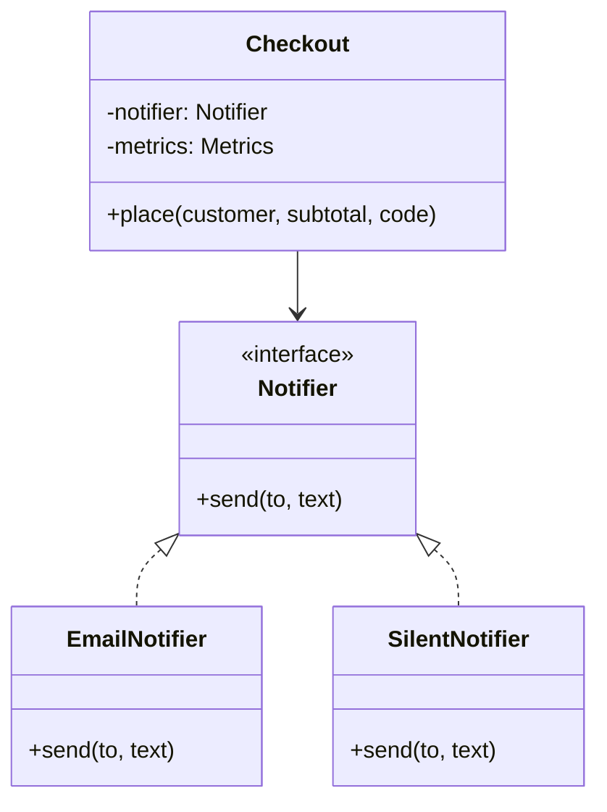

## In one minute
- A Null Object is a real implementation of an interface whose behaviour is "do nothing, neutrally": a notifier that sends nothing, a discount of zero, a metrics sink that drops counts. Callers use it exactly like any other implementation, so they stop checking for `None`.
- The `if x is not None` checks move from every call site to one place, usually the constructor or factory, where absence is turned into an object once.
- The neutral behaviour is an identity element: adding a zero discount, sending to an empty notifier list, or writing to `io.Discard` leaves the outcome unchanged. If no such neutral answer exists, the pattern does not apply.
- It is the wrong tool when absence is an error. A missing payment gateway must fail loudly; a missing analytics sink may quietly do nothing. Decide which dependencies are optional before you hide them.
- Agents love `if self.metrics: self.metrics.incr(...)` scattered through business code. Review asks for a null implementation injected at construction, and for no null objects on dependencies whose absence should stop the program.

## How it works

### The problem
An order service has three collaborators. Pricing rules may give a discount, a notifier emails the customer, and a metrics client counts orders. In tests, in a CLI tool, and in a small region that has no email provider, some of them are absent, so the code fills with guards:

```python
def place(self, order):
    discount = self.discounts.get(order.code)
    off = discount.apply(order.subtotal) if discount else 0
    total = order.subtotal - off
    if self.notifier is not None:
        self.notifier.send(order.customer, f"total {total}")
    if self.metrics:
        self.metrics.incr("orders")
    return total
```

Every new method repeats the guards, and the one that forgets crashes with `AttributeError: 'NoneType' object has no attribute 'send'` at the worst moment. Tony Hoare called null references his billion-dollar mistake for this reason ([Hoare, InfoQ](https://www.infoq.com/presentations/Null-References-The-Billion-Dollar-Mistake-Tony-Hoare/)): the type says "a notifier" but the value may be nothing, and the compiler cannot tell which call sites remembered.

### Replace absence with an object
Write an implementation for the "nothing" case and inject it once:

```python
class SilentNotifier:
    def send(self, to, text):
        pass

class Checkout:
    def __init__(self, notifier=None, metrics=None):
        self.notifier = notifier or SilentNotifier()
        self.metrics = metrics or NullMetrics()
```

The method body loses its branches: it always calls `self.notifier.send` and `self.metrics.incr`. The only null check left is in the constructor, where the decision "no notifier means silence" is stated once and can be read and tested.

### Neutral, not empty
A null object must return values that leave the computation unchanged, and the right neutral value depends on the operation. A discount returns 0. A list-returning repository returns an empty list, not `None`. A feature flag client with no backend returns each flag's coded default. A permission checker has no neutral answer: "allow" is dangerous and "deny" breaks every request, so a null permission checker is a bug waiting to happen. When you cannot name the neutral answer, absence is an error and should be treated as one.

The algebra helps. If you combine implementations (a composite notifier that fans out to email and SMS, a chain of discount rules), the null object is the identity element of that combination: a composite of zero notifiers behaves like the silent notifier, and the sum of zero discounts is zero. That is a quick test of whether your null object is correct.

### Where you already use it
Go's `io.Discard` is a writer on which every write succeeds without doing anything ([io docs](https://pkg.go.dev/io)). `slog.DiscardHandler`, added in Go 1.24, is never enabled, so loggers skip formatting entirely ([Go 1.24 notes](https://go.dev/doc/go1.24)). Python libraries are told to attach `logging.NullHandler()` to their top logger so they never print on behalf of an application that has not configured logging ([Python logging HOWTO](https://docs.python.org/3/howto/logging.html#configuring-logging-for-a-library)). `contextlib.nullcontext()` is a context manager that does nothing, so `with lock or nullcontext():` needs no branch ([contextlib docs](https://docs.python.org/3/library/contextlib.html)). The OpenTelemetry specification says that without an installed SDK the Trace API is a no-op API, which is why libraries can instrument themselves without forcing tracing on their users ([OpenTelemetry spec](https://opentelemetry.io/docs/specs/otel/trace/api/)). Java's `Collections.emptyList()` returns an immutable empty list ([Javadoc](https://docs.oracle.com/en/java/javase/21/docs/api/java.base/java/util/Collections.html)).

### Special Case and default values
Martin Fowler generalises the idea as [Special Case](https://martinfowler.com/eaaCatalog/specialCase.html), and his refactoring catalogue lists Introduce Special Case with the alias Introduce Null Object ([catalogue](https://refactoring.com/catalog/introduceSpecialCase.html)): an object for a recurring edge case, such as an `UnknownCustomer` with no billing plan or a `GuestUser` with an empty cart. The same shape appears in system design: a recommendation widget whose service times out shows a fixed "popular this week" list instead of an error. That fallback is a null object for a degraded dependency, the *partial failure* problem shape handled by substituting a safe neutral answer.

### When not to use it
- **Required dependencies.** A checkout without a payment gateway must not "succeed" silently. Fail at startup.
- **When callers need to know.** If the caller must render "no discount applied" differently from "0 percent discount", expose that difference (an `is_active()` method or an optional type) instead of hiding it.
- **Languages with good optional types.** Kotlin's `?.`, Rust's `Option`, and TypeScript's strict null checks make absence visible to the compiler. Use them for values; keep null objects for collaborators you call methods on.

### Reviewing agent-written code
Asked to "make metrics optional", an agent will add `if self.metrics:` before each of the 14 increments, often missing one. Ask instead for a `NullMetrics` class, a default in the constructor, and a test that runs the main flow with no optional dependencies. Also check the reverse mistake: an agent that "fixes" a crash by defaulting the payment client to a no-op has turned an outage into silent revenue loss.

## Down the stack

### Layer 1: The contract
A null object promises full substitutability (Liskov): every method of the interface exists, accepts the same inputs, never raises because it is the null variant, and returns the neutral value for that operation. It is stateless, or its state is never observable, so one instance can be shared by every caller and every thread. Its identity is not part of the contract: callers must not write `if notifier is SILENT`, because that reintroduces the branch the pattern removed. What it does not promise is that absence was intended; that decision belongs to whoever wires the object in.

### Layer 2: The mechanism
In Python, a null object is a class with empty methods and a module-level instance. In TypeScript, a `const` object literal satisfying the interface is enough, or a class with a single exported instance. In Go, the idiomatic form is an empty struct type with value receivers, exposed as a package variable of the interface type: `var Discard Writer = discard{}`. Go's own `io.Discard` goes a step further and implements `ReaderFrom`, so `io.Copy(io.Discard, r)` reads into a pooled 8 KB buffer instead of allocating per call ([io.go](https://github.com/golang/go/blob/master/src/io/io.go)). `slog.DiscardHandler` shows the other refinement: a null object with a cheap guard method (`Enabled` returns false) lets the caller skip building arguments at all, which matters more than the cost of the call.

Go has a trap here. An interface value is a pair (type, data). A nil `*EmailNotifier` stored in a `Notifier` interface is not equal to nil ([Go FAQ](https://go.dev/doc/faq#nil_error)), because the type half is set, so `if n != nil` passes and the method call dereferences nil. Returning a null object instead of a typed nil pointer removes the trap.

### Layer 3: The machine
Allocation: a stateless null object costs nothing per use. In Go, zero-size values such as `struct{}` share the runtime's `zerobase` address, and storing one in an interface does not allocate. In Python and TypeScript, share one module-level instance rather than building one per request.

Dispatch: the null object replaces a predictable branch with an indirect call. A nil check is under 1 ns when predicted. A Go interface call loads the itab and the function pointer: about 1 to 2 ns, and it blocks inlining unless profile-guided optimisation devirtualises the site. In V8, a call site that sees both `EmailNotifier` and `SilentNotifier` becomes polymorphic, which the inline cache handles cheaply up to four shapes. In CPython, calling an empty method costs roughly 30 to 60 ns against about 15 ns for `if x is not None`. Next to one network call, all of this is noise.

Concurrency: a stateless null object needs no lock. One that counts calls "for debugging" is no longer null; it needs atomics and becomes a contention point on hot paths.

### Why it's built this way
1. Optional collaborators are common (tests, CLIs, small deployments), and checking for absence at every call site is repetitive and easy to forget.
2. Polymorphism already answers "which behaviour runs here", so absence can be one more implementation instead of a special branch.
3. The behaviour must not change results, so the null implementation returns the identity value of each operation.
4. Having no state makes it free to share, which removes allocation and locking costs.
5. Silencing a required dependency hides outages, so the decision is made once, explicitly, at construction.

## Diagram


## Worked example
A marketplace's order service ran in 4 regions, one without an SMS provider, and an admin CLI reused it with neither SMS nor metrics. The code had 37 `if self.sms` and `if self.metrics` checks across 11 files. In one quarter, a refund path added without the guard crashed every refund in the SMS-less region for 40 minutes, and the CLI crashed on a metrics call in a batch job.

The refactor added `SilentSms` and `NullMetrics`, defaulted them in the composition root, and deleted all 37 checks. A test now builds the service with only its required dependencies (database, payment gateway) and runs every public method. A benchmark showed the extra interface calls add under 200 ns to a request that spends 35 ms in the database and payment provider.

The same review caught the opposite mistake: a `NullPaymentGateway` "so the CLI can start without credentials". It was rejected in favour of a `--dry-run` flag that wires an explicit `DryRunGateway` which logs what it would have charged, and production startup fails without the real gateway.

## In the wild
- **OpenTelemetry, ongoing: the no-op API.** The specification requires the Trace API to behave as a no-op when no SDK is installed, and the metrics API likewise. A library can create spans and record metrics unconditionally, and the host application decides whether anything is collected. The Go documentation warns of the flip side: if you forget to set the SDK provider, data is silently not generated ([OpenTelemetry spec](https://opentelemetry.io/docs/specs/otel/trace/api/), [Go instrumentation docs](https://opentelemetry.io/docs/languages/go/instrumentation/)).
- **Google Cloud, 2025-06: the missing guard on blank fields.** A new quota check in Service Control had no error handling or feature flag. A policy row with blank fields replicated worldwide within seconds, hit a null pointer and crash-looped the service in every region; API calls returned 503 for hours, and a kill switch took about 40 minutes. Google's follow-ups included making the check fail open, which is a deliberate, reviewed version of a neutral default for a dependency that is not worth an outage ([Google Cloud status](https://status.cloud.google.com/incidents/ow5i3PPK96RduMcb1SsW)).
- **Monzo, 2017-10: a NullPointerException on an empty service.** Restarting every Linkerd instance exposed a version incompatibility: Linkerd threw a NullPointerException on a Kubernetes service with no endpoints, left from a scale-to-zero the day before. The platform was down for roughly 1h20m until the empty service was deleted. The lesson for a null-safe design is to model "no endpoints" as an empty list the client handles, not as an absent value ([Monzo](https://community.monzo.com/t/resolved-current-account-payments-may-fail-major-outage-27-10-2017/26296/95)).

## Trade-offs
| Option | Strengths | Weaknesses | Choose when |
| --- | --- | --- | --- |
| Null checks at call sites | Absence is visible where it matters | Repetitive; one missed check crashes | Very few call sites, or the caller must react to absence |
| Null Object | No branches; shared and free; tests run with minimal setup | Hides absence; wrong for required dependencies | Optional collaborators with a clear neutral behaviour |
| Optional type (`Option`, `T \| undefined`) | Compiler forces handling | Handling still spread over callers | Values that may be absent, such as lookups |
| Special Case object | Encodes domain defaults (guest user, unknown customer) | More types to maintain | A recurring edge case with domain meaning |
| Fail fast at startup | Misconfiguration found before traffic | Less flexible for tests and tools | Required dependencies |

## Pitfalls in production
- A null object wired for a required dependency, so failures become silent data loss (orders without receipts, audits not written). Fix: list which dependencies may be null and fail at startup for the rest.
- A Go function returning a typed nil pointer as an interface, so `!= nil` checks pass and the call panics. Fix: return the null object or an untyped `nil`.
- Production accidentally running on the null default because a config key was misspelled, so metrics read zero and nobody notices. Fix: log which implementation was wired at startup and alert on a metrics series going absent.
- Identity checks against the null instance (`if notifier is SILENT`) creeping back into business code. Fix: add a method to the interface if callers truly need to know.
- Null objects that accumulate state, such as a "null" cache that stores entries, which then leaks memory. Fix: keep them stateless; a test-recording fake is a different class.

## Leadership lens
- Ask in design review: "Which dependencies are optional, and what does the system do without each one?" The answer decides where null objects are allowed and where startup must fail.
- Null objects make the minimal configuration testable. Require a test that boots the service with only required dependencies; it catches every forgotten guard at once.
- Treat a null default in production as a configuration risk. Startup logs and a dashboard of which implementations are active make silent degradation visible.
- When agents generate guards, point them at the house rule: optional collaborators get a null implementation and a constructor default, never call-site checks.

## Check yourself
1. Why is a null permission checker usually a mistake, while a null metrics sink is fine?
   **Answer:** Metrics have a neutral behaviour (record nothing) that does not change results. Authorization has none: allowing everything is a security hole and denying everything breaks the service, so absence must be an error.
2. How does the identity-element view help you check a null object's return values?
   **Answer:** Combining it with any real implementation must give the same result as the real one alone, for example adding a zero discount or fanning out to an empty notifier list. If a return value would change the result, it is not neutral.
3. Why does returning a typed nil pointer as an interface in Go defeat `if n != nil`?
   **Answer:** The interface holds a non-nil type and a nil data pointer, so it compares unequal to nil, and calling a method that dereferences the receiver panics.
4. When would you prefer an optional type over a null object?
   **Answer:** When the caller must behave differently if the value is absent, such as showing "not found", or when the value is data rather than a collaborator you call methods on.

## Practice
**Task:** Remove null checks from a checkout with null objects. Discount policies have `discount(subtotal)` (integer cents) and `describe()`. `NO_DISCOUNT` (Go: `NoDiscount`) is a shared null policy returning 0 and `"none"`. `PercentOff(pct)` returns `floor(subtotal * pct / 100)` and describes itself as `"<pct>% off"`. `discount_for(code, catalog)` maps a code to `PercentOff(catalog[code])`; an empty or unknown code returns the shared null policy, but a catalog percentage outside 0 to 100 is a configuration error `bad discount: <code>`. Notifiers have `send(to, text)` and metrics have `incr(name)`; `SilentNotifier` and `NullMetrics` do nothing. `Checkout(notifier, metrics)` accepts missing values (`None`, `undefined`, `nil`) and replaces them with the null objects. `place(customer, subtotal, code, catalog)` rejects negative subtotals with `bad subtotal` before any side effect, computes `total = subtotal - discount`, sends `"order total <total>"` to the customer, increments `orders`, increments `discounted` when the discount is positive, and returns the total.

```python starter
class NoDiscount:
    def discount(self, subtotal):
        # TODO
        raise NotImplementedError

    def describe(self):
        # TODO
        raise NotImplementedError

NO_DISCOUNT = NoDiscount()

class PercentOff:
    def __init__(self, pct):
        self.pct = pct

    def discount(self, subtotal):
        # TODO
        raise NotImplementedError

    def describe(self):
        # TODO
        raise NotImplementedError

def discount_for(code, catalog):
    # TODO
    raise NotImplementedError

class SilentNotifier:
    def send(self, to, text):
        raise NotImplementedError

class NullMetrics:
    def incr(self, name):
        raise NotImplementedError

class Checkout:
    def __init__(self, notifier=None, metrics=None):
        # TODO
        raise NotImplementedError

    def place(self, customer, subtotal, code, catalog):
        # TODO
        raise NotImplementedError
```

```python tests
class RecordingNotifier:
    def __init__(self):
        self.sent = []
    def send(self, to, text):
        self.sent.append((to, text))

class CountingMetrics:
    def __init__(self):
        self.counts = {}
    def incr(self, name):
        self.counts[name] = self.counts.get(name, 0) + 1

def error_of(fn):
    try:
        fn()
    except ValueError as e:
        return str(e)
    return None

def test_null_policy_is_neutral():
    assert NO_DISCOUNT.discount(5000) == 0 and NO_DISCOUNT.describe() == "none"
    assert PercentOff(25).discount(999) == 249 and PercentOff(25).describe() == "25% off"

def test_unknown_and_empty_codes_share_null_policy():
    cat = {"TEN": 10}
    assert discount_for("", cat) is NO_DISCOUNT
    assert discount_for("NOPE", cat) is NO_DISCOUNT
    assert discount_for("TEN", cat).discount(1000) == 100

def test_bad_catalog_is_an_error_not_a_null():
    assert error_of(lambda: discount_for("HUGE", {"HUGE": 150})) == "bad discount: HUGE"
    assert error_of(lambda: discount_for("NEG", {"NEG": -5})) == "bad discount: NEG"
    assert discount_for("ALL", {"ALL": 100}).discount(700) == 700

def test_checkout_runs_with_no_optional_dependencies():
    assert Checkout().place("ana", 1000, "", {}) == 1000
    assert Checkout(None, None).place("ana", 999, "TEN", {"TEN": 10}) == 900

def test_real_collaborators_receive_calls():
    n, m = RecordingNotifier(), CountingMetrics()
    c = Checkout(n, m)
    assert c.place("ana", 2000, "TEN", {"TEN": 10}) == 1800
    assert c.place("bo", 500, "", {}) == 500
    assert n.sent == [("ana", "order total 1800"), ("bo", "order total 500")]
    assert m.counts == {"orders": 2, "discounted": 1}

def test_negative_subtotal_has_no_side_effects():
    n, m = RecordingNotifier(), CountingMetrics()
    assert error_of(lambda: Checkout(n, m).place("ana", -1, "", {})) == "bad subtotal"
    assert n.sent == [] and m.counts == {}

def test_zero_percent_is_not_counted_as_discounted():
    m = CountingMetrics()
    assert Checkout(metrics=m).place("ana", 1000, "ZERO", {"ZERO": 0}) == 1000
    assert m.counts == {"orders": 1}
```

```python solution
class NoDiscount:
    def discount(self, subtotal):
        return 0

    def describe(self):
        return "none"

NO_DISCOUNT = NoDiscount()

class PercentOff:
    def __init__(self, pct):
        self.pct = pct

    def discount(self, subtotal):
        return subtotal * self.pct // 100

    def describe(self):
        return "%d%% off" % self.pct

def discount_for(code, catalog):
    if code == "" or code not in catalog:
        return NO_DISCOUNT
    pct = catalog[code]
    if pct < 0 or pct > 100:
        raise ValueError("bad discount: " + code)
    return PercentOff(pct)

class SilentNotifier:
    def send(self, to, text):
        pass

class NullMetrics:
    def incr(self, name):
        pass

class Checkout:
    def __init__(self, notifier=None, metrics=None):
        self.notifier = notifier if notifier is not None else SilentNotifier()
        self.metrics = metrics if metrics is not None else NullMetrics()

    def place(self, customer, subtotal, code, catalog):
        if subtotal < 0:
            raise ValueError("bad subtotal")
        off = discount_for(code, catalog).discount(subtotal)
        total = subtotal - off
        self.notifier.send(customer, "order total %d" % total)
        self.metrics.incr("orders")
        if off > 0:
            self.metrics.incr("discounted")
        return total
```

```typescript starter
export interface DiscountPolicy { discount(subtotal: number): number; describe(): string; }
export interface Notifier { send(to: string, text: string): void; }
export interface Metrics { incr(name: string): void; }

export const NO_DISCOUNT: DiscountPolicy = {
  discount(subtotal: number): number { throw new Error("TODO"); },
  describe(): string { throw new Error("TODO"); },
};

export class PercentOff implements DiscountPolicy {
  constructor(public readonly pct: number) {}
  discount(subtotal: number): number { throw new Error("TODO"); }
  describe(): string { throw new Error("TODO"); }
}

export function discountFor(code: string, catalog: Record<string, number>): DiscountPolicy {
  throw new Error("TODO");
}

export class SilentNotifier implements Notifier { send(to: string, text: string): void { throw new Error("TODO"); } }
export class NullMetrics implements Metrics { incr(name: string): void { throw new Error("TODO"); } }

export class Checkout {
  constructor(notifier?: Notifier, metrics?: Metrics) { throw new Error("TODO"); }
  place(customer: string, subtotal: number, code: string, catalog: Record<string, number>): number {
    throw new Error("TODO");
  }
}
```

```typescript tests
class RecordingNotifier implements Notifier {
  sent: [string, string][] = [];
  send(to: string, text: string): void { this.sent.push([to, text]); }
}

class CountingMetrics implements Metrics {
  counts: Record<string, number> = {};
  incr(name: string): void { this.counts[name] = (this.counts[name] ?? 0) + 1; }
}

function errorOf(fn: () => unknown): string | undefined {
  try { fn(); } catch (e) { return (e as Error).message; }
  return undefined;
}

test("null policy is neutral", () => {
  assertEqual(NO_DISCOUNT.discount(5000), 0);
  assertEqual(NO_DISCOUNT.describe(), "none");
  assertEqual(new PercentOff(25).discount(999), 249);
  assertEqual(new PercentOff(25).describe(), "25% off");
});

test("unknown and empty codes share null policy", () => {
  const cat = { TEN: 10 };
  assert(discountFor("", cat) === NO_DISCOUNT, "empty code");
  assert(discountFor("NOPE", cat) === NO_DISCOUNT, "unknown code");
  assertEqual(discountFor("TEN", cat).discount(1000), 100);
});

test("bad catalog is an error not a null", () => {
  assertEqual(errorOf(() => discountFor("HUGE", { HUGE: 150 })), "bad discount: HUGE");
  assertEqual(errorOf(() => discountFor("NEG", { NEG: -5 })), "bad discount: NEG");
  assertEqual(discountFor("ALL", { ALL: 100 }).discount(700), 700);
});

test("checkout runs with no optional dependencies", () => {
  assertEqual(new Checkout().place("ana", 1000, "", {}), 1000);
  assertEqual(new Checkout(undefined, undefined).place("ana", 999, "TEN", { TEN: 10 }), 900);
});

test("real collaborators receive calls", () => {
  const n = new RecordingNotifier();
  const m = new CountingMetrics();
  const c = new Checkout(n, m);
  assertEqual(c.place("ana", 2000, "TEN", { TEN: 10 }), 1800);
  assertEqual(c.place("bo", 500, "", {}), 500);
  assertEqual(n.sent, [["ana", "order total 1800"], ["bo", "order total 500"]]);
  assertEqual(m.counts, { orders: 2, discounted: 1 });
});

test("negative subtotal has no side effects", () => {
  const n = new RecordingNotifier();
  const m = new CountingMetrics();
  assertEqual(errorOf(() => new Checkout(n, m).place("ana", -1, "", {})), "bad subtotal");
  assertEqual(n.sent, []);
  assertEqual(m.counts, {});
});

test("zero percent is not counted as discounted", () => {
  const m = new CountingMetrics();
  assertEqual(new Checkout(undefined, m).place("ana", 1000, "ZERO", { ZERO: 0 }), 1000);
  assertEqual(m.counts, { orders: 1 });
});
```

```typescript solution
export interface DiscountPolicy { discount(subtotal: number): number; describe(): string; }
export interface Notifier { send(to: string, text: string): void; }
export interface Metrics { incr(name: string): void; }

export const NO_DISCOUNT: DiscountPolicy = Object.freeze({
  discount(_subtotal: number): number { return 0; },
  describe(): string { return "none"; },
});

export class PercentOff implements DiscountPolicy {
  constructor(public readonly pct: number) {}
  discount(subtotal: number): number { return Math.floor((subtotal * this.pct) / 100); }
  describe(): string { return `${this.pct}% off`; }
}

export function discountFor(code: string, catalog: Record<string, number>): DiscountPolicy {
  if (code === "" || !Object.prototype.hasOwnProperty.call(catalog, code)) return NO_DISCOUNT;
  const pct = catalog[code];
  if (pct < 0 || pct > 100) throw new Error("bad discount: " + code);
  return new PercentOff(pct);
}

export class SilentNotifier implements Notifier { send(_to: string, _text: string): void {} }
export class NullMetrics implements Metrics { incr(_name: string): void {} }

const SILENT = new SilentNotifier();
const NULL_METRICS = new NullMetrics();

export class Checkout {
  private notifier: Notifier;
  private metrics: Metrics;

  constructor(notifier?: Notifier, metrics?: Metrics) {
    this.notifier = notifier ?? SILENT;
    this.metrics = metrics ?? NULL_METRICS;
  }

  place(customer: string, subtotal: number, code: string, catalog: Record<string, number>): number {
    if (subtotal < 0) throw new Error("bad subtotal");
    const off = discountFor(code, catalog).discount(subtotal);
    const total = subtotal - off;
    this.notifier.send(customer, `order total ${total}`);
    this.metrics.incr("orders");
    if (off > 0) this.metrics.incr("discounted");
    return total;
  }
}
```

```go starter
package practice

type DiscountPolicy interface {
	Discount(subtotal int) int
	Describe() string
}

type Notifier interface{ Send(to, text string) }
type Metrics interface{ Incr(name string) }

type noDiscount struct{}

func (noDiscount) Discount(subtotal int) int { panic("TODO") }
func (noDiscount) Describe() string          { panic("TODO") }

var NoDiscount DiscountPolicy = noDiscount{}

type PercentOff struct{ Pct int }

func (p PercentOff) Discount(subtotal int) int { panic("TODO") }
func (p PercentOff) Describe() string          { panic("TODO") }

func DiscountFor(code string, catalog map[string]int) (DiscountPolicy, error) { panic("TODO") }

type SilentNotifier struct{}

func (SilentNotifier) Send(to, text string) { panic("TODO") }

type NullMetrics struct{}

func (NullMetrics) Incr(name string) { panic("TODO") }

type Checkout struct {
	notifier Notifier
	metrics  Metrics
}

func NewCheckout(n Notifier, m Metrics) *Checkout { panic("TODO") }

func (c *Checkout) Place(customer string, subtotal int, code string, catalog map[string]int) (int, error) {
	panic("TODO")
}
```

```go tests
package practice

import (
	"reflect"
	"testing"
)

type recordingNotifier struct{ sent [][2]string }

func (r *recordingNotifier) Send(to, text string) { r.sent = append(r.sent, [2]string{to, text}) }

type countingMetrics struct{ counts map[string]int }

func (c *countingMetrics) Incr(name string) { c.counts[name]++ }

func newCounting() *countingMetrics { return &countingMetrics{counts: map[string]int{}} }

func TestNullPolicyIsNeutral(t *testing.T) {
	if NoDiscount.Discount(5000) != 0 || NoDiscount.Describe() != "none" {
		t.Fatal("null policy must be neutral")
	}
	p := PercentOff{25}
	if p.Discount(999) != 249 || p.Describe() != "25% off" {
		t.Fatalf("got %d %q", p.Discount(999), p.Describe())
	}
}

func TestUnknownAndEmptyCodesShareNullPolicy(t *testing.T) {
	cat := map[string]int{"TEN": 10}
	for _, code := range []string{"", "NOPE"} {
		p, err := DiscountFor(code, cat)
		if err != nil || p != NoDiscount {
			t.Fatalf("%q: got %v %v", code, p, err)
		}
	}
	p, _ := DiscountFor("TEN", cat)
	if p.Discount(1000) != 100 {
		t.Fatal("TEN should take 100 off 1000")
	}
}

func TestBadCatalogIsAnErrorNotANull(t *testing.T) {
	cases := map[string]int{"HUGE": 150, "NEG": -5}
	for code, pct := range cases {
		_, err := DiscountFor(code, map[string]int{code: pct})
		if err == nil || err.Error() != "bad discount: "+code {
			t.Fatalf("%s: got %v", code, err)
		}
	}
	p, err := DiscountFor("ALL", map[string]int{"ALL": 100})
	if err != nil || p.Discount(700) != 700 {
		t.Fatal("100 percent is valid")
	}
}

func TestCheckoutRunsWithNoOptionalDependencies(t *testing.T) {
	c := NewCheckout(nil, nil)
	if got, err := c.Place("ana", 1000, "", nil); err != nil || got != 1000 {
		t.Fatalf("got %d %v", got, err)
	}
	if got, _ := c.Place("ana", 999, "TEN", map[string]int{"TEN": 10}); got != 900 {
		t.Fatalf("got %d", got)
	}
}

func TestRealCollaboratorsReceiveCalls(t *testing.T) {
	n, m := &recordingNotifier{}, newCounting()
	c := NewCheckout(n, m)
	if got, _ := c.Place("ana", 2000, "TEN", map[string]int{"TEN": 10}); got != 1800 {
		t.Fatalf("got %d", got)
	}
	if got, _ := c.Place("bo", 500, "", nil); got != 500 {
		t.Fatalf("got %d", got)
	}
	want := [][2]string{{"ana", "order total 1800"}, {"bo", "order total 500"}}
	if !reflect.DeepEqual(n.sent, want) {
		t.Fatalf("got %v", n.sent)
	}
	if !reflect.DeepEqual(m.counts, map[string]int{"orders": 2, "discounted": 1}) {
		t.Fatalf("got %v", m.counts)
	}
}

func TestNegativeSubtotalHasNoSideEffects(t *testing.T) {
	n, m := &recordingNotifier{}, newCounting()
	_, err := NewCheckout(n, m).Place("ana", -1, "", nil)
	if err == nil || err.Error() != "bad subtotal" {
		t.Fatalf("got %v", err)
	}
	if len(n.sent) != 0 || len(m.counts) != 0 {
		t.Fatal("no side effects expected")
	}
}

func TestZeroPercentIsNotCountedAsDiscounted(t *testing.T) {
	m := newCounting()
	got, _ := NewCheckout(nil, m).Place("ana", 1000, "ZERO", map[string]int{"ZERO": 0})
	if got != 1000 || !reflect.DeepEqual(m.counts, map[string]int{"orders": 1}) {
		t.Fatalf("got %d %v", got, m.counts)
	}
}
```

```go solution
package practice

import (
	"errors"
	"fmt"
)

type DiscountPolicy interface {
	Discount(subtotal int) int
	Describe() string
}

type Notifier interface{ Send(to, text string) }
type Metrics interface{ Incr(name string) }

type noDiscount struct{}

func (noDiscount) Discount(subtotal int) int { return 0 }
func (noDiscount) Describe() string          { return "none" }

var NoDiscount DiscountPolicy = noDiscount{}

type PercentOff struct{ Pct int }

func (p PercentOff) Discount(subtotal int) int { return subtotal * p.Pct / 100 }
func (p PercentOff) Describe() string          { return fmt.Sprintf("%d%% off", p.Pct) }

func DiscountFor(code string, catalog map[string]int) (DiscountPolicy, error) {
	pct, ok := catalog[code]
	if code == "" || !ok {
		return NoDiscount, nil
	}
	if pct < 0 || pct > 100 {
		return nil, errors.New("bad discount: " + code)
	}
	return PercentOff{pct}, nil
}

type SilentNotifier struct{}

func (SilentNotifier) Send(to, text string) {}

type NullMetrics struct{}

func (NullMetrics) Incr(name string) {}

type Checkout struct {
	notifier Notifier
	metrics  Metrics
}

func NewCheckout(n Notifier, m Metrics) *Checkout {
	if n == nil {
		n = SilentNotifier{}
	}
	if m == nil {
		m = NullMetrics{}
	}
	return &Checkout{notifier: n, metrics: m}
}

func (c *Checkout) Place(customer string, subtotal int, code string, catalog map[string]int) (int, error) {
	if subtotal < 0 {
		return 0, errors.New("bad subtotal")
	}
	policy, err := DiscountFor(code, catalog)
	if err != nil {
		return 0, err
	}
	off := policy.Discount(subtotal)
	total := subtotal - off
	c.notifier.Send(customer, fmt.Sprintf("order total %d", total))
	c.metrics.Incr("orders")
	if off > 0 {
		c.metrics.Incr("discounted")
	}
	return total, nil
}
```

## Mock interview
**Prompt:** You own a shared Go and Python SDK used by 40 internal services. It takes optional collaborators: a logger, a metrics client, a tracer and a feature-flag client. Half the services do not configure some of them, and the SDK is full of nil checks; last month a missed check caused a panic in a payment service. Redesign how the SDK handles optional dependencies.

- Follow-up: The feature-flag client is optional. What does its null object return for each flag, and who decides?
- Follow-up: A service misconfigures its metrics endpoint and silently gets the null sink in production. How would you detect that?
- Follow-up: Which of the SDK's dependencies should never have a null object, and what happens instead?

**A strong answer covers:**
- Null implementations for logger, metrics and tracer (mirroring `slog.DiscardHandler`, `NullHandler`, the OpenTelemetry no-op tracer), defaulted once in the SDK constructor, with call-site checks deleted.
- A null flag client that returns each flag's coded default, so behaviour without the flag service equals the documented default, not "off".
- Visibility: log the wired implementations at startup, expose them in a health or info endpoint, and alert when expected metrics series are absent.
- Required dependencies (credentials, the payment or storage backend) fail at construction with a clear error instead of degrading silently.
- Go specifics: avoid returning typed nil pointers as interfaces; stateless zero-size null types that are free to share across goroutines.

## Sources and further study
**Primary**
- [Go 1.24 release notes](https://go.dev/doc/go1.24): the addition of `slog.DiscardHandler`.
- [Go FAQ: nil error values](https://go.dev/doc/faq#nil_error): why a typed nil inside an interface is not nil.
- [OpenTelemetry Trace API spec](https://opentelemetry.io/docs/specs/otel/trace/api/): the required no-op behaviour when no SDK is installed.

**Systems docs**
- [Go io package](https://pkg.go.dev/io): `io.Discard` as a writer that does nothing.
- [Python logging HOWTO](https://docs.python.org/3/howto/logging.html#configuring-logging-for-a-library): `NullHandler` for libraries.
- [Python contextlib](https://docs.python.org/3/library/contextlib.html): `nullcontext` for optional context managers.
- [Google Cloud incident, June 2025](https://status.cloud.google.com/incidents/ow5i3PPK96RduMcb1SsW): the cost of an unhandled null in a critical path.

**Books**
- *Refactoring*, Martin Fowler, 2nd edition: chapter 10 (Simplifying Conditional Logic), Introduce Special Case.
- *Design Patterns*, Gamma, Helm, Johnson and Vlissides: chapter 5 (Behavioral Patterns), which has no Null Object entry; it is usually presented as a variation on Strategy and State.
- *Head First Design Patterns*, Freeman and Robson: chapter 1 (Strategy), where a do-nothing behaviour is just one more interchangeable implementation.

**Other curricula**
- [Refactoring.Guru: Introduce Null Object](https://refactoring.guru/introduce-null-object): the mechanical steps from checks to a null class.

## Watch
- [Nothing is Something (Sandi Metz, RailsConf 2015)](https://www.youtube.com/watch?v=29MAL8pJImQ): the classic talk on replacing conditionals about absence with objects.
- [Design Patterns: Null Object (Ludonaut)](https://www.youtube.com/watch?v=6sOQhEFoGxQ): a short walk-through of removing null checks with a null implementation.

## Free resources
- [Special Case (Martin Fowler)](https://martinfowler.com/eaaCatalog/specialCase.html): the generalisation of null objects to any recurring edge case.
- [Introduce Null Object (Refactoring.Guru)](https://refactoring.guru/introduce-null-object): the refactoring steps from scattered checks to a null class.
- [Null References: The Billion Dollar Mistake (Tony Hoare, InfoQ)](https://www.infoq.com/presentations/Null-References-The-Billion-Dollar-Mistake-Tony-Hoare/): the history of null and why it causes so many failures.
- [Configuring logging for a library (Python docs)](https://docs.python.org/3/howto/logging.html#configuring-logging-for-a-library): why libraries attach a `NullHandler`.
- [slog.DiscardHandler (Go docs)](https://pkg.go.dev/log/slog#DiscardHandler): a null handler whose `Enabled` check lets callers skip work entirely.
- [Why is my nil error value not equal to nil? (Go FAQ)](https://go.dev/doc/faq#nil_error): the typed-nil interface trap that null objects avoid.
