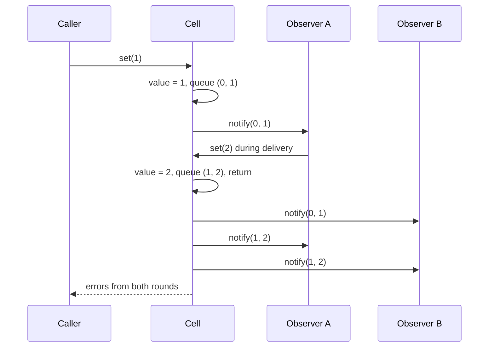

## In one minute
- Observer lets one object (the subject) tell any number of other objects (observers) that something changed, without knowing who they are. Observers subscribe; the subject keeps a list and calls each one on every change.
- It removes the arrow from the core to its side effects: the stock counter no longer imports the search indexer, the alerting code and the cache. Adding a new reaction is a new subscription, not an edit to the core.
- In-process observers run synchronously on the publisher's thread, in its call stack. That makes them simple and ordered, and it means a slow or failing observer slows or breaks the publisher unless you isolate it.
- The classic bugs are about lifecycle and re-entrancy: observers that are never unsubscribed (the lapsed listener leak), observers that unsubscribe or publish while being notified, and notifications that arrive out of order.
- When observers live in other processes, the same idea becomes pub/sub over a broker, with its own delivery guarantees. Keep in-process Observer for cheap, local reactions.

## How it works

### The problem
An inventory service keeps a stock count per product. When a count changes, four things must happen: the search index updates the "in stock" flag, a low-stock alert fires below 10 units, a product page cache entry is dropped, and the analytics pipeline records the change. The first version does all of that inside `set_stock`:

```python
def set_stock(self, sku, qty):
    old = self.stock[sku]
    self.stock[sku] = qty
    self.search.update(sku, qty > 0)
    if qty < 10 <= old:
        self.alerts.low_stock(sku, qty)
    self.cache.drop(f"product:{sku}")
    self.analytics.record("stock", sku, old, qty)
```

The inventory class now depends on four other teams' code. Each new reaction is a change to the core, and a test of the stock arithmetic needs four fakes. When the analytics client throws, the stock update looks failed even though it succeeded.

### Invert the dependency
The subject offers `subscribe(callback)` and calls every callback when the value changes:

```python
class StockLevel:
    def __init__(self):
        self.observers = []

    def subscribe(self, fn):
        self.observers.append(fn)
        return lambda: self.observers.remove(fn)

    def set(self, sku, old, new):
        for fn in list(self.observers):
            fn(sku, old, new)
```

Each team registers its own reaction at startup. The inventory code knows only that someone may be listening. This is the dependency inversion principle applied to side effects, and it is how GUI toolkits, DOM events, Node's `EventEmitter`, reactive stores (MobX, Svelte stores, signals) and the elevator and parking-lot display boards in this course are wired.

### Push or pull
A notification can carry the data (push: `fn(sku, old, new)`) or just say "I changed" and let the observer read what it needs (pull: `fn(subject)`). Push is simpler and gives each observer a consistent snapshot of that change. Pull lets observers fetch only what they need, but an observer that reads later may see a newer value than the one that triggered it. Most modern APIs push a small event object.

### The hard parts are lifecycle and re-entrancy
Three situations break naive implementations.

1. **Unsubscribe during notification.** An observer removes itself (a one-shot listener) or another observer while the subject is iterating the list. Mutating a list while iterating it skips elements or throws. Iterate over a snapshot, and decide whether a listener removed mid-delivery still gets the current event. The DOM says no (removed listeners are flagged and skipped); Node's `EventEmitter` says yes (it iterates a copy).
2. **Publishing during notification.** An observer reacts to `0 -> 1` by setting the value to `2`. If the subject notifies recursively, observers later in the list see `1 -> 2` before `0 -> 1`. Queue nested changes and deliver them after the current round, so every observer sees changes in the same order.
3. **Failing observers.** One observer throws. Without isolation the remaining observers are skipped and the exception reaches the code that changed the value. Catch per observer, collect or log the error, and keep going.

The Practice section builds a value cell that handles all three.

### Forgetting to unsubscribe
A subject holds a strong reference to every callback, and every callback holds whatever it closes over, often an entire screen or request context. A component that subscribes on creation and never unsubscribes stays in memory forever and keeps reacting to events for a page the user left an hour ago. This is the lapsed listener problem. The fixes are a disposable handle (`subscribe` returns an unsubscribe function), lifecycle helpers (`AbortSignal` passed to `addEventListener`, React's effect cleanup), or weak references (Python's `weakref.WeakMethod`) when the subject should not keep observers alive.

### Reviewing agent-written code
Agents add observers readily and forget teardown, because the subscribe call is in the code they were asked to write and the unsubscribe belongs in a lifecycle method they did not open. In review, look for every `subscribe`, `on` or `addEventListener` and find its matching removal. Also check whether a new observer does slow work (an HTTP call, a database write) synchronously. If it does, it adds that latency to every change, and it belongs behind a queue.

### The same shape elsewhere
Observer is the *fan-out* shape inside one process. The same shape appears in Postgres `LISTEN`/`NOTIFY`, Kubernetes informers built on etcd watches, webhook subscriptions, and broker topics. Each one faces the questions this lesson raises at a larger scale: what happens to a slow subscriber, what order events arrive in, and how subscriptions are cleaned up. The event-driven architecture lesson in the system design course covers the cross-process version.

## Down the stack

### Layer 1: The contract
A well-behaved subject promises: every observer subscribed when a change is delivered is called exactly once for it, in subscription order; observers removed before their turn are not called; observers added during a delivery start with the next change; nested changes are delivered after the current one, so all observers see the same order; one observer's failure does not prevent delivery to the others and does not undo the change; and unsubscribing is idempotent. It should also say what it does not promise: in-process observers are not durable, so a crash between the change and the notification loses the notification. If an observer must never miss an event, use an outbox or a log, not a callback list.

### Layer 2: The mechanism
Node's `EventEmitter` stores listeners in an `_events` object keyed by event name. A single listener is stored as the bare function and only becomes an array when a second one is added, because most events have one listener. `emit` copies the array before calling listeners, which is why removing a listener mid-emit does not affect the current emit. An `'error'` event with no listener throws. With more than 10 listeners on one event it prints a `MaxListenersExceededWarning`, a cheap leak detector.

The DOM's `EventTarget` keeps an event listener list per target with `type`, `callback`, `capture`, `once`, `passive` and `signal`. Removing a listener sets its `removed` flag, and dispatch skips flagged entries, so removal takes effect immediately. Dispatch walks capture, target and bubble phases along a path computed before the first listener runs.

Java's `CopyOnWriteArrayList`, the usual listener list in concurrent code, copies the whole array on every `add` or `remove` and lets iterators read a frozen snapshot without locks. That fits listeners exactly: subscriptions are rare and notifications are frequent. Go code often gives each subscriber a buffered channel instead, which turns synchronous observers into asynchronous ones and forces an explicit decision when a subscriber's buffer is full: block, drop, or disconnect.

### Layer 3: The machine
Notifying N observers costs N indirect calls plus whatever they do. The dispatch itself is cheap: a loop over 20 callbacks with trivial bodies takes well under a microsecond in Go or V8, and a few microseconds in CPython, where each call builds a frame. The cost that bites is that observers run on the publisher's thread. If one of 20 observers makes a 40 ms HTTP call, every `set` now takes 40 ms, and a request handler that changes three values waits 120 ms.

Allocation per notification adds up at high rates. Copying the listener array, building an event object and boxing arguments are each a heap allocation in JS and Python; at 100,000 changes per second that is several hundred thousand short-lived objects per second for the garbage collector. Copy-on-write lists move that cost to subscription time. Each observer closure also pins memory: the closure, its captured environment, and everything reachable from it. A leaked listener on a long-lived subject keeps megabytes alive, and heap snapshots show it as a retaining path from the subject's listener array.

Concurrency adds two rules. Never call observers while holding the subject's lock, because an observer that calls back into the subject deadlocks, and a slow observer blocks every other thread. Copy the list under the lock, release it, then notify. And with Go channels, an unbuffered send to a subscriber that has stopped reading blocks the publisher forever; buffer, use `select` with a `default` branch to drop, or cut the subscriber off.

### Why it's built this way
1. The core changes rarely, and the set of reactions to its changes grows with every team, so the core must not depend on the reactions.
2. A list of callbacks inverts that dependency at the cost of one loop and N indirect calls.
3. Callbacks run on the publisher's stack, so ordering, re-entrancy and failure isolation must be handled by the subject, not left to luck.
4. Callbacks are strong references with captured state, so every subscription needs a teardown path, or memory leaks in proportion to uptime.
5. When reactions are slow or must survive crashes, the in-process list is the wrong tool, and the design moves to queues and logs.

## Diagram


## Worked example
An online shop changes stock about 800 times per second at peak. The `StockLevel` subject had five synchronous observers. Four were fast (under 50 us each). The fifth, added for a marketing dashboard, posted every change to an HTTP endpoint with a median of 25 ms and a p99 of 300 ms. Checkout updates stock for every line item, and an average cart has 3 items, so checkout p99 rose by almost a second. During a dashboard outage the HTTP client threw on every call, and because the subject did not isolate failures, the cache-invalidation observer registered after it never ran. Customers saw "in stock" for sold-out items for 20 minutes.

The fix had three parts. The subject now catches each observer's error, logs it with the observer's name, and continues. The dashboard observer only appends to an in-memory buffer (about 1 us), and a background worker ships batches of 500 events every second, dropping the oldest when the buffer passes 50,000 so a dead dashboard cannot exhaust memory. And the cache invalidation moved first in the list with a comment explaining why. Checkout p99 returned to 180 ms, and a later dashboard outage changed nothing customers could see.

## Trade-offs
| Option | Strengths | Weaknesses | Choose when |
| --- | --- | --- | --- |
| Direct calls in the core | Explicit order; easy to trace | Core depends on every reaction | Two or three reactions owned by the same team |
| Synchronous observers | Decoupled; ordered; no infrastructure | Slow or failing observer affects publisher; not durable | Fast, local reactions such as UI updates and cache drops |
| Async observers (channel or queue per subscriber) | Publisher isolated from slow observers | Ordering, buffering and back-pressure decisions | Slow reactions in the same process |
| Event bus or broker topic | Cross-process; durable; replayable | Infrastructure, at-least-once semantics, duplicates | Other services react, or reactions must survive crashes |
| Reactive streams (Rx, signals) | Composition: map, filter, debounce | Learning curve; hidden subscriptions | UIs and dataflows with many derived values |

## Pitfalls in production
- Lapsed listeners: components subscribe and never unsubscribe, so memory grows and old screens keep reacting. Fix: return an unsubscribe handle and tie it to the component's lifecycle; alert on listener counts.
- Slow observers adding latency to every change. Fix: keep synchronous observers under a microsecond budget and move anything with I/O behind a queue.
- One exception stopping delivery to the rest. Fix: isolate each observer, record the error with the observer's name, and continue.
- Recursive notification when an observer changes the subject, so observers see changes out of order or the stack overflows. Fix: queue nested changes and drain them after the current round.
- Calling observers while holding the subject's lock, causing deadlocks when an observer calls back. Fix: snapshot the list under the lock and notify outside it.
- Depending on observer order without saying so. Fix: if order matters, make it explicit (priorities or a single composed observer), not an accident of import order.

## Leadership lens
- Decide per reaction whether it may fail the change. A ledger entry probably must be in the same transaction; a dashboard update must never block checkout. Observer is for the second kind.
- Ask "what happens if the process crashes between the change and the notification?" If the answer is "we lose money or data", the reaction needs an outbox or log, not a callback.
- Track subscription counts per subject as a metric. A count that only grows is a leak you can catch before the out-of-memory kill.
- Give each observer a name and an owner, and log errors with both. Anonymous lambdas in a listener list are hard to debug at 3 a.m.
- When agents add observers, require the teardown in the same change and a note on whether the observer does I/O.

## Check yourself
1. An observer reacts to a change from 0 to 1 by setting the value to 2. With naive recursive notification, what does an observer later in the list see, and how do you fix it?
   **Answer:** It sees 1 to 2 before 0 to 1. Queue nested changes and deliver them after the current round so every observer sees the same order.
2. Why does Node's `EventEmitter` still call a listener that another listener removed during the same `emit`, while the DOM does not?
   **Answer:** `emit` iterates a copy of the listener array taken before dispatch. The DOM marks removed listeners with a flag and skips flagged entries during dispatch.
3. Why should a subject never call observers while holding its own lock?
   **Answer:** An observer that calls back into the subject would deadlock, and a slow observer would block every other thread waiting for the lock.
4. When should a reaction move from an in-process observer to a message broker?
   **Answer:** When it lives in another process, is slow, or must not be lost if the process crashes between the change and the notification.

## Practice
**Task:** Build an observable value cell. `Cell(initial)` has `get()`, `count()` (active subscriptions), `subscribe(fn)` and `set(value)`. `subscribe` returns an unsubscribe function; calling it more than once is harmless, and subscribing the same function twice creates two independent subscriptions. `set` does nothing and returns an empty list if the value is unchanged; otherwise it stores the value and notifies observers with `(old, new)` in subscription order. Rules: observers subscribed during a delivery start with the next change; an observer unsubscribed before its turn is skipped, even mid-delivery; a `set` made by an observer during a delivery stores the value at once but its notification is queued until the current delivery finishes, and returns an empty list; an observer that raises (Python), throws (TypeScript) or returns an error (Go) does not stop the others. The outermost `set` returns the error messages from every delivery it ran, in order. Values are integers.

```python starter
class Cell:
    def __init__(self, initial):
        self._value = initial

    def get(self):
        return self._value

    def count(self):
        # TODO
        raise NotImplementedError

    def subscribe(self, fn):
        # TODO: return an unsubscribe function
        raise NotImplementedError

    def set(self, value):
        # TODO: return a list of error messages
        raise NotImplementedError
```

```python tests
def test_notifies_old_and_new_in_order():
    c, log = Cell(0), []
    c.subscribe(lambda o, n: log.append(("a", o, n)))
    c.subscribe(lambda o, n: log.append(("b", o, n)))
    assert c.set(5) == []
    assert c.get() == 5
    assert log == [("a", 0, 5), ("b", 0, 5)]
    assert c.set(5) == [] and len(log) == 2, "unchanged value notifies nobody"

def test_unsubscribe_is_idempotent():
    c, log = Cell(0), []
    off = c.subscribe(lambda o, n: log.append(n))
    assert c.count() == 1
    off()
    off()
    c.set(1)
    assert log == [] and c.count() == 0

def test_same_function_twice_is_two_subscriptions():
    c, log = Cell(0), []
    fn = lambda o, n: log.append(n)
    off1 = c.subscribe(fn)
    c.subscribe(fn)
    c.set(1)
    off1()
    c.set(2)
    assert log == [1, 1, 2] and c.count() == 1

def test_failing_observer_does_not_stop_others():
    c, log = Cell(0), []
    def boom(o, n):
        raise ValueError("boom " + str(n))
    c.subscribe(boom)
    c.subscribe(lambda o, n: log.append(n))
    assert c.set(1) == ["boom 1"]
    assert log == [1] and c.get() == 1

def test_nested_set_is_queued_in_order():
    c, log, nested = Cell(0), [], []
    def bump(o, n):
        if n == 1:
            nested.append(c.set(2))
        log.append(("a", o, n))
    c.subscribe(bump)
    c.subscribe(lambda o, n: log.append(("b", o, n)))
    assert c.set(1) == []
    assert nested == [[]]
    assert log == [("a", 0, 1), ("b", 0, 1), ("a", 1, 2), ("b", 1, 2)]
    assert c.get() == 2

def test_unsubscribe_during_delivery_skips():
    c, log = Cell(0), []
    handles = {}
    def first(o, n):
        log.append("first")
        handles["second"]()
        handles["first"]()
    handles["first"] = c.subscribe(first)
    handles["second"] = c.subscribe(lambda o, n: log.append("second"))
    c.set(1)
    c.set(2)
    assert log == ["first"] and c.count() == 0

def test_subscribe_during_delivery_starts_next_change():
    c, log = Cell(0), []
    def adder(o, n):
        if n == 1:
            c.subscribe(lambda o2, n2: log.append(("late", n2)))
    c.subscribe(adder)
    c.set(1)
    assert log == []
    c.set(2)
    assert log == [("late", 2)]

def test_errors_from_nested_rounds_are_collected():
    c = Cell(0)
    def chain(o, n):
        if n < 3:
            c.set(n + 1)
        raise ValueError("fail " + str(n))
    c.subscribe(chain)
    assert c.set(1) == ["fail 1", "fail 2", "fail 3"]
    assert c.get() == 3
```

```python solution
class _Sub:
    __slots__ = ("fn", "active")

    def __init__(self, fn):
        self.fn = fn
        self.active = True

class Cell:
    def __init__(self, initial):
        self._value = initial
        self._subs = []
        self._queue = []
        self._delivering = False

    def get(self):
        return self._value

    def count(self):
        return len(self._subs)

    def subscribe(self, fn):
        sub = _Sub(fn)
        self._subs.append(sub)

        def unsubscribe():
            if sub.active:
                sub.active = False
                self._subs = [s for s in self._subs if s is not sub]
        return unsubscribe

    def set(self, value):
        if value == self._value:
            return []
        old, self._value = self._value, value
        self._queue.append((old, value))
        if self._delivering:
            return []
        self._delivering = True
        errors = []
        try:
            while self._queue:
                o, n = self._queue.pop(0)
                for sub in list(self._subs):
                    if not sub.active:
                        continue
                    try:
                        sub.fn(o, n)
                    except Exception as e:
                        errors.append(str(e))
        finally:
            self._delivering = False
        return errors
```

```typescript starter
export type Observer = (oldValue: number, newValue: number) => void;

export class Cell {
  constructor(private value: number) {}
  get(): number { return this.value; }
  count(): number { throw new Error("TODO"); }
  subscribe(fn: Observer): () => void { throw new Error("TODO"); }
  set(value: number): string[] { throw new Error("TODO"); }
}
```

```typescript tests
test("notifies old and new in order", () => {
  const c = new Cell(0);
  const log: unknown[] = [];
  c.subscribe((o, n) => log.push(["a", o, n]));
  c.subscribe((o, n) => log.push(["b", o, n]));
  assertEqual(c.set(5), []);
  assertEqual(c.get(), 5);
  assertEqual(log, [["a", 0, 5], ["b", 0, 5]]);
  assertEqual(c.set(5), []);
  assertEqual(log.length, 2, "unchanged value notifies nobody");
});

test("unsubscribe is idempotent", () => {
  const c = new Cell(0);
  const log: number[] = [];
  const off = c.subscribe((o, n) => { log.push(n); });
  assertEqual(c.count(), 1);
  off();
  off();
  c.set(1);
  assertEqual(log, []);
  assertEqual(c.count(), 0);
});

test("same function twice is two subscriptions", () => {
  const c = new Cell(0);
  const log: number[] = [];
  const fn: Observer = (o, n) => { log.push(n); };
  const off1 = c.subscribe(fn);
  c.subscribe(fn);
  c.set(1);
  off1();
  c.set(2);
  assertEqual(log, [1, 1, 2]);
  assertEqual(c.count(), 1);
});

test("failing observer does not stop others", () => {
  const c = new Cell(0);
  const log: number[] = [];
  c.subscribe((o, n) => { throw new Error("boom " + n); });
  c.subscribe((o, n) => { log.push(n); });
  assertEqual(c.set(1), ["boom 1"]);
  assertEqual(log, [1]);
  assertEqual(c.get(), 1);
});

test("nested set is queued in order", () => {
  const c = new Cell(0);
  const log: unknown[] = [];
  const nested: string[][] = [];
  c.subscribe((o, n) => {
    if (n === 1) nested.push(c.set(2));
    log.push(["a", o, n]);
  });
  c.subscribe((o, n) => { log.push(["b", o, n]); });
  assertEqual(c.set(1), []);
  assertEqual(nested, [[]]);
  assertEqual(log, [["a", 0, 1], ["b", 0, 1], ["a", 1, 2], ["b", 1, 2]]);
  assertEqual(c.get(), 2);
});

test("unsubscribe during delivery skips", () => {
  const c = new Cell(0);
  const log: string[] = [];
  const handles: Record<string, () => void> = {};
  handles.first = c.subscribe(() => {
    log.push("first");
    handles.second();
    handles.first();
  });
  handles.second = c.subscribe(() => { log.push("second"); });
  c.set(1);
  c.set(2);
  assertEqual(log, ["first"]);
  assertEqual(c.count(), 0);
});

test("subscribe during delivery starts next change", () => {
  const c = new Cell(0);
  const log: unknown[] = [];
  c.subscribe((o, n) => {
    if (n === 1) c.subscribe((o2, n2) => { log.push(["late", n2]); });
  });
  c.set(1);
  assertEqual(log, []);
  c.set(2);
  assertEqual(log, [["late", 2]]);
});

test("errors from nested rounds are collected", () => {
  const c = new Cell(0);
  c.subscribe((o, n) => {
    if (n < 3) c.set(n + 1);
    throw new Error("fail " + n);
  });
  assertEqual(c.set(1), ["fail 1", "fail 2", "fail 3"]);
  assertEqual(c.get(), 3);
});
```

```typescript solution
export type Observer = (oldValue: number, newValue: number) => void;

interface Sub {
  fn: Observer;
  active: boolean;
}

export class Cell {
  private subs: Sub[] = [];
  private queue: Array<[number, number]> = [];
  private delivering = false;

  constructor(private value: number) {}

  get(): number { return this.value; }

  count(): number { return this.subs.length; }

  subscribe(fn: Observer): () => void {
    const sub: Sub = { fn, active: true };
    this.subs.push(sub);
    return () => {
      if (!sub.active) return;
      sub.active = false;
      this.subs = this.subs.filter((s) => s !== sub);
    };
  }

  set(value: number): string[] {
    if (value === this.value) return [];
    const old = this.value;
    this.value = value;
    this.queue.push([old, value]);
    if (this.delivering) return [];
    this.delivering = true;
    const errors: string[] = [];
    try {
      while (this.queue.length > 0) {
        const [o, n] = this.queue.shift()!;
        for (const sub of [...this.subs]) {
          if (!sub.active) continue;
          try {
            sub.fn(o, n);
          } catch (e) {
            errors.push(e instanceof Error ? e.message : String(e));
          }
        }
      }
    } finally {
      this.delivering = false;
    }
    return errors;
  }
}
```

```go starter
package practice

type Observer func(old, new int) error

type Cell struct {
	value int
}

func NewCell(initial int) *Cell { return &Cell{value: initial} }

func (c *Cell) Get() int                       { return c.value }
func (c *Cell) Count() int                     { panic("TODO") }
func (c *Cell) Subscribe(fn Observer) func()   { panic("TODO") }
func (c *Cell) Set(value int) []string         { panic("TODO") }
```

```go tests
package practice

import (
	"fmt"
	"reflect"
	"testing"
)

func same(t *testing.T, got, want any, msg string) {
	t.Helper()
	if !reflect.DeepEqual(got, want) {
		t.Fatalf("%s: want %v, got %v", msg, want, got)
	}
}

func TestNotifiesOldAndNewInOrder(t *testing.T) {
	c := NewCell(0)
	var log []string
	c.Subscribe(func(o, n int) error { log = append(log, fmt.Sprint("a", o, n)); return nil })
	c.Subscribe(func(o, n int) error { log = append(log, fmt.Sprint("b", o, n)); return nil })
	same(t, len(c.Set(5)), 0, "no errors")
	same(t, c.Get(), 5, "value")
	same(t, log, []string{"a0 5", "b0 5"}, "log")
	c.Set(5)
	same(t, len(log), 2, "unchanged value notifies nobody")
}

func TestUnsubscribeIsIdempotent(t *testing.T) {
	c := NewCell(0)
	var log []int
	off := c.Subscribe(func(o, n int) error { log = append(log, n); return nil })
	same(t, c.Count(), 1, "count")
	off()
	off()
	c.Set(1)
	same(t, len(log), 0, "no calls")
	same(t, c.Count(), 0, "count after")
}

func TestSameFunctionTwiceIsTwoSubscriptions(t *testing.T) {
	c := NewCell(0)
	var log []int
	fn := func(o, n int) error { log = append(log, n); return nil }
	off1 := c.Subscribe(fn)
	c.Subscribe(fn)
	c.Set(1)
	off1()
	c.Set(2)
	same(t, log, []int{1, 1, 2}, "log")
	same(t, c.Count(), 1, "count")
}

func TestFailingObserverDoesNotStopOthers(t *testing.T) {
	c := NewCell(0)
	var log []int
	c.Subscribe(func(o, n int) error { return fmt.Errorf("boom %d", n) })
	c.Subscribe(func(o, n int) error { log = append(log, n); return nil })
	same(t, c.Set(1), []string{"boom 1"}, "errors")
	same(t, log, []int{1}, "second still called")
}

func TestNestedSetIsQueuedInOrder(t *testing.T) {
	c := NewCell(0)
	var log []string
	var nested [][]string
	c.Subscribe(func(o, n int) error {
		if n == 1 {
			nested = append(nested, c.Set(2))
		}
		log = append(log, fmt.Sprint("a", o, n))
		return nil
	})
	c.Subscribe(func(o, n int) error { log = append(log, fmt.Sprint("b", o, n)); return nil })
	same(t, len(c.Set(1)), 0, "no errors")
	same(t, len(nested), 1, "one nested set")
	same(t, len(nested[0]), 0, "nested set returns nothing")
	same(t, log, []string{"a0 1", "b0 1", "a1 2", "b1 2"}, "order")
	same(t, c.Get(), 2, "value")
}

func TestUnsubscribeDuringDeliverySkips(t *testing.T) {
	c := NewCell(0)
	var log []string
	var offFirst, offSecond func()
	offFirst = c.Subscribe(func(o, n int) error {
		log = append(log, "first")
		offSecond()
		offFirst()
		return nil
	})
	offSecond = c.Subscribe(func(o, n int) error { log = append(log, "second"); return nil })
	c.Set(1)
	c.Set(2)
	same(t, log, []string{"first"}, "log")
	same(t, c.Count(), 0, "count")
}

func TestSubscribeDuringDeliveryStartsNextChange(t *testing.T) {
	c := NewCell(0)
	var log []int
	c.Subscribe(func(o, n int) error {
		if n == 1 {
			c.Subscribe(func(o2, n2 int) error { log = append(log, n2); return nil })
		}
		return nil
	})
	c.Set(1)
	same(t, len(log), 0, "not called for current change")
	c.Set(2)
	same(t, log, []int{2}, "called for next change")
}

func TestErrorsFromNestedRoundsAreCollected(t *testing.T) {
	c := NewCell(0)
	c.Subscribe(func(o, n int) error {
		if n < 3 {
			c.Set(n + 1)
		}
		return fmt.Errorf("fail %d", n)
	})
	same(t, c.Set(1), []string{"fail 1", "fail 2", "fail 3"}, "errors")
	same(t, c.Get(), 3, "value")
}
```

```go solution
package practice

import "sync"

type Observer func(old, new int) error

type sub struct {
	fn     Observer
	active bool
}

type change struct{ old, new int }

// Cell guards its state with a mutex but never holds it while calling observers,
// so observers may call back into the cell.
type Cell struct {
	mu         sync.Mutex
	value      int
	subs       []*sub
	queue      []change
	delivering bool
}

func NewCell(initial int) *Cell { return &Cell{value: initial} }

func (c *Cell) Get() int {
	c.mu.Lock()
	defer c.mu.Unlock()
	return c.value
}

func (c *Cell) Count() int {
	c.mu.Lock()
	defer c.mu.Unlock()
	return len(c.subs)
}

func (c *Cell) Subscribe(fn Observer) func() {
	s := &sub{fn: fn, active: true}
	c.mu.Lock()
	c.subs = append(c.subs, s)
	c.mu.Unlock()
	return func() {
		c.mu.Lock()
		defer c.mu.Unlock()
		if !s.active {
			return
		}
		s.active = false
		kept := make([]*sub, 0, len(c.subs))
		for _, x := range c.subs {
			if x != s {
				kept = append(kept, x)
			}
		}
		c.subs = kept
	}
}

func (c *Cell) Set(value int) []string {
	c.mu.Lock()
	if value == c.value {
		c.mu.Unlock()
		return []string{}
	}
	c.queue = append(c.queue, change{c.value, value})
	c.value = value
	if c.delivering {
		c.mu.Unlock()
		return []string{}
	}
	c.delivering = true
	errs := []string{}
	for len(c.queue) > 0 {
		ch := c.queue[0]
		c.queue = c.queue[1:]
		snapshot := append([]*sub(nil), c.subs...)
		for _, s := range snapshot {
			active := s.active
			c.mu.Unlock()
			if active {
				if err := s.fn(ch.old, ch.new); err != nil {
					errs = append(errs, err.Error())
				}
			}
			c.mu.Lock()
		}
	}
	c.delivering = false
	c.mu.Unlock()
	return errs
}
```

## Mock interview
**Prompt:** You are building the live dashboard for a ride-hailing operations team. A driver-location service updates 200,000 driver positions every 4 seconds, and each dashboard widget (a city heat map, a per-zone supply counter, an alert when a zone drops below 20 available drivers) must update when the data it shows changes. Design how widgets learn about changes inside one server process that serves 300 connected dashboards.

- Follow-up: One widget's handler occasionally takes 200 ms. What happens to the others, and how do you contain it?
- Follow-up: Dashboards connect and disconnect all day. How do you make sure a closed dashboard's subscriptions do not leak?
- Follow-up: 50,000 updates per second would trigger far more redraws than a browser can show. Where do you coalesce, and what do you give up?

**A strong answer covers:**
- Subjects at the right grain (per zone, not per driver) so a widget subscribes only to what it shows, and fan-out stays proportional to interest.
- Subscriptions owned by the dashboard session, with an unsubscribe handle per widget released in one place when the connection closes, plus a metric on subscription counts.
- Isolation: fast synchronous observers for counters, and per-session buffered queues with drop-oldest or coalescing for slow consumers, so one slow browser cannot stall the location pipeline.
- Coalescing by time (for example one push per zone per 500 ms carrying the latest value), accepting that intermediate values are skipped.
- Recognition that missed in-process notifications are lost on restart, so dashboards reload a snapshot on reconnect rather than relying on replay.

## Watch
- [Observer Pattern, Design Patterns ep 2 (Christopher Okhravi)](https://www.youtube.com/watch?v=_BpmfnqjgzQ): push versus pull and the subject and observer interfaces, drawn step by step.
- [10 Design Patterns Explained in 10 Minutes (Fireship)](https://www.youtube.com/watch?v=tv-_1er1mWI): a quick look at observer next to other patterns in JavaScript.

## Free resources
- [Observer (Game Programming Patterns, Robert Nystrom)](https://gameprogrammingpatterns.com/observer.html): an honest discussion of observer costs, including synchronous dispatch and dangling observers.
- [Events (Node.js docs)](https://nodejs.org/api/events.html): `EventEmitter` semantics, including listener copies during `emit`, the `'error'` event and the max listeners warning.
- [EventTarget.addEventListener (MDN)](https://developer.mozilla.org/en-US/docs/Web/API/EventTarget/addEventListener): `once`, `passive` and `signal` options for removing listeners with an `AbortController`.
- [weakref (Python docs)](https://docs.python.org/3/library/weakref.html): `WeakMethod` and weak collections for subjects that should not keep observers alive.
- [CopyOnWriteArrayList (Java docs)](https://docs.oracle.com/javase/8/docs/api/java/util/concurrent/CopyOnWriteArrayList.html): the snapshot-iteration list that suits listener registries.
- [Lapsed listener problem (Wikipedia)](https://en.wikipedia.org/wiki/Lapsed_listener_problem): the leak that comes from forgetting to unsubscribe.
