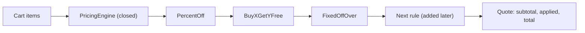

## In one minute
- A module is open for extension and closed for modification when you can add new behaviour by adding code, not by editing code that already works and is already tested.
- The usual mechanism is a seam: an interface (pricing rule, notification channel, payment provider) plus a registry. The core loop is written once; new cases plug in beside it.
- You cannot be closed against every change. Pick the axis that actually varies, such as "new promotion types every sprint", and close against that one. Polymorphism makes new variants cheap and new operations expensive; a `switch` does the opposite.
- Over-applied, OCP produces plugin frameworks for two cases and configuration languages nobody can debug. A plain `if` is fine until the third variant shows up.
- With agents, a good seam turns "add a feature" into "add a file": an additive diff with a small blast radius that is easy to review.

## How it works

### A realistic "before"
A checkout service prices carts. Every promotion the marketing team invents lands in the same function:

```python
def price(cart, promo_codes, customer):
    total = sum(i.price * i.qty for i in cart.items)
    for code in promo_codes:
        if code == "SUMMER10":
            total -= total // 10
        elif code.startswith("BOGO-"):
            sku = code[5:]
            qty = sum(i.qty for i in cart.items if i.sku == sku)
            total -= (qty // 2) * price_of(cart, sku)
        elif code == "FIRST" and customer.orders == 0:
            total -= 500
        elif code == "STUDENT" and customer.verified_student:
            total -= total * 15 // 100
    return max(total, 0)
```

Each new promotion edits the function that prices every order in the company. A typo in the "STUDENT" branch can break "SUMMER10". The function's tests grow combinatorially, and the people who change it most (whoever is adding this week's campaign) are the least familiar with its edge cases. Release managers learn to fear the file.

### The "after"
Separate the part that is stable (walk the rules, keep a running total, never go below zero, record what applied) from the part that varies (what each promotion computes):

```python
class PricingRule(Protocol):
    name: str
    def discount(self, items, running_total) -> int: ...

class PricingEngine:
    def __init__(self, rules):
        self.rules = rules
    def quote(self, items):
        total = sum(price * qty for _, price, qty in items)
        for rule in self.rules:
            total -= min(max(rule.discount(items, total), 0), total)
        return total
```

A new campaign is a new class with its own tests, plus one line where the rules are assembled. The engine, its invariants and its tests do not change. That is the whole idea: the engine is closed, the rule set is open.

### Choosing the axis
Bertrand Meyer coined the principle in 1988 in terms of inheritance: extend a class by subclassing instead of editing it. The modern reading, popularised by Robert Martin, uses interfaces and composition. Either way, you can only be closed against changes you predicted. The pricing engine above is closed against new promotion types. It is wide open to "promotions now need the customer's loyalty tier", which changes the rule interface and every rule. This is the expression problem: with polymorphism, adding a variant is one new class but adding an operation touches every class; with a `switch` over a closed set of variants, adding an operation is one new function but adding a variant touches every `switch`. Look at your history and pick the axis that churns.

### When following it too zealously hurts
- **Speculative seams.** A `NotificationChannelFactory` with one channel and a plugin loader is complexity paid in advance for flexibility that may never be used. YAGNI applies.
- **Configuration as a programming language.** Teams sometimes "close" the engine so completely that rules live in YAML with conditions, loops and references. Now the logic has no type checker, no debugger and no unit tests.
- **Hidden ordering coupling.** Rules that look independent often are not. Ten percent off and then five dollars off is a different price from the reverse. The seam does not remove that coupling; the engine has to own and document the order.
- **Closed sets dressed up as open.** Order states (pending, paid, shipped, refunded) are a fixed set with transitions between them. An exhaustive `switch` with a compiler check is clearer than a state interface with one class per state.

### Reviewing agent-written code
Given a long `if/elif` chain and a request for one more case, an agent will add one more branch, because that is the smallest local change. It will often add a boolean flag parameter to an existing function for the same reason. Neither is wrong once; repeated twenty times it produces the "before" above. When a seam exists, point the agent at it ("add a `PricingRule` and register it; do not edit the engine") and review for the shape of the diff: new files plus one registration line is a good sign, edits inside the engine loop deserve a closer look. Tests for the engine that use a rule defined only in the test file are the strongest evidence the seam is real.

### The same shape elsewhere
The pricing engine is an ordered chain of independent steps over shared state, and order matters. Infrastructure is full of the same design: Envoy HTTP filter chains, Linux netfilter hooks, Express or Go `net/http` middleware, Kubernetes admission webhooks. Each lets you add behaviour by registering a new step without recompiling the core, and each has had bugs caused by steps running in an unexpected order.

## Down the stack

### Layer 1: The contract
The engine promises: rules run in registration order; each rule sees the running total after the previous rules; a rule's discount is clamped to between zero and the running total, so the total never goes negative; the result lists exactly which rules applied and how much each took. Each rule promises to be a pure function of its inputs, with no I/O and no shared mutable state. Those two contracts are what make an unknown future rule safe to plug in.

### Layer 2: The mechanism
The mechanism is the strategy pattern plus a registry. In Go the rule is an interface; a registry is a slice or a `map[string]func() Rule` filled at startup, sometimes from `init()` functions in separate packages (the way `database/sql` drivers register themselves). In TypeScript the interface is checked at compile time and erased; at runtime each rule is an object whose `discount` method is found on its prototype. In Python the engine relies on duck typing, optionally checked with `typing.Protocol`. Statically typed languages with sum types offer the alternative axis: a Rust `enum` or a TypeScript discriminated union with an exhaustive `switch` makes the compiler list every place that must change when you add a variant.

### Layer 3: The machine
Each rule call is a dynamic dispatch. In C++ or Java the object's header points to a vtable, and the call loads the function pointer from a fixed slot and jumps: one or two dependent loads plus an indirect branch, about 1 to 3 ns when the branch predictor guesses right. In Go an interface value is two words, an itab pointer and a data pointer; the itab holds the method pointers for that concrete type, computed once and cached, so a call is the same load-and-jump. Storing a non-pointer value larger than a word in an interface can force a heap allocation, which is why rule types are usually pointers or zero-size structs. In V8, `rule.discount(...)` is a property lookup along the prototype chain that an inline cache remembers per call site: one shape (monomorphic) is fast, two to four (polymorphic) is a short check list, and beyond that (megamorphic) it falls back to a slower global cache. A loop over twenty different rule classes is megamorphic at that call site. CPython looks the method up through the type's MRO with a per-type method cache, roughly 50 ns per call.

At realistic scale this is noise. Twenty rules times 2,000 checkouts per second is 40,000 calls per second, a few milliseconds of CPU per second even in Python. The cost that matters is concurrency: rules shared by all request goroutines or threads must be stateless or immutable. Build the registry once at startup and only read it afterwards, and no lock is needed. If rules can be hot-reloaded, build a new slice and swap it in with an atomic pointer store, so readers never see a half-built list.

### Why it's built this way
1. Every edit to working code risks breaking it, and the risk grows with the code's age and number of callers.
2. Some kinds of change recur (new promotions, new providers, new channels), so the same risky edit would happen again and again.
3. A stable interface lets the recurring change be pure addition, which can only break the new code.
4. Interfaces cost indirection and lock in an axis of change, so they pay off only where change actually recurs.
5. Hence: identify the churning axis from history, put one seam there, and keep everything else simple.

## Diagram


## Worked example
A retailer runs 4 to 6 new promotions a month. In the old design each one edited `price()`, which had grown to 600 lines with 41 branches. Over a year, 9 of 14 checkout incidents traced back to promotion changes, and two of those broke promotions that had nothing to do with the change.

After the refactor, the engine is 40 lines and has not changed in eight months. Each promotion is a class of 15 to 60 lines with its own tests. A new promotion is one pull request that adds a file and one registration line; reviewers check the rule's tests and the registration order and nothing else. Incidents caused by promotions drop to two in the following year, both inside the new rule, neither affecting other promotions.

Ordering is the subtle part. With a 100.00 cart and two rules, "10% off" and "20.00 off orders of 95.00 or more": percent first gives 90.00, which is below the threshold, so the total is 90.00. Fixed first gives 80.00, then 10% off that is 72.00. The engine makes order explicit in the registry and returns the list of applied rules, so support staff can explain any quote.

## Trade-offs
| Option | Strengths | Weaknesses | Choose when |
| --- | --- | --- | --- |
| `if/elif` or `switch` in one function | Everything visible in one place; cheapest to read | Every new case edits shared code; tests grow combinatorially | Two or three cases, rarely changing |
| Interface plus registry (strategy) | New cases are additive; small reviews | Indirection; changing the interface touches every rule | Variants are added often; operations are stable |
| Sum type with exhaustive match | Compiler finds every place to update; easy to add operations | Adding a variant edits every match | Variant set is closed; operations grow |
| Rules as data (DSL, config) | Non-engineers can change behaviour without deploys | No types, weak tests, hard debugging | Many simple, uniform rules owned by operations staff |

## Pitfalls in production
- Rules that do I/O (look up the customer, call a fraud API) inside the pricing loop, adding latency and partial failure to every quote. Fix: load the context once and pass it in; keep rules pure.
- Order defined implicitly by import order or map iteration, which in Go is randomised. Fix: an explicit ordered list or priority field, tested.
- Stacking promotions that together exceed the price. Fix: the engine clamps each discount, and business caps (one promotion per category) live in the engine, not in each rule.
- Changing the rule interface "just slightly" and editing thirty rules in one pull request. Fix: add a new optional capability or a context object that can grow without breaking existing rules.
- Seams with one implementation, kept "for the future". Fix: inline them; reintroduce the seam when the second variant arrives.

## Leadership lens
- Ask which change recurs. Look at six months of commits to a hot file; if most add a case, put a seam there. If they change the core algorithm, a seam will not help.
- An additive seam changes who can safely contribute: a new team member or an agent can add a rule without understanding the engine. That is the organisational payoff.
- Own the invariants centrally. Ordering, caps and clamping belong to the engine's team, with tests, even when rule authors are spread across the company.
- Push back on configuration-driven "rule engines" unless non-engineers truly need to change behaviour without a deploy; the debugging and testing cost is large.

## Check yourself
1. Your notification service supports email, SMS and push. Product asks for "quiet hours" across all channels. Does a `Channel` interface help?
   **Answer:** Not much: quiet hours is a new operation across every variant, which is the axis the interface does not cover. Put it in the dispatcher in front of the channels, or extend the interface knowingly.
2. Why does the pricing engine clamp each rule's discount rather than trusting rules to behave?
   **Answer:** The engine is closed and must keep its invariant (total never negative) for rules that do not exist yet, written by people who may not know the invariant.
3. When is an exhaustive `switch` better than an interface?
   **Answer:** When the set of variants is fixed or rarely changes but operations over them keep growing, such as order states; the compiler can then flag every unhandled case.
4. Why might a loop over many rule types be slower in V8 than a loop over one type?
   **Answer:** The method call site sees many object shapes, so its inline cache becomes megamorphic and falls back to a slower generic lookup instead of a cached direct call.

## Practice
**Task:** Build a pricing engine that is closed for modification and open to new rules. Items are `[sku, unit_price_cents, quantity]`. A rule has a `name` and `discount(items, running_total)` returning cents. `PricingEngine(rules).quote(items)` computes the subtotal, then applies rules in order: each discount is clamped to between 0 and the current running total, subtracted, and recorded as `[name, cents]` if positive. It returns `{"subtotal", "applied", "total"}`. Implement three rules: `PercentOff(percent)` named `"percent"` takes `running_total * percent // 100`; `BuyXGetYFree(sku, x, y)` named `"bxgy"` makes `y` of every `x + y` units of that sku free (use the sku's unit price from its first line); `FixedOffOver(threshold, off)` named `"fixed"` takes `off` when the running total is at least `threshold`. Tests also plug in a rule the engine has never seen.

```python starter
class PercentOff:
    name = "percent"
    def __init__(self, percent):
        self.percent = percent
    def discount(self, items, running_total):
        # TODO
        raise NotImplementedError

class BuyXGetYFree:
    name = "bxgy"
    def __init__(self, sku, x, y):
        self.sku, self.x, self.y = sku, x, y
    def discount(self, items, running_total):
        # TODO
        raise NotImplementedError

class FixedOffOver:
    name = "fixed"
    def __init__(self, threshold, off):
        self.threshold, self.off = threshold, off
    def discount(self, items, running_total):
        # TODO
        raise NotImplementedError

class PricingEngine:
    def __init__(self, rules):
        self.rules = list(rules)
    def quote(self, items):
        # TODO
        raise NotImplementedError
```

```python tests
CART = [["shirt", 2000, 3], ["socks", 500, 2]]

def test_no_rules():
    assert PricingEngine([]).quote(CART) == {"subtotal": 7000, "applied": [], "total": 7000}

def test_percent_off():
    assert PricingEngine([PercentOff(10)]).quote(CART) == {"subtotal": 7000, "applied": [["percent", 700]], "total": 6300}

def test_buy_x_get_y():
    q = PricingEngine([BuyXGetYFree("shirt", 2, 1)]).quote(CART)
    assert q["applied"] == [["bxgy", 2000]] and q["total"] == 5000
    q = PricingEngine([BuyXGetYFree("hat", 2, 1)]).quote(CART)
    assert q["applied"] == [] and q["total"] == 7000, "zero discounts are not recorded"

def test_order_matters():
    a = PricingEngine([PercentOff(10), FixedOffOver(6500, 1000)]).quote(CART)
    assert a["total"] == 6300 and a["applied"] == [["percent", 700]]
    b = PricingEngine([FixedOffOver(6500, 1000), PercentOff(10)]).quote(CART)
    assert b["total"] == 5400 and b["applied"] == [["fixed", 1000], ["percent", 600]]

class Greedy:
    name = "greedy"
    def discount(self, items, running_total):
        return running_total + 999

class Broken:
    name = "broken"
    def discount(self, items, running_total):
        return -50

def test_new_rule_plugs_in_and_is_clamped():
    q = PricingEngine([PercentOff(50), Greedy(), PercentOff(10)]).quote(CART)
    assert q == {"subtotal": 7000, "applied": [["percent", 3500], ["greedy", 3500]], "total": 0}

def test_negative_discount_ignored():
    assert PricingEngine([Broken()]).quote(CART)["total"] == 7000

def test_empty_cart():
    assert PricingEngine([PercentOff(10), FixedOffOver(0, 300)]).quote([]) == {"subtotal": 0, "applied": [], "total": 0}
```

```python solution
class PercentOff:
    name = "percent"
    def __init__(self, percent):
        self.percent = percent
    def discount(self, items, running_total):
        return running_total * self.percent // 100

class BuyXGetYFree:
    name = "bxgy"
    def __init__(self, sku, x, y):
        self.sku, self.x, self.y = sku, x, y
    def discount(self, items, running_total):
        qty, unit = 0, None
        for sku, price, q in items:
            if sku == self.sku:
                qty += q
                if unit is None:
                    unit = price
        if unit is None:
            return 0
        return (qty // (self.x + self.y)) * self.y * unit

class FixedOffOver:
    name = "fixed"
    def __init__(self, threshold, off):
        self.threshold, self.off = threshold, off
    def discount(self, items, running_total):
        return self.off if running_total >= self.threshold else 0

class PricingEngine:
    def __init__(self, rules):
        self.rules = list(rules)
    def quote(self, items):
        subtotal = sum(price * qty for _, price, qty in items)
        total, applied = subtotal, []
        for rule in self.rules:
            d = min(max(rule.discount(items, total), 0), total)
            if d > 0:
                total -= d
                applied.append([rule.name, d])
        return {"subtotal": subtotal, "applied": applied, "total": total}
```

```typescript starter
export type Item = [string, number, number];
export interface PricingRule { name: string; discount(items: Item[], runningTotal: number): number; }
export interface Quote { subtotal: number; applied: [string, number][]; total: number; }

export class PercentOff implements PricingRule {
  name = "percent";
  constructor(private percent: number) {}
  discount(items: Item[], runningTotal: number): number { throw new Error("TODO"); }
}

export class BuyXGetYFree implements PricingRule {
  name = "bxgy";
  constructor(private sku: string, private x: number, private y: number) {}
  discount(items: Item[], runningTotal: number): number { throw new Error("TODO"); }
}

export class FixedOffOver implements PricingRule {
  name = "fixed";
  constructor(private threshold: number, private off: number) {}
  discount(items: Item[], runningTotal: number): number { throw new Error("TODO"); }
}

export class PricingEngine {
  constructor(private rules: PricingRule[]) {}
  quote(items: Item[]): Quote { throw new Error("TODO"); }
}
```

```typescript tests
const CART: Item[] = [["shirt", 2000, 3], ["socks", 500, 2]];

test("no rules", () => {
  assertEqual(new PricingEngine([]).quote(CART), { subtotal: 7000, applied: [], total: 7000 });
});

test("percent off", () => {
  assertEqual(new PricingEngine([new PercentOff(10)]).quote(CART), { subtotal: 7000, applied: [["percent", 700]], total: 6300 });
});

test("buy x get y", () => {
  let q = new PricingEngine([new BuyXGetYFree("shirt", 2, 1)]).quote(CART);
  assertEqual(q.applied, [["bxgy", 2000]]);
  assertEqual(q.total, 5000);
  q = new PricingEngine([new BuyXGetYFree("hat", 2, 1)]).quote(CART);
  assertEqual(q.applied, [], "zero discounts are not recorded");
  assertEqual(q.total, 7000);
});

test("order matters", () => {
  const a = new PricingEngine([new PercentOff(10), new FixedOffOver(6500, 1000)]).quote(CART);
  assertEqual(a.total, 6300);
  assertEqual(a.applied, [["percent", 700]]);
  const b = new PricingEngine([new FixedOffOver(6500, 1000), new PercentOff(10)]).quote(CART);
  assertEqual(b.total, 5400);
  assertEqual(b.applied, [["fixed", 1000], ["percent", 600]]);
});

test("new rule plugs in and is clamped", () => {
  const greedy: PricingRule = { name: "greedy", discount: (_i, t) => t + 999 };
  const q = new PricingEngine([new PercentOff(50), greedy, new PercentOff(10)]).quote(CART);
  assertEqual(q, { subtotal: 7000, applied: [["percent", 3500], ["greedy", 3500]], total: 0 });
});

test("negative discount ignored", () => {
  const broken: PricingRule = { name: "broken", discount: () => -50 };
  assertEqual(new PricingEngine([broken]).quote(CART).total, 7000);
});

test("empty cart", () => {
  assertEqual(new PricingEngine([new PercentOff(10), new FixedOffOver(0, 300)]).quote([]), { subtotal: 0, applied: [], total: 0 });
});
```

```typescript solution
export type Item = [string, number, number];
export interface PricingRule { name: string; discount(items: Item[], runningTotal: number): number; }
export interface Quote { subtotal: number; applied: [string, number][]; total: number; }

export class PercentOff implements PricingRule {
  name = "percent";
  constructor(private percent: number) {}
  discount(items: Item[], runningTotal: number): number {
    return Math.floor((runningTotal * this.percent) / 100);
  }
}

export class BuyXGetYFree implements PricingRule {
  name = "bxgy";
  constructor(private sku: string, private x: number, private y: number) {}
  discount(items: Item[], runningTotal: number): number {
    let qty = 0;
    let unit: number | undefined;
    for (const [sku, price, q] of items) {
      if (sku !== this.sku) continue;
      qty += q;
      if (unit === undefined) unit = price;
    }
    if (unit === undefined) return 0;
    return Math.floor(qty / (this.x + this.y)) * this.y * unit;
  }
}

export class FixedOffOver implements PricingRule {
  name = "fixed";
  constructor(private threshold: number, private off: number) {}
  discount(items: Item[], runningTotal: number): number {
    return runningTotal >= this.threshold ? this.off : 0;
  }
}

export class PricingEngine {
  constructor(private rules: PricingRule[]) {}
  quote(items: Item[]): Quote {
    const subtotal = items.reduce((s, [, price, qty]) => s + price * qty, 0);
    let total = subtotal;
    const applied: [string, number][] = [];
    for (const rule of this.rules) {
      const d = Math.min(Math.max(rule.discount(items, total), 0), total);
      if (d > 0) {
        total -= d;
        applied.push([rule.name, d]);
      }
    }
    return { subtotal, applied, total };
  }
}
```

```go starter
package practice

type Item struct {
	SKU   string
	Price int
	Qty   int
}

type Applied struct {
	Name  string
	Cents int
}

type Quote struct {
	Subtotal int
	Applied  []Applied
	Total    int
}

type PricingRule interface {
	Name() string
	Discount(items []Item, runningTotal int) int
}

type PercentOff struct{ Percent int }

func (r PercentOff) Name() string                    { return "percent" }
func (r PercentOff) Discount(items []Item, t int) int { panic("TODO") }

type BuyXGetYFree struct {
	SKU  string
	X, Y int
}

func (r BuyXGetYFree) Name() string                    { return "bxgy" }
func (r BuyXGetYFree) Discount(items []Item, t int) int { panic("TODO") }

type FixedOffOver struct{ Threshold, Off int }

func (r FixedOffOver) Name() string                    { return "fixed" }
func (r FixedOffOver) Discount(items []Item, t int) int { panic("TODO") }

type PricingEngine struct{ Rules []PricingRule }

func (e PricingEngine) Quote(items []Item) Quote {
	panic("TODO")
}
```

```go tests
package practice

import (
	"reflect"
	"testing"
)

var cart = []Item{{"shirt", 2000, 3}, {"socks", 500, 2}}

func TestNoRules(t *testing.T) {
	q := PricingEngine{}.Quote(cart)
	if q.Subtotal != 7000 || q.Total != 7000 || len(q.Applied) != 0 {
		t.Fatalf("got %+v", q)
	}
}

func TestPercentOff(t *testing.T) {
	q := PricingEngine{[]PricingRule{PercentOff{10}}}.Quote(cart)
	if q.Total != 6300 || !reflect.DeepEqual(q.Applied, []Applied{{"percent", 700}}) {
		t.Fatalf("got %+v", q)
	}
}

func TestBuyXGetY(t *testing.T) {
	q := PricingEngine{[]PricingRule{BuyXGetYFree{"shirt", 2, 1}}}.Quote(cart)
	if q.Total != 5000 || !reflect.DeepEqual(q.Applied, []Applied{{"bxgy", 2000}}) {
		t.Fatalf("got %+v", q)
	}
	q = PricingEngine{[]PricingRule{BuyXGetYFree{"hat", 2, 1}}}.Quote(cart)
	if q.Total != 7000 || len(q.Applied) != 0 {
		t.Fatalf("zero discounts are not recorded: %+v", q)
	}
}

func TestOrderMatters(t *testing.T) {
	a := PricingEngine{[]PricingRule{PercentOff{10}, FixedOffOver{6500, 1000}}}.Quote(cart)
	if a.Total != 6300 || !reflect.DeepEqual(a.Applied, []Applied{{"percent", 700}}) {
		t.Fatalf("percent first: %+v", a)
	}
	b := PricingEngine{[]PricingRule{FixedOffOver{6500, 1000}, PercentOff{10}}}.Quote(cart)
	if b.Total != 5400 || !reflect.DeepEqual(b.Applied, []Applied{{"fixed", 1000}, {"percent", 600}}) {
		t.Fatalf("fixed first: %+v", b)
	}
}

type greedy struct{}

func (greedy) Name() string                    { return "greedy" }
func (greedy) Discount(items []Item, t int) int { return t + 999 }

type broken struct{}

func (broken) Name() string                    { return "broken" }
func (broken) Discount(items []Item, t int) int { return -50 }

func TestNewRulePlugsInAndIsClamped(t *testing.T) {
	q := PricingEngine{[]PricingRule{PercentOff{50}, greedy{}, PercentOff{10}}}.Quote(cart)
	want := []Applied{{"percent", 3500}, {"greedy", 3500}}
	if q.Total != 0 || q.Subtotal != 7000 || !reflect.DeepEqual(q.Applied, want) {
		t.Fatalf("got %+v", q)
	}
}

func TestNegativeDiscountIgnored(t *testing.T) {
	if q := (PricingEngine{[]PricingRule{broken{}}}).Quote(cart); q.Total != 7000 {
		t.Fatalf("got %+v", q)
	}
}

func TestEmptyCart(t *testing.T) {
	q := PricingEngine{[]PricingRule{PercentOff{10}, FixedOffOver{0, 300}}}.Quote(nil)
	if q.Subtotal != 0 || q.Total != 0 || len(q.Applied) != 0 {
		t.Fatalf("got %+v", q)
	}
}
```

```go solution
package practice

type Item struct {
	SKU   string
	Price int
	Qty   int
}

type Applied struct {
	Name  string
	Cents int
}

type Quote struct {
	Subtotal int
	Applied  []Applied
	Total    int
}

type PricingRule interface {
	Name() string
	Discount(items []Item, runningTotal int) int
}

type PercentOff struct{ Percent int }

func (r PercentOff) Name() string { return "percent" }
func (r PercentOff) Discount(items []Item, t int) int {
	return t * r.Percent / 100
}

type BuyXGetYFree struct {
	SKU  string
	X, Y int
}

func (r BuyXGetYFree) Name() string { return "bxgy" }
func (r BuyXGetYFree) Discount(items []Item, t int) int {
	qty, unit, found := 0, 0, false
	for _, it := range items {
		if it.SKU != r.SKU {
			continue
		}
		qty += it.Qty
		if !found {
			unit, found = it.Price, true
		}
	}
	if !found {
		return 0
	}
	return qty / (r.X + r.Y) * r.Y * unit
}

type FixedOffOver struct{ Threshold, Off int }

func (r FixedOffOver) Name() string { return "fixed" }
func (r FixedOffOver) Discount(items []Item, t int) int {
	if t >= r.Threshold {
		return r.Off
	}
	return 0
}

type PricingEngine struct{ Rules []PricingRule }

func (e PricingEngine) Quote(items []Item) Quote {
	subtotal := 0
	for _, it := range items {
		subtotal += it.Price * it.Qty
	}
	total := subtotal
	applied := []Applied{}
	for _, r := range e.Rules {
		d := min(max(r.Discount(items, total), 0), total)
		if d > 0 {
			total -= d
			applied = append(applied, Applied{r.Name(), d})
		}
	}
	return Quote{Subtotal: subtotal, Applied: applied, Total: total}
}
```

## Mock interview
**Prompt:** You run the notification platform for a ride-hailing company: 40 million messages a day across push, SMS and email, with WhatsApp and in-app inbox coming next quarter. Every new channel so far has meant editing a 900-line `send()` function. Design the change so the next channels are additive.

- Follow-up: Where do cross-cutting rules live (quiet hours, per-user rate limits, opt-outs), and why not in each channel?
- Follow-up: A channel provider times out. Who decides whether to retry, fall back to another channel, or drop the message?
- Follow-up: Marketing wants to define routing rules without a deploy. What do you offer, and what do you refuse?

**A strong answer covers:**
- A `Channel` interface (send, capabilities such as max length, cost) plus a registry, so a new channel is a new adapter and one registration.
- A dispatcher that owns invariants and ordering: opt-outs, quiet hours, rate limits, deduplication by message id, and fallback policy, applied before any channel is called.
- Recognising the axis: channels are the churning variant; cross-cutting policies are operations that would otherwise touch every channel.
- Contract tests every channel adapter must pass, so the closed dispatcher can trust new channels.
- Limited data-driven routing (priority lists, feature flags) with validation, rather than a general-purpose rule language.

## Watch
- [Nothing is Something (Sandi Metz, RailsConf 2015)](https://www.youtube.com/watch?v=OMPfEXIlTVE): replacing conditionals with injected collaborators so new behaviour is added, not edited in.
- [All the Little Things (Sandi Metz, RailsConf 2014)](https://www.youtube.com/watch?v=8bZh5LMaSmE): a growing conditional refactored into small polymorphic objects, with an honest look at the intermediate mess.
- [Breaking Dependencies: The SOLID Principles (Klaus Iglberger, CppCon 2020)](https://www.youtube.com/watch?v=Ntraj80qN2k): OCP in terms of dependency direction and the cost of the wrong abstraction.

## Free resources
- [The Open Closed Principle (Robert C. Martin)](https://blog.cleancoder.com/uncle-bob/2014/05/12/TheOpenClosedPrinciple.html): a short restatement with plugin architectures as the main example.
- [Replace Conditional with Polymorphism (refactoring.com)](https://refactoring.com/catalog/replaceConditionalWithPolymorphism.html): the mechanical refactoring that turns a branch chain into a seam.
- [The Wrong Abstraction (Sandi Metz)](https://sandimetz.com/blog/2016/1/20/the-wrong-abstraction): why a premature seam can cost more than duplication.
- [Yagni (Martin Fowler)](https://martinfowler.com/bliki/Yagni.html): the cost model behind not building extension points early.
- [Expression problem (Wikipedia)](https://en.wikipedia.org/wiki/Expression_problem): why no design is open on both the variant and the operation axes at once.
- [Go interfaces (Russ Cox)](https://research.swtch.com/interfaces): how itabs are laid out and cached, which is what an interface call actually costs.
