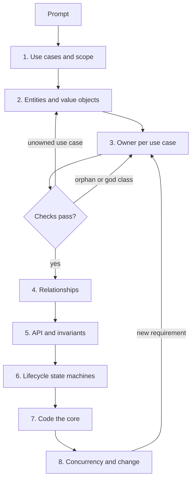

## In one minute
- An object-oriented design (OOD) interview gives you a vague prompt ("design a parking lot") and 45 to 60 minutes. It tests whether you can turn requirements into a small set of classes with clear ownership, working code for the core, and sound answers about concurrency and change.
- Use a fixed sequence: clarify use cases, find entities, assign each use case to an owning class, draw relationships, define the public API, model lifecycles as state machines, code the core, then discuss concurrency and extension.
- Every use case needs exactly one class that owns it. Every class needs to serve some use case. No class should own everything. These three checks catch most weak designs before the interviewer does.
- Patterns come last and only where something varies. Interviewers reward a Strategy for pricing that will change; they discount a Factory, Singleton and Observer added to show vocabulary.
- Talk while you work. The interviewer grades your reasoning and trade-offs, and silent code gives them nothing to grade.

## How it works

### What the interviewer is looking for
Most rubrics for OOD or machine-coding rounds score four things. **Requirements handling**: did you ask questions that change the design, and state what is out of scope? **Modelling**: are the classes cohesive, is ownership clear, do relationships match the domain? **Code quality**: does the core run, are invariants enforced by the API rather than by hoping callers behave? **Extensibility and depth**: can you absorb a new requirement in a few classes, and do you know where locks go? The step-by-step approach below maps to these four.

### Step 1: Clarify use cases (5 minutes)
Turn the prompt into five to eight use cases, each phrased as actor plus verb plus object: "driver parks a car", "driver pays and exits", "attendant views free spots by floor". Ask questions whose answers change classes: are there spot sizes? Is pricing hourly, flat or tiered, and will it change? One building or many? Is this in-process, or do you need persistence? Concurrent entrances? Write the list down where the interviewer can see it, and name what you are leaving out (payments provider integration, reservations, a UI). The Use Case Diagram lesson covers how to draw this; in an interview a bullet list is enough.

### Step 2: Find the entities (5 minutes)
Underline nouns in the use cases and keep the ones that hold state or rules: `ParkingLot`, `Floor`, `Spot`, `Ticket`, `Vehicle`, `Payment`. Drop nouns that are attributes (`colour`, `licence plate`) or actors outside the system (`Driver`, unless it has state you track). Separate **entities**, which have identity and a lifecycle (a ticket is issued, paid and closed), from **value objects**, which are compared by value (a `Money` amount, a `TimeRange`). Classes and Objects and Enums go deeper on that split.

### Step 3: Assign every use case an owner
For each use case, name the class and method that will carry it out: "driver parks a car" belongs to `ParkingLot.park(vehicle) -> Ticket`; "driver pays" belongs to `Ticket.pay(amount, clock)` or a `PaymentService`. This is the step most candidates skip, and it is where designs succeed or fail. Two heuristics help. Give the responsibility to the class that has the information it needs (the GRASP "information expert": the ticket knows its entry time, so it computes duration). And use one entry-point class per subsystem (a controller or facade) so callers do not orchestrate five objects themselves.

Then run three checks. A use case with no owner is a missing requirement. A class that owns no use case and is not used by a class that does is an orphan: delete it or find its job. A class that owns most use cases or has 25 methods is a god class: split it along its responsibilities. The practice task automates exactly these checks.

### Step 4: Relationships and multiplicities (5 minutes)
Draw a class diagram with only the arrows that matter. Is it composition (a `Floor` owns its `Spot`s and they die with it) or association (a `Ticket` refers to a `Spot` it does not own)? What are the multiplicities (one lot to many floors; one spot to zero or one active ticket)? The Class Diagram, Association, Aggregation and Composition lessons cover the notation. Interviewers mostly care that ownership is right, because ownership decides who enforces invariants.

### Step 5: Public API and invariants
Write the signatures of the entry-point methods, including errors: `park(vehicle) -> Ticket` fails with `LotFull`; `unpark(ticket_id, clock) -> Receipt` fails on an unknown or already closed ticket. Then state the invariants in one line each: a spot holds at most one vehicle; a ticket is closed at most once; free-spot counts equal the number of unoccupied spots. Design the API so callers cannot break them, which usually means no public setters on state that has rules.

### Step 6: Lifecycles as state machines
Any entity with stages (a ticket, a booking seat, a vending machine, an elevator car) gets a small state diagram: states, events and which transitions are legal. An enum plus a transition table is often enough; the State pattern earns its keep when behaviour differs a lot per state, as in Design Vending Machine. The State Machine Diagram lesson covers hierarchical states and guards.

### Step 7: Code the core (15 to 20 minutes)
Implement the entry-point class and the two or three operations that carry the invariants. Inject a clock and any randomness so behaviour is deterministic. Use maps for lookups by id, and a heap or ordered structure where you need "nearest free spot". Skip getters, logging, persistence and input parsing unless asked. Write one or two quick tests or a `main` that walks a scenario; it proves the code runs and shows you think about verification.

### Step 8: Concurrency, edge cases and change (5 to 10 minutes)
Expect probes: two cars at two entrances take the last spot at the same moment; a payment succeeds but the exit gate fails; pricing changes at midnight; a second building opens. Answer with the smallest change: one lock around the allocation step (or per-floor locks if contention is real), idempotent payment keyed by ticket id, a `PricingPolicy` interface introduced now because the interviewer just told you pricing varies, and a `Lot` registry keyed by building. This is where patterns appear, each tied to a stated change.

### Worked examples in this course
Each design lesson applies this approach end to end and is worth doing under a timer:

- Design Parking Lot: spot allocation by size, ticket lifecycle, pricing as Strategy.
- Design Vending Machine: the State pattern with money and inventory invariants.
- Design Elevator System: scheduling requests across cars, a dispatcher per building.
- Design Movie Booking System: seat holds with expiry and the double-booking race.
- Design Splitwise: a ledger with integer cents and pluggable split strategies.
- Design Tic Tac Toe and Design Snake and Ladder: game state, turn order and O(1) win detection.
- Design LRU Cache, Design Rate Limiter, Design Bloom Filter: data-structure-heavy rounds.
- Design Logging Framework and Design Task Scheduler: frameworks with hierarchies, levels, heaps and retries.

### Working with an AI assistant
In practice rounds, an assistant can generate a full parking-lot class hierarchy in seconds, and it will usually include a `ParkingLotManager`, a Singleton, and getters for everything. Use it as an opponent rather than an author: produce your own use-case-to-owner table first, then ask the assistant for its design and compare ownership decisions. Where they differ, decide which is right and why. That trains the judgement the interview tests.

### The same shape elsewhere
"Every requirement has exactly one owner, and nothing exists without a purpose" is the same check used in other fields. A RACI matrix in project management assigns one accountable person per task and flags tasks without one; a traceability matrix in regulated software maps each requirement to the code and tests that satisfy it; on-call rotations assign every alert an owning team. Orphan alerts and orphan classes fail the same way: nobody acts on them.

## Down the stack

### Layer 1: The contract
The interview's contract is the use-case list you wrote in step 1. Your design promises that each use case is reachable through a public method on an owning class, that each stated invariant holds after any sequence of public calls, and that each error case returns a specific error rather than corrupting state. Stated that way, the contract is testable: you can write a test per use case and a property test per invariant, which is exactly what strong candidates sketch at the end.

### Layer 2: The mechanism
The method underneath is responsibility assignment. CRC cards (Class, Responsibilities, Collaborators), introduced by Beck and Cunningham in 1989, put each class on an index card with its responsibilities on the left and its collaborators on the right. Their paper's advice: when a responsibility is not covered, add it to an existing object or create a new object for it, and when a card gets cluttered, copy it to a new card and look for a more concise wording ([OOPSLA '89 paper](https://c2.com/doc/oopsla89/paper.html)). [GRASP](https://en.wikipedia.org/wiki/GRASP_(object-oriented_design)) adds named rules: information expert (the class with the data does the work), creator (the class that contains or aggregates B creates B), controller (one class receives system events), low coupling and high cohesion. [Tell, don't ask](https://martinfowler.com/bliki/TellDontAsk.html) is the code-level form: call `ticket.close(now)` rather than reading `ticket.status` and writing it from outside. The use-case-to-owner table is a mapping from requirements to methods, and the three checks (no unowned use case, no orphan, no god class) are graph properties of that mapping plus the class relationships.

### Layer 3: The machine
Interviewers probe the runtime when they ask about scale and concurrency, so know what your object graph costs. A parking lot with 10,000 spots modelled as objects is about 10,000 small heap objects; in Go or Java that is a few hundred kilobytes, trivial. A map from ticket id to ticket costs one hash and usually one cache miss (about 100 ns from main memory) per lookup. An uncontended mutex in Go or Java costs about 20 to 50 ns (17 ns on [Colin Scott's latency table](https://colin-scott.github.io/personal_website/research/interactive_latency.html)); under contention a waiting goroutine parks and wakes in microseconds, so a single lock around `park()` handles thousands of entries per second, far beyond any real building. A per-request lock across a network call (charging a card inside the lock) is the real hazard: it holds the lock for 200 ms and serialises every entrance. The machine-level answer is to keep lock scopes to in-memory state changes and do I/O outside them.

### Why it's built this way
1. Requirements arrive as sentences, and code needs owners for each behaviour, so the first job is mapping sentences to methods.
2. Without an explicit owner per use case, behaviour gets split across classes or duplicated, and invariants break in the gaps.
3. Classes without a use case cost reading time and maintenance while serving nothing, so they are removed.
4. Classes that own everything cannot be changed safely or tested in parts, so responsibilities are split by cohesion.
5. Interviews are 45 minutes, so the process front-loads decisions that are expensive to reverse (ownership, lifecycles) and leaves cheap ones (patterns, naming) for last.

## Diagram


## Worked example
Prompt: "Design a library management system." Forty-five minutes.

Minutes 0 to 5. Use cases: member borrows a copy; member returns a copy; member reserves a title that has no free copy; librarian adds copies; system computes late fines. Out of scope: search UI, payments, multiple branches. Questions asked: max loans per member (5), loan length (14 days), fine (20 cents a day, capped at 1,000), and whether reservations are first come, first served (yes).

Minutes 5 to 12. Entities: `Library`, `Member`, `Title` (an ISBN and metadata), `Copy` (a physical book with a status), `Loan`, `Reservation`. Value objects: `Money` as integer cents, `Date`. Owner table: borrow and return go to `Library.borrow(member_id, copy_id, today)` and `Library.return_copy(copy_id, today)` as the controller; the fine is computed by `Loan.fine(today)` (information expert: the loan knows its due date); reservations by `Title.reserve(member_id)`, since the queue is per title. Checks: every use case owned; no orphans; `Library` owns 3 of 5 use cases, which is the controller's job and acceptable, with 6 methods.

Minutes 12 to 18. Relationships: `Library` composes `Title`s, `Title` composes `Copy`s, `Loan` associates one `Member` with one `Copy`. Invariants: a copy is on at most one open loan; a member has at most 5 open loans; a reserved copy can only be borrowed by the first member in its title's queue. `Copy` lifecycle: available, on loan, held for reservation, lost.

Minutes 18 to 38. Code `Library.borrow`, `Library.return_copy`, `Loan.fine` and the reservation hand-off on return, with an injected `today`. A short scenario test borrows, returns 3 days late (60 cents), and checks the next reserver's hold.

Minutes 38 to 45. Probes: two members borrow the last copy at once (a lock around the copy's status change in `borrow`, or a compare-and-set on the status); fine rules differ for students (a `FinePolicy` interface, introduced now because the requirement is real); a second branch (a `Branch` above `Library`, with copies owned by branches and transfers as a new use case).

## In the wild
- **Knight Capital, 2012-08: code with no owner.** The "Power Peg" trading logic had not been used since 2003 but was still deployed. New order-routing code reused its flag, and a technician deployed that code to 7 of 8 servers. On the eighth, the flag woke the defunct logic, which sent orders without tracking fills: over 4 million executions in 154 stocks in about 45 minutes and a loss of more than $460M. The SEC cited the missing second-person review of the deploy and the lack of written procedures ([SEC order](https://www.sec.gov/litigation/admin/2013/34-70694.pdf)). It is the orphan-class check at company scale: nobody owned the dead path, so nobody removed it.
- **NASA, 1999-09: Mars Climate Orbiter.** Ground software wrote thruster impulse data in pound-force seconds where the interface specification required newton-seconds, so the effects were underestimated by a factor of 4.45 and the spacecraft was lost at Mars orbit insertion. The review board named the units error as the root cause ([NASA review board report](https://llis.nasa.gov/llis_lib/pdf/1009464main1_0641-mr.pdf)). An interface where nobody owned the unit made it a bare number, which is what a `Money` or `Distance` value object prevents.
- **CRC cards, 1989: responsibility assignment as a documented practice.** Beck and Cunningham's OOPSLA paper, written while Cunningham was at Wyatt Software and Beck at Apple, describes teaching object thinking with index cards that list a class's responsibilities and collaborators ([paper](https://c2.com/doc/oopsla89/paper.html)). The use-case-to-owner table in this lesson is the same idea applied to use cases.

## Trade-offs
| Option | Strengths | Weaknesses | Choose when |
| --- | --- | --- | --- |
| Rich domain objects (behaviour on entities) | Invariants live next to data; tell, don't ask | Behaviour spread across many classes | Entities have real rules and lifecycles |
| Service classes over plain data | Easy to find all logic; simple data | Anemic model; invariants enforced by convention | Logic spans many entities with few per-entity rules |
| One controller per subsystem | Clear entry point; easy to test end to end | Can grow into a god class | Most interview problems |
| Patterns from the start | Ready for variation | Over-engineering if variation never comes | The interviewer has stated what varies |
| Code first, model later | Fast to a running program | Ownership decisions made by accident | Pure machine-coding rounds with a strict spec |

## Pitfalls in production
- **Jumping to code before the use cases are agreed.** You build the wrong system well. Fix: spend the first five minutes on the list and get a nod.
- **Manager and Helper classes.** `ParkingManager` owns everything and entities become data bags, which Fowler calls an [anemic domain model](https://martinfowler.com/bliki/AnemicDomainModel.html). Fix: move each rule to the class that has its data, and keep the controller thin.
- **Mutable state with public setters.** `spot.setOccupied(true)` lets any caller break the free-count invariant. Fix: expose operations (`occupy(ticket)`), not fields.
- **Pattern tourism.** Singleton, Factory and Observer added with no requirement behind them. Fix: name the variation each pattern absorbs, or delete it.
- **Ignoring time and concurrency.** Calling the system clock inside methods and no story for two simultaneous requests. Fix: inject the clock; name the lock and what it protects.
- **Silent failure cases.** `park()` returning `None` when full, with no distinction from other errors. Fix: specific errors for each failure in the API.

## Leadership lens
- Use the same steps for real design reviews: a one-page use-case-to-owner table catches more problems than a class diagram, and juniors can produce it.
- When interviewing, give the candidate a requirement change at minute 35. How many classes they touch is a better signal than how many patterns they name.
- Ask coding agents for the owner table and invariants before code. Reviewing ten lines of ownership is faster than reviewing 400 lines of generated classes.
- Watch for controllers that grow. A controller with 40 methods is a team-level smell: it usually means one team owns logic that belongs to several.

## Check yourself
1. Why assign an owner to each use case before drawing relationships?
   **Answer:** Ownership decides which class enforces which invariant, and relationships follow from who needs whom to do their job; drawing arrows first produces structure without responsibility.
2. A `Ticket` class has fields and getters only, and `ParkingService` computes fees, closes tickets and frees spots. What is wrong and how would you fix it?
   **Answer:** It is an anemic model with a god service, so ticket rules can be broken from anywhere; move fee and closing logic onto `Ticket` (it has the entry time and status) and keep the service as a thin coordinator.
3. When is it right to add a Strategy interface during the interview?
   **Answer:** When the interviewer states, or you confirm, that a behaviour (pricing, fines, dispatch) varies or will change; without that, a plain method is the stronger answer.
4. Two entrances try to take the last spot at once. What is the smallest correct fix?
   **Answer:** Make the check-and-allocate step atomic with one lock (or a compare-and-set on the spot), and keep any I/O such as printing or charging outside the lock.

## Practice
**Task:** Write a checker that validates an OOD model against its use cases. Inputs: `classes` maps a class name to its list of method names; `use_cases` maps a use case name to its owner as `"Class.method"`; `relations` is a list of `[a, b]` class pairs (direction ignored); `max_methods` is the method limit. Report, as a sorted list of unique strings: `use case <uc>: bad owner <owner>` when the owner does not split into exactly two non-empty parts on `.`; `use case <uc>: no class <C>`; `use case <uc>: no method <C>.<m>`; `unknown class in relation: <x>` for each relation end that is not a class; `god class: <C> (<n> methods)` when a class has more than `max_methods` methods; `god class: <C> owns <k> of <n> use cases` when there are at least 4 use cases and a class validly owns more than half of them; and `orphan class: <C>` for every class not reachable, through relations between known classes, from a class that validly owns a use case (owners themselves are reachable). An empty list means the model passes.

```python starter
def check_model(classes, use_cases, relations, max_methods):
    # TODO
    raise NotImplementedError
```

```python tests
LOT = {
    "ParkingLot": ["park", "unpark"],
    "Spot": ["occupy", "release"],
    "Ticket": ["close"],
    "Payment": ["charge"],
    "DisplayBoard": ["show"],
}
CASES = {
    "park vehicle": "ParkingLot.park",
    "exit": "ParkingLot.unpark",
    "pay": "Payment.charge",
    "view free spots": "DisplayBoard.show",
}
RELS = [["ParkingLot", "Spot"], ["ParkingLot", "Ticket"], ["Ticket", "Payment"], ["DisplayBoard", "ParkingLot"]]

def test_clean_model_passes():
    assert check_model(LOT, CASES, RELS, 5) == []

def test_bad_owners():
    cases = dict(CASES)
    cases["refund"] = "Refunds.issue"
    cases["lose ticket"] = "Ticket.replace"
    cases["audit"] = "audit"
    cases["odd"] = "A.b.c"
    assert check_model(LOT, cases, RELS, 5) == [
        "use case audit: bad owner audit",
        "use case lose ticket: no method Ticket.replace",
        "use case odd: bad owner A.b.c",
        "use case refund: no class Refunds",
    ]

def test_orphan_class():
    classes = dict(LOT)
    classes["AuditLog"] = ["write"]
    assert check_model(classes, CASES, RELS, 5) == ["orphan class: AuditLog"]

def test_reachability_ignores_direction_and_spans_hops():
    classes = {"A": ["run"], "B": [], "C": [], "D": []}
    assert check_model(classes, {"go": "A.run"}, [["B", "A"], ["C", "B"]], 5) == ["orphan class: D"]

def test_god_class_by_methods_limit_is_inclusive():
    classes = dict(LOT)
    classes["ParkingLot"] = ["park", "unpark", "a", "b", "c", "d"]
    assert check_model(classes, CASES, RELS, 6) == []
    classes["ParkingLot"] = classes["ParkingLot"] + ["e"]
    assert check_model(classes, CASES, RELS, 6) == ["god class: ParkingLot (7 methods)"]

def test_god_class_by_use_case_share():
    cases = dict(CASES)
    cases["pay"] = "ParkingLot.park"
    assert check_model(LOT, cases, RELS, 5) == ["god class: ParkingLot owns 3 of 4 use cases"]
    small = {"a": "ParkingLot.park", "b": "ParkingLot.unpark", "c": "ParkingLot.park"}
    assert check_model(LOT, small, RELS, 5) == []

def test_unknown_relation_classes_reported_once():
    rels = RELS + [["Ghost", "Spot"], ["ParkingLot", "Ghost"]]
    assert check_model(LOT, CASES, rels, 5) == ["unknown class in relation: Ghost"]

def test_no_use_cases_means_everything_is_orphan():
    assert check_model({"B": [], "A": []}, {}, [["A", "B"]], 5) == ["orphan class: A", "orphan class: B"]
```

```python solution
def check_model(classes, use_cases, relations, max_methods):
    issues = set()
    owned = {}
    for uc, owner in use_cases.items():
        parts = owner.split(".")
        if len(parts) != 2 or not parts[0] or not parts[1]:
            issues.add("use case %s: bad owner %s" % (uc, owner))
            continue
        cls, method = parts
        if cls not in classes:
            issues.add("use case %s: no class %s" % (uc, cls))
        elif method not in classes[cls]:
            issues.add("use case %s: no method %s.%s" % (uc, cls, method))
        else:
            owned[cls] = owned.get(cls, 0) + 1
    adj = {c: set() for c in classes}
    for a, b in relations:
        for end in (a, b):
            if end not in classes:
                issues.add("unknown class in relation: " + end)
        if a in classes and b in classes:
            adj[a].add(b)
            adj[b].add(a)
    for cls, methods in classes.items():
        if len(methods) > max_methods:
            issues.add("god class: %s (%d methods)" % (cls, len(methods)))
    n = len(use_cases)
    for cls, k in owned.items():
        if n >= 4 and k * 2 > n:
            issues.add("god class: %s owns %d of %d use cases" % (cls, k, n))
    seen = set(owned)
    stack = list(owned)
    while stack:
        cur = stack.pop()
        for nxt in adj[cur]:
            if nxt not in seen:
                seen.add(nxt)
                stack.append(nxt)
    for cls in classes:
        if cls not in seen:
            issues.add("orphan class: " + cls)
    return sorted(issues)
```

```typescript starter
export function checkModel(
  classes: Record<string, string[]>,
  useCases: Record<string, string>,
  relations: [string, string][],
  maxMethods: number,
): string[] {
  throw new Error("TODO");
}
```

```typescript tests
const LOT: Record<string, string[]> = {
  ParkingLot: ["park", "unpark"],
  Spot: ["occupy", "release"],
  Ticket: ["close"],
  Payment: ["charge"],
  DisplayBoard: ["show"],
};
const CASES: Record<string, string> = {
  "park vehicle": "ParkingLot.park",
  exit: "ParkingLot.unpark",
  pay: "Payment.charge",
  "view free spots": "DisplayBoard.show",
};
const RELS: [string, string][] = [
  ["ParkingLot", "Spot"], ["ParkingLot", "Ticket"], ["Ticket", "Payment"], ["DisplayBoard", "ParkingLot"],
];

test("clean model passes", () => {
  assertEqual(checkModel(LOT, CASES, RELS, 5), []);
});

test("bad owners", () => {
  const cases = { ...CASES, refund: "Refunds.issue", "lose ticket": "Ticket.replace", audit: "audit", odd: "A.b.c" };
  assertEqual(checkModel(LOT, cases, RELS, 5), [
    "use case audit: bad owner audit",
    "use case lose ticket: no method Ticket.replace",
    "use case odd: bad owner A.b.c",
    "use case refund: no class Refunds",
  ]);
});

test("orphan class", () => {
  assertEqual(checkModel({ ...LOT, AuditLog: ["write"] }, CASES, RELS, 5), ["orphan class: AuditLog"]);
});

test("reachability ignores direction and spans hops", () => {
  const classes = { A: ["run"], B: [], C: [], D: [] };
  assertEqual(checkModel(classes, { go: "A.run" }, [["B", "A"], ["C", "B"]], 5), ["orphan class: D"]);
});

test("god class by methods limit is inclusive", () => {
  const six = { ...LOT, ParkingLot: ["park", "unpark", "a", "b", "c", "d"] };
  assertEqual(checkModel(six, CASES, RELS, 6), []);
  const seven = { ...LOT, ParkingLot: ["park", "unpark", "a", "b", "c", "d", "e"] };
  assertEqual(checkModel(seven, CASES, RELS, 6), ["god class: ParkingLot (7 methods)"]);
});

test("god class by use case share", () => {
  assertEqual(checkModel(LOT, { ...CASES, pay: "ParkingLot.park" }, RELS, 5), ["god class: ParkingLot owns 3 of 4 use cases"]);
  const small = { a: "ParkingLot.park", b: "ParkingLot.unpark", c: "ParkingLot.park" };
  assertEqual(checkModel(LOT, small, RELS, 5), []);
});

test("unknown relation classes reported once", () => {
  const rels: [string, string][] = [...RELS, ["Ghost", "Spot"], ["ParkingLot", "Ghost"]];
  assertEqual(checkModel(LOT, CASES, rels, 5), ["unknown class in relation: Ghost"]);
});

test("no use cases means everything is orphan", () => {
  assertEqual(checkModel({ B: [], A: [] }, {}, [["A", "B"]], 5), ["orphan class: A", "orphan class: B"]);
});
```

```typescript solution
export function checkModel(
  classes: Record<string, string[]>,
  useCases: Record<string, string>,
  relations: [string, string][],
  maxMethods: number,
): string[] {
  const issues = new Set<string>();
  const owned = new Map<string, number>();
  const has = (c: string) => Object.prototype.hasOwnProperty.call(classes, c);
  for (const [uc, owner] of Object.entries(useCases)) {
    const parts = owner.split(".");
    if (parts.length !== 2 || !parts[0] || !parts[1]) {
      issues.add(`use case ${uc}: bad owner ${owner}`);
      continue;
    }
    const [cls, method] = parts;
    if (!has(cls)) issues.add(`use case ${uc}: no class ${cls}`);
    else if (!classes[cls].includes(method)) issues.add(`use case ${uc}: no method ${cls}.${method}`);
    else owned.set(cls, (owned.get(cls) ?? 0) + 1);
  }
  const adj = new Map<string, Set<string>>();
  for (const c of Object.keys(classes)) adj.set(c, new Set());
  for (const [a, b] of relations) {
    for (const end of [a, b]) if (!has(end)) issues.add("unknown class in relation: " + end);
    if (has(a) && has(b)) {
      adj.get(a)!.add(b);
      adj.get(b)!.add(a);
    }
  }
  for (const [cls, methods] of Object.entries(classes)) {
    if (methods.length > maxMethods) issues.add(`god class: ${cls} (${methods.length} methods)`);
  }
  const n = Object.keys(useCases).length;
  for (const [cls, k] of owned) {
    if (n >= 4 && k * 2 > n) issues.add(`god class: ${cls} owns ${k} of ${n} use cases`);
  }
  const seen = new Set<string>(owned.keys());
  const stack = [...owned.keys()];
  while (stack.length > 0) {
    const cur = stack.pop()!;
    for (const next of adj.get(cur)!) {
      if (!seen.has(next)) {
        seen.add(next);
        stack.push(next);
      }
    }
  }
  for (const cls of Object.keys(classes)) if (!seen.has(cls)) issues.add("orphan class: " + cls);
  return [...issues].sort();
}
```

```go starter
package practice

func CheckModel(classes map[string][]string, useCases map[string]string, relations [][2]string, maxMethods int) []string {
	panic("TODO")
}
```

```go tests
package practice

import (
	"reflect"
	"testing"
)

func lot() map[string][]string {
	return map[string][]string{
		"ParkingLot":   {"park", "unpark"},
		"Spot":         {"occupy", "release"},
		"Ticket":       {"close"},
		"Payment":      {"charge"},
		"DisplayBoard": {"show"},
	}
}

func cases() map[string]string {
	return map[string]string{
		"park vehicle":    "ParkingLot.park",
		"exit":            "ParkingLot.unpark",
		"pay":             "Payment.charge",
		"view free spots": "DisplayBoard.show",
	}
}

var rels = [][2]string{{"ParkingLot", "Spot"}, {"ParkingLot", "Ticket"}, {"Ticket", "Payment"}, {"DisplayBoard", "ParkingLot"}}

func same(t *testing.T, got, want []string) {
	t.Helper()
	if len(got) == 0 && len(want) == 0 {
		return
	}
	if !reflect.DeepEqual(got, want) {
		t.Fatalf("got %q\nwant %q", got, want)
	}
}

func TestCleanModelPasses(t *testing.T) {
	same(t, CheckModel(lot(), cases(), rels, 5), nil)
}

func TestBadOwners(t *testing.T) {
	c := cases()
	c["refund"] = "Refunds.issue"
	c["lose ticket"] = "Ticket.replace"
	c["audit"] = "audit"
	c["odd"] = "A.b.c"
	same(t, CheckModel(lot(), c, rels, 5), []string{
		"use case audit: bad owner audit",
		"use case lose ticket: no method Ticket.replace",
		"use case odd: bad owner A.b.c",
		"use case refund: no class Refunds",
	})
}

func TestOrphanClass(t *testing.T) {
	cl := lot()
	cl["AuditLog"] = []string{"write"}
	same(t, CheckModel(cl, cases(), rels, 5), []string{"orphan class: AuditLog"})
}

func TestReachabilityIgnoresDirectionAndSpansHops(t *testing.T) {
	cl := map[string][]string{"A": {"run"}, "B": {}, "C": {}, "D": {}}
	got := CheckModel(cl, map[string]string{"go": "A.run"}, [][2]string{{"B", "A"}, {"C", "B"}}, 5)
	same(t, got, []string{"orphan class: D"})
}

func TestGodClassByMethodsLimitIsInclusive(t *testing.T) {
	cl := lot()
	cl["ParkingLot"] = []string{"park", "unpark", "a", "b", "c", "d"}
	same(t, CheckModel(cl, cases(), rels, 6), nil)
	cl["ParkingLot"] = append(cl["ParkingLot"], "e")
	same(t, CheckModel(cl, cases(), rels, 6), []string{"god class: ParkingLot (7 methods)"})
}

func TestGodClassByUseCaseShare(t *testing.T) {
	c := cases()
	c["pay"] = "ParkingLot.park"
	same(t, CheckModel(lot(), c, rels, 5), []string{"god class: ParkingLot owns 3 of 4 use cases"})
	small := map[string]string{"a": "ParkingLot.park", "b": "ParkingLot.unpark", "c": "ParkingLot.park"}
	same(t, CheckModel(lot(), small, rels, 5), nil)
}

func TestUnknownRelationClassesReportedOnce(t *testing.T) {
	r := append(append([][2]string{}, rels...), [2]string{"Ghost", "Spot"}, [2]string{"ParkingLot", "Ghost"})
	same(t, CheckModel(lot(), cases(), r, 5), []string{"unknown class in relation: Ghost"})
}

func TestNoUseCasesMeansEverythingIsOrphan(t *testing.T) {
	cl := map[string][]string{"B": {}, "A": {}}
	same(t, CheckModel(cl, map[string]string{}, [][2]string{{"A", "B"}}, 5), []string{"orphan class: A", "orphan class: B"})
}
```

```go solution
package practice

import (
	"fmt"
	"sort"
	"strings"
)

func CheckModel(classes map[string][]string, useCases map[string]string, relations [][2]string, maxMethods int) []string {
	issues := map[string]bool{}
	owned := map[string]int{}
	for uc, owner := range useCases {
		parts := strings.Split(owner, ".")
		if len(parts) != 2 || parts[0] == "" || parts[1] == "" {
			issues[fmt.Sprintf("use case %s: bad owner %s", uc, owner)] = true
			continue
		}
		cls, method := parts[0], parts[1]
		methods, ok := classes[cls]
		if !ok {
			issues[fmt.Sprintf("use case %s: no class %s", uc, cls)] = true
			continue
		}
		found := false
		for _, m := range methods {
			if m == method {
				found = true
				break
			}
		}
		if !found {
			issues[fmt.Sprintf("use case %s: no method %s.%s", uc, cls, method)] = true
			continue
		}
		owned[cls]++
	}
	adj := map[string][]string{}
	for _, r := range relations {
		a, b := r[0], r[1]
		_, okA := classes[a]
		_, okB := classes[b]
		if !okA {
			issues["unknown class in relation: "+a] = true
		}
		if !okB {
			issues["unknown class in relation: "+b] = true
		}
		if okA && okB {
			adj[a] = append(adj[a], b)
			adj[b] = append(adj[b], a)
		}
	}
	for cls, methods := range classes {
		if len(methods) > maxMethods {
			issues[fmt.Sprintf("god class: %s (%d methods)", cls, len(methods))] = true
		}
	}
	n := len(useCases)
	for cls, k := range owned {
		if n >= 4 && k*2 > n {
			issues[fmt.Sprintf("god class: %s owns %d of %d use cases", cls, k, n)] = true
		}
	}
	seen := map[string]bool{}
	var stack []string
	for cls := range owned {
		seen[cls] = true
		stack = append(stack, cls)
	}
	for len(stack) > 0 {
		cur := stack[len(stack)-1]
		stack = stack[:len(stack)-1]
		for _, next := range adj[cur] {
			if !seen[next] {
				seen[next] = true
				stack = append(stack, next)
			}
		}
	}
	for cls := range classes {
		if !seen[cls] {
			issues["orphan class: "+cls] = true
		}
	}
	out := make([]string, 0, len(issues))
	for s := range issues {
		out = append(out, s)
	}
	sort.Strings(out)
	return out
}
```

## Mock interview
**Prompt:** Design an in-memory system for a co-working space: members book desks and meeting rooms by the hour, rooms have capacities, members on a basic plan get 10 room-hours a month, and bookings can be cancelled up to one hour before start. You have 45 minutes; code the booking core.

- Follow-up: Two members book the last free room for the same slot from two kiosks at once. Where does the lock go, and what does it protect?
- Follow-up: A new "enterprise" plan has unlimited hours but requires manager approval for rooms over 8 people. Which classes change?
- Follow-up: Show me your use-case-to-owner table. Is any class doing too much?

**A strong answer covers:**
- Five to eight use cases written down first, with explicit out-of-scope items (payments, recurring bookings, notifications).
- Clear owners: a `BookingService` as controller, `Room` and `Desk` owning their schedules and overlap checks, `Member` and `Plan` owning quota rules, `Booking` owning its lifecycle (held, confirmed, cancelled) with the cancellation cutoff checked against an injected clock.
- Invariants stated and enforced: no overlapping bookings per resource, quota never exceeded, cancellation only before the cutoff.
- A `PlanPolicy` interface added when the enterprise plan appears, with approval as a new booking state rather than a flag checked everywhere.
- A per-resource lock (or one lock for the whole service, justified by the low request rate) around the overlap check and insert, with no I/O inside it.

## Sources and further study
**Primary**
- [Beck and Cunningham, A Laboratory for Teaching Object-Oriented Thinking (1989)](https://c2.com/doc/oopsla89/paper.html): the origin of CRC cards and their size and overflow rules.
- [NASA Mars Climate Orbiter mishap investigation board report](https://llis.nasa.gov/llis_lib/pdf/1009464main1_0641-mr.pdf): a primary report on an interface whose owner and unit were not pinned down.
- [SEC order against Knight Capital Americas](https://www.sec.gov/litigation/admin/2013/34-70694.pdf): the regulator's account of the dead-code deployment failure.

**Systems docs**
- [Latency numbers (Colin Scott)](https://colin-scott.github.io/personal_website/research/interactive_latency.html): mutex and network costs for the "no I/O inside the lock" advice.

**Books**
- *Cracking the Coding Interview*, Gayle Laakmann McDowell: chapter 7, Object-Oriented Design, a step list for the same interview, with less on ownership checks and concurrency.
- *Domain-Driven Design*, Eric Evans (1st ed.): chapters 5 and 6, entities, value objects, aggregates and repositories.
- *Head First Design Patterns* (2nd ed.), Freeman and Robson: chapter 1, on starting from changing requirements before reaching for patterns.
- *Refactoring*, Martin Fowler (2nd ed.): chapter 3, Bad Smells in Code, including large classes that own too much.

**Other curricula**
- [donnemartin/system-design-primer: object-oriented design](https://github.com/donnemartin/system-design-primer): worked class sketches with little on ownership checks, invariants or locking.
- [Refactoring.Guru: design patterns](https://refactoring.guru/design-patterns): a pattern catalogue that lists the problem, solution and pros and cons for each pattern, which helps with the "only where something varies" test.

## Watch
- [Designing A Chess Game: Object Oriented Design (Mayur Vaid)](https://www.youtube.com/watch?v=9soBz9lhZek): a walk from approach to class design to code for a common OOD prompt, useful to compare against the steps above.

## Free resources
- [A Laboratory For Teaching Object-Oriented Thinking (Beck and Cunningham, 1989)](http://c2.com/doc/oopsla89/paper.html): the original CRC card paper, still the fastest way to find classes and responsibilities.
- [GRASP (Wikipedia)](https://en.wikipedia.org/wiki/GRASP_(object-oriented_design)): the responsibility-assignment principles behind step 3, such as information expert, creator and controller.
- [Tell Don't Ask (Martin Fowler)](https://martinfowler.com/bliki/TellDontAsk.html): why behaviour belongs with the data it changes.
- [Anemic Domain Model (Martin Fowler)](https://martinfowler.com/bliki/AnemicDomainModel.html): the failure mode where entities are data bags and services hold every rule.
- [God object (Wikipedia)](https://en.wikipedia.org/wiki/God_object): the anti-pattern the practice checker flags, with its causes and fixes.
