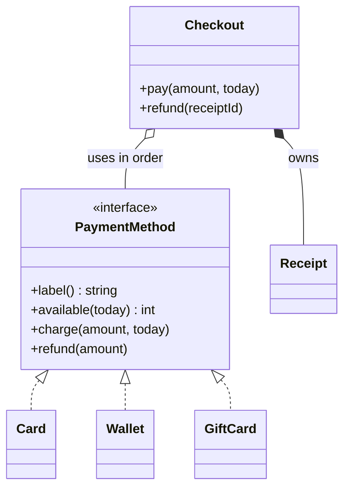

## In one minute
- Object-oriented programming is a way to keep rules next to the data they protect: an object owns some state and exposes only operations that keep that state valid.
- Fifteen concepts cover almost every LLD discussion. They fall into four groups: building blocks (class, object, constructor, enum and value object), protection (encapsulation, abstraction), substitution (interface, abstract class, inheritance, polymorphism, overriding versus overloading), and relationships (association, aggregation, composition, dependency and realization).
- The concepts are not a checklist; they are connected. Encapsulation makes abstraction possible, interfaces make polymorphism cheap to use, and composition is usually a safer route to polymorphism than inheritance, a point the Gang of Four make in their first chapter (*Design Patterns*, Ch 1: Introduction).
- Each concept has a runtime price: a vtable or itab pointer, an extra indirection, a heap allocation. Usually it is nanoseconds; in hot loops it is worth knowing.
- When reviewing agent-written code, these concepts give you the vocabulary to say what is wrong: "this setter breaks the invariant", "this subclass is not substitutable", "this should own its parts".

## How it works

### The fifteen at a glance
Each row links to the lesson in this course that goes deeper.

| # | Concept | The idea in one line | Lesson |
| --- | --- | --- | --- |
| 1 | Class | A type that bundles state with the operations allowed on it | Classes and Objects |
| 2 | Object | One instance with identity, its own state, and the class's behaviour | Classes and Objects |
| 3 | Constructor and invariants | Creation either produces a valid object or fails; no half-built objects | Classes and Objects, Builder |
| 4 | Enum and value object | A closed set of named values, and immutable values compared by content | Enums, Classes and Objects |
| 5 | Encapsulation | State changes only through methods that keep the rules | Encapsulation |
| 6 | Abstraction | Callers depend on what an object does, not how | Abstraction |
| 7 | Interface | A named set of operations with no implementation | Interfaces |
| 8 | Abstract class | A partial implementation that subclasses complete | Abstraction, Template Method |
| 9 | Inheritance | A subclass reuses and specialises a parent's code and type | Inheritance, Liskov Substitution Principle |
| 10 | Polymorphism | One call site, behaviour chosen by the receiver's runtime type | Polymorphism |
| 11 | Overriding vs overloading | Dynamic dispatch on the receiver versus compile-time choice by signature | Polymorphism |
| 12 | Association | One object knows and uses another long term | Association |
| 13 | Aggregation | A whole groups parts that live on without it | Aggregation |
| 14 | Composition | A whole owns its parts; they are created and destroyed with it | Composition |
| 15 | Dependency and realization | Short-term use of another type, and a class implementing an interface | Dependency, Realization |

### Building blocks
A **class** is a type plus rules; an **object** is one instance, and the key question is whether it has identity. Two bank accounts with the same balance are still different accounts; two `Money(500, "EUR")` **value objects** are interchangeable, so they should be immutable and compared by content. **Enums** close a set (`PENDING`, `PAID`, `REFUNDED`) so a tool can flag a `switch` that misses a case. The **constructor** is where invariants start: if a `Card` needs a four-digit suffix, the constructor rejects anything else, and every method after that can assume it.

### Protection
**Encapsulation** means outside code cannot put an object into an invalid state. A wallet exposes `charge(amount)`, which checks the balance, not a public `balance` field that anyone can set to minus 400. **Abstraction** is the other face: callers see `charge` and `available`, and never learn whether the balance lives in a field, a ledger or a remote service. Encapsulation protects the object from callers; abstraction protects callers from the object's internals. Without encapsulation there is nothing stable to abstract over.

### Substitution
An **interface** names a capability (`PaymentMethod`: `label`, `available`, `charge`, `refund`). **Polymorphism** lets one call site, `method.charge(amount)`, run the card's, the wallet's or the gift card's logic depending on the object. **Inheritance** is one way to get polymorphism, by subclassing; it also shares code, which is where it gets into trouble, because a subclass that changes a promised behaviour breaks every caller (Liskov Substitution Principle). An **abstract class** sits between: shared code plus abstract methods, the backbone of Template Method. **Overriding** replaces a method in a subtype and is resolved at runtime; **overloading** picks among methods with the same name by argument types at compile time (Java, C++, C#). Python, Go and TypeScript have no real overloading, which is one reason idioms differ across these languages. Inheritance for reuse has a cost: Java's `Stack` extends `Vector`, so a "stack" inherits `get(i)` and `insertElementAt`, and its own Javadoc now says to prefer a `Deque` ([Java docs](https://docs.oracle.com/en/java/javase/21/docs/api/java.base/java/util/Stack.html)).

### Relationships
Relationships say who knows whom and who owns whom. **Association**: an order knows its customer. **Aggregation**: a team groups employees who outlive the team. **Composition**: an order owns its line items; deleting the order deletes them, and nobody else holds them. **Dependency**: a checkout uses a clock passed into a method and keeps no reference. **Realization**: `Card` implements `PaymentMethod`. These map directly onto lifecycle code: who constructs, who deletes, who may hold a reference. Getting them wrong produces dangling references and leaked objects, the object-level version of the *partial failure* shape.

### How the concepts connect
The table hides the most useful part, which is how the concepts lean on each other.

- Encapsulation is the precondition for everything else: an object whose fields anyone can change cannot promise anything to an interface.
- Interfaces plus realization give polymorphism without sharing code; inheritance gives polymorphism with shared code and tighter coupling.
- Composition plus an interface (a checkout holding a list of `PaymentMethod`s) gives the same flexibility as a subclass hierarchy, with each piece replaceable at runtime. That is the root of "prefer composition over inheritance", and of the Strategy, Decorator and Bridge patterns.
- Dependency on interfaces rather than concrete classes is the Dependency Inversion Principle, and it is what makes objects testable with fakes.
- Value objects make encapsulation cheap: immutable values need no defensive copies and are safe to share across threads.
- The principles judge how well you used them: Coupling and Cohesion, the SOLID lessons, Law of Demeter.

### Reviewing agent-written code
Agents' OOP failures are predictable: setters for every field (encapsulation in name only), `isinstance` switches where a polymorphic method belongs, deep inheritance to reuse two helpers, and "manager" classes holding all the logic while entities are bags of data (the anemic domain model, which Fowler calls an anti-pattern because it keeps the costs of a domain model and loses data-with-behaviour, [Fowler](https://martinfowler.com/bliki/AnemicDomainModel.html)). Ask, for each class: what invariant does it protect, which methods can break it, and could a new subtype be added without editing a `switch`?

### The same shape elsewhere
Polymorphism through a table of function pointers is older than OOP and lives far outside it. The Linux kernel's virtual file system gives every filesystem structs of function pointers (`file_operations`, `inode_operations`, `super_operations`) that the specific filesystem fills in, and the VFS calls through them when `read(2)` or `open(2)` arrives ([kernel docs](https://docs.kernel.org/filesystems/vfs.html)), so one system call works on ext4, procfs and a socket. Device drivers, TLS libraries with pluggable cipher suites and database drivers all use the same structure: an interface, several realizations, and callers that never know which one they have.

## Down the stack

### Layer 1: The contract
Each concept promises something testable. Encapsulation: no sequence of public calls can violate the class invariant (a wallet's balance never goes negative). Polymorphism: a call through the interface does what the interface documents for every implementation, so one contract test suite passes against all of them. Composition: when the whole is destroyed or reset, its parts go with it, and no outside reference to a part exists. Value objects: equal values are interchangeable and never change after construction. A design review can ask for a test per promise.

### Layer 2: The mechanism
Polymorphism is implemented by dispatch tables. In C++ each object of a class with virtual methods carries a hidden pointer (vptr) to a per-class vtable, an array of function pointers whose layout, with the vptr at offset zero when there is no primary base class, is fixed by the [Itanium C++ ABI](https://itanium-cxx-abi.github.io/cxx-abi/abi.html); `p->charge()` loads the vptr, loads the slot, and calls it. Go has no classes: an interface value is two words, a pointer to an itab (type metadata plus a list of method pointers, computed at run time and then cached) and a pointer to the data ([Russ Cox](https://research.swtch.com/interfaces)). JavaScript looks up methods along the prototype chain, made fast by hidden classes (V8 calls them maps) and inline caches that remember the last shape seen at a call site. Python looks up attributes in the instance `__dict__`, then along the class's MRO, with a per-type method cache; `__slots__` replaces the per-instance dict with fixed offsets.

### Layer 3: The machine
The costs are small but real. A direct call is about 1 ns and inlinable; a virtual or interface call is 1 to 3 ns when the branch predictor guesses right, and up to around 15 to 20 ns when a call site sees many types and mispredicts, plus the lost inlining, which often matters more. Every C++ polymorphic object pays 8 bytes for its vptr; every Go interface value is 16 bytes, and storing a non-pointer value in one usually forces a heap allocation. A Java object header is 12 to 16 bytes. A small Python object with a `__dict__` costs over 100 bytes, against roughly 50 to 60 with `__slots__`. Composition affects layout: a Go struct that embeds its parts by value keeps them in one contiguous block (one cache line for small parts), whereas a list of pointers to parts scatters them across the heap and costs a cache miss, about 100 ns, per part. Encapsulation is also where concurrency control lives: if only the wallet's methods touch the balance, a single mutex inside the wallet makes it thread safe; if the field is public, no lock can.

### Why it's built this way
1. Programs fail when data and the rules about it drift apart, so objects keep them together and hide the data.
2. Hidden data means callers depend only on operations, so implementations can vary behind one interface.
3. Varying implementations need a runtime choice, so languages add a dispatch table per type, one pointer chase per call.
4. Inheritance couples the subtype to the parent's internals, so designers prefer composing objects through interfaces and keep inheritance for true "is a" relationships.
5. Dispatch and indirection cost cache misses in hot loops, so performance-critical code devirtualises, inlines, or stores parts by value.

## Diagram


## Worked example
A food delivery app splits payment across a gift card, a wallet and a card, in that order. The first version was one 180-line `PaymentService.pay(user, amount)` with three `if` branches writing `user.gift_balance`, `user.wallet_balance` and `user.card_used` directly. Three bugs followed: a promotion script set `wallet_balance` directly and pushed 1,900 accounts negative; expired gift cards were spent because the expiry check lived in the checkout screen and the reorder flow skipped it; and a payment that failed on the card leg had already taken money from the wallet.

The redesign applied four concepts. Encapsulation: each method object owns its balance and rejects overdrafts, so no script can push it negative. Polymorphism: `GiftCard.available(today)` returns 0 after expiry, so every flow gets the rule. Composition: `Checkout` owns an ordered list of methods and its receipts. All-or-nothing: `pay` sums `available` across methods before charging anything. Adding loyalty points later was one new class and no edits to `Checkout`. The cost: a few nanoseconds of interface dispatch per leg, against a 150 ms card network call.

## In the wild
- **Linux kernel, ongoing: the VFS as hand-built polymorphism.** Every filesystem registers tables of operations, and the VFS dispatches `read`, `lookup` and `open` through them, so a new filesystem is a new set of pointers with no change to callers ([kernel docs](https://docs.kernel.org/filesystems/vfs.html)). This is the interface-plus-realizations shape in C.
- **Java platform, since JDK 1.0: `Stack extends Vector`.** A stack that inherits every `List`-style operation can be indexed and have elements inserted in the middle, breaking the LIFO contract. The current Javadoc points users to `Deque` implementations such as `ArrayDeque` instead ([Java docs](https://docs.oracle.com/en/java/javase/21/docs/api/java.base/java/util/Stack.html)).

## Trade-offs
| Option | Strengths | Weaknesses | Choose when |
| --- | --- | --- | --- |
| Interface plus several implementations | Substitutable; testable with fakes; no shared internals | One indirection per call; behaviour spread across files | Real variants exist today |
| Inheritance from a base class | Shares code and type in one step | Fragile base class; subtypes coupled to parent internals | A true "is a" with shared invariants, or a framework hook |
| Composition of parts | Parts replaceable at runtime; clear ownership | More wiring code; delegation boilerplate | Behaviour built from pieces, or chosen by configuration |
| Plain data plus functions | Simple; easy to serialise; no dispatch cost | Rules can be bypassed; invariants live in callers | Data transfer objects, hot loops, pipelines |
| Enum plus `switch` | Closed set, compiler-checked exhaustiveness | Adding a variant edits every `switch` | Few variants, owned by one team, rarely extended |

## Pitfalls in production
- Getters and setters for every field, which is encapsulation in name only. Fix: expose operations that express intent (`charge`, `refund`) and drop setters that can break invariants.
- Type switches (`isinstance`, `instanceof`, Go type switches) scattered through business logic. Fix: move the varying behaviour into a method on the interface.
- Deep inheritance trees built for code reuse, where a change in a base class breaks distant subclasses. Fix: extract the shared code into a component and compose it.
- Mutable value objects shared between owners, so changing one order's `Money` changes another's. Fix: make values immutable and return new instances.
- Composed parts leaked by returning internal lists, so callers mutate them behind the owner's back. Fix: return copies or read-only views, and test that mutating the returned list has no effect.

## Leadership lens
- In design review, ask each class for its invariant in one sentence. A class that has none is either a value, a data carrier, or misplaced logic.
- Agree as a team on when inheritance is allowed (framework hooks, true subtype relationships) and default to composition otherwise; it removes a recurring review argument.
- Treat public mutable fields in domain classes as a review blocker. Production incidents from scripts writing state directly are common and avoidable.
- When onboarding engineers or prompting agents, link the concept table above to the codebase's own examples, so "use composition here" points at a real class.

## Check yourself
1. What is the difference between encapsulation and abstraction?
   **Answer:** Encapsulation stops outside code from putting an object into an invalid state by hiding its data behind checked operations. Abstraction lets callers rely on what an object does without knowing how; it depends on encapsulation, because hidden data is what can be changed freely.
2. Why is "prefer composition over inheritance" good advice for a payment checkout?
   **Answer:** A checkout composed of `PaymentMethod` objects can change methods, order and count at runtime and test each in isolation; a subclass per combination would multiply classes and couple each to a base class's internals.
3. Overriding and overloading both reuse a method name. How do they differ at runtime?
   **Answer:** Overriding is resolved at runtime through the receiver's dispatch table; overloading is resolved at compile time from the argument types, so it costs nothing at runtime and cannot vary by the object's dynamic type.
4. Why does storing a small struct in a Go interface often cost an allocation, and when does it matter?
   **Answer:** The interface's data word must point to the value, so a non-pointer value usually escapes to the heap. It matters in hot loops that create millions of interface values, where the GC pressure shows up in profiles.

## Practice
**Task:** Build a split-payment checkout that exercises encapsulation, polymorphism and composition. Every payment method implements `label()`, `available(today)`, `charge(amount, today)` and `refund(amount)`; `charge` fails with `over limit: <label>` and changes nothing if `amount` exceeds `available(today)`. `Card(last4, limit)` requires `last4` to be exactly four digits (else `bad card: <last4>`), has label `card:<last4>`, and `available` is `limit` minus what is currently charged. `Wallet(balance)` has label `wallet`. `GiftCard(code, balance, expires_day)` has label `gift:<code>` and `available` 0 when `today > expires_day`. `Checkout(methods)` keeps the methods in order and numbers receipts 1, 2, 3. `pay(amount, today)` fails with `bad amount: <amount>` if `amount < 1`, and with `insufficient funds` (charging nothing) if the total available is less than `amount`; otherwise it charges each method in order the smaller of its available amount and what remains, skipping methods that contribute 0, and returns `(receipt_id, parts)` where parts are `(label, cents)` pairs. `refund(receipt_id)` refunds every part to its method; it fails with `no such receipt: <id>` or `already refunded: <id>`. Python raises `ValueError`, TypeScript throws `Error`, Go returns an error.

```python starter
class Card:
    def __init__(self, last4, limit):
        # TODO
        raise NotImplementedError

class Wallet:
    def __init__(self, balance):
        # TODO
        raise NotImplementedError

class GiftCard:
    def __init__(self, code, balance, expires_day):
        # TODO
        raise NotImplementedError

class Checkout:
    def __init__(self, methods):
        self.methods = list(methods)

    def pay(self, amount, today):
        # TODO: return (receipt_id, [(label, cents), ...])
        raise NotImplementedError

    def refund(self, receipt_id):
        # TODO
        raise NotImplementedError
```

```python tests
def error_of(fn):
    try:
        fn()
    except ValueError as e:
        return str(e)
    return None

def test_card_label_and_validation():
    assert Card("1234", 5000).label() == "card:1234"
    assert error_of(lambda: Card("12a4", 5000)) == "bad card: 12a4"
    assert error_of(lambda: Card("12345", 5000)) == "bad card: 12345"

def test_charge_is_guarded():
    w = Wallet(1000)
    w.charge(400, 1)
    assert w.available(1) == 600
    assert error_of(lambda: w.charge(700, 1)) == "over limit: wallet"
    assert w.available(1) == 600, "failed charge changes nothing"
    c = Card("4242", 500)
    c.charge(500, 1)
    assert c.available(1) == 0
    c.refund(200)
    assert c.available(1) == 200

def test_gift_card_expires():
    g = GiftCard("G1", 500, 10)
    assert (g.label(), g.available(10), g.available(11)) == ("gift:G1", 500, 0)
    assert error_of(lambda: g.charge(1, 11)) == "over limit: gift:G1"

def test_split_payment_in_order():
    co = Checkout([GiftCard("G1", 300, 30), Wallet(500), Card("4242", 10000)])
    assert co.pay(1000, 5) == (1, [("gift:G1", 300), ("wallet", 500), ("card:4242", 200)])
    assert co.pay(100, 5) == (2, [("card:4242", 100)]), "empty methods are skipped"

def test_insufficient_funds_charges_nothing():
    g, w = GiftCard("G1", 300, 3), Wallet(500)
    co = Checkout([g, w])
    assert error_of(lambda: co.pay(600, 4)) == "insufficient funds", "expired gift does not count"
    assert w.available(4) == 500 and g.available(3) == 300
    assert error_of(lambda: co.pay(0, 1)) == "bad amount: 0"

def test_refund_restores_and_is_once_only():
    w, c = Wallet(100), Card("0007", 1000)
    co = Checkout([w, c])
    rid, _ = co.pay(400, 1)
    co.refund(rid)
    assert w.available(1) == 100 and c.available(1) == 1000
    assert error_of(lambda: co.refund(rid)) == "already refunded: 1"
    assert error_of(lambda: co.refund(9)) == "no such receipt: 9"

class Points:
    def __init__(self, points):
        self.points = points
    def label(self):
        return "points"
    def available(self, today):
        return self.points
    def charge(self, amount, today):
        if amount > self.points:
            raise ValueError("over limit: points")
        self.points -= amount
    def refund(self, amount):
        self.points += amount

def test_new_method_plugs_in_without_changes():
    p = Points(50)
    co = Checkout([p, Wallet(100)])
    assert co.pay(120, 1) == (1, [("points", 50), ("wallet", 70)])
    co.refund(1)
    assert p.points == 50
```

```python solution
class _Method:
    def label(self):
        raise NotImplementedError

    def available(self, today):
        raise NotImplementedError

    def _take(self, amount):
        raise NotImplementedError

    def charge(self, amount, today):
        if amount > self.available(today):
            raise ValueError("over limit: " + self.label())
        self._take(amount)


class Card(_Method):
    def __init__(self, last4, limit):
        if len(last4) != 4 or any(ch not in "0123456789" for ch in last4):
            raise ValueError("bad card: " + last4)
        self._last4, self._limit, self._used = last4, limit, 0

    def label(self):
        return "card:" + self._last4

    def available(self, today):
        return self._limit - self._used

    def _take(self, amount):
        self._used += amount

    def refund(self, amount):
        self._used -= amount


class Wallet(_Method):
    def __init__(self, balance):
        self._balance = balance

    def label(self):
        return "wallet"

    def available(self, today):
        return self._balance

    def _take(self, amount):
        self._balance -= amount

    def refund(self, amount):
        self._balance += amount


class GiftCard(Wallet):
    def __init__(self, code, balance, expires_day):
        Wallet.__init__(self, balance)
        self._code, self._expires = code, expires_day

    def label(self):
        return "gift:" + self._code

    def available(self, today):
        return 0 if today > self._expires else self._balance


class Checkout:
    def __init__(self, methods):
        self.methods = list(methods)
        self._receipts = {}
        self._refunded = set()

    def pay(self, amount, today):
        if amount < 1:
            raise ValueError("bad amount: %d" % amount)
        if sum(m.available(today) for m in self.methods) < amount:
            raise ValueError("insufficient funds")
        remaining, legs = amount, []
        for m in self.methods:
            take = min(m.available(today), remaining)
            if take > 0:
                m.charge(take, today)
                legs.append((m, take))
                remaining -= take
        rid = len(self._receipts) + 1
        self._receipts[rid] = legs
        return (rid, [(m.label(), take) for m, take in legs])

    def refund(self, receipt_id):
        if receipt_id not in self._receipts:
            raise ValueError("no such receipt: %d" % receipt_id)
        if receipt_id in self._refunded:
            raise ValueError("already refunded: %d" % receipt_id)
        for m, take in self._receipts[receipt_id]:
            m.refund(take)
        self._refunded.add(receipt_id)
```

```typescript starter
export interface PaymentMethod {
  label(): string;
  available(today: number): number;
  charge(amount: number, today: number): void;
  refund(amount: number): void;
}

export type Part = [string, number];

export class Card implements PaymentMethod {
  constructor(last4: string, limit: number) { throw new Error("TODO"); }
  label(): string { throw new Error("TODO"); }
  available(today: number): number { throw new Error("TODO"); }
  charge(amount: number, today: number): void { throw new Error("TODO"); }
  refund(amount: number): void { throw new Error("TODO"); }
}

export class Wallet implements PaymentMethod {
  constructor(balance: number) { throw new Error("TODO"); }
  label(): string { throw new Error("TODO"); }
  available(today: number): number { throw new Error("TODO"); }
  charge(amount: number, today: number): void { throw new Error("TODO"); }
  refund(amount: number): void { throw new Error("TODO"); }
}

export class GiftCard implements PaymentMethod {
  constructor(code: string, balance: number, expiresDay: number) { throw new Error("TODO"); }
  label(): string { throw new Error("TODO"); }
  available(today: number): number { throw new Error("TODO"); }
  charge(amount: number, today: number): void { throw new Error("TODO"); }
  refund(amount: number): void { throw new Error("TODO"); }
}

export class Checkout {
  constructor(methods: PaymentMethod[]) {}
  pay(amount: number, today: number): [number, Part[]] { throw new Error("TODO"); }
  refund(receiptId: number): void { throw new Error("TODO"); }
}
```

```typescript tests
function errorOf(fn: () => unknown): string | undefined {
  try { fn(); } catch (e) { return (e as Error).message; }
  return undefined;
}

test("card label and validation", () => {
  assertEqual(new Card("1234", 5000).label(), "card:1234");
  assertEqual(errorOf(() => new Card("12a4", 5000)), "bad card: 12a4");
  assertEqual(errorOf(() => new Card("12345", 5000)), "bad card: 12345");
});

test("charge is guarded", () => {
  const w = new Wallet(1000);
  w.charge(400, 1);
  assertEqual(w.available(1), 600);
  assertEqual(errorOf(() => w.charge(700, 1)), "over limit: wallet");
  assertEqual(w.available(1), 600, "failed charge changes nothing");
  const c = new Card("4242", 500);
  c.charge(500, 1);
  assertEqual(c.available(1), 0);
  c.refund(200);
  assertEqual(c.available(1), 200);
});

test("gift card expires", () => {
  const g = new GiftCard("G1", 500, 10);
  assertEqual([g.label(), g.available(10), g.available(11)], ["gift:G1", 500, 0]);
  assertEqual(errorOf(() => g.charge(1, 11)), "over limit: gift:G1");
});

test("split payment in order", () => {
  const co = new Checkout([new GiftCard("G1", 300, 30), new Wallet(500), new Card("4242", 10000)]);
  assertEqual(co.pay(1000, 5), [1, [["gift:G1", 300], ["wallet", 500], ["card:4242", 200]]]);
  assertEqual(co.pay(100, 5), [2, [["card:4242", 100]]], "empty methods are skipped");
});

test("insufficient funds charges nothing", () => {
  const g = new GiftCard("G1", 300, 3);
  const w = new Wallet(500);
  const co = new Checkout([g, w]);
  assertEqual(errorOf(() => co.pay(600, 4)), "insufficient funds");
  assertEqual([w.available(4), g.available(3)], [500, 300]);
  assertEqual(errorOf(() => co.pay(0, 1)), "bad amount: 0");
});

test("refund restores and is once only", () => {
  const w = new Wallet(100);
  const c = new Card("0007", 1000);
  const co = new Checkout([w, c]);
  const [rid] = co.pay(400, 1);
  co.refund(rid);
  assertEqual([w.available(1), c.available(1)], [100, 1000]);
  assertEqual(errorOf(() => co.refund(rid)), "already refunded: 1");
  assertEqual(errorOf(() => co.refund(9)), "no such receipt: 9");
});

class Points implements PaymentMethod {
  constructor(public points: number) {}
  label(): string { return "points"; }
  available(_today: number): number { return this.points; }
  charge(amount: number, _today: number): void {
    if (amount > this.points) throw new Error("over limit: points");
    this.points -= amount;
  }
  refund(amount: number): void { this.points += amount; }
}

test("new method plugs in without changes", () => {
  const p = new Points(50);
  const co = new Checkout([p, new Wallet(100)]);
  assertEqual(co.pay(120, 1), [1, [["points", 50], ["wallet", 70]]]);
  co.refund(1);
  assertEqual(p.points, 50);
});
```

```typescript solution
export interface PaymentMethod {
  label(): string;
  available(today: number): number;
  charge(amount: number, today: number): void;
  refund(amount: number): void;
}

export type Part = [string, number];

abstract class Base implements PaymentMethod {
  abstract label(): string;
  abstract available(today: number): number;
  protected abstract take(amount: number): void;
  abstract refund(amount: number): void;
  charge(amount: number, today: number): void {
    if (amount > this.available(today)) throw new Error("over limit: " + this.label());
    this.take(amount);
  }
}

export class Card extends Base {
  private used = 0;
  constructor(private readonly last4: string, private readonly limit: number) {
    super();
    if (!/^[0-9]{4}$/.test(last4)) throw new Error("bad card: " + last4);
  }
  label(): string { return "card:" + this.last4; }
  available(_today: number): number { return this.limit - this.used; }
  protected take(amount: number): void { this.used += amount; }
  refund(amount: number): void { this.used -= amount; }
}

export class Wallet extends Base {
  constructor(protected balance: number) { super(); }
  label(): string { return "wallet"; }
  available(_today: number): number { return this.balance; }
  protected take(amount: number): void { this.balance -= amount; }
  refund(amount: number): void { this.balance += amount; }
}

export class GiftCard extends Wallet {
  constructor(private readonly code: string, balance: number, private readonly expiresDay: number) {
    super(balance);
  }
  label(): string { return "gift:" + this.code; }
  available(today: number): number { return today > this.expiresDay ? 0 : this.balance; }
}

type Leg = [PaymentMethod, number];

export class Checkout {
  private readonly methods: PaymentMethod[];
  private receipts = new Map<number, Leg[]>();
  private refunded = new Set<number>();

  constructor(methods: PaymentMethod[]) { this.methods = methods.slice(); }

  pay(amount: number, today: number): [number, Part[]] {
    if (amount < 1) throw new Error("bad amount: " + amount);
    const total = this.methods.reduce((s, m) => s + m.available(today), 0);
    if (total < amount) throw new Error("insufficient funds");
    let remaining = amount;
    const legs: Leg[] = [];
    for (const m of this.methods) {
      const take = Math.min(m.available(today), remaining);
      if (take > 0) {
        m.charge(take, today);
        legs.push([m, take]);
        remaining -= take;
      }
    }
    const id = this.receipts.size + 1;
    this.receipts.set(id, legs);
    return [id, legs.map(([m, take]): Part => [m.label(), take])];
  }

  refund(receiptId: number): void {
    const legs = this.receipts.get(receiptId);
    if (!legs) throw new Error("no such receipt: " + receiptId);
    if (this.refunded.has(receiptId)) throw new Error("already refunded: " + receiptId);
    for (const [m, take] of legs) m.refund(take);
    this.refunded.add(receiptId);
  }
}
```

```go starter
package practice

type PaymentMethod interface {
	Label() string
	Available(today int) int
	Charge(amount, today int) error
	Refund(amount int)
}

type Part struct {
	Label string
	Cents int
}

type Card struct{}

func NewCard(last4 string, limit int) (*Card, error) { panic("TODO") }
func (c *Card) Label() string                      { panic("TODO") }
func (c *Card) Available(today int) int            { panic("TODO") }
func (c *Card) Charge(amount, today int) error     { panic("TODO") }
func (c *Card) Refund(amount int)                  { panic("TODO") }

type Wallet struct{}

func NewWallet(balance int) *Wallet              { panic("TODO") }
func (w *Wallet) Label() string                  { panic("TODO") }
func (w *Wallet) Available(today int) int        { panic("TODO") }
func (w *Wallet) Charge(amount, today int) error { panic("TODO") }
func (w *Wallet) Refund(amount int)              { panic("TODO") }

type GiftCard struct{}

func NewGiftCard(code string, balance, expiresDay int) *GiftCard { panic("TODO") }
func (g *GiftCard) Label() string                                { panic("TODO") }
func (g *GiftCard) Available(today int) int                      { panic("TODO") }
func (g *GiftCard) Charge(amount, today int) error               { panic("TODO") }
func (g *GiftCard) Refund(amount int)                            { panic("TODO") }

type Checkout struct{}

func NewCheckout(methods []PaymentMethod) *Checkout                 { return &Checkout{} }
func (c *Checkout) Pay(amount, today int) (int, []Part, error) { panic("TODO") }
func (c *Checkout) Refund(receiptID int) error                  { panic("TODO") }
```

```go tests
package practice

import (
	"errors"
	"reflect"
	"testing"
)

func errText(err error) string {
	if err == nil {
		return ""
	}
	return err.Error()
}

func mustCard(t *testing.T, last4 string, limit int) *Card {
	t.Helper()
	c, err := NewCard(last4, limit)
	if err != nil {
		t.Fatal(err)
	}
	return c
}

func TestCardLabelAndValidation(t *testing.T) {
	if l := mustCard(t, "1234", 5000).Label(); l != "card:1234" {
		t.Fatalf("label %q", l)
	}
	for _, bad := range []string{"12a4", "12345"} {
		if _, err := NewCard(bad, 5000); errText(err) != "bad card: "+bad {
			t.Errorf("%q: got %v", bad, err)
		}
	}
}

func TestChargeIsGuarded(t *testing.T) {
	w := NewWallet(1000)
	if err := w.Charge(400, 1); err != nil {
		t.Fatal(err)
	}
	if err := w.Charge(700, 1); errText(err) != "over limit: wallet" {
		t.Fatalf("got %v", err)
	}
	if w.Available(1) != 600 {
		t.Fatalf("available %d", w.Available(1))
	}
	c := mustCard(t, "4242", 500)
	c.Charge(500, 1)
	c.Refund(200)
	if c.Available(1) != 200 {
		t.Fatalf("card available %d", c.Available(1))
	}
}

func TestGiftCardExpires(t *testing.T) {
	g := NewGiftCard("G1", 500, 10)
	if g.Label() != "gift:G1" || g.Available(10) != 500 || g.Available(11) != 0 {
		t.Fatalf("got %q %d %d", g.Label(), g.Available(10), g.Available(11))
	}
	if err := g.Charge(1, 11); errText(err) != "over limit: gift:G1" {
		t.Fatalf("got %v", err)
	}
}

func TestSplitPaymentInOrder(t *testing.T) {
	co := NewCheckout([]PaymentMethod{NewGiftCard("G1", 300, 30), NewWallet(500), mustCard(t, "4242", 10000)})
	id, parts, err := co.Pay(1000, 5)
	want := []Part{{"gift:G1", 300}, {"wallet", 500}, {"card:4242", 200}}
	if err != nil || id != 1 || !reflect.DeepEqual(parts, want) {
		t.Fatalf("got %d %v %v", id, parts, err)
	}
	id, parts, _ = co.Pay(100, 5)
	if id != 2 || !reflect.DeepEqual(parts, []Part{{"card:4242", 100}}) {
		t.Fatalf("got %d %v", id, parts)
	}
}

func TestInsufficientFundsChargesNothing(t *testing.T) {
	g, w := NewGiftCard("G1", 300, 3), NewWallet(500)
	co := NewCheckout([]PaymentMethod{g, w})
	if _, _, err := co.Pay(600, 4); errText(err) != "insufficient funds" {
		t.Fatalf("got %v", err)
	}
	if w.Available(4) != 500 || g.Available(3) != 300 {
		t.Fatal("nothing should be charged")
	}
	if _, _, err := co.Pay(0, 1); errText(err) != "bad amount: 0" {
		t.Fatalf("got %v", err)
	}
}

func TestRefundRestoresAndIsOnceOnly(t *testing.T) {
	w, c := NewWallet(100), mustCard(t, "0007", 1000)
	co := NewCheckout([]PaymentMethod{w, c})
	id, _, _ := co.Pay(400, 1)
	if err := co.Refund(id); err != nil {
		t.Fatal(err)
	}
	if w.Available(1) != 100 || c.Available(1) != 1000 {
		t.Fatal("refund did not restore")
	}
	if err := co.Refund(id); errText(err) != "already refunded: 1" {
		t.Fatalf("got %v", err)
	}
	if err := co.Refund(9); errText(err) != "no such receipt: 9" {
		t.Fatalf("got %v", err)
	}
}

type points struct{ n int }

func (p *points) Label() string        { return "points" }
func (p *points) Available(int) int    { return p.n }
func (p *points) Refund(amount int)    { p.n += amount }
func (p *points) Charge(amount, _ int) error {
	if amount > p.n {
		return errors.New("over limit: points")
	}
	p.n -= amount
	return nil
}

func TestNewMethodPlugsInWithoutChanges(t *testing.T) {
	p := &points{50}
	co := NewCheckout([]PaymentMethod{p, NewWallet(100)})
	_, parts, err := co.Pay(120, 1)
	if err != nil || !reflect.DeepEqual(parts, []Part{{"points", 50}, {"wallet", 70}}) {
		t.Fatalf("got %v %v", parts, err)
	}
	co.Refund(1)
	if p.n != 50 {
		t.Fatalf("points %d", p.n)
	}
}
```

```go solution
package practice

import (
	"errors"
	"fmt"
	"strings"
)

type PaymentMethod interface {
	Label() string
	Available(today int) int
	Charge(amount, today int) error
	Refund(amount int)
}

type Part struct {
	Label string
	Cents int
}

func overLimit(m PaymentMethod) error { return errors.New("over limit: " + m.Label()) }

type Card struct {
	last4       string
	limit, used int
}

func NewCard(last4 string, limit int) (*Card, error) {
	if len(last4) != 4 || strings.Trim(last4, "0123456789") != "" {
		return nil, errors.New("bad card: " + last4)
	}
	return &Card{last4: last4, limit: limit}, nil
}

func (c *Card) Label() string       { return "card:" + c.last4 }
func (c *Card) Available(int) int   { return c.limit - c.used }
func (c *Card) Refund(amount int)   { c.used -= amount }
func (c *Card) Charge(amount, today int) error {
	if amount > c.Available(today) {
		return overLimit(c)
	}
	c.used += amount
	return nil
}

type Wallet struct{ balance int }

func NewWallet(balance int) *Wallet   { return &Wallet{balance} }
func (w *Wallet) Label() string       { return "wallet" }
func (w *Wallet) Available(int) int   { return w.balance }
func (w *Wallet) Refund(amount int)   { w.balance += amount }
func (w *Wallet) Charge(amount, today int) error {
	if amount > w.Available(today) {
		return overLimit(w)
	}
	w.balance -= amount
	return nil
}

// GiftCard composes a Wallet for its balance and adds a label and expiry.
type GiftCard struct {
	wallet  Wallet
	code    string
	expires int
}

func NewGiftCard(code string, balance, expiresDay int) *GiftCard {
	return &GiftCard{wallet: Wallet{balance}, code: code, expires: expiresDay}
}

func (g *GiftCard) Label() string     { return "gift:" + g.code }
func (g *GiftCard) Refund(amount int) { g.wallet.Refund(amount) }
func (g *GiftCard) Available(today int) int {
	if today > g.expires {
		return 0
	}
	return g.wallet.balance
}
func (g *GiftCard) Charge(amount, today int) error {
	if amount > g.Available(today) {
		return overLimit(g)
	}
	g.wallet.balance -= amount
	return nil
}

type leg struct {
	method PaymentMethod
	cents  int
}

type Checkout struct {
	methods  []PaymentMethod
	receipts [][]leg
	refunded map[int]bool
}

func NewCheckout(methods []PaymentMethod) *Checkout {
	return &Checkout{methods: append([]PaymentMethod(nil), methods...), refunded: map[int]bool{}}
}

func (c *Checkout) Pay(amount, today int) (int, []Part, error) {
	if amount < 1 {
		return 0, nil, fmt.Errorf("bad amount: %d", amount)
	}
	total := 0
	for _, m := range c.methods {
		total += m.Available(today)
	}
	if total < amount {
		return 0, nil, errors.New("insufficient funds")
	}
	remaining := amount
	var legs []leg
	var parts []Part
	for _, m := range c.methods {
		take := min(m.Available(today), remaining)
		if take <= 0 {
			continue
		}
		if err := m.Charge(take, today); err != nil {
			return 0, nil, err
		}
		legs = append(legs, leg{m, take})
		parts = append(parts, Part{m.Label(), take})
		remaining -= take
	}
	c.receipts = append(c.receipts, legs)
	return len(c.receipts), parts, nil
}

func (c *Checkout) Refund(receiptID int) error {
	if receiptID < 1 || receiptID > len(c.receipts) {
		return fmt.Errorf("no such receipt: %d", receiptID)
	}
	if c.refunded[receiptID] {
		return fmt.Errorf("already refunded: %d", receiptID)
	}
	for _, l := range c.receipts[receiptID-1] {
		l.method.Refund(l.cents)
	}
	c.refunded[receiptID] = true
	return nil
}
```

## Mock interview
**Prompt:** Design the payment step of a food delivery checkout. Customers can combine a gift card, an in-app wallet and a saved card, applied in that order; the app handles 2 million orders a day and plans to add loyalty points and a buy-now-pay-later provider next year. Walk me through the classes and how the OOP concepts shape them.

- Follow-up: The card leg fails at the bank after the wallet leg succeeded. What does your design do?
- Follow-up: Would you model `GiftCard` as a subclass of `Wallet`? What could go wrong?
- Follow-up: Two requests for the same customer run concurrently. Where does the lock live?

**A strong answer covers:**
- A `PaymentMethod` interface with `available`, `charge` and `refund`, realised by each method, so new methods plug in without editing the checkout.
- Encapsulated balances with guarded `charge`, so no caller or script can overdraw a method.
- A checkout composed of an ordered list of methods that owns its receipts, checks the total first, and compensates (refunds earlier legs) if a later leg fails.
- A clear position on inheritance: a gift card may reuse a wallet's balance logic by composition; subclassing is acceptable only if it remains substitutable (expiry changes `available`, which callers must already handle).
- Concurrency control per account (a lock or version check), possible only because state is encapsulated.

## Sources and further study
**Primary**
- [Python tutorial, Classes](https://docs.python.org/3/tutorial/classes.html): the language's own account of objects, inheritance and its limited notion of privacy.
- [Anemic Domain Model (Fowler, 2003)](https://martinfowler.com/bliki/AnemicDomainModel.html): the origin of the term and Fowler's case against it.

**Systems docs**
- [Overview of the Linux VFS](https://docs.kernel.org/filesystems/vfs.html): dispatch through per-filesystem operation structs.
- [`java.util.Stack`](https://docs.oracle.com/en/java/javase/21/docs/api/java.base/java/util/Stack.html): a platform class whose own docs steer you away from its inheritance design.

**Books**
- *Design Patterns* (Gamma et al., 1994), Ch 1: Introduction, for "program to an interface" and "favour composition over inheritance".
- *Head First Design Patterns*, 2nd ed., Ch 1: Welcome to Design Patterns, for the same ideas taught through a duck simulator.
- *Clean Architecture* (Martin, 2017), Ch 5: Object-Oriented Programming, which argues that polymorphism is the real contribution of OOP.
- *Refactoring*, 2nd ed., Ch 12: Dealing with Inheritance, for ways out of a hierarchy that went wrong.

**Other curricula**
- [refactoring.guru, What is a design pattern](https://refactoring.guru/design-patterns/what-is-pattern): treats patterns as reusable blueprints for recurring object-design problems, so OOP basics come first and patterns second.

## Watch
- [Object-Oriented Programming, Simplified (Programming with Mosh)](https://www.youtube.com/watch?v=pTB0EiLXUC8): a fast refresher on encapsulation, abstraction, inheritance and polymorphism with small examples.
- [OOP Principles: Composition vs Inheritance (Dave Crabbe)](https://www.youtube.com/watch?v=RiRrcCUyn4M): the two ways to build behaviour from other types, compared in Python.
- [The Four Principles of Object Oriented Programming (HuwsTube)](https://www.youtube.com/watch?v=YpYLXq4htKY): a sceptical look at the usual four pillars and the jargon around them.

## Free resources
- [Go Data Structures: Interfaces (Russ Cox)](https://research.swtch.com/interfaces): how Go builds itabs and two-word interface values, and what dispatch costs.
- [Fast properties in V8](https://v8.dev/blog/fast-properties): hidden classes and inline caches, the machinery behind JavaScript method lookup.
- [Data model (Python documentation)](https://docs.python.org/3/reference/datamodel.html): attribute lookup, `__slots__` and special methods, where Python's object model is defined.
- [Itanium C++ ABI](https://itanium-cxx-abi.github.io/cxx-abi/abi.html): the precise vtable layout that GCC and Clang use for virtual dispatch.
- [On Understanding Data Abstraction, Revisited (William Cook)](https://www.cs.utexas.edu/~wcook/Drafts/2009/essay.pdf): a clear essay on what objects are and how they differ from abstract data types.
- [Anemic Domain Model (Martin Fowler)](https://martinfowler.com/bliki/AnemicDomainModel.html): the failure mode where objects hold data and logic lives elsewhere.
