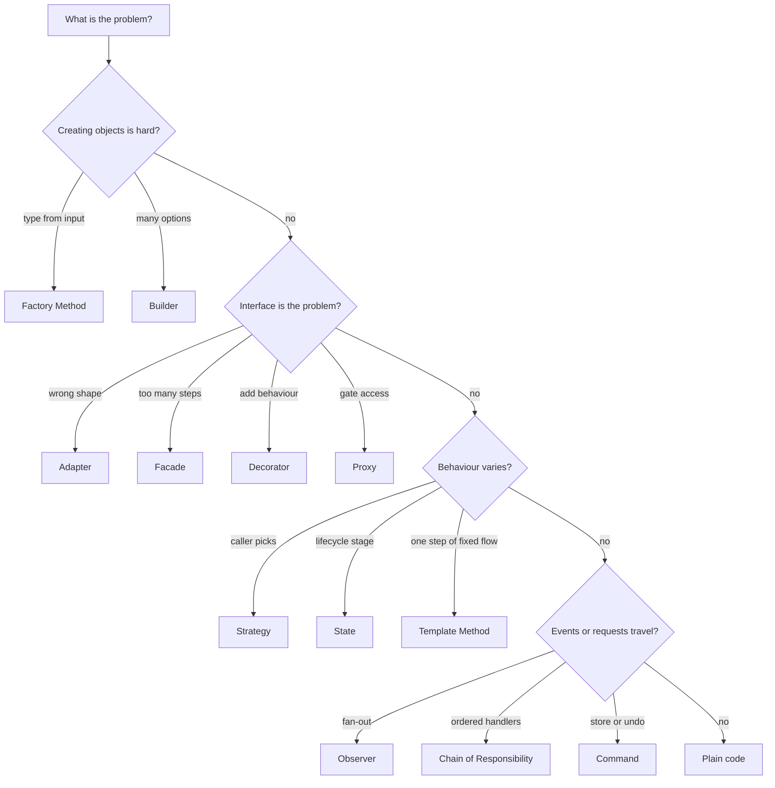

## In one minute
- Fifteen patterns cover most object-oriented design you will write or be asked about. Each has its own lesson in this course; this page is the map and the selection method.
- Pick a pattern from the *shape of the problem*, not from its name. "Behaviour varies by a value I choose at runtime" is Strategy; "behaviour varies by where the object is in its lifecycle" is State; "callers need the wrong interface" is Adapter.
- The fifteen reduce to four mechanisms: an interface with several implementations, a wrapper, a table from key to behaviour, and a list of callbacks. The mechanism tells you the runtime cost.
- A pattern needs two real variants or a scheduled change. Otherwise the plain function is the better design.
- The fastest test in review: say the problem in one sentence without the pattern's name. If you cannot, the pattern is decoration.

## How it works

### The fifteen and the problem each one solves
The "problem shape" column is the sentence you should hear in a requirement before reaching for the pattern; the last column names the lesson that goes deep on it.

| Pattern | Problem shape | Smallest honest form | Lesson |
| --- | --- | --- | --- |
| Strategy | One step has interchangeable algorithms the caller picks | A function parameter or a map of functions | Strategy |
| Observer | Many parties react to a change the source should not know about | A list of callbacks with unsubscribe | Observer |
| Factory Method | The concrete type depends on runtime input | A constructor function or a registry keyed by name | Factory Method |
| Builder | Many optional parts, valid only when complete | Named or keyword arguments, or a builder with `build()` that validates | Builder |
| Adapter | Code needs interface A, the library offers interface B | A thin wrapper that translates calls | Adapter |
| Decorator | Add retry, cache or metrics without editing the core | A wrapper with the same interface as what it wraps | Decorator |
| Facade | Callers keep misusing a many-step subsystem | One function or class that does the safe sequence | Facade |
| Proxy | Gate access: lazy load, remote, permission, rate limit | A stand-in with the same interface that decides whether to forward | Proxy |
| Composite | Parts and wholes treated alike (folders, UI trees) | A node type whose children are the same type | Composite |
| Command | Actions must be queued, logged, retried or undone | A record of "what to do" plus `execute` and `undo` | Command |
| State | Behaviour depends on lifecycle stage | An enum plus a transition table, or one class per state | State |
| Template Method | Fixed sequence, some steps vary | A function that takes the varying steps as parameters | Template Method |
| Iterator | Walk a collection without knowing its storage | A generator or `Next()` method | Iterator |
| Chain of Responsibility | Ordered handlers, any may answer or stop the request | A slice of handlers or middleware | Chain of Responsibility |
| Singleton | Exactly one instance per process | One instance created in `main` and injected | Singleton |

The remaining patterns also have lessons here: Abstract Factory (matching families of products), Prototype (cloning a configured template), Bridge (two dimensions that vary independently), Flyweight (millions of objects sharing immutable state), Mediator (widgets that would otherwise all reference each other), Memento (snapshots for undo), Visitor (new operations over a closed tree of types) and Null Object (absence as a harmless default). Intro to Design Patterns covers where the catalogue came from and why many entries became language features.

### Four mechanisms underneath
The mechanics repeat across the fifteen.

1. **Interface plus implementations.** Strategy, State, Factory Method, Template Method, Iterator and Command put varying behaviour behind one interface. What differs is who picks the implementation: the caller (Strategy), the object as its stage changes (State), a lookup on input (Factory Method), a subclass (Template Method).
2. **Wrapper with the same interface.** Decorator always forwards and adds behaviour, Proxy decides whether to forward, Adapter changes the interface shape, Composite wraps many children.
3. **Table from key to behaviour.** Factory registries, Strategy maps, State transition tables and Command dispatchers are dictionaries: a switch statement turned into data.
4. **List of callbacks.** Observer calls every function in its list; a Chain calls them in order until one handles the request.

Seeing the mechanism ends arguments about names. Instead of "is this Strategy or State?", ask "who changes the implementation, and is the change a lifecycle transition?"

### Picking one quickly
Ask four questions in order, and stop at the first yes.

1. **Is something being created, and is the choice or the construction hard?** Choice by input points to Factory Method; many optional fields point to Builder; matching families point to Abstract Factory.
2. **Is an interface wrong, too big or missing a capability?** The wrong shape points to Adapter, too many steps to Facade, a missing cross-cutting behaviour to Decorator, gated access to Proxy.
3. **Does behaviour vary?** By caller choice it is Strategy; by lifecycle stage it is State; by one step in a fixed sequence it is Template Method; by node type in a tree, Composite or Visitor.
4. **Do events or requests need to travel?** Fan-out to many listeners is Observer; ordered handlers that may stop the request are a Chain; actions that must be stored, replayed or undone are Commands.

Then count variants. A Strategy with one strategy or a Factory that builds one type is indirection with nothing on the other side; write the direct call instead.

### When not to use any pattern
- **One implementation and no change in sight.** YAGNI applies. Adding the interface later is a mechanical refactor that takes minutes with a type checker and tests.
- **The language already does it.** A function value, a generator or `functools.lru_cache` is the pattern; Intro to Design Patterns explains why.
- **The problem is data, not behaviour.** If variants differ only in numbers (rates, thresholds, timeouts), a table of values beats a class per variant.
- **Nobody can name the change it protects against.** A pattern is a bet on what will vary; without a named change the bet is random.

### Reviewing agent-written code
Ask an agent to "make the pricing extensible" and you may get a `PricingStrategyFactory`, an abstract `BasePricingStrategy` and a `PricingContext`, for a codebase with one pricing rule. In review, apply the one-sentence test, count the variants, and ask for the smallest honest form from the table. The reverse also happens: an agent adds a fourth `elif` to a value that is already switched on in three other functions. That repeated switch is the signal a Strategy map or State table is now worth it.

### The same shape elsewhere
Choosing a pattern from problem flags is a classification problem, the same one a doctor's differential diagnosis or an incident triage runbook solves: observe a few features, rule out candidates whose preconditions fail, prefer the most specific match. The practice task builds exactly that recommender, and its "most specific rule wins" step is the same conflict resolution that CSS selector specificity and longest-prefix IP routing use.

## Down the stack

### Layer 1: The contract
Strategy and State promise substitutability: any implementation can replace another without the caller changing (the Liskov rule). Decorator and Proxy promise the same interface as the wrapped object, so callers cannot tell how many layers there are. Observer promises every live subscriber is called once per event, and an unsubscribed one is not. Command promises `undo(execute(s)) == s`. Builder promises `build()` never returns an invalid object. Iterator promises every element once, in a defined order, and a defined behaviour when the collection changes underneath. Singleton promises one instance per process, the promise most often broken by tests and forks.

### Layer 2: The mechanism
An interface call in C++ and Java goes through a vtable: the object header points at a per-class table of function pointers, and the call loads one and jumps. Go stores an interface as two words, a pointer to an itab (type plus method pointers) and a pointer to the data, so a Strategy held in an interface field costs 16 bytes and one indirect call. JavaScript has no vtables: `strategy.apply(x)` walks the prototype chain, and V8 caches the result per call site in an inline cache keyed by the object's hidden class. A table of behaviours is a hash map: Python `dict`, Go `map` (buckets of 8 entries, or Swiss tables since Go 1.24), JS `Map`. A list of callbacks is an array of closures, each a function pointer plus captured variables.

### Layer 3: The machine
A well-predicted indirect call costs about 1 to 2 ns; a mispredicted one about 15 to 20 cycles (5 ns at 3 to 4 GHz), which matters only when one hot call site sees many implementations. The larger cost is lost inlining: the compiler cannot inline through an interface it cannot see through, so a tiny helper that could have been vectorised stays a call. Wrappers cost allocation and pointer chasing: a five-layer Decorator stack in Go is five heap objects, and each call follows five pointers that may each miss L1 cache (about 1 ns hit, 4 ns L2, 80 to 100 ns main memory). Command objects allocate one record per action; an undo history of 100,000 edits at 64 bytes each is 6.4 MB. Observer under concurrency needs a lock or a copy-on-write subscriber list; Singleton needs `sync.Once` in Go or a module-level instance in Python, whose import lock already serialises initialisation.

### Why it's built this way
1. Requirements change in predictable places (a new payment method, a new channel, a new state), so designers isolate those places behind a seam.
2. A seam must let new code plug in without editing old code, which in typed languages means an interface or a function type.
3. Indirection costs a pointer load, a lost inline and sometimes an allocation, so seams are worth it only where change is likely.
4. The same few seams kept recurring across projects, so they got names, and the names let teams agree on a design in one word.
5. Names became fashion, which is why the selection discipline (problem shape first, two variants, one-sentence test) matters more than the catalogue.

## Diagram


## Worked example
A team is adding invoice reminders to a billing service: send reminders 3, 7 and 14 days after the due date; email today, SMS next quarter; retry provider timeouts; audit every send for finance; stop once an invoice is paid, disputed or written off. Volume is about 40,000 reminders a day. Walk the four questions.

- Creating objects: the channel is chosen per customer, and SMS is scheduled, so a small factory keyed by channel name is justified. Builder is not: a reminder has four fields.
- Interfaces: the SMS SDK takes a phone number and template id, not a `Message`, so it gets an Adapter. Retry and audit are cross-cutting and identical across channels, so they are two Decorators around the channel interface.
- Varying behaviour: whether to send depends on the invoice's lifecycle stage, so State, in practice an enum plus a transition table, since the stage is already a database column. The 3, 7, 14 schedule is data in config, not a Strategy.
- Travelling events: "invoice paid" must cancel pending reminders. The payments module already publishes events, so the reminder module subscribes: Observer with no new infrastructure.

Rejected: a `ReminderStrategy` hierarchy (one way to remind), a Singleton scheduler (create one in `main` and inject it), and a Command per reminder (the job table already records what to send).

Cost check: each send passes Retry, Audit and the adapter, three interface calls costing nanoseconds against a 150 ms provider round trip, at under one send per second on average. Performance does not constrain this design; readability does, so there are four seams, each tied to a named requirement.

## Trade-offs
| Option | Strengths | Weaknesses | Choose when |
| --- | --- | --- | --- |
| Plain function or `switch` | Readable; compiler checks exhaustiveness; inlinable | Every new variant edits the same function | One or two variants, owned by one team |
| Map of functions | Variants added as data; one line per variant | Runtime errors for unknown keys; no per-variant state | Variants are stateless and chosen by key |
| Interface with classes | Variants carry state and several methods; testable in isolation | More files; indirect calls; harder to read top-down | Variants have state or several related operations |
| Wrapper stack (Decorator, Proxy) | Cross-cutting concerns stay out of core code | Order of layers matters and is easy to get wrong; allocations | Retries, caching, metrics, auth around a stable interface |
| No seam yet, refactor later | Zero indirection today | Needs tests and a type checker to make the later change safe | No second variant and no named change |

## Pitfalls in production
- **Pattern by name, not by problem.** A codebase full of `*Factory`, `*Manager` and `*Strategy` classes each with one implementation. Fix: inline them; keep a seam only where two variants exist or a change is scheduled.
- **Strategy where State was needed.** The caller sets the "strategy" for an order's stage and forgets to change it on transition, so a shipped order still accepts edits. Fix: let the object own its stage and expose transitions, not setters.
- **Decorator order bugs.** Cache outside Retry caches the error; Retry outside Auth retries a 401 three times. Fix: build the stack in one function with a comment on the order, and test the order.
- **Observer leaks.** Subscribers added per request and never removed; memory grows until restart. Fix: return an unsubscribe handle and tie it to the subscriber's lifetime.
- **Singleton as hidden global.** Tests pass alone and fail together because state leaks across them. Fix: construct once in the composition root and pass it in.

## Leadership lens
- Make "which requirement does this seam serve?" a standard review question. A pattern without an answer is cost without benefit, and it compounds as new hires copy it.
- Agree on a small house vocabulary. Teams that use Strategy, State, Decorator and Observer consistently review designs faster than teams that know thirty names loosely.
- Tell coding agents the smallest form you want ("a map from channel name to a send function, no classes") instead of "make it extensible". Agents follow concrete shapes well and over-build vague ones.
- Budget refactors as the variant count grows. The right moment to add a Strategy is the third `elif`, and that work is cheap if someone owns it.

## Check yourself
1. An order's behaviour differs between draft, submitted and shipped, and someone proposes Strategy. What is the better fit, and why?
   **Answer:** State, because the variation follows the object's lifecycle and the object itself must change implementation on transitions; Strategy is for variation the caller chooses.
2. Decorator and Proxy have the same structure. What tells them apart?
   **Answer:** Intent: a Decorator always forwards and adds behaviour around the call, while a Proxy decides whether and when to forward (lazy loading, access checks, remote calls).
3. Why do Strategy, Factory registries and State tables often end up as dictionaries in Python or Go?
   **Answer:** Because all three map a key to a behaviour, and when the behaviour is stateless a map of functions gives the same extension point with less code than a class per variant.
4. A teammate adds an interface with one implementation "for testability". When is that justified?
   **Answer:** When the real implementation does I/O or is slow and tests need a fake; then the fake is the second implementation. If the real one is pure and fast, test it directly.

## Practice
**Task:** Build a pattern recommender that turns problem-shape flags into suggested patterns. `recommend(flags, variants)` takes a collection of flag strings and the number of concrete variants that exist today. Rules are checked in this fixed order, each with the flags it needs (all must be present) and a minimum variant count: State `{behaviour_varies, by_lifecycle}` min 2; Strategy `{behaviour_varies}` min 2; Abstract Factory `{creates_objects, families}` min 2; Factory Method `{creates_objects, type_from_input}` min 2; Builder `{creates_objects, many_options}` min 0; Adapter `{wrong_interface}` min 0; Decorator `{add_behaviour}` min 0; Proxy `{add_behaviour, gate_access}` min 0; Facade `{complex_subsystem}` min 0; Composite `{part_whole}` min 0; Command `{undo_or_queue}` min 0; Observer `{notify_many}` min 0; Chain of Responsibility `{ordered_handlers}` min 0. A rule fires when all its flags are present and `variants >= min`. Then drop any fired rule whose flag set is a strict subset of another fired rule's flag set (the more specific rule wins), and return the remaining pattern names in rule order; an empty list means "write plain code". Duplicate flags are ignored. Any flag not used by a rule fails with `unknown flag: <flag>`, reporting the alphabetically first unknown flag (Python `ValueError`, TypeScript `Error`, Go error).

```python starter
RULES = [
    ("State", {"behaviour_varies", "by_lifecycle"}, 2),
    ("Strategy", {"behaviour_varies"}, 2),
    ("Abstract Factory", {"creates_objects", "families"}, 2),
    ("Factory Method", {"creates_objects", "type_from_input"}, 2),
    ("Builder", {"creates_objects", "many_options"}, 0),
    ("Adapter", {"wrong_interface"}, 0),
    ("Decorator", {"add_behaviour"}, 0),
    ("Proxy", {"add_behaviour", "gate_access"}, 0),
    ("Facade", {"complex_subsystem"}, 0),
    ("Composite", {"part_whole"}, 0),
    ("Command", {"undo_or_queue"}, 0),
    ("Observer", {"notify_many"}, 0),
    ("Chain of Responsibility", {"ordered_handlers"}, 0),
]

def recommend(flags, variants):
    # TODO
    raise NotImplementedError
```

```python tests
def error_of(fn):
    try:
        fn()
    except ValueError as e:
        return str(e)
    return None

def test_single_flag():
    assert recommend(["wrong_interface"], 1) == ["Adapter"]

def test_more_specific_rule_wins():
    assert recommend(["behaviour_varies", "by_lifecycle"], 4) == ["State"]
    assert recommend(["add_behaviour", "gate_access"], 0) == ["Proxy"]

def test_too_few_variants_means_plain_code():
    assert recommend(["behaviour_varies"], 1) == []
    assert recommend(["behaviour_varies", "by_lifecycle"], 1) == []

def test_specific_rule_blocked_lets_general_rule_fire():
    assert recommend(["creates_objects", "type_from_input", "many_options"], 1) == ["Builder"]

def test_several_patterns_in_rule_order():
    got = recommend(["notify_many", "creates_objects", "type_from_input", "behaviour_varies"], 3)
    assert got == ["Strategy", "Factory Method", "Observer"]

def test_no_flags_and_duplicates():
    assert recommend([], 5) == []
    assert recommend(["part_whole", "part_whole"], 0) == ["Composite"]

def test_unknown_flag_reports_first_alphabetically():
    assert error_of(lambda: recommend(["zeta", "notify_many", "alpha"], 2)) == "unknown flag: alpha"

def test_flag_that_only_completes_rules_is_known():
    assert recommend(["by_lifecycle"], 3) == []
    assert recommend(["families"], 3) == []
```

```python solution
RULES = [
    ("State", {"behaviour_varies", "by_lifecycle"}, 2),
    ("Strategy", {"behaviour_varies"}, 2),
    ("Abstract Factory", {"creates_objects", "families"}, 2),
    ("Factory Method", {"creates_objects", "type_from_input"}, 2),
    ("Builder", {"creates_objects", "many_options"}, 0),
    ("Adapter", {"wrong_interface"}, 0),
    ("Decorator", {"add_behaviour"}, 0),
    ("Proxy", {"add_behaviour", "gate_access"}, 0),
    ("Facade", {"complex_subsystem"}, 0),
    ("Composite", {"part_whole"}, 0),
    ("Command", {"undo_or_queue"}, 0),
    ("Observer", {"notify_many"}, 0),
    ("Chain of Responsibility", {"ordered_handlers"}, 0),
]

def recommend(flags, variants):
    given = set(flags)
    known = set()
    for _, needs, _ in RULES:
        known |= needs
    unknown = sorted(given - known)
    if unknown:
        raise ValueError("unknown flag: " + unknown[0])
    fired = [(name, needs) for name, needs, low in RULES
             if needs <= given and variants >= low]
    result = []
    for name, needs in fired:
        if not any(needs < other for _, other in fired):
            result.append(name)
    return result
```

```typescript starter
export type Rule = { name: string; needs: string[]; min: number };

export const RULES: Rule[] = [
  { name: "State", needs: ["behaviour_varies", "by_lifecycle"], min: 2 },
  { name: "Strategy", needs: ["behaviour_varies"], min: 2 },
  { name: "Abstract Factory", needs: ["creates_objects", "families"], min: 2 },
  { name: "Factory Method", needs: ["creates_objects", "type_from_input"], min: 2 },
  { name: "Builder", needs: ["creates_objects", "many_options"], min: 0 },
  { name: "Adapter", needs: ["wrong_interface"], min: 0 },
  { name: "Decorator", needs: ["add_behaviour"], min: 0 },
  { name: "Proxy", needs: ["add_behaviour", "gate_access"], min: 0 },
  { name: "Facade", needs: ["complex_subsystem"], min: 0 },
  { name: "Composite", needs: ["part_whole"], min: 0 },
  { name: "Command", needs: ["undo_or_queue"], min: 0 },
  { name: "Observer", needs: ["notify_many"], min: 0 },
  { name: "Chain of Responsibility", needs: ["ordered_handlers"], min: 0 },
];

export function recommend(flags: string[], variants: number): string[] {
  throw new Error("TODO");
}
```

```typescript tests
function errorOf(fn: () => unknown): string | undefined {
  try { fn(); } catch (e) { return (e as Error).message; }
  return undefined;
}

test("single flag", () => {
  assertEqual(recommend(["wrong_interface"], 1), ["Adapter"]);
});

test("more specific rule wins", () => {
  assertEqual(recommend(["behaviour_varies", "by_lifecycle"], 4), ["State"]);
  assertEqual(recommend(["add_behaviour", "gate_access"], 0), ["Proxy"]);
});

test("too few variants means plain code", () => {
  assertEqual(recommend(["behaviour_varies"], 1), []);
  assertEqual(recommend(["behaviour_varies", "by_lifecycle"], 1), []);
});

test("specific rule blocked lets general rule fire", () => {
  assertEqual(recommend(["creates_objects", "type_from_input", "many_options"], 1), ["Builder"]);
});

test("several patterns in rule order", () => {
  const got = recommend(["notify_many", "creates_objects", "type_from_input", "behaviour_varies"], 3);
  assertEqual(got, ["Strategy", "Factory Method", "Observer"]);
});

test("no flags and duplicates", () => {
  assertEqual(recommend([], 5), []);
  assertEqual(recommend(["part_whole", "part_whole"], 0), ["Composite"]);
});

test("unknown flag reports first alphabetically", () => {
  assertEqual(errorOf(() => recommend(["zeta", "notify_many", "alpha"], 2)), "unknown flag: alpha");
});

test("flag that only completes rules is known", () => {
  assertEqual(recommend(["by_lifecycle"], 3), []);
  assertEqual(recommend(["families"], 3), []);
});
```

```typescript solution
export type Rule = { name: string; needs: string[]; min: number };

export const RULES: Rule[] = [
  { name: "State", needs: ["behaviour_varies", "by_lifecycle"], min: 2 },
  { name: "Strategy", needs: ["behaviour_varies"], min: 2 },
  { name: "Abstract Factory", needs: ["creates_objects", "families"], min: 2 },
  { name: "Factory Method", needs: ["creates_objects", "type_from_input"], min: 2 },
  { name: "Builder", needs: ["creates_objects", "many_options"], min: 0 },
  { name: "Adapter", needs: ["wrong_interface"], min: 0 },
  { name: "Decorator", needs: ["add_behaviour"], min: 0 },
  { name: "Proxy", needs: ["add_behaviour", "gate_access"], min: 0 },
  { name: "Facade", needs: ["complex_subsystem"], min: 0 },
  { name: "Composite", needs: ["part_whole"], min: 0 },
  { name: "Command", needs: ["undo_or_queue"], min: 0 },
  { name: "Observer", needs: ["notify_many"], min: 0 },
  { name: "Chain of Responsibility", needs: ["ordered_handlers"], min: 0 },
];

function strictSubset(a: string[], b: string[]): boolean {
  return a.length < b.length && a.every((f) => b.includes(f));
}

export function recommend(flags: string[], variants: number): string[] {
  const given = new Set(flags);
  const known = new Set<string>();
  for (const r of RULES) for (const f of r.needs) known.add(f);
  const unknown = [...given].filter((f) => !known.has(f)).sort();
  if (unknown.length > 0) throw new Error("unknown flag: " + unknown[0]);
  const fired = RULES.filter((r) => r.needs.every((f) => given.has(f)) && variants >= r.min);
  return fired
    .filter((r) => !fired.some((o) => strictSubset(r.needs, o.needs)))
    .map((r) => r.name);
}
```

```go starter
package practice

type Rule struct {
	Name  string
	Needs []string
	Min   int
}

var Rules = []Rule{
	{"State", []string{"behaviour_varies", "by_lifecycle"}, 2},
	{"Strategy", []string{"behaviour_varies"}, 2},
	{"Abstract Factory", []string{"creates_objects", "families"}, 2},
	{"Factory Method", []string{"creates_objects", "type_from_input"}, 2},
	{"Builder", []string{"creates_objects", "many_options"}, 0},
	{"Adapter", []string{"wrong_interface"}, 0},
	{"Decorator", []string{"add_behaviour"}, 0},
	{"Proxy", []string{"add_behaviour", "gate_access"}, 0},
	{"Facade", []string{"complex_subsystem"}, 0},
	{"Composite", []string{"part_whole"}, 0},
	{"Command", []string{"undo_or_queue"}, 0},
	{"Observer", []string{"notify_many"}, 0},
	{"Chain of Responsibility", []string{"ordered_handlers"}, 0},
}

func Recommend(flags []string, variants int) ([]string, error) {
	panic("TODO")
}
```

```go tests
package practice

import (
	"reflect"
	"testing"
)

func mustRecommend(t *testing.T, flags []string, variants int) []string {
	t.Helper()
	got, err := Recommend(flags, variants)
	if err != nil {
		t.Fatalf("unexpected error: %v", err)
	}
	return got
}

func expect(t *testing.T, got, want []string) {
	t.Helper()
	if len(got) == 0 && len(want) == 0 {
		return
	}
	if !reflect.DeepEqual(got, want) {
		t.Fatalf("got %v, want %v", got, want)
	}
}

func TestSingleFlag(t *testing.T) {
	expect(t, mustRecommend(t, []string{"wrong_interface"}, 1), []string{"Adapter"})
}

func TestMoreSpecificRuleWins(t *testing.T) {
	expect(t, mustRecommend(t, []string{"behaviour_varies", "by_lifecycle"}, 4), []string{"State"})
	expect(t, mustRecommend(t, []string{"add_behaviour", "gate_access"}, 0), []string{"Proxy"})
}

func TestTooFewVariantsMeansPlainCode(t *testing.T) {
	expect(t, mustRecommend(t, []string{"behaviour_varies"}, 1), nil)
	expect(t, mustRecommend(t, []string{"behaviour_varies", "by_lifecycle"}, 1), nil)
}

func TestSpecificRuleBlockedLetsGeneralRuleFire(t *testing.T) {
	got := mustRecommend(t, []string{"creates_objects", "type_from_input", "many_options"}, 1)
	expect(t, got, []string{"Builder"})
}

func TestSeveralPatternsInRuleOrder(t *testing.T) {
	got := mustRecommend(t, []string{"notify_many", "creates_objects", "type_from_input", "behaviour_varies"}, 3)
	expect(t, got, []string{"Strategy", "Factory Method", "Observer"})
}

func TestNoFlagsAndDuplicates(t *testing.T) {
	expect(t, mustRecommend(t, nil, 5), nil)
	expect(t, mustRecommend(t, []string{"part_whole", "part_whole"}, 0), []string{"Composite"})
}

func TestUnknownFlagReportsFirstAlphabetically(t *testing.T) {
	_, err := Recommend([]string{"zeta", "notify_many", "alpha"}, 2)
	if err == nil || err.Error() != "unknown flag: alpha" {
		t.Fatalf("got %v", err)
	}
}

func TestFlagThatOnlyCompletesRulesIsKnown(t *testing.T) {
	expect(t, mustRecommend(t, []string{"by_lifecycle"}, 3), nil)
	expect(t, mustRecommend(t, []string{"families"}, 3), nil)
}
```

```go solution
package practice

import (
	"errors"
	"sort"
)

type Rule struct {
	Name  string
	Needs []string
	Min   int
}

var Rules = []Rule{
	{"State", []string{"behaviour_varies", "by_lifecycle"}, 2},
	{"Strategy", []string{"behaviour_varies"}, 2},
	{"Abstract Factory", []string{"creates_objects", "families"}, 2},
	{"Factory Method", []string{"creates_objects", "type_from_input"}, 2},
	{"Builder", []string{"creates_objects", "many_options"}, 0},
	{"Adapter", []string{"wrong_interface"}, 0},
	{"Decorator", []string{"add_behaviour"}, 0},
	{"Proxy", []string{"add_behaviour", "gate_access"}, 0},
	{"Facade", []string{"complex_subsystem"}, 0},
	{"Composite", []string{"part_whole"}, 0},
	{"Command", []string{"undo_or_queue"}, 0},
	{"Observer", []string{"notify_many"}, 0},
	{"Chain of Responsibility", []string{"ordered_handlers"}, 0},
}

func containsAll(set map[string]bool, needs []string) bool {
	for _, f := range needs {
		if !set[f] {
			return false
		}
	}
	return true
}

func strictSubset(a, b []string) bool {
	if len(a) >= len(b) {
		return false
	}
	inB := map[string]bool{}
	for _, f := range b {
		inB[f] = true
	}
	return containsAll(inB, a)
}

func Recommend(flags []string, variants int) ([]string, error) {
	known := map[string]bool{}
	for _, r := range Rules {
		for _, f := range r.Needs {
			known[f] = true
		}
	}
	given := map[string]bool{}
	var unknown []string
	for _, f := range flags {
		if !known[f] && !given[f] {
			unknown = append(unknown, f)
		}
		given[f] = true
	}
	if len(unknown) > 0 {
		sort.Strings(unknown)
		return nil, errors.New("unknown flag: " + unknown[0])
	}
	var fired []Rule
	for _, r := range Rules {
		if containsAll(given, r.Needs) && variants >= r.Min {
			fired = append(fired, r)
		}
	}
	result := []string{}
	for _, r := range fired {
		shadowed := false
		for _, o := range fired {
			if strictSubset(r.Needs, o.Needs) {
				shadowed = true
				break
			}
		}
		if !shadowed {
			result = append(result, r.Name)
		}
	}
	return result, nil
}
```

## Mock interview
**Prompt:** You are reviewing a document-sharing service's permission and notification design. It includes a `PermissionStrategyFactory`, a `NotificationManagerSingleton`, an `AuditDecorator` and a `ShareCommand`, for a feature that today supports two roles and one notification channel at about 300 shares a minute. Walk through which patterns you would keep, which you would remove, and why.

- Follow-up: Product says a third role and a Slack channel are coming next quarter. Does that change your answer for any of them?
- Follow-up: The audit decorator wraps the permission checker. What happens if someone wraps it in the wrong order with a cache, and how would you prevent that?
- Follow-up: Would two roles be better as data than as classes?

**A strong answer covers:**
- Naming the problem shape behind each pattern in one sentence, and removing the ones without a real second variant or a scheduled change.
- Replacing the Singleton with one instance created at startup and injected, so tests can use fakes.
- Keeping the audit Decorator because auditing is cross-cutting and must not leak into permission logic, and fixing the wrapper order in one constructor with a test.
- Recognising that two roles may be data (a role-to-permissions table) rather than a Strategy hierarchy.
- Treating the roadmap as evidence: a scheduled third role or second channel justifies a seam now, a hypothetical one does not.

## Watch
- [10 Design Patterns Explained in 10 Minutes (Fireship)](https://www.youtube.com/watch?v=tv-_1er1mWI): a quick tour of the most common patterns with the "do you need it?" caveat for each.

## Free resources
- [Refactoring.Guru design pattern catalog](https://refactoring.guru/design-patterns/catalog): one page per pattern with intent, structure and applicability, useful as a lookup next to the table above.
- [Design Patterns in Dynamic Languages (Peter Norvig)](https://norvig.com/design-patterns/): shows that 16 of the 23 GoF patterns become simpler or invisible with first-class functions and dynamic types.
- [python-patterns.guide (Brandon Rhodes)](https://python-patterns.guide/): which patterns still earn their place in Python, and which the language absorbed.
- [Game Programming Patterns (Robert Nystrom)](https://gameprogrammingpatterns.com/contents.html): a free book that revisits Command, Observer, State, Flyweight and others with performance in mind.
- [Beck Design Rules (Martin Fowler)](https://martinfowler.com/bliki/BeckDesignRules.html): four rules of simple design, the check to apply before any pattern.
