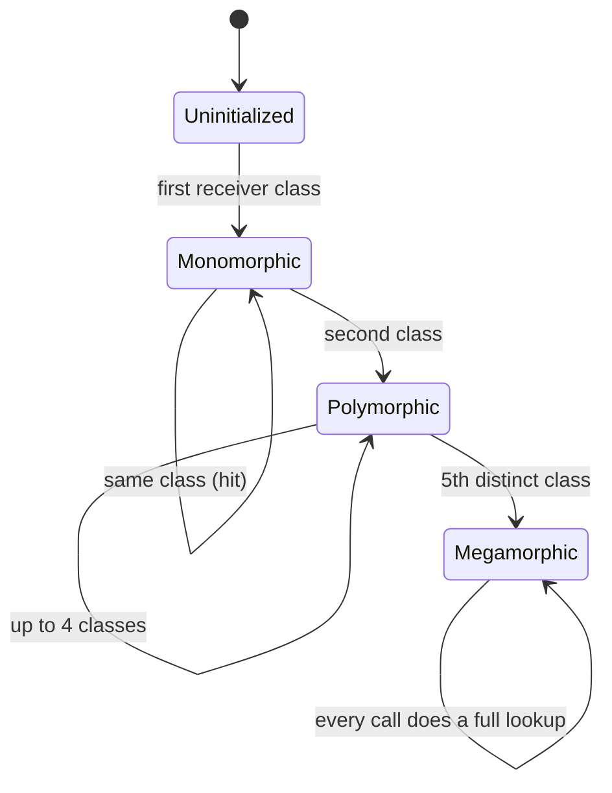

## In one minute
- Polymorphism means one piece of code works with values of many types, and the right behaviour for each type is chosen for you. The caller writes `r.monthly_cost()` once; a VM, a bucket and a function each answer their own way.
- Subtype polymorphism picks the method at runtime from the receiver's type. Parametric polymorphism (generics) writes one algorithm for any type. Ad hoc polymorphism (overloading) picks a function at compile time from argument types.
- Dispatch makes adding a type cheap and adding an operation expensive; a `switch` over a closed set of types makes the opposite trade. This is the expression problem.
- A virtual call costs about a nanosecond when predicted, but mostly costs lost inlining. JITs recover it with inline caches, fast while a call site sees one to four types.
- Agents produce either long `isinstance` chains or a hierarchy for two cases. Ask which axis will grow: types or operations.

## How it works

### One call, many behaviours
A cloud billing job prices resources. The first version branches on a type tag:

```python
def monthly_cost(r):
    if r.kind == "vm":
        return r.vcpus * 21.0 + r.ram_gb * 2.8
    if r.kind == "bucket":
        return r.stored_gb * 0.021
    if r.kind == "function":
        return r.invocations / 1_000_000 * 0.20
    raise ValueError("unknown kind " + r.kind)
```

The same chain reappears in the invoice renderer, the budget alerter and the carbon estimator. Adding a managed database means editing all four, and a missed one fails only at runtime. With subtype polymorphism each class carries its own `monthly_cost` and callers write `r.monthly_cost()`. The branch still exists, but the language performs it, in one place, from the object's type.

### The kinds of polymorphism
- **Subtype (dynamic dispatch).** A `Resource` variable holds any subtype and the method runs from the object's actual class: Java, Python and JavaScript methods, C++ `virtual`, Go interfaces.
- **Parametric (generics).** `Max[T cmp.Ordered](xs []T) T` is one algorithm for every `T`.
- **Ad hoc (overloading).** `print(int)` and `print(string)` are different functions sharing a name; the compiler picks one from *static* argument types. Operator overloading is the same idea.
- **Coercion.** `1 + 2.5` converts the integer so one addition works.

What matters most is *when* the choice is made. Overriding is decided at runtime from the object; overloading and generics at compile time from declared types.

### How many arguments decide?
Most languages dispatch on the receiver only. If behaviour depends on two types, such as a collision between an asteroid and a ship, single dispatch needs a second hop: the Visitor pattern's double dispatch. Julia and Common Lisp dispatch on all arguments. Python's `functools.singledispatch` dispatches a function on its first argument, a handy way to add an operation to classes you do not own.

### The expression problem
Picture a grid with types as rows and operations as columns. Subclasses add a row cheaply but a new column edits every class. A `switch` per operation is the reverse.

Choose by which axis grows. Third-party payment providers grow rows, so use interfaces. A compiler's syntax tree has fixed node types and keeps gaining passes, so use exhaustive matching. Java 21 sealed interfaces with pattern-matching `switch`, Rust enums, and TypeScript discriminated unions with a `never` check all fail to compile when a case is missing.

### Reviewing agent-written code
Agents add another `elif isinstance(...)` branch because it is the smallest diff, or, asked to "make it extensible", build an abstract base with one subclass. Check that a new type needs edits in one place, that type switches are exhaustive and compiler-checked, and that overloads do not depend on static types the caller lacks: a Java `equals(Money other)` overloads rather than overrides `equals(Object)`, so collections never call it.

### The same shape elsewhere
Dispatch is the *finding things fast* shape: map a key (the type) to a handler and cache the answer. An HTTP router maps method and path to a handler, and a CPU's branch target buffer maps an instruction address to a predicted target. Each fails the same way: too many distinct keys at one point overflow the fast cache and force a slow path.

## Down the stack

### Layer 1: The contract
For an overridden method, the most specific implementation for the receiver's runtime type runs, even when the static type is a parent or interface. Overloads are fixed at compile time from static argument types. Generic code is type-checked once (Java, Go, TypeScript) or per instantiation (C++ templates). Nothing promises how fast dispatch is.

### Layer 2: The mechanism
**C++ and the JVM** give each class a vtable; a virtual call loads the vtable pointer, loads a fixed slot and calls it. Inherited methods keep their parent's slot, so the slot is a compile-time constant. The JIT first tries an inline cache: compare the receiver's class with the one last seen and jump straight to its method. HotSpot profiles receiver types and inlines sites seeing one or two classes behind a guard; sites seeing more are megamorphic and use the vtable.

**V8** keeps an inline cache per access and call site, keyed by hidden class ("map"): uninitialised, monomorphic, polymorphic (about four maps), then megamorphic with a global stub cache. Objects given the same properties in different orders get different maps, so a site turns polymorphic for no visible reason.

**Generics.** C++ templates and Rust generics are monomorphised: one copy per type argument, so calls are direct and inlinable, at the cost of binary size. Java erases type parameters to `Object` and casts. Go uses GC shape stenciling: one copy per memory shape, all pointer types sharing one, plus a dictionary argument, so a method call on a type parameter is indirect and can be slower than an interface call.

**Python** looks the method up on `type(obj)` through the MRO. CPython 3.11 and later specialise hot bytecode, turning `LOAD_ATTR` into a method-load variant guarded by the type's version tag. `singledispatch` caches class to implementation, walking the MRO on a miss.

### Layer 3: The machine
A predicted virtual call is two dependent loads and an indirect branch, around 1 ns with L1 hits. A mispredicted indirect branch costs roughly 15 to 20 cycles, about 5 ns at 3.5 GHz. A loop over seven classes in random order defeats the branch target buffer; the same list grouped by class predicts almost perfectly. The larger cost is what the compiler cannot do through an indirect call: inline, hoist checks or vectorise. Layout matters more still: a list of polymorphic objects is a list of pointers to separate allocations, and each DRAM miss costs around 80 to 100 ns. A slice of one concrete struct is contiguous and prefetchable.

### Why it's built this way
1. Callers must not know every type, so the decision is made from data the object carries (vtable pointer, hidden class, type object).
2. Inherited methods keep fixed slots so dispatch is one indexed load, not a search.
3. Indirect calls block inlining and most sites see one type, so JITs speculate with inline caches.
4. Copying code per type is fast but bloats binaries, so C++ and Rust copy, Java erases, and Go copies per shape.

## Diagram


## Worked example
A nightly Go billing run prices 300 million usage records held as `Rater` interface values across seven concrete types, interleaved by timestamp. It takes about 41 seconds on one core, roughly 137 ns per record.

The profile shows little time in the arithmetic. About half goes to cache misses chasing each interface's pointer to a separately allocated struct, and a noticeable share to mispredicted indirect calls. The team partitions records by type into seven slices of concrete structs (about 2.4 seconds of extra work) and processes each slice with a loop over the concrete type, so calls are direct and inlined.

The run drops to about 9 seconds. The public API still accepts `Rater`, so new types plug in and use the generic path until they earn a specialised loop. The numbers are illustrative, but the ratio is typical when dispatch sits in a tight loop over pointer-heavy data.

## Trade-offs
| Option | Strengths | Weaknesses | Choose when |
| --- | --- | --- | --- |
| Subtype dispatch | New types without touching callers | New operations touch every type | Open set of types, such as plugins |
| Exhaustive switch over a sealed type | New operations in one place, checked | New types touch every switch | Closed types, growing operations, such as ASTs |
| Monomorphised generics | Direct, inlinable calls | Binary size, compile time | Hot generic containers and algorithms |
| Shared generics (erasure, dictionaries) | Small binaries, fast builds | Indirect calls or casts | Most application code |
| Multiple dispatch | Behaviour depending on two types | Rare outside Julia and Lisp | Numeric and symbolic code |

## Pitfalls in production
- An overload is chosen by static type, so `equals(Money)` is never called by a `HashSet`. Fix: override the exact signature with `@Override`.
- A plugin adds a fifth receiver type to a hot call site and latency rises with no core change. Fix: find megamorphic sites in profiles; split hot loops by type.
- JavaScript objects built with properties in different orders make access sites polymorphic. Fix: initialise every field in the constructor in one order.
- A new subtype is silently swallowed by a `default` branch. Fix: exhaustive matching without a default, so the compiler lists every place to update.
- `functools.singledispatch` on a method dispatches on `self`. Fix: use `singledispatchmethod`.

## Leadership lens
- In design review, ask which axis grows next year, types or operations, and check the design makes that one cheap.
- Treat a widely implemented interface as a platform API: each new required method is work for every implementing team.
- Do not ban `switch` or mandate hierarchies; require exhaustiveness checks wherever types are matched.
- Before accepting "make it polymorphic" refactors on hot paths, budget a profiling pass; the cost is usually memory layout, not the call.

## Check yourself
1. Why does a new payment provider take one new class with interfaces but edits in many files with type switches?
   **Answer:** With interfaces each type carries all its operations, so a new type is one unit. With switches each operation lists every type, so a new type touches every operation.
2. In Java, `Money` defines `equals(Money other)`. Why does `set.contains(m)` ignore it?
   **Answer:** `HashSet` calls `equals(Object)`. `equals(Money)` is an overload chosen from static types, not an override, so `Object.equals` runs.
3. A V8 call site was fast in benchmarks and slow in production, where six object shapes reach it. Why?
   **Answer:** The inline cache holds only a few shapes before going megamorphic, so every call falls back to a generic lookup and cannot be inlined.
4. Why can a C++ template call be faster than the same logic behind a virtual call?
   **Answer:** The template is compiled per type, so the target is known and can be inlined. The virtual target is only known at runtime.

## Practice
**Task:** Build vtables for a single-inheritance hierarchy, then an inline cache for one call site. `build_vtables(defs)` takes `(name, parent, methods)` in order (`parent` is `""` for a root). A vtable starts as a copy of the parent's; each listed method overrides its inherited slot in place or is appended. Entries are `[method, owner]`. Fail with `duplicate class: <name>` or `unknown parent: <parent>` (the parent must be defined earlier). `CallSite(vtables, method)`: `call(cls)` returns the owner whose implementation runs. A cached class is a hit; otherwise do a slow lookup (counted by `slow_lookups()`) and cache the class. When a fifth distinct class would be cached, the site becomes megamorphic, drops its cache, and every later call is a slow lookup. `state()` returns `uninitialized`, `monomorphic` (1 cached class), `polymorphic` (2 to 4) or `megamorphic`. `call` fails with `unknown class: <cls>` or `no method <method> on <cls>` without changing the state or the count. Python raises `ValueError`, TypeScript throws `Error`, Go returns an error.

```python starter
def build_vtables(defs):
    # TODO: copy parent's vtable, override in place, append new methods
    raise NotImplementedError

class CallSite:
    def __init__(self, vtables, method):
        # TODO
        raise NotImplementedError

    def call(self, cls):
        raise NotImplementedError

    def state(self):
        raise NotImplementedError

    def slow_lookups(self):
        raise NotImplementedError
```

```python tests
DEFS = [
    ("Resource", "", ["cost", "name"]),
    ("VM", "Resource", ["cost", "resize"]),
    ("GpuVM", "VM", ["cost"]),
    ("Bucket", "Resource", ["cost"]),
    ("Function", "Resource", []),
    ("Queue", "Resource", ["cost"]),
]

def test_vtables_keep_slots_and_append():
    vt = build_vtables(DEFS)
    assert vt["Resource"] == [["cost", "Resource"], ["name", "Resource"]]
    assert vt["VM"] == [["cost", "VM"], ["name", "Resource"], ["resize", "VM"]]
    assert vt["GpuVM"] == [["cost", "GpuVM"], ["name", "Resource"], ["resize", "VM"]]
    assert vt["Function"] == [["cost", "Resource"], ["name", "Resource"]]

def test_build_errors():
    for defs, msg in [([("A", "", []), ("A", "", [])], "duplicate class: A"),
                      ([("B", "A", []), ("A", "", [])], "unknown parent: A")]:
        try:
            build_vtables(defs)
            assert False, "expected ValueError"
        except ValueError as e:
            assert str(e) == msg

def test_starts_uninitialized():
    site = CallSite(build_vtables(DEFS), "cost")
    assert site.state() == "uninitialized" and site.slow_lookups() == 0

def test_monomorphic_hits_after_first_lookup():
    site = CallSite(build_vtables(DEFS), "cost")
    assert site.call("VM") == "VM"
    assert site.call("VM") == "VM"
    assert site.state() == "monomorphic" and site.slow_lookups() == 1

def test_polymorphic_and_inherited_owner():
    site = CallSite(build_vtables(DEFS), "cost")
    got = [site.call(c) for c in ["VM", "Function", "GpuVM", "VM", "Function"]]
    assert got == ["VM", "Resource", "GpuVM", "VM", "Resource"]
    assert site.state() == "polymorphic" and site.slow_lookups() == 3

def test_megamorphic_after_fifth_class():
    site = CallSite(build_vtables(DEFS), "cost")
    for c in ["Resource", "VM", "GpuVM", "Bucket"]:
        site.call(c)
    assert site.state() == "polymorphic" and site.slow_lookups() == 4
    assert site.call("Queue") == "Queue"
    assert site.state() == "megamorphic" and site.slow_lookups() == 5
    site.call("VM")
    site.call("VM")
    assert site.state() == "megamorphic" and site.slow_lookups() == 7

def test_call_errors_leave_site_unchanged():
    site = CallSite(build_vtables(DEFS), "resize")
    for cls, msg in [("Tape", "unknown class: Tape"), ("Bucket", "no method resize on Bucket")]:
        try:
            site.call(cls)
            assert False, "expected ValueError"
        except ValueError as e:
            assert str(e) == msg
    assert site.state() == "uninitialized" and site.slow_lookups() == 0
    assert site.call("GpuVM") == "VM"
```

```python solution
def build_vtables(defs):
    vt = {}
    for name, parent, methods in defs:
        if name in vt:
            raise ValueError("duplicate class: " + name)
        if parent and parent not in vt:
            raise ValueError("unknown parent: " + parent)
        table = [list(e) for e in vt[parent]] if parent else []
        for m in methods:
            for e in table:
                if e[0] == m:
                    e[1] = name
                    break
            else:
                table.append([m, name])
        vt[name] = table
    return vt

class CallSite:
    def __init__(self, vtables, method):
        self._vt = vtables
        self._method = method
        self._cache = {}
        self._mega = False
        self._slow = 0

    def _lookup(self, cls):
        if cls not in self._vt:
            raise ValueError("unknown class: " + cls)
        for m, owner in self._vt[cls]:
            if m == self._method:
                return owner
        raise ValueError("no method " + self._method + " on " + cls)

    def call(self, cls):
        if not self._mega and cls in self._cache:
            return self._cache[cls]
        owner = self._lookup(cls)
        self._slow += 1
        if not self._mega:
            if len(self._cache) == 4:
                self._mega = True
                self._cache = {}
            else:
                self._cache[cls] = owner
        return owner

    def state(self):
        if self._mega:
            return "megamorphic"
        n = len(self._cache)
        if n == 0:
            return "uninitialized"
        return "monomorphic" if n == 1 else "polymorphic"

    def slow_lookups(self):
        return self._slow
```

```typescript starter
export type ClassDef = [string, string, string[]];
export type VTables = Record<string, [string, string][]>;

export function buildVTables(defs: ClassDef[]): VTables {
  throw new Error("TODO");
}

export class CallSite {
  constructor(vtables: VTables, method: string) {
    throw new Error("TODO");
  }
  call(cls: string): string { throw new Error("TODO"); }
  state(): string { throw new Error("TODO"); }
  slowLookups(): number { throw new Error("TODO"); }
}
```

```typescript tests
const DEFS: ClassDef[] = [
  ["Resource", "", ["cost", "name"]],
  ["VM", "Resource", ["cost", "resize"]],
  ["GpuVM", "VM", ["cost"]],
  ["Bucket", "Resource", ["cost"]],
  ["Function", "Resource", []],
  ["Queue", "Resource", ["cost"]],
];

function errorOf(fn: () => unknown): string {
  try { fn(); } catch (e) { return (e as Error).message; }
  return "";
}

test("vtables keep slots and append", () => {
  const vt = buildVTables(DEFS);
  assertEqual(vt["Resource"], [["cost", "Resource"], ["name", "Resource"]]);
  assertEqual(vt["VM"], [["cost", "VM"], ["name", "Resource"], ["resize", "VM"]]);
  assertEqual(vt["GpuVM"], [["cost", "GpuVM"], ["name", "Resource"], ["resize", "VM"]]);
  assertEqual(vt["Function"], [["cost", "Resource"], ["name", "Resource"]]);
});

test("build errors", () => {
  assertEqual(errorOf(() => buildVTables([["A", "", []], ["A", "", []]])), "duplicate class: A");
  assertEqual(errorOf(() => buildVTables([["B", "A", []], ["A", "", []]])), "unknown parent: A");
});

test("starts uninitialized", () => {
  const site = new CallSite(buildVTables(DEFS), "cost");
  assertEqual(site.state(), "uninitialized");
  assertEqual(site.slowLookups(), 0);
});

test("monomorphic hits after first lookup", () => {
  const site = new CallSite(buildVTables(DEFS), "cost");
  assertEqual(site.call("VM"), "VM");
  assertEqual(site.call("VM"), "VM");
  assertEqual(site.state(), "monomorphic");
  assertEqual(site.slowLookups(), 1);
});

test("polymorphic and inherited owner", () => {
  const site = new CallSite(buildVTables(DEFS), "cost");
  const got = ["VM", "Function", "GpuVM", "VM", "Function"].map((c) => site.call(c));
  assertEqual(got, ["VM", "Resource", "GpuVM", "VM", "Resource"]);
  assertEqual(site.state(), "polymorphic");
  assertEqual(site.slowLookups(), 3);
});

test("megamorphic after fifth class", () => {
  const site = new CallSite(buildVTables(DEFS), "cost");
  for (const c of ["Resource", "VM", "GpuVM", "Bucket"]) site.call(c);
  assertEqual(site.state(), "polymorphic");
  assertEqual(site.slowLookups(), 4);
  assertEqual(site.call("Queue"), "Queue");
  assertEqual(site.state(), "megamorphic");
  assertEqual(site.slowLookups(), 5);
  site.call("VM");
  site.call("VM");
  assertEqual(site.state(), "megamorphic");
  assertEqual(site.slowLookups(), 7);
});

test("call errors leave site unchanged", () => {
  const site = new CallSite(buildVTables(DEFS), "resize");
  assertEqual(errorOf(() => site.call("Tape")), "unknown class: Tape");
  assertEqual(errorOf(() => site.call("Bucket")), "no method resize on Bucket");
  assertEqual(site.state(), "uninitialized");
  assertEqual(site.slowLookups(), 0);
  assertEqual(site.call("GpuVM"), "VM");
});
```

```typescript solution
export type ClassDef = [string, string, string[]];
export type VTables = Record<string, [string, string][]>;

export function buildVTables(defs: ClassDef[]): VTables {
  const vt: VTables = {};
  for (const [name, parent, methods] of defs) {
    if (name in vt) throw new Error("duplicate class: " + name);
    if (parent !== "" && !(parent in vt)) throw new Error("unknown parent: " + parent);
    const table: [string, string][] = parent !== "" ? vt[parent].map(([m, o]) => [m, o]) : [];
    for (const m of methods) {
      const slot = table.find((e) => e[0] === m);
      if (slot) slot[1] = name;
      else table.push([m, name]);
    }
    vt[name] = table;
  }
  return vt;
}

export class CallSite {
  private cache = new Map<string, string>();
  private mega = false;
  private slow = 0;

  constructor(private vtables: VTables, private method: string) {}

  private lookup(cls: string): string {
    const table = this.vtables[cls];
    if (table === undefined) throw new Error("unknown class: " + cls);
    const e = table.find(([m]) => m === this.method);
    if (!e) throw new Error("no method " + this.method + " on " + cls);
    return e[1];
  }

  call(cls: string): string {
    const hit = this.mega ? undefined : this.cache.get(cls);
    if (hit !== undefined) return hit;
    const owner = this.lookup(cls);
    this.slow++;
    if (!this.mega) {
      if (this.cache.size === 4) {
        this.mega = true;
        this.cache.clear();
      } else {
        this.cache.set(cls, owner);
      }
    }
    return owner;
  }

  state(): string {
    if (this.mega) return "megamorphic";
    const n = this.cache.size;
    if (n === 0) return "uninitialized";
    return n === 1 ? "monomorphic" : "polymorphic";
  }

  slowLookups(): number { return this.slow; }
}
```

```go starter
package practice

type ClassDef struct {
	Name    string
	Parent  string
	Methods []string
}

type Entry struct {
	Method string
	Owner  string
}

func BuildVTables(defs []ClassDef) (map[string][]Entry, error) {
	panic("TODO")
}

type CallSite struct{}

func NewCallSite(vtables map[string][]Entry, method string) *CallSite {
	panic("TODO")
}

func (c *CallSite) Call(cls string) (string, error) { panic("TODO") }
func (c *CallSite) State() string                   { panic("TODO") }
func (c *CallSite) SlowLookups() int                { panic("TODO") }
```

```go tests
package practice

import (
	"reflect"
	"testing"
)

var defs = []ClassDef{
	{"Resource", "", []string{"cost", "name"}},
	{"VM", "Resource", []string{"cost", "resize"}},
	{"GpuVM", "VM", []string{"cost"}},
	{"Bucket", "Resource", []string{"cost"}},
	{"Function", "Resource", nil},
	{"Queue", "Resource", []string{"cost"}},
}

func site(t *testing.T, method string) *CallSite {
	t.Helper()
	vt, err := BuildVTables(defs)
	if err != nil {
		t.Fatal(err)
	}
	return NewCallSite(vt, method)
}

func expect(t *testing.T, c *CallSite, state string, slow int) {
	t.Helper()
	if c.State() != state || c.SlowLookups() != slow {
		t.Fatalf("state=%s slow=%d, want %s %d", c.State(), c.SlowLookups(), state, slow)
	}
}

func TestVTablesKeepSlotsAndAppend(t *testing.T) {
	vt, err := BuildVTables(defs)
	if err != nil {
		t.Fatal(err)
	}
	want := map[string][]Entry{
		"Resource": {{"cost", "Resource"}, {"name", "Resource"}},
		"VM":       {{"cost", "VM"}, {"name", "Resource"}, {"resize", "VM"}},
		"GpuVM":    {{"cost", "GpuVM"}, {"name", "Resource"}, {"resize", "VM"}},
		"Function": {{"cost", "Resource"}, {"name", "Resource"}},
	}
	for k, w := range want {
		if !reflect.DeepEqual(vt[k], w) {
			t.Errorf("%s: got %v want %v", k, vt[k], w)
		}
	}
}

func TestBuildErrors(t *testing.T) {
	_, err := BuildVTables([]ClassDef{{"A", "", nil}, {"A", "", nil}})
	if err == nil || err.Error() != "duplicate class: A" {
		t.Errorf("got %v", err)
	}
	_, err = BuildVTables([]ClassDef{{"B", "A", nil}, {"A", "", nil}})
	if err == nil || err.Error() != "unknown parent: A" {
		t.Errorf("got %v", err)
	}
}

func TestStartsUninitialized(t *testing.T) {
	expect(t, site(t, "cost"), "uninitialized", 0)
}

func TestMonomorphicHitsAfterFirstLookup(t *testing.T) {
	c := site(t, "cost")
	for i := 0; i < 2; i++ {
		if got, err := c.Call("VM"); err != nil || got != "VM" {
			t.Fatalf("got %q %v", got, err)
		}
	}
	expect(t, c, "monomorphic", 1)
}

func TestPolymorphicAndInheritedOwner(t *testing.T) {
	c := site(t, "cost")
	var got []string
	for _, cls := range []string{"VM", "Function", "GpuVM", "VM", "Function"} {
		o, err := c.Call(cls)
		if err != nil {
			t.Fatal(err)
		}
		got = append(got, o)
	}
	if !reflect.DeepEqual(got, []string{"VM", "Resource", "GpuVM", "VM", "Resource"}) {
		t.Fatalf("got %v", got)
	}
	expect(t, c, "polymorphic", 3)
}

func TestMegamorphicAfterFifthClass(t *testing.T) {
	c := site(t, "cost")
	for _, cls := range []string{"Resource", "VM", "GpuVM", "Bucket"} {
		c.Call(cls)
	}
	expect(t, c, "polymorphic", 4)
	if o, _ := c.Call("Queue"); o != "Queue" {
		t.Fatalf("got %q", o)
	}
	expect(t, c, "megamorphic", 5)
	c.Call("VM")
	c.Call("VM")
	expect(t, c, "megamorphic", 7)
}

func TestCallErrorsLeaveSiteUnchanged(t *testing.T) {
	c := site(t, "resize")
	if _, err := c.Call("Tape"); err == nil || err.Error() != "unknown class: Tape" {
		t.Errorf("got %v", err)
	}
	if _, err := c.Call("Bucket"); err == nil || err.Error() != "no method resize on Bucket" {
		t.Errorf("got %v", err)
	}
	expect(t, c, "uninitialized", 0)
	if o, err := c.Call("GpuVM"); err != nil || o != "VM" {
		t.Fatalf("got %q %v", o, err)
	}
}
```

```go solution
package practice

import "errors"

type ClassDef struct {
	Name    string
	Parent  string
	Methods []string
}

type Entry struct {
	Method string
	Owner  string
}

func BuildVTables(defs []ClassDef) (map[string][]Entry, error) {
	vt := map[string][]Entry{}
	for _, d := range defs {
		if _, ok := vt[d.Name]; ok {
			return nil, errors.New("duplicate class: " + d.Name)
		}
		var table []Entry
		if d.Parent != "" {
			p, ok := vt[d.Parent]
			if !ok {
				return nil, errors.New("unknown parent: " + d.Parent)
			}
			table = append([]Entry{}, p...)
		}
		for _, m := range d.Methods {
			found := false
			for i := range table {
				if table[i].Method == m {
					table[i].Owner = d.Name
					found = true
					break
				}
			}
			if !found {
				table = append(table, Entry{m, d.Name})
			}
		}
		vt[d.Name] = table
	}
	return vt, nil
}

type CallSite struct {
	vtables map[string][]Entry
	method  string
	cache   map[string]string
	mega    bool
	slow    int
}

func NewCallSite(vtables map[string][]Entry, method string) *CallSite {
	return &CallSite{vtables: vtables, method: method, cache: map[string]string{}}
}

func (c *CallSite) lookup(cls string) (string, error) {
	table, ok := c.vtables[cls]
	if !ok {
		return "", errors.New("unknown class: " + cls)
	}
	for _, e := range table {
		if e.Method == c.method {
			return e.Owner, nil
		}
	}
	return "", errors.New("no method " + c.method + " on " + cls)
}

func (c *CallSite) Call(cls string) (string, error) {
	if !c.mega {
		if o, ok := c.cache[cls]; ok {
			return o, nil
		}
	}
	owner, err := c.lookup(cls)
	if err != nil {
		return "", err
	}
	c.slow++
	if !c.mega {
		if len(c.cache) == 4 {
			c.mega = true
			c.cache = map[string]string{}
		} else {
			c.cache[cls] = owner
		}
	}
	return owner, nil
}

func (c *CallSite) State() string {
	switch {
	case c.mega:
		return "megamorphic"
	case len(c.cache) == 0:
		return "uninitialized"
	case len(c.cache) == 1:
		return "monomorphic"
	}
	return "polymorphic"
}

func (c *CallSite) SlowLookups() int { return c.slow }
```

## Mock interview
**Prompt:** A fraud engine evaluates 40 rule types against 200,000 transactions per second. Each rule implements `evaluate(txn)`, loaded per merchant from configuration. Product adds rule types monthly; data science wants new operations (explain, simulate, cost estimate) across all rules. Design the rule model.

- Follow-up: The `evaluate` call site is megamorphic and the loop is twice as slow as a prototype. What would you change?
- Follow-up: A new rule ships and `explain` silently returns an empty string for it. How do you make that impossible?
- Follow-up: When would you replace the hierarchy with a sealed set of rule types and pattern matching?

**A strong answer covers:**
- Naming the expression problem: both axes grow, so pick one for classes and handle the other with a visitor or exhaustive matching.
- Compiler-checked exhaustiveness, so a missing case is a build error rather than a default branch.
- Grouping rules by type, or compiling a merchant's rules into a specialised evaluator, to keep hot sites monomorphic.
- Contiguous rule parameters instead of pointer-chasing per rule object.
- Profiling before restructuring, and a stable rule interface for teams that add rules.

## Watch
- [The Clean Code Talks: Inheritance, Polymorphism and Testing (Misko Hevery, Google TechTalks)](https://www.youtube.com/watch?v=4F72VULWFvc): replacing conditionals with polymorphism to make code testable.
- ["Clean" Code, Horrible Performance (Casey Muratori, Molly Rocket)](https://www.youtube.com/watch?v=tD5NrevFtbU): a measured counterpoint on virtual dispatch cost in tight loops.

## Free resources
- [On Understanding Types, Data Abstraction, and Polymorphism (Cardelli and Wegner)](https://lucacardelli.name/Papers/OnUnderstanding.A4.pdf): the classic paper naming the kinds of polymorphism.
- [VirtualCalls (OpenJDK HotSpot wiki)](https://wiki.openjdk.org/display/HotSpot/VirtualCalls): vtables and inline caches in HotSpot.
- [JavaScript engine fundamentals: Shapes and Inline Caches (Mathias Bynens)](https://mathiasbynens.be/notes/shapes-ics): hidden classes and inline caches in JavaScript engines.
- [Go generics implementation: dictionaries and GC shape stenciling](https://github.com/golang/proposal/blob/master/design/generics-implementation-dictionaries-go1.18.md): how Go compiles generic code.
- [Expression problem (Wikipedia)](https://en.wikipedia.org/wiki/Expression_problem): the types-versus-operations trade-off.
