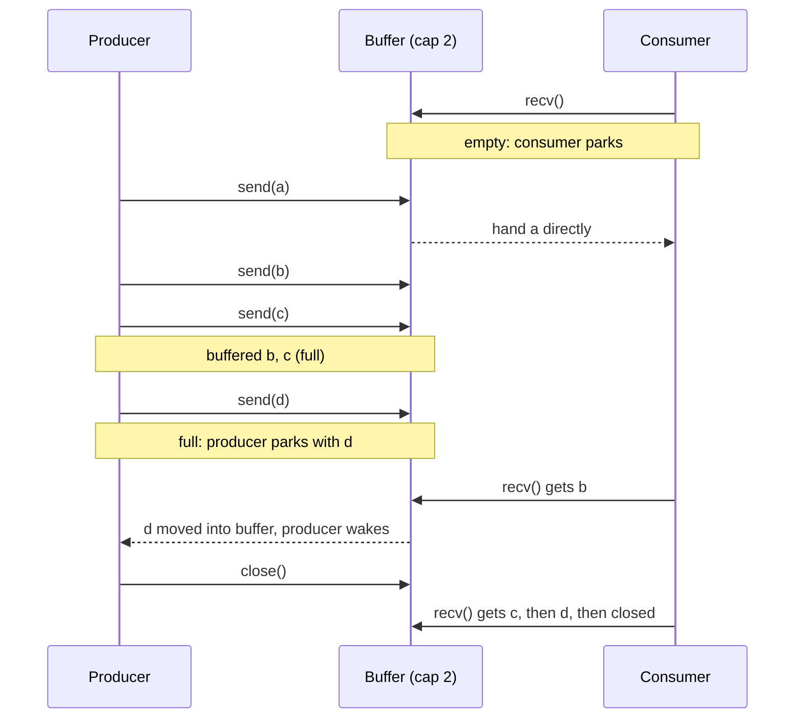

## In one minute
- Producers create work and consumers process it; a buffer between them lets each side run at its own pace, so a burst from producers does not have to be handled the instant it arrives.
- The buffer must be bounded. When it is full, producers block, slow down or drop; when it is empty, consumers block. A full buffer that pushes back on producers is backpressure, and it is the whole point of the pattern.
- The classic implementation is a lock plus two condition variables ("not full" and "not empty"), always waited on in a `while` loop. Most languages ship it ready-made: Go channels, Java's `BlockingQueue`, Python's `queue.Queue`.
- Shutdown is part of the design: closing the buffer (or sending a poison pill) tells consumers to drain what is left and stop, and producers must not send after close.
- The same shape appears at every scale: a Unix pipe, a TCP receive window, a Kafka topic and a thread pool's work queue are all producer-consumer buffers with different bounds and different full-buffer policies.

## How it works

### The problem
A log shipper reads lines from application files and sends them in batches to a central store. Reading is fast and bursty: a deploy can produce 50,000 lines in a second. Sending is slower and steady: the store accepts about 5,000 lines per second from one shipper. If the reader calls the sender directly, every read waits for a network round trip, and a slow store stalls the reader. If the reader appends to an unbounded list that the sender drains, a ten-minute store outage queues millions of lines and the shipper runs out of memory.

The producer-consumer pattern puts a bounded buffer between them. The reader (producer) puts lines in; the sender (consumer) takes them out. Short bursts are absorbed by the buffer. A long slowdown fills it, and then the producer waits, which in a log shipper means it simply reads the files later. Nothing is lost, and memory stays flat.

### The three rules of a bounded buffer
1. A producer may add only when there is room; otherwise it waits (or follows an overflow policy).
2. A consumer may take only when there is an item; otherwise it waits.
3. Adding and taking must not interfere: two producers must not write the same slot, and a consumer must never see a half-written item.

### The classic implementation
A ring buffer guarded by one mutex and two condition variables:

```python
def put(self, item):
    with self.lock:
        while len(self.items) == self.capacity:
            self.not_full.wait()       # releases the lock while waiting
        self.items.append(item)
        self.not_empty.notify()

def take(self):
    with self.lock:
        while not self.items:
            self.not_empty.wait()
        item = self.items.popleft()
        self.not_full.notify()
        return item
```

The `while` is not optional. A waiting thread can wake up spuriously, and even a genuine notify does not guarantee the condition still holds: another consumer may have grabbed the item between the notify and this thread reacquiring the lock. Checking with `if` instead of `while` is the most common bug in hand-written versions. Using one condition variable for both conditions also works, but then every change must `notify_all`, waking producers that cannot proceed.

Dijkstra's original formulation used two counting semaphores, `empty_slots` (starting at capacity) and `full_slots` (starting at 0), plus a mutex for the buffer itself. A producer waits on `empty_slots`, adds, signals `full_slots`; a consumer does the reverse. The counts carry the state, so no `while` loop is needed.

### Overflow policies
Blocking is only one answer to "the buffer is full". The others are the same menu a thread pool offers:

- **Block** the producer until there is room. Right when the producer can wait (reading files, a batch job).
- **Fail** the put immediately and let the producer decide (`offer` in Java, `put_nowait` in Python, a `select` with `default` in Go). Right for request handlers that should return 503 rather than hang.
- **Drop** the newest or the oldest item. Right for telemetry and video frames, where fresh data beats complete data.
- **Block with a timeout**, then fail. Usually the best default for services.

### Shutdown
Consumers loop forever, so they need a way to know the stream has ended. Go's `close(ch)` makes receivers drain the remaining items and then get the zero value with `ok == false`; sending on a closed channel panics. In Java and Python, the convention is a poison pill: a special sentinel object put once per consumer. Either way, the rules are the same: only the producer side closes, everything buffered before close is still delivered, and anything blocked waiting to receive must wake up.

### Many producers, many consumers
The pattern scales to M producers and N consumers on one buffer without code changes, which is why it is the basis of worker pools. What you lose is ordering: with several consumers, item 2 may finish before item 1. If order matters per key (all events for one account in order), partition: hash the key to one of N buffers, each with exactly one consumer. Kafka partitions apply exactly this rule across machines.

### Batching
A consumer that takes one item at a time pays the per-item overhead (a lock, a syscall, a network round trip) every time. Draining everything available, up to a batch size, amortises that overhead and gets more efficient under load, which is the opposite of what most systems do. Java's `drainTo` and Go's "receive one, then non-blocking receive the rest" idiom both do this.

### Reviewing agent-written code
Agents produce two typical shapes. One is an unbounded queue (`queue.Queue()` with no `maxsize`, an unbuffered list, `new LinkedBlockingQueue<>()`) that works in tests and fails under load. The other is a hand-rolled buffer with `if` instead of `while` around `wait`, or a busy loop that polls `len(queue)` with a sleep. Ask for the platform's blocking queue with an explicit capacity, a stated overflow policy, and a shutdown path, and for tests that cover a full buffer and close with waiters.

### The same shape elsewhere
This is the *overload* problem shape solved with backpressure. A Unix pipeline `zcat logs.gz | grep ERROR | sort` runs three processes connected by kernel pipe buffers; when `sort` is slow, `grep` blocks on write and `zcat` blocks behind it. TCP's receive window is a producer-consumer buffer across a network: when the receiving application stops reading, the window shrinks to zero and the sender stops. A restaurant kitchen's ticket rail, with a limited number of clips, is the same buffer with humans on both sides.

## Down the stack

### Layer 1: The contract
A bounded buffer of capacity C promises: it never holds more than C items; every item put is taken exactly once (unless dropped by a stated policy); a single producer's items are taken in the order they were put; a blocked producer resumes once there is room and a blocked consumer resumes once there is an item; and after close, buffered items are still delivered, then every receive reports "closed" instead of blocking. A good implementation also promises fairness among waiters: the producer that blocked first is the first to get room.

### Layer 2: The mechanism
Go's channel is a struct called `hchan` with a ring buffer (`buf`, `dataqsiz`, `qcount`, `sendx`, `recvx`), a `closed` flag, a lock, and two FIFO wait queues, `recvq` and `sendq`, of parked goroutines. A send first checks `recvq`: if a receiver is waiting, the value is copied directly to that receiver and it is made runnable, bypassing the buffer. Otherwise, if there is room, the value goes into `buf[sendx]`. Otherwise the sender parks on `sendq` with its value. A receive that takes from a full buffer also moves the first parked sender's value into the freed slot and wakes it. An unbuffered channel (capacity 0) is a pure rendezvous. Java's `ArrayBlockingQueue` uses one `ReentrantLock` with `notEmpty` and `notFull` conditions; `LinkedBlockingQueue` uses separate put and take locks so producers and consumers do not contend. Python's `queue.Queue` is a `deque` with a lock and three conditions, plus `task_done` and `join` to wait until consumers have processed everything. The LMAX Disruptor drops locks altogether: a preallocated ring of slots, a producer sequence claimed with compare-and-set, and consumers that track their own sequence and spin or wait until the producer's sequence passes it.

### Layer 3: The machine
When a consumer blocks on an empty queue, the runtime eventually parks the thread with a `futex` wait, and the producer's `notify` becomes a `futex` wake syscall, around 1 us, plus a context switch of a few microseconds when the woken thread runs. Go avoids the OS for goroutines: parking and waking is a scheduler operation of roughly 100 to 200 ns, and an uncontended buffered channel send or receive is tens of nanoseconds. Under contention the cost is in the cache: the head and tail indexes and the lock word bounce between cores, each transfer around 50 to 100 ns, so a single shared queue tops out at a few million operations per second. The Disruptor pads its sequence counters to separate 64-byte cache lines to stop false sharing and reaches tens of millions of events per second on one machine. The kernel has the same structure: a Linux pipe is a ring of 16 pages, 64 KiB by default, adjustable with `fcntl(F_SETPIPE_SZ)`, and a writer to a full pipe sleeps until the reader drains it.

### Why it's built this way
1. Producers and consumers run at different and varying speeds, so a direct call couples the fast side to the slow one; a buffer decouples them.
2. Memory is finite and queues hide latency, so the buffer is bounded and a full buffer pushes back on producers.
3. Waiting by polling burns CPU, so blocked threads sleep on a condition and are woken by the other side.
4. Waking is racy and can be spurious, so waiters recheck the condition in a loop, and runtimes hand values directly to parked receivers to skip the buffer and a wake-up.
5. Shared indexes and locks become the bottleneck at high rates, so fast implementations partition the queue, batch, or use lock-free rings with padded counters.

## Diagram


## Worked example
The log shipper's numbers: the store accepts batches of up to 1,000 lines with a 40 ms round trip, so one consumer sends at most 25,000 lines per second; the production steady state is 3,000 lines per second with deploy bursts of 50,000 lines over about 2 seconds.

With a buffer of 100,000 lines (about 20 MB at 200 bytes per line), a burst of 100,000 lines arrives while the consumer drains 25,000 per second, so the buffer peaks around 50,000 and empties within 4 seconds. No producer blocks. During a 10-minute store outage, the consumer stops draining, the buffer fills in about 30 seconds at the steady rate, and the reader then blocks on `put`. Because the reader tracks its file offset, it resumes where it stopped when the store recovers; with the buffer full, it catches up at 25,000 minus 3,000, about 22,000 lines per second, clearing a 10-minute backlog of 1.8 million lines in under 90 seconds.

An earlier version used an unbounded queue. During the same outage it grew to 1.8 million lines, about 360 MB, and the container, limited to 256 MB, was killed by the OOM killer, losing the in-memory lines. The bound changed the failure from "crash and lose data" to "pause and catch up".

Batching mattered as much: sending one line per request at 40 ms each caps the consumer at 25 lines per second. Draining up to 1,000 available lines per request gives the 1,000-times improvement above.

## Trade-offs
| Option | Strengths | Weaknesses | Choose when |
| --- | --- | --- | --- |
| Direct call, no buffer | Simplest; no extra latency | Fast side waits on slow side; bursts hurt | Steady, matched rates |
| Unbounded queue | Never blocks producers | Hides overload until memory runs out | Almost never; only with an external bound |
| Bounded, blocking | Natural backpressure; no loss | Producers stall; possible deadlock if they hold locks | Producers that can wait (files, batch jobs) |
| Bounded, fail or drop | Producers never stall | Data loss or errors under load | Request handlers, telemetry, live media |
| Rendezvous (capacity 0) | Tight coupling; each send confirms a receive | No burst absorption | Synchronising handoffs, signalling |
| Lock-free ring (Disruptor) | Very high throughput, low latency | Complex; fixed size; spin waiting costs CPU | Trading, telemetry pipelines at millions per second |

## Pitfalls in production
- Unbounded queues turning a slow consumer into an out-of-memory crash. Fix: bound every in-process queue and choose an overflow policy explicitly.
- `if` instead of `while` around a condition wait, so a consumer takes from an empty buffer after a race or spurious wakeup. Fix: always recheck in a loop, or use a library queue.
- Consumers that never exit because nobody closed the queue or sent enough poison pills. Fix: close from the producer side once all producers are done (in Go, a `sync.WaitGroup` and one closer goroutine), or one pill per consumer.
- Lost ordering after adding consumers. Fix: partition by key so each key has one consumer.
- Deadlock when a producer holds a lock that the consumer needs while blocking on a full buffer. Fix: never block on a queue while holding other locks.
- Queue depth not monitored, so a slow consumer goes unnoticed until latency explodes. Fix: export depth, time-in-queue and blocked-producer time, and alert on sustained high water.

## Leadership lens
- Ask of every queue in a design: what is its bound, what happens when it is full, and who notices. "It's async" is not an answer to overload.
- Size buffers in time, not items: capacity divided by drain rate is the latency you are willing to add. A buffer of 10 minutes of work is a 10-minute delay you have signed up for.
- Choose between in-process buffers and a broker deliberately; a broker adds durability and fan-out, and also an operational dependency. Point teams at [Message Queues](../sd/message-queues.md) when work must survive a crash.
- Put producer-consumer correctness in the review checklist for agent-written concurrency code: bound, overflow policy, close path, and tests with full and empty buffers.

## Check yourself
1. Why must a condition wait be inside a `while` loop rather than an `if`?
   **Answer:** Wakeups can be spurious, and even after a real notify another thread may have changed the state before this one reacquired the lock, so the condition must be checked again.
2. A Go channel has a parked receiver and an empty buffer when a send happens. Where does the value go?
   **Answer:** Directly to the waiting receiver, which is made runnable; the buffer is bypassed, saving a copy and keeping FIFO fairness.
3. You add a second consumer to speed up event processing and customers see account events applied out of order. What do you change?
   **Answer:** Partition by account: hash the account ID to one of N queues, each with a single consumer, so each account's events stay in order while different accounts run in parallel.
4. How do you choose a buffer's capacity?
   **Answer:** From the burst you need to absorb and the latency you can accept: capacity is roughly burst size minus what consumers drain during the burst, and capacity divided by drain rate must stay under the latency budget.

## Practice
**Task:** Build a deterministic model of a bounded channel with FIFO wait queues, the structure behind Go channels and blocking queues, without real threads. `BoundedChannel(capacity)` (capacity may be 0) supports `send(producer, item)`: if a consumer is parked, hand the item straight to the oldest one, record event `recv:<consumer>:<item>` and return `"delivered"`; else if the buffer has room, append it and return `"buffered"`; else park the producer with its item and return `"blocked"`. Sending after close is an error `send on closed channel`. `recv(consumer)` returns a pair `(status, item)`: if the buffer has items, take the oldest, then move the oldest parked producer's item (if any) into the buffer and record `sent:<producer>`; with an empty buffer and a parked producer (capacity 0), take that producer's item directly and record `sent:<producer>`; otherwise return `("closed", "")` if closed or park the consumer and return `("blocked", "")`. `close()` wakes every parked consumer with event `closed:<consumer>` and every parked producer with `failed:<producer>` (oldest first, consumers before producers), keeps buffered items for later receives, and closing twice is an error `close of closed channel`. `drain_events()` returns events in order and clears them; `size()` returns the number of buffered items.

```python starter
class BoundedChannel:
    def __init__(self, capacity):
        self.capacity = capacity

    def send(self, producer, item):
        # TODO
        raise NotImplementedError

    def recv(self, consumer):
        # TODO: return (status, item)
        raise NotImplementedError

    def close(self):
        # TODO
        raise NotImplementedError

    def drain_events(self):
        # TODO
        raise NotImplementedError

    def size(self):
        # TODO
        raise NotImplementedError
```

```python tests
def error_of(fn):
    try:
        fn()
    except ValueError as e:
        return str(e)
    return None

def test_buffer_then_block_then_refill():
    ch = BoundedChannel(2)
    assert [ch.send("p1", x) for x in "abc"] == ["buffered", "buffered", "blocked"]
    assert ch.size() == 2
    assert ch.recv("c1") == ("ok", "a")
    assert ch.drain_events() == ["sent:p1"]
    assert ch.size() == 2
    assert [ch.recv("c1") for _ in range(3)] == [("ok", "b"), ("ok", "c"), ("blocked", "")]

def test_parked_consumers_get_direct_handoff_in_order():
    ch = BoundedChannel(2)
    assert ch.recv("c1") == ("blocked", "")
    assert ch.recv("c2") == ("blocked", "")
    assert ch.send("p1", "x") == "delivered"
    assert ch.send("p1", "y") == "delivered"
    assert ch.drain_events() == ["recv:c1:x", "recv:c2:y"]
    assert ch.size() == 0 and ch.drain_events() == []

def test_rendezvous_with_zero_capacity():
    ch = BoundedChannel(0)
    assert ch.send("p1", "a") == "blocked"
    assert ch.recv("c1") == ("ok", "a")
    assert ch.drain_events() == ["sent:p1"]
    assert ch.recv("c1") == ("blocked", "")
    assert ch.send("p2", "b") == "delivered"
    assert ch.drain_events() == ["recv:c1:b"]

def test_parked_producers_are_fifo():
    ch = BoundedChannel(1)
    assert [ch.send(p, x) for p, x in [("p1", "a"), ("p2", "b"), ("p3", "c")]] == ["buffered", "blocked", "blocked"]
    assert ch.recv("c") == ("ok", "a")
    assert ch.recv("c") == ("ok", "b")
    assert ch.recv("c") == ("ok", "c")
    assert ch.drain_events() == ["sent:p2", "sent:p3"]

def test_close_drains_buffer_then_reports_closed():
    ch = BoundedChannel(2)
    ch.send("p1", "a")
    ch.close()
    assert ch.recv("c1") == ("ok", "a")
    assert ch.recv("c1") == ("closed", "")
    assert error_of(lambda: ch.send("p1", "z")) == "send on closed channel"
    assert error_of(ch.close) == "close of closed channel"

def test_close_wakes_all_parked():
    ch = BoundedChannel(0)
    ch.recv("c1")
    ch.recv("c2")
    ch.close()
    assert ch.drain_events() == ["closed:c1", "closed:c2"]
    full = BoundedChannel(1)
    full.send("p1", "a")
    full.send("p2", "b")
    full.close()
    assert full.drain_events() == ["failed:p2"]
    assert full.recv("c") == ("ok", "a") and full.recv("c") == ("closed", "")
```

```python solution
from collections import deque

class BoundedChannel:
    def __init__(self, capacity):
        self.capacity = capacity
        self.buf = deque()
        self.recvq = deque()   # parked consumer names
        self.sendq = deque()   # parked (producer, item)
        self.closed = False
        self.events = []

    def send(self, producer, item):
        if self.closed:
            raise ValueError("send on closed channel")
        if self.recvq:
            consumer = self.recvq.popleft()
            self.events.append("recv:%s:%s" % (consumer, item))
            return "delivered"
        if len(self.buf) < self.capacity:
            self.buf.append(item)
            return "buffered"
        self.sendq.append((producer, item))
        return "blocked"

    def recv(self, consumer):
        if self.buf:
            item = self.buf.popleft()
            if self.sendq:
                producer, waiting = self.sendq.popleft()
                self.buf.append(waiting)
                self.events.append("sent:" + producer)
            return ("ok", item)
        if self.sendq:
            producer, item = self.sendq.popleft()
            self.events.append("sent:" + producer)
            return ("ok", item)
        if self.closed:
            return ("closed", "")
        self.recvq.append(consumer)
        return ("blocked", "")

    def close(self):
        if self.closed:
            raise ValueError("close of closed channel")
        self.closed = True
        while self.recvq:
            self.events.append("closed:" + self.recvq.popleft())
        while self.sendq:
            producer, _ = self.sendq.popleft()
            self.events.append("failed:" + producer)

    def drain_events(self):
        out = self.events
        self.events = []
        return out

    def size(self):
        return len(self.buf)
```

```typescript starter
export class BoundedChannel {
  constructor(public capacity: number) {}
  send(producer: string, item: string): string { throw new Error("TODO"); }
  recv(consumer: string): [string, string] { throw new Error("TODO"); }
  close(): void { throw new Error("TODO"); }
  drainEvents(): string[] { throw new Error("TODO"); }
  size(): number { throw new Error("TODO"); }
}
```

```typescript tests
function errorMessage(fn: () => unknown): string | undefined {
  try { fn(); } catch (e) { return (e as Error).message; }
  return undefined;
}

test("buffer then block then refill", () => {
  const ch = new BoundedChannel(2);
  assertEqual(["a", "b", "c"].map((x) => ch.send("p1", x)), ["buffered", "buffered", "blocked"]);
  assertEqual(ch.size(), 2);
  assertEqual(ch.recv("c1"), ["ok", "a"]);
  assertEqual(ch.drainEvents(), ["sent:p1"]);
  assertEqual(ch.size(), 2);
  assertEqual([ch.recv("c1"), ch.recv("c1"), ch.recv("c1")], [["ok", "b"], ["ok", "c"], ["blocked", ""]]);
});

test("parked consumers get direct handoff in order", () => {
  const ch = new BoundedChannel(2);
  assertEqual(ch.recv("c1"), ["blocked", ""]);
  assertEqual(ch.recv("c2"), ["blocked", ""]);
  assertEqual(ch.send("p1", "x"), "delivered");
  assertEqual(ch.send("p1", "y"), "delivered");
  assertEqual(ch.drainEvents(), ["recv:c1:x", "recv:c2:y"]);
  assertEqual(ch.size(), 0);
  assertEqual(ch.drainEvents(), []);
});

test("rendezvous with zero capacity", () => {
  const ch = new BoundedChannel(0);
  assertEqual(ch.send("p1", "a"), "blocked");
  assertEqual(ch.recv("c1"), ["ok", "a"]);
  assertEqual(ch.drainEvents(), ["sent:p1"]);
  assertEqual(ch.recv("c1"), ["blocked", ""]);
  assertEqual(ch.send("p2", "b"), "delivered");
  assertEqual(ch.drainEvents(), ["recv:c1:b"]);
});

test("parked producers are fifo", () => {
  const ch = new BoundedChannel(1);
  assertEqual([ch.send("p1", "a"), ch.send("p2", "b"), ch.send("p3", "c")], ["buffered", "blocked", "blocked"]);
  assertEqual(ch.recv("c"), ["ok", "a"]);
  assertEqual(ch.recv("c"), ["ok", "b"]);
  assertEqual(ch.recv("c"), ["ok", "c"]);
  assertEqual(ch.drainEvents(), ["sent:p2", "sent:p3"]);
});

test("close drains buffer then reports closed", () => {
  const ch = new BoundedChannel(2);
  ch.send("p1", "a");
  ch.close();
  assertEqual(ch.recv("c1"), ["ok", "a"]);
  assertEqual(ch.recv("c1"), ["closed", ""]);
  assertEqual(errorMessage(() => ch.send("p1", "z")), "send on closed channel");
  assertEqual(errorMessage(() => ch.close()), "close of closed channel");
});

test("close wakes all parked", () => {
  const ch = new BoundedChannel(0);
  ch.recv("c1");
  ch.recv("c2");
  ch.close();
  assertEqual(ch.drainEvents(), ["closed:c1", "closed:c2"]);
  const full = new BoundedChannel(1);
  full.send("p1", "a");
  full.send("p2", "b");
  full.close();
  assertEqual(full.drainEvents(), ["failed:p2"]);
  assertEqual([full.recv("c"), full.recv("c")], [["ok", "a"], ["closed", ""]]);
});
```

```typescript solution
export class BoundedChannel {
  private buf: string[] = [];
  private recvq: string[] = [];
  private sendq: [string, string][] = [];
  private closed = false;
  private events: string[] = [];

  constructor(public capacity: number) {}

  send(producer: string, item: string): string {
    if (this.closed) throw new Error("send on closed channel");
    const consumer = this.recvq.shift();
    if (consumer !== undefined) {
      this.events.push(`recv:${consumer}:${item}`);
      return "delivered";
    }
    if (this.buf.length < this.capacity) {
      this.buf.push(item);
      return "buffered";
    }
    this.sendq.push([producer, item]);
    return "blocked";
  }

  recv(consumer: string): [string, string] {
    if (this.buf.length > 0) {
      const item = this.buf.shift()!;
      const waiting = this.sendq.shift();
      if (waiting) {
        this.buf.push(waiting[1]);
        this.events.push("sent:" + waiting[0]);
      }
      return ["ok", item];
    }
    const direct = this.sendq.shift();
    if (direct) {
      this.events.push("sent:" + direct[0]);
      return ["ok", direct[1]];
    }
    if (this.closed) return ["closed", ""];
    this.recvq.push(consumer);
    return ["blocked", ""];
  }

  close(): void {
    if (this.closed) throw new Error("close of closed channel");
    this.closed = true;
    for (const c of this.recvq) this.events.push("closed:" + c);
    for (const [p] of this.sendq) this.events.push("failed:" + p);
    this.recvq = [];
    this.sendq = [];
  }

  drainEvents(): string[] {
    const out = this.events;
    this.events = [];
    return out;
  }

  size(): number {
    return this.buf.length;
  }
}
```

```go starter
package practice

type BoundedChannel struct {
	Capacity int
}

func NewBoundedChannel(capacity int) *BoundedChannel { return &BoundedChannel{Capacity: capacity} }

func (c *BoundedChannel) Send(producer, item string) (string, error) { panic("TODO") }
func (c *BoundedChannel) Recv(consumer string) (string, string)      { panic("TODO") }
func (c *BoundedChannel) Close() error                               { panic("TODO") }
func (c *BoundedChannel) DrainEvents() []string                      { panic("TODO") }
func (c *BoundedChannel) Size() int                                  { panic("TODO") }
```

```go tests
package practice

import (
	"reflect"
	"testing"
)

func mustSend(t *testing.T, ch *BoundedChannel, p, item, want string) {
	t.Helper()
	got, err := ch.Send(p, item)
	if err != nil || got != want {
		t.Fatalf("send %s: want %s, got %s (%v)", item, want, got, err)
	}
}

func expectRecv(t *testing.T, ch *BoundedChannel, consumer, status, item string) {
	t.Helper()
	s, i := ch.Recv(consumer)
	if s != status || i != item {
		t.Fatalf("recv: want (%s,%q), got (%s,%q)", status, item, s, i)
	}
}

func expectEvents(t *testing.T, ch *BoundedChannel, want ...string) {
	t.Helper()
	got := ch.DrainEvents()
	if len(want) == 0 && len(got) == 0 {
		return
	}
	if !reflect.DeepEqual(got, want) {
		t.Fatalf("events: want %v, got %v", want, got)
	}
}

func TestBufferThenBlockThenRefill(t *testing.T) {
	ch := NewBoundedChannel(2)
	mustSend(t, ch, "p1", "a", "buffered")
	mustSend(t, ch, "p1", "b", "buffered")
	mustSend(t, ch, "p1", "c", "blocked")
	if ch.Size() != 2 {
		t.Fatal("size")
	}
	expectRecv(t, ch, "c1", "ok", "a")
	expectEvents(t, ch, "sent:p1")
	if ch.Size() != 2 {
		t.Fatal("refilled size")
	}
	expectRecv(t, ch, "c1", "ok", "b")
	expectRecv(t, ch, "c1", "ok", "c")
	expectRecv(t, ch, "c1", "blocked", "")
}

func TestParkedConsumersGetDirectHandoffInOrder(t *testing.T) {
	ch := NewBoundedChannel(2)
	expectRecv(t, ch, "c1", "blocked", "")
	expectRecv(t, ch, "c2", "blocked", "")
	mustSend(t, ch, "p1", "x", "delivered")
	mustSend(t, ch, "p1", "y", "delivered")
	expectEvents(t, ch, "recv:c1:x", "recv:c2:y")
	if ch.Size() != 0 {
		t.Fatal("buffer should be empty")
	}
	expectEvents(t, ch)
}

func TestRendezvousWithZeroCapacity(t *testing.T) {
	ch := NewBoundedChannel(0)
	mustSend(t, ch, "p1", "a", "blocked")
	expectRecv(t, ch, "c1", "ok", "a")
	expectEvents(t, ch, "sent:p1")
	expectRecv(t, ch, "c1", "blocked", "")
	mustSend(t, ch, "p2", "b", "delivered")
	expectEvents(t, ch, "recv:c1:b")
}

func TestParkedProducersAreFIFO(t *testing.T) {
	ch := NewBoundedChannel(1)
	mustSend(t, ch, "p1", "a", "buffered")
	mustSend(t, ch, "p2", "b", "blocked")
	mustSend(t, ch, "p3", "c", "blocked")
	expectRecv(t, ch, "c", "ok", "a")
	expectRecv(t, ch, "c", "ok", "b")
	expectRecv(t, ch, "c", "ok", "c")
	expectEvents(t, ch, "sent:p2", "sent:p3")
}

func TestCloseDrainsBufferThenReportsClosed(t *testing.T) {
	ch := NewBoundedChannel(2)
	mustSend(t, ch, "p1", "a", "buffered")
	if err := ch.Close(); err != nil {
		t.Fatal(err)
	}
	expectRecv(t, ch, "c1", "ok", "a")
	expectRecv(t, ch, "c1", "closed", "")
	if _, err := ch.Send("p1", "z"); err == nil || err.Error() != "send on closed channel" {
		t.Fatalf("got %v", err)
	}
	if err := ch.Close(); err == nil || err.Error() != "close of closed channel" {
		t.Fatalf("got %v", err)
	}
}

func TestCloseWakesAllParked(t *testing.T) {
	ch := NewBoundedChannel(0)
	ch.Recv("c1")
	ch.Recv("c2")
	ch.Close()
	expectEvents(t, ch, "closed:c1", "closed:c2")
	full := NewBoundedChannel(1)
	mustSend(t, full, "p1", "a", "buffered")
	mustSend(t, full, "p2", "b", "blocked")
	full.Close()
	expectEvents(t, full, "failed:p2")
	expectRecv(t, full, "c", "ok", "a")
	expectRecv(t, full, "c", "closed", "")
}
```

```go solution
package practice

import "errors"

type parked struct {
	producer, item string
}

type BoundedChannel struct {
	Capacity int
	buf      []string
	recvq    []string
	sendq    []parked
	closed   bool
	events   []string
}

func NewBoundedChannel(capacity int) *BoundedChannel { return &BoundedChannel{Capacity: capacity} }

func (c *BoundedChannel) Send(producer, item string) (string, error) {
	if c.closed {
		return "", errors.New("send on closed channel")
	}
	if len(c.recvq) > 0 {
		consumer := c.recvq[0]
		c.recvq = c.recvq[1:]
		c.events = append(c.events, "recv:"+consumer+":"+item)
		return "delivered", nil
	}
	if len(c.buf) < c.Capacity {
		c.buf = append(c.buf, item)
		return "buffered", nil
	}
	c.sendq = append(c.sendq, parked{producer, item})
	return "blocked", nil
}

func (c *BoundedChannel) Recv(consumer string) (string, string) {
	if len(c.buf) > 0 {
		item := c.buf[0]
		c.buf = c.buf[1:]
		if len(c.sendq) > 0 {
			w := c.sendq[0]
			c.sendq = c.sendq[1:]
			c.buf = append(c.buf, w.item)
			c.events = append(c.events, "sent:"+w.producer)
		}
		return "ok", item
	}
	if len(c.sendq) > 0 {
		w := c.sendq[0]
		c.sendq = c.sendq[1:]
		c.events = append(c.events, "sent:"+w.producer)
		return "ok", w.item
	}
	if c.closed {
		return "closed", ""
	}
	c.recvq = append(c.recvq, consumer)
	return "blocked", ""
}

func (c *BoundedChannel) Close() error {
	if c.closed {
		return errors.New("close of closed channel")
	}
	c.closed = true
	for _, r := range c.recvq {
		c.events = append(c.events, "closed:"+r)
	}
	for _, s := range c.sendq {
		c.events = append(c.events, "failed:"+s.producer)
	}
	c.recvq, c.sendq = nil, nil
	return nil
}

func (c *BoundedChannel) DrainEvents() []string {
	out := c.events
	c.events = nil
	return out
}

func (c *BoundedChannel) Size() int { return len(c.buf) }
```

## Mock interview
**Prompt:** Design the ingestion stage of a metrics agent that runs on 20,000 hosts. Each agent collects about 2,000 data points per second from local applications and forwards them in compressed batches to a central collector that is sometimes slow or unreachable for minutes. The agent must not use more than 64 MB of memory or block the applications that report to it.

- Follow-up: The collector is down for 15 minutes. What happens inside the agent, minute by minute?
- Follow-up: Applications report through a local UDP socket and through an in-process library. Which overflow policy does each get, and why?
- Follow-up: Would you use a lock-based queue, a channel, or a lock-free ring here?

**A strong answer covers:**
- A bounded buffer sized in time and bytes (for example 60 seconds or 32 MB, whichever comes first), between collection and a sender that batches and compresses.
- A non-blocking overflow policy toward applications: drop newest or oldest with counters, never block the reporting code path; optionally spill to a bounded on-disk queue for longer outages.
- Batching on the consumer side (drain up to N points or T milliseconds), retry with backoff and jitter, and catching up at a capped rate after recovery so 20,000 agents do not stampede the collector.
- Shutdown that closes the buffer, flushes what fits in a deadline, and reports what was dropped.
- Metrics on queue depth, drops, batch size and send latency, exported by the agent itself, and a reasoned choice of queue implementation (a plain bounded queue is ample at 2,000 points per second).

## Watch
- [GopherCon 2017: Understanding Channels (Kavya Joshi)](https://www.youtube.com/watch?v=KBZlN0izeiY): the `hchan` structure, its wait queues and the direct handoff to parked goroutines.
- [Google I/O 2012: Go Concurrency Patterns (Rob Pike)](https://www.youtube.com/watch?v=f6kdp27TYZs): producer-consumer pipelines, fan-in and fan-out built from channels.

## Free resources
- [Go channel source (chan.go)](https://go.dev/src/runtime/chan.go): `chansend`, `chanrecv` and `closechan`, the reference implementation of a bounded buffer with wait queues.
- [Go Concurrency Patterns: Pipelines and cancellation (Go blog)](https://go.dev/blog/pipelines): stages, fan-out, and how to close and cancel pipelines correctly.
- [ArrayBlockingQueue (Java SE 21 docs)](https://docs.oracle.com/en/java/javase/21/docs/api/java.base/java/util/concurrent/ArrayBlockingQueue.html): the classic bounded buffer with fairness options and the full blocking, timed and failing API.
- [queue module (Python docs)](https://docs.python.org/3/library/queue.html): bounded queues, `task_done` and `join` for waiting on consumers.
- [LMAX Disruptor technical paper](https://lmax-exchange.github.io/disruptor/disruptor.html): how a lock-free ring buffer with padded sequences reaches very high throughput.
- [pipe(7) Linux manual page](https://man7.org/linux/man-pages/man7/pipe.7.html): the kernel's own bounded buffer, its capacity and blocking rules.
