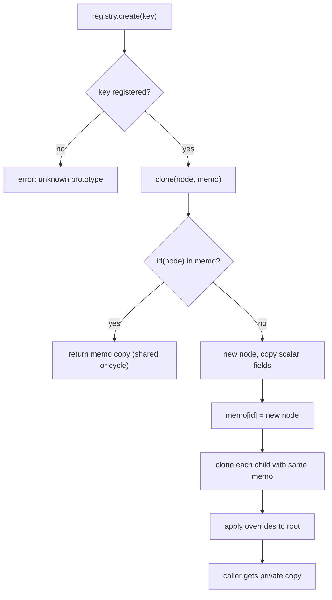

## In one minute
- The prototype pattern creates new objects by copying a configured example instead of calling a constructor. The caller says "give me another one like this" and needs to know neither the concrete class nor the steps it took to set the example up.
- It pays off when an object is expensive to set up (parsed, validated, resolved) and you need many variations of it: job templates, game entities, test fixtures, pod templates.
- The whole pattern lives or dies on copy semantics. A shallow copy shares nested lists and maps with the original, so editing the "new" object silently edits the template. A correct deep copy must also keep shared references shared and survive cycles.
- JavaScript's prototype chain is a different thing: delegation (lookups fall through to a parent object), not copying.
- Agents write `new = template` or `{...template}` and call it a copy. Review asks: which fields are nested, who else holds them, and which test proves the template is untouched after a clone is edited?

## How it works

### The problem
A CI system lets teams define job templates: a base image, environment variables, steps, resource limits and caches. Building a "Python service" template means parsing 40 lines of YAML, validating them and resolving image digests from a registry, about 30 ms. Every pull request creates 6 jobs from it, each changing a field or two. Calling the constructor per job repeats that work, and the code creating jobs has to know every field the template sets. What the job runner wants is simpler: "take the validated template and give me a private copy I can tweak."

### The shape
The template object knows how to copy itself, and a registry holds the named templates:

```python
registry.register("py-service", load_and_validate("py-service.yaml"))

job = registry.create("py-service")   # a private deep copy
job.env["PYTHON"] = "3.13"
job.steps.append(Step("pytest -k shard_3"))
```

`create` returns whatever concrete type the template is, the same decoupling a factory gives (see the Factory Method lesson), except that the recipe is data held in an existing instance rather than code in a function. New kinds of object can be registered at runtime, for example from a config file, without writing a class.

### Shallow, deep and structural sharing
There are three ways to copy, and choosing one is the real design decision.

A **shallow copy** duplicates the outer object and copies its fields by reference: Python's `copy.copy` and `dict.copy()`, JavaScript's `{...obj}`, struct assignment in Go. Immutable fields are safe to share. Mutable ones are not: `job.env` in the copy is the template's dict, so the first job's `PYTHON=3.13` leaks into every later job.

A **deep copy** walks the graph and copies every reachable mutable object. Done naively it has two bugs: it turns one shared object into two (two steps that shared one cache config now have separate ones), and it recurses forever on a cycle (a step pointing back at its job). Python's `copy.deepcopy` fixes both with a memo keyed by `id(obj)` ([Python docs](https://docs.python.org/3/library/copy.html)), checked before copying and filled before recursing into children. The Practice builds exactly this.

**Structural sharing** avoids copying by making the template immutable. A "copy with one change" builds a new top-level object pointing at the unchanged parts of the old one. Python's `dataclasses.replace` and `copy.replace` (new in 3.13, per the [copy docs](https://docs.python.org/3/library/copy.html)) do this for one level; persistent collections (Clojure's vectors, Immutable.js) do it for whole trees, copying only the path to the change.

### Language support, and where it breaks
- **Python** offers `__copy__` and `__deepcopy__(self, memo)` hooks and otherwise falls back to the pickle protocol. Objects holding sockets, locks or files either fail to copy or produce a copy sharing the handle.
- **JavaScript** has `structuredClone`, which handles cycles, `Map`, `Set` and `Date`, but throws `DataCloneError` on functions and does not walk the prototype chain, so class instances come back as plain objects without their methods ([MDN](https://developer.mozilla.org/en-US/docs/Web/API/Web_Workers_API/Structured_clone_algorithm)). `JSON.parse(JSON.stringify(x))` is worse: it drops `undefined`, stringifies dates and throws on cycles.
- **Go** has no generic clone. Struct assignment copies fields, but slices, maps and pointers inside still alias. `slices.Clone` and `maps.Clone` (Go 1.21) are shallow. A correct `Clone()` is written by hand.
- **Java's** `Cloneable` has no `clone` method and `Object.clone` is protected and shallow; *Effective Java* (3rd ed., Item 13) advises a copy constructor or copy factory instead.

### When not to use it
- **Construction is cheap and has few fields.** A constructor call or an options object is clearer than a registry of examples.
- **The template could be immutable.** Then share it and use "copy with changes" at the top level; no deep clone is needed.
- **The object owns resources.** A database connection, an open file or a running goroutine is not a value. Clone the configuration and open a new resource from it.

### Reviewing agent-written code
Asked to "create jobs from a template", an agent will often write `const job = { ...template }` and then `job.steps.push(...)`. Tests that build one job pass; production breaks when the second job inherits the first job's step. Ask for a test that creates two objects from one template, mutates nested fields of the first, and asserts the template and the second are unchanged. A hand-written recursive `clone` without a memo is a stack overflow waiting for the first cyclic template.

### The same shape elsewhere
Prototype is the *duplicates* problem shape seen from the other side: you want many copies, and the bugs are the parts that should not have been duplicated or shared. Infrastructure stamps out copies of a validated example constantly. A Kubernetes Deployment holds a pod template that the ReplicaSet controller copies into every pod; VMs boot from golden images; `fork()` copies a process; AWS Lambda SnapStart restores new environments from a snapshot of an initialised one, and AWS tells you to generate unique IDs and random seeds after restore, not during initialisation ([AWS docs](https://docs.aws.amazon.com/lambda/latest/dg/snapstart-uniqueness.html)). All share the shallow-copy failure mode: something that should be unique per copy (a random seed, a host key, a connection) was baked into the template and is now shared by every instance.

## Down the stack

### Layer 1: The contract
`clone()` returns a new object of the same concrete type, equal to the original at the moment of copying. Afterwards, mutating any part the contract calls "owned" must not affect the original, and vice versa. The contract also names deliberately shared fields (immutable values, handles such as a logger) and how sharing and cycles are treated: a graph-preserving clone maps two references to one child onto one copied child, and a cycle onto a cycle. A registry promises to store a snapshot taken at registration, so later edits to the object passed in do not change future clones.

### Layer 2: The mechanism
CPython's `copy.deepcopy` looks up a copier in `_deepcopy_dispatch` by exact type (`int` and `str` return themselves; `list`, `dict` and `tuple` have dedicated functions), then tries `__deepcopy__`, then `__reduce_ex__(4)`. It stores each new object in `memo[id(original)]` before copying children, and keeps originals alive in the memo so their `id` values cannot be reused mid-copy. `structuredClone` uses the same serialisation as `postMessage`: V8's `ValueSerializer` writes the graph to a buffer, turning repeat visits into back-references, and `ValueDeserializer` rebuilds it. Go's struct assignment is a `memmove` of the struct's bytes; a slice header (pointer, length, capacity: 24 bytes) is copied, its backing array is not. JavaScript's prototype chain copies nothing: `Object.create(proto)` sets the new object's `[[Prototype]]` slot, and property reads that miss walk up the chain.

### Layer 3: The machine
A shallow copy is one allocation plus a field copy: tens of nanoseconds. A deep copy allocates once per reachable mutable node, so a template with 2,000 nested dicts and lists costs 2,000 allocations and, in CPython, several milliseconds of per-node dispatch and memo inserts. That can exceed building from scratch, so measure before assuming cloning is cheap. The clone's nodes also land wherever the allocator has space, losing the original's locality.

The kernel uses the cheapest prototype of all. `fork()` copies page tables, not memory, and marks pages read-only in both processes; the first write to a page faults and copies that one 4 KiB page. Redis `BGSAVE` relies on this: the child snapshots the dataset while the parent keeps writing, and extra memory equals the pages touched during the save, which on a write-heavy instance approaches the whole dataset; Redis's own latency guide says a busy instance can trigger copy-on-write of almost the whole process memory ([Redis docs](https://redis.io/docs/latest/operate/oss_and_stack/management/optimization/latency/)). Copy-on-write is structural sharing implemented by the MMU.

### Why it's built this way
1. Some objects are expensive to set up or carry many decisions (validation, lookups, defaults), and you need many variations of them.
2. Rebuilding each one repeats that cost and spreads knowledge of every field into the code that creates them, so copy a finished example instead.
3. Copying by reference is cheap but makes the copies share mutable state, so owned nested data must be copied deeply.
4. Deep copies that duplicate shared nodes or loop on cycles corrupt the graph, so the copier keeps a memo from original to copy.
5. Deep copies cost allocations proportional to the graph, so where the template can be immutable, share it and copy only what changes.

## Diagram


## Worked example
A game spawns enemies from data files holding stats, an equipment list, a 120-node behaviour tree and a reference to a shared texture atlas. Building one from its file takes 1.8 ms, so a wave of 300 costs 540 ms, far beyond a 16.7 ms frame budget at 60 fps.

The team loads each type once and spawns with `clone(prototype)`. The first version used a generic deep copy, which also copied the 4 MB atlas metadata per enemy: a 1.2 GB spike. The fix was an explicit clone contract: stats and equipment are copied, the behaviour tree is shared because it is immutable after load (per-enemy state lives in a small "blackboard"), and asset references are shared handles. A spawn now copies about 2 KB in 6 microseconds; a wave takes under 2 ms.

The bug that slipped through came from the other direction: the hand-written clone copied the equipment list but not the dicts inside it, so one goblin's power-up upgraded the sword of every goblin spawned after it. A test that clones twice and mutates nested data on one now guards every prototype type.

## In the wild
- **AWS Lambda SnapStart, documented hazard: a snapshot freezes anything meant to be unique.** Lambda resumes many execution environments from one initialised snapshot, so a random seed or unique ID generated during initialisation is identical in all of them. AWS says to generate such values in the handler or in a runtime hook after restore ([AWS docs](https://docs.aws.amazon.com/lambda/latest/dg/snapstart-uniqueness.html)).
- **Redis, documented cost: `fork()` as a prototype.** RDB persistence forks a child that sees a frozen copy of the dataset. Redis warns that `fork()` can stall serving for milliseconds, or up to a second on a very large dataset, and that a busy instance can trigger copy-on-write of nearly all memory ([persistence](https://redis.io/docs/latest/operate/oss_and_stack/management/persistence/), [latency](https://redis.io/docs/latest/operate/oss_and_stack/management/optimization/latency/)).
- **cloud-init, documented practice: do not clone machine identity.** Machine images are prototypes, and cloud-init's SSH module can remove the image's default host keys (`ssh_deletekeys`) so each new instance does not share the template's keys ([cloud-init docs](https://docs.cloud-init.io/en/latest/reference/modules.html)).

## Trade-offs
| Option | Strengths | Weaknesses | Choose when |
| --- | --- | --- | --- |
| Constructor or factory per object | Explicit; no copy semantics to get wrong | Repeats expensive setup; caller knows fields | Setup is cheap and variants are few |
| Shallow copy | Fast; one allocation | Nested mutable data is shared with the template | All fields are immutable or meant to be shared |
| Generic deep copy (`deepcopy`, `structuredClone`) | Correct for plain data, cycles and sharing | Slow on big graphs; copies handles you meant to share; drops class identity in JS | Plain data templates, tests, tooling |
| Hand-written `clone()` | Precise contract per field; fastest | Must be updated when fields are added | Hot paths and objects mixing values with shared handles |
| Immutable template plus structural sharing | No copy cost; safe to share across threads | Requires an immutable data model | Configuration, documents, state in UI frameworks |

## Pitfalls in production
- Shallow copies of templates with nested lists or maps, so edits leak into the template and every later copy. Fix: deep copy owned data, and test two clones with nested mutation.
- A new field added to a class but not to its hand-written `clone()`, so it is silently shared or dropped. Fix: a test that compares a clone field by field using reflection or `__dict__`, so a new field fails it.
- Values that must be unique per instance (ids, random seeds, SSH host keys on VM images) baked into the prototype. Fix: regenerate them in a post-clone hook, the way cloud-init can delete an image's baked-in host keys (`ssh_deletekeys`, per its [module docs](https://docs.cloud-init.io/en/latest/reference/modules.html)) so each machine makes its own.
- Registry entries mutated after registration because the registry stored the caller's object. Fix: clone on `register` as well as on `create`.
- `structuredClone` or JSON round-trips on TypeScript class instances, returning objects without methods. Fix: a `clone()` method, or templates as plain data.

## Leadership lens
- Ask for the clone contract in writing: which fields are copied, which are shared, and why. Most prototype bugs are disagreements about that list.
- Prefer immutable templates. They remove both the copy cost and the aliasing bugs, and are safe to share across threads.
- Golden images and templates are a supply-chain asset. Decide who owns them and how fast a fix reaches every instance created from them.
- Make "clone twice, mutate one, check the other and the template" a standard test, and ask agents to write it before the clone.

## Check yourself
1. A template holds a list of steps. Why does `{...template}` cause a bug only when two objects are created from it?
   **Answer:** The spread copies the reference to the list, so both copies and the template share one list. With one copy the shared mutation is invisible; the second copy reveals the first copy's changes.
2. Why does a correct deep copy need a memo of already-copied objects?
   **Answer:** Without it, a node reached twice is copied twice, so shared references become separate objects, and a cycle recurses forever. The memo maps each original to its single copy.
3. When is cloning slower than constructing from scratch?
   **Answer:** When the object graph is large and the constructor is cheap: a deep copy allocates and dispatches per node, while a constructor might share immutable parts or build compact data directly.
4. How is JavaScript's prototype chain different from the prototype pattern?
   **Answer:** The chain is delegation: a new object points at its prototype and reads that miss fall through to it, so changes to the prototype are visible later. The pattern copies, so later changes to the template do not affect existing copies.

## Practice
**Task:** Build a graph-preserving clone and a prototype registry for template trees. A `Node` has a `name`, an `attrs` map of string to string and an ordered list of `children`, which may share nodes and may contain cycles. `clone(node)` returns a deep copy: every reachable node is copied exactly once, so two references to the same original node point at the same copied node, a cycle in the original becomes the same cycle in the copy, and no copied node or attrs map is shared with the original. `PrototypeRegistry` has `register(key, node)`, which stores a clone (so later edits to the passed node do not matter) and fails with `duplicate prototype: <key>` if the key exists, and `create(key, overrides)`, which returns a fresh clone of the stored node with the `overrides` map merged into the root's `attrs`, failing with `unknown prototype: <key>`. Python raises `ValueError`, TypeScript throws `Error`, Go returns an error; in Go, `Clone(nil)` returns `nil`.

```python starter
class Node:
    def __init__(self, name, attrs=None, children=None):
        self.name = name
        self.attrs = dict(attrs or {})
        self.children = list(children or [])

def clone(node):
    # TODO: deep copy that preserves sharing and cycles
    raise NotImplementedError

class PrototypeRegistry:
    def __init__(self):
        self.protos = {}

    def register(self, key, node):
        # TODO
        raise NotImplementedError

    def create(self, key, overrides=None):
        # TODO
        raise NotImplementedError
```

```python tests
def error_of(fn):
    try:
        fn()
    except ValueError as e:
        return str(e)
    return None

def job_template():
    cache = Node("cache", {"path": "~/.cache/pip"})
    test = Node("step", {"run": "pytest"}, [cache])
    lint = Node("step", {"run": "ruff"}, [cache])
    return Node("job", {"image": "python:3.12"}, [test, lint])

def test_clone_is_independent():
    t = job_template()
    c = clone(t)
    assert c is not t and c.name == "job" and c.attrs == {"image": "python:3.12"}
    c.attrs["image"] = "python:3.13"
    c.children[0].attrs["run"] = "pytest -x"
    c.children.append(Node("extra"))
    assert t.attrs["image"] == "python:3.12"
    assert t.children[0].attrs["run"] == "pytest"
    assert len(t.children) == 2

def test_shared_child_stays_shared():
    c = clone(job_template())
    a, b = c.children[0].children[0], c.children[1].children[0]
    assert a is b, "both steps point at one copied cache"
    a.attrs["path"] = "/tmp/cache"
    assert b.attrs["path"] == "/tmp/cache"

def test_no_node_shared_with_original():
    t = job_template()
    c = clone(t)
    assert c.children[0].children[0] is not t.children[0].children[0]
    assert c.children[0].attrs is not t.children[0].attrs

def test_cycle_is_preserved():
    root = Node("root")
    child = Node("child", {}, [root])
    root.children.append(child)
    c = clone(root)
    assert c is not root
    assert c.children[0].children[0] is c
    assert c.children[0] is not child

def test_registry_snapshots_on_register():
    r = PrototypeRegistry()
    t = job_template()
    r.register("py", t)
    t.attrs["image"] = "changed"
    t.children.clear()
    j = r.create("py")
    assert j.attrs["image"] == "python:3.12" and len(j.children) == 2

def test_create_returns_fresh_copies():
    r = PrototypeRegistry()
    r.register("py", job_template())
    a, b = r.create("py"), r.create("py")
    assert a is not b
    a.children[0].attrs["run"] = "broken"
    assert b.children[0].attrs["run"] == "pytest"
    assert r.create("py").children[0].attrs["run"] == "pytest"

def test_overrides_apply_to_root_only():
    r = PrototypeRegistry()
    r.register("py", job_template())
    j = r.create("py", {"image": "python:3.13", "shard": "3"})
    assert j.attrs == {"image": "python:3.13", "shard": "3"}
    assert j.children[0].attrs == {"run": "pytest"}
    assert r.create("py").attrs == {"image": "python:3.12"}

def test_unknown_and_duplicate_keys():
    r = PrototypeRegistry()
    r.register("py", job_template())
    assert error_of(lambda: r.create("go")) == "unknown prototype: go"
    assert error_of(lambda: r.register("py", Node("x"))) == "duplicate prototype: py"
```

```python solution
class Node:
    def __init__(self, name, attrs=None, children=None):
        self.name = name
        self.attrs = dict(attrs or {})
        self.children = list(children or [])

def _clone(node, memo):
    key = id(node)
    if key in memo:
        return memo[key]
    copy = Node(node.name, node.attrs)
    memo[key] = copy
    copy.children = [_clone(ch, memo) for ch in node.children]
    return copy

def clone(node):
    return _clone(node, {})

class PrototypeRegistry:
    def __init__(self):
        self.protos = {}

    def register(self, key, node):
        if key in self.protos:
            raise ValueError("duplicate prototype: " + key)
        self.protos[key] = clone(node)

    def create(self, key, overrides=None):
        if key not in self.protos:
            raise ValueError("unknown prototype: " + key)
        copy = clone(self.protos[key])
        for k, v in (overrides or {}).items():
            copy.attrs[k] = v
        return copy
```

```typescript starter
export class Node {
  attrs: Record<string, string>;
  children: Node[];
  constructor(public name: string, attrs: Record<string, string> = {}, children: Node[] = []) {
    this.attrs = { ...attrs };
    this.children = [...children];
  }
}

export function clone(node: Node): Node {
  throw new Error("TODO");
}

export class PrototypeRegistry {
  register(key: string, node: Node): void { throw new Error("TODO"); }
  create(key: string, overrides: Record<string, string> = {}): Node { throw new Error("TODO"); }
}
```

```typescript tests
function errorOf(fn: () => unknown): string | undefined {
  try { fn(); } catch (e) { return (e as Error).message; }
  return undefined;
}

function jobTemplate(): Node {
  const cache = new Node("cache", { path: "~/.cache/pip" });
  const t = new Node("step", { run: "pytest" }, [cache]);
  const l = new Node("step", { run: "ruff" }, [cache]);
  return new Node("job", { image: "python:3.12" }, [t, l]);
}

test("clone is independent", () => {
  const t = jobTemplate();
  const c = clone(t);
  assert(c !== t && c.name === "job", "new root");
  assertEqual(c.attrs, { image: "python:3.12" });
  c.attrs.image = "python:3.13";
  c.children[0].attrs.run = "pytest -x";
  c.children.push(new Node("extra"));
  assertEqual(t.attrs.image, "python:3.12");
  assertEqual(t.children[0].attrs.run, "pytest");
  assertEqual(t.children.length, 2);
});

test("shared child stays shared", () => {
  const c = clone(jobTemplate());
  const a = c.children[0].children[0], b = c.children[1].children[0];
  assert(a === b, "both steps point at one copied cache");
  a.attrs.path = "/tmp/cache";
  assertEqual(b.attrs.path, "/tmp/cache");
});

test("no node shared with original", () => {
  const t = jobTemplate();
  const c = clone(t);
  assert(c.children[0].children[0] !== t.children[0].children[0], "cache copied");
  assert(c.children[0].attrs !== t.children[0].attrs, "attrs copied");
});

test("cycle is preserved", () => {
  const root = new Node("root");
  const child = new Node("child", {}, [root]);
  root.children.push(child);
  const c = clone(root);
  assert(c !== root, "new root");
  assert(c.children[0].children[0] === c, "cycle maps to the copy");
  assert(c.children[0] !== child, "child copied");
});

test("registry snapshots on register", () => {
  const r = new PrototypeRegistry();
  const t = jobTemplate();
  r.register("py", t);
  t.attrs.image = "changed";
  t.children.length = 0;
  const j = r.create("py");
  assertEqual(j.attrs.image, "python:3.12");
  assertEqual(j.children.length, 2);
});

test("create returns fresh copies", () => {
  const r = new PrototypeRegistry();
  r.register("py", jobTemplate());
  const a = r.create("py"), b = r.create("py");
  assert(a !== b, "different objects");
  a.children[0].attrs.run = "broken";
  assertEqual(b.children[0].attrs.run, "pytest");
  assertEqual(r.create("py").children[0].attrs.run, "pytest");
});

test("overrides apply to root only", () => {
  const r = new PrototypeRegistry();
  r.register("py", jobTemplate());
  const j = r.create("py", { image: "python:3.13", shard: "3" });
  assertEqual(j.attrs, { image: "python:3.13", shard: "3" });
  assertEqual(j.children[0].attrs, { run: "pytest" });
  assertEqual(r.create("py").attrs, { image: "python:3.12" });
});

test("unknown and duplicate keys", () => {
  const r = new PrototypeRegistry();
  r.register("py", jobTemplate());
  assertEqual(errorOf(() => r.create("go")), "unknown prototype: go");
  assertEqual(errorOf(() => r.register("py", new Node("x"))), "duplicate prototype: py");
});
```

```typescript solution
export class Node {
  attrs: Record<string, string>;
  children: Node[];
  constructor(public name: string, attrs: Record<string, string> = {}, children: Node[] = []) {
    this.attrs = { ...attrs };
    this.children = [...children];
  }
}

function cloneWith(node: Node, memo: Map<Node, Node>): Node {
  const seen = memo.get(node);
  if (seen) return seen;
  const copy = new Node(node.name, node.attrs);
  memo.set(node, copy);
  copy.children = node.children.map((ch) => cloneWith(ch, memo));
  return copy;
}

export function clone(node: Node): Node {
  return cloneWith(node, new Map());
}

export class PrototypeRegistry {
  private protos = new Map<string, Node>();

  register(key: string, node: Node): void {
    if (this.protos.has(key)) throw new Error("duplicate prototype: " + key);
    this.protos.set(key, clone(node));
  }

  create(key: string, overrides: Record<string, string> = {}): Node {
    const proto = this.protos.get(key);
    if (!proto) throw new Error("unknown prototype: " + key);
    const copy = clone(proto);
    for (const k of Object.keys(overrides)) copy.attrs[k] = overrides[k];
    return copy;
  }
}
```

```go starter
package practice

type Node struct {
	Name     string
	Attrs    map[string]string
	Children []*Node
}

func Clone(n *Node) *Node {
	panic("TODO")
}

type PrototypeRegistry struct {
	protos map[string]*Node
}

func NewPrototypeRegistry() *PrototypeRegistry {
	return &PrototypeRegistry{protos: map[string]*Node{}}
}

func (r *PrototypeRegistry) Register(key string, n *Node) error { panic("TODO") }
func (r *PrototypeRegistry) Create(key string, overrides map[string]string) (*Node, error) {
	panic("TODO")
}
```

```go tests
package practice

import (
	"reflect"
	"testing"
)

func jobTemplate() *Node {
	cache := &Node{Name: "cache", Attrs: map[string]string{"path": "~/.cache/pip"}}
	t := &Node{Name: "step", Attrs: map[string]string{"run": "pytest"}, Children: []*Node{cache}}
	l := &Node{Name: "step", Attrs: map[string]string{"run": "ruff"}, Children: []*Node{cache}}
	return &Node{Name: "job", Attrs: map[string]string{"image": "python:3.12"}, Children: []*Node{t, l}}
}

func TestCloneIsIndependent(t *testing.T) {
	tmpl := jobTemplate()
	c := Clone(tmpl)
	if c == tmpl || c.Name != "job" || c.Attrs["image"] != "python:3.12" {
		t.Fatalf("bad clone %#v", c)
	}
	c.Attrs["image"] = "python:3.13"
	c.Children[0].Attrs["run"] = "pytest -x"
	c.Children = append(c.Children, &Node{Name: "extra"})
	if tmpl.Attrs["image"] != "python:3.12" || tmpl.Children[0].Attrs["run"] != "pytest" || len(tmpl.Children) != 2 {
		t.Fatal("template changed through the clone")
	}
}

func TestSharedChildStaysShared(t *testing.T) {
	c := Clone(jobTemplate())
	a, b := c.Children[0].Children[0], c.Children[1].Children[0]
	if a != b {
		t.Fatal("both steps should point at one copied cache")
	}
}

func TestNoNodeSharedWithOriginal(t *testing.T) {
	tmpl := jobTemplate()
	c := Clone(tmpl)
	if c.Children[0].Children[0] == tmpl.Children[0].Children[0] {
		t.Fatal("cache node shared")
	}
	c.Children[0].Children[0].Attrs["path"] = "/tmp"
	if tmpl.Children[0].Children[0].Attrs["path"] != "~/.cache/pip" {
		t.Fatal("attrs map shared")
	}
}

func TestCycleIsPreserved(t *testing.T) {
	root := &Node{Name: "root", Attrs: map[string]string{}}
	child := &Node{Name: "child", Attrs: map[string]string{}, Children: []*Node{root}}
	root.Children = append(root.Children, child)
	c := Clone(root)
	if c == root || c.Children[0] == child || c.Children[0].Children[0] != c {
		t.Fatal("cycle not mapped onto the copy")
	}
	if Clone(nil) != nil {
		t.Fatal("Clone(nil) should be nil")
	}
}

func TestRegistrySnapshotsOnRegister(t *testing.T) {
	r := NewPrototypeRegistry()
	tmpl := jobTemplate()
	if err := r.Register("py", tmpl); err != nil {
		t.Fatal(err)
	}
	tmpl.Attrs["image"] = "changed"
	tmpl.Children = nil
	j, err := r.Create("py", nil)
	if err != nil || j.Attrs["image"] != "python:3.12" || len(j.Children) != 2 {
		t.Fatalf("got %#v %v", j, err)
	}
}

func TestCreateReturnsFreshCopies(t *testing.T) {
	r := NewPrototypeRegistry()
	r.Register("py", jobTemplate())
	a, _ := r.Create("py", nil)
	b, _ := r.Create("py", nil)
	if a == b {
		t.Fatal("same object returned twice")
	}
	a.Children[0].Attrs["run"] = "broken"
	c, _ := r.Create("py", nil)
	if b.Children[0].Attrs["run"] != "pytest" || c.Children[0].Attrs["run"] != "pytest" {
		t.Fatal("copies share state")
	}
}

func TestOverridesApplyToRootOnly(t *testing.T) {
	r := NewPrototypeRegistry()
	r.Register("py", jobTemplate())
	j, _ := r.Create("py", map[string]string{"image": "python:3.13", "shard": "3"})
	if !reflect.DeepEqual(j.Attrs, map[string]string{"image": "python:3.13", "shard": "3"}) {
		t.Fatalf("root attrs %v", j.Attrs)
	}
	if !reflect.DeepEqual(j.Children[0].Attrs, map[string]string{"run": "pytest"}) {
		t.Fatalf("child attrs %v", j.Children[0].Attrs)
	}
	k, _ := r.Create("py", nil)
	if !reflect.DeepEqual(k.Attrs, map[string]string{"image": "python:3.12"}) {
		t.Fatalf("prototype changed: %v", k.Attrs)
	}
}

func TestUnknownAndDuplicateKeys(t *testing.T) {
	r := NewPrototypeRegistry()
	r.Register("py", jobTemplate())
	if _, err := r.Create("go", nil); err == nil || err.Error() != "unknown prototype: go" {
		t.Fatalf("got %v", err)
	}
	if err := r.Register("py", &Node{Name: "x"}); err == nil || err.Error() != "duplicate prototype: py" {
		t.Fatalf("got %v", err)
	}
}
```

```go solution
package practice

import "errors"

type Node struct {
	Name     string
	Attrs    map[string]string
	Children []*Node
}

func cloneWith(n *Node, memo map[*Node]*Node) *Node {
	if n == nil {
		return nil
	}
	if c, ok := memo[n]; ok {
		return c
	}
	c := &Node{Name: n.Name, Attrs: make(map[string]string, len(n.Attrs))}
	memo[n] = c
	for k, v := range n.Attrs {
		c.Attrs[k] = v
	}
	c.Children = make([]*Node, len(n.Children))
	for i, ch := range n.Children {
		c.Children[i] = cloneWith(ch, memo)
	}
	return c
}

func Clone(n *Node) *Node {
	return cloneWith(n, map[*Node]*Node{})
}

type PrototypeRegistry struct {
	protos map[string]*Node
}

func NewPrototypeRegistry() *PrototypeRegistry {
	return &PrototypeRegistry{protos: map[string]*Node{}}
}

func (r *PrototypeRegistry) Register(key string, n *Node) error {
	if _, dup := r.protos[key]; dup {
		return errors.New("duplicate prototype: " + key)
	}
	r.protos[key] = Clone(n)
	return nil
}

func (r *PrototypeRegistry) Create(key string, overrides map[string]string) (*Node, error) {
	p, ok := r.protos[key]
	if !ok {
		return nil, errors.New("unknown prototype: " + key)
	}
	c := Clone(p)
	for k, v := range overrides {
		c.Attrs[k] = v
	}
	return c, nil
}
```

## Mock interview
**Prompt:** You are designing the template system for an internal deployment platform. Teams define service templates (container spec, sidecars, environment, probes, autoscaling rules), about 300 of them, and the platform creates around 5,000 service instances from them, each with a few overrides. Design how instances are created from templates and how template changes reach existing instances.

- Follow-up: A team edits a template. Should existing instances change, and how would each answer be implemented?
- Follow-up: An override on one instance changed the sidecars of 400 others. How did that happen and how do you prevent it structurally?
- Follow-up: Where do per-instance fields such as service accounts and TLS certificates get set?

**A strong answer covers:**
- Templates as validated, versioned, immutable data; each instance records its template version plus its overrides.
- A clone contract naming owned and shared fields, deep copies or structural sharing for nested data, and a test that mutates one clone and checks the others.
- An explicit choice between snapshot semantics (changes roll out as deliberate re-renders) and live delegation (instances read through to the template), with the blast radius of each.
- Post-clone hooks that generate per-instance identity (names, credentials, certificates) instead of copying it.
- Cost awareness: large shared immutable parts are referenced, not copied per instance.

## Sources and further study
**Primary**
- [Structured clone algorithm (MDN)](https://developer.mozilla.org/en-US/docs/Web/API/Web_Workers_API/Structured_clone_algorithm): what the browser's deep copy does and refuses to copy.

**Systems docs**
- [Handling uniqueness with Lambda SnapStart (AWS)](https://docs.aws.amazon.com/lambda/latest/dg/snapstart-uniqueness.html): what must be regenerated after a snapshot restore.
- [Redis latency diagnosis](https://redis.io/docs/latest/operate/oss_and_stack/management/optimization/latency/): fork cost and copy-on-write in a live system.
- [cloud-init modules](https://docs.cloud-init.io/en/latest/reference/modules.html): per-instance identity generated after cloning an image.

**Books**
- *Design Patterns*, Gamma, Helm, Johnson and Vlissides (1994): chapter 3, Creational Patterns, for the original Prototype and its prototype manager.
- *Effective Java* (3rd ed.), Bloch: chapter 3, Item 13, Override clone judiciously.
- *Head First Design Patterns* (2nd ed.), Freeman and Robson: appendix A, Leftover Patterns.

**Other curricula**
- [Prototype (refactoring.guru)](https://refactoring.guru/design-patterns/prototype): frames it as cloning without coupling to concrete classes, plus the cost of cloning cyclic objects.

## Watch
- [10 Design Patterns Explained in 10 Minutes (Fireship)](https://www.youtube.com/watch?v=tv-_1er1mWI): includes prototype in JavaScript and shows how it relates to the language's prototype chain.

## Free resources
- [The Prototype Pattern (Brandon Rhodes, python-patterns.guide)](https://python-patterns.guide/gang-of-four/prototype/): why Python rarely needs the class-based form, and what it uses instead.
- [copy: shallow and deep copy operations (Python docs)](https://docs.python.org/3/library/copy.html): `__copy__`, `__deepcopy__`, the memo dictionary and `copy.replace`.
- [structuredClone (MDN)](https://developer.mozilla.org/en-US/docs/Web/API/Window/structuredClone): what the browser and Node deep copy supports, and what it throws on.
- [Inheritance and the prototype chain (MDN)](https://developer.mozilla.org/en-US/docs/Web/JavaScript/Inheritance_and_the_prototype_chain): how JavaScript's delegation works, to keep it apart from the copying pattern.
- [Go Slices: usage and internals (Go blog)](https://go.dev/blog/slices-intro): why copying a struct that holds a slice still shares the backing array.
- [Pod templates (Kubernetes docs)](https://kubernetes.io/docs/concepts/workloads/pods/#pod-templates): the prototype pattern at infrastructure scale, including how template changes roll out.
- [Redis persistence (Redis docs)](https://redis.io/docs/latest/operate/oss_and_stack/management/persistence/): how `BGSAVE` uses fork and copy-on-write to snapshot a live dataset.
