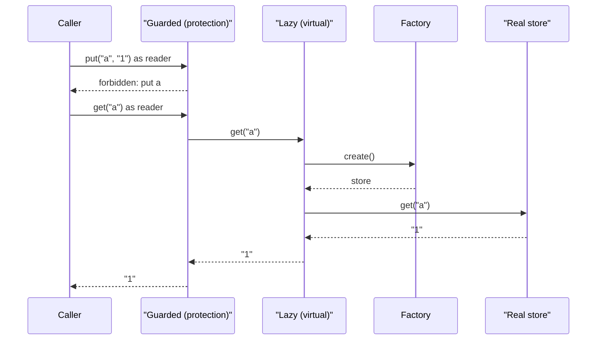

## In one minute
- A proxy is an object that stands in for another object behind the same interface and decides whether, when and how the real object is reached. The caller holds the proxy and believes it holds the real thing.
- Four classic kinds: a *virtual* proxy delays creating an expensive object until first use, a *protection* proxy checks permissions before forwarding, a *remote* proxy turns a method call into a network request, and a *caching* or smart-reference proxy adds bookkeeping around access.
- Structurally a proxy looks like a decorator. The difference is intent: a decorator adds behaviour to an object that exists; a proxy controls access to an object that may not exist yet, may live elsewhere, or may be off limits. This lesson is about object-level proxies; network forward and reverse proxies are covered in Proxy vs Reverse Proxy.
- Proxies break assumptions quietly: first-call latency, identity and equality checks, calls that bypass the proxy from inside the target, and lazy loads that fire after their database session has closed.
- Agents generate ORM code full of lazy relationships and dynamic proxies. In review, look for N+1 queries, lazy loads outside a transaction, and permission checks that live in the UI instead of a proxy in front of the data.

## How it works

### The problem
A CRM loads a `Customer` for every page. Each customer has an order history (often thousands of rows), a contract PDF in object storage and a credit report from a paid third-party API. The first version loads all three in the constructor. The customer list page, which shows only names, now takes 900 ms and costs money per view for credit reports nobody looks at.

The proxy answer: `Customer.orders` holds a proxy with the real history's interface that runs the query only on first iteration. The credit report sits behind a protection proxy that checks the viewer's role before the paid API is called. The page code does not change.

### The four kinds
A **virtual proxy** holds a recipe for the real object (a factory, a primary key, a file path) and builds it on first use. Hibernate's `session.getReference(Customer.class, id)` returns one. Virtual memory is the same idea in hardware: a not-present page table entry, and a page fault that loads the page on first touch.

A **protection proxy** checks whether the caller may perform the operation and forwards or refuses, so no caller can forget the policy.

A **remote proxy** implements the interface by serialising arguments, sending them over the network and decoding the reply. A generated gRPC client stub is one: `client.GetUser(ctx, req)` looks like a method call and is an HTTP/2 request.

A **smart-reference proxy** adds bookkeeping: reference counting, access logging, copy-on-write, or change tracking. Vue 3's `reactive()` wraps an object in a JavaScript `Proxy` whose `get` trap records which component read which property and whose `set` trap schedules re-renders.

### Proxy, decorator, adapter
All three wrap an object. An adapter changes the interface (see Adapter). A decorator keeps it and adds a concern while always forwarding (see Decorator). A proxy keeps it and may not forward at all: it may refuse, defer, or cross a network. The line blurs (a cache is called either), so ask which question the wrapper answers: "what else happens on this call?" or "should and can this call reach the target?"

### Static and dynamic proxies
A static proxy is written or generated for one interface. Go has only these, since it cannot create types at runtime: proxies are hand-written structs or generated code (gRPC stubs, `mockgen`). Dynamic proxies are created at runtime for any interface. Java's `java.lang.reflect.Proxy.newProxyInstance` builds a class implementing the given interfaces and routes every call to one `InvocationHandler.invoke(proxy, method, args)`. JavaScript's `new Proxy(target, handler)` intercepts thirteen operations, including `get`, `set`, `has`, `deleteProperty` and `apply`. Python has no proxy object, but `__getattr__`, called only when normal attribute lookup fails, makes a forwarding proxy a few lines long.

### Reviewing agent-written code
Agents add lazy relationships by default because they keep the first query simple. Check every lazy collection read in a loop (an N+1), every lazy access after the transaction closes (serialisers and templates), and every permission check that is not in front of the data. In hand-written proxies, a forgotten method is an unguarded door.

### The same shape elsewhere
A protection proxy is the *trust but verify* problem shape: the check sits on the only path to the resource. Operating systems do the same with system calls, where the kernel checks every request against the process's credentials before touching a file, and cloud storage does it with presigned URLs, where the proxy is replaced by a signature the storage service verifies on every request.

## Down the stack

### Layer 1: The contract
A proxy promises the target's contract plus documented differences. A virtual proxy creates the target at most once, on first use, and reports a failed creation rather than caching a broken object. A protection proxy promises that a denied call has no effect on the target, including no side effects of creating it. A remote proxy cannot keep the local contract fully: it adds latency in milliseconds, new failure modes (timeouts, partial failure where the server acted but the reply was lost), and copies instead of shared references. What no proxy preserves is identity: `proxy is target` is false, and type checks see the proxy's class.

### Layer 2: The mechanism
Java's dynamic proxy generates a class named like `$Proxy12` that extends `java.lang.reflect.Proxy` and implements the requested interfaces. Each method body boxes primitive arguments into an `Object[]` and calls the handler with a cached `Method` object. Spring AOP uses these for interfaces and CGLIB-generated subclasses otherwise; either way, a `@Transactional` method called from another method of the same bean goes through `this`, not the proxy, so no transaction starts. Hibernate's lazy entities are ByteBuddy-generated subclasses whose methods ask a lazy initializer to load the row on first access, and throw `LazyInitializationException` if the session is gone.

In JavaScript, a `Proxy` has internal slots `[[ProxyTarget]]` and `[[ProxyHandler]]`, and each internal method checks for a trap and falls back to the target. The engine enforces invariants: a `get` trap cannot report a different value for a non-configurable, non-writable property. Private class fields (`#balance`) are not reachable through a proxy: a method called with `this` set to the proxy throws `TypeError` when it reads `this.#balance`, which breaks naive wrappers of classes.

### Layer 3: The machine
A hand-written proxy in Go costs one extra interface call, roughly 1 to 2 ns, and one pointer of memory. A virtual proxy saves the target's whole allocation until it is needed: an unopened 4 MB image costs a 48-byte proxy. In Java, a dynamic proxy call allocates the argument array and boxes primitives unless the JIT's escape analysis removes them, and `Method.invoke` dispatch is slower than a direct call, typically tens of nanoseconds. In V8, property access on a `Proxy` does not use the inline caches that make ordinary property reads a few nanoseconds, so code that reads proxied objects in tight loops is often an order of magnitude slower; Vue mitigates this by caching proxies per object in a `WeakMap`.

A remote proxy dwarfs all of this. A local call costs nanoseconds; a same-datacentre RPC costs 0.2 to 1 ms, five to six orders of magnitude more, plus serialisation. A loop of 1,000 calls that looked free costs a second.

Lazy initialisation is a concurrency hazard. Two threads that both see "not loaded" create the target twice, which wastes a connection or, for a non-idempotent factory, does something twice. Go's `sync.Once` or a mutex fixes it; Java uses double-checked locking with a `volatile` field; Python needs a `threading.Lock` around the check and the creation.

### Why it's built this way
1. Some objects are expensive, remote or sensitive, and most callers should not care which.
2. Keeping the target's interface lets the proxy slot in without changing callers.
3. One wrapper on the only path is safer than trusting every caller to check.
4. Hand-writing proxies per interface is tedious, so reflective languages generate them, at the cost of slower dispatch and surprising identity.
5. A proxy hides cost and location, so query logs, traces and review rules must make the cost visible again.

## Diagram


## Worked example
The CRM's customer list shows 50 customers per page and, after a product request, each row's open order count. The ORM maps `customer.orders` as a lazy collection. The template loops over customers and reads `len(customer.orders)`, so the page runs 1 query for the list and 50 more, one per proxy: 51 round trips. At 1.2 ms each against a database in the same zone, the page spends 61 ms in the database before rendering, and at 300 page views a second that is 15,300 queries a second for a list page.

Two fixes, depending on the access pattern. If the page needs the orders themselves, eager-load them for this query only, with SQLAlchemy's `selectinload(Customer.orders)` or a fetch join in JPA: 2 queries, about 3 ms. If it needs only the count, do not load orders at all; add a grouped count query: 2 queries, 2.5 ms, and no thousands of order rows in memory. The lazy proxy stays as the default for pages that touch one customer.

A second incident was a protection gap: a new export job called the credit API client directly, skipping the proxy. The fix made the client constructor package-private so the factory hands out only the proxy.

## Trade-offs
| Option | Strengths | Weaknesses | Choose when |
| --- | --- | --- | --- |
| Eager creation | Simple; failures at startup | Pays for objects never used | Cheap or always-used objects |
| Virtual proxy | Pay only on use | First-call latency; N+1 risk; lazy init races | Expensive, often unused objects |
| Protection proxy | One enforcement point | Bypassed if the target is reachable directly | Sensitive objects with many callers |
| Remote proxy (RPC stub) | Network call looks local | Hides latency and partial failure | Typed clients for services |
| Dynamic proxy (reflection, JS `Proxy`) | One handler for any interface | Slower dispatch; identity and self-call surprises | Frameworks: AOP, ORMs, reactivity, mocks |

## Pitfalls in production
- N+1 queries from lazy collections read in loops. Fix: eager-load per query where the access pattern is known, and fail tests that exceed a query count.
- `LazyInitializationException` or detached-instance errors when a serialiser touches a lazy field after the transaction ends. Fix: map to DTOs inside the transaction, or fetch what the response needs explicitly.
- Self-invocation skipping the proxy, so `@Transactional`, `@Cacheable` or security annotations silently do nothing. Fix: move the method to another bean, or call through the injected proxy.
- Identity and equality: `proxy == entity` false, `getClass()` returns a generated subclass, and `equals` based on class comparison fails. Fix: compare by ID and use `instanceof`-style checks or the ORM's unproxy helper.
- Wrapping classes with private fields in a JavaScript `Proxy`, so methods throw `TypeError`. Fix: bind methods to the target in the `get` trap, or proxy plain data objects only.
- Remote proxies called in loops as if local. Fix: batch APIs, and make remote interfaces look remote (contexts, deadlines, explicit errors).

## Leadership lens
- Ask what each proxy hides (cost, location or policy) and how it is made visible again: query-count assertions, traces, access logs.
- A protection proxy is only as strong as the guarantee that nothing else can reach the target. In review, check how the target is constructed and who can get a reference.
- Set a team rule for ORM loading: lazy by default with query-count tests, or explicit fetch plans per endpoint. Mixed habits produce N+1 regressions in every release.
- Prefer a framework's dynamic proxies over home-grown reflection, and teach new hires the self-invocation and identity surprises.

## Check yourself
1. What distinguishes a proxy from a decorator when both keep the same interface?
   **Answer:** Intent and forwarding: a decorator always forwards and adds a concern, while a proxy controls whether, when and where the call reaches the target, and may not forward at all.
2. Why does calling a `@Transactional` method from another method of the same Spring bean not start a transaction?
   **Answer:** The transaction logic lives in the proxy around the bean; an internal call goes through `this`, the raw target, so the proxy never sees it.
3. Why must a protection proxy be checked before a virtual proxy in `Guarded(Lazy(store))`?
   **Answer:** So a denied call has no effects at all, including the cost and side effects of creating the real object; with the order reversed, unauthorised callers could trigger expensive loads.
4. Why should a failed lazy creation not be remembered?
   **Answer:** A transient failure (a database restarting) would then become permanent for the process; reporting the error and retrying on the next call lets it recover.

## Practice
**Task:** Build two proxies over a key-value `Store` interface with `get(key)` (the value, or `None` / `undefined` / `ok == false` when missing), `put(key, value)` and `keys()` (sorted). `LazyStore(factory)` is a virtual proxy: it calls `factory()` to create the real store on the first call of any method and reuses it afterwards; if the factory fails, the error propagates, the proxy stays unloaded, and the next call tries again. `loaded()` reports whether the real store exists. `GuardedStore(inner, roles)` is a protection proxy: `get` and `keys` need role `reader`, `put` needs `writer`, and any `get` or `put` on a key starting with `private/` also needs `admin`. A denied call fails with `forbidden: <op> <key>` (or `forbidden: keys`) and never touches `inner`; `keys()` hides `private/` keys from non-admins. Python raises (`PermissionError` for denials), TypeScript throws `Error`, Go returns errors.

```python starter
class LazyStore:
    def __init__(self, factory):
        self.factory = factory
        self.real = None

    def loaded(self):
        # TODO
        raise NotImplementedError

    def get(self, key):
        # TODO
        raise NotImplementedError

    def put(self, key, value):
        # TODO
        raise NotImplementedError

    def keys(self):
        # TODO
        raise NotImplementedError


class GuardedStore:
    def __init__(self, inner, roles):
        self.inner = inner
        self.roles = set(roles)

    def get(self, key):
        # TODO
        raise NotImplementedError

    def put(self, key, value):
        # TODO
        raise NotImplementedError

    def keys(self):
        # TODO
        raise NotImplementedError
```

```python tests
class FakeStore:
    def __init__(self, data=None):
        self.data = dict(data or {})
        self.calls = 0

    def get(self, key):
        self.calls += 1
        return self.data.get(key)

    def put(self, key, value):
        self.calls += 1
        self.data[key] = value

    def keys(self):
        self.calls += 1
        return sorted(self.data)


class Factory:
    def __init__(self, store, failures=0):
        self.store, self.failures, self.calls = store, failures, 0

    def __call__(self):
        self.calls += 1
        if self.failures > 0:
            self.failures -= 1
            raise RuntimeError("db down")
        return self.store


def denied(fn):
    try:
        fn()
    except PermissionError as e:
        return str(e)
    return None


def test_lazy_loads_once_on_first_use():
    f = Factory(FakeStore({"a": "1"}))
    lazy = LazyStore(f)
    assert f.calls == 0 and not lazy.loaded()
    assert lazy.get("a") == "1"
    lazy.put("b", "2")
    assert lazy.keys() == ["a", "b"]
    assert f.calls == 1 and lazy.loaded()


def test_lazy_failure_is_not_remembered():
    f = Factory(FakeStore({"a": "1"}), failures=1)
    lazy = LazyStore(f)
    try:
        lazy.get("a")
        assert False, "expected failure"
    except RuntimeError as e:
        assert str(e) == "db down"
    assert not lazy.loaded()
    assert lazy.get("a") == "1"
    assert f.calls == 2


def test_reader_can_get_but_not_put():
    inner = FakeStore({"a": "1"})
    g = GuardedStore(inner, ["reader"])
    assert g.get("a") == "1"
    assert g.get("zzz") is None
    assert denied(lambda: g.put("a", "2")) == "forbidden: put a"
    assert inner.data["a"] == "1"


def test_private_keys_need_admin():
    inner = FakeStore({"private/x": "s"})
    g = GuardedStore(inner, ["reader", "writer"])
    assert denied(lambda: g.get("private/x")) == "forbidden: get private/x"
    assert denied(lambda: g.put("private/y", "t")) == "forbidden: put private/y"
    admin = GuardedStore(inner, ["reader", "writer", "admin"])
    admin.put("private/y", "t")
    assert admin.get("private/y") == "t"


def test_keys_filtered_and_guarded():
    inner = FakeStore({"b": "1", "private/x": "2", "a": "3"})
    assert GuardedStore(inner, ["reader"]).keys() == ["a", "b"]
    assert GuardedStore(inner, ["reader", "admin"]).keys() == ["a", "b", "private/x"]
    assert denied(lambda: GuardedStore(inner, ["writer"]).keys()) == "forbidden: keys"


def test_denied_call_never_reaches_inner_or_loads():
    f = Factory(FakeStore())
    lazy = LazyStore(f)
    g = GuardedStore(lazy, ["reader"])
    assert denied(lambda: g.put("a", "1")) == "forbidden: put a"
    assert f.calls == 0 and not lazy.loaded()
    inner = FakeStore()
    assert denied(lambda: GuardedStore(inner, []).get("a")) == "forbidden: get a"
    assert inner.calls == 0


def test_writer_put_passes_through():
    inner = FakeStore()
    GuardedStore(inner, ["writer"]).put("k", "v")
    assert inner.data == {"k": "v"}
```

```python solution
class LazyStore:
    def __init__(self, factory):
        self.factory = factory
        self.real = None

    def _target(self):
        if self.real is None:
            self.real = self.factory()
        return self.real

    def loaded(self):
        return self.real is not None

    def get(self, key):
        return self._target().get(key)

    def put(self, key, value):
        self._target().put(key, value)

    def keys(self):
        return self._target().keys()


class GuardedStore:
    def __init__(self, inner, roles):
        self.inner = inner
        self.roles = set(roles)

    def _check(self, op, need, key):
        ok = need in self.roles
        if key.startswith("private/") and "admin" not in self.roles:
            ok = False
        if not ok:
            raise PermissionError("forbidden: " + op + " " + key)

    def get(self, key):
        self._check("get", "reader", key)
        return self.inner.get(key)

    def put(self, key, value):
        self._check("put", "writer", key)
        self.inner.put(key, value)

    def keys(self):
        if "reader" not in self.roles:
            raise PermissionError("forbidden: keys")
        ks = self.inner.keys()
        if "admin" in self.roles:
            return ks
        return [k for k in ks if not k.startswith("private/")]
```

```typescript starter
export interface Store {
  get(key: string): string | undefined;
  put(key: string, value: string): void;
  keys(): string[];
}

export class LazyStore implements Store {
  private real: Store | null = null;
  constructor(private factory: () => Store) {}
  loaded(): boolean { throw new Error("TODO"); }
  get(key: string): string | undefined { throw new Error("TODO"); }
  put(key: string, value: string): void { throw new Error("TODO"); }
  keys(): string[] { throw new Error("TODO"); }
}

export class GuardedStore implements Store {
  private roles: Set<string>;
  constructor(private inner: Store, roles: string[]) { this.roles = new Set(roles); }
  get(key: string): string | undefined { throw new Error("TODO"); }
  put(key: string, value: string): void { throw new Error("TODO"); }
  keys(): string[] { throw new Error("TODO"); }
}
```

```typescript tests
class FakeStore implements Store {
  calls = 0;
  data: Record<string, string>;
  constructor(data: Record<string, string> = {}) { this.data = { ...data }; }
  get(key: string): string | undefined { this.calls++; return this.data[key]; }
  put(key: string, value: string): void { this.calls++; this.data[key] = value; }
  keys(): string[] { this.calls++; return Object.keys(this.data).sort(); }
}

function makeFactory(store: Store, failures = 0) {
  const f = {
    calls: 0,
    create: (): Store => {
      f.calls++;
      if (failures > 0) { failures--; throw new Error("db down"); }
      return store;
    },
  };
  return f;
}

function errorOf(fn: () => unknown): string | undefined {
  try { fn(); } catch (e) { return (e as Error).message; }
  return undefined;
}

test("lazy loads once on first use", () => {
  const f = makeFactory(new FakeStore({ a: "1" }));
  const lazy = new LazyStore(f.create);
  assert(f.calls === 0 && !lazy.loaded(), "not loaded yet");
  assertEqual(lazy.get("a"), "1");
  lazy.put("b", "2");
  assertEqual(lazy.keys(), ["a", "b"]);
  assert(f.calls === 1 && lazy.loaded(), "loaded once");
});

test("lazy failure is not remembered", () => {
  const f = makeFactory(new FakeStore({ a: "1" }), 1);
  const lazy = new LazyStore(f.create);
  assertEqual(errorOf(() => lazy.get("a")), "db down");
  assert(!lazy.loaded(), "still unloaded");
  assertEqual(lazy.get("a"), "1");
  assertEqual(f.calls, 2);
});

test("reader can get but not put", () => {
  const inner = new FakeStore({ a: "1" });
  const g = new GuardedStore(inner, ["reader"]);
  assertEqual(g.get("a"), "1");
  assert(g.get("zzz") === undefined, "missing is undefined");
  assertEqual(errorOf(() => g.put("a", "2")), "forbidden: put a");
  assertEqual(inner.data["a"], "1");
});

test("private keys need admin", () => {
  const inner = new FakeStore({ "private/x": "s" });
  const g = new GuardedStore(inner, ["reader", "writer"]);
  assertEqual(errorOf(() => g.get("private/x")), "forbidden: get private/x");
  assertEqual(errorOf(() => g.put("private/y", "t")), "forbidden: put private/y");
  const admin = new GuardedStore(inner, ["reader", "writer", "admin"]);
  admin.put("private/y", "t");
  assertEqual(admin.get("private/y"), "t");
});

test("keys filtered and guarded", () => {
  const inner = new FakeStore({ b: "1", "private/x": "2", a: "3" });
  assertEqual(new GuardedStore(inner, ["reader"]).keys(), ["a", "b"]);
  assertEqual(new GuardedStore(inner, ["reader", "admin"]).keys(), ["a", "b", "private/x"]);
  assertEqual(errorOf(() => new GuardedStore(inner, ["writer"]).keys()), "forbidden: keys");
});

test("denied call never reaches inner or loads", () => {
  const f = makeFactory(new FakeStore());
  const lazy = new LazyStore(f.create);
  const g = new GuardedStore(lazy, ["reader"]);
  assertEqual(errorOf(() => g.put("a", "1")), "forbidden: put a");
  assert(f.calls === 0 && !lazy.loaded(), "no load");
  const inner = new FakeStore();
  assertEqual(errorOf(() => new GuardedStore(inner, []).get("a")), "forbidden: get a");
  assertEqual(inner.calls, 0);
});

test("writer put passes through", () => {
  const inner = new FakeStore();
  new GuardedStore(inner, ["writer"]).put("k", "v");
  assertEqual(inner.data, { k: "v" });
});
```

```typescript solution
export interface Store {
  get(key: string): string | undefined;
  put(key: string, value: string): void;
  keys(): string[];
}

export class LazyStore implements Store {
  private real: Store | null = null;
  constructor(private factory: () => Store) {}
  private target(): Store {
    if (this.real === null) this.real = this.factory();
    return this.real;
  }
  loaded(): boolean { return this.real !== null; }
  get(key: string): string | undefined { return this.target().get(key); }
  put(key: string, value: string): void { this.target().put(key, value); }
  keys(): string[] { return this.target().keys(); }
}

export class GuardedStore implements Store {
  private roles: Set<string>;
  constructor(private inner: Store, roles: string[]) { this.roles = new Set(roles); }

  private check(op: string, need: string, key: string): void {
    const ok = this.roles.has(need) && (!key.startsWith("private/") || this.roles.has("admin"));
    if (!ok) throw new Error(`forbidden: ${op} ${key}`);
  }

  get(key: string): string | undefined {
    this.check("get", "reader", key);
    return this.inner.get(key);
  }

  put(key: string, value: string): void {
    this.check("put", "writer", key);
    this.inner.put(key, value);
  }

  keys(): string[] {
    if (!this.roles.has("reader")) throw new Error("forbidden: keys");
    const ks = this.inner.keys();
    return this.roles.has("admin") ? ks : ks.filter((k) => !k.startsWith("private/"));
  }
}
```

```go starter
package practice

import "sync"

// Store is a key-value store. Get reports ok == false for a missing key.
type Store interface {
	Get(key string) (string, bool, error)
	Put(key, value string) error
	Keys() ([]string, error)
}

type LazyStore struct {
	mu      sync.Mutex
	factory func() (Store, error)
	real    Store
}

func NewLazyStore(factory func() (Store, error)) *LazyStore {
	return &LazyStore{factory: factory}
}

func (l *LazyStore) Loaded() bool                         { panic("TODO") }
func (l *LazyStore) Get(key string) (string, bool, error) { panic("TODO") }
func (l *LazyStore) Put(key, value string) error          { panic("TODO") }
func (l *LazyStore) Keys() ([]string, error)              { panic("TODO") }

type GuardedStore struct {
	inner Store
	roles map[string]bool
}

func NewGuardedStore(inner Store, roles []string) *GuardedStore {
	m := map[string]bool{}
	for _, r := range roles {
		m[r] = true
	}
	return &GuardedStore{inner: inner, roles: m}
}

func (g *GuardedStore) Get(key string) (string, bool, error) { panic("TODO") }
func (g *GuardedStore) Put(key, value string) error          { panic("TODO") }
func (g *GuardedStore) Keys() ([]string, error)              { panic("TODO") }
```

```go tests
package practice

import (
	"errors"
	"reflect"
	"sort"
	"testing"
)

type fakeStore struct {
	data  map[string]string
	calls int
}

func newFake(kv ...string) *fakeStore {
	f := &fakeStore{data: map[string]string{}}
	for i := 0; i+1 < len(kv); i += 2 {
		f.data[kv[i]] = kv[i+1]
	}
	return f
}

func (f *fakeStore) Get(key string) (string, bool, error) {
	f.calls++
	v, ok := f.data[key]
	return v, ok, nil
}

func (f *fakeStore) Put(key, value string) error {
	f.calls++
	f.data[key] = value
	return nil
}

func (f *fakeStore) Keys() ([]string, error) {
	f.calls++
	ks := []string{}
	for k := range f.data {
		ks = append(ks, k)
	}
	sort.Strings(ks)
	return ks, nil
}

type factory struct {
	store    Store
	failures int
	calls    int
}

func (f *factory) create() (Store, error) {
	f.calls++
	if f.failures > 0 {
		f.failures--
		return nil, errors.New("db down")
	}
	return f.store, nil
}

func errText(err error) string {
	if err == nil {
		return ""
	}
	return err.Error()
}

func TestLazyLoadsOnceOnFirstUse(t *testing.T) {
	f := &factory{store: newFake("a", "1")}
	lazy := NewLazyStore(f.create)
	if f.calls != 0 || lazy.Loaded() {
		t.Fatal("loaded too early")
	}
	if v, ok, err := lazy.Get("a"); v != "1" || !ok || err != nil {
		t.Fatalf("get: %q %v %v", v, ok, err)
	}
	if err := lazy.Put("b", "2"); err != nil {
		t.Fatal(err)
	}
	ks, _ := lazy.Keys()
	if !reflect.DeepEqual(ks, []string{"a", "b"}) || f.calls != 1 || !lazy.Loaded() {
		t.Fatalf("keys %v calls %d", ks, f.calls)
	}
}

func TestLazyFailureIsNotRemembered(t *testing.T) {
	f := &factory{store: newFake("a", "1"), failures: 1}
	lazy := NewLazyStore(f.create)
	if _, _, err := lazy.Get("a"); errText(err) != "db down" {
		t.Fatalf("want db down, got %v", err)
	}
	if lazy.Loaded() {
		t.Fatal("should stay unloaded")
	}
	if v, _, err := lazy.Get("a"); v != "1" || err != nil || f.calls != 2 {
		t.Fatalf("retry: %q %v calls %d", v, err, f.calls)
	}
}

func TestReaderCanGetButNotPut(t *testing.T) {
	inner := newFake("a", "1")
	g := NewGuardedStore(inner, []string{"reader"})
	if v, ok, err := g.Get("a"); v != "1" || !ok || err != nil {
		t.Fatalf("get: %q %v %v", v, ok, err)
	}
	if _, ok, err := g.Get("zzz"); ok || err != nil {
		t.Fatal("missing key should be ok=false")
	}
	if got := errText(g.Put("a", "2")); got != "forbidden: put a" {
		t.Fatalf("got %q", got)
	}
	if inner.data["a"] != "1" {
		t.Fatal("inner changed")
	}
}

func TestPrivateKeysNeedAdmin(t *testing.T) {
	inner := newFake("private/x", "s")
	g := NewGuardedStore(inner, []string{"reader", "writer"})
	if _, _, err := g.Get("private/x"); errText(err) != "forbidden: get private/x" {
		t.Fatalf("got %v", err)
	}
	if got := errText(g.Put("private/y", "t")); got != "forbidden: put private/y" {
		t.Fatalf("got %q", got)
	}
	admin := NewGuardedStore(inner, []string{"reader", "writer", "admin"})
	if err := admin.Put("private/y", "t"); err != nil {
		t.Fatal(err)
	}
	if v, _, _ := admin.Get("private/y"); v != "t" {
		t.Fatalf("got %q", v)
	}
}

func TestKeysFilteredAndGuarded(t *testing.T) {
	inner := newFake("b", "1", "private/x", "2", "a", "3")
	ks, _ := NewGuardedStore(inner, []string{"reader"}).Keys()
	if !reflect.DeepEqual(ks, []string{"a", "b"}) {
		t.Fatalf("reader keys %v", ks)
	}
	ks, _ = NewGuardedStore(inner, []string{"reader", "admin"}).Keys()
	if !reflect.DeepEqual(ks, []string{"a", "b", "private/x"}) {
		t.Fatalf("admin keys %v", ks)
	}
	if _, err := NewGuardedStore(inner, []string{"writer"}).Keys(); errText(err) != "forbidden: keys" {
		t.Fatalf("got %v", err)
	}
}

func TestDeniedCallNeverReachesInnerOrLoads(t *testing.T) {
	f := &factory{store: newFake()}
	lazy := NewLazyStore(f.create)
	g := NewGuardedStore(lazy, []string{"reader"})
	if got := errText(g.Put("a", "1")); got != "forbidden: put a" {
		t.Fatalf("got %q", got)
	}
	if f.calls != 0 || lazy.Loaded() {
		t.Fatal("denied call loaded the store")
	}
	inner := newFake()
	if _, _, err := NewGuardedStore(inner, nil).Get("a"); errText(err) != "forbidden: get a" {
		t.Fatalf("got %v", err)
	}
	if inner.calls != 0 {
		t.Fatal("inner was called")
	}
}

func TestWriterPutPassesThrough(t *testing.T) {
	inner := newFake()
	if err := NewGuardedStore(inner, []string{"writer"}).Put("k", "v"); err != nil {
		t.Fatal(err)
	}
	if !reflect.DeepEqual(inner.data, map[string]string{"k": "v"}) {
		t.Fatalf("data %v", inner.data)
	}
}
```

```go solution
package practice

import (
	"errors"
	"strings"
	"sync"
)

// Store is a key-value store. Get reports ok == false for a missing key.
type Store interface {
	Get(key string) (string, bool, error)
	Put(key, value string) error
	Keys() ([]string, error)
}

type LazyStore struct {
	mu      sync.Mutex
	factory func() (Store, error)
	real    Store
}

func NewLazyStore(factory func() (Store, error)) *LazyStore {
	return &LazyStore{factory: factory}
}

func (l *LazyStore) target() (Store, error) {
	l.mu.Lock()
	defer l.mu.Unlock()
	if l.real == nil {
		s, err := l.factory()
		if err != nil {
			return nil, err
		}
		l.real = s
	}
	return l.real, nil
}

func (l *LazyStore) Loaded() bool {
	l.mu.Lock()
	defer l.mu.Unlock()
	return l.real != nil
}

func (l *LazyStore) Get(key string) (string, bool, error) {
	s, err := l.target()
	if err != nil {
		return "", false, err
	}
	return s.Get(key)
}

func (l *LazyStore) Put(key, value string) error {
	s, err := l.target()
	if err != nil {
		return err
	}
	return s.Put(key, value)
}

func (l *LazyStore) Keys() ([]string, error) {
	s, err := l.target()
	if err != nil {
		return nil, err
	}
	return s.Keys()
}

type GuardedStore struct {
	inner Store
	roles map[string]bool
}

func NewGuardedStore(inner Store, roles []string) *GuardedStore {
	m := map[string]bool{}
	for _, r := range roles {
		m[r] = true
	}
	return &GuardedStore{inner: inner, roles: m}
}

func (g *GuardedStore) check(op, need, key string) error {
	if !g.roles[need] || (strings.HasPrefix(key, "private/") && !g.roles["admin"]) {
		return errors.New("forbidden: " + op + " " + key)
	}
	return nil
}

func (g *GuardedStore) Get(key string) (string, bool, error) {
	if err := g.check("get", "reader", key); err != nil {
		return "", false, err
	}
	return g.inner.Get(key)
}

func (g *GuardedStore) Put(key, value string) error {
	if err := g.check("put", "writer", key); err != nil {
		return err
	}
	return g.inner.Put(key, value)
}

func (g *GuardedStore) Keys() ([]string, error) {
	if !g.roles["reader"] {
		return nil, errors.New("forbidden: keys")
	}
	ks, err := g.inner.Keys()
	if err != nil || g.roles["admin"] {
		return ks, err
	}
	out := []string{}
	for _, k := range ks {
		if !strings.HasPrefix(k, "private/") {
			out = append(out, k)
		}
	}
	return out, nil
}
```

## Mock interview
**Prompt:** A document service stores 200 million documents; a typical response returns metadata for 100 of them, and only 3% need bodies (400 KB on average). Tenants have different permissions, and an analytics team wants a typed client. Design the object model for documents, bodies and access control.

- Follow-up: A listing endpoint suddenly makes 101 storage calls per request. How did that happen, and how do you prevent it from recurring?
- Follow-up: Where does the permission check sit, and how do you guarantee the analytics client cannot skip it?
- Follow-up: The body proxy is shared across goroutines or threads. What goes wrong without synchronisation?

**A strong answer covers:**
- Metadata loaded eagerly and bodies behind a virtual proxy that fetches on first read, with streaming rather than buffering 400 KB per document.
- N+1 awareness: batch prefetch for endpoints that need bodies, and a test or metric that caps storage calls per request.
- A protection proxy or service layer as the only path to storage, with the raw client unexported, and checks ordered before any lazy load.
- Safe lazy initialisation (`sync.Once`, a mutex, or a future shared by concurrent callers) and no caching of failed loads.

## Watch
- [Proxy Pattern, Design Patterns ep 10 (Christopher Okhravi)](https://www.youtube.com/watch?v=NwaabHqPHeM): the Gang of Four structure and the kinds of proxy.
- [Proxy Design Pattern Tutorial (Derek Banas)](https://www.youtube.com/watch?v=cHg5bWW4nUI): a code walkthrough of a protection-style proxy.

## Free resources
- [Proxy (Refactoring Guru)](https://refactoring.guru/design-patterns/proxy): the structure, the kinds of proxy, and relations to decorator and adapter.
- [Proxy (MDN)](https://developer.mozilla.org/en-US/docs/Web/JavaScript/Reference/Global_Objects/Proxy): JavaScript's dynamic proxy, its traps and invariants.
- [java.lang.reflect.Proxy (Java docs)](https://docs.oracle.com/javase/8/docs/api/java/lang/reflect/Proxy.html): how dynamic proxy classes are generated and dispatched.
- [Proxying mechanisms (Spring docs)](https://docs.spring.io/spring-framework/reference/core/aop/proxying.html): JDK versus CGLIB proxies and the self-invocation problem.
- [Lazy Load (Martin Fowler)](https://martinfowler.com/eaaCatalog/lazyLoad.html): virtual proxy, lazy initialisation, value holder and ghost as variants.
- [Relationship loading techniques (SQLAlchemy docs)](https://docs.sqlalchemy.org/en/20/orm/queryguide/relationships.html): lazy, select-in and joined loading, and how to avoid N+1.
