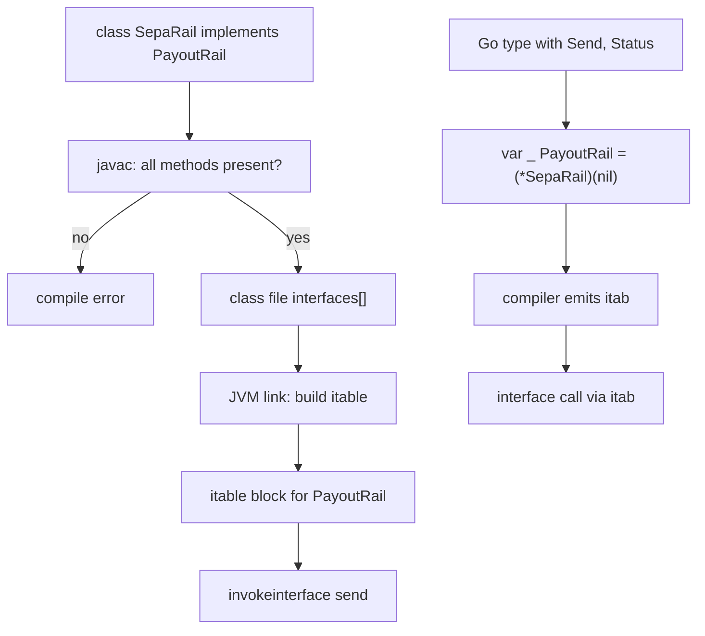

## In one minute
- Realization is the UML relationship between a specification and the class that fulfils it, usually a class implementing an interface. It is drawn as a dashed line with a hollow triangle pointing at the interface.
- Generalization (solid line, hollow triangle) passes state and code to the child; dependency (dashed line, open arrowhead) means one class uses another. Realization passes only obligations.
- In code it is `implements` in Java, C# and TypeScript, `impl Trait for Type` in Rust, and an ABC subclass in Python. Go has no declaration: the relationship exists whenever the method set fits, so teams add a compile-time assertion.
- A realization is a claim. Compilers check signatures; only conformance tests check behaviour.
- At runtime each (class, interface) pair costs some dispatch data: a Java itable block, a Go itab, an extra vtable pointer per C++ object, or nothing in TypeScript, where `implements` is erased.

## How it works

### Three arrows that look alike
A payouts team moves money over several bank rails. `PayoutService` needs something that can send a payout and report its status; ACH, SEPA and card push each do it differently. In plain text:

```text
PayoutService - - - - - - > <<interface>> PayoutRail     (dependency: uses)
                                   ^        ^
                                   :        :            (realization: dashed, hollow triangle)
                              AchRail    SepaRail
                                            |
                                            |            (generalization: solid, hollow triangle)
                                       SepaInstantRail
```

Read each arrow by what crosses it. Generalization from `SepaInstantRail` to `SepaRail` carries fields, method bodies and the obligation to behave like a `SepaRail`. Realization from `SepaRail` to `PayoutRail` carries only the obligation: provide `send` and `status` with these signatures and documented behaviour. Dependency carries nothing; it says a change to `PayoutRail` may force a change to `PayoutService`. UML's compact form shows the same thing: a "lollipop" on `SepaRail` means it *provides* `PayoutRail`, and a "socket" on `PayoutService` means it *requires* it.

### Arrows point at the abstraction
In a well-layered design the dependency and all realizations point at `PayoutRail`. That is Dependency Inversion drawn as geometry, and a quick review test: an arrow from a high-level class to a concrete rail means the inversion has leaked.

### What realization does and does not give you
A realizing class must provide every declared operation with compatible signatures, and gets no fields. Java default methods, Rust default trait methods and concrete methods on Python ABCs let an interface hand over some code, which blurs the line with generalization; keep anything holding state in a class.

A class may realize several role interfaces: `SepaRail` might realize `PayoutRail`, `Cancellable` and `HealthReporter`. Trouble starts when two interfaces use one name for different things, such as `close()` meaning "end the session" in one and "close the settlement batch" in the other. Java and TypeScript give the class one `close`; C# can provide both through explicit interface implementation.

### Declared versus implicit realization
Nominal languages record the realization (`class SepaRail implements PayoutRail`), so the compiler checks it and IDEs list every realizer. In Go a type realizes `PayoutRail` the moment it has `Send` and `Status` with the right signatures. Nothing records intent, and a renamed method breaks the realization silently until some distant conversion fails. The Go FAQ's fix is one line per realizer: `var _ PayoutRail = (*SepaRail)(nil)`.

TypeScript checks `implements` but accepts any object of the right shape and erases the clause from the emitted JavaScript. Python has two forms. Subclassing an `abc.ABC` blocks instantiation if an abstract method is missing. `PayoutRail.register(SepaRail)` declares a "virtual subclass" and checks nothing: `isinstance` returns true even if `SepaRail` has no `send`.

### Diagrams that stay true
A hand-drawn class diagram is accurate on the day it is drawn. Diagram-as-code (Mermaid writes realization as `PayoutRail <|.. SepaRail`) can be generated from source or checked against it, so a missing realization fails a build instead of misleading a new hire. The practice task builds the core of such a check.

### Reviewing agent-written code
Agents produce realizations that compile but do not conform: an `implements PayoutRail` whose `cancel` throws "not supported", a `register()` call added to make an `isinstance` check pass, or a generated diagram that draws interfaces with solid generalization arrows. Ask of each realization: is it declared or asserted, does a conformance test run against it, and does the diagram match the code?

### The same shape elsewhere
Realization is the *trust but verify* shape: a declaration is a claim about behaviour. A service implementing an OpenAPI spec, a storage system claiming S3 compatibility and a driver claiming POSIX compliance all realize a specification written by someone else, and all need conformance suites, because "it compiles" and "it accepts the request" are the weakest evidence there is.

## Down the stack

### Layer 1: The contract
The realizing type provides every member of the interface and its superinterfaces with compatible signatures, and its values are accepted where the interface is expected. Java and C# check at compile time unless the class is abstract; Go at each static conversion; TypeScript only at compile time; Python ABCs at instantiation. Separately compiled code can still break it: if an interface gains a method after a realizer was compiled, the JVM links the old class anyway and throws `AbstractMethodError` only when the missing method is called.

### Layer 2: The mechanism
**Java.** The class file's `interfaces` array names the directly implemented interfaces. When HotSpot links the class it builds an itable with an entry for every implemented interface, including superinterfaces and those inherited from superclasses, each pointing to a block of method pointers. Default methods are filled from the interface; missing ones get a stub that throws `AbstractMethodError`.

**C++.** Realizing an abstract class means inheriting from it. Each abstract base after the first adds its own vtable pointer inside the object, and calls through it use thunks that adjust `this`.

**Go.** A type's runtime descriptor lists its methods sorted by name, with no record of which interfaces it satisfies. The compiler emits an itab for each static (type, interface) conversion; type assertions build itabs lazily by merging the two sorted method lists and cache them.

**TypeScript and Python.** `tsc` checks `implements` and emits nothing. CPython's `ABCMeta` computes `__abstractmethods__` at class creation, and `register()` adds the class to a weak registry consulted by `isinstance`, without touching its MRO.

### Layer 3: The machine
In Java realization costs metaspace, not object size: a class realizing four interfaces stores four itable entries and their method blocks once, and each instance keeps its 12 byte header (with compressed class pointers). A C++ object realizing four abstract bases holds four vtable pointers, 32 bytes per instance; across a million small objects that is 32 MB of pointers. A Go interface value is two words (16 bytes), and each itab is roughly 32 bytes plus 8 per method, allocated once per pair. A Python ABC `isinstance` on a class it has not seen walks the registry and subclass hooks, taking microseconds, then caches the answer per class.

### Why it's built this way
1. Callers should depend on what they need, not who provides it, so the specification is a separate type that providers realize.
2. A class plays several roles, so it maps onto several interfaces, each needing its own method table or itable block.
3. Building every possible table up front is wasteful, so Java builds itables for declared interfaces at link time and Go builds itabs only for pairs actually used.
4. Signatures are cheap to check mechanically and behaviour is not, so compilers check shape and teams own conformance tests.

## Diagram


## Worked example
The payouts platform has five rails realizing `PayoutRail` and processes 1.2 million payouts a day. Product adds a required `cancel(payout_id)`. Four rails live in the platform repository and fail to compile until `cancel` is implemented, which is the system working. The fifth, a card-push rail, is a vendor jar compiled against the old interface.

The JVM links it without complaint. About 0.4 percent of payouts are cancelled, 4,800 a day, and the vendor rail carries 15 percent of traffic, so roughly 720 cancellations a day hit `AbstractMethodError`, each leaving a payout in flight that the customer believes was cancelled.

The fix had three parts. `cancel` moved to a separate `Cancellable` interface, and the service returns "cannot cancel on this rail" when a rail does not realize it. A conformance suite (send, status, idempotent retries, cancel where realized) runs in CI against every class in the `ServiceLoader` configuration, vendor jars included. And the architecture diagram is now generated from code, so the vendor rail's missing realization arrow is visible.

## Trade-offs
| Option | Strengths | Weaknesses | Choose when |
| --- | --- | --- | --- |
| Declared (`implements`) | Intent recorded; tools find realizers | Foreign types need adapters | Java, C#, published service interfaces |
| Implicit (structural) | Foreign types fit; consumer owns interface | Intent invisible; silent drift | Go and TypeScript role interfaces |
| Implicit plus assertion | Structural with a build check | One line per pair | Every Go type meant to realize an interface |
| Virtual registration (`register`) | Retrofit types you do not own | Checks nothing | Third-party classes, with tests |
| Default methods | Add methods without breaking realizers | Blurs realization and inheritance | Evolving a widely realized interface |

## Pitfalls in production
- An interface gains a method and a prebuilt realizer throws `AbstractMethodError` at runtime. Fix: add capabilities as new interfaces or default methods, and run conformance tests against binary plugins.
- A Go type stops realizing an interface after a signature change and the error appears in an unrelated package. Fix: `var _ I = (*T)(nil)` beside each realizer.
- A `register`ed Python class lacks a method and fails with `AttributeError` far from the cause. Fix: subclass the ABC, or test registered classes against the interface.
- A realizer implements a method by throwing "not supported". Fix: it does not realize that interface; split the roles.
- Diagrams draw interfaces with generalization arrows, so reviewers assume shared state. Fix: generate diagrams from code.

## Leadership lens
- Treat each realization of a shared interface as a claim needing evidence: a conformance suite owned by the interface's team and run by every realizer.
- In design review, ask where each interface lives and which way the arrows point. Consumer-owned interfaces and arrows into abstractions keep teams independent.
- For interfaces realized outside your repository (plugins, vendors, partner SDKs), set a compatibility policy: new methods are optional or defaulted for at least one release.
- Use diagrams generated from code for onboarding and audits; hand-drawn ones drift within a quarter.

## Check yourself
1. How do generalization and realization differ in what the child receives?
   **Answer:** Generalization passes fields, method bodies and obligations. Realization passes only obligations, plus any default methods the interface supplies.
2. A Java service calls a new interface method on a plugin compiled last year and gets `AbstractMethodError`. Why did class loading succeed?
   **Answer:** HotSpot fills missing itable entries with a stub that throws when called, so the error appears at the first call, not at load time.
3. Why does a C++ class realizing four abstract interfaces make each object bigger, while the same design in Java does not?
   **Answer:** In C++ each extra base subobject carries a vtable pointer in the instance. In Java the itable lives in class metadata.
4. What does `PayoutRail.register(SepaRail)` verify in Python?
   **Answer:** Nothing about methods. It makes `isinstance` return true; a missing method fails only when called.

## Practice
**Task:** Write a realization checker. Interfaces map a name to `extends` and `methods` (name to parameter count); an interface requires its own methods plus those of everything it extends, transitively. Classes map a name to `parent` (`""` for none), `realizes` and `methods`. A class has its ancestors' methods overridden by its own, and realizes its own interfaces plus its parent's. `check(interfaces, classes)` returns a sorted list of violations, one per class, interface and problem, each reported once: `<C>: unknown interface <I>`, `<C> realizes <I>: missing <m>`, or `<C> realizes <I>: <m> takes <got>, want <want>`. `satisfies(interfaces, classes, cls, iface)` reports whether the class structurally fits, declared or not, failing with `unknown class: <C>` or `unknown interface: <I>`. Inputs are otherwise valid and acyclic. Python raises `ValueError`, TypeScript throws `Error`, Go returns an error.

```python starter
def check(interfaces, classes):
    # TODO: list violations of declared and inherited realizations
    raise NotImplementedError

def satisfies(interfaces, classes, cls, iface):
    # TODO: structural check
    raise NotImplementedError
```

```python tests
IFACES = {
    "PayoutRail": {"extends": [], "methods": {"send": 2, "status": 1}},
    "Cancellable": {"extends": ["PayoutRail"], "methods": {"cancel": 1}},
    "Health": {"extends": [], "methods": {"ping": 0}},
}

def rail(methods, realizes=(), parent=""):
    return {"parent": parent, "realizes": list(realizes), "methods": dict(methods)}

def test_conforming_classes():
    classes = {
        "AchRail": rail({"send": 2, "status": 1}, ["PayoutRail"]),
        "SepaRail": rail({"send": 2, "status": 1, "cancel": 1, "ping": 0}, ["Cancellable", "Health"]),
    }
    assert check(IFACES, classes) == []

def test_missing_and_wrong_arity_through_extends():
    classes = {"CardRail": rail({"send": 2, "cancel": 2}, ["Cancellable"])}
    assert check(IFACES, classes) == [
        "CardRail realizes Cancellable: cancel takes 2, want 1",
        "CardRail realizes Cancellable: missing status",
    ]

def test_inherited_methods_satisfy():
    classes = {
        "BaseRail": rail({"send": 2, "status": 1}),
        "WireRail": rail({}, ["PayoutRail"], parent="BaseRail"),
    }
    assert check(IFACES, classes) == []

def test_realization_is_inherited_and_override_can_break_it():
    classes = {
        "AchRail": rail({"send": 2, "status": 1}, ["PayoutRail"]),
        "FastAch": rail({"send": 1}, parent="AchRail"),
    }
    assert check(IFACES, classes) == ["FastAch realizes PayoutRail: send takes 1, want 2"]

def test_unknown_interface_and_sorting():
    classes = {
        "Zeta": rail({}, ["Ledger"]),
        "Alpha": rail({"send": 2}, ["PayoutRail"]),
    }
    assert check(IFACES, classes) == [
        "Alpha realizes PayoutRail: missing status",
        "Zeta: unknown interface Ledger",
    ]

def test_duplicates_reported_once():
    classes = {
        "Base": rail({"send": 2}, ["PayoutRail"]),
        "Child": rail({}, ["PayoutRail", "PayoutRail"], parent="Base"),
    }
    assert check(IFACES, classes) == [
        "Base realizes PayoutRail: missing status",
        "Child realizes PayoutRail: missing status",
    ]

def test_satisfies_is_structural():
    classes = {
        "Probe": rail({"send": 2, "status": 1}),
        "Bad": rail({"send": 2, "status": 2}),
    }
    assert satisfies(IFACES, classes, "Probe", "PayoutRail") is True
    assert satisfies(IFACES, classes, "Probe", "Cancellable") is False
    assert satisfies(IFACES, classes, "Bad", "PayoutRail") is False

def test_satisfies_errors():
    classes = {"Probe": rail({})}
    for args, msg in [(("Nope", "Health"), "unknown class: Nope"), (("Probe", "Nope"), "unknown interface: Nope")]:
        try:
            satisfies(IFACES, classes, *args)
            assert False, "expected ValueError"
        except ValueError as e:
            assert str(e) == msg
```

```python solution
def _required(interfaces, name):
    spec = interfaces[name]
    req = {}
    for parent in spec["extends"]:
        req.update(_required(interfaces, parent))
    req.update(spec["methods"])
    return req

def _methods(classes, name):
    c = classes[name]
    ms = _methods(classes, c["parent"]) if c["parent"] else {}
    ms.update(c["methods"])
    return ms

def _realizes(classes, name):
    c = classes[name]
    out = _realizes(classes, c["parent"]) if c["parent"] else []
    for i in c["realizes"]:
        if i not in out:
            out.append(i)
    return out

def _problems(required, have):
    out = []
    for m, want in required.items():
        if m not in have:
            out.append("missing " + m)
        elif have[m] != want:
            out.append("%s takes %d, want %d" % (m, have[m], want))
    return out

def check(interfaces, classes):
    found = []
    for c in classes:
        have = _methods(classes, c)
        for i in _realizes(classes, c):
            if i not in interfaces:
                found.append(c + ": unknown interface " + i)
                continue
            for p in _problems(_required(interfaces, i), have):
                found.append(c + " realizes " + i + ": " + p)
    return sorted(found)

def satisfies(interfaces, classes, cls, iface):
    if cls not in classes:
        raise ValueError("unknown class: " + cls)
    if iface not in interfaces:
        raise ValueError("unknown interface: " + iface)
    return not _problems(_required(interfaces, iface), _methods(classes, cls))
```

```typescript starter
export interface Iface { extends: string[]; methods: Record<string, number>; }
export interface Klass { parent: string; realizes: string[]; methods: Record<string, number>; }

export function check(ifaces: Record<string, Iface>, classes: Record<string, Klass>): string[] {
  throw new Error("TODO");
}

export function satisfies(ifaces: Record<string, Iface>, classes: Record<string, Klass>, cls: string, iface: string): boolean {
  throw new Error("TODO");
}
```

```typescript tests
const IFACES: Record<string, Iface> = {
  PayoutRail: { extends: [], methods: { send: 2, status: 1 } },
  Cancellable: { extends: ["PayoutRail"], methods: { cancel: 1 } },
  Health: { extends: [], methods: { ping: 0 } },
};

function rail(methods: Record<string, number>, realizes: string[] = [], parent = ""): Klass {
  return { parent, realizes, methods };
}

function errorOf(fn: () => unknown): string {
  try { fn(); } catch (e) { return (e as Error).message; }
  return "";
}

test("conforming classes", () => {
  assertEqual(check(IFACES, {
    AchRail: rail({ send: 2, status: 1 }, ["PayoutRail"]),
    SepaRail: rail({ send: 2, status: 1, cancel: 1, ping: 0 }, ["Cancellable", "Health"]),
  }), []);
});

test("missing and wrong arity through extends", () => {
  assertEqual(check(IFACES, { CardRail: rail({ send: 2, cancel: 2 }, ["Cancellable"]) }), [
    "CardRail realizes Cancellable: cancel takes 2, want 1",
    "CardRail realizes Cancellable: missing status",
  ]);
});

test("inherited methods satisfy", () => {
  assertEqual(check(IFACES, {
    BaseRail: rail({ send: 2, status: 1 }),
    WireRail: rail({}, ["PayoutRail"], "BaseRail"),
  }), []);
});

test("realization is inherited and override can break it", () => {
  assertEqual(check(IFACES, {
    AchRail: rail({ send: 2, status: 1 }, ["PayoutRail"]),
    FastAch: rail({ send: 1 }, [], "AchRail"),
  }), ["FastAch realizes PayoutRail: send takes 1, want 2"]);
});

test("unknown interface and sorting", () => {
  assertEqual(check(IFACES, {
    Zeta: rail({}, ["Ledger"]),
    Alpha: rail({ send: 2 }, ["PayoutRail"]),
  }), ["Alpha realizes PayoutRail: missing status", "Zeta: unknown interface Ledger"]);
});

test("duplicates reported once", () => {
  assertEqual(check(IFACES, {
    Base: rail({ send: 2 }, ["PayoutRail"]),
    Child: rail({}, ["PayoutRail", "PayoutRail"], "Base"),
  }), ["Base realizes PayoutRail: missing status", "Child realizes PayoutRail: missing status"]);
});

test("satisfies is structural", () => {
  const classes = { Probe: rail({ send: 2, status: 1 }), Bad: rail({ send: 2, status: 2 }) };
  assertEqual(satisfies(IFACES, classes, "Probe", "PayoutRail"), true);
  assertEqual(satisfies(IFACES, classes, "Probe", "Cancellable"), false);
  assertEqual(satisfies(IFACES, classes, "Bad", "PayoutRail"), false);
});

test("satisfies errors", () => {
  const classes = { Probe: rail({}) };
  assertEqual(errorOf(() => satisfies(IFACES, classes, "Nope", "Health")), "unknown class: Nope");
  assertEqual(errorOf(() => satisfies(IFACES, classes, "Probe", "Nope")), "unknown interface: Nope");
});
```

```typescript solution
export interface Iface { extends: string[]; methods: Record<string, number>; }
export interface Klass { parent: string; realizes: string[]; methods: Record<string, number>; }

function required(ifaces: Record<string, Iface>, name: string): Record<string, number> {
  const spec = ifaces[name];
  let req: Record<string, number> = {};
  for (const p of spec.extends) req = { ...req, ...required(ifaces, p) };
  return { ...req, ...spec.methods };
}

function methodsOf(classes: Record<string, Klass>, name: string): Record<string, number> {
  const c = classes[name];
  const inherited = c.parent ? methodsOf(classes, c.parent) : {};
  return { ...inherited, ...c.methods };
}

function realizesOf(classes: Record<string, Klass>, name: string): string[] {
  const c = classes[name];
  const out = c.parent ? realizesOf(classes, c.parent) : [];
  for (const i of c.realizes) if (!out.includes(i)) out.push(i);
  return out;
}

function problems(req: Record<string, number>, have: Record<string, number>): string[] {
  const out: string[] = [];
  for (const [m, want] of Object.entries(req)) {
    if (!(m in have)) out.push("missing " + m);
    else if (have[m] !== want) out.push(`${m} takes ${have[m]}, want ${want}`);
  }
  return out;
}

export function check(ifaces: Record<string, Iface>, classes: Record<string, Klass>): string[] {
  const found: string[] = [];
  for (const c of Object.keys(classes)) {
    const have = methodsOf(classes, c);
    for (const i of realizesOf(classes, c)) {
      if (!(i in ifaces)) { found.push(`${c}: unknown interface ${i}`); continue; }
      for (const p of problems(required(ifaces, i), have)) found.push(`${c} realizes ${i}: ${p}`);
    }
  }
  return found.sort();
}

export function satisfies(ifaces: Record<string, Iface>, classes: Record<string, Klass>, cls: string, iface: string): boolean {
  if (!(cls in classes)) throw new Error("unknown class: " + cls);
  if (!(iface in ifaces)) throw new Error("unknown interface: " + iface);
  return problems(required(ifaces, iface), methodsOf(classes, cls)).length === 0;
}
```

```go starter
package practice

type Interface struct {
	Extends []string
	Methods map[string]int
}

type Class struct {
	Parent   string
	Realizes []string
	Methods  map[string]int
}

func Check(ifaces map[string]Interface, classes map[string]Class) []string {
	panic("TODO")
}

func Satisfies(ifaces map[string]Interface, classes map[string]Class, cls, iface string) (bool, error) {
	panic("TODO")
}
```

```go tests
package practice

import (
	"reflect"
	"testing"
)

var ifaces = map[string]Interface{
	"PayoutRail":  {nil, map[string]int{"send": 2, "status": 1}},
	"Cancellable": {[]string{"PayoutRail"}, map[string]int{"cancel": 1}},
	"Health":      {nil, map[string]int{"ping": 0}},
}

func rail(parent string, realizes []string, methods map[string]int) Class {
	return Class{Parent: parent, Realizes: realizes, Methods: methods}
}

func expectCheck(t *testing.T, classes map[string]Class, want []string) {
	t.Helper()
	got := Check(ifaces, classes)
	if len(got) == 0 && len(want) == 0 {
		return
	}
	if !reflect.DeepEqual(got, want) {
		t.Fatalf("got %q\nwant %q", got, want)
	}
}

func TestConformingClasses(t *testing.T) {
	expectCheck(t, map[string]Class{
		"AchRail":  rail("", []string{"PayoutRail"}, map[string]int{"send": 2, "status": 1}),
		"SepaRail": rail("", []string{"Cancellable", "Health"}, map[string]int{"send": 2, "status": 1, "cancel": 1, "ping": 0}),
	}, nil)
}

func TestMissingAndWrongArityThroughExtends(t *testing.T) {
	expectCheck(t, map[string]Class{
		"CardRail": rail("", []string{"Cancellable"}, map[string]int{"send": 2, "cancel": 2}),
	}, []string{
		"CardRail realizes Cancellable: cancel takes 2, want 1",
		"CardRail realizes Cancellable: missing status",
	})
}

func TestInheritedMethodsSatisfy(t *testing.T) {
	expectCheck(t, map[string]Class{
		"BaseRail": rail("", nil, map[string]int{"send": 2, "status": 1}),
		"WireRail": rail("BaseRail", []string{"PayoutRail"}, nil),
	}, nil)
}

func TestRealizationIsInheritedAndOverrideCanBreakIt(t *testing.T) {
	expectCheck(t, map[string]Class{
		"AchRail": rail("", []string{"PayoutRail"}, map[string]int{"send": 2, "status": 1}),
		"FastAch": rail("AchRail", nil, map[string]int{"send": 1}),
	}, []string{"FastAch realizes PayoutRail: send takes 1, want 2"})
}

func TestUnknownInterfaceAndSorting(t *testing.T) {
	expectCheck(t, map[string]Class{
		"Zeta":  rail("", []string{"Ledger"}, nil),
		"Alpha": rail("", []string{"PayoutRail"}, map[string]int{"send": 2}),
	}, []string{"Alpha realizes PayoutRail: missing status", "Zeta: unknown interface Ledger"})
}

func TestDuplicatesReportedOnce(t *testing.T) {
	expectCheck(t, map[string]Class{
		"Base":  rail("", []string{"PayoutRail"}, map[string]int{"send": 2}),
		"Child": rail("Base", []string{"PayoutRail", "PayoutRail"}, nil),
	}, []string{"Base realizes PayoutRail: missing status", "Child realizes PayoutRail: missing status"})
}

func TestSatisfiesIsStructural(t *testing.T) {
	classes := map[string]Class{
		"Probe": rail("", nil, map[string]int{"send": 2, "status": 1}),
		"Bad":   rail("", nil, map[string]int{"send": 2, "status": 2}),
	}
	cases := []struct {
		cls, iface string
		want       bool
	}{{"Probe", "PayoutRail", true}, {"Probe", "Cancellable", false}, {"Bad", "PayoutRail", false}}
	for _, c := range cases {
		got, err := Satisfies(ifaces, classes, c.cls, c.iface)
		if err != nil || got != c.want {
			t.Errorf("Satisfies(%s, %s) = %v, %v", c.cls, c.iface, got, err)
		}
	}
}

func TestSatisfiesErrors(t *testing.T) {
	classes := map[string]Class{"Probe": rail("", nil, nil)}
	if _, err := Satisfies(ifaces, classes, "Nope", "Health"); err == nil || err.Error() != "unknown class: Nope" {
		t.Errorf("got %v", err)
	}
	if _, err := Satisfies(ifaces, classes, "Probe", "Nope"); err == nil || err.Error() != "unknown interface: Nope" {
		t.Errorf("got %v", err)
	}
}
```

```go solution
package practice

import (
	"errors"
	"fmt"
	"slices"
	"sort"
)

type Interface struct {
	Extends []string
	Methods map[string]int
}

type Class struct {
	Parent   string
	Realizes []string
	Methods  map[string]int
}

func required(ifaces map[string]Interface, name string) map[string]int {
	spec := ifaces[name]
	req := map[string]int{}
	for _, p := range spec.Extends {
		for m, n := range required(ifaces, p) {
			req[m] = n
		}
	}
	for m, n := range spec.Methods {
		req[m] = n
	}
	return req
}

func methodsOf(classes map[string]Class, name string) map[string]int {
	c := classes[name]
	have := map[string]int{}
	if c.Parent != "" {
		have = methodsOf(classes, c.Parent)
	}
	for m, n := range c.Methods {
		have[m] = n
	}
	return have
}

func realizesOf(classes map[string]Class, name string) []string {
	c := classes[name]
	var out []string
	if c.Parent != "" {
		out = realizesOf(classes, c.Parent)
	}
	for _, i := range c.Realizes {
		if !slices.Contains(out, i) {
			out = append(out, i)
		}
	}
	return out
}

func problems(req, have map[string]int) []string {
	var out []string
	for m, want := range req {
		got, ok := have[m]
		if !ok {
			out = append(out, "missing "+m)
		} else if got != want {
			out = append(out, fmt.Sprintf("%s takes %d, want %d", m, got, want))
		}
	}
	return out
}

func Check(ifaces map[string]Interface, classes map[string]Class) []string {
	found := []string{}
	for c := range classes {
		have := methodsOf(classes, c)
		for _, i := range realizesOf(classes, c) {
			if _, ok := ifaces[i]; !ok {
				found = append(found, c+": unknown interface "+i)
				continue
			}
			for _, p := range problems(required(ifaces, i), have) {
				found = append(found, c+" realizes "+i+": "+p)
			}
		}
	}
	sort.Strings(found)
	return found
}

func Satisfies(ifaces map[string]Interface, classes map[string]Class, cls, iface string) (bool, error) {
	if _, ok := classes[cls]; !ok {
		return false, errors.New("unknown class: " + cls)
	}
	if _, ok := ifaces[iface]; !ok {
		return false, errors.New("unknown interface: " + iface)
	}
	return len(problems(required(ifaces, iface), methodsOf(classes, cls))) == 0, nil
}
```

## Mock interview
**Prompt:** Your storage platform's `BlobStore` interface is realized by nine backends, three shipped as binary vendor plugins. Teams want to add `copy`, `presign` and `tag` over the next year. Design how realizations are declared, verified and evolved.

- Follow-up: A vendor plugin worked until `presign` was added, then failed in production. Explain the mechanism and how you would have caught it.
- Follow-up: Two backends realize `presign` with different expiry semantics. How do you detect that?
- Follow-up: One wide interface or several roles, and how does the class diagram change?

**A strong answer covers:**
- Role interfaces (`BlobStore`, `Copier`, `Presigner`, `Tagger`) that backends realize as they can, with callers checking for the capability.
- A conformance suite per interface, run in CI against every backend including binary plugins.
- Binary compatibility: old classes link and fail at the first call to a missing method, so evolution uses new interfaces or defaults.
- Behavioural rules (expiry, idempotency, error codes) documented on the interface and enforced by the suite.
- A class diagram generated from code showing which backend realizes which role.

## Watch
- [UML Class Diagram Tutorial (Lucid Software)](https://www.youtube.com/watch?v=UI6lqHOVHic): the notation for every class relationship, realization included.
- [Go Proverbs (Rob Pike, Gopherfest 2015)](https://www.youtube.com/watch?v=PAAkCSZUG1c): small, implicitly satisfied interfaces.

## Free resources
- [Class diagram (Wikipedia)](https://en.wikipedia.org/wiki/Class_diagram): the UML relationships side by side.
- [Mermaid class diagram syntax](https://mermaid.js.org/syntax/classDiagram.html): realization (`<|..`) as diagram-as-code.
- [Go FAQ: How can I guarantee my type satisfies an interface?](https://go.dev/doc/faq#guarantee_satisfies_interface): the compile-time assertion idiom.
- [Java Language Specification, Chapter 13: Binary Compatibility](https://docs.oracle.com/javase/specs/jls/se21/html/jls-13.html): what happens to compiled realizers when an interface changes.
- [abc: Abstract Base Classes (Python docs)](https://docs.python.org/3/library/abc.html): subclassing versus `register()`.
