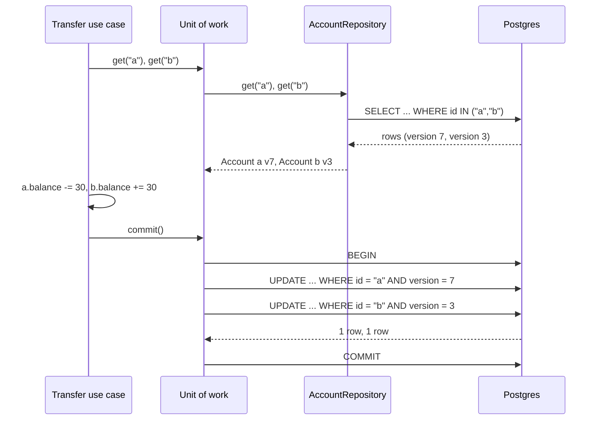

## In one minute
- A repository makes stored domain objects look like an in-memory collection: `get(id)`, `add(order)`, `find(spec)`. The domain code asks for objects and hands them back; it never sees SQL, connection pools or document shapes.
- It is a port in the [Dependency Inversion](dip.md) sense: the domain defines the interface it needs, and a Postgres, DynamoDB or in-memory adapter implements it. That is what lets business rules be tested in milliseconds against a fake that behaves like the real thing.
- Repositories come with two companions. A unit of work tracks which loaded objects changed and commits them together in one transaction. Optimistic concurrency (a version column checked on every save) stops two requests that loaded the same row from silently overwriting each other.
- One repository per aggregate root, not per table. Order lines are loaded and saved through the order, never through an `OrderLineRepository`.
- The common failures are leaky ones: a generic `Repository<T>` wrapped around an ORM that already is one, query methods that multiply into dozens, and hidden N+1 loading. Agents generate all three readily; review the interface, not just the implementation.

## How it works

### The problem
A subscription service has a `renew(subscription_id)` use case. Its first version opens a cursor, runs `SELECT * FROM subscriptions WHERE id = %s`, reads columns by index into local variables, applies the renewal rules, and runs an `UPDATE` with seven columns. The renewal rules (grace periods, price changes on renewal, a cap on failed charges) are mixed with column indexes and SQL strings. The tests need a Postgres container and take 40 seconds. When the team moves subscriptions into a separate table for add-ons, every use case that touched the old columns has to change.

### The collection illusion
A repository moves all of that behind a small interface owned by the domain:

```python
class SubscriptionRepository(Protocol):
    def get(self, sub_id: str) -> Subscription: ...
    def add(self, sub: Subscription) -> None: ...
    def save(self, sub: Subscription) -> None: ...
    def due_for_renewal(self, day: date, limit: int) -> list[Subscription]: ...

def renew(repo: SubscriptionRepository, sub_id: str, today: date) -> None:
    sub = repo.get(sub_id)
    sub.renew(today)          # all rules live on the domain object
    repo.save(sub)
```

The use case reads like the business process. The SQL, the mapping from rows to a `Subscription` and the add-on join live in `PostgresSubscriptionRepository`. Tests use `InMemorySubscriptionRepository`, a dictionary with the same behaviour. Martin Fowler's catalogue describes the pattern as mediating between the domain and data mapping layers with a collection-like interface ([PoEAA catalog](https://martinfowler.com/eaaCatalog/repository.html)), and Eric Evans made it a building block of domain-driven design.

### Repository versus DAO
A data access object is shaped like the storage: one per table, with methods such as `update_status(id, status)`. A repository is shaped like the domain: one per aggregate, with methods that load and store whole, consistent objects. If the order and its lines must change together to keep a rule true (the total equals the sum of the lines), they are one aggregate, and `OrderRepository` loads and saves both. Code that edits a line through its own repository can break the rule without the order ever knowing. Microsoft's .NET microservices guide states the rule bluntly: one repository per aggregate root, and never one per database table ([Microsoft Learn](https://learn.microsoft.com/en-us/dotnet/architecture/microservices/microservice-ddd-cqrs-patterns/infrastructure-persistence-layer-design)). Vaughn Vernon's aggregate design essays are the best guide to drawing these boundaries.

### Unit of work and identity map
A use case often changes several aggregates, or loads the same one twice through different paths. Two companions handle that:

- **Identity map.** Within one unit of work, loading id 42 twice returns the same object, so two parts of the code cannot hold diverging copies.
- **Unit of work.** It remembers what was loaded, notices which objects changed, and on `commit()` writes only those, in one transaction, or nothing at all.

SQLAlchemy's `Session`, Hibernate's `Session` and Entity Framework's `DbContext` are each an identity map plus a unit of work, and `DbSet<T>` is already a repository. Microsoft's guide says the same about EF Core: its `DbContext` already implements both the Repository and Unit of Work patterns, and its own sample repositories lean on the change tracker instead of duplicating it ([Microsoft Learn](https://learn.microsoft.com/en-us/dotnet/architecture/microservices/microservice-ddd-cqrs-patterns/infrastructure-persistence-layer-design)). Wrapping them in a hand-written generic repository adds a layer that does nothing. The useful repository over an ORM is narrow and domain-named: `subscriptions.due_for_renewal(day)`, not `repo.query(lambda s: ...)`.

### Optimistic concurrency
Two support agents open the same customer account at once. One changes the email, the other the plan, and both save. Without protection the second save writes the old email back. A database can sometimes catch this for you: PostgreSQL's repeatable read aborts the second updater with `could not serialize access due to concurrent update` and expects the application to retry the whole transaction, while the default read committed level just re-checks the `WHERE` clause and lets the write through ([Postgres docs](https://www.postgresql.org/docs/current/transaction-iso.html)). But that needs one transaction spanning the user's think time, which EF Core's docs advise against ([EF Core docs](https://learn.microsoft.com/en-us/ef/core/saving/concurrency)). The standard fix is a version number on each aggregate. Every save runs `UPDATE accounts SET ..., version = version + 1 WHERE id = $1 AND version = $2`; if no row matched, someone else saved first, and the repository raises a conflict instead of overwriting. The caller retries the whole use case from a fresh load, or shows the user a merge screen. Hibernate's `@Version`, EF Core concurrency tokens and SQLAlchemy's `version_id_col` all generate this statement for you. EF Core reports zero matched rows as `DbUpdateConcurrencyException` and suggests either telling the user or looping with a re-query ([EF Core docs](https://learn.microsoft.com/en-us/ef/core/saving/concurrency)). One gap to know: SQLAlchemy applies the check only during `Session.flush()`, so bulk `Query.update()` and `Query.delete()` skip it ([SQLAlchemy docs](https://docs.sqlalchemy.org/en/20/orm/versioning.html)).

### Queries without a method explosion
Read-heavy screens push repositories toward `find_by_status_and_region_and_created_after`. Three ways out: a specification object that the adapter translates into a `WHERE` clause; a few intention-named methods for the queries the domain actually needs; or, for screens and reports, a separate read model that skips the repository and the domain objects entirely, as described in [CQRS](../sd/cqrs.md). Repositories are for loading aggregates to change them. They are a poor tool for lists of 500 rows with eight joined columns.

### When not to use one
A CRUD admin screen with no rules beyond validation gains nothing from domain objects and repositories; let it talk to the ORM or the query builder directly. The pattern pays when there are invariants to protect and logic worth testing without a database. Even Microsoft's guide says repositories are not mandatory, and quotes a reviewer who dislikes them because they hide persistence details and who still wants an integration test against the real database ([Microsoft Learn](https://learn.microsoft.com/en-us/dotnet/architecture/microservices/microservice-ddd-cqrs-patterns/infrastructure-persistence-layer-design)). Treat that as the honest counter-argument: the fake proves the domain logic, never the SQL.

### Reviewing agent-written code
Ask an agent to "add a repository layer" and you often get `BaseRepository<T>` with `get_all`, `get_by_id`, `create`, `update` and `delete` for every table, over an ORM session. Look for: repositories per table rather than per aggregate, `get_all()` used and then filtered in Python, ORM objects or query builders leaking out of the interface, `save` methods that commit (so two saves in one use case are two transactions), and no version check. Ask for a narrow interface per aggregate, a unit of work that owns the transaction, and an in-memory implementation that passes the same contract tests as the real one.

### The same shape elsewhere
A repository with versioned saves is the *contention* shape: many writers, one record, and a compare-and-set that lets exactly one win. Kubernetes objects carry a `resourceVersion` and the API server rejects an update with a stale one. Etcd transactions compare a key's `mod_revision`. HTTP uses `ETag` with `If-Match` and answers `412 Precondition Failed`. Git refuses a non-fast-forward push. In every case the writer reads a version, proposes a change against it, and retries on conflict.

## Down the stack

### Layer 1: The contract
`get(id)` returns the aggregate as last committed, or fails with not found; it never returns a half-loaded object. `add` fails on a duplicate identity. `save` succeeds only if the stored version equals the version the object was loaded with, and then increments it; otherwise it fails with a conflict and writes nothing. Objects returned are the caller's to modify, and modifications have no effect until saved and committed. A unit of work commits all of its changes or none, and returns the same object for the same id within its lifetime. An in-memory fake must honour all of this, or tests against it prove nothing; the [Liskov Substitution Principle](lsp.md) lesson shows how a shared contract suite enforces that.

### Layer 2: The mechanism
Hibernate snapshots every loaded entity's field values. At flush, it compares each managed entity with its snapshot (dirty checking), orders the `INSERT`, `UPDATE` and `DELETE` statements to respect foreign keys, and for versioned entities appends `AND version = ?` to each `UPDATE`. If the JDBC update count is 0, it throws `OptimisticLockException`. SQLAlchemy instruments mapped attributes so each assignment records the change in the object's state, keeps loaded objects in a weak-referencing identity map keyed by primary key, and on `flush()` topologically sorts the work by mapper dependencies before emitting SQL. With `version_id_col` it checks that exactly one row matched and raises `StaleDataError` otherwise ([SQLAlchemy docs](https://docs.sqlalchemy.org/en/20/orm/versioning.html)).

In Postgres, an `UPDATE` never changes a row in place: it writes a new tuple version and marks the old one dead. If no indexed column changed and the page has room for the new version, it is a heap-only tuple (HOT) update that avoids new index entries ([Postgres docs](https://www.postgresql.org/docs/current/storage-hot.html)). The version column itself is not indexed, so bumping it keeps HOT updates possible.

### Layer 3: The machine
The repository's costs are round trips and flushes. A query inside one data centre costs about 0.2 to 1 ms of network and parsing before any work is done. Loading an order and then lazily loading each of its 50 lines is 51 round trips, 10 to 50 ms, where one join or one `IN` query costs 1 to 2 ms. That N+1 pattern is the classic repository failure, and it hides behind a clean interface.

Commit cost is dominated by the write-ahead log. Postgres writes the transaction's WAL records and, with `synchronous_commit = on`, waits for `fsync` (or `fdatasync`) on the WAL file before acknowledging. On a datacentre NVMe drive with power-loss protection that is tens of microseconds; on network-attached cloud volumes it is often 0.5 to 2 ms. A unit of work that commits once per use case pays this once. Code that commits inside each `save` pays it per aggregate and loses atomicity. In memory, identity maps and snapshots roughly double the memory of loaded entities, which matters when a batch job loads 100,000 of them into one session; clear the session in chunks.

### Why it's built this way
1. Business rules change more often than storage, and are more valuable to test, so they should not depend on SQL.
2. Domain code thinks in whole objects with invariants, so persistence is offered as a collection of aggregates, not as tables.
3. One use case can change several objects that must succeed or fail together, so changes are tracked and committed as one unit.
4. Concurrent requests load the same aggregate, and locks held across user think time do not scale, so saves compare a version and fail fast.
5. Round trips and fsyncs are the dominant costs, so loading is designed per aggregate and commits are batched per use case.

## Diagram


## Worked example
A billing platform holds 2 million customer accounts. Support agents and an automated dunning job both edit accounts; at peak there are about 300 writes per second, and the same account is edited by two actors within a few seconds roughly 40 times a day. Before versioning, those collisions silently lost one of the two changes. Two customers a week reported a plan change that "didn't stick".

The team introduced `AccountRepository` with a `version` column and a unit of work per request. Each save became `UPDATE ... WHERE id = $1 AND version = $2`. Conflicts now surface as errors: the dunning job retries from a fresh load (up to 3 attempts, with jitter), and the support UI shows "this account changed while you were editing" with a diff. Over a month, 1,180 conflicts were caught, 1,150 resolved by automatic retry, and 30 needed an agent to re-apply a change. Lost-update reports dropped to zero.

The cost was small. Each update now carries one more predicate and writes one more integer column; p99 latency for the save moved from 4.1 to 4.3 ms. The bigger win came from the same refactor: the old code saved account, address and preferences in three transactions with three WAL flushes. The unit of work committed them in one, cutting the save path from 3 to 1 synchronous commits per request.

## In the wild
- **Jepsen on MySQL, 2023: lost updates in the ORM load-modify-save flow.** On a single healthy node running 8.0.34 at repeatable read, Jepsen found 198 lost-update instances in one run of 9,048 successful transactions. It says a read-modify-write transaction of the kind ORMs generate is not safe at that level, and recommends `SELECT ... FOR UPDATE` or serializable ([Jepsen](https://jepsen.io/analyses/mysql-8.0.34)). A versioned repository does not depend on the isolation level to catch this.
- **Uber, 2021: fulfillment storage moves to Spanner.** Uber's trip and delivery platform stored data in Cassandra, which uses last-write-wins, so concurrent writes during split-brain events could overwrite each other, and writes touching several entities were not atomic. The rebuild put the data in Spanner with transactions across rows and tables, and added an ORM layer; the project took about two years with 100+ engineers ([Uber Engineering](https://www.uber.com/us/en/blog/fulfillment-platform-rearchitecture/)). The lesson for a repository is the same one at larger scale: saves need a conflict check and one atomic commit per use case.
- **Microsoft eShopOnContainers, documented design.** The ordering service in Microsoft's reference architecture gives each aggregate root its own repository, uses EF Core's `DbContext` as the unit of work, and recommends mock repositories for unit tests, while sending reads on a separate Dapper-based query path ([Microsoft Learn](https://learn.microsoft.com/en-us/dotnet/architecture/microservices/microservice-ddd-cqrs-patterns/infrastructure-persistence-layer-design)).

## Trade-offs
| Option | Strengths | Weaknesses | Choose when |
| --- | --- | --- | --- |
| SQL or ORM in the use case | Least code; full query power | Rules tangled with storage; slow tests | Thin CRUD with no real rules |
| Narrow repository per aggregate | Domain-named, testable with fakes; protects invariants | Mapping code; query methods to maintain | Domains with invariants and long life |
| Generic `Repository<T>` over an ORM | Uniform API | Duplicates the ORM; leaks query concerns; per-table thinking | Rarely; prefer the ORM directly |
| Repository plus separate read model | Fast lists and reports; writes stay clean | Two models to keep in sync | Read-heavy screens over a rich domain |
| Pessimistic locking (`SELECT ... FOR UPDATE`) | No conflicts to handle | Locks held for the transaction; deadlocks; no use across user think time | Short, hot, contended updates such as counters |

## Pitfalls in production
- `save()` that commits, so a use case with two saves can half-succeed. Fix: the unit of work owns the transaction; repositories never commit.
- Lazy loading inside loops, turning one page load into hundreds of queries. Fix: load the aggregate with its parts in one query, and add a query-count assertion to tests.
- Missing version checks, so concurrent edits overwrite each other silently. Do not assume the database isolation level covers you: Jepsen showed MySQL 8.0.34 repeatable read losing updates in a plain read-modify-write transaction, the usual ORM load-modify-save flow ([Jepsen](https://jepsen.io/analyses/mysql-8.0.34)). Fix: a version column and a conditional update, with conflicts surfaced and retried at the use-case level.
- An in-memory fake that returns the stored object itself, so tests pass even when the code forgets to call `save`. Fix: return copies, and run the same contract tests against the fake and the real adapter.
- `get_all()` followed by filtering in application code. Fix: an intention-named query method or a specification translated to `WHERE`.
- Long-lived sessions in batch jobs growing without bound as the identity map fills. Fix: commit and clear in chunks of a few thousand.

## Leadership lens
- Decide where repositories pay. Mandating them for every table creates a layer of empty wrappers; limiting them to aggregates with invariants keeps the cost where the value is.
- Treat lost updates as a correctness bug with a test, not a rare race to ignore. Ask in review: "what happens when two requests save this at once?"
- Require contract tests shared between the in-memory fake and the real adapter. Fast tests are only valuable if the fake is honest.
- Watch query counts per request in production. A repository interface hides N+1 patterns from code review, so measure them instead.
- Agents produce generic repository scaffolding by default. State the house style (aggregate repositories, unit of work owns commit, versioned saves) in the repo's agent instructions.

## Check yourself
1. Why should `OrderLine` not have its own repository when lines belong to an order?
   **Answer:** The order is the aggregate that protects rules spanning its lines, such as the total. Saving lines independently lets code change them without the order checking its invariants.
2. Two requests load account `a` at version 7 and both save. What does a versioned repository do, and what should the caller do?
   **Answer:** The first save matches `version = 7` and bumps it to 8; the second matches no row and fails with a conflict. The caller reloads and retries the use case, or asks the user to resolve the difference.
3. Why should an in-memory fake repository return copies rather than the stored objects?
   **Answer:** Real repositories return detached data; returning the stored object lets a test pass even when the code never calls `save`, so the fake hides bugs.
4. When would you skip the repository for a query?
   **Answer:** For read-only lists and reports, where a dedicated read query or read model is faster and nothing is being changed, so no invariants need the domain object.

## Practice
**Task:** Build an in-memory account repository with optimistic concurrency and a unit of work. An `Account` has `id`, `owner`, `balance` and `version` (default 0). `add(account)` fails with `duplicate id: <id>`, stores a copy at version 1 and sets the caller's version to 1. `get(id)` returns a copy or fails with `not found: <id>`. `save(account)` fails with `not found: <id>`, or with `conflict: <id> expected v<stored> got v<given>` if versions differ; otherwise it stores a copy with the version incremented and increments the caller's version. `find(spec, limit)` returns copies of accounts for which `spec(account)` is true, sorted by id, at most `limit`. `UnitOfWork(repo)` has `get(id)`, which returns the same object for the same id within the unit and remembers the loaded `owner` and `balance`, and `commit()`, which finds the changed accounts, checks every one of them for a version conflict before saving any (failing with the first conflict in id order and saving nothing), saves them in id order, forgets all tracked objects, and returns the saved ids. Python raises `ValueError`, TypeScript throws `Error`, Go returns an error.

```python starter
class Account:
    def __init__(self, id, owner, balance, version=0):
        self.id, self.owner, self.balance, self.version = id, owner, balance, version

class InMemoryAccountRepo:
    def add(self, account):
        raise NotImplementedError

    def get(self, id):
        raise NotImplementedError

    def save(self, account):
        raise NotImplementedError

    def find(self, spec, limit):
        raise NotImplementedError

class UnitOfWork:
    def __init__(self, repo):
        self.repo = repo

    def get(self, id):
        raise NotImplementedError

    def commit(self):
        raise NotImplementedError
```

```python tests
def error_of(fn):
    try:
        fn()
    except ValueError as e:
        return str(e)
    return None

def seeded():
    r = InMemoryAccountRepo()
    for i, name, bal in [("b", "bo", 50), ("a", "ann", 100), ("c", "cy", 0)]:
        r.add(Account(i, name, bal))
    return r

def test_add_get_returns_versioned_copy():
    r = InMemoryAccountRepo()
    acct = Account("a", "ann", 100)
    r.add(acct)
    assert acct.version == 1
    got = r.get("a")
    assert (got.owner, got.balance, got.version) == ("ann", 100, 1)
    got.balance = 0
    assert r.get("a").balance == 100, "changes need save"

def test_duplicate_and_missing():
    r = seeded()
    assert error_of(lambda: r.add(Account("a", "x", 1))) == "duplicate id: a"
    assert error_of(lambda: r.get("zz")) == "not found: zz"
    assert error_of(lambda: r.save(Account("zz", "x", 1, 1))) == "not found: zz"

def test_save_bumps_version_and_rejects_stale():
    r = seeded()
    first, second = r.get("a"), r.get("a")
    first.balance = 70
    r.save(first)
    assert first.version == 2 and r.get("a").balance == 70
    second.owner = "annie"
    assert error_of(lambda: r.save(second)) == "conflict: a expected v2 got v1"
    assert r.get("a").owner == "ann"

def test_find_sorted_and_limited_copies():
    r = seeded()
    rich = r.find(lambda a: a.balance > 0, 10)
    assert [a.id for a in rich] == ["a", "b"]
    assert [a.id for a in r.find(lambda a: True, 2)] == ["a", "b"]
    rich[0].balance = -1
    assert r.get("a").balance == 100

def test_unit_of_work_identity_map_and_dirty_only():
    r = seeded()
    uow = UnitOfWork(r)
    a, b = uow.get("a"), uow.get("b")
    assert uow.get("a") is a
    uow.get("c")
    b.balance += 30
    a.balance -= 30
    assert uow.commit() == ["a", "b"]
    assert (r.get("a").balance, r.get("a").version) == (70, 2)
    assert (r.get("b").balance, r.get("b").version) == (80, 2)
    assert r.get("c").version == 1, "unchanged account is not saved"

def test_commit_is_all_or_nothing_on_conflict():
    r = seeded()
    uow = UnitOfWork(r)
    a, b = uow.get("a"), uow.get("b")
    a.balance -= 30
    b.balance += 30
    other = r.get("b")
    other.owner = "bob"
    r.save(other)
    assert error_of(uow.commit) == "conflict: b expected v2 got v1"
    assert r.get("a").balance == 100 and r.get("a").version == 1, "a was not saved"

def test_commit_forgets_tracked_objects():
    r = seeded()
    uow = UnitOfWork(r)
    a = uow.get("a")
    a.balance = 1
    assert uow.commit() == ["a"]
    assert uow.commit() == []
    assert uow.get("a") is not a and uow.get("a").version == 2
```

```python solution
class Account:
    def __init__(self, id, owner, balance, version=0):
        self.id, self.owner, self.balance, self.version = id, owner, balance, version

def _copy(a):
    return Account(a.id, a.owner, a.balance, a.version)

class InMemoryAccountRepo:
    def __init__(self):
        self._rows = {}

    def add(self, account):
        if account.id in self._rows:
            raise ValueError("duplicate id: " + account.id)
        account.version = 1
        self._rows[account.id] = _copy(account)

    def get(self, id):
        if id not in self._rows:
            raise ValueError("not found: " + id)
        return _copy(self._rows[id])

    def check(self, account):
        stored = self._rows.get(account.id)
        if stored is None:
            raise ValueError("not found: " + account.id)
        if stored.version != account.version:
            raise ValueError("conflict: %s expected v%d got v%d" % (account.id, stored.version, account.version))

    def save(self, account):
        self.check(account)
        account.version += 1
        self._rows[account.id] = _copy(account)

    def find(self, spec, limit):
        ids = sorted(i for i, a in self._rows.items() if spec(_copy(a)))
        return [_copy(self._rows[i]) for i in ids[:limit]]

class UnitOfWork:
    def __init__(self, repo):
        self.repo = repo
        self._seen = {}

    def get(self, id):
        if id not in self._seen:
            a = self.repo.get(id)
            self._seen[id] = (a, (a.owner, a.balance))
        return self._seen[id][0]

    def commit(self):
        dirty = [a for i, (a, snap) in sorted(self._seen.items()) if (a.owner, a.balance) != snap]
        for a in dirty:
            current = self.repo.get(a.id)
            if current.version != a.version:
                raise ValueError("conflict: %s expected v%d got v%d" % (a.id, current.version, a.version))
        for a in dirty:
            self.repo.save(a)
        self._seen = {}
        return [a.id for a in dirty]
```

```typescript starter
export class Account {
  constructor(public id: string, public owner: string, public balance: number, public version = 0) {}
}

export class InMemoryAccountRepo {
  add(account: Account): void { throw new Error("TODO"); }
  get(id: string): Account { throw new Error("TODO"); }
  save(account: Account): void { throw new Error("TODO"); }
  find(spec: (a: Account) => boolean, limit: number): Account[] { throw new Error("TODO"); }
}

export class UnitOfWork {
  constructor(public repo: InMemoryAccountRepo) {}
  get(id: string): Account { throw new Error("TODO"); }
  commit(): string[] { throw new Error("TODO"); }
}
```

```typescript tests
function errorOf(fn: () => unknown): string | undefined {
  try { fn(); } catch (e) { return (e as Error).message; }
  return undefined;
}

function seeded(): InMemoryAccountRepo {
  const r = new InMemoryAccountRepo();
  r.add(new Account("b", "bo", 50));
  r.add(new Account("a", "ann", 100));
  r.add(new Account("c", "cy", 0));
  return r;
}

test("add get returns versioned copy", () => {
  const r = new InMemoryAccountRepo();
  const acct = new Account("a", "ann", 100);
  r.add(acct);
  assertEqual(acct.version, 1);
  const got = r.get("a");
  assertEqual([got.owner, got.balance, got.version], ["ann", 100, 1]);
  got.balance = 0;
  assertEqual(r.get("a").balance, 100, "changes need save");
});

test("duplicate and missing", () => {
  const r = seeded();
  assertEqual(errorOf(() => r.add(new Account("a", "x", 1))), "duplicate id: a");
  assertEqual(errorOf(() => r.get("zz")), "not found: zz");
  assertEqual(errorOf(() => r.save(new Account("zz", "x", 1, 1))), "not found: zz");
});

test("save bumps version and rejects stale", () => {
  const r = seeded();
  const first = r.get("a");
  const second = r.get("a");
  first.balance = 70;
  r.save(first);
  assert(first.version === 2 && r.get("a").balance === 70, "saved at v2");
  second.owner = "annie";
  assertEqual(errorOf(() => r.save(second)), "conflict: a expected v2 got v1");
  assertEqual(r.get("a").owner, "ann");
});

test("find sorted and limited copies", () => {
  const r = seeded();
  const rich = r.find((a) => a.balance > 0, 10);
  assertEqual(rich.map((a) => a.id), ["a", "b"]);
  assertEqual(r.find(() => true, 2).map((a) => a.id), ["a", "b"]);
  rich[0].balance = -1;
  assertEqual(r.get("a").balance, 100);
});

test("unit of work identity map and dirty only", () => {
  const r = seeded();
  const uow = new UnitOfWork(r);
  const a = uow.get("a");
  const b = uow.get("b");
  assert(uow.get("a") === a, "same object");
  uow.get("c");
  b.balance += 30;
  a.balance -= 30;
  assertEqual(uow.commit(), ["a", "b"]);
  assertEqual([r.get("a").balance, r.get("a").version], [70, 2]);
  assertEqual([r.get("b").balance, r.get("b").version], [80, 2]);
  assertEqual(r.get("c").version, 1, "unchanged account is not saved");
});

test("commit is all or nothing on conflict", () => {
  const r = seeded();
  const uow = new UnitOfWork(r);
  const a = uow.get("a");
  const b = uow.get("b");
  a.balance -= 30;
  b.balance += 30;
  const other = r.get("b");
  other.owner = "bob";
  r.save(other);
  assertEqual(errorOf(() => uow.commit()), "conflict: b expected v2 got v1");
  assert(r.get("a").balance === 100 && r.get("a").version === 1, "a was not saved");
});

test("commit forgets tracked objects", () => {
  const r = seeded();
  const uow = new UnitOfWork(r);
  const a = uow.get("a");
  a.balance = 1;
  assertEqual(uow.commit(), ["a"]);
  assertEqual(uow.commit(), []);
  assert(uow.get("a") !== a && uow.get("a").version === 2, "fresh load after commit");
});
```

```typescript solution
export class Account {
  constructor(public id: string, public owner: string, public balance: number, public version = 0) {}
}

const copyOf = (a: Account) => new Account(a.id, a.owner, a.balance, a.version);

export class InMemoryAccountRepo {
  private rows = new Map<string, Account>();

  add(account: Account): void {
    if (this.rows.has(account.id)) throw new Error("duplicate id: " + account.id);
    account.version = 1;
    this.rows.set(account.id, copyOf(account));
  }

  get(id: string): Account {
    const a = this.rows.get(id);
    if (!a) throw new Error("not found: " + id);
    return copyOf(a);
  }

  save(account: Account): void {
    const stored = this.rows.get(account.id);
    if (!stored) throw new Error("not found: " + account.id);
    if (stored.version !== account.version) {
      throw new Error(`conflict: ${account.id} expected v${stored.version} got v${account.version}`);
    }
    account.version += 1;
    this.rows.set(account.id, copyOf(account));
  }

  find(spec: (a: Account) => boolean, limit: number): Account[] {
    return [...this.rows.values()]
      .filter((a) => spec(copyOf(a)))
      .sort((x, y) => (x.id < y.id ? -1 : x.id > y.id ? 1 : 0))
      .slice(0, limit)
      .map(copyOf);
  }
}

export class UnitOfWork {
  private seen = new Map<string, { obj: Account; owner: string; balance: number }>();
  constructor(public repo: InMemoryAccountRepo) {}

  get(id: string): Account {
    let e = this.seen.get(id);
    if (!e) {
      const obj = this.repo.get(id);
      e = { obj, owner: obj.owner, balance: obj.balance };
      this.seen.set(id, e);
    }
    return e.obj;
  }

  commit(): string[] {
    const ids = [...this.seen.keys()].sort();
    const dirty: Account[] = [];
    for (const id of ids) {
      const e = this.seen.get(id)!;
      if (e.obj.owner !== e.owner || e.obj.balance !== e.balance) dirty.push(e.obj);
    }
    for (const a of dirty) {
      const current = this.repo.get(a.id);
      if (current.version !== a.version) {
        throw new Error(`conflict: ${a.id} expected v${current.version} got v${a.version}`);
      }
    }
    for (const a of dirty) this.repo.save(a);
    this.seen.clear();
    return dirty.map((a) => a.id);
  }
}
```

```go starter
package practice

type Account struct {
	ID      string
	Owner   string
	Balance int
	Version int
}

type Repo struct{}

func NewRepo() *Repo { return &Repo{} }

func (r *Repo) Add(a *Account) error                               { panic("TODO") }
func (r *Repo) Get(id string) (*Account, error)                    { panic("TODO") }
func (r *Repo) Save(a *Account) error                              { panic("TODO") }
func (r *Repo) Find(spec func(Account) bool, limit int) []*Account { panic("TODO") }

type UnitOfWork struct{ repo *Repo }

func NewUnitOfWork(r *Repo) *UnitOfWork { return &UnitOfWork{repo: r} }

func (u *UnitOfWork) Get(id string) (*Account, error) { panic("TODO") }
func (u *UnitOfWork) Commit() ([]string, error)       { panic("TODO") }
```

```go tests
package practice

import (
	"reflect"
	"testing"
)

func errStr(err error) string {
	if err == nil {
		return ""
	}
	return err.Error()
}

func seeded(t *testing.T) *Repo {
	t.Helper()
	r := NewRepo()
	for _, a := range []*Account{{ID: "b", Owner: "bo", Balance: 50}, {ID: "a", Owner: "ann", Balance: 100}, {ID: "c", Owner: "cy"}} {
		if err := r.Add(a); err != nil {
			t.Fatal(err)
		}
	}
	return r
}

type getter interface {
	Get(id string) (*Account, error)
}

func mustGet(t *testing.T, g getter, id string) *Account {
	t.Helper()
	a, err := g.Get(id)
	if err != nil {
		t.Fatal(err)
	}
	return a
}

func ids(as []*Account) []string {
	out := []string{}
	for _, a := range as {
		out = append(out, a.ID)
	}
	return out
}

func TestAddGetReturnsVersionedCopy(t *testing.T) {
	r := NewRepo()
	acct := &Account{ID: "a", Owner: "ann", Balance: 100}
	if err := r.Add(acct); err != nil || acct.Version != 1 {
		t.Fatalf("err %v version %d", err, acct.Version)
	}
	got := mustGet(t, r, "a")
	if got.Owner != "ann" || got.Balance != 100 || got.Version != 1 {
		t.Fatalf("got %+v", got)
	}
	got.Balance = 0
	if mustGet(t, r, "a").Balance != 100 {
		t.Fatal("changes need save")
	}
}

func TestDuplicateAndMissing(t *testing.T) {
	r := seeded(t)
	if e := errStr(r.Add(&Account{ID: "a"})); e != "duplicate id: a" {
		t.Fatalf("got %q", e)
	}
	if _, err := r.Get("zz"); errStr(err) != "not found: zz" {
		t.Fatalf("got %v", err)
	}
	if e := errStr(r.Save(&Account{ID: "zz", Version: 1})); e != "not found: zz" {
		t.Fatalf("got %q", e)
	}
}

func TestSaveBumpsVersionAndRejectsStale(t *testing.T) {
	r := seeded(t)
	first, second := mustGet(t, r, "a"), mustGet(t, r, "a")
	first.Balance = 70
	if err := r.Save(first); err != nil || first.Version != 2 {
		t.Fatalf("err %v version %d", err, first.Version)
	}
	second.Owner = "annie"
	if e := errStr(r.Save(second)); e != "conflict: a expected v2 got v1" {
		t.Fatalf("got %q", e)
	}
	if got := mustGet(t, r, "a"); got.Owner != "ann" || got.Balance != 70 {
		t.Fatalf("got %+v", got)
	}
}

func TestFindSortedAndLimitedCopies(t *testing.T) {
	r := seeded(t)
	rich := r.Find(func(a Account) bool { return a.Balance > 0 }, 10)
	if !reflect.DeepEqual(ids(rich), []string{"a", "b"}) {
		t.Fatalf("got %v", ids(rich))
	}
	if got := ids(r.Find(func(Account) bool { return true }, 2)); !reflect.DeepEqual(got, []string{"a", "b"}) {
		t.Fatalf("got %v", got)
	}
	rich[0].Balance = -1
	if mustGet(t, r, "a").Balance != 100 {
		t.Fatal("find must return copies")
	}
}

func TestUnitOfWorkIdentityMapAndDirtyOnly(t *testing.T) {
	r := seeded(t)
	u := NewUnitOfWork(r)
	a, b := mustGet(t, u, "a"), mustGet(t, u, "b")
	if mustGet(t, u, "a") != a {
		t.Fatal("expected same object")
	}
	mustGet(t, u, "c")
	b.Balance += 30
	a.Balance -= 30
	saved, err := u.Commit()
	if err != nil || !reflect.DeepEqual(saved, []string{"a", "b"}) {
		t.Fatalf("saved %v err %v", saved, err)
	}
	if got := mustGet(t, r, "a"); got.Balance != 70 || got.Version != 2 {
		t.Fatalf("a %+v", got)
	}
	if got := mustGet(t, r, "b"); got.Balance != 80 || got.Version != 2 {
		t.Fatalf("b %+v", got)
	}
	if mustGet(t, r, "c").Version != 1 {
		t.Fatal("unchanged account is not saved")
	}
}

func TestCommitIsAllOrNothingOnConflict(t *testing.T) {
	r := seeded(t)
	u := NewUnitOfWork(r)
	a, b := mustGet(t, u, "a"), mustGet(t, u, "b")
	a.Balance -= 30
	b.Balance += 30
	other := mustGet(t, r, "b")
	other.Owner = "bob"
	if err := r.Save(other); err != nil {
		t.Fatal(err)
	}
	if _, err := u.Commit(); errStr(err) != "conflict: b expected v2 got v1" {
		t.Fatalf("got %v", err)
	}
	if got := mustGet(t, r, "a"); got.Balance != 100 || got.Version != 1 {
		t.Fatalf("a was saved: %+v", got)
	}
}

func TestCommitForgetsTrackedObjects(t *testing.T) {
	r := seeded(t)
	u := NewUnitOfWork(r)
	a := mustGet(t, u, "a")
	a.Balance = 1
	if saved, err := u.Commit(); err != nil || !reflect.DeepEqual(saved, []string{"a"}) {
		t.Fatalf("saved %v err %v", saved, err)
	}
	if saved, err := u.Commit(); err != nil || len(saved) != 0 {
		t.Fatalf("second commit saved %v err %v", saved, err)
	}
	if again := mustGet(t, u, "a"); again == a || again.Version != 2 {
		t.Fatalf("expected fresh load, got %+v", again)
	}
}
```

```go solution
package practice

import (
	"errors"
	"fmt"
	"sort"
)

type Account struct {
	ID      string
	Owner   string
	Balance int
	Version int
}

type Repo struct{ rows map[string]Account }

func NewRepo() *Repo { return &Repo{rows: map[string]Account{}} }

func (r *Repo) Add(a *Account) error {
	if _, ok := r.rows[a.ID]; ok {
		return errors.New("duplicate id: " + a.ID)
	}
	a.Version = 1
	r.rows[a.ID] = *a
	return nil
}

func (r *Repo) Get(id string) (*Account, error) {
	a, ok := r.rows[id]
	if !ok {
		return nil, errors.New("not found: " + id)
	}
	return &a, nil
}

func (r *Repo) check(a *Account) error {
	stored, ok := r.rows[a.ID]
	if !ok {
		return errors.New("not found: " + a.ID)
	}
	if stored.Version != a.Version {
		return fmt.Errorf("conflict: %s expected v%d got v%d", a.ID, stored.Version, a.Version)
	}
	return nil
}

func (r *Repo) Save(a *Account) error {
	if err := r.check(a); err != nil {
		return err
	}
	a.Version++
	r.rows[a.ID] = *a
	return nil
}

func (r *Repo) Find(spec func(Account) bool, limit int) []*Account {
	keys := make([]string, 0, len(r.rows))
	for id, a := range r.rows {
		if spec(a) {
			keys = append(keys, id)
		}
	}
	sort.Strings(keys)
	if len(keys) > limit {
		keys = keys[:limit]
	}
	out := make([]*Account, 0, len(keys))
	for _, id := range keys {
		a := r.rows[id]
		out = append(out, &a)
	}
	return out
}

type tracked struct {
	obj     *Account
	owner   string
	balance int
}

type UnitOfWork struct {
	repo *Repo
	seen map[string]tracked
}

func NewUnitOfWork(r *Repo) *UnitOfWork { return &UnitOfWork{repo: r, seen: map[string]tracked{}} }

func (u *UnitOfWork) Get(id string) (*Account, error) {
	if e, ok := u.seen[id]; ok {
		return e.obj, nil
	}
	a, err := u.repo.Get(id)
	if err != nil {
		return nil, err
	}
	u.seen[id] = tracked{a, a.Owner, a.Balance}
	return a, nil
}

func (u *UnitOfWork) Commit() ([]string, error) {
	keys := make([]string, 0, len(u.seen))
	for id := range u.seen {
		keys = append(keys, id)
	}
	sort.Strings(keys)
	var dirty []*Account
	for _, id := range keys {
		e := u.seen[id]
		if e.obj.Owner != e.owner || e.obj.Balance != e.balance {
			dirty = append(dirty, e.obj)
		}
	}
	for _, a := range dirty {
		if err := u.repo.check(a); err != nil {
			return nil, err
		}
	}
	saved := []string{}
	for _, a := range dirty {
		if err := u.repo.Save(a); err != nil {
			return saved, err
		}
		saved = append(saved, a.ID)
	}
	u.seen = map[string]tracked{}
	return saved, nil
}
```

## Mock interview
**Prompt:** You are designing the persistence layer for an inventory service: 5,000 warehouses, 40 million stock records, about 2,000 writes per second at peak, and frequent concurrent adjustments to the same SKU in the same warehouse from picking, receiving and cycle-count jobs. Business rules forbid negative stock and require every adjustment to carry a reason. How do you structure repositories and transactions?

- Follow-up: Picking and receiving adjust the same stock record within milliseconds. Optimistic versioning or `SELECT ... FOR UPDATE`, and why?
- Follow-up: A transfer moves stock between two warehouses. What is the aggregate, and what does the unit of work commit?
- Follow-up: The warehouse dashboard lists 3,000 SKUs with totals. Does it go through the repository?

**A strong answer covers:**
- An aggregate per stock record (warehouse plus SKU) holding quantity and recent adjustments, with the no-negative rule enforced inside it, and a narrow `StockRepository` for it.
- A unit of work per command that owns the transaction; repositories never commit, and a transfer updates two aggregates in one transaction (or, across services, a saga with compensations).
- Optimistic versioning by default with bounded retries and jitter; for a measured hot SKU, a conditional atomic update (`quantity = quantity - n WHERE quantity >= n`) or a short row lock instead of retry storms.
- A separate read model or direct SQL for the dashboard, not loading 3,000 aggregates.
- Contract tests shared by the in-memory and Postgres repositories, and production metrics for conflict rate and queries per request.

## Sources and further study
**Primary**
- [PostgreSQL: transaction isolation](https://www.postgresql.org/docs/current/transaction-iso.html): what read committed and repeatable read do when two transactions update the same row.
- [SQLAlchemy: configuring a version counter](https://docs.sqlalchemy.org/en/20/orm/versioning.html): the `UPDATE ... WHERE version` mechanism, `StaleDataError` and its limits.
- [Jepsen: MySQL 8.0.34](https://jepsen.io/analyses/mysql-8.0.34): lost updates at repeatable read and the locking advice for read-modify-write code.

**Systems docs**
- [EF Core: handling concurrency conflicts](https://learn.microsoft.com/en-us/ef/core/saving/concurrency): concurrency tokens, `DbUpdateConcurrencyException` and retry strategies.
- [Microsoft Learn: infrastructure persistence layer design](https://learn.microsoft.com/en-us/dotnet/architecture/microservices/microservice-ddd-cqrs-patterns/infrastructure-persistence-layer-design): one repository per aggregate, `DbContext` as unit of work, and the case against mandatory repositories.
- [PostgreSQL: heap-only tuples](https://www.postgresql.org/docs/current/storage-hot.html): why updating a non-indexed version column stays cheap.
- [Uber: fulfillment platform re-architecture](https://www.uber.com/us/en/blog/fulfillment-platform-rearchitecture/): the cost of best-effort consistency and last-write-wins storage.

**Books**
- *Domain-Driven Design* (Evans, 1st ed. 2003), Ch 6 The Life Cycle of a Domain Object: aggregates and repositories as the building blocks this lesson uses.
- *Clean Architecture* (Martin, 1st ed. 2017), Ch 30 The Database Is a Detail and Ch 11 DIP: why the domain owns the interface and the storage adapts to it.

## Watch
- [Deep Dive Into the Repository Design Pattern in Python (ArjanCodes)](https://www.youtube.com/watch?v=9ymRLDfnDKg): building a repository interface and swapping storage implementations behind it.

## Free resources
- [Repository (Martin Fowler, PoEAA catalog)](https://martinfowler.com/eaaCatalog/repository.html): the original short definition of the pattern.
- [Unit of Work (Martin Fowler, PoEAA catalog)](https://martinfowler.com/eaaCatalog/unitOfWork.html): the companion pattern that tracks changes and commits them together.
- [Repository Pattern (Architecture Patterns with Python)](https://www.cosmicpython.com/book/chapter_02_repository.html): a full, free chapter with fakes, ports and tests.
- [Unit of Work Pattern (Architecture Patterns with Python)](https://www.cosmicpython.com/book/chapter_06_uow.html): how the unit of work owns the transaction in practice.
- [Effective Aggregate Design, Part I (Vaughn Vernon)](https://www.dddcommunity.org/wp-content/uploads/files/pdf_articles/Vernon_2011_1.pdf): how to size aggregates, which decides what each repository loads.
- [Session Basics (SQLAlchemy docs)](https://docs.sqlalchemy.org/en/20/orm/session_basics.html): a production identity map and unit of work, and when to flush and commit.
