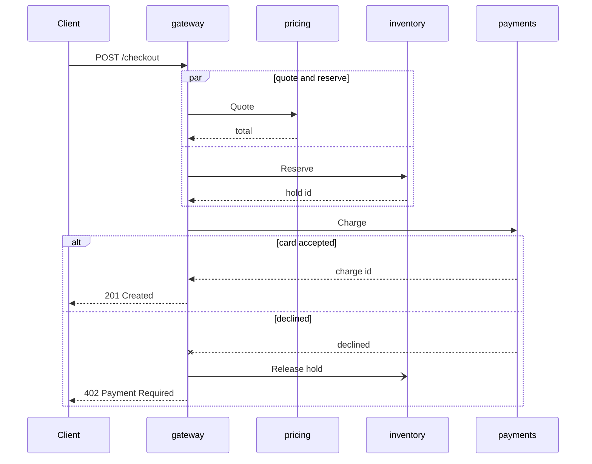

## In one minute
- A sequence diagram shows one scenario as messages between participants over time: participants across the top, time running down, one arrow per message.
- Each participant has a lifeline (dashed vertical line) and activation bars showing when it is busy handling a call. Solid arrows with filled heads are synchronous calls, open heads are asynchronous sends, dashed arrows are replies.
- Combined fragments (`alt`, `opt`, `loop`, `par`, `break`, `critical`) add branching, repetition and concurrency without turning the diagram into a flowchart.
- At runtime a synchronous arrow is a stack frame inside one process and a pair of client and server spans across processes. A distributed trace is a sequence diagram that the system drew for you.
- Draw one when the question is "who calls whom, in what order, and what happens when step 4 fails". Draw a class diagram for structure and an activity diagram for a process with many branches.

## How it works

### Reading the axes
Horizontal position means nothing except identity: each column is one participant, which can be an object, a service, a queue or a human actor. Vertical position is time, but only as order. Equal spacing does not mean equal duration, and two arrows at the same height on different lifelines are not necessarily simultaneous.

Each lifeline is a total order of events: on the `pricing` lifeline, receiving `Quote` happens before sending `GET rules`. Across lifelines the order is partial. A message's send happens before its receive, and that chains through, which is exactly Lamport's happens-before relation drawn on paper ([Lamport, 1978](https://lamport.azurewebsites.net/pubs/time-clocks.pdf)). Two events on different lifelines with no chain of messages between them are concurrent, whatever their height on the page.

### Messages
A solid line with a filled arrowhead is a synchronous call: the sender blocks until the reply. A solid line with an open arrowhead is an asynchronous send: the sender continues. A dashed line back is a reply, labelled with the return value or status. In Mermaid these are `->>`, `-)` and `-->>`, and `-x` or `--x` ends a message with a cross to show it was lost or failed ([Mermaid docs](https://mermaid.js.org/syntax/sequenceDiagram.html)).

The activation bar on the receiver starts when a synchronous call arrives and ends when the reply leaves. Nested bars show a participant calling itself or being re-entered by a callback, which is often the first visual hint of a reentrancy bug.

An arrow into a participant box drawn halfway down is a constructor call, and an X ending a lifeline is destruction (Mermaid: `create participant`, `destroy`).

### Combined fragments
A fragment is a labelled box around some messages:

- `alt` with guards such as `[card accepted]` and `[declined]` is if/else.
- `opt` is an `alt` with one branch.
- `loop [for each item]` repeats its contents.
- `par` splits into regions separated by dashed lines that run concurrently; the fragment ends when all regions finish.
- `break` runs its contents and then abandons the rest of the enclosing interaction, the diagram's version of an early return or thrown exception.
- `critical` marks a region that must not interleave with others, such as a lock or a transaction (Mermaid draws it as a labelled box with optional `option` branches for failure handling).

Nesting more than two fragments deep is a sign the diagram is trying to be a program. Split it into one diagram per scenario: the happy path, the declined card, the inventory timeout.

### Reviewing agent-written diagrams
Agents generating diagrams from code tend to draw every call as synchronous, omit failure replies, and put `par` around calls the code awaits one after another. Compare with a real trace: spans that never overlap were not parallel. The practice task generates the diagram from spans.

### The same shape elsewhere
Sequence diagrams are the *ordering* shape. A database transaction history and a TCP capture (Wireshark's flow graph is a sequence diagram of segments) raise the same questions: what is ordered, what is concurrent, and what happens when one message is lost.

## Down the stack

### Layer 1: The contract
A sequence diagram claims four things that can be checked against a running system. Messages on a lifeline occur in the drawn order. Every synchronous call gets exactly one reply or one failure, and the caller's activation encloses the callee's. Messages in different `par` regions may interleave in any order. Messages not shown are not part of the scenario, which is a weaker claim than "do not happen". The diagram says nothing about absolute time, so latency budgets belong in notes or in a separate SLO.

### Layer 2: The mechanism
Inside one process a synchronous arrow is a function call and the activation bar is the callee's stack frame: pushed on call, popped on return. A debugger's stack view at any instant is a vertical slice through the diagram's nested activations.

Across processes the mapping is distributed tracing (see the Distributed Tracing lesson for propagation and sampling). OpenTelemetry records each operation as a span with `trace_id` (16 bytes), `span_id` (8 bytes), `parent_span_id`, `name`, `kind`, `start_time_unix_nano`, `end_time_unix_nano` and `status`. One arrow between services is a pair of spans: a `CLIENT` span in the caller and a `SERVER` span in the callee whose parent is that client span, linked by the W3C `traceparent` header, a 55-character string such as `00-<32 hex trace id>-<16 hex parent id>-01` ([W3C Trace Context](https://www.w3.org/TR/trace-context/)). An asynchronous send is a `PRODUCER` span and a `CONSUMER` span. The OpenTelemetry messaging conventions connect them with a span link by default, because a link is the only structure that holds across every broker model, and a consumer may run long after the producer finished ([messaging spans](https://opentelemetry.io/docs/specs/semconv/messaging/messaging-spans/), [span kinds](https://opentelemetry.io/docs/concepts/signals/traces/)). `INTERNAL` spans are work inside one participant and draw as nothing, or as a self-call.

A `par` fragment corresponds to sibling spans whose intervals overlap. A `loop` is a run of sibling spans with the same name. An `alt` is not visible in one trace at all; it appears only across many traces, as different children under the same parent.

Mermaid parses `sequenceDiagram` text with a Jison-generated grammar into participants and an ordered list of message and fragment events, then renders SVG itself. No graph layout engine is needed: participants are columns, events are rows, and the real work is measuring label text. PlantUML likewise lays out sequence diagrams without Graphviz. Jaeger draws the same data as a Gantt chart, keeping durations but hiding who called whom.

### Layer 3: The machine
On x86-64 a call pushes an 8-byte return address and the callee typically sets up a frame of a few dozen to a few hundred bytes; a call and return costs a few nanoseconds when the branch predictor guesses right. A cross-service arrow costs from about 100 microseconds within a rack to tens of milliseconds across regions, so a diagram with 12 synchronous hops in sequence has a latency floor you can read off the page before writing any code.

`async` and `await` break the frame mapping. Rust futures, C# async methods and JavaScript promises turn the suspended activation into a heap object holding the local variables, and the thread's stack unwinds while the call is pending. The diagram still shows one nested activation, but a stack trace taken in the callee no longer contains the caller. That is why runtimes added async stack traces and why tracing context travels in task-local or context objects instead of the stack.

Span timestamps come from different machines. NTP usually keeps hosts within a millisecond or so in one datacenter, but a fast child call can still appear to start before its parent or end after it. Trace viewers adjust for this skew, and any tool that infers ordering or parallelism from timestamps must tolerate it.

### Why it's built this way
1. Most design bugs are ordering bugs (a call made before a lock is taken, a reply lost after a timeout), so the notation makes order the main axis.
2. Each participant runs sequentially but participants run concurrently, so each lifeline is a total order and the picture as a whole is only a partial order.
3. Real interactions branch and repeat, so fragments add control flow without abandoning the time axis.
4. Hand-drawn diagrams drift from code, so tracing systems record the same structure automatically, and the diagram can be regenerated from evidence.

## Diagram


## Worked example
A checkout endpoint has a p50 of 180 ms and a target of 120 ms. The design doc's sequence diagram shows the gateway calling `pricing` and `inventory` inside a `par` fragment, then `payments`. Everyone believes pricing and inventory run in parallel.

An engineer pulls 500 traces and generates a diagram from each. In 480 of them the `Quote` and `Reserve` spans do not overlap: `Quote` runs from 30 to 70 ms and `Reserve` from 71 to 129 ms. The code awaited each call in turn:

```python
quote = await pricing.quote(cart)
hold = await inventory.reserve(cart)
```

Running them with `asyncio.gather` makes them overlap, and the critical path drops from 40 + 58 = 98 ms to max(40, 58) = 58 ms, taking p50 from 180 to about 140 ms. The rest of the gap turns out to be payments waiting on an undersized connection pool.

The other 20 traces matter more: `Reserve` failed and the gateway still called `Charge`. The design diagram had no inventory failure branch, so nobody had designed one. The fix adds a `break` fragment to the diagram and an early return to the code.

## In the wild
- **AWS, 2025: a DNS race that only an interleaving diagram explains.** On 19 October 2025 two independent DNS Enactors for DynamoDB raced. One was unusually delayed, and by the time it applied an old plan, its one-time "is this plan newer?" check was stale. A second Enactor finished a newer plan, then its clean-up deleted the old plan that had just overwritten the regional endpoint, which removed every IP address for it at 11:48 PM PDT. DNS was restored at 2:25 AM, and EC2 launches were not fully normal until 1:50 PM ([AWS post-event summary](https://aws.amazon.com/message/101925/)). The bug lives in the order of messages across three lifelines, which a table of components would not show.
- **Google, 2010: Dapper turns every request into a trace tree.** Google's tracing system records the call tree of a request across services, using sampling and instrumentation restricted to a small number of common libraries, so that it can run on production traffic ([Dapper paper](https://research.google/pubs/dapper-a-large-scale-distributed-systems-tracing-infrastructure/)). OpenTelemetry's spans and the `traceparent` header descend from the same idea, which is why a trace can be rendered back into a sequence diagram.

## Trade-offs
| Option | Strengths | Weaknesses | Choose when |
| --- | --- | --- | --- |
| Hand-drawn sequence diagram | Shows intent, includes failure paths you plan for | Drifts from code, can be wrong about parallelism | Design review, before code exists |
| Diagram as code (Mermaid, PlantUML) | Diffable, reviewed with code | Still written by hand | Design docs in the repository |
| Generated from traces | Shows what really happened | One run only, no intent, sampling gaps | Debugging, verifying a design |
| Trace Gantt view | Real durations and overlap | Hides caller and callee relationships | Latency analysis |

## Pitfalls in production
- `par` drawn around calls the code runs sequentially. Fix: check span overlap in traces, and treat the trace as the truth.
- Only the happy path is drawn, so retries, timeouts and partial failure are undesigned. Fix: one diagram per important failure scenario, or `alt` and `break` fragments for the main ones.
- Async sends drawn as synchronous calls, hiding that the caller does not wait and the consumer may run much later. Fix: use open arrowheads and show the queue as its own participant.
- Diagrams with 15 participants and nested fragments nobody can read. Fix: one diagram per scenario, and collapse internal services behind one participant.
- Tools that infer order from timestamps report a child starting before its parent because of clock skew. Fix: order by parent and child structure first, then by time within siblings.

## Leadership lens
- Require a sequence diagram for every new cross-service flow, including at least one failure scenario. Count the synchronous hops in review; each one is latency and an availability multiplier.
- Ask for traces that confirm the diagram once the feature ships. Disagreements between diagram and trace are cheap bugs found early.
- Prefer diagrams as code in the repository so they are reviewed with the change that makes them wrong.
- Use generated diagrams in incident reviews; they settle "who called whom" arguments faster than logs.

## Check yourself
1. Two arrows appear at the same height on different lifelines. Did they happen at the same time?
   **Answer:** Not necessarily. Height orders events only within a lifeline and along message chains; events with no chain between them are concurrent and may happen in either order.
2. What pair of OpenTelemetry spans corresponds to one synchronous arrow between two services?
   **Answer:** A `CLIENT` span in the caller and a `SERVER` span in the callee, whose parent is the client span, connected by the propagated `traceparent`.
3. Why does a stack trace from an `async` callee often not show the caller, while the sequence diagram does?
   **Answer:** The suspended caller's activation lives in a heap-allocated state object, not on the thread's stack, so unwinding the stack does not reach it.
4. How would you check that a `par` fragment in the design is real?
   **Answer:** Look at traces: the sibling spans inside it must overlap in time. If they never overlap, the code is sequential.

## Practice
**Task:** Generate a Mermaid sequence diagram from trace spans. Each span has `id`, `parent` (`""` for the root), `service`, `name`, `start` and `end` (integer ms) and `error` (bool). `to_sequence(spans)` returns the diagram as a list of lines with no indentation: `sequenceDiagram`, then `participant X` for every participant in order of first appearance in the messages, then the messages. The root is a call from `Client`. For a span whose service differs from its caller's, emit `caller->>service: name`, then its children, then `service-->>caller: <d>ms` or, if `error`, `service--xcaller: error <d>ms`, where d is `end - start`. A span in the same service as its caller is internal: emit no message, but emit its children with that service as caller. Children are visited by `(start, id)`; consecutive children that overlap (a child starting before the latest end seen so far in its group) form a group, and a group of two or more is wrapped as `par`, members separated by `and`, then `end`. Fail with `unknown parent: <p>` or `expected 1 root, got <n>` (Python `ValueError`, TypeScript `Error`, Go error).

```python starter
def to_sequence(spans):
    # TODO: build a span tree and render mermaid lines
    raise NotImplementedError
```

```python tests
def span(id, parent, service, name, start, end, error=False):
    return {"id": id, "parent": parent, "service": service, "name": name,
            "start": start, "end": end, "error": error}

def test_single_call():
    assert to_sequence([span("r", "", "api", "GET /", 0, 12)]) == [
        "sequenceDiagram", "participant Client", "participant api",
        "Client->>api: GET /", "api-->>Client: 12ms",
    ]

def test_nested_calls_and_error_reply():
    spans = [
        span("r", "", "gateway", "POST /checkout", 0, 50),
        span("b", "r", "payments", "Charge", 20, 45, True),
        span("a", "r", "cart", "GetCart", 2, 10),
    ]
    assert to_sequence(spans) == [
        "sequenceDiagram", "participant Client", "participant gateway",
        "participant cart", "participant payments",
        "Client->>gateway: POST /checkout",
        "gateway->>cart: GetCart", "cart-->>gateway: 8ms",
        "gateway->>payments: Charge", "payments--xgateway: error 25ms",
        "gateway-->>Client: 50ms",
    ]

def test_overlapping_siblings_become_par():
    spans = [
        span("r", "", "gateway", "POST /checkout", 0, 120),
        span("q", "r", "pricing", "Quote", 30, 70),
        span("s", "r", "inventory", "Reserve", 32, 90),
        span("c", "r", "payments", "Charge", 92, 118),
    ]
    assert to_sequence(spans)[6:] == [
        "Client->>gateway: POST /checkout",
        "par",
        "gateway->>pricing: Quote", "pricing-->>gateway: 40ms",
        "and",
        "gateway->>inventory: Reserve", "inventory-->>gateway: 58ms",
        "end",
        "gateway->>payments: Charge", "payments-->>gateway: 26ms",
        "gateway-->>Client: 120ms",
    ]

def test_internal_span_is_transparent():
    spans = [
        span("r", "", "pricing", "Quote", 0, 40),
        span("i", "r", "pricing", "loadRules", 1, 20),
        span("g", "i", "redis", "GET rules", 2, 4),
    ]
    assert to_sequence(spans) == [
        "sequenceDiagram", "participant Client", "participant pricing", "participant redis",
        "Client->>pricing: Quote",
        "pricing->>redis: GET rules", "redis-->>pricing: 2ms",
        "pricing-->>Client: 40ms",
    ]

def test_ties_broken_by_id_and_par_chains():
    spans = [
        span("r", "", "api", "List", 0, 30),
        span("z", "r", "db", "Q2", 5, 15),
        span("y", "r", "cache", "Q1", 5, 10),
        span("x", "r", "db", "Q3", 12, 20),
    ]
    assert to_sequence(spans) == [
        "sequenceDiagram", "participant Client", "participant api",
        "participant cache", "participant db",
        "Client->>api: List",
        "par",
        "api->>cache: Q1", "cache-->>api: 5ms",
        "and",
        "api->>db: Q2", "db-->>api: 10ms",
        "and",
        "api->>db: Q3", "db-->>api: 8ms",
        "end",
        "api-->>Client: 30ms",
    ]

def test_validation_errors():
    cases = [
        ([span("a", "", "x", "A", 0, 1), span("b", "", "y", "B", 0, 1)], "expected 1 root, got 2"),
        ([span("a", "", "x", "A", 0, 1), span("b", "nope", "y", "B", 0, 1)], "unknown parent: nope"),
        ([], "expected 1 root, got 0"),
    ]
    for spans, msg in cases:
        try:
            to_sequence(spans)
            assert False, "expected ValueError"
        except ValueError as e:
            assert str(e) == msg
```

```python solution
def to_sequence(spans):
    ids = {s["id"] for s in spans}
    children = {}
    roots = []
    for s in spans:
        if s["parent"] == "":
            roots.append(s)
        elif s["parent"] not in ids:
            raise ValueError("unknown parent: " + s["parent"])
        else:
            children.setdefault(s["parent"], []).append(s)
    if len(roots) != 1:
        raise ValueError("expected 1 root, got %d" % len(roots))
    order = []
    lines = []

    def see(p):
        if p not in order:
            order.append(p)

    def visit_children(parent_id, caller):
        kids = sorted(children.get(parent_id, []), key=lambda k: (k["start"], k["id"]))
        groups = []
        group_end = None
        for k in kids:
            if groups and k["start"] < group_end:
                groups[-1].append(k)
                group_end = max(group_end, k["end"])
            else:
                groups.append([k])
                group_end = k["end"]
        for g in groups:
            if len(g) > 1:
                lines.append("par")
            for i, k in enumerate(g):
                if i > 0:
                    lines.append("and")
                visit(k, caller)
            if len(g) > 1:
                lines.append("end")

    def visit(s, caller):
        svc = s["service"]
        if svc == caller:
            visit_children(s["id"], caller)
            return
        see(caller)
        see(svc)
        lines.append("%s->>%s: %s" % (caller, svc, s["name"]))
        visit_children(s["id"], svc)
        d = s["end"] - s["start"]
        if s["error"]:
            lines.append("%s--x%s: error %dms" % (svc, caller, d))
        else:
            lines.append("%s-->>%s: %dms" % (svc, caller, d))

    visit(roots[0], "Client")
    return ["sequenceDiagram"] + ["participant " + p for p in order] + lines
```

```typescript starter
export interface Span {
  id: string; parent: string; service: string; name: string;
  start: number; end: number; error: boolean;
}

export function toSequence(spans: Span[]): string[] {
  throw new Error("TODO");
}
```

```typescript tests
function span(id: string, parent: string, service: string, name: string, start: number, end: number, error = false): Span {
  return { id, parent, service, name, start, end, error };
}

test("single call", () => {
  assertEqual(toSequence([span("r", "", "api", "GET /", 0, 12)]), [
    "sequenceDiagram", "participant Client", "participant api",
    "Client->>api: GET /", "api-->>Client: 12ms",
  ]);
});

test("nested calls and error reply", () => {
  assertEqual(toSequence([
    span("r", "", "gateway", "POST /checkout", 0, 50),
    span("b", "r", "payments", "Charge", 20, 45, true),
    span("a", "r", "cart", "GetCart", 2, 10),
  ]), [
    "sequenceDiagram", "participant Client", "participant gateway",
    "participant cart", "participant payments",
    "Client->>gateway: POST /checkout",
    "gateway->>cart: GetCart", "cart-->>gateway: 8ms",
    "gateway->>payments: Charge", "payments--xgateway: error 25ms",
    "gateway-->>Client: 50ms",
  ]);
});

test("overlapping siblings become par", () => {
  const out = toSequence([
    span("r", "", "gateway", "POST /checkout", 0, 120),
    span("q", "r", "pricing", "Quote", 30, 70),
    span("s", "r", "inventory", "Reserve", 32, 90),
    span("c", "r", "payments", "Charge", 92, 118),
  ]);
  assertEqual(out.slice(6), [
    "Client->>gateway: POST /checkout",
    "par",
    "gateway->>pricing: Quote", "pricing-->>gateway: 40ms",
    "and",
    "gateway->>inventory: Reserve", "inventory-->>gateway: 58ms",
    "end",
    "gateway->>payments: Charge", "payments-->>gateway: 26ms",
    "gateway-->>Client: 120ms",
  ]);
});

test("internal span is transparent", () => {
  assertEqual(toSequence([
    span("r", "", "pricing", "Quote", 0, 40),
    span("i", "r", "pricing", "loadRules", 1, 20),
    span("g", "i", "redis", "GET rules", 2, 4),
  ]), [
    "sequenceDiagram", "participant Client", "participant pricing", "participant redis",
    "Client->>pricing: Quote",
    "pricing->>redis: GET rules", "redis-->>pricing: 2ms",
    "pricing-->>Client: 40ms",
  ]);
});

test("ties broken by id and par chains", () => {
  assertEqual(toSequence([
    span("r", "", "api", "List", 0, 30),
    span("z", "r", "db", "Q2", 5, 15),
    span("y", "r", "cache", "Q1", 5, 10),
    span("x", "r", "db", "Q3", 12, 20),
  ]), [
    "sequenceDiagram", "participant Client", "participant api",
    "participant cache", "participant db",
    "Client->>api: List",
    "par",
    "api->>cache: Q1", "cache-->>api: 5ms",
    "and",
    "api->>db: Q2", "db-->>api: 10ms",
    "and",
    "api->>db: Q3", "db-->>api: 8ms",
    "end",
    "api-->>Client: 30ms",
  ]);
});

test("validation errors", () => {
  const cases: [Span[], string][] = [
    [[span("a", "", "x", "A", 0, 1), span("b", "", "y", "B", 0, 1)], "expected 1 root, got 2"],
    [[span("a", "", "x", "A", 0, 1), span("b", "nope", "y", "B", 0, 1)], "unknown parent: nope"],
    [[], "expected 1 root, got 0"],
  ];
  for (const [spans, msg] of cases) {
    let got = "";
    try { toSequence(spans); } catch (e) { got = (e as Error).message; }
    assertEqual(got, msg);
  }
});
```

```typescript solution
export interface Span {
  id: string; parent: string; service: string; name: string;
  start: number; end: number; error: boolean;
}

export function toSequence(spans: Span[]): string[] {
  const ids = new Set(spans.map((s) => s.id));
  const children = new Map<string, Span[]>();
  const roots: Span[] = [];
  for (const s of spans) {
    if (s.parent === "") roots.push(s);
    else if (!ids.has(s.parent)) throw new Error("unknown parent: " + s.parent);
    else {
      if (!children.has(s.parent)) children.set(s.parent, []);
      children.get(s.parent)!.push(s);
    }
  }
  if (roots.length !== 1) throw new Error(`expected 1 root, got ${roots.length}`);
  const order: string[] = [];
  const lines: string[] = [];
  const see = (p: string) => { if (!order.includes(p)) order.push(p); };

  const visitChildren = (parentId: string, caller: string): void => {
    const kids = [...(children.get(parentId) ?? [])].sort((a, b) =>
      a.start - b.start || (a.id < b.id ? -1 : a.id > b.id ? 1 : 0));
    const groups: Span[][] = [];
    let groupEnd = 0;
    for (const k of kids) {
      if (groups.length && k.start < groupEnd) {
        groups[groups.length - 1].push(k);
        groupEnd = Math.max(groupEnd, k.end);
      } else {
        groups.push([k]);
        groupEnd = k.end;
      }
    }
    for (const g of groups) {
      if (g.length > 1) lines.push("par");
      g.forEach((k, i) => {
        if (i > 0) lines.push("and");
        visit(k, caller);
      });
      if (g.length > 1) lines.push("end");
    }
  };

  const visit = (s: Span, caller: string): void => {
    if (s.service === caller) { visitChildren(s.id, caller); return; }
    see(caller);
    see(s.service);
    lines.push(`${caller}->>${s.service}: ${s.name}`);
    visitChildren(s.id, s.service);
    const d = s.end - s.start;
    lines.push(s.error ? `${s.service}--x${caller}: error ${d}ms` : `${s.service}-->>${caller}: ${d}ms`);
  };

  visit(roots[0], "Client");
  return ["sequenceDiagram", ...order.map((p) => "participant " + p), ...lines];
}
```

```go starter
package practice

type Span struct {
	ID, Parent, Service, Name string
	Start, End                int
	Error                     bool
}

func ToSequence(spans []Span) ([]string, error) {
	panic("TODO")
}
```

```go tests
package practice

import (
	"reflect"
	"testing"
)

func sp(id, parent, service, name string, start, end int, failed bool) Span {
	return Span{ID: id, Parent: parent, Service: service, Name: name, Start: start, End: end, Error: failed}
}

func mustSequence(t *testing.T, spans []Span) []string {
	t.Helper()
	out, err := ToSequence(spans)
	if err != nil {
		t.Fatal(err)
	}
	return out
}

func same(t *testing.T, got, want []string) {
	t.Helper()
	if !reflect.DeepEqual(got, want) {
		t.Fatalf("got %q\nwant %q", got, want)
	}
}

func TestSingleCall(t *testing.T) {
	same(t, mustSequence(t, []Span{sp("r", "", "api", "GET /", 0, 12, false)}), []string{
		"sequenceDiagram", "participant Client", "participant api",
		"Client->>api: GET /", "api-->>Client: 12ms",
	})
}

func TestNestedCallsAndErrorReply(t *testing.T) {
	same(t, mustSequence(t, []Span{
		sp("r", "", "gateway", "POST /checkout", 0, 50, false),
		sp("b", "r", "payments", "Charge", 20, 45, true),
		sp("a", "r", "cart", "GetCart", 2, 10, false),
	}), []string{
		"sequenceDiagram", "participant Client", "participant gateway",
		"participant cart", "participant payments",
		"Client->>gateway: POST /checkout",
		"gateway->>cart: GetCart", "cart-->>gateway: 8ms",
		"gateway->>payments: Charge", "payments--xgateway: error 25ms",
		"gateway-->>Client: 50ms",
	})
}

func TestOverlappingSiblingsBecomePar(t *testing.T) {
	out := mustSequence(t, []Span{
		sp("r", "", "gateway", "POST /checkout", 0, 120, false),
		sp("q", "r", "pricing", "Quote", 30, 70, false),
		sp("s", "r", "inventory", "Reserve", 32, 90, false),
		sp("c", "r", "payments", "Charge", 92, 118, false),
	})
	same(t, out[6:], []string{
		"Client->>gateway: POST /checkout",
		"par",
		"gateway->>pricing: Quote", "pricing-->>gateway: 40ms",
		"and",
		"gateway->>inventory: Reserve", "inventory-->>gateway: 58ms",
		"end",
		"gateway->>payments: Charge", "payments-->>gateway: 26ms",
		"gateway-->>Client: 120ms",
	})
}

func TestInternalSpanIsTransparent(t *testing.T) {
	same(t, mustSequence(t, []Span{
		sp("r", "", "pricing", "Quote", 0, 40, false),
		sp("i", "r", "pricing", "loadRules", 1, 20, false),
		sp("g", "i", "redis", "GET rules", 2, 4, false),
	}), []string{
		"sequenceDiagram", "participant Client", "participant pricing", "participant redis",
		"Client->>pricing: Quote",
		"pricing->>redis: GET rules", "redis-->>pricing: 2ms",
		"pricing-->>Client: 40ms",
	})
}

func TestTiesBrokenByIDAndParChains(t *testing.T) {
	same(t, mustSequence(t, []Span{
		sp("r", "", "api", "List", 0, 30, false),
		sp("z", "r", "db", "Q2", 5, 15, false),
		sp("y", "r", "cache", "Q1", 5, 10, false),
		sp("x", "r", "db", "Q3", 12, 20, false),
	}), []string{
		"sequenceDiagram", "participant Client", "participant api",
		"participant cache", "participant db",
		"Client->>api: List",
		"par",
		"api->>cache: Q1", "cache-->>api: 5ms",
		"and",
		"api->>db: Q2", "db-->>api: 10ms",
		"and",
		"api->>db: Q3", "db-->>api: 8ms",
		"end",
		"api-->>Client: 30ms",
	})
}

func TestValidationErrors(t *testing.T) {
	cases := []struct {
		spans []Span
		msg   string
	}{
		{[]Span{sp("a", "", "x", "A", 0, 1, false), sp("b", "", "y", "B", 0, 1, false)}, "expected 1 root, got 2"},
		{[]Span{sp("a", "", "x", "A", 0, 1, false), sp("b", "nope", "y", "B", 0, 1, false)}, "unknown parent: nope"},
		{nil, "expected 1 root, got 0"},
	}
	for _, c := range cases {
		_, err := ToSequence(c.spans)
		if err == nil || err.Error() != c.msg {
			t.Errorf("got %v, want %s", err, c.msg)
		}
	}
}
```

```go solution
package practice

import (
	"fmt"
	"slices"
	"sort"
)

type Span struct {
	ID, Parent, Service, Name string
	Start, End                int
	Error                     bool
}

type renderer struct {
	children map[string][]Span
	order    []string
	lines    []string
}

func (r *renderer) see(p string) {
	if !slices.Contains(r.order, p) {
		r.order = append(r.order, p)
	}
}

func (r *renderer) visitChildren(parentID, caller string) {
	kids := append([]Span(nil), r.children[parentID]...)
	sort.Slice(kids, func(i, j int) bool {
		if kids[i].Start != kids[j].Start {
			return kids[i].Start < kids[j].Start
		}
		return kids[i].ID < kids[j].ID
	})
	var groups [][]Span
	groupEnd := 0
	for _, k := range kids {
		if len(groups) > 0 && k.Start < groupEnd {
			groups[len(groups)-1] = append(groups[len(groups)-1], k)
			groupEnd = max(groupEnd, k.End)
		} else {
			groups = append(groups, []Span{k})
			groupEnd = k.End
		}
	}
	for _, g := range groups {
		if len(g) > 1 {
			r.lines = append(r.lines, "par")
		}
		for i, k := range g {
			if i > 0 {
				r.lines = append(r.lines, "and")
			}
			r.visit(k, caller)
		}
		if len(g) > 1 {
			r.lines = append(r.lines, "end")
		}
	}
}

func (r *renderer) visit(s Span, caller string) {
	if s.Service == caller {
		r.visitChildren(s.ID, caller)
		return
	}
	r.see(caller)
	r.see(s.Service)
	r.lines = append(r.lines, fmt.Sprintf("%s->>%s: %s", caller, s.Service, s.Name))
	r.visitChildren(s.ID, s.Service)
	d := s.End - s.Start
	if s.Error {
		r.lines = append(r.lines, fmt.Sprintf("%s--x%s: error %dms", s.Service, caller, d))
	} else {
		r.lines = append(r.lines, fmt.Sprintf("%s-->>%s: %dms", s.Service, caller, d))
	}
}

func ToSequence(spans []Span) ([]string, error) {
	ids := map[string]bool{}
	for _, s := range spans {
		ids[s.ID] = true
	}
	r := &renderer{children: map[string][]Span{}}
	var roots []Span
	for _, s := range spans {
		switch {
		case s.Parent == "":
			roots = append(roots, s)
		case !ids[s.Parent]:
			return nil, fmt.Errorf("unknown parent: %s", s.Parent)
		default:
			r.children[s.Parent] = append(r.children[s.Parent], s)
		}
	}
	if len(roots) != 1 {
		return nil, fmt.Errorf("expected 1 root, got %d", len(roots))
	}
	r.visit(roots[0], "Client")
	out := []string{"sequenceDiagram"}
	for _, p := range r.order {
		out = append(out, "participant "+p)
	}
	return append(out, r.lines...), nil
}
```

## Mock interview
**Prompt:** Your team is designing a ride-hailing "request ride" flow touching rider app, API gateway, matching, pricing, driver app (over push) and payments pre-authorization, at 2,000 requests per second at peak. Walk me through the sequence diagram and what it tells you about latency and failure.

- Follow-up: Which arrows are synchronous and which asynchronous, and why does the driver acceptance have to be asynchronous?
- Follow-up: The payments pre-authorization times out after the driver accepted. Draw that scenario.
- Follow-up: Six months later, how do you know the real flow still matches the diagram?

**A strong answer covers:**
- A happy-path diagram with pricing and payments pre-auth in a `par` fragment, and the synchronous hop count turned into a latency floor.
- Driver offer and acceptance as asynchronous messages through a push channel, with a timeout and re-offer `loop`.
- A failure scenario with `alt` or `break`: release the driver, notify the rider, and a compensation path for any hold already placed.
- Idempotency keys on the retried calls, shown as message parameters.
- Verification from traces: span overlap for `par`, client and server span pairs for every arrow, and a regenerated diagram in incident reviews.

## Sources and further study
**Primary**
- [Lamport, Time, Clocks, and the Ordering of Events (1978)](https://lamport.azurewebsites.net/pubs/time-clocks.pdf): the happens-before relation that lifelines and message arrows draw.
- [Dapper (Google Research)](https://research.google/pubs/dapper-a-large-scale-distributed-systems-tracing-infrastructure/): the design of production trace trees.
- [W3C Trace Context](https://www.w3.org/TR/trace-context/): the `traceparent` header format.

**Systems docs**
- [OpenTelemetry: traces and span kinds](https://opentelemetry.io/docs/concepts/signals/traces/): `CLIENT`, `SERVER`, `PRODUCER`, `CONSUMER` and `INTERNAL`.
- [OpenTelemetry: messaging spans](https://opentelemetry.io/docs/specs/semconv/messaging/messaging-spans/): why producer and consumer are linked rather than parented.
- [AWS: DynamoDB service disruption, October 2025](https://aws.amazon.com/message/101925/): a published account of a cross-component ordering race.
- [Mermaid sequence diagram syntax](https://mermaid.js.org/syntax/sequenceDiagram.html): arrows, fragments and create or destroy.

**Books**
- *Designing Data-Intensive Applications*, Martin Kleppmann: see the chapters on distributed systems trouble and on ordering for the same message-ordering ideas in prose.
- *Release It!*, Michael Nygard (2nd edition): the stability chapters on timeouts and cascading failures, the cases where a failure branch missing from the sequence diagram hurts.

**Other curricula**
- [donnemartin/system-design-primer](https://github.com/donnemartin/system-design-primer): describes flows in prose and boxes, which is a reminder to pair them with a failure scenario.

## Watch
- [How to Make a UML Sequence Diagram (Lucid Software)](https://www.youtube.com/watch?v=pCK6prSq8aw): lifelines, activations, message types and fragments step by step.

## Free resources
- [Sequence diagram (Wikipedia)](https://en.wikipedia.org/wiki/Sequence_diagram): notation overview and history.
- [Sequence diagrams (Mermaid)](https://mermaid.js.org/syntax/sequenceDiagram.html): arrow types, fragments, create and destroy, activations.
- [Sequence diagram (PlantUML)](https://plantuml.com/sequence-diagram): the same notation in PlantUML, with more layout control.
- [Traces (OpenTelemetry)](https://opentelemetry.io/docs/concepts/signals/traces/): span fields, span kinds and links, the runtime counterpart of each arrow.
- [Trace Context (W3C)](https://www.w3.org/TR/trace-context/): the `traceparent` header that connects caller and callee spans.
- [Dapper (Google Research)](https://research.google/pubs/dapper-a-large-scale-distributed-systems-tracing-infrastructure/): the paper that made trace trees standard practice.
