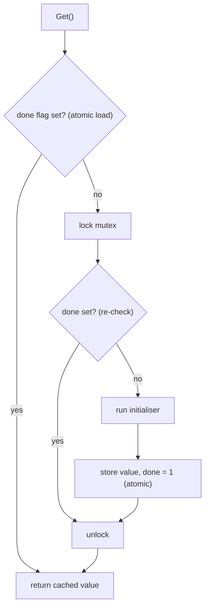

## In one minute
- A singleton guarantees one instance of a type within some scope and gives code a way to reach it. The two halves are separable, and only the first one is usually worth having.
- "One instance" is the useful part: a connection pool sized to the database's limit, a metrics registry, a parsed configuration. "Reachable from anywhere" is the harmful part: it is global mutable state with a nicer name, and it hides dependencies from signatures and from tests.
- The modern answer is to create the one instance in the composition root (your `main`, or a dependency-injection container) and pass it in. You keep "one per process" and lose the hidden global.
- Lazy creation must be safe under concurrency. Use the runtime's primitive (Go `sync.Once`, Python's module import lock, the Java class-initialisation lock, the JS module cache) rather than hand-rolled double-checked locking.
- "One per process" is not "one per system". Forty pods each holding "the" pool of 20 connections is 800 connections to a database that allows 500.

## How it works

### The classic shape
The Gang of Four version hides the constructor and exposes a static accessor:

```python
class FeatureFlags:
    _instance = None

    @classmethod
    def instance(cls):
        if cls._instance is None:
            cls._instance = FeatureFlags(load_flags_from_disk())
        return cls._instance
```

Every caller writes `FeatureFlags.instance().enabled("new_checkout")`. It works, and it creates three problems at once. The dependency is invisible: nothing in a function's signature says it reads flags. The instance is shared across tests: a test that flips a flag leaks into the next test, and the order tests run in starts to matter. And the check-then-create in `instance()` is a race: two threads can both see `None` and both build one.

### What languages already give you
Most languages have a built-in "run this once" mechanism, and it is usually the better tool.

- **Python modules are singletons.** A module's top-level code runs once per interpreter, and every later `import` returns the cached module object from `sys.modules`. A module-level `flags = FeatureFlags(...)` is a singleton without any class machinery.
- **JS modules are cached too.** An ES module is evaluated once per realm and keyed by its resolved URL; CommonJS caches by resolved filename in `require.cache`. `export const flags = new FeatureFlags()` is shared by every importer.
- **Go has `sync.Once`** and, since Go 1.21, `sync.OnceValue(f)`, which returns a function that calls `f` once and caches its result for every caller.

These remove the race and the boilerplate. They do not remove the hidden-global problem, because any code can still import the instance directly. Java's equivalent is a single-element enum, the form *Effective Java* (3rd ed., Item 3) prefers. Scope is part of the definition too: Spring's docs point out that a Spring singleton is one per container, while the GoF form is hard-wired to one per class loader ([Spring docs](https://docs.spring.io/spring-framework/reference/core/beans/factory-scopes.html)).

### Keep "one", drop "global"
The fix is to separate *how many* from *how it is reached*. Create the instance once at startup and hand it to the things that need it:

```go
func main() {
    cfg := config.Load()
    pool := db.NewPool(cfg.DSN, 20)       // the one pool
    flags := flags.New(cfg.FlagsPath)
    orders := orders.NewService(pool, flags)
    http.ListenAndServe(":8080", api.New(orders))
}
```

Sharing is often the point: AWS's Java SDK guide recommends one shared client so an application does not multiply connection pools ([AWS docs](https://docs.aws.amazon.com/sdk-for-java/latest/developer-guide/best-practices.html)). `main` is the only place that knows there is exactly one pool. `orders.NewService` declares that it needs a pool and flags; a test passes a fake pool and a flags object with two entries. The lifetime is still "one per process", but it is now a decision made in one file instead of a property baked into the type. A dependency-injection container does the same thing at larger scale: it registers a factory per service with a scope (singleton, per-request, transient) and builds the graph on demand, which is what the Practice section implements.

### When a real singleton is fine
- **Stateless or effectively immutable values**: a compiled regular expression, a lookup table, a parsed timezone database. Sharing them is safe and there is nothing to fake in tests.
- **Things that are truly one per process**: the process's logger root, `os.Stdout`, a metrics registry that a `/metrics` handler scrapes. Python's `logging.getLogger(name)` returns the same logger for the same name for exactly this reason.
- **Leaf utilities with no I/O.** If a test would never want a different one, a global costs little.

The warning signs are mutable state, I/O in the constructor, and any test that has to reset or monkey-patch the instance.

### Reviewing agent-written code
Asked to "add a Redis cache", an agent will often write `redis_client = Redis(host=os.environ["REDIS_HOST"])` at module top level and import it wherever needed. Importing the module in a unit test now needs Redis or an environment variable, and the tests fill up with `mock.patch("app.cache.redis_client")`, each one an admission that the dependency should have been a parameter. In review, look for module-level clients that do I/O, `global` statements, `getInstance()` accessors and tests that patch module attributes. Then ask for the concrete fix: "construct the client in `main` (or the app factory) and pass it to the service constructor."

### The same shape elsewhere
A singleton with mutable state is the *hot spot* problem shape: one object every request touches, like a hot key in a cache or a counter row every transaction updates in Postgres. It is correct and slow under load, and the fixes match: shard the state (per-core counters, striped locks) or make it immutable and swap it atomically.

## Down the stack

### Layer 1: The contract
A once-initialised value promises: the initialiser runs at most once per scope (process, module, container) when it succeeds; every caller sees the fully constructed object, never a half-built one; initialisation *happens-before* every use, in the memory-model sense. The failure contract varies and is worth testing. Go's `sync.Once` marks itself done even if the function panics, so later calls do nothing and the value stays zero. `sync.OnceValue` re-panics with the same value on every call ([Go docs](https://pkg.go.dev/sync)). A Python module that raises during import is removed from `sys.modules`, so the next import runs it again ([import reference](https://docs.python.org/3/reference/import.html)). Decide which one you want: "retry on failure" is right for a network client, "fail forever" is right for corrupt configuration.

### Layer 2: The mechanism
Go's `sync.Once` is a 32-bit `done` flag plus a `Mutex`. `Do` first does an atomic load of `done`; if set, it returns immediately. Otherwise it takes the slow path: lock, check `done` again, call `f`, then store `done = 1` with a deferred atomic store before unlocking. Other goroutines that arrive during `f` block on the mutex and then see `done` set. This is double-checked locking done correctly, because the flag is atomic.

Python's import system holds a per-module lock (`_ModuleLock` in `importlib._bootstrap`) while the module body runs, and inserts the module into `sys.modules` before executing it, which is why circular imports see a partially initialised module rather than deadlocking. Java's lazy holder idiom (`static class Holder { static final X INSTANCE = new X(); }`) rides on the class-initialisation lock that [JLS section 12.4.2](https://docs.oracle.com/javase/specs/jls/se21/html/jls-12.html) requires the JVM to take. Node resolves a specifier to a filename and checks `require.cache` before reading the file; ES modules keep a module map keyed by URL. The catch in both: two installed copies of a package (say, two versions in nested `node_modules`) are two modules and therefore two singletons, a caveat Node's docs list under module caching ([Node docs](https://nodejs.org/api/modules.html)).

### Layer 3: The machine
The fast path is cheap. On x86-64 an acquire load is an ordinary `MOV`, because the hardware's total store order already gives acquire semantics; on ARM64 it is an `LDAR`. Either way it is about 1 ns when the line is in L1. The slow path runs once.

The cost appears when the shared object has mutable state. A mutex-guarded counter updated by 32 cores moves its cache line between cores on every update, 50 to 100 ns per transfer, so throughput stops scaling. Allocation is once, but the object is a GC root for the life of the process, and anything it references (a growing cache map) is scanned on every collection. `fork()` copies the singleton into the child, including any lock that another thread held at the moment of the fork, which can deadlock the child, and including open sockets, so a parent and child sharing one database connection interleave bytes on the same TCP stream. Pre-forking servers such as gunicorn with `--preload` hit this when a pool is created at import time; the fix is to create pools after the fork. SQLAlchemy's docs call it critical that pooled connections are not shared with a forked process ([SQLAlchemy docs](https://docs.sqlalchemy.org/en/20/core/pooling.html)).

### Why it's built this way
1. Some resources are expensive to create (TLS handshakes, connection setup, parsing large config) or limited downstream (database connections), so you want one and share it.
2. Sharing between threads needs safe publication, so runtimes provide a once primitive with an atomic fast path instead of making every reader lock.
3. A shared instance reachable by name is convenient, but it removes the dependency from every signature, which breaks substitution in tests.
4. So keep the once-only creation in one place, the composition root, and pass the instance down. The runtime primitive handles concurrency; the constructor parameters handle visibility.

## Diagram


## Worked example
A payments service has a module-level `db = Database(os.environ["DSN"])` and 1,400 unit tests. Tests that need data write rows into a shared SQLite file; tests that need isolation patch `payments.db.db`. Over a quarter the suite has a 6% flake rate. Investigation finds 31 tests that pass alone and fail after a specific other test, all because of rows or patches left on the shared instance.

The team moves construction into `create_app(settings)`, makes services take `db` as a constructor parameter, and gives each test a fresh in-memory database. The change touches 140 files, mostly deleting `mock.patch` lines. Flakes fall below 0.5%, and with nothing shared the suite runs in parallel with `pytest -n 8`, from 9 minutes to 2.

The production side has its own arithmetic. The service runs 25 pods, each with 4 worker processes, each with a "singleton" pool of 10: 1,000 connections against a Postgres limit of 400. The singleton was correct per process and wrong for the system. The fix is either a smaller per-process pool (25 x 4 x 3 = 300) or a shared pooler such as PgBouncer in front of the database, which is the real "one per system" instance.

## In the wild
- **SQLAlchemy, documented hazard: a pool copied by `fork()`.** The docs say pooled connections must not be shared with a forked process, because TCP connections are file descriptors that two interpreters then use at once, and the most common symptom is broken messaging on a shared socket. A "singleton" engine created before the fork is exactly this bug; create it after the fork ([SQLAlchemy docs](https://docs.sqlalchemy.org/en/20/core/pooling.html)).
- **Java, 2000s: double-checked locking declared broken.** A group including Bill Pugh published a declaration showing that the common lazy-singleton idiom without proper memory-model guarantees can expose a half-constructed object to another thread. The class-initialisation lock behind the holder idiom is the safe replacement ([Pugh et al.](https://www.cs.umd.edu/~pugh/java/memoryModel/DoubleCheckedLocking.html), [JLS 12.4.2](https://docs.oracle.com/javase/specs/jls/se21/html/jls-12.html)).
- **AWS SDK for Java 2.x, documented practice: one shared client.** AWS recommends sharing a single client instance to avoid the overhead of many unused connection pools, and states that all service clients are thread-safe. This is a legitimate singleton: shared, thread-safe, and created once in the composition root ([AWS docs](https://docs.aws.amazon.com/sdk-for-java/latest/developer-guide/best-practices.html)).

## Trade-offs
| Option | Strengths | Weaknesses | Choose when |
| --- | --- | --- | --- |
| Classic singleton class with `instance()` | Familiar; lazy | Hidden dependency; test leakage; easy to get the locking wrong | Rarely; legacy code you cannot restructure yet |
| Module-level instance (Python, JS) | No boilerplate; runtime handles once-only | Created at import time; still a hidden global | Immutable values and leaf utilities with no I/O |
| `sync.Once` / `OnceValue` / lazy holder | Correct lazy init with a cheap fast path | Failure semantics need care; still global if exported | Expensive, rarely needed resources inside one package |
| Create in `main`, inject | Visible dependencies; trivial to fake; one place controls lifetime | Constructors take more parameters; wiring code to maintain | Anything stateful or doing I/O, which is most services |
| DI container with singleton scope | Lifetime per service is declarative; scales to large graphs | Magic at a distance; errors appear at resolve time | Large apps with many services and several scopes |

## Pitfalls in production
- I/O at import time (connect to Redis, read a secret), which makes imports slow, fails tests that never use the client, and runs before logging is configured. Fix: construct in the app factory or `main`.
- Hand-written double-checked locking without an atomic or `volatile` flag, so another thread can see a non-null pointer to a half-constructed object. Fix: use the runtime primitive.
- A singleton created before `fork()` sharing sockets or held locks with the child. Fix: create pools after fork, or register an after-fork hook that rebuilds them.
- Mutable shared state behind one lock becoming the throughput ceiling. Fix: make it immutable and swap with an atomic pointer, or shard it per core or per key.
- Two copies of the "singleton" because a package is installed twice or a module is imported under two paths. Fix: dedupe dependencies and treat "exactly one" as something to assert in a test, not assume.
- `sync.Once` swallowing a failed init forever. Fix: return the error with `OnceValues` so callers see it (it caches the error too, so it never retries), or use a small mutex-guarded lazy holder that only caches success.

## Leadership lens
- Ask "one per what?" in design review: per process, per pod, per region, per tenant. The answer decides pool sizes and whether you need a shared service instead of a shared object.
- Treat new module-level clients and `getInstance()` accessors as a review flag, especially in agent-written code. The cost shows up months later as flaky tests and slow suites.
- Budget the migration honestly. Moving from globals to injection is mostly mechanical, which makes it a good task to delegate to an agent with a clear instruction and a test suite as the oracle.
- Keep a single composition root per binary that a new engineer can read top to bottom to see every long-lived object and its lifetime.

## Check yourself
1. Why does a module-level instance in Python remove the race but not the testing problem?
   **Answer:** The import lock guarantees the body runs once, so there is no race, but any code can still import the instance directly, so tests must patch it and state leaks between them.
2. Your service runs 12 pods with 8 worker processes each and a pool of 15 per process. The database allows 1,000 connections. What is wrong?
   **Answer:** The singleton is per process: 12 x 8 x 15 = 1,440 connections, over the limit. Shrink per-process pools or put a shared pooler in front.
3. When is Go's `sync.Once` failure behaviour a problem?
   **Answer:** If the init function fails or panics, `Once` still marks itself done, so later callers get a zero value forever. For transient failures, cache only success; `OnceValues` surfaces the error but caches it forever.
4. Why is a stateless singleton, such as a compiled regex, acceptable when a database client is not?
   **Answer:** Nothing about it varies between tests or environments and sharing it is safe across threads, so hiding it costs nothing; a client has state, I/O and environment-specific configuration that tests need to replace.

## Practice
**Task:** Build a tiny dependency-injection container that gives you singletons without global state. `Container()` holds registrations. `register(name, factory, singleton)` stores a factory that receives the container (so it can resolve its own dependencies); re-registering a name replaces the factory and discards any cached instance. `resolve(name)` returns an instance: for a singleton the factory runs once per container and the result is cached, but only on success, so a factory that fails is called again next time; for a transient registration the factory runs on every call. Unknown names raise an error with the message `unknown: <name>`. A dependency cycle raises `cycle: a -> b -> a` (the chain of names being resolved, ending with the repeated one), and after any error the container must still work. Containers are independent of each other. The container is wired on one thread at startup, so it needs no locking.

```python starter
class ResolveError(Exception):
    pass

class Container:
    def __init__(self):
        self.factories = {}

    def register(self, name, factory, singleton=True):
        # TODO
        raise NotImplementedError

    def resolve(self, name):
        # TODO
        raise NotImplementedError
```

```python tests
class Db:
    pass

class Repo:
    def __init__(self, db):
        self.db = db

def counting(factory):
    calls = [0]
    def f(c):
        calls[0] += 1
        return factory(c)
    return f, calls

def test_singleton_built_once():
    c = Container()
    f, calls = counting(lambda c: Db())
    c.register("db", f)
    assert c.resolve("db") is c.resolve("db")
    assert calls[0] == 1

def test_transient_new_each_time():
    c = Container()
    c.register("repo", lambda c: Repo(None), singleton=False)
    assert c.resolve("repo") is not c.resolve("repo")

def test_dependencies_share_singleton():
    c = Container()
    c.register("db", lambda c: Db())
    c.register("repo", lambda c: Repo(c.resolve("db")), singleton=False)
    a, b = c.resolve("repo"), c.resolve("repo")
    assert a is not b and a.db is b.db and a.db is c.resolve("db")

def test_unknown_name():
    c = Container()
    c.register("repo", lambda c: Repo(c.resolve("db")))
    try:
        c.resolve("repo")
        assert False, "expected ResolveError"
    except ResolveError as e:
        assert str(e) == "unknown: db"

def test_failure_is_not_cached():
    c = Container()
    attempts = [0]
    def flaky(c):
        attempts[0] += 1
        if attempts[0] == 1:
            raise RuntimeError("connection refused")
        return Db()
    c.register("db", flaky)
    try:
        c.resolve("db")
        assert False, "first attempt should fail"
    except RuntimeError:
        pass
    first = c.resolve("db")
    assert first is c.resolve("db") and attempts[0] == 2

def test_cycle_detected_and_container_recovers():
    c = Container()
    c.register("a", lambda c: c.resolve("b"))
    c.register("b", lambda c: c.resolve("a"))
    try:
        c.resolve("a")
        assert False, "expected cycle"
    except ResolveError as e:
        assert str(e) == "cycle: a -> b -> a"
    c.register("b", lambda c: "fixed")
    assert c.resolve("a") == "fixed"

def test_override_replaces_cached_instance():
    c = Container()
    c.register("db", lambda c: Db())
    real = c.resolve("db")
    fake = Db()
    c.register("db", lambda c: fake)
    assert c.resolve("db") is fake and fake is not real

def test_containers_are_isolated():
    one, two = Container(), Container()
    for c in (one, two):
        c.register("db", lambda c: Db())
    assert one.resolve("db") is not two.resolve("db")
```

```python solution
class ResolveError(Exception):
    pass

class Container:
    def __init__(self):
        self.factories = {}
        self.instances = {}
        self.resolving = []

    def register(self, name, factory, singleton=True):
        self.factories[name] = (factory, singleton)
        self.instances.pop(name, None)

    def resolve(self, name):
        if name not in self.factories:
            raise ResolveError("unknown: " + name)
        if name in self.instances:
            return self.instances[name]
        if name in self.resolving:
            raise ResolveError("cycle: " + " -> ".join(self.resolving + [name]))
        factory, singleton = self.factories[name]
        self.resolving.append(name)
        try:
            value = factory(self)
        finally:
            self.resolving.pop()
        if singleton:
            self.instances[name] = value
        return value
```

```typescript starter
export class ResolveError extends Error {}

export type Factory = (c: Container) => unknown;

export class Container {
  private factories = new Map<string, { factory: Factory; singleton: boolean }>();

  register(name: string, factory: Factory, singleton: boolean = true): void {
    throw new Error("TODO");
  }

  resolve(name: string): unknown {
    throw new Error("TODO");
  }
}
```

```typescript tests
class Db {}
class Repo { constructor(public db: unknown) {} }

function errorOf(fn: () => unknown): Error | undefined {
  try { fn(); } catch (e) { return e as Error; }
  return undefined;
}

test("singleton built once", () => {
  const c = new Container();
  let calls = 0;
  c.register("db", () => { calls++; return new Db(); });
  assert(c.resolve("db") === c.resolve("db"), "same instance");
  assertEqual(calls, 1);
});

test("transient new each time", () => {
  const c = new Container();
  c.register("repo", () => new Repo(null), false);
  assert(c.resolve("repo") !== c.resolve("repo"), "new instance each time");
});

test("dependencies share singleton", () => {
  const c = new Container();
  c.register("db", () => new Db());
  c.register("repo", (c) => new Repo(c.resolve("db")), false);
  const a = c.resolve("repo") as Repo;
  const b = c.resolve("repo") as Repo;
  assert(a !== b && a.db === b.db && a.db === c.resolve("db"), "shared db");
});

test("unknown name", () => {
  const c = new Container();
  c.register("repo", (c) => new Repo(c.resolve("db")));
  const e = errorOf(() => c.resolve("repo"));
  assert(e instanceof ResolveError, "ResolveError expected");
  assertEqual(e!.message, "unknown: db");
});

test("failure is not cached", () => {
  const c = new Container();
  let attempts = 0;
  c.register("db", () => {
    attempts++;
    if (attempts === 1) throw new Error("connection refused");
    return new Db();
  });
  assertEqual(errorOf(() => c.resolve("db"))?.message, "connection refused");
  const first = c.resolve("db");
  assert(first === c.resolve("db"), "cached after success");
  assertEqual(attempts, 2);
});

test("cycle detected and container recovers", () => {
  const c = new Container();
  c.register("a", (c) => c.resolve("b"));
  c.register("b", (c) => c.resolve("a"));
  const e = errorOf(() => c.resolve("a"));
  assert(e instanceof ResolveError, "ResolveError expected");
  assertEqual(e!.message, "cycle: a -> b -> a");
  c.register("b", () => "fixed");
  assertEqual(c.resolve("a"), "fixed");
});

test("override replaces cached instance", () => {
  const c = new Container();
  c.register("db", () => new Db());
  const real = c.resolve("db");
  const fake = new Db();
  c.register("db", () => fake);
  assert(c.resolve("db") === fake && fake !== real, "override wins");
});

test("containers are isolated", () => {
  const one = new Container();
  const two = new Container();
  for (const c of [one, two]) c.register("db", () => new Db());
  assert(one.resolve("db") !== two.resolve("db"), "separate instances");
});
```

```typescript solution
export class ResolveError extends Error {}

export type Factory = (c: Container) => unknown;

export class Container {
  private factories = new Map<string, { factory: Factory; singleton: boolean }>();
  private instances = new Map<string, unknown>();
  private resolving: string[] = [];

  register(name: string, factory: Factory, singleton: boolean = true): void {
    this.factories.set(name, { factory, singleton });
    this.instances.delete(name);
  }

  resolve(name: string): unknown {
    const reg = this.factories.get(name);
    if (!reg) throw new ResolveError("unknown: " + name);
    if (this.instances.has(name)) return this.instances.get(name);
    if (this.resolving.includes(name)) {
      throw new ResolveError("cycle: " + [...this.resolving, name].join(" -> "));
    }
    this.resolving.push(name);
    let value: unknown;
    try {
      value = reg.factory(this);
    } finally {
      this.resolving.pop();
    }
    if (reg.singleton) this.instances.set(name, value);
    return value;
  }
}
```

```go starter
package practice

type Factory func(c *Container) (any, error)

type registration struct {
	factory   Factory
	singleton bool
}

type Container struct {
	factories map[string]registration
}

func NewContainer() *Container {
	return &Container{factories: map[string]registration{}}
}

func (c *Container) Register(name string, f Factory, singleton bool) {
	panic("TODO")
}

func (c *Container) Resolve(name string) (any, error) {
	panic("TODO")
}
```

```go tests
package practice

import (
	"errors"
	"testing"
)

type db struct{ id int }
type repo struct{ db any }

func TestSingletonBuiltOnce(t *testing.T) {
	c := NewContainer()
	calls := 0
	c.Register("db", func(*Container) (any, error) { calls++; return &db{}, nil }, true)
	a, _ := c.Resolve("db")
	b, _ := c.Resolve("db")
	if a != b || calls != 1 {
		t.Fatalf("same=%v calls=%d", a == b, calls)
	}
}

func TestTransientNewEachTime(t *testing.T) {
	c := NewContainer()
	c.Register("repo", func(*Container) (any, error) { return &repo{}, nil }, false)
	a, _ := c.Resolve("repo")
	b, _ := c.Resolve("repo")
	if a == b {
		t.Fatal("transient returned the same instance")
	}
}

func TestDependenciesShareSingleton(t *testing.T) {
	c := NewContainer()
	c.Register("db", func(*Container) (any, error) { return &db{}, nil }, true)
	c.Register("repo", func(c *Container) (any, error) {
		d, err := c.Resolve("db")
		if err != nil {
			return nil, err
		}
		return &repo{db: d}, nil
	}, false)
	a, _ := c.Resolve("repo")
	b, _ := c.Resolve("repo")
	d, _ := c.Resolve("db")
	ra, rb := a.(*repo), b.(*repo)
	if ra == rb || ra.db != rb.db || ra.db != d {
		t.Fatal("repos should be distinct and share one db")
	}
}

func TestUnknownName(t *testing.T) {
	c := NewContainer()
	c.Register("repo", func(c *Container) (any, error) { return c.Resolve("db") }, true)
	_, err := c.Resolve("repo")
	if err == nil || err.Error() != "unknown: db" {
		t.Fatalf("got %v", err)
	}
}

func TestFailureIsNotCached(t *testing.T) {
	c := NewContainer()
	attempts := 0
	refused := errors.New("connection refused")
	c.Register("db", func(*Container) (any, error) {
		attempts++
		if attempts == 1 {
			return nil, refused
		}
		return &db{attempts}, nil
	}, true)
	if _, err := c.Resolve("db"); !errors.Is(err, refused) {
		t.Fatalf("first attempt: %v", err)
	}
	a, err := c.Resolve("db")
	b, _ := c.Resolve("db")
	if err != nil || a != b || attempts != 2 {
		t.Fatalf("err=%v same=%v attempts=%d", err, a == b, attempts)
	}
}

func TestCycleDetectedAndContainerRecovers(t *testing.T) {
	c := NewContainer()
	c.Register("a", func(c *Container) (any, error) { return c.Resolve("b") }, true)
	c.Register("b", func(c *Container) (any, error) { return c.Resolve("a") }, true)
	if _, err := c.Resolve("a"); err == nil || err.Error() != "cycle: a -> b -> a" {
		t.Fatalf("got %v", err)
	}
	c.Register("b", func(*Container) (any, error) { return "fixed", nil }, true)
	if v, err := c.Resolve("a"); err != nil || v != "fixed" {
		t.Fatalf("got %v %v", v, err)
	}
}

func TestOverrideReplacesCachedInstance(t *testing.T) {
	c := NewContainer()
	c.Register("db", func(*Container) (any, error) { return &db{1}, nil }, true)
	real, _ := c.Resolve("db")
	fake := &db{2}
	c.Register("db", func(*Container) (any, error) { return fake, nil }, true)
	got, _ := c.Resolve("db")
	if got != fake || got == real {
		t.Fatal("override should win")
	}
}

func TestContainersAreIsolated(t *testing.T) {
	one, two := NewContainer(), NewContainer()
	for _, c := range []*Container{one, two} {
		c.Register("db", func(*Container) (any, error) { return &db{}, nil }, true)
	}
	a, _ := one.Resolve("db")
	b, _ := two.Resolve("db")
	if a == b {
		t.Fatal("containers share an instance")
	}
}
```

```go solution
package practice

import (
	"errors"
	"strings"
)

type Factory func(c *Container) (any, error)

type registration struct {
	factory   Factory
	singleton bool
}

type Container struct {
	factories map[string]registration
	instances map[string]any
	resolving []string
}

func NewContainer() *Container {
	return &Container{factories: map[string]registration{}, instances: map[string]any{}}
}

func (c *Container) Register(name string, f Factory, singleton bool) {
	c.factories[name] = registration{f, singleton}
	delete(c.instances, name)
}

func (c *Container) Resolve(name string) (any, error) {
	reg, ok := c.factories[name]
	if !ok {
		return nil, errors.New("unknown: " + name)
	}
	if v, ok := c.instances[name]; ok {
		return v, nil
	}
	for _, n := range c.resolving {
		if n == name {
			chain := append(append([]string{}, c.resolving...), name)
			return nil, errors.New("cycle: " + strings.Join(chain, " -> "))
		}
	}
	c.resolving = append(c.resolving, name)
	v, err := reg.factory(c)
	c.resolving = c.resolving[:len(c.resolving)-1]
	if err != nil {
		return nil, err
	}
	if reg.singleton {
		c.instances[name] = v
	}
	return v, nil
}
```

## Mock interview
**Prompt:** A monolith with 300,000 lines of Python uses about 40 module-level singletons: database, Redis, an HTTP client, feature flags, a metrics registry and many service objects. The test suite takes 25 minutes and fails randomly about one run in ten. You have one quarter to fix it without stopping feature work. What do you do?

- Follow-up: Which of the 40 do you leave as globals, and how do you decide?
- Follow-up: The app runs under gunicorn with `--preload`. What breaks if a pool is created at import time?
- Follow-up: Someone proposes adopting a full DI framework. What do you say?

**A strong answer covers:**
- Classifying each singleton: immutable or stateless (keep), stateful or doing I/O (inject). Metrics registry and logger roots often stay global by design.
- An app factory or composition root that constructs long-lived objects once, plus constructor injection, migrated service by service behind the existing module names so callers keep working during the transition.
- Test isolation: fixtures that build fresh in-memory dependencies per test, then parallel test execution once nothing is shared.
- Fork safety: pools and sockets created after the worker forks, never at import time, and the arithmetic of connections per pod times workers times pool size.
- A measured view of frameworks: plain constructor injection and one wiring module first; a container only if the graph and scopes justify it.
- Guardrails for new code, including agent-written code: a lint or review rule against new module-level clients and `global`.

## Sources and further study
**Primary**
- [Java Language Specification, 12.4.2: detailed initialization procedure](https://docs.oracle.com/javase/specs/jls/se21/html/jls-12.html): the lock behind the lazy holder idiom.
- [The import system (Python reference)](https://docs.python.org/3/reference/import.html): `sys.modules`, partial modules and failed imports.

**Systems docs**
- [Spring: bean scopes](https://docs.spring.io/spring-framework/reference/core/beans/factory-scopes.html): why a Spring singleton is per container, not per class loader.
- [SQLAlchemy: pools and fork](https://docs.sqlalchemy.org/en/20/core/pooling.html): what goes wrong when a pool crosses a process boundary.
- [AWS SDK for Java 2.x best practices](https://docs.aws.amazon.com/sdk-for-java/latest/developer-guide/best-practices.html): when sharing one client is the right call.

**Books**
- *Design Patterns*, Gamma, Helm, Johnson and Vlissides (1994): chapter 3, Creational Patterns, for the original Singleton.
- *Head First Design Patterns* (2nd ed.), Freeman and Robson: chapter 5, The Singleton Pattern, including the multithreading fixes.
- *Effective Java* (3rd ed.), Bloch: chapter 2, Item 3, Enforce the singleton property with a private constructor or an enum type.
- *Clean Architecture*, Martin: chapter 26, The Main Component, the place where long-lived objects are created.

**Other curricula**
- [Singleton (refactoring.guru)](https://refactoring.guru/design-patterns/singleton): lists the pattern's critics and the thread-safety variants.

## Watch
- [The Clean Code Talks: Global State and Singletons (Misko Hevery, Google TechTalks)](https://www.youtube.com/watch?v=-FRm3VPhseI): why singletons make tests lie about their dependencies, with concrete examples.
- [The Clean Code Talks: Don't Look For Things! (Misko Hevery, Google TechTalks)](https://www.youtube.com/watch?v=RlfLCWKxHJ0): the case for asking for dependencies instead of fetching them from globals.
- [Singleton Pattern (Christopher Okhravi)](https://www.youtube.com/watch?v=hUE_j6q0LTQ): the classic structure and a critical look at when it is justified.

## Free resources
- [The Singleton Pattern (Brandon Rhodes, python-patterns.guide)](https://python-patterns.guide/gang-of-four/singleton/): why Python mostly does not need the class form, and what to use instead.
- [Root Cause of Singletons (Google Testing Blog)](https://testing.googleblog.com/2008/08/root-cause-of-singletons.html): how global access, not single instance, is what hurts testability.
- [Inversion of Control Containers and the Dependency Injection pattern (Martin Fowler)](https://martinfowler.com/articles/injection.html): the original description of constructor injection and service locators.
- [sync package: Once and OnceValue (Go docs)](https://pkg.go.dev/sync#Once): the exact semantics, including what happens when the function panics.
- [The "Double-Checked Locking is Broken" Declaration (Bill Pugh et al.)](https://www.cs.umd.edu/~pugh/java/memoryModel/DoubleCheckedLocking.html): why hand-rolled lazy init fails without proper memory-model guarantees.
- [Node.js modules: caching (Node docs)](https://nodejs.org/api/modules.html): how `require` caches modules by resolved filename, and why that makes modules singletons.
