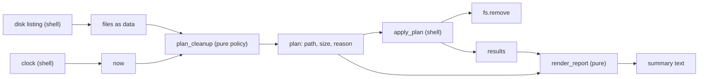

## In one minute
- A concern is one thing a piece of software has to get right: the business rule, the storage format, the user interface, authentication, logging, retries. Separating concerns means each one lives in its own place, so you can think about, change and test it without holding the others in your head.
- Dijkstra coined the phrase in 1974 ([EWD447](https://www.cs.utexas.edu/~EWD/transcriptions/EWD04xx/EWD447.html)) to describe a way of thinking: study one aspect of a problem in depth while knowing, but temporarily ignoring, the others. Code structure is how that way of thinking survives after the author has moved on.
- The most useful split in everyday code is between deciding and doing: a pure core that decides what should happen, and a thin shell that talks to disks, networks and clocks. The core is tested with plain values; the shell is tested with a few fakes.
- Concerns come in three shapes: horizontal layers (presentation, domain, data), vertical slices (features), and cross-cutting concerns (auth, logging, transactions) that touch everything and belong in middleware or wrappers.
- Agents happily write one function that parses input, applies policy, calls the database and formats output. Review by asking which lines would change if the policy changed, and which if the storage changed. If the answer is "the same function", the concerns are tangled.

## How it works

### The problem
A nightly job keeps a build-artifact cache under its disk quota. The first version is one 80-line function: it walks the directory, reads each file's modification time, decides whether the file is too old, deletes it, keeps a running byte total, and prints a summary. It works. Then three requests arrive in one month: the platform team wants pinned artifacts to survive cleanup, finance wants the quota lowered from 500 GB to 300 GB with oldest files removed first, and the on-call team wants a dry-run mode that shows what would be deleted.

Every request touches the same function. Dry-run needs the decision without the deletion, which is impossible because both happen on the same line inside the loop, and testing anything requires a real directory with timestamps set by `os.utime`. The function has three concerns (policy, execution, reporting) and no seams between them.

### Separate deciding from doing
The fix is to split the job along its concerns:

```python
def plan_cleanup(files, now, max_age, max_bytes):   # policy: pure
    ...returns [(path, size, reason), ...]

def apply_plan(plan, fs):                             # execution: I/O through a port
    ...returns [(path, status), ...]

def render_report(plan, results):                     # presentation: pure
    ...returns a string
```

`plan_cleanup` takes plain data and returns plain data. It never touches the disk and never reads the clock; `now` is a parameter. Dry-run is now `print(render_report(plan, []))`. Pinning and quota ordering are changes to one pure function, tested with lists of tuples in microseconds. `apply_plan` is ten lines that loop and call `fs.remove`, and its tests need one fake that fails on a chosen path. Gary Bernhardt named this shape "functional core, imperative shell": push decisions into code with no side effects, and keep the code with side effects so simple it barely needs tests.

### Three shapes of concern
**Horizontal layers.** Presentation, domain and data access are the classic split, described well in [Fowler's note on presentation-domain-data layering](https://martinfowler.com/bliki/PresentationDomainDataLayering.html). Each layer knows only the one beneath it. A web handler parses the request and renders the response; the domain decides; the repository loads and stores. The rule that matters is direction: the domain must not import the web framework or the SQL driver.

**Vertical slices.** Within a large application, features are also concerns. Billing, search and notifications change for different reasons and are owned by different people. Grouping code by feature (`billing/handler.py`, `billing/rules.py`, `billing/repo.py`) keeps a billing change inside one folder, where grouping by layer (`handlers/`, `services/`, `repos/`) spreads it across three. Most mature codebases do both: slices at the top level, layers inside each slice.

**Cross-cutting concerns.** Authentication, request IDs, logging, metrics, timeouts and transactions apply to almost every operation. Pasting them into each handler tangles them with business logic and guarantees that one handler forgets. They belong in a layer that wraps every handler: HTTP middleware in Go and Express, interceptors in gRPC, decorators in Python, aspects in Spring. The handler then contains only its own concern.

### Separation of concerns is not separation of technologies
Splitting by file type is not splitting by concern. When React put markup and behaviour for one component in one file, critics called it a violation of separation of concerns. Pete Hunt's answer at JSConf EU 2013 was that HTML, CSS and JavaScript files separated technologies, not concerns; the component is the concern. Things that change together should live together, and things that change for different reasons should not.

### Relation to SRP and coupling
The [Single Responsibility Principle](srp.md) is separation of concerns applied to one class, with "concern" defined as "who asks for changes". [Coupling and Cohesion](coupling-and-cohesion.md) gives you the measurements. [Hexagonal architecture](../sd/hexagonal-architecture.md) is separation of concerns at service scale: the domain in the centre, technology at the edges. Separation of concerns is the umbrella idea; the others are specific ways to apply it.

### When not to separate
A 40-line script that runs once does not need a core, a shell and a presenter. Separation costs names, files and hops. A good trigger is the second change request that touches two concerns in one function, or the first test you cannot write without a real disk or network.

### Reviewing agent-written code
Ask an agent to "add dry-run to the cleanup job" and the usual result is a `dry_run` flag threaded through the loop with `if not dry_run:` around each side effect. It passes the test it wrote, and it leaves the policy untestable without a filesystem. Ask instead for a planner that returns actions and an executor that performs them, then check three things in review: the planner has no imports of I/O modules and no calls to the clock, the executor has no business rules (no `if size > ...`), and the report is built from the plan and results rather than from print statements inside the loop.

### The same shape elsewhere
Deciding separately from doing is the *trust but verify* shape: the plan is data, so a human, a test or a policy engine can inspect it before anything irreversible happens. Terraform's [`plan`](https://developer.hashicorp.com/terraform/cli/commands/plan) and [`apply`](https://developer.hashicorp.com/terraform/cli/commands/apply), Kubernetes controllers that compute a diff before calling the API, database query planners that produce an `EXPLAIN` tree before execution, and agent frameworks that ask for approval of a tool call before running it all use the same split.

## Down the stack

### Layer 1: The contract
Separation makes promises you can check. The policy module promises determinism: the same inputs produce the same plan, with no reads from disk, network, clock or randomness, so it can be called a million times in a property test. The execution module promises that it performs exactly the actions in the plan, in order, and reports the outcome of each, including partial failure; it does not add, drop or reorder actions. The presentation module promises that its output is a function of the plan and the results only. Each promise is a test you can write, and a violation (a hidden `time.time()` call, a filter inside the executor) is visible in review.

### Layer 2: The mechanism
Languages and frameworks give you tools to enforce the boundaries rather than hope for them. Go refuses to compile an import of a package under an `internal/` directory from outside the tree rooted at that directory's parent ([Go 1.4 release notes](https://go.dev/doc/go1.4#internalpackages)). Java's module system only exposes packages listed in `exports`. Python has no enforcement, so teams use import-linter with a `layers` contract, and Java teams write ArchUnit tests such as "classes in `..domain..` must not depend on classes in `..web..`".

Cross-cutting concerns rely on wrapping. Go's `net/http` middleware is a function `func(http.Handler) http.Handler`; a chain of five is five nested handlers, each calling the next one's `ServeHTTP`. Express keeps an array of `(req, res, next)` functions and advances an index each time `next()` is called ([Express docs](https://expressjs.com/en/guide/using-middleware.html)). Spring implements `@Transactional` with a proxy object (a JDK dynamic proxy for interfaces, or a CGLIB-generated subclass) that opens the transaction and then calls your method. That mechanism has a well-known edge: a method calling another `@Transactional` method on `this` bypasses the proxy, so the inner annotation does nothing ([Spring docs](https://docs.spring.io/spring-framework/reference/core/aop/proxying.html)).

### Layer 3: The machine
Separation has a runtime cost, and it is usually small. Each layer or middleware is one more call; through an interface or function value it is an indirect call of about 1 to 3 ns when the branch predictor has seen it before, and the compiler cannot inline across it. A ten-middleware HTTP chain adds tens of nanoseconds to a request whose database query takes a millisecond.

The costs that matter come from copying and from round trips. Layers that each define their own struct for the same row (a database record, a domain object, an API DTO) copy fields at every boundary: for a 30-field object and 10,000 rows per page, that is 300,000 field copies and three sets of heap allocations, which shows up as GC work in Go and Java. A repository boundary that hides how data is loaded can turn one join into N queries at 0.3 to 1 ms each. And when a concern is separated into its own service, the boundary becomes serialisation plus a network round trip of roughly 0.2 to 0.5 ms inside one data centre, a million times more than a function call. Separate in code first; separate into processes only when deployment or scaling demands it.

### Why it's built this way
1. People can only reason about a small number of things at once, so a change is safe only if it can be understood locally.
2. Concerns change at different rates and for different owners, so code that mixes them forces every change to be understood globally.
3. Side effects are what make code hard to test and hard to preview, so pulling decisions away from effects yields a core that is cheap to test and a plan that can be inspected.
4. Cross-cutting concerns would otherwise be copied into every operation, so they are applied once, by wrapping.
5. Every boundary costs a call, a copy or a round trip, so you draw boundaries where change actually happens, not everywhere.

## Diagram


## Worked example
A CI platform keeps 420 GB of build artifacts on a 500 GB volume across 1.8 million files. The original cleanup function mixed policy, deletion and logging. It had no unit tests, only an integration test that created 200 files in a temp directory and took 9 seconds. Two incidents in six months came from policy bugs: one run deleted pinned release artifacts because the pin check was inside an `else` branch that the quota path skipped.

The refactor split the job three ways. The planner takes a list of `(path, size, mtime, pinned)` tuples and returns actions. Its test suite grew to 64 cases, including a randomised property test that asserts pinned files never appear in a plan, and runs in 40 ms. The executor is 14 lines; three tests with a fake filesystem cover success, a permission error mid-plan, and a file that vanished before removal. The report is built from the plan and results.

Dry-run became a flag in `main` that skips `apply_plan`. Before the quota drop to 300 GB, ops reviewed a dry-run plan of 1.1 million files and 210 GB and caught that a team's nightly snapshot directory was unpinned. Planning 1.8 million entries takes about 1.5 seconds and a few hundred MB for the tuples; the `unlink` calls take roughly 25 minutes, so the separation cost nothing that mattered.

## In the wild
- **Apache Log4j, 2021: Log4Shell.** The logging library resolved JNDI lookups inside log messages, so a string that an application merely logged could make it load and run code from an attacker's LDAP server (CVE-2021-44228, CVSS 10.0). The first fix, 2.15.0, was incomplete in some non-default configurations (CVE-2021-45046), and 2.16.0 followed for Java 8 and later ([Apache Logging](https://logging.apache.org/log4j/2.x/security.html)). A recording concern had quietly gained an execution concern.
- **HashiCorp Terraform: plan, then apply.** `terraform plan` produces an execution plan with a preview of changes, and `terraform apply` executes the actions proposed in a plan. The decision is data a human or policy check can read before anything irreversible happens ([plan](https://developer.hashicorp.com/terraform/cli/commands/plan), [apply](https://developer.hashicorp.com/terraform/cli/commands/apply)).
- **Spring Framework: cross-cutting concerns by proxy.** Spring applies aspects such as transactions through proxies, which means a call from one method to another on the same object skips the advice. The docs call this out as the self-invocation issue, and note that AspectJ weaving does not have it ([Spring docs](https://docs.spring.io/spring-framework/reference/core/aop/proxying.html)).

## Trade-offs
| Option | Strengths | Weaknesses | Choose when |
| --- | --- | --- | --- |
| One function does everything | Short; easy to read once | Untestable without real I/O; every change touches it | Throwaway scripts |
| Functional core, imperative shell | Pure policy tests; plans are previewable | More names; data must be passed in explicitly | Any job with real rules and side effects |
| Horizontal layers | Clear dependency direction; swappable storage | A feature change touches every layer | Applications with one main domain |
| Vertical slices with layers inside | Feature changes stay local | Shared code needs a deliberate home | Large codebases with several owning teams |
| Separate services per concern | Independent deploys and scaling | Network calls, partial failure, data copies | Only when teams or load demand it |

## Pitfalls in production
- A `dry_run` flag threaded through side-effecting code, where one forgotten `if` deletes data during a dry run. Fix: compute a plan and decide at the top whether to execute it.
- Hidden inputs in the pure core (`datetime.now()`, environment variables, a global config). Fix: pass them as parameters; ban the imports in the core with a lint rule.
- Business rules creeping into the shell ("skip files over 1 GB" added inside the executor loop). Fix: keep the executor free of conditions on domain data, and put every rule in the planner.
- Cross-cutting code copied into handlers, so the one new endpoint lacks auth. Fix: apply it in middleware registered once, and test that every route passes through it.
- A cross-cutting component trusted with too much power. Log4j's message lookups let logged text trigger a JNDI fetch, so attacker-controlled strings that were merely logged could run remote code ([Apache Logging security page](https://logging.apache.org/log4j/2.x/security.html)). Fix: a logging layer formats and records data and does nothing else; treat anything that logs untrusted input as an input boundary.
- Layers that only forward calls and copy fields, adding files without separating anything. Fix: merge layers that never change independently.

## Leadership lens
- The useful review question is "which concerns does this change touch?". A one-line rule change that edits five files signals tangled concerns; a feature that touches one folder signals a healthy split.
- Enforce the important boundaries mechanically (Go `internal/`, import-linter, ArchUnit) so they survive staff turnover and high volumes of agent-written code.
- Ask for plans before actions in anything destructive: cleanup, migrations, bulk updates, infrastructure changes. A reviewable plan is cheaper than a postmortem.
- Do not split into services to get separation you could have had with modules. The network boundary adds latency, partial failure and on-call load that the team will carry for years.

## Check yourself
1. Why does moving the clock read out of the cleanup policy make dry-run easier as well as testing?
   **Answer:** Once the policy is a pure function of its inputs, it can be called on its own to produce a plan without performing it, and the same call in a test gives the same answer every time.
2. Your team groups code into `controllers/`, `services/` and `repositories/`, and every feature change touches all three folders. Which kind of separation is missing?
   **Answer:** Vertical separation by feature. Group by feature first and keep the layers inside each feature folder, so a change to one feature stays in one place.
3. Why is logging better applied as middleware than written into each handler?
   **Answer:** It is a cross-cutting concern with the same rules for every request, so applying it once guarantees coverage and keeps each handler about its own concern.
4. When is it wrong to separate a concern into its own service?
   **Answer:** When it does not need its own deployment, scaling or team. You pay network latency and partial failure for a separation that a module boundary would give you for free.

## Practice
**Task:** Split an artifact cleanup job into policy, execution and reporting. `plan_cleanup(files, now, max_age, max_bytes)` is pure. Each file has `path`, `size`, `mtime` and `pinned`. Pinned files are never planned. First, every unpinned file with `now - mtime > max_age` is planned with reason `expired`, in ascending path order. Then, counting every file not yet planned (pinned ones included), while the total size exceeds `max_bytes`, plan the oldest remaining unpinned file (ties broken by path) with reason `over_quota`; stop when none are left. The plan is a list of `(path, size, reason)` entries in that order, and the input must not be mutated. `apply_plan(plan, fs)` calls `fs.remove(path)` for each entry in order, keeps going after a failure, and returns `(path, status)` pairs with status `deleted` or `failed: <message>`. `render_report(plan, results)` returns `deleted <d> of <n>, freed <bytes> bytes` (bytes summed over deleted entries only), followed by one line `failed <path>: <message>` per failure in plan order, joined with newlines.

```python starter
def plan_cleanup(files, now, max_age, max_bytes):
    # files: list of dicts with path, size, mtime, pinned
    # TODO: return [(path, size, reason), ...]
    raise NotImplementedError

def apply_plan(plan, fs):
    # TODO: return [(path, status), ...]
    raise NotImplementedError

def render_report(plan, results):
    # TODO
    raise NotImplementedError
```

```python tests
def f(path, size, mtime, pinned=False):
    return {"path": path, "size": size, "mtime": mtime, "pinned": pinned}

class FakeFS:
    def __init__(self, failing=None):
        self.failing = failing or {}
        self.removed = []
    def remove(self, path):
        if path in self.failing:
            raise OSError(self.failing[path])
        self.removed.append(path)

def test_expired_files_sorted_by_path():
    files = [f("b", 10, 0), f("a", 5, 10), f("c", 7, 95)]
    assert plan_cleanup(files, 100, 50, 1000) == [("a", 5, "expired"), ("b", 10, "expired")]

def test_pinned_files_survive_age_and_quota():
    files = [f("old", 50, 0, True), f("new", 60, 90)]
    plan = plan_cleanup(files, 100, 10, 40)
    assert plan == [("new", 60, "over_quota")], "pinned file stays even though still over quota"

def test_quota_removes_oldest_first_with_path_tiebreak():
    files = [f("x", 30, 20), f("w", 30, 20), f("y", 30, 10), f("z", 30, 40)]
    plan = plan_cleanup(files, 50, 1000, 60)
    assert plan == [("y", 30, "over_quota"), ("w", 30, "over_quota")]

def test_expired_count_toward_quota_and_input_untouched():
    files = [f("a", 100, 0), f("b", 40, 80), f("c", 40, 90)]
    snapshot = [dict(x) for x in files]
    plan = plan_cleanup(files, 100, 50, 50)
    assert plan == [("a", 100, "expired"), ("b", 40, "over_quota")]
    assert files == snapshot

def test_apply_continues_after_failure():
    plan = [("a", 1, "expired"), ("b", 2, "expired"), ("c", 3, "over_quota")]
    fs = FakeFS({"b": "permission denied"})
    results = apply_plan(plan, fs)
    assert results == [("a", "deleted"), ("b", "failed: permission denied"), ("c", "deleted")]
    assert fs.removed == ["a", "c"]

def test_report_counts_only_deleted_bytes():
    plan = [("a", 10, "expired"), ("b", 20, "expired"), ("c", 5, "over_quota")]
    results = [("a", "deleted"), ("b", "failed: busy"), ("c", "deleted")]
    assert render_report(plan, results) == "deleted 2 of 3, freed 15 bytes\nfailed b: busy"

def test_dry_run_and_empty_plan():
    plan = plan_cleanup([f("a", 1, 99)], 100, 50, 10)
    assert plan == []
    assert render_report(plan, []) == "deleted 0 of 0, freed 0 bytes"
    assert render_report([("a", 9, "expired")], []) == "deleted 0 of 1, freed 0 bytes"
```

```python solution
def plan_cleanup(files, now, max_age, max_bytes):
    plan = []
    planned = set()
    for x in sorted(files, key=lambda x: x["path"]):
        if not x["pinned"] and now - x["mtime"] > max_age:
            plan.append((x["path"], x["size"], "expired"))
            planned.add(x["path"])
    remaining = [x for x in files if x["path"] not in planned]
    total = sum(x["size"] for x in remaining)
    candidates = sorted((x for x in remaining if not x["pinned"]),
                        key=lambda x: (x["mtime"], x["path"]))
    for x in candidates:
        if total <= max_bytes:
            break
        plan.append((x["path"], x["size"], "over_quota"))
        total -= x["size"]
    return plan

def apply_plan(plan, fs):
    results = []
    for path, _size, _reason in plan:
        try:
            fs.remove(path)
            results.append((path, "deleted"))
        except Exception as e:
            results.append((path, "failed: " + str(e)))
    return results

def render_report(plan, results):
    status = dict(results)
    deleted = [p for p in plan if status.get(p[0]) == "deleted"]
    lines = ["deleted %d of %d, freed %d bytes" % (len(deleted), len(plan), sum(p[1] for p in deleted))]
    for path, _size, _reason in plan:
        s = status.get(path, "")
        if s.startswith("failed: "):
            lines.append("failed %s: %s" % (path, s[len("failed: "):]))
    return "\n".join(lines)
```

```typescript starter
export interface FileInfo { path: string; size: number; mtime: number; pinned: boolean; }
export interface Action { path: string; size: number; reason: string; }
export interface Outcome { path: string; status: string; }
export interface FS { remove(path: string): void; }

export function planCleanup(files: FileInfo[], now: number, maxAge: number, maxBytes: number): Action[] {
  throw new Error("TODO");
}

export function applyPlan(plan: Action[], fs: FS): Outcome[] {
  throw new Error("TODO");
}

export function renderReport(plan: Action[], results: Outcome[]): string {
  throw new Error("TODO");
}
```

```typescript tests
function fi(path: string, size: number, mtime: number, pinned = false): FileInfo {
  return { path, size, mtime, pinned };
}

class FakeFS implements FS {
  removed: string[] = [];
  constructor(private failing: Record<string, string> = {}) {}
  remove(path: string): void {
    if (path in this.failing) throw new Error(this.failing[path]);
    this.removed.push(path);
  }
}

test("expired files sorted by path", () => {
  const files = [fi("b", 10, 0), fi("a", 5, 10), fi("c", 7, 95)];
  assertEqual(planCleanup(files, 100, 50, 1000), [
    { path: "a", size: 5, reason: "expired" },
    { path: "b", size: 10, reason: "expired" },
  ]);
});

test("pinned files survive age and quota", () => {
  const files = [fi("old", 50, 0, true), fi("new", 60, 90)];
  assertEqual(planCleanup(files, 100, 10, 40), [{ path: "new", size: 60, reason: "over_quota" }]);
});

test("quota removes oldest first with path tiebreak", () => {
  const files = [fi("x", 30, 20), fi("w", 30, 20), fi("y", 30, 10), fi("z", 30, 40)];
  assertEqual(planCleanup(files, 50, 1000, 60), [
    { path: "y", size: 30, reason: "over_quota" },
    { path: "w", size: 30, reason: "over_quota" },
  ]);
});

test("expired count toward quota and input untouched", () => {
  const files = [fi("a", 100, 0), fi("b", 40, 80), fi("c", 40, 90)];
  const snapshot = JSON.stringify(files);
  assertEqual(planCleanup(files, 100, 50, 50), [
    { path: "a", size: 100, reason: "expired" },
    { path: "b", size: 40, reason: "over_quota" },
  ]);
  assertEqual(JSON.stringify(files), snapshot);
});

test("apply continues after failure", () => {
  const plan = [
    { path: "a", size: 1, reason: "expired" },
    { path: "b", size: 2, reason: "expired" },
    { path: "c", size: 3, reason: "over_quota" },
  ];
  const fs = new FakeFS({ b: "permission denied" });
  assertEqual(applyPlan(plan, fs), [
    { path: "a", status: "deleted" },
    { path: "b", status: "failed: permission denied" },
    { path: "c", status: "deleted" },
  ]);
  assertEqual(fs.removed, ["a", "c"]);
});

test("report counts only deleted bytes", () => {
  const plan = [
    { path: "a", size: 10, reason: "expired" },
    { path: "b", size: 20, reason: "expired" },
    { path: "c", size: 5, reason: "over_quota" },
  ];
  const results = [
    { path: "a", status: "deleted" },
    { path: "b", status: "failed: busy" },
    { path: "c", status: "deleted" },
  ];
  assertEqual(renderReport(plan, results), "deleted 2 of 3, freed 15 bytes\nfailed b: busy");
});

test("dry run and empty plan", () => {
  const plan = planCleanup([fi("a", 1, 99)], 100, 50, 10);
  assertEqual(plan, []);
  assertEqual(renderReport(plan, []), "deleted 0 of 0, freed 0 bytes");
  assertEqual(renderReport([{ path: "a", size: 9, reason: "expired" }], []), "deleted 0 of 1, freed 0 bytes");
});
```

```typescript solution
export interface FileInfo { path: string; size: number; mtime: number; pinned: boolean; }
export interface Action { path: string; size: number; reason: string; }
export interface Outcome { path: string; status: string; }
export interface FS { remove(path: string): void; }

const byPath = (a: FileInfo, b: FileInfo) => (a.path < b.path ? -1 : a.path > b.path ? 1 : 0);

export function planCleanup(files: FileInfo[], now: number, maxAge: number, maxBytes: number): Action[] {
  const plan: Action[] = [];
  const planned = new Set<string>();
  for (const f of [...files].sort(byPath)) {
    if (!f.pinned && now - f.mtime > maxAge) {
      plan.push({ path: f.path, size: f.size, reason: "expired" });
      planned.add(f.path);
    }
  }
  const remaining = files.filter((f) => !planned.has(f.path));
  let total = remaining.reduce((s, f) => s + f.size, 0);
  const candidates = remaining
    .filter((f) => !f.pinned)
    .sort((a, b) => a.mtime - b.mtime || byPath(a, b));
  for (const f of candidates) {
    if (total <= maxBytes) break;
    plan.push({ path: f.path, size: f.size, reason: "over_quota" });
    total -= f.size;
  }
  return plan;
}

export function applyPlan(plan: Action[], fs: FS): Outcome[] {
  return plan.map((a) => {
    try {
      fs.remove(a.path);
      return { path: a.path, status: "deleted" };
    } catch (e) {
      return { path: a.path, status: "failed: " + (e as Error).message };
    }
  });
}

export function renderReport(plan: Action[], results: Outcome[]): string {
  const status = new Map(results.map((r) => [r.path, r.status] as [string, string]));
  const deleted = plan.filter((a) => status.get(a.path) === "deleted");
  const freed = deleted.reduce((s, a) => s + a.size, 0);
  const lines = [`deleted ${deleted.length} of ${plan.length}, freed ${freed} bytes`];
  for (const a of plan) {
    const s = status.get(a.path) ?? "";
    if (s.startsWith("failed: ")) lines.push(`failed ${a.path}: ${s.slice("failed: ".length)}`);
  }
  return lines.join("\n");
}
```

```go starter
package practice

type FileInfo struct {
	Path   string
	Size   int
	Mtime  int
	Pinned bool
}

type Action struct {
	Path   string
	Size   int
	Reason string
}

type Outcome struct {
	Path   string
	Status string
}

type FS interface {
	Remove(path string) error
}

func PlanCleanup(files []FileInfo, now, maxAge, maxBytes int) []Action {
	panic("TODO")
}

func ApplyPlan(plan []Action, fs FS) []Outcome {
	panic("TODO")
}

func RenderReport(plan []Action, results []Outcome) string {
	panic("TODO")
}
```

```go tests
package practice

import (
	"errors"
	"reflect"
	"testing"
)

func fi(path string, size, mtime int, pinned bool) FileInfo {
	return FileInfo{Path: path, Size: size, Mtime: mtime, Pinned: pinned}
}

type fakeFS struct {
	failing map[string]string
	removed []string
}

func (f *fakeFS) Remove(path string) error {
	if msg, ok := f.failing[path]; ok {
		return errors.New(msg)
	}
	f.removed = append(f.removed, path)
	return nil
}

func samePlan(t *testing.T, got, want []Action) {
	t.Helper()
	if len(got) == 0 && len(want) == 0 {
		return
	}
	if !reflect.DeepEqual(got, want) {
		t.Fatalf("got %v, want %v", got, want)
	}
}

func TestExpiredFilesSortedByPath(t *testing.T) {
	files := []FileInfo{fi("b", 10, 0, false), fi("a", 5, 10, false), fi("c", 7, 95, false)}
	samePlan(t, PlanCleanup(files, 100, 50, 1000), []Action{{"a", 5, "expired"}, {"b", 10, "expired"}})
}

func TestPinnedFilesSurviveAgeAndQuota(t *testing.T) {
	files := []FileInfo{fi("old", 50, 0, true), fi("new", 60, 90, false)}
	samePlan(t, PlanCleanup(files, 100, 10, 40), []Action{{"new", 60, "over_quota"}})
}

func TestQuotaRemovesOldestFirstWithPathTiebreak(t *testing.T) {
	files := []FileInfo{fi("x", 30, 20, false), fi("w", 30, 20, false), fi("y", 30, 10, false), fi("z", 30, 40, false)}
	samePlan(t, PlanCleanup(files, 50, 1000, 60), []Action{{"y", 30, "over_quota"}, {"w", 30, "over_quota"}})
}

func TestExpiredCountTowardQuotaAndInputUntouched(t *testing.T) {
	files := []FileInfo{fi("a", 100, 0, false), fi("b", 40, 80, false), fi("c", 40, 90, false)}
	snapshot := append([]FileInfo(nil), files...)
	samePlan(t, PlanCleanup(files, 100, 50, 50), []Action{{"a", 100, "expired"}, {"b", 40, "over_quota"}})
	if !reflect.DeepEqual(files, snapshot) {
		t.Fatal("input was mutated")
	}
}

func TestApplyContinuesAfterFailure(t *testing.T) {
	plan := []Action{{"a", 1, "expired"}, {"b", 2, "expired"}, {"c", 3, "over_quota"}}
	fs := &fakeFS{failing: map[string]string{"b": "permission denied"}}
	got := ApplyPlan(plan, fs)
	want := []Outcome{{"a", "deleted"}, {"b", "failed: permission denied"}, {"c", "deleted"}}
	if !reflect.DeepEqual(got, want) {
		t.Fatalf("got %v", got)
	}
	if !reflect.DeepEqual(fs.removed, []string{"a", "c"}) {
		t.Fatalf("removed %v", fs.removed)
	}
}

func TestReportCountsOnlyDeletedBytes(t *testing.T) {
	plan := []Action{{"a", 10, "expired"}, {"b", 20, "expired"}, {"c", 5, "over_quota"}}
	results := []Outcome{{"a", "deleted"}, {"b", "failed: busy"}, {"c", "deleted"}}
	if got := RenderReport(plan, results); got != "deleted 2 of 3, freed 15 bytes\nfailed b: busy" {
		t.Fatalf("got %q", got)
	}
}

func TestDryRunAndEmptyPlan(t *testing.T) {
	plan := PlanCleanup([]FileInfo{fi("a", 1, 99, false)}, 100, 50, 10)
	if len(plan) != 0 {
		t.Fatalf("got %v", plan)
	}
	if got := RenderReport(plan, nil); got != "deleted 0 of 0, freed 0 bytes" {
		t.Fatalf("got %q", got)
	}
	if got := RenderReport([]Action{{"a", 9, "expired"}}, nil); got != "deleted 0 of 1, freed 0 bytes" {
		t.Fatalf("got %q", got)
	}
}
```

```go solution
package practice

import (
	"fmt"
	"sort"
	"strings"
)

type FileInfo struct {
	Path   string
	Size   int
	Mtime  int
	Pinned bool
}

type Action struct {
	Path   string
	Size   int
	Reason string
}

type Outcome struct {
	Path   string
	Status string
}

type FS interface {
	Remove(path string) error
}

func PlanCleanup(files []FileInfo, now, maxAge, maxBytes int) []Action {
	sorted := append([]FileInfo(nil), files...)
	sort.Slice(sorted, func(i, j int) bool { return sorted[i].Path < sorted[j].Path })
	var plan []Action
	planned := map[string]bool{}
	for _, f := range sorted {
		if !f.Pinned && now-f.Mtime > maxAge {
			plan = append(plan, Action{f.Path, f.Size, "expired"})
			planned[f.Path] = true
		}
	}
	total := 0
	var candidates []FileInfo
	for _, f := range files {
		if planned[f.Path] {
			continue
		}
		total += f.Size
		if !f.Pinned {
			candidates = append(candidates, f)
		}
	}
	sort.Slice(candidates, func(i, j int) bool {
		if candidates[i].Mtime != candidates[j].Mtime {
			return candidates[i].Mtime < candidates[j].Mtime
		}
		return candidates[i].Path < candidates[j].Path
	})
	for _, f := range candidates {
		if total <= maxBytes {
			break
		}
		plan = append(plan, Action{f.Path, f.Size, "over_quota"})
		total -= f.Size
	}
	return plan
}

func ApplyPlan(plan []Action, fs FS) []Outcome {
	out := make([]Outcome, 0, len(plan))
	for _, a := range plan {
		if err := fs.Remove(a.Path); err != nil {
			out = append(out, Outcome{a.Path, "failed: " + err.Error()})
		} else {
			out = append(out, Outcome{a.Path, "deleted"})
		}
	}
	return out
}

func RenderReport(plan []Action, results []Outcome) string {
	status := map[string]string{}
	for _, r := range results {
		status[r.Path] = r.Status
	}
	deleted, freed := 0, 0
	var failures []string
	for _, a := range plan {
		s := status[a.Path]
		if s == "deleted" {
			deleted++
			freed += a.Size
		} else if strings.HasPrefix(s, "failed: ") {
			failures = append(failures, fmt.Sprintf("failed %s: %s", a.Path, strings.TrimPrefix(s, "failed: ")))
		}
	}
	lines := append([]string{fmt.Sprintf("deleted %d of %d, freed %d bytes", deleted, len(plan), freed)}, failures...)
	return strings.Join(lines, "\n")
}
```

## Mock interview
**Prompt:** You own a service that sends 3 million billing reminder emails a month. Today one 600-line handler loads accounts from Postgres, decides who is overdue, applies regional grace periods, renders the email, calls the mail vendor and writes an audit row. Finance wants new grace rules every quarter and legal wants a preview of who will be emailed before each run. How would you restructure it?

- Follow-up: Where does the current time come from in your design, and how do you test the day a grace period ends?
- Follow-up: The mail vendor fails for 2% of sends mid-run. What does the executor do, and what does the report show?
- Follow-up: A colleague proposes splitting this into four microservices, one per concern. What do you say?

**A strong answer covers:**
- A pure policy function that takes accounts, rules and `now` and returns a plan of reminders with reasons, so finance's rule changes are tested as data in and data out.
- A thin executor that sends each planned email through a mail port, records per-item outcomes, continues past failures and is idempotent per account and billing period.
- The preview for legal is the plan itself, rendered without executing, with the same code path as the real run.
- Cross-cutting concerns (audit, metrics, retries) applied by wrapping the mail port, not inside the policy.
- Modules with enforced import rules before services; split into services only for independent scaling or ownership, since the network adds latency and partial failure.

## Sources and further study
**Primary**
- [Cockburn, Hexagonal architecture](https://alistair.cockburn.us/hexagonal-architecture/): the intent is an application that can be driven by users, tests or batch scripts and developed in isolation from its devices and databases.
- [Go 1.4 release notes: internal packages](https://go.dev/doc/go1.4#internalpackages): a compiler-enforced boundary between concerns.

**Systems docs**
- [Terraform: plan command](https://developer.hashicorp.com/terraform/cli/commands/plan): a deciding step that previews changes without making them.
- [Terraform: apply command](https://developer.hashicorp.com/terraform/cli/commands/apply): the doing step that executes a plan.
- [Apache Log4j security page](https://logging.apache.org/log4j/2.x/security.html): what happens when a cross-cutting concern is allowed to do too much.

**Books**
- *Clean Architecture*, Robert C. Martin, chapter 17 "Boundaries: Drawing Lines" and chapter 23 "Presenters and Humble Objects": where to cut and how to keep the hard-to-test edge thin.
- *Design Patterns*, Gamma, Helm, Johnson and Vlissides, chapter 4 (Structural patterns, including Decorator and Proxy): the wrapping mechanisms behind cross-cutting concerns.

**Other curricula**
- [Azure Architecture Center: Gateway Offloading](https://learn.microsoft.com/en-us/azure/architecture/patterns/gateway-offloading): moves shared concerns such as TLS termination into a gateway instead of duplicating them across services.
- [Wikipedia: Separation of concerns](https://en.wikipedia.org/wiki/Separation_of_concerns): a neutral overview of the idea and its forms.

## Watch
- [Boundaries (Gary Bernhardt, RubyConf 12)](https://www.youtube.com/watch?v=yTkzNHF6rMs): the functional core and imperative shell, and why isolating decisions from effects removes most mocks.
- [React: Rethinking best practices (Pete Hunt, JSConf EU)](https://www.youtube.com/watch?v=x7cQ3mrcKaY): the argument that splitting by file type separates technologies, not concerns.

## Free resources
- [On the role of scientific thought (Dijkstra, EWD447)](https://www.cs.utexas.edu/~EWD/transcriptions/EWD04xx/EWD447.html): the 1974 essay where the phrase "separation of concerns" appears.
- [On the criteria to be used in decomposing systems into modules (Parnas)](https://www.win.tue.nl/~wstomv/edu/2ip30/references/criteria_for_modularization.pdf): the classic paper on splitting modules by the decisions they hide.
- [Presentation Domain Data Layering (Martin Fowler)](https://martinfowler.com/bliki/PresentationDomainDataLayering.html): the standard horizontal split and why it is often applied inside feature modules.
- [Functional Core, Imperative Shell (Destroy All Software)](https://www.destroyallsoftware.com/screencasts/catalog/functional-core-imperative-shell): the short screencast that named the deciding versus doing split.
- [Proxying mechanisms (Spring docs)](https://docs.spring.io/spring-framework/reference/core/aop/proxying.html): how cross-cutting aspects are applied with proxies, including the self-invocation limitation.
- [Using middleware (Express docs)](https://expressjs.com/en/guide/using-middleware.html): cross-cutting concerns as an ordered chain of functions.
