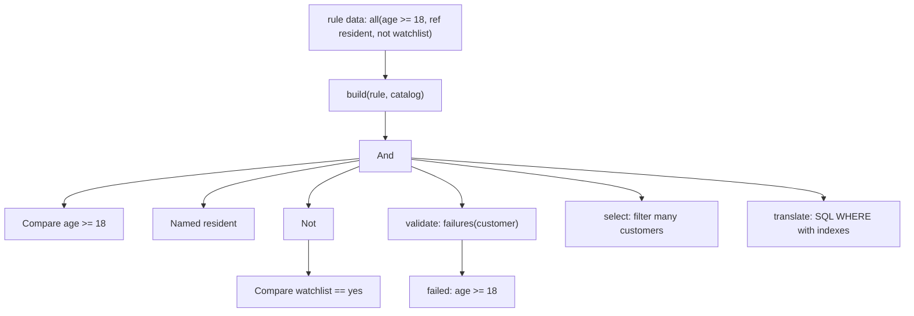

## In one minute
- A specification is an object that answers one question about a candidate: "does this order, customer or file satisfy the rule?" It has one core method, `is_satisfied_by(candidate)`, and a name from the business vocabulary, such as `OverdueInvoice` or `EligibleForFreeShipping`.
- Specifications compose with `and`, `or` and `not` into larger rules, so a complex business rule becomes a tree of small, separately tested pieces instead of a 40-line `if`.
- Eric Evans and Martin Fowler listed three uses for the same rule object: **validation** (does this object meet the rule, and if not, why), **selection** (find all objects that meet it) and **building to order** (build something that meets it) ([Evans and Fowler](https://martinfowler.com/apsupp/spec.pdf)).
- The hard part is selection at scale: a rule evaluated in memory forces you to load every row. Production systems translate specifications into a query (Django `Q`, Spring Data JPA `Specification`, SQLAlchemy expressions) so the database filters with its indexes ([Django docs](https://docs.djangoproject.com/en/stable/topics/db/queries/), [Spring Data JPA docs](https://docs.spring.io/spring-data/jpa/reference/jpa/specifications.html)).
- Do not use it for a rule that appears once. It earns its keep when the same rule is checked in several places, changes often, or is configured by non-developers as data.

## How it works

### The problem
A lending app decides who may apply for a loan. The rule started as `age >= 18 and country == "ID"`, then gained "or has a guarantor", "and not on the fraud watchlist", and "and monthly income at least 5 million rupiah unless the customer is a salaried employee of a partner company". It now lives in three places: the signup API (to show the apply button), a nightly job (to email eligible customers) and the underwriting service (to recheck at submission). The three copies disagree on the partner-company exception, and when a customer is rejected, support cannot tell them which condition failed.

### One object per rule
A specification wraps one condition behind a uniform interface:

```python
class Adult(Spec):
    def is_satisfied_by(self, c):
        return c.get("age", 0) >= 18
```

Every rule now has a name, a test file and a single home. The signup API, the nightly job and the underwriting service all call the same `Eligible` specification. Changing the rule is one change.

### Composition
The value comes from combinators. `And`, `Or` and `Not` are themselves specifications that hold other specifications, which is the [Composite](composite.md) pattern applied to predicates:

```python
eligible = Adult().and_(Resident()).or_(HasGuarantor()).and_(OnWatchlist().not_())
```

The result is a tree. Evaluating it is a recursive walk: an `And` node is satisfied when every child is, an `Or` when any child is, a `Not` when its child is not. Because each node also knows how to describe itself, the tree can explain itself: "failed: age >= 18, country in ID|SG". That explanation is what support needed and what three hand-written `if` blocks never produced.

### Three uses for one rule
- **Validation**: before accepting a loan application, check `eligible.is_satisfied_by(customer)` and return the failed conditions to the user.
- **Selection**: the nightly job wants every eligible customer. A naive version loads all customers and filters in memory. A better one asks the specification to produce a query predicate, so the repository runs `WHERE age >= 18 AND country IN ('ID','SG') ...` with indexes. Spring Data JPA builds this in: a `Specification<T>` has `toPredicate(root, query, builder)` and can be combined with `and`, `or` and `not` before being passed to a repository. Its current docs also define a `PredicateSpecification<T>` whose `toPredicate(from, builder)` takes no query argument, plus `UpdateSpecification` and `DeleteSpecification`, because a Criteria predicate is tied to the kind of statement it is used in ([Spring Data JPA docs](https://docs.spring.io/spring-data/jpa/reference/jpa/specifications.html)). The lesson for your own code is the same: a rule that must run as an `UPDATE` or `DELETE` filter needs a translation for that statement type too. Django does it with `Q` objects joined by `&`, `|` and `~` ([Django docs](https://docs.djangoproject.com/en/stable/topics/db/queries/)).
- **Building to order**: generate a test fixture or a default configuration that satisfies the rule. This is rarer in application code but common in property-based testing.

### Rules as data
Once rules are trees of small objects, they can be stored as data and built at runtime: `["all", ["age", ">=", 18], ["ref", "resident"]]`. Product or risk teams can then change a threshold without a deploy, with the code providing a fixed vocabulary of leaf conditions and named, reviewed building blocks. This is the road that leads to policy engines. Google's Common Expression Language (CEL) evaluates such expressions in Kubernetes `ValidatingAdmissionPolicy`, stable since v1.30 ([Kubernetes docs](https://kubernetes.io/docs/reference/access-authn-authz/validating-admission-policy/)), and Google Cloud IAM conditions use a subset of CEL ([Google Cloud docs](https://cloud.google.com/iam/docs/conditions-overview)). Open Policy Agent evaluates Rego policies over structured data ([OPA docs](https://www.openpolicyagent.org/docs/policy-language)). All of them are specifications with a parser, a type checker and a sandbox in front.

### When not to use it
- A rule used once, in one place, that nobody configures: an `if` statement is clearer.
- Hot paths where the rule is fixed at compile time: a plain function avoids a tree walk per candidate.
- Selection over large tables when your specifications cannot be translated into queries. In-memory filtering of a million rows is a performance bug waiting to happen.
- A generic "rule engine" built before the second rule exists. Build named specifications for real rules first; generalise when rules really do become data.

### Reviewing agent-written code
Asked to "also exclude customers on the watchlist", an agent will usually add one more condition to whichever `if` it finds first, often only one of the three copies. Asked to "make eligibility configurable", it may write a string-parsing mini-language with `eval`. Steer it towards one named specification per business rule, combinators instead of new `if` branches, a description on every leaf so failures explain themselves, and a translation to the query layer for any rule used in selection. In review, check that the rule exists exactly once and that a test pins each leaf and the combined tree.

### The same shape elsewhere
A specification is the *finding things fast* and *trust but verify* shapes meeting in one object: the same predicate filters a collection and validates a single item. Database query planners treat a `WHERE` clause as a tree of predicates and push the cheap, selective ones down to an index. Firewalls and Kubernetes network policies are ordered predicate trees over packet fields. Email filtering rules, feature-flag targeting and alert routing in Alertmanager are specification trees configured as data. Each faces the same issues: explaining why something matched, evaluating cheaply, and avoiding rules that only work in one evaluator.

## Down the stack

### Layer 1: The contract
A specification is a pure predicate: for the same candidate it always returns the same answer and has no side effects, so it can be evaluated in any order, cached, or run in a database instead of in memory. Composition obeys Boolean algebra: `a and b` equals `b and a`, `not not a` equals `a`. When a specification is translated to a query, the translation must select exactly the candidates the in-memory version accepts, including the edge cases: missing fields, nulls and type mismatches. That last clause is where real systems break, because SQL's three-valued logic treats `NULL` as "unknown", so `NOT` of an unknown is still unknown and the row is dropped ([PostgreSQL docs](https://www.postgresql.org/docs/current/functions-logical.html)), while most languages' `None` just compares unequal.

### Layer 2: The mechanism
In memory, a composite specification is an abstract syntax tree interpreted by recursion. `And` and `Or` short-circuit: once one child of an `And` fails, the rest are skipped, so ordering children cheapest and most selective first saves work. That is an in-memory trick only: SQL gives no such promise, and the PostgreSQL docs say the order in which `AND` and `OR` operands are evaluated is not guaranteed ([PostgreSQL docs](https://www.postgresql.org/docs/current/functions-logical.html)), so never put a guard in the left operand and rely on it. Explanations need the opposite: to list every failed condition, the explaining walk must not short-circuit.

Translation to queries works the same way the in-memory walk does, emitting a predicate instead of a Boolean. Django's `Q` objects build a tree of `WhereNode`s with `AND`/`OR` connectors and a negation flag; the compiler walks it into SQL with bound parameters. It also repairs the null problem above: for a negated lookup on a nullable column, Django adds an `IS NOT NULL` guard so that `~Q(country="ID")` matches a row with no country, as Python would ([Django source](https://github.com/django/django/blob/stable/5.2.x/django/db/models/sql/query.py)). Hand-built Criteria or raw SQL get no such help. Spring Data JPA `Specification` produces JPA Criteria `Predicate` objects that Hibernate renders into SQL. CEL goes further: an expression is parsed, type-checked against a declared schema, then evaluated by a small interpreter with cost limits, so a policy cannot loop forever or consume unbounded CPU inside the Kubernetes API server. Cost units are deterministic, independent of load and hardware, so the same expression on the same input always costs the same ([Kubernetes docs](https://kubernetes.io/docs/reference/using-api/cel/)).

### Layer 3: The machine
Each node in an in-memory specification is a heap object, and evaluation is a virtual call per node: a vtable call in Java or C#, an itab lookup in Go, a property lookup along the prototype chain in JavaScript. Each costs a few nanoseconds when predicted, but the nodes are scattered across the heap, so a deep tree evaluated over many candidates pays cache misses (about 100 ns each) chasing pointers. A 12-node rule over 1 million in-memory customers is 12 million calls, roughly 20 to 60 ms, plus the cost of having loaded the million rows, which is the dominant term: at 1 KB per row, 1 GB pulled from the database across the network.

The same rule pushed into SQL lets the database use an index on `(country, age)` to read perhaps 30,000 matching rows instead of 1 million. That is why selection-heavy code translates specifications instead of evaluating them. For hot in-memory paths, a common optimisation is to compile the tree once into nested closures or bytecode, which removes per-node dispatch and lets the JIT inline small comparisons.

### Why it's built this way
1. Business rules are checked in several places and change often, so each rule needs one named home.
2. Rules are built from smaller conditions, so they are composed from objects with a shared interface rather than copied `if` chains.
3. People need to know why a rule failed, so every node can describe itself and the tree can explain a rejection.
4. Evaluating in memory requires loading every candidate, which is too expensive at scale, so specifications are translated into queries that use indexes.
5. Rules that change faster than deploys become data, which demands parsing, validation and cost limits, so mature systems end up as policy engines.

## Diagram


## Worked example
An e-commerce company decides who gets free shipping. Marketing changes the rule about twice a month: basket at least 150,000 rupiah, or member tier gold, and not a marketplace seller's item from overseas, and not during a flash sale unless the customer is a new user. The rule existed in the checkout service, the cart banner and the order history page, and each copy was hand-edited. In a quarter, 6 of 25 changes reached only some copies, and customers saw "free shipping" in the cart and a shipping fee at checkout. Support handled about 1,400 tickets a month about it.

The team defined eight leaf specifications with descriptions and a catalog of named blocks (`gold_member`, `overseas_item`, `flash_sale_window`), stored the combined rule as data in the config service, and built it at startup and on config change. All three surfaces evaluate the same tree. When a customer is denied, the cart shows the first failed condition in plain language. Tickets about mismatched shipping fees dropped to about 60 a month. Each evaluation takes about 2 microseconds for an 11-node tree, irrelevant next to a 120 ms checkout. The one place that needed more work was a marketing report selecting eligible past orders from a 40-million-row table: the team added a SQL translation for the four leaf types the report used, and the report went from a 25-minute full scan with in-memory filtering to a 40-second indexed query.

## In the wild
- **Kubernetes, v1.30: admission rules as CEL specifications.** `ValidatingAdmissionPolicy` lets cluster admins write validation rules as CEL expressions evaluated inside the API server instead of calling an external webhook. It reached stable in v1.30, and the API server charges every expression against a deterministic cost budget so one rule cannot starve the control plane ([Kubernetes docs](https://kubernetes.io/docs/reference/access-authn-authz/validating-admission-policy/), [CEL in Kubernetes](https://kubernetes.io/docs/reference/using-api/cel/)).
- **Microsoft eShopOnWeb, .NET.** Microsoft's .NET architecture guide shows specifications in its eShopOnWeb sample carrying both the filter and the eager-loading shape of a query, so repositories stay small ([Microsoft docs](https://learn.microsoft.com/en-us/dotnet/architecture/modern-web-apps-azure/work-with-data-in-asp-net-core-apps)). The open-source Ardalis.Specification library packages the same idea for EF Core queries ([GitHub](https://github.com/ardalis/Specification)).
- **Cloudflare, 2019: a rule pushed globally.** Cloudflare's WAF is rules shipped as data. One new managed rule, deployed in "simulate" mode, contained a regular expression that backtracked enormously. HTTP-serving CPUs went to nearly 100% worldwide, about 80% of traffic was lost, and the outage lasted 27 minutes. Even a rule that blocks nothing must still execute, so "simulate" was not safe. The fix list included profiling rules before release and staged rollouts ([Cloudflare](https://blog.cloudflare.com/details-of-the-cloudflare-outage-on-july-2-2019/)).

## Trade-offs
| Option | Strengths | Weaknesses | Choose when |
| --- | --- | --- | --- |
| Inline `if` statements | Simplest; fastest | Duplicated across call sites; no explanation | Rule used once and rarely changes |
| Predicate functions (`lambda c: ...`) | Composable with higher-order functions; light | Opaque: cannot describe, translate or store | Simple in-process filtering |
| Specification objects | Named rules; composable; can explain and translate | More classes; translation must stay faithful | Shared rules checked in several places |
| Query-translatable specifications | One rule for validation and indexed selection | Two evaluators to keep consistent | Rules used to select from large tables |
| Policy engine (CEL, OPA) | Rules as data; sandboxed; tooling | New language for the team; operational component | Rules owned by non-developers or many services |

## Pitfalls in production
- In-memory selection over large tables: `[c for c in repo.all() if spec.is_satisfied_by(c)]` loads everything. Fix: translate specifications into the query layer and restrict in-memory evaluation to single objects or small sets.
- Two evaluators disagreeing on nulls: the in-memory `not (country == "ID")` accepts a customer with no country, while SQL `NOT (country = 'ID')` rejects it because the comparison is `NULL`. Fix: define missing-value semantics explicitly and test both evaluators on the same fixtures.
- Explanations that leak internals or are useless ("rule 7 failed"). Fix: give every leaf a business description and wrap composite policies in named specifications for customer-facing messages.
- Rule data with no validation: a typo in an operator or a reference to a deleted rule discovered at evaluation time. Fix: build and validate the whole tree when the configuration is loaded and reject bad configurations before they go live.
- Side effects inside predicates, such as a specification that calls a remote fraud API. Fix: keep specifications pure; fetch data first and pass it in as part of the candidate.

## Leadership lens
- Ask how many places check a rule and who changes it. One place and one team: an `if` is fine. Several places, or a business team that changes it weekly: a specification, possibly as data.
- Treat rule data like code: version it, review changes, run the rule against a fixed set of sample customers in CI, and keep an audit log of who changed what.
- Budget for the query translation when rules drive selection. It is where most of the engineering effort and most of the bugs live.
- Before building an in-house rules engine, evaluate CEL or OPA. They come with parsers, type checking and cost limits you would otherwise build and maintain.

## Check yourself
1. Why must an explanation walk not short-circuit, while evaluation should?
   **Answer:** Evaluation only needs the Boolean answer, so it stops at the first decisive child. An explanation must list every failed condition, so it has to evaluate all children of a failing `And`.
2. Your in-memory specification and its SQL translation return different customers. What is the most likely cause?
   **Answer:** Different handling of missing or null values (SQL's three-valued logic) or of type mismatches; both evaluators must share explicit semantics and tests.
3. How is a specification different from a lambda predicate?
   **Answer:** A specification is an object with a name and structure, so besides being evaluated it can describe itself, explain failures, be stored as data and be translated into a query. A lambda can only be called.
4. When is a named specification better than exposing the full rule tree in an error message?
   **Answer:** When the internals are long, sensitive (fraud thresholds) or meaningless to the user. A named block such as `prime borrower` explains at the right level of detail.

## Practice
**Task:** Build composable specifications with explanations and a rule builder. Candidates are maps from field names to integers or strings. `Compare(field, op, value)` supports `==`, `!=`, `<`, `<=`, `>`, `>=`; a missing field or a value of a different type fails every comparison (including `!=`), and it describes itself as `"<field> <op> <value>"`. `OneOf(field, values)` is satisfied when the field is present and equals one of the values (same type), described as `"<field> in a|b|c"`. `And` and `Or` hold a list of children and describe as `"(x and y)"` or `"(x or y)"`; `Not` describes as `"not x"`; `Named(name, spec)` behaves like `spec` but describes as `name`. Specs also offer `and`, `or` and `not` combinators (`and_`, `or_`, `not_` in Python; functions `And`, `Or`, `Not` in Go) that wrap exactly two children or one. `failures(candidate)` returns `[]` when satisfied; otherwise a leaf or `Named` returns its description, `And` returns the failures of its failing children in order, `Or` returns all its children's failures, and `Not` returns `"not " + inner description`. `build(rule, catalog)` turns nested lists into specs: `["all", ...]` and `["any", ...]` (fail with `empty all` or `empty any` without children), `["not", r]`, `["ref", name]` (a `Named` spec from the catalog, else `unknown spec: <name>`), `[field, "in", [values]]` and `[field, op, value]` (unknown ops fail with `unknown op: <op>`); anything else fails with `bad rule`. `select(items, spec)` keeps the satisfying items in order. Python raises `ValueError`, TypeScript throws `Error`, Go returns errors.

```python starter
class Spec:
    def is_satisfied_by(self, c):
        raise NotImplementedError

    def describe(self):
        raise NotImplementedError

    def failures(self, c):
        raise NotImplementedError

    def and_(self, other):
        raise NotImplementedError

    def or_(self, other):
        raise NotImplementedError

    def not_(self):
        raise NotImplementedError


class Compare(Spec):
    def __init__(self, field, op, value):
        self.field, self.op, self.value = field, op, value


class OneOf(Spec):
    def __init__(self, field, values):
        self.field, self.values = field, values


class And(Spec):
    def __init__(self, children):
        self.children = children


class Or(Spec):
    def __init__(self, children):
        self.children = children


class Not(Spec):
    def __init__(self, inner):
        self.inner = inner


class Named(Spec):
    def __init__(self, name, spec):
        self.name, self.spec = name, spec


def build(rule, catalog):
    raise NotImplementedError


def select(items, spec):
    raise NotImplementedError
```

```python tests
def error_of(fn):
    try:
        fn()
    except ValueError as e:
        return str(e)
    return None

ANA = {"name": "ana", "age": 31, "country": "ID", "income": 9000, "watchlist": "no"}
BUDI = {"name": "budi", "age": 17, "country": "MY", "watchlist": "no"}
CHEN = {"name": "chen", "age": 40, "country": "SG", "income": 2000, "watchlist": "yes"}
DEWI = {"name": "dewi", "age": "unknown", "country": "ID", "guarantor": "yes"}

def test_compare_ops_missing_and_types():
    assert Compare("age", ">=", 18).is_satisfied_by(ANA)
    assert not Compare("age", ">=", 18).is_satisfied_by(BUDI)
    assert Compare("age", "<", 18).is_satisfied_by(BUDI)
    assert Compare("country", "!=", "ID").is_satisfied_by(BUDI)
    assert not Compare("income", ">", 0).is_satisfied_by(BUDI), "missing field fails"
    assert not Compare("income", "!=", 5).is_satisfied_by(BUDI), "missing fails != too"
    assert not Compare("age", ">=", 18).is_satisfied_by(DEWI), "type mismatch fails"
    assert Compare("age", ">=", 18).describe() == "age >= 18"

def test_one_of():
    s = OneOf("country", ["ID", "SG"])
    assert s.is_satisfied_by(ANA) and s.is_satisfied_by(CHEN) and not s.is_satisfied_by(BUDI)
    assert s.describe() == "country in ID|SG"
    assert not OneOf("age", ["31"]).is_satisfied_by(ANA)

def test_combinators_and_describe():
    adult, resident = Compare("age", ">=", 18), OneOf("country", ["ID", "SG"])
    guarantor = Compare("guarantor", "==", "yes")
    s = adult.and_(resident).or_(guarantor)
    assert s.describe() == "((age >= 18 and country in ID|SG) or guarantor == yes)"
    assert s.is_satisfied_by(ANA) and s.is_satisfied_by(DEWI) and not s.is_satisfied_by(BUDI)
    n = Compare("watchlist", "==", "yes").not_()
    assert n.describe() == "not watchlist == yes"
    assert n.is_satisfied_by(ANA) and not n.is_satisfied_by(CHEN) and n.is_satisfied_by(DEWI)

def test_failures_explain_everything():
    adult, resident = Compare("age", ">=", 18), OneOf("country", ["ID", "SG"])
    clean = Compare("watchlist", "==", "yes").not_()
    s = And([adult, resident, clean])
    assert s.failures(ANA) == []
    assert s.failures(BUDI) == ["age >= 18", "country in ID|SG"]
    assert s.failures(CHEN) == ["not watchlist == yes"]
    o = Or([adult, Compare("guarantor", "==", "yes")])
    assert o.failures(BUDI) == ["age >= 18", "guarantor == yes"]
    assert o.failures(ANA) == []

def test_named_hides_internals():
    prime = Named("prime borrower", Compare("income", ">=", 5000).and_(Compare("age", ">=", 25)))
    s = prime.and_(OneOf("country", ["ID"]))
    assert s.describe() == "(prime borrower and country in ID)"
    assert s.failures(CHEN) == ["prime borrower", "country in ID"]
    assert s.failures(ANA) == []

def test_build_and_select():
    catalog = {"resident": OneOf("country", ["ID", "SG"])}
    rule = ["all",
            ["any", ["age", ">=", 18], ["guarantor", "==", "yes"]],
            ["ref", "resident"],
            ["not", ["watchlist", "==", "yes"]]]
    s = build(rule, catalog)
    assert s.describe() == "((age >= 18 or guarantor == yes) and resident and not watchlist == yes)"
    people = [ANA, BUDI, CHEN, DEWI]
    assert [p["name"] for p in select(people, s)] == ["ana", "dewi"]
    assert s.failures(BUDI) == ["age >= 18", "guarantor == yes", "resident"]
    t = build(["country", "in", ["MY"]], catalog)
    assert [p["name"] for p in select(people, t)] == ["budi"]

def test_build_errors():
    cat = {}
    assert error_of(lambda: build(["age", "~=", 3], cat)) == "unknown op: ~="
    assert error_of(lambda: build(["any"], cat)) == "empty any"
    assert error_of(lambda: build(["all", ["ref", "vip"]], cat)) == "unknown spec: vip"
    assert error_of(lambda: build([], cat)) == "bad rule"
    assert error_of(lambda: build(["not"], cat)) == "bad rule"
    assert error_of(lambda: build(["age", ">="], cat)) == "bad rule"
    assert error_of(lambda: build(["country", "in", "ID"], cat)) == "bad rule"
```

```python solution
OPS = ("==", "!=", "<", "<=", ">", ">=")


class Spec:
    def failures(self, c):
        if self.is_satisfied_by(c):
            return []
        return self._why(c)

    def _why(self, c):
        return [self.describe()]

    def and_(self, other):
        return And([self, other])

    def or_(self, other):
        return Or([self, other])

    def not_(self):
        return Not(self)


class Compare(Spec):
    def __init__(self, field, op, value):
        self.field, self.op, self.value = field, op, value

    def is_satisfied_by(self, c):
        if self.field not in c:
            return False
        a, b = c[self.field], self.value
        if type(a) is not type(b):
            return False
        if self.op == "==":
            return a == b
        if self.op == "!=":
            return a != b
        if self.op == "<":
            return a < b
        if self.op == "<=":
            return a <= b
        if self.op == ">":
            return a > b
        if self.op == ">=":
            return a >= b
        return False

    def describe(self):
        return self.field + " " + self.op + " " + str(self.value)


class OneOf(Spec):
    def __init__(self, field, values):
        self.field, self.values = field, list(values)

    def is_satisfied_by(self, c):
        if self.field not in c:
            return False
        a = c[self.field]
        return any(type(a) is type(v) and a == v for v in self.values)

    def describe(self):
        return self.field + " in " + "|".join(str(v) for v in self.values)


class And(Spec):
    def __init__(self, children):
        self.children = list(children)

    def is_satisfied_by(self, c):
        return all(ch.is_satisfied_by(c) for ch in self.children)

    def describe(self):
        return "(" + " and ".join(ch.describe() for ch in self.children) + ")"

    def _why(self, c):
        out = []
        for ch in self.children:
            out.extend(ch.failures(c))
        return out


class Or(Spec):
    def __init__(self, children):
        self.children = list(children)

    def is_satisfied_by(self, c):
        return any(ch.is_satisfied_by(c) for ch in self.children)

    def describe(self):
        return "(" + " or ".join(ch.describe() for ch in self.children) + ")"

    def _why(self, c):
        out = []
        for ch in self.children:
            out.extend(ch.failures(c))
        return out


class Not(Spec):
    def __init__(self, inner):
        self.inner = inner

    def is_satisfied_by(self, c):
        return not self.inner.is_satisfied_by(c)

    def describe(self):
        return "not " + self.inner.describe()


class Named(Spec):
    def __init__(self, name, spec):
        self.name, self.spec = name, spec

    def is_satisfied_by(self, c):
        return self.spec.is_satisfied_by(c)

    def describe(self):
        return self.name


def build(rule, catalog):
    if not isinstance(rule, list) or not rule or not isinstance(rule[0], str):
        raise ValueError("bad rule")
    head = rule[0]
    if head in ("all", "any"):
        if len(rule) == 1:
            raise ValueError("empty " + head)
        kids = [build(r, catalog) for r in rule[1:]]
        return And(kids) if head == "all" else Or(kids)
    if head == "not":
        if len(rule) != 2:
            raise ValueError("bad rule")
        return Not(build(rule[1], catalog))
    if head == "ref":
        if len(rule) != 2:
            raise ValueError("bad rule")
        if rule[1] not in catalog:
            raise ValueError("unknown spec: " + str(rule[1]))
        return Named(rule[1], catalog[rule[1]])
    if len(rule) != 3:
        raise ValueError("bad rule")
    op = rule[1]
    if op == "in":
        if not isinstance(rule[2], list):
            raise ValueError("bad rule")
        return OneOf(head, rule[2])
    if op not in OPS:
        raise ValueError("unknown op: " + str(op))
    return Compare(head, op, rule[2])


def select(items, spec):
    return [it for it in items if spec.is_satisfied_by(it)]
```

```typescript starter
export type Value = string | number;
export type Candidate = Record<string, Value>;

export abstract class Spec {
  abstract isSatisfiedBy(c: Candidate): boolean;
  abstract describe(): string;
  failures(c: Candidate): string[] { throw new Error("TODO"); }
  and(other: Spec): Spec { throw new Error("TODO"); }
  or(other: Spec): Spec { throw new Error("TODO"); }
  not(): Spec { throw new Error("TODO"); }
}

export class Compare extends Spec {
  constructor(public field: string, public op: string, public value: Value) { super(); }
  isSatisfiedBy(c: Candidate): boolean { throw new Error("TODO"); }
  describe(): string { throw new Error("TODO"); }
}

export class OneOf extends Spec {
  constructor(public field: string, public values: Value[]) { super(); }
  isSatisfiedBy(c: Candidate): boolean { throw new Error("TODO"); }
  describe(): string { throw new Error("TODO"); }
}

export class And extends Spec {
  constructor(public children: Spec[]) { super(); }
  isSatisfiedBy(c: Candidate): boolean { throw new Error("TODO"); }
  describe(): string { throw new Error("TODO"); }
}

export class Or extends Spec {
  constructor(public children: Spec[]) { super(); }
  isSatisfiedBy(c: Candidate): boolean { throw new Error("TODO"); }
  describe(): string { throw new Error("TODO"); }
}

export class Not extends Spec {
  constructor(public inner: Spec) { super(); }
  isSatisfiedBy(c: Candidate): boolean { throw new Error("TODO"); }
  describe(): string { throw new Error("TODO"); }
}

export class Named extends Spec {
  constructor(public name: string, public spec: Spec) { super(); }
  isSatisfiedBy(c: Candidate): boolean { throw new Error("TODO"); }
  describe(): string { throw new Error("TODO"); }
}

export function build(rule: unknown, catalog: Record<string, Spec>): Spec {
  throw new Error("TODO");
}

export function select(items: Candidate[], spec: Spec): Candidate[] {
  throw new Error("TODO");
}
```

```typescript tests
function errorOf(fn: () => unknown): string | undefined {
  try { fn(); } catch (e) { return (e as Error).message; }
  return undefined;
}

const ANA: Candidate = { name: "ana", age: 31, country: "ID", income: 9000, watchlist: "no" };
const BUDI: Candidate = { name: "budi", age: 17, country: "MY", watchlist: "no" };
const CHEN: Candidate = { name: "chen", age: 40, country: "SG", income: 2000, watchlist: "yes" };
const DEWI: Candidate = { name: "dewi", age: "unknown", country: "ID", guarantor: "yes" };

test("compare ops, missing and types", () => {
  assert(new Compare("age", ">=", 18).isSatisfiedBy(ANA), "adult");
  assert(!new Compare("age", ">=", 18).isSatisfiedBy(BUDI), "minor");
  assert(new Compare("age", "<", 18).isSatisfiedBy(BUDI), "less than");
  assert(new Compare("country", "!=", "ID").isSatisfiedBy(BUDI), "not equal");
  assert(!new Compare("income", ">", 0).isSatisfiedBy(BUDI), "missing field fails");
  assert(!new Compare("income", "!=", 5).isSatisfiedBy(BUDI), "missing fails != too");
  assert(!new Compare("age", ">=", 18).isSatisfiedBy(DEWI), "type mismatch fails");
  assertEqual(new Compare("age", ">=", 18).describe(), "age >= 18");
});

test("one of", () => {
  const s = new OneOf("country", ["ID", "SG"]);
  assert(s.isSatisfiedBy(ANA) && s.isSatisfiedBy(CHEN) && !s.isSatisfiedBy(BUDI), "membership");
  assertEqual(s.describe(), "country in ID|SG");
  assert(!new OneOf("age", ["31"]).isSatisfiedBy(ANA), "type must match");
});

test("combinators and describe", () => {
  const adult = new Compare("age", ">=", 18), resident = new OneOf("country", ["ID", "SG"]);
  const guarantor = new Compare("guarantor", "==", "yes");
  const s = adult.and(resident).or(guarantor);
  assertEqual(s.describe(), "((age >= 18 and country in ID|SG) or guarantor == yes)");
  assert(s.isSatisfiedBy(ANA) && s.isSatisfiedBy(DEWI) && !s.isSatisfiedBy(BUDI), "evaluation");
  const n = new Compare("watchlist", "==", "yes").not();
  assertEqual(n.describe(), "not watchlist == yes");
  assert(n.isSatisfiedBy(ANA) && !n.isSatisfiedBy(CHEN) && n.isSatisfiedBy(DEWI), "negation");
});

test("failures explain everything", () => {
  const adult = new Compare("age", ">=", 18), resident = new OneOf("country", ["ID", "SG"]);
  const clean = new Compare("watchlist", "==", "yes").not();
  const s = new And([adult, resident, clean]);
  assertEqual(s.failures(ANA), []);
  assertEqual(s.failures(BUDI), ["age >= 18", "country in ID|SG"]);
  assertEqual(s.failures(CHEN), ["not watchlist == yes"]);
  const o = new Or([adult, new Compare("guarantor", "==", "yes")]);
  assertEqual(o.failures(BUDI), ["age >= 18", "guarantor == yes"]);
  assertEqual(o.failures(ANA), []);
});

test("named hides internals", () => {
  const prime = new Named("prime borrower", new Compare("income", ">=", 5000).and(new Compare("age", ">=", 25)));
  const s = prime.and(new OneOf("country", ["ID"]));
  assertEqual(s.describe(), "(prime borrower and country in ID)");
  assertEqual(s.failures(CHEN), ["prime borrower", "country in ID"]);
  assertEqual(s.failures(ANA), []);
});

test("build and select", () => {
  const catalog: Record<string, Spec> = { resident: new OneOf("country", ["ID", "SG"]) };
  const rule = ["all",
    ["any", ["age", ">=", 18], ["guarantor", "==", "yes"]],
    ["ref", "resident"],
    ["not", ["watchlist", "==", "yes"]]];
  const s = build(rule, catalog);
  assertEqual(s.describe(), "((age >= 18 or guarantor == yes) and resident and not watchlist == yes)");
  const people = [ANA, BUDI, CHEN, DEWI];
  assertEqual(select(people, s).map((p) => p.name), ["ana", "dewi"]);
  assertEqual(s.failures(BUDI), ["age >= 18", "guarantor == yes", "resident"]);
  const t = build(["country", "in", ["MY"]], catalog);
  assertEqual(select(people, t).map((p) => p.name), ["budi"]);
});

test("build errors", () => {
  const cat: Record<string, Spec> = {};
  assertEqual(errorOf(() => build(["age", "~=", 3], cat)), "unknown op: ~=");
  assertEqual(errorOf(() => build(["any"], cat)), "empty any");
  assertEqual(errorOf(() => build(["all", ["ref", "vip"]], cat)), "unknown spec: vip");
  assertEqual(errorOf(() => build([], cat)), "bad rule");
  assertEqual(errorOf(() => build(["not"], cat)), "bad rule");
  assertEqual(errorOf(() => build(["age", ">="], cat)), "bad rule");
  assertEqual(errorOf(() => build(["country", "in", "ID"], cat)), "bad rule");
});
```

```typescript solution
export type Value = string | number;
export type Candidate = Record<string, Value>;

const OPS = ["==", "!=", "<", "<=", ">", ">="];

export abstract class Spec {
  abstract isSatisfiedBy(c: Candidate): boolean;
  abstract describe(): string;
  failures(c: Candidate): string[] {
    return this.isSatisfiedBy(c) ? [] : this.why(c);
  }
  protected why(c: Candidate): string[] { return [this.describe()]; }
  and(other: Spec): Spec { return new And([this, other]); }
  or(other: Spec): Spec { return new Or([this, other]); }
  not(): Spec { return new Not(this); }
}

export class Compare extends Spec {
  constructor(public field: string, public op: string, public value: Value) { super(); }
  isSatisfiedBy(c: Candidate): boolean {
    if (!(this.field in c)) return false;
    const a = c[this.field], b = this.value;
    if (typeof a !== typeof b) return false;
    switch (this.op) {
      case "==": return a === b;
      case "!=": return a !== b;
      case "<": return a < b;
      case "<=": return a <= b;
      case ">": return a > b;
      case ">=": return a >= b;
    }
    return false;
  }
  describe(): string { return this.field + " " + this.op + " " + String(this.value); }
}

export class OneOf extends Spec {
  constructor(public field: string, public values: Value[]) { super(); }
  isSatisfiedBy(c: Candidate): boolean {
    if (!(this.field in c)) return false;
    const a = c[this.field];
    return this.values.some((v) => typeof v === typeof a && v === a);
  }
  describe(): string { return this.field + " in " + this.values.map(String).join("|"); }
}

export class And extends Spec {
  constructor(public children: Spec[]) { super(); }
  isSatisfiedBy(c: Candidate): boolean { return this.children.every((ch) => ch.isSatisfiedBy(c)); }
  describe(): string { return "(" + this.children.map((ch) => ch.describe()).join(" and ") + ")"; }
  protected why(c: Candidate): string[] { return this.children.flatMap((ch) => ch.failures(c)); }
}

export class Or extends Spec {
  constructor(public children: Spec[]) { super(); }
  isSatisfiedBy(c: Candidate): boolean { return this.children.some((ch) => ch.isSatisfiedBy(c)); }
  describe(): string { return "(" + this.children.map((ch) => ch.describe()).join(" or ") + ")"; }
  protected why(c: Candidate): string[] { return this.children.flatMap((ch) => ch.failures(c)); }
}

export class Not extends Spec {
  constructor(public inner: Spec) { super(); }
  isSatisfiedBy(c: Candidate): boolean { return !this.inner.isSatisfiedBy(c); }
  describe(): string { return "not " + this.inner.describe(); }
}

export class Named extends Spec {
  constructor(public name: string, public spec: Spec) { super(); }
  isSatisfiedBy(c: Candidate): boolean { return this.spec.isSatisfiedBy(c); }
  describe(): string { return this.name; }
}

export function build(rule: unknown, catalog: Record<string, Spec>): Spec {
  if (!Array.isArray(rule) || rule.length === 0 || typeof rule[0] !== "string") throw new Error("bad rule");
  const head = rule[0] as string;
  if (head === "all" || head === "any") {
    if (rule.length === 1) throw new Error("empty " + head);
    const kids = rule.slice(1).map((r) => build(r, catalog));
    return head === "all" ? new And(kids) : new Or(kids);
  }
  if (head === "not") {
    if (rule.length !== 2) throw new Error("bad rule");
    return new Not(build(rule[1], catalog));
  }
  if (head === "ref") {
    if (rule.length !== 2) throw new Error("bad rule");
    const name = String(rule[1]);
    if (!Object.prototype.hasOwnProperty.call(catalog, name)) throw new Error("unknown spec: " + name);
    return new Named(name, catalog[name]);
  }
  if (rule.length !== 3) throw new Error("bad rule");
  const op = String(rule[1]);
  if (op === "in") {
    if (!Array.isArray(rule[2])) throw new Error("bad rule");
    return new OneOf(head, rule[2] as Value[]);
  }
  if (!OPS.includes(op)) throw new Error("unknown op: " + op);
  return new Compare(head, op, rule[2] as Value);
}

export function select(items: Candidate[], spec: Spec): Candidate[] {
  return items.filter((it) => spec.isSatisfiedBy(it));
}
```

```go starter
package practice

type Candidate map[string]any

type Spec interface {
	IsSatisfiedBy(c Candidate) bool
	Describe() string
	Failures(c Candidate) []string
}

func Compare(field, op string, value any) Spec   { panic("TODO") }
func OneOf(field string, values ...any) Spec      { panic("TODO") }
func And(children ...Spec) Spec                   { panic("TODO") }
func Or(children ...Spec) Spec                    { panic("TODO") }
func Not(inner Spec) Spec                         { panic("TODO") }
func Named(name string, spec Spec) Spec           { panic("TODO") }

func Build(rule []any, catalog map[string]Spec) (Spec, error) { panic("TODO") }

func Select(items []Candidate, spec Spec) []Candidate { panic("TODO") }
```

```go tests
package practice

import (
	"reflect"
	"testing"
)

var (
	ana  = Candidate{"name": "ana", "age": 31, "country": "ID", "income": 9000, "watchlist": "no"}
	budi = Candidate{"name": "budi", "age": 17, "country": "MY", "watchlist": "no"}
	chen = Candidate{"name": "chen", "age": 40, "country": "SG", "income": 2000, "watchlist": "yes"}
	dewi = Candidate{"name": "dewi", "age": "unknown", "country": "ID", "guarantor": "yes"}
)

func eq(t *testing.T, got, want any) {
	t.Helper()
	if !reflect.DeepEqual(got, want) {
		t.Fatalf("got %#v, want %#v", got, want)
	}
}

func names(cs []Candidate) []string {
	out := []string{}
	for _, c := range cs {
		out = append(out, c["name"].(string))
	}
	return out
}

func TestCompareOpsMissingAndTypes(t *testing.T) {
	eq(t, Compare("age", ">=", 18).IsSatisfiedBy(ana), true)
	eq(t, Compare("age", ">=", 18).IsSatisfiedBy(budi), false)
	eq(t, Compare("age", "<", 18).IsSatisfiedBy(budi), true)
	eq(t, Compare("country", "!=", "ID").IsSatisfiedBy(budi), true)
	eq(t, Compare("income", ">", 0).IsSatisfiedBy(budi), false)
	eq(t, Compare("income", "!=", 5).IsSatisfiedBy(budi), false)
	eq(t, Compare("age", ">=", 18).IsSatisfiedBy(dewi), false)
	eq(t, Compare("age", ">=", 18).Describe(), "age >= 18")
}

func TestOneOf(t *testing.T) {
	s := OneOf("country", "ID", "SG")
	eq(t, []bool{s.IsSatisfiedBy(ana), s.IsSatisfiedBy(chen), s.IsSatisfiedBy(budi)}, []bool{true, true, false})
	eq(t, s.Describe(), "country in ID|SG")
	eq(t, OneOf("age", "31").IsSatisfiedBy(ana), false)
}

func TestCombinatorsAndDescribe(t *testing.T) {
	adult, resident := Compare("age", ">=", 18), OneOf("country", "ID", "SG")
	s := Or(And(adult, resident), Compare("guarantor", "==", "yes"))
	eq(t, s.Describe(), "((age >= 18 and country in ID|SG) or guarantor == yes)")
	eq(t, []bool{s.IsSatisfiedBy(ana), s.IsSatisfiedBy(dewi), s.IsSatisfiedBy(budi)}, []bool{true, true, false})
	n := Not(Compare("watchlist", "==", "yes"))
	eq(t, n.Describe(), "not watchlist == yes")
	eq(t, []bool{n.IsSatisfiedBy(ana), n.IsSatisfiedBy(chen), n.IsSatisfiedBy(dewi)}, []bool{true, false, true})
}

func TestFailuresExplainEverything(t *testing.T) {
	adult, resident := Compare("age", ">=", 18), OneOf("country", "ID", "SG")
	s := And(adult, resident, Not(Compare("watchlist", "==", "yes")))
	eq(t, len(s.Failures(ana)), 0)
	eq(t, s.Failures(budi), []string{"age >= 18", "country in ID|SG"})
	eq(t, s.Failures(chen), []string{"not watchlist == yes"})
	o := Or(adult, Compare("guarantor", "==", "yes"))
	eq(t, o.Failures(budi), []string{"age >= 18", "guarantor == yes"})
	eq(t, len(o.Failures(ana)), 0)
}

func TestNamedHidesInternals(t *testing.T) {
	prime := Named("prime borrower", And(Compare("income", ">=", 5000), Compare("age", ">=", 25)))
	s := And(prime, OneOf("country", "ID"))
	eq(t, s.Describe(), "(prime borrower and country in ID)")
	eq(t, s.Failures(chen), []string{"prime borrower", "country in ID"})
	eq(t, len(s.Failures(ana)), 0)
}

func TestBuildAndSelect(t *testing.T) {
	catalog := map[string]Spec{"resident": OneOf("country", "ID", "SG")}
	rule := []any{"all",
		[]any{"any", []any{"age", ">=", 18}, []any{"guarantor", "==", "yes"}},
		[]any{"ref", "resident"},
		[]any{"not", []any{"watchlist", "==", "yes"}}}
	s, err := Build(rule, catalog)
	if err != nil {
		t.Fatal(err)
	}
	eq(t, s.Describe(), "((age >= 18 or guarantor == yes) and resident and not watchlist == yes)")
	people := []Candidate{ana, budi, chen, dewi}
	eq(t, names(Select(people, s)), []string{"ana", "dewi"})
	eq(t, s.Failures(budi), []string{"age >= 18", "guarantor == yes", "resident"})
	in, err := Build([]any{"country", "in", []any{"MY"}}, catalog)
	if err != nil {
		t.Fatal(err)
	}
	eq(t, names(Select(people, in)), []string{"budi"})
}

func TestBuildErrors(t *testing.T) {
	cat := map[string]Spec{}
	cases := []struct {
		rule []any
		want string
	}{
		{[]any{"age", "~=", 3}, "unknown op: ~="},
		{[]any{"any"}, "empty any"},
		{[]any{"all", []any{"ref", "vip"}}, "unknown spec: vip"},
		{[]any{}, "bad rule"},
		{[]any{"not"}, "bad rule"},
		{[]any{"age", ">="}, "bad rule"},
		{[]any{"country", "in", "ID"}, "bad rule"},
	}
	for _, c := range cases {
		_, err := Build(c.rule, cat)
		if err == nil || err.Error() != c.want {
			t.Errorf("%v: want %q, got %v", c.rule, c.want, err)
		}
	}
}
```

```go solution
package practice

import (
	"errors"
	"fmt"
	"strings"
)

type Candidate map[string]any

type Spec interface {
	IsSatisfiedBy(c Candidate) bool
	Describe() string
	Failures(c Candidate) []string
}

// order compares a and b when both are ints or both are strings.
func order(a, b any) (int, bool) {
	switch x := a.(type) {
	case int:
		y, ok := b.(int)
		if !ok {
			return 0, false
		}
		switch {
		case x < y:
			return -1, true
		case x > y:
			return 1, true
		}
		return 0, true
	case string:
		y, ok := b.(string)
		if !ok {
			return 0, false
		}
		return strings.Compare(x, y), true
	}
	return 0, false
}

type compare struct {
	field, op string
	value     any
}

func Compare(field, op string, value any) Spec { return &compare{field, op, value} }

func (s *compare) IsSatisfiedBy(c Candidate) bool {
	a, ok := c[s.field]
	if !ok {
		return false
	}
	r, ok := order(a, s.value)
	if !ok {
		return false
	}
	switch s.op {
	case "==":
		return r == 0
	case "!=":
		return r != 0
	case "<":
		return r < 0
	case "<=":
		return r <= 0
	case ">":
		return r > 0
	case ">=":
		return r >= 0
	}
	return false
}

func (s *compare) Describe() string { return fmt.Sprintf("%s %s %v", s.field, s.op, s.value) }
func (s *compare) Failures(c Candidate) []string { return leafFailures(s, c) }

func leafFailures(s Spec, c Candidate) []string {
	if s.IsSatisfiedBy(c) {
		return []string{}
	}
	return []string{s.Describe()}
}

type oneOf struct {
	field  string
	values []any
}

func OneOf(field string, values ...any) Spec { return &oneOf{field, values} }

func (s *oneOf) IsSatisfiedBy(c Candidate) bool {
	a, ok := c[s.field]
	if !ok {
		return false
	}
	for _, v := range s.values {
		if r, ok := order(a, v); ok && r == 0 {
			return true
		}
	}
	return false
}

func (s *oneOf) Describe() string {
	parts := make([]string, len(s.values))
	for i, v := range s.values {
		parts[i] = fmt.Sprint(v)
	}
	return s.field + " in " + strings.Join(parts, "|")
}

func (s *oneOf) Failures(c Candidate) []string { return leafFailures(s, c) }

type group struct {
	any      bool
	children []Spec
}

func And(children ...Spec) Spec { return &group{false, children} }
func Or(children ...Spec) Spec  { return &group{true, children} }

func (g *group) IsSatisfiedBy(c Candidate) bool {
	for _, ch := range g.children {
		if ch.IsSatisfiedBy(c) == g.any {
			return g.any
		}
	}
	return !g.any
}

func (g *group) Describe() string {
	sep := " and "
	if g.any {
		sep = " or "
	}
	parts := make([]string, len(g.children))
	for i, ch := range g.children {
		parts[i] = ch.Describe()
	}
	return "(" + strings.Join(parts, sep) + ")"
}

func (g *group) Failures(c Candidate) []string {
	out := []string{}
	if g.IsSatisfiedBy(c) {
		return out
	}
	for _, ch := range g.children {
		out = append(out, ch.Failures(c)...)
	}
	return out
}

type not struct{ inner Spec }

func Not(inner Spec) Spec { return &not{inner} }

func (n *not) IsSatisfiedBy(c Candidate) bool { return !n.inner.IsSatisfiedBy(c) }
func (n *not) Describe() string                { return "not " + n.inner.Describe() }
func (n *not) Failures(c Candidate) []string   { return leafFailures(n, c) }

type named struct {
	name string
	spec Spec
}

func Named(name string, spec Spec) Spec { return &named{name, spec} }

func (n *named) IsSatisfiedBy(c Candidate) bool { return n.spec.IsSatisfiedBy(c) }
func (n *named) Describe() string                { return n.name }
func (n *named) Failures(c Candidate) []string   { return leafFailures(n, c) }

var errBad = errors.New("bad rule")

func buildAny(r any, catalog map[string]Spec) (Spec, error) {
	rule, ok := r.([]any)
	if !ok {
		return nil, errBad
	}
	return Build(rule, catalog)
}

func Build(rule []any, catalog map[string]Spec) (Spec, error) {
	if len(rule) == 0 {
		return nil, errBad
	}
	head, ok := rule[0].(string)
	if !ok {
		return nil, errBad
	}
	switch head {
	case "all", "any":
		if len(rule) == 1 {
			return nil, errors.New("empty " + head)
		}
		kids := []Spec{}
		for _, r := range rule[1:] {
			k, err := buildAny(r, catalog)
			if err != nil {
				return nil, err
			}
			kids = append(kids, k)
		}
		if head == "all" {
			return And(kids...), nil
		}
		return Or(kids...), nil
	case "not":
		if len(rule) != 2 {
			return nil, errBad
		}
		k, err := buildAny(rule[1], catalog)
		if err != nil {
			return nil, err
		}
		return Not(k), nil
	case "ref":
		if len(rule) != 2 {
			return nil, errBad
		}
		name := fmt.Sprint(rule[1])
		s, ok := catalog[name]
		if !ok {
			return nil, errors.New("unknown spec: " + name)
		}
		return Named(name, s), nil
	}
	if len(rule) != 3 {
		return nil, errBad
	}
	op := fmt.Sprint(rule[1])
	if op == "in" {
		vals, ok := rule[2].([]any)
		if !ok {
			return nil, errBad
		}
		return OneOf(head, vals...), nil
	}
	switch op {
	case "==", "!=", "<", "<=", ">", ">=":
		return Compare(head, op, rule[2]), nil
	}
	return nil, errors.New("unknown op: " + op)
}

func Select(items []Candidate, spec Spec) []Candidate {
	out := []Candidate{}
	for _, it := range items {
		if spec.IsSatisfiedBy(it) {
			out = append(out, it)
		}
	}
	return out
}
```

## Mock interview
**Prompt:** You are designing the promotion engine for a food delivery app with 8 million monthly users. Marketing launches about 30 promotions a week, each with eligibility rules (city, order value, cuisine, new versus returning user, time window, payment method) that they want to edit without engineering. Checkout must decide eligibility in under 10 ms, the app must show users why a promotion does not apply, and a nightly job must find every user eligible for a campaign push.

- Follow-up: How do you store, validate and roll out a rule change so a typo cannot break checkout?
- Follow-up: The nightly job is slow because it evaluates rules in memory over 8 million users. What do you change?
- Follow-up: Would you build your own specification tree, or adopt CEL or OPA? What decides it?

**A strong answer covers:**
- A fixed vocabulary of leaf specifications (city, basket value, cuisine, user segment, time window) with descriptions, combined with all, any and not, and named reusable blocks such as `new_user`.
- Rules stored as versioned data, built and validated on load with unknown operators and references rejected, tested against sample orders before activation, with instant rollback to the previous version.
- Checkout evaluation in memory over one order with short-circuiting, and an explanation walk that lists failed conditions for the app.
- Selection translated to the data warehouse or database query (with matching null semantics and tests that compare both evaluators), not an in-memory loop over every user.
- Trade-offs between an in-house tree, CEL (sandboxed, typed, cost-limited) and OPA, including team skills, latency and the cost of running another component.

## Sources and further study

**Primary**
- [CEL language definition (google/cel-spec)](https://github.com/google/cel-spec/blob/master/doc/langdef.md): the formal grammar, types and evaluation rules of the expression language many policy systems embed.
- [Common Expression Language in Kubernetes](https://kubernetes.io/docs/reference/using-api/cel/): type checking, deterministic cost units and estimated cost limits for rules run inside a server.

**Systems docs**
- [Logical operators (PostgreSQL docs)](https://www.postgresql.org/docs/current/functions-logical.html): the three-valued truth tables and the warning about operand evaluation order.
- [Django `query.py` (source)](https://github.com/django/django/blob/stable/5.2.x/django/db/models/sql/query.py): how a mature ORM compensates for `NULL` when it translates negated predicates.
- [IAM Conditions overview (Google Cloud)](https://cloud.google.com/iam/docs/conditions-overview): a production authorization system that stores rules as CEL expression data.
- [Policy Language (Open Policy Agent)](https://www.openpolicyagent.org/docs/policy-language): the Rego approach to rules as data over structured input.
- [Ardalis.Specification (GitHub)](https://github.com/ardalis/Specification): a maintained .NET library that applies the pattern to EF Core queries.

**Books**
- *Domain-Driven Design* (Evans, 1st ed. 2003), Ch 9: Making Implicit Concepts Explicit, where the Specification pattern is introduced for validation, selection and building to order.
- *Design Patterns* (Gamma, Helm, Johnson, Vlissides, 1994), Ch 4: Structural Patterns, for Composite, the structure the `And`, `Or` and `Not` combinators reuse.

**Other curricula**
- [Work with data in ASP.NET Core apps (Microsoft Learn)](https://learn.microsoft.com/en-us/dotnet/architecture/modern-web-apps-azure/work-with-data-in-asp-net-core-apps): frames specifications as a way to keep query logic out of repositories and controllers.
- [Composite (Refactoring Guru)](https://refactoring.guru/design-patterns/composite): the tree structure behind composite specifications, as a plain reference.

## Watch
- [Specification Pattern for Object Oriented Programming and Domain Driven Design (Coding Blocks)](https://www.youtube.com/watch?v=NZ7mlH0JLW0): the pattern's structure and its role in domain-driven design, with example code.

## Free resources
- [Specifications (Eric Evans and Martin Fowler)](https://martinfowler.com/apsupp/spec.pdf): the original paper, with validation, selection and construction to order, and subsumption between specifications.
- [Specification pattern (Wikipedia)](https://en.wikipedia.org/wiki/Specification_pattern): a compact summary with the composite structure and criticisms.
- [Specifications (Spring Data JPA reference)](https://docs.spring.io/spring-data/jpa/reference/jpa/specifications.html): specifications that compile to database predicates in a mainstream framework.
- [Making queries: complex lookups with Q objects (Django docs)](https://docs.djangoproject.com/en/stable/topics/db/queries/): composable query predicates with `&`, `|` and `~`.
- [Common Expression Language (cel.dev)](https://cel.dev/): a sandboxed, typed expression language for rules stored as data.
- [Validating Admission Policy (Kubernetes docs)](https://kubernetes.io/docs/reference/access-authn-authz/validating-admission-policy/): CEL rules evaluated inside the API server, with cost limits.
