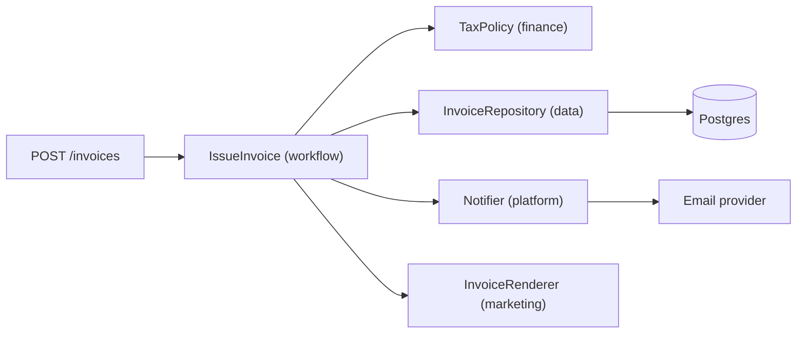

## In one minute
- A module should have one reason to change. "Reason" means a person or group who can ask for the change: finance owns tax rules, marketing owns email copy, the platform team owns the mail provider. Code that serves three of them has three reasons to change.
- The test is not "does this class do one thing?" (everything does one thing at some zoom level). The test is "if two different people asked for changes this week, would they both edit this file?"
- Splitting along those lines buys isolated tests, smaller diffs, fewer merge conflicts and fewer surprise regressions. It costs indirection: more files, more names, more hops to follow when reading.
- Split along axes of change you have actually seen, not ones you imagine. A one-method class per verb is as hard to work with as a 2,000-line god class.
- With agents writing code, SRP becomes a review tool: a change to tax rules that also touches the email template and the retry loop is a diff you cannot review with confidence.

## How it works

### A realistic "before"
Most SRP violations are not written on purpose. They grow. Here is a billing service after two years of feature requests:

```python
class InvoiceService:
    def issue(self, order_id):
        order = self.db.query("SELECT ... FROM orders WHERE id = %s", order_id)
        subtotal = sum(l.price * l.qty for l in order.lines)
        if order.country == "DE":
            tax = round(subtotal * 0.19)
        elif order.country == "ID":
            tax = round(subtotal * 0.11)
        else:
            tax = 0
        html = f"<h1>Thanks, {order.name}!</h1><p>Total: {subtotal + tax}</p>"
        for attempt in range(3):
            try:
                self.smtp.send(order.email, "Your invoice", html)
                break
            except TimeoutError:
                time.sleep(2 ** attempt)
        self.db.execute("INSERT INTO invoices ...", order_id, subtotal, tax)
        self.metrics.incr("invoices.issued")
```

Count who might ask for a change. Finance wants a new tax rule. Marketing wants a new template. The platform team wants to move from SMTP to a provider API. The data team wants the invoice row written before the email, so a crash cannot send an email for an invoice that does not exist. Four owners, one method. Each change risks the other three, and the only way to test the tax arithmetic is to fake a database, an SMTP server and a clock.

### The "after"
Split by owner, then put a thin coordinator on top:

```python
class TaxPolicy:            # finance
    def tax(self, subtotal, country): ...

class InvoiceRenderer:      # marketing
    def render(self, invoice): ...

class InvoiceRepository:    # data
    def get(self, invoice_id): ...
    def save(self, invoice): ...

class Notifier:             # platform: retries, provider choice
    def send(self, to, body): ...

class IssueInvoice:         # the workflow: order of steps only
    def run(self, order): ...
```

`IssueInvoice` still knows the sequence (compute, save, then notify) because the sequence is its responsibility. It does not know tax rates, HTML or retry backoff. Tax tests become pure arithmetic that run in microseconds. The notifier's retry policy can change without anyone rereading tax code.

### Where the name misleads
"Single responsibility" sounds like "do one thing", which leads people to split by verb: `InvoiceLoader`, `InvoiceSaver`, `InvoiceValidator`, `InvoiceFormatter`. That often splits one owner's logic across four files, so every change still touches all four. Robert Martin later restated the principle as "gather together the things that change for the same reasons; separate the things that change for different reasons" ([Martin, 2014](https://blog.cleancoder.com/uncle-bob/2014/05/08/SingleReponsibilityPrinciple.html)). That is cohesion and coupling under another name, and it goes back to David Parnas's 1972 advice to hide each design decision likely to change inside its own module ([Parnas](https://www.win.tue.nl/~wstomv/edu/2ip30/references/criteria_for_modularization.pdf)).

### When following it too zealously hurts
- **Indirection without payoff.** If tax rules have changed once in three years and only one team ever touches the file, a `TaxPolicyFactory` adds reading cost and no protection.
- **Scattered invariants.** "An invoice total equals subtotal minus discount plus tax" is one rule. Spread across a calculator, a validator and a mapper, nobody owns it and it drifts.
- **Anaemic objects.** Splitting all behaviour out of a type leaves a bag of fields plus a cloud of `*Service` classes that each poke at it.
- **Premature seams.** Every interface you add is a promise to keep it stable. Add one when a second reason to change shows up, not before.

A practical rule: extract when you see two different owners in the commit history of one file, or when a test needs fakes for things unrelated to what it checks. Refactoring catalogues name both sides of the trade. Editing one class for many unrelated reasons is [divergent change](https://refactoring.guru/smells/divergent-change), the symptom of a missing split. Having one change ripple through many small classes is [shotgun surgery](https://refactoring.guru/smells/shotgun-surgery), the symptom of splitting by verb.

### Reviewing agent-written code
Coding agents optimise for "make the requested change work" and tend to put the change where the context already is. Asked to add a tax rule, an agent will happily add it inside `issue()`, and while there it may also "fix" the retry loop it noticed. Two habits help:
- Ask of every diff: which owner asked for this, and does the diff touch code owned by anyone else? A diff that spans several owners should be split into separate changes.
- Prefer codebases where responsibilities are already separated. An agent working in a 40-line `TaxPolicy` with its own tests has less room to cause collateral damage than one working in a 1,400-line service.

### The same shape elsewhere
A god class is a contention problem. Many teams writing one file looks like many transactions writing one hot row: they serialise on merge conflicts instead of locks. The fix is the same in both domains: partition the shared thing by who writes it. Conway's observation that a system's structure copies the communication structure of its builders is why the partition usually has to follow teams as well ([Conway, 1968](http://www.melconway.com/Home/Committees_Paper.html)).

## Down the stack

### Layer 1: The contract
After the split, each unit has a contract small enough to test exhaustively. `TaxPolicy.tax(subtotal, country)` is a pure function: same inputs, same output, no I/O. `InvoiceRepository.get` returns the saved invoice or "not found". `Notifier.send` either delivers or returns an error. `IssueInvoice` promises ordering: it saves before it notifies, never notifies if saving failed, and does not send twice for an invoice that already exists. Each sentence maps to a test that needs at most two fakes.

### Layer 2: The mechanism
The mechanism is dependency injection plus module boundaries. `IssueInvoice` receives its collaborators through its constructor instead of building them, so tests pass fakes and production passes real adapters. In Python the boundary is a module and an informal protocol (or `typing.Protocol`). In TypeScript it is an `interface` checked structurally at compile time and erased at runtime. In Go it is a package plus a small interface declared by the consumer ([Go code review comments](https://go.dev/wiki/CodeReviewComments)), so `billing` declares `type Notifier interface { Send(to, body string) error }` and the email package never imports billing. Import graphs make the split visible: if `tax` imports `smtp`, the split is cosmetic.

### Layer 3: The machine
Splitting costs a little at runtime. Each collaborator is one heap object, typically 16 to 64 bytes, allocated once at startup and reused, so allocation cost rounds to zero. Calls through an interface are indirect. In Go an interface value is two words (an itab pointer and a data pointer), and a call loads the function pointer from the itab and jumps: about 1 to 2 ns, and it blocks inlining unless the compiler can devirtualise it (profile-guided optimisation in Go 1.21 and later can devirtualise some hot sites, per the [Go 1.21 notes](https://go.dev/doc/go1.21)). In V8 a monomorphic call site is cached and costs a few ns. In CPython any method call costs roughly 30 to 100 ns. Compare that with a 1 ms database round trip or a 200 ms email API call: the dispatch overhead is under a thousandth of the request.

Layout and concurrency are where the split can make code faster. A god object that holds a rate cache, retry counters and a template cache behind one mutex serialises unrelated work: a template reload blocks tax calculation. Separate objects get separate locks, or no locks at all when they hold no mutable state. Separate objects also stop unrelated hot counters from sharing a 64-byte cache line, which avoids false sharing when two threads update them.

### Why it's built this way
1. Requirements arrive from different people at different times, so code changes along those organisational lines.
2. When one file mixes several owners' logic, every change has to be checked against all of them, so review and test cost grows with the number of owners.
3. Isolating each owner's logic behind a narrow contract makes the blast radius of a change equal to one owner's code.
4. Isolation needs seams (interfaces, injected collaborators), and seams cost reading time and a few nanoseconds per call.
5. So split where change actually happens, and keep everything else together.

## Diagram


## Worked example
A team's `InvoiceService` is 1,400 lines. Over one quarter it had 37 commits from 4 teams and 11 merge conflicts. Its test suite starts a Postgres container and a fake SMTP server and takes 40 seconds, so developers run it rarely. Two production bugs that quarter were "fixed the template, broke the tax rounding" changes.

After the split: `TaxPolicy` is 60 lines with 120 table-driven tests that run in 0.2 seconds. The renderer has snapshot tests. The repository has integration tests against a real database, run in CI only. `IssueInvoice` is 35 lines with 6 tests using in-memory fakes. Commits per file per quarter drop to single digits and conflicts to roughly zero, because the teams no longer edit the same files.

The runtime cost: four extra objects at startup and four interface calls per invoice, about 10 ns in Go, against a request that spends 3 ms in the database and 150 ms waiting for the email provider. Nobody will measure the difference.

What the team chose not to split: the rule that an invoice's total equals subtotal plus tax stays inside one `Invoice` type with its constructor enforcing it. One rule, one place.

## In the wild
- **Knight Capital, 2012: one flag with two jobs.** New order-routing code reused a flag that had once switched on a retired trading routine called Power Peg. A technician deployed the new code to only seven of eight servers, so the eighth ran the dead logic, and in about 45 minutes the firm lost more than $460 million. The SEC found no second-person review of the deploy and no written procedure ([SEC order](https://www.sec.gov/litigation/admin/2013/34-70694.pdf)). Live behaviour and dead behaviour shared one switch, which is what mixed responsibilities in one place look like when they fail.
- **Istio, 2020: when splitting did not pay.** The mesh's control plane began as separate microservices for config, certificates and discovery. The team concluded that many of the usual benefits of microservices did not apply to those parts and merged them into a single binary, istiod ([Istio blog](https://istio.io/latest/blog/2020/istiod/)). A responsibility boundary is not automatically a deployment boundary.

## Trade-offs
| Option | Strengths | Weaknesses | Choose when |
| --- | --- | --- | --- |
| One cohesive class | Easy to read top to bottom; no indirection | Every owner edits it; tests need every dependency | One owner, small code, stable requirements |
| Split by owner (reason to change) | Small diffs, fast pure tests, fewer conflicts | More files and names; a coordinator to maintain | Several teams or roles change the code |
| Split by verb (load, validate, save) | Looks tidy | One change still touches every piece | Rarely; it usually mirrors a framework, not a need |
| Split into services | Independent deploys and scaling | Network calls, partial failure, distributed consistency | Owners need separate release cycles, not just separate files |

## Pitfalls in production
- Splitting the code but sharing the database tables, so finance and marketing still collide on schema migrations. Fix: give each responsibility its own tables or at least its own migration owner.
- A "workflow" class that slowly re-absorbs logic ("just one quick check here"). Fix: keep it to sequencing and error handling; push rules down into the owner's module.
- Side effects in the wrong order (email sent, then the save fails). Fix: the coordinator saves first, then notifies, and checks for an existing invoice so a retry does not send twice.
- Interfaces with one implementation and no test that uses a fake. Fix: if nothing substitutes it, inline it until something does.
- Shared mutable "context" objects passed to every collaborator, which recreate the god object one level down. Fix: pass each collaborator only the values it needs.

## Leadership lens
- Map code ownership to responsibilities. If CODEOWNERS for one file lists four teams, that file is a scheduling and quality risk, not just a style issue.
- In design review ask "who asks for this to change?" rather than "is this class too big?". Size is a symptom; mixed owners are the cause.
- Budget refactors where the commit history shows conflict and regressions, not across the whole codebase. The payoff is concentrated in a few hot files.
- For agent-assisted work, require one owner per change. Ask agents for focused diffs and reject ones that wander across responsibilities, even when each edit looks correct.

## Check yourself
1. A `ReportGenerator` class loads data, computes totals and renders a PDF, and only the analytics team has ever changed it. Does it violate SRP?
   **Answer:** Probably not in a way that matters. It has one owner and one reason to change so far; splitting it now adds indirection without reducing risk. Revisit if a second owner appears.
2. Why does splitting by verb (loader, validator, saver) often fail to deliver SRP's benefits?
   **Answer:** One owner's change, such as a new field, usually has to touch loading, validation and saving together, so the change still spans every file and the pieces stay tightly coupled.
3. What does the coordinator in the "after" design own, and what should it never contain?
   **Answer:** It owns the sequence and the error handling between steps (save before notify, skip duplicates). It should not contain tax rules, templates or delivery retries, which belong to their owners.
4. How does a god class make concurrency worse?
   **Answer:** Unrelated state sits behind one lock or one object, so unrelated operations serialise on it and hot fields can share cache lines; splitting by responsibility allows separate locks or no shared state at all.

## Practice
**Task:** Refactor a billing flow into three responsibilities. `calculate_totals(items, tax_rate_bps, discount_cents)` is pure: each item is `[sku, unit_price_cents, quantity]`; subtotal is the sum of price times quantity; the discount is capped at the subtotal; tax is the taxable amount (subtotal minus discount) times `tax_rate_bps / 10000`, rounded half up to whole cents; return `{"subtotal", "discount", "tax", "total"}`. Raise `ValueError` (TypeScript: throw; Go: return an error) if any quantity is below 1 or any price is negative. `render_invoice(invoice_id, email, totals)` returns `"Invoice <id> for <email>: total <dollars>.<cents>"` with two cent digits. `IssueInvoice(repo, notifier).run(invoice_id, email, items, tax_rate_bps, discount_cents)` returns the totals: if `repo.get(invoice_id)` already returns totals, return them without saving or notifying; otherwise compute, `repo.save`, then `notifier.send(email, rendered)`. If saving fails, the error propagates and nothing is sent. Tests use in-memory fakes through the interfaces.

```python starter
def calculate_totals(items, tax_rate_bps, discount_cents):
    # TODO
    raise NotImplementedError

def render_invoice(invoice_id, email, totals):
    # TODO
    raise NotImplementedError

class IssueInvoice:
    def __init__(self, repo, notifier):
        self.repo = repo
        self.notifier = notifier

    def run(self, invoice_id, email, items, tax_rate_bps, discount_cents):
        # TODO
        raise NotImplementedError
```

```python tests
class FakeRepo:
    def __init__(self, fail=False):
        self.rows = {}
        self.fail = fail
    def get(self, invoice_id):
        return self.rows.get(invoice_id)
    def save(self, invoice_id, totals):
        if self.fail:
            raise IOError("db down")
        self.rows[invoice_id] = totals

class FakeNotifier:
    def __init__(self):
        self.sent = []
    def send(self, to, body):
        self.sent.append((to, body))

def test_totals_basic():
    t = calculate_totals([["a", 1000, 2], ["b", 250, 1]], 1100, 0)
    assert t == {"subtotal": 2250, "discount": 0, "tax": 248, "total": 2498}

def test_discount_capped_and_rounding():
    assert calculate_totals([["a", 500, 1]], 1000, 900) == {"subtotal": 500, "discount": 500, "tax": 0, "total": 0}
    assert calculate_totals([["a", 5, 1]], 1000, 0)["tax"] == 1, "0.5 cents rounds up"

def test_invalid_items():
    for bad in ([["a", 100, 0]], [["a", -1, 1]]):
        try:
            calculate_totals(bad, 0, 0)
            assert False, "expected ValueError"
        except ValueError:
            pass

def test_render():
    t = {"subtotal": 2250, "discount": 0, "tax": 248, "total": 2498}
    assert render_invoice("INV-7", "a@x.io", t) == "Invoice INV-7 for a@x.io: total 24.98"
    assert render_invoice("INV-8", "b@x.io", {"total": 5}) == "Invoice INV-8 for b@x.io: total 0.05"

def test_workflow_saves_then_sends():
    repo, n = FakeRepo(), FakeNotifier()
    t = IssueInvoice(repo, n).run("INV-1", "a@x.io", [["a", 1000, 1]], 0, 0)
    assert t["total"] == 1000
    assert repo.rows["INV-1"] == t
    assert n.sent == [("a@x.io", "Invoice INV-1 for a@x.io: total 10.00")]

def test_workflow_is_idempotent():
    repo, n = FakeRepo(), FakeNotifier()
    w = IssueInvoice(repo, n)
    first = w.run("INV-1", "a@x.io", [["a", 1000, 1]], 0, 0)
    second = w.run("INV-1", "a@x.io", [["a", 9999, 9]], 0, 0)
    assert second == first
    assert len(n.sent) == 1

def test_save_failure_sends_nothing():
    repo, n = FakeRepo(fail=True), FakeNotifier()
    try:
        IssueInvoice(repo, n).run("INV-1", "a@x.io", [["a", 1000, 1]], 0, 0)
        assert False, "expected the save error"
    except IOError:
        pass
    assert n.sent == []
```

```python solution
def calculate_totals(items, tax_rate_bps, discount_cents):
    subtotal = 0
    for sku, price, qty in items:
        if qty < 1 or price < 0:
            raise ValueError("bad line item: " + str(sku))
        subtotal += price * qty
    discount = min(max(discount_cents, 0), subtotal)
    taxable = subtotal - discount
    tax = (taxable * tax_rate_bps + 5000) // 10000
    return {"subtotal": subtotal, "discount": discount, "tax": tax, "total": taxable + tax}

def render_invoice(invoice_id, email, totals):
    total = totals["total"]
    return "Invoice %s for %s: total %d.%02d" % (invoice_id, email, total // 100, total % 100)

class IssueInvoice:
    def __init__(self, repo, notifier):
        self.repo = repo
        self.notifier = notifier

    def run(self, invoice_id, email, items, tax_rate_bps, discount_cents):
        existing = self.repo.get(invoice_id)
        if existing is not None:
            return existing
        totals = calculate_totals(items, tax_rate_bps, discount_cents)
        self.repo.save(invoice_id, totals)
        self.notifier.send(email, render_invoice(invoice_id, email, totals))
        return totals
```

```typescript starter
export type Item = [string, number, number];
export interface Totals { subtotal: number; discount: number; tax: number; total: number; }
export interface Repo { get(id: string): Totals | undefined; save(id: string, t: Totals): void; }
export interface Notifier { send(to: string, body: string): void; }

export function calculateTotals(items: Item[], taxRateBps: number, discountCents: number): Totals {
  throw new Error("TODO");
}

export function renderInvoice(invoiceId: string, email: string, totals: { total: number }): string {
  throw new Error("TODO");
}

export class IssueInvoice {
  constructor(private repo: Repo, private notifier: Notifier) {}
  run(invoiceId: string, email: string, items: Item[], taxRateBps: number, discountCents: number): Totals {
    throw new Error("TODO");
  }
}
```

```typescript tests
class FakeRepo implements Repo {
  rows: Record<string, Totals> = {};
  constructor(private fail = false) {}
  get(id: string): Totals | undefined { return this.rows[id]; }
  save(id: string, t: Totals): void {
    if (this.fail) throw new Error("db down");
    this.rows[id] = t;
  }
}

class FakeNotifier implements Notifier {
  sent: [string, string][] = [];
  send(to: string, body: string): void { this.sent.push([to, body]); }
}

test("totals basic", () => {
  assertEqual(calculateTotals([["a", 1000, 2], ["b", 250, 1]], 1100, 0),
    { subtotal: 2250, discount: 0, tax: 248, total: 2498 });
});

test("discount capped and rounding", () => {
  assertEqual(calculateTotals([["a", 500, 1]], 1000, 900), { subtotal: 500, discount: 500, tax: 0, total: 0 });
  assertEqual(calculateTotals([["a", 5, 1]], 1000, 0).tax, 1, "0.5 cents rounds up");
});

test("invalid items", () => {
  for (const bad of [[["a", 100, 0]], [["a", -1, 1]]] as Item[][]) {
    let threw = false;
    try { calculateTotals(bad, 0, 0); } catch (e) { threw = true; }
    assert(threw, "expected an error");
  }
});

test("render", () => {
  assertEqual(renderInvoice("INV-7", "a@x.io", { total: 2498 }), "Invoice INV-7 for a@x.io: total 24.98");
  assertEqual(renderInvoice("INV-8", "b@x.io", { total: 5 }), "Invoice INV-8 for b@x.io: total 0.05");
});

test("workflow saves then sends", () => {
  const repo = new FakeRepo(), n = new FakeNotifier();
  const t = new IssueInvoice(repo, n).run("INV-1", "a@x.io", [["a", 1000, 1]], 0, 0);
  assertEqual(t.total, 1000);
  assertEqual(repo.rows["INV-1"], t);
  assertEqual(n.sent, [["a@x.io", "Invoice INV-1 for a@x.io: total 10.00"]]);
});

test("workflow is idempotent", () => {
  const repo = new FakeRepo(), n = new FakeNotifier();
  const w = new IssueInvoice(repo, n);
  const first = w.run("INV-1", "a@x.io", [["a", 1000, 1]], 0, 0);
  const second = w.run("INV-1", "a@x.io", [["a", 9999, 9]], 0, 0);
  assertEqual(second, first);
  assertEqual(n.sent.length, 1);
});

test("save failure sends nothing", () => {
  const repo = new FakeRepo(true), n = new FakeNotifier();
  let threw = false;
  try { new IssueInvoice(repo, n).run("INV-1", "a@x.io", [["a", 1000, 1]], 0, 0); } catch (e) { threw = true; }
  assert(threw, "expected the save error");
  assertEqual(n.sent, []);
});
```

```typescript solution
export type Item = [string, number, number];
export interface Totals { subtotal: number; discount: number; tax: number; total: number; }
export interface Repo { get(id: string): Totals | undefined; save(id: string, t: Totals): void; }
export interface Notifier { send(to: string, body: string): void; }

export function calculateTotals(items: Item[], taxRateBps: number, discountCents: number): Totals {
  let subtotal = 0;
  for (const [sku, price, qty] of items) {
    if (qty < 1 || price < 0) throw new Error("bad line item: " + sku);
    subtotal += price * qty;
  }
  const discount = Math.min(Math.max(discountCents, 0), subtotal);
  const taxable = subtotal - discount;
  const tax = Math.floor((taxable * taxRateBps + 5000) / 10000);
  return { subtotal, discount, tax, total: taxable + tax };
}

export function renderInvoice(invoiceId: string, email: string, totals: { total: number }): string {
  const t = totals.total;
  const cents = String(t % 100).padStart(2, "0");
  return `Invoice ${invoiceId} for ${email}: total ${Math.floor(t / 100)}.${cents}`;
}

export class IssueInvoice {
  constructor(private repo: Repo, private notifier: Notifier) {}
  run(invoiceId: string, email: string, items: Item[], taxRateBps: number, discountCents: number): Totals {
    const existing = this.repo.get(invoiceId);
    if (existing !== undefined) return existing;
    const totals = calculateTotals(items, taxRateBps, discountCents);
    this.repo.save(invoiceId, totals);
    this.notifier.send(email, renderInvoice(invoiceId, email, totals));
    return totals;
  }
}
```

```go starter
package practice

type Item struct {
	SKU   string
	Price int
	Qty   int
}

type Totals struct {
	Subtotal, Discount, Tax, Total int
}

type Repo interface {
	Get(id string) (Totals, bool)
	Save(id string, t Totals) error
}

type Notifier interface {
	Send(to, body string) error
}

func CalculateTotals(items []Item, taxRateBps, discountCents int) (Totals, error) {
	panic("TODO")
}

func RenderInvoice(invoiceID, email string, t Totals) string {
	panic("TODO")
}

type IssueInvoice struct {
	Repo     Repo
	Notifier Notifier
}

func (w IssueInvoice) Run(invoiceID, email string, items []Item, taxRateBps, discountCents int) (Totals, error) {
	panic("TODO")
}
```

```go tests
package practice

import (
	"errors"
	"testing"
)

type fakeRepo struct {
	rows map[string]Totals
	fail bool
}

func newRepo(fail bool) *fakeRepo { return &fakeRepo{rows: map[string]Totals{}, fail: fail} }

func (r *fakeRepo) Get(id string) (Totals, bool) { t, ok := r.rows[id]; return t, ok }
func (r *fakeRepo) Save(id string, t Totals) error {
	if r.fail {
		return errors.New("db down")
	}
	r.rows[id] = t
	return nil
}

type fakeNotifier struct{ sent []string }

func (n *fakeNotifier) Send(to, body string) error { n.sent = append(n.sent, to+"|"+body); return nil }

func TestTotalsBasic(t *testing.T) {
	got, err := CalculateTotals([]Item{{"a", 1000, 2}, {"b", 250, 1}}, 1100, 0)
	if err != nil || got != (Totals{2250, 0, 248, 2498}) {
		t.Fatalf("got %+v %v", got, err)
	}
}

func TestDiscountCappedAndRounding(t *testing.T) {
	got, _ := CalculateTotals([]Item{{"a", 500, 1}}, 1000, 900)
	if got != (Totals{500, 500, 0, 0}) {
		t.Fatalf("capped discount %+v", got)
	}
	got, _ = CalculateTotals([]Item{{"a", 5, 1}}, 1000, 0)
	if got.Tax != 1 {
		t.Fatalf("0.5 cents should round up, got %d", got.Tax)
	}
}

func TestInvalidItems(t *testing.T) {
	for _, bad := range [][]Item{{{"a", 100, 0}}, {{"a", -1, 1}}} {
		if _, err := CalculateTotals(bad, 0, 0); err == nil {
			t.Fatalf("expected error for %+v", bad)
		}
	}
}

func TestRender(t *testing.T) {
	if got := RenderInvoice("INV-7", "a@x.io", Totals{Total: 2498}); got != "Invoice INV-7 for a@x.io: total 24.98" {
		t.Fatal(got)
	}
	if got := RenderInvoice("INV-8", "b@x.io", Totals{Total: 5}); got != "Invoice INV-8 for b@x.io: total 0.05" {
		t.Fatal(got)
	}
}

func TestWorkflowSavesThenSends(t *testing.T) {
	repo, n := newRepo(false), &fakeNotifier{}
	got, err := IssueInvoice{repo, n}.Run("INV-1", "a@x.io", []Item{{"a", 1000, 1}}, 0, 0)
	if err != nil || got.Total != 1000 || repo.rows["INV-1"] != got {
		t.Fatalf("got %+v %v", got, err)
	}
	if len(n.sent) != 1 || n.sent[0] != "a@x.io|Invoice INV-1 for a@x.io: total 10.00" {
		t.Fatalf("sent %v", n.sent)
	}
}

func TestWorkflowIsIdempotent(t *testing.T) {
	repo, n := newRepo(false), &fakeNotifier{}
	w := IssueInvoice{repo, n}
	first, _ := w.Run("INV-1", "a@x.io", []Item{{"a", 1000, 1}}, 0, 0)
	second, _ := w.Run("INV-1", "a@x.io", []Item{{"a", 9999, 9}}, 0, 0)
	if first != second || len(n.sent) != 1 {
		t.Fatalf("first %+v second %+v sent %d", first, second, len(n.sent))
	}
}

func TestSaveFailureSendsNothing(t *testing.T) {
	repo, n := newRepo(true), &fakeNotifier{}
	if _, err := (IssueInvoice{repo, n}).Run("INV-1", "a@x.io", []Item{{"a", 1000, 1}}, 0, 0); err == nil {
		t.Fatal("expected the save error")
	}
	if len(n.sent) != 0 {
		t.Fatalf("sent %v", n.sent)
	}
}
```

```go solution
package practice

import (
	"errors"
	"fmt"
)

type Item struct {
	SKU   string
	Price int
	Qty   int
}

type Totals struct {
	Subtotal, Discount, Tax, Total int
}

type Repo interface {
	Get(id string) (Totals, bool)
	Save(id string, t Totals) error
}

type Notifier interface {
	Send(to, body string) error
}

func CalculateTotals(items []Item, taxRateBps, discountCents int) (Totals, error) {
	subtotal := 0
	for _, it := range items {
		if it.Qty < 1 || it.Price < 0 {
			return Totals{}, errors.New("bad line item: " + it.SKU)
		}
		subtotal += it.Price * it.Qty
	}
	discount := min(max(discountCents, 0), subtotal)
	taxable := subtotal - discount
	tax := (taxable*taxRateBps + 5000) / 10000
	return Totals{subtotal, discount, tax, taxable + tax}, nil
}

func RenderInvoice(invoiceID, email string, t Totals) string {
	return fmt.Sprintf("Invoice %s for %s: total %d.%02d", invoiceID, email, t.Total/100, t.Total%100)
}

type IssueInvoice struct {
	Repo     Repo
	Notifier Notifier
}

func (w IssueInvoice) Run(invoiceID, email string, items []Item, taxRateBps, discountCents int) (Totals, error) {
	if existing, ok := w.Repo.Get(invoiceID); ok {
		return existing, nil
	}
	totals, err := CalculateTotals(items, taxRateBps, discountCents)
	if err != nil {
		return Totals{}, err
	}
	if err := w.Repo.Save(invoiceID, totals); err != nil {
		return Totals{}, err
	}
	if err := w.Notifier.Send(email, RenderInvoice(invoiceID, email, totals)); err != nil {
		return totals, err
	}
	return totals, nil
}
```

## Mock interview
**Prompt:** You inherit a 2,000-line `OrderService` in a food delivery backend that validates carts, prices them, charges cards, assigns couriers and sends push notifications. Five teams commit to it and it causes an incident roughly every month. How would you restructure it, and in what order?

- Follow-up: How do you decide where the boundaries go, rather than splitting by method?
- Follow-up: Charging succeeded but courier assignment threw. What does the coordinator do, and who owns that decision?
- Follow-up: When would you stop at separate modules instead of separate services?

**A strong answer covers:**
- Using commit history, CODEOWNERS and incident reports to find the real axes of change, then splitting by owner, not by verb.
- Doing it incrementally: extract pure logic (pricing) first with characterisation tests, then wrap side effects (payments, push) behind interfaces, keeping behaviour identical at each step.
- A thin coordinator that owns sequencing, idempotency and compensation (refund or retry assignment), with invariants kept in one place.
- Recognising the cost: more indirection, and services add network failure and consistency problems, so modules come first.
- How the split changes review, testing and agent-assisted work: smaller, single-owner diffs.

## Sources and further study
**Primary**
- [Conway, How Do Committees Invent? (1968)](http://www.melconway.com/Home/Committees_Paper.html): structure follows communication structure, so ownership and responsibility boundaries end up aligned.

**Systems docs**
- [Go wiki: Code review comments, interfaces](https://go.dev/wiki/CodeReviewComments): interfaces belong in the package that uses them, which is how Go keeps responsibilities decoupled.
- [Go 1.21 release notes](https://go.dev/doc/go1.21): profile-guided devirtualisation of interface calls, relevant to the runtime cost of splitting.
- [Istio: Introducing istiod](https://istio.io/latest/blog/2020/istiod/): a real team weighing when separate components earn their cost.
- [SEC order on Knight Capital](https://www.sec.gov/litigation/admin/2013/34-70694.pdf): the regulator's account of a failure rooted in mixed live and dead code.

**Books**
- *Clean Architecture*, Robert C. Martin, chapter 7 "SRP: The Single Responsibility Principle" and chapter 13 "Component Cohesion": the principle and its component-level form.
- *Refactoring* (2nd ed.), Martin Fowler, chapter 3 "Bad Smells in Code": divergent change and shotgun surgery.

**Other curricula**
- [Refactoring.Guru: Divergent Change](https://refactoring.guru/smells/divergent-change): describes the symptom of a class edited for unrelated reasons and recommends Extract Class.
- [Wikipedia: Single-responsibility principle](https://en.wikipedia.org/wiki/Single-responsibility_principle): background on the principle and how its wording has changed.

## Watch
- [Breaking Dependencies: The SOLID Principles (Klaus Iglberger, CppCon 2020)](https://www.youtube.com/watch?v=Ntraj80qN2k): a careful look at what each SOLID principle really says, including SRP as separation of concerns.
- [SOLID Object-Oriented Design (Sandi Metz, GORUCO 2009)](https://www.youtube.com/watch?v=v-2yFMzxqwU): refactors a real script step by step and shows when each extraction pays for itself.
- [Uncle Bob's SOLID Principles Made Easy, in Python (ArjanCodes)](https://www.youtube.com/watch?v=pTB30aXS77U): a short Python refactor of an order-processing class.

## Free resources
- [The Single Responsibility Principle (Robert C. Martin)](https://blog.cleancoder.com/uncle-bob/2014/05/08/SingleReponsibilityPrinciple.html): the author's own restatement in terms of people and reasons to change.
- [On the Criteria To Be Used in Decomposing Systems into Modules (David Parnas, 1972)](https://www.win.tue.nl/~wstomv/edu/2ip30/references/criteria_for_modularization.pdf): the original argument for hiding each likely change behind a module.
- [CUPID: for joyful coding (Dan North)](https://dannorth.net/cupid-for-joyful-coding/): a critique of SOLID and an alternative set of properties worth comparing.
- [Beck Design Rules (Martin Fowler)](https://martinfowler.com/bliki/BeckDesignRules.html): a counterweight that ranks "fewest elements" alongside clarity.
- [Conway's Law (Martin Fowler)](https://martinfowler.com/bliki/ConwaysLaw.html): why module boundaries end up following team boundaries.
