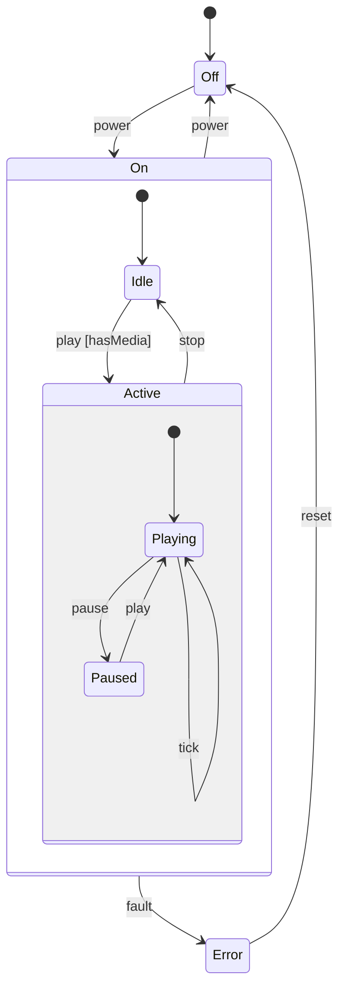

## In one minute
- A state machine diagram shows how one object (an order, a connection, a media player) reacts to events over its lifetime: its states, the events that move it, the guards that must hold and the actions that run.
- A transition reads `event [guard] / action`. An event with no enabled transition is ignored by default, a rule behind many bugs in hand-written machines.
- Composite states make diagrams scale. An arrow drawn on a parent applies to every state nested inside it, so "power off from anywhere" is one arrow, not twelve. Exits run innermost first, entries outermost first.
- History lets a composite remember where it was: shallow history restores the last direct child, deep history the whole nested configuration.
- Treat the diagram as a testable contract: each arrow is a test, each missing arrow a decision to write down. [State](state.md) and [Enums](enums.md) cover implementing flat machines; this lesson covers notation and hierarchical semantics.

## How it works

### States, events and transitions
A **state** is a period in an object's life during which a fixed set of rules applies. "Paid" is a state; "total is 42.10" is data. The test is whether the set of legal operations changes. An **event** happens at a point in time: a call (`cancel()`), a message (`PaymentCaptured`), a timer (`after(30s)`) or a condition becoming true (`when(stock == 0)`). A **transition** is an arrow between states triggered by an event. The black dot is the initial pseudostate and the circled dot a final state.

### Guards and actions
The full label is `event [guard] / action`. The guard is a side-effect-free boolean evaluated when the event arrives; if it is false, the machine looks for another transition. The action runs while the transition fires. Two transitions on the same event from the same state need mutually exclusive guards; UML leaves the choice undefined, and real implementations quietly pick the first one declared. A **choice** pseudostate (a diamond) evaluates its guards after the first part of the transition has run, for branches that depend on a value the action just computed, such as "charge the card, then go to `paid` or `payment_failed`".

### Entry, exit and do activities
Inside a state box you can write `entry / startTimer()`, `exit / stopTimer()` and `do / pollSensor()`. Entry runs every time the state is entered, whichever arrow brought you in, and exit every time it is left. With five arrows into `connected`, the "start heartbeat" code lives in one place, and nobody forgets it on the sixth arrow. A `do` activity is long-running work interrupted when the state is left: in code, a goroutine or timer that the exit action cancels.

An internal transition (`event / action` written inside the box) runs an action without leaving the state, so neither entry nor exit runs. A self-transition leaves and re-enters, so both run. That difference matters when entry resets a timer.

### Composite states
A **composite** (or superstate) contains its own nested state machine. When the object is in `playing`, inside `active`, inside `on`, it is in all three at once: the active configuration. Two rules give composites their power:

1. **Inherited transitions.** An event is offered to the innermost active state first, then to its parent, then the grandparent. The `power` arrow drawn once on `on` works from every state inside it. This is Harel's 1987 answer to state explosion: N states that all need an emergency exit need N flat arrows but one hierarchical arrow.
2. **Entering a composite enters a child.** An arrow that ends on the border of a composite continues to its initial substate, recursively, until a simple (leaf) state is active. An arrow can also cross the border and end on a specific inner state.

When a transition fires, the machine finds the innermost state that strictly contains both source and target (the least common ancestor, or LCA). It exits every active state below the LCA, innermost first, enters each state from the LCA down to the target, outermost first, then drills down through initial substates. Inside-out exits mean a child never tears down after its parent has released shared resources; outside-in entries mean a parent's setup is in place before a child uses it.

### History
A **shallow history** pseudostate (`H` in a circle) says: on re-entry, resume the direct child that was active when you last left. If `on` has history and was left from `active > paused`, re-entry resumes `active`, which restarts at its own initial child. **Deep history** (`H*`) restores the whole nested configuration. A composite never visited falls back to its initial state.

History is how wizards resume at the right step. The catch is that it is hidden state: two objects in the "same" state can behave differently depending on what they remember, so test it explicitly.

### Orthogonal regions
A composite can be split by dashed lines into regions that run concurrently, such as a `fan` region (`off`, `low`, `high`) and an independent `ac` region (`off`, `on`) in climate control. Without regions you need the cross product, six states. Every event is offered to all regions, and "what state is it in?" now returns a set, which persistence and logging must handle.

### From diagram to code
Flat diagrams map to a switch on an enum, a `(state, event)` transition table ([Enums](enums.md)) or one class per state ([State](state.md)). Hierarchy is where hand-written code breaks: inherited transitions become copy-pasted `if` branches in every child, and entry and exit order becomes whatever the developer remembered. If you need composites, use a statechart runtime (XState, Qt's state machine framework, SCXML engines, Miro Samek's QP) or a small interpreter like the one in Practice, and generate both the diagram and the tests from one definition.

### Reviewing agent-written code
Code assistants produce a plausible `switch` and miss the semantics around it. Check that unhandled events are explicitly ignored or rejected rather than falling into a default branch that mutates state, that entry actions are not duplicated per incoming arrow, that guards have no side effects, and that self and internal transitions are not confused. Ask for the diagram and a test per arrow.

### The same shape elsewhere
Statecharts are a **multi-step consistency** tool: they make the legal orders of operations explicit. The same shape appears in TCP's connection states, a payment saga's compensation steps and a checkout form's UI, where hierarchy lets "connection reset" or "user logged out" be handled once at the top.

## Down the stack

### Layer 1: The contract
UML specifies **run-to-completion**: events are queued and each is fully handled (guards, exits, actions, entries, drill-down) before the next is dequeued, so no one observes a half-finished step. The transition chosen is the one on the innermost active state with an enabled guard; exits run innermost first, entries outermost first, and an event with no enabled transition is discarded. Given a definition and an event sequence, the log of exits and entries is fully determined, which makes it testable.

### Layer 2: The mechanism
A hierarchical machine is a tree of states plus a transition list. Dispatch walks from the active leaf up parent pointers, testing transitions at each level. Executing one computes the LCA from the two ancestor chains, exits up to it, enters down from it, then follows history records or initial children to a leaf. History is a map from composite to last active child, written during exit.

SCXML, the W3C statechart XML format, specifies this algorithm in pseudocode (`microstep`, `exitStates`, `enterStates`, `computeExitSet`), including document order as the tiebreaker between conflicting transitions. Samek's QP implements hierarchy with each state as a C function that returns either "handled", "transition to X" or "super is Y"; the dispatcher discovers the hierarchy at run time by calling those functions. XState stores the machine as a JSON-like config, interprets it, and exposes the active configuration as a value you can serialise.

### Layer 3: The machine
A flat table of 50 states by 20 events with one-byte targets is 1 KB and sits in L1 cache, so a lookup takes nanoseconds. Hierarchical dispatch adds a parent-pointer hop per level, and state functions or virtual methods (Go itabs, C++ vtables) add an indirect call each: 1 to 2 ns predicted, 15 to 20 cycles mispredicted. An interpreted JavaScript config walks object properties and prototype chains, orders of magnitude slower than a table but irrelevant for 60 UI events a second. Lexers that run per byte compile their machines to jump tables or `goto` instead (Ragel, re2c).

Run-to-completion is also the concurrency model: one goroutine or event loop owns the machine and others send events through a channel, so no lock is held while actions run. A slow action delays every event queued behind it.

### Why it's built this way
- Behaviour that depends on history is hard to reason about in scattered flags, so you name each period of life as a state.
- Flat machines explode when many states share a reaction, so you nest them and let parents handle shared events.
- Nesting makes the order of setup and teardown ambiguous, so the semantics fix it: exits inside-out, entries outside-in, around the LCA.
- Interleaved events would expose half-finished transitions, so each event runs to completion before the next.
- Users and flows return to where they were, so composites can remember their last child through history.

## Diagram

Mermaid has no history pseudostate, so the shallow history on `On` used in the worked example is stated in prose here; in a full UML tool it would be an `H` inside the `On` box.

## Worked example
Take the player above with shallow history on `On`. Power from `Off` logs `exit:Off`, `enter:On`, `enter:Idle`. Play with no media fails its guard, nothing up the chain handles it, and it is dropped. With media, play logs `exit:Idle`, `enter:Active`, `enter:Playing` (the LCA is `On`), and pause logs `exit:Playing`, `enter:Paused`.

Now press power. Only `On` handles it, so the machine exits `Paused`, `Active` (recording it as `On`'s last child) and `On`, then enters `Off`. Press power again: `enter:On`, history picks `Active` over `Idle`, and because history is shallow `Active` starts at `Playing`. The user returns playing, not paused; deep history would have restored `Paused`. Whichever you choose, it is a product decision the diagram makes visible.

A `tick` in `Playing` is a self-transition, so it logs `exit:Playing`, `enter:Playing` and re-runs entry: a bug if entry restarts a buffering timer and tick was meant to be internal.

## Trade-offs
| Option | Strengths | Weaknesses | Choose when |
|---|---|---|---|
| Flat diagram, switch or table | Easy to read and test; trivially serialised | Shared reactions repeated in every state | Under about 10 states with few cross-cutting events |
| Composite states | One arrow for shared reactions; entry and exit scoped by level | Exit and entry order must be understood; dispatch walks parents | Many states share cancel, timeout or reset handling |
| History states | Resumes flows without extra flags | Hidden memory; two equal-looking states behave differently | Users leave and return to a sub-flow |
| Orthogonal regions | Avoids cross-product states | Configuration is a set; harder to persist and log | Truly independent aspects of one object |
| Statechart runtime (XState, SCXML, QP) | Correct semantics, visualisers, simulators | Dependency, learning curve, interpretation overhead | Hierarchy, history or regions are needed in production |

## Pitfalls in production
- **Silent ignores.** "I clicked cancel and nothing happened." Decide per event whether to ignore, reject or defer, and log ignored events.
- **Entry actions on arrows.** Setup copied onto each incoming transition drifts as arrows are added. Move it into `entry`.
- **Self-transition where an internal one was meant.** Re-entering resets timers and counters. Draw internal transitions inside the box and test that entry did not run.
- **Overlapping guards.** Two transitions on the same event with guards that can both be true make behaviour depend on declaration order. Lint for it, or make the order an explicit, documented priority.
- **Persisting only the leaf.** With history or regions, the leaf alone cannot rebuild the machine. Persist the full configuration plus history records, and version the format so an old row loads after a state is renamed.
- **Diagram drift.** A hand-drawn wiki diagram stops matching the code within months. Generate it from the definition in CI.

## Leadership lens
- Ask for a state machine diagram in design review for any entity with a status column. Missing arrows surface product questions (can a shipped order be cancelled?) before they become incidents.
- Make "unhandled event" behaviour a team-wide convention, then enforce it in code review and tests. Inconsistent ignore-versus-reject choices across services are a constant source of support tickets.
- Treat the definition as the source of truth and generate diagrams and tests from it, so documentation stays cheap enough to maintain.
- Adopt a statechart runtime only when hierarchy, history or regions are real requirements; for a flat lifecycle, a table and a conditional database update are cheaper to own.

## Check yourself
1. The active configuration is `On > Active > Paused`, and only `On` handles `power`. In what order do exit actions run, and why that order?
   **Answer:** `Paused`, then `Active`, then `On`. Exiting inside-out guarantees a child tears down before the parent whose resources it may depend on.
2. What is the difference between a self-transition and an internal transition on the same state?
   **Answer:** A self-transition leaves and re-enters the state, so exit and entry actions run. An internal transition only runs its action and leaves the state, and its entry and exit, untouched.
3. `On` has shallow history and was last left from `Active > Paused`. Re-entering `On` through history ends in which leaf?
   **Answer:** `Playing`. Shallow history restores the direct child `Active`, and `Active` then starts at its own initial child. Deep history would restore `Paused`.
4. Why does run-to-completion make concurrency easier rather than harder?
   **Answer:** Only one event is processed at a time by one owner, so no transition ever observes another half-finished transition. Other threads communicate by enqueueing events instead of sharing state behind locks.

## Practice
**Task:** Write a small hierarchical state machine interpreter. `HSM(parents, initial, transitions, history)` takes a map from each state to its parent (`""` for top-level), a map from each composite (and `""` for the root) to its initial child, a list of transitions `(source, event, target, guard)` where guard is a context key or empty, and a list of composites with shallow history. The constructor fails with `bad initial for <state>` (or `bad initial for root`) when a composite or the root lacks an initial child whose parent is that composite, and with `unknown state: <name>` for a transition endpoint that is not a state. `start()` enters the root's initial child and drills down to a leaf. `fire(event, ctx)` fails with `not started` before `start`; otherwise it searches from the active leaf upwards, taking the first transition in list order at the innermost level whose guard is empty or true in `ctx`, and returns whether one fired. A transition exits from the active leaf up to the least common proper ancestor of source and target (innermost first), records each exited state as its parent's last child when the parent has history, enters from below that ancestor down to the target (outermost first), then drills down using the history record if present, else the initial child. `active()` returns the configuration from outermost to leaf, and `drain_log()` returns and clears the `enter:X` and `exit:X` entries. Python raises `ValueError`, TypeScript throws `Error`, Go returns errors.

```python starter
class HSM:
    def __init__(self, parents, initial, transitions, history=()):
        # TODO: validate and store the definition
        self._parents = parents

    def start(self):
        raise NotImplementedError

    def fire(self, event, ctx=None):
        # TODO: innermost enabled transition, exits, entries, drill-down
        raise NotImplementedError

    def active(self):
        raise NotImplementedError

    def drain_log(self):
        raise NotImplementedError
```

```python tests
def player():
    parents = {"off": "", "on": "", "error": "", "idle": "on", "active": "on",
               "playing": "active", "paused": "active"}
    initial = {"": "off", "on": "idle", "active": "playing"}
    transitions = [
        ("off", "power", "on", None),
        ("on", "power", "off", None),
        ("idle", "play", "active", "has_media"),
        ("playing", "pause", "paused", None),
        ("paused", "play", "playing", None),
        ("active", "stop", "idle", None),
        ("playing", "tick", "playing", None),
        ("on", "fault", "error", None),
        ("error", "reset", "off", None),
    ]
    return HSM(parents, initial, transitions, ["on"])

def to_paused(m):
    m.start()
    m.fire("power")
    m.fire("play", {"has_media": True})
    m.fire("pause")
    m.drain_log()

def expect_error(fn, msg):
    try:
        fn()
    except ValueError as e:
        assert str(e) == msg, "expected " + msg + ", got " + str(e)
        return
    assert False, "expected ValueError " + msg

def test_start_enters_initial_leaf():
    m = player()
    m.start()
    assert m.active() == ["off"]
    assert m.drain_log() == ["enter:off"]
    assert m.drain_log() == []

def test_entering_composite_drills_down():
    m = player()
    m.start()
    m.drain_log()
    assert m.fire("power") is True
    assert m.drain_log() == ["exit:off", "enter:on", "enter:idle"]
    assert m.active() == ["on", "idle"]

def test_guard_blocks_then_allows():
    m = player()
    m.start()
    m.fire("power")
    m.drain_log()
    assert m.fire("play") is False
    assert m.fire("play", {"has_media": False}) is False
    assert m.drain_log() == []
    assert m.active() == ["on", "idle"]
    assert m.fire("play", {"has_media": True}) is True
    assert m.drain_log() == ["exit:idle", "enter:active", "enter:playing"]

def test_ancestor_handles_event_and_exits_inside_out():
    m = player()
    to_paused(m)
    assert m.active() == ["on", "active", "paused"]
    assert m.fire("power") is True
    assert m.drain_log() == ["exit:paused", "exit:active", "exit:on", "enter:off"]

def test_shallow_history_restores_child_only():
    m = player()
    to_paused(m)
    m.fire("power")
    m.fire("power")
    assert m.drain_log() == ["exit:paused", "exit:active", "exit:on", "enter:off",
                             "exit:off", "enter:on", "enter:active", "enter:playing"]
    assert m.active() == ["on", "active", "playing"]

def test_self_transition_and_unhandled_event():
    m = player()
    to_paused(m)
    m.fire("play")
    m.fire("tick")
    assert m.drain_log() == ["exit:paused", "enter:playing", "exit:playing", "enter:playing"]
    m.fire("stop")
    assert m.drain_log() == ["exit:playing", "exit:active", "enter:idle"]
    assert m.fire("tick") is False
    assert m.drain_log() == []

def test_innermost_enabled_transition_wins():
    parents = {"a": "", "a1": "a", "a2": "a", "b": ""}
    initial = {"": "a", "a": "a1"}
    ts = [("a1", "go", "a2", "fast"), ("a", "go", "b", None)]
    m = HSM(parents, initial, ts)
    m.start()
    m.drain_log()
    m.fire("go", {"fast": True})
    assert m.drain_log() == ["exit:a1", "enter:a2"]
    m2 = HSM(parents, initial, ts)
    m2.start()
    m2.drain_log()
    m2.fire("go", {})
    assert m2.drain_log() == ["exit:a1", "exit:a", "enter:b"]
    assert m2.active() == ["b"]

def test_invalid_definitions_and_not_started():
    expect_error(lambda: HSM({"a": "", "a1": "a"}, {"": "a"}, []), "bad initial for a")
    expect_error(lambda: HSM({"a": ""}, {}, []), "bad initial for root")
    expect_error(lambda: HSM({"a": ""}, {"": "a"}, [("a", "go", "zz", None)]), "unknown state: zz")
    expect_error(lambda: player().fire("power"), "not started")
```

```python solution
class HSM:
    def __init__(self, parents, initial, transitions, history=()):
        self._parent = dict(parents)
        self._initial = dict(initial)
        self._history = set(history)
        self._transitions = list(transitions)
        composites = sorted(set(p for p in self._parent.values() if p != ""))
        for c in composites + [""]:
            if c != "" and c not in self._parent:
                raise ValueError("unknown state: " + c)
            child = self._initial.get(c)
            if child is None or self._parent.get(child) != c:
                raise ValueError("bad initial for " + (c if c else "root"))
        for t in self._transitions:
            for s in (t[0], t[2]):
                if s not in self._parent:
                    raise ValueError("unknown state: " + s)
        self._last = {}
        self._leaf = None
        self._log = []

    def _chain(self, s):
        out = []
        while s != "":
            out.append(s)
            s = self._parent[s]
        return out

    def _drill(self, s):
        while s in self._initial:
            if s in self._history and s in self._last:
                s = self._last[s]
            else:
                s = self._initial[s]
            self._log.append("enter:" + s)
        self._leaf = s

    def start(self):
        if self._leaf is not None:
            raise ValueError("already started")
        self._drill("")

    def fire(self, event, ctx=None):
        if self._leaf is None:
            raise ValueError("not started")
        ctx = ctx or {}
        for s in self._chain(self._leaf):
            for src, ev, tgt, guard in self._transitions:
                if src == s and ev == event and (not guard or ctx.get(guard)):
                    self._take(src, tgt)
                    return True
        return False

    def _take(self, src, tgt):
        src_up = self._chain(self._parent[src]) + [""]
        tgt_up = self._chain(self._parent[tgt]) + [""]
        domain = ""
        for a in src_up:
            if a in tgt_up:
                domain = a
                break
        s = self._leaf
        while s != domain:
            self._log.append("exit:" + s)
            p = self._parent[s]
            if p in self._history:
                self._last[p] = s
            s = p
        path = []
        s = tgt
        while s != domain:
            path.append(s)
            s = self._parent[s]
        for s in reversed(path):
            self._log.append("enter:" + s)
        self._drill(tgt)

    def active(self):
        return list(reversed(self._chain(self._leaf)))

    def drain_log(self):
        out = self._log
        self._log = []
        return out
```

```typescript starter
export interface Transition {
  source: string;
  event: string;
  target: string;
  guard?: string;
}

export class HSM {
  constructor(parents: Record<string, string>, initial: Record<string, string>,
              transitions: Transition[], history: string[] = []) {
    // TODO: validate and store the definition
  }
  start(): void {
    throw new Error("TODO");
  }
  fire(event: string, ctx: Record<string, boolean> = {}): boolean {
    throw new Error("TODO");
  }
  active(): string[] {
    throw new Error("TODO");
  }
  drainLog(): string[] {
    throw new Error("TODO");
  }
}
```

```typescript tests
function playerMachine(): HSM {
  const parents: Record<string, string> = {
    off: "", on: "", error: "", idle: "on", active: "on", playing: "active", paused: "active",
  };
  const initial: Record<string, string> = { "": "off", on: "idle", active: "playing" };
  const t = (source: string, event: string, target: string, guard?: string): Transition =>
    ({ source, event, target, guard });
  return new HSM(parents, initial, [
    t("off", "power", "on"),
    t("on", "power", "off"),
    t("idle", "play", "active", "hasMedia"),
    t("playing", "pause", "paused"),
    t("paused", "play", "playing"),
    t("active", "stop", "idle"),
    t("playing", "tick", "playing"),
    t("on", "fault", "error"),
    t("error", "reset", "off"),
  ], ["on"]);
}

function toPaused(m: HSM): void {
  m.start();
  m.fire("power");
  m.fire("play", { hasMedia: true });
  m.fire("pause");
  m.drainLog();
}

function expectThrow(fn: () => void, msg: string): void {
  try {
    fn();
  } catch (e) {
    assertEqual((e as Error).message, msg);
    return;
  }
  assert(false, "expected error " + msg);
}

test("start enters initial leaf", () => {
  const m = playerMachine();
  m.start();
  assertEqual(m.active(), ["off"]);
  assertEqual(m.drainLog(), ["enter:off"]);
  assertEqual(m.drainLog(), []);
});

test("entering a composite drills down", () => {
  const m = playerMachine();
  m.start();
  m.drainLog();
  assertEqual(m.fire("power"), true);
  assertEqual(m.drainLog(), ["exit:off", "enter:on", "enter:idle"]);
  assertEqual(m.active(), ["on", "idle"]);
});

test("guard blocks then allows", () => {
  const m = playerMachine();
  m.start();
  m.fire("power");
  m.drainLog();
  assertEqual(m.fire("play"), false);
  assertEqual(m.fire("play", { hasMedia: false }), false);
  assertEqual(m.drainLog(), []);
  assertEqual(m.fire("play", { hasMedia: true }), true);
  assertEqual(m.drainLog(), ["exit:idle", "enter:active", "enter:playing"]);
});

test("ancestor handles event and exits inside out", () => {
  const m = playerMachine();
  toPaused(m);
  assertEqual(m.active(), ["on", "active", "paused"]);
  assertEqual(m.fire("power"), true);
  assertEqual(m.drainLog(), ["exit:paused", "exit:active", "exit:on", "enter:off"]);
});

test("shallow history restores child only", () => {
  const m = playerMachine();
  toPaused(m);
  m.fire("power");
  m.fire("power");
  assertEqual(m.drainLog(), ["exit:paused", "exit:active", "exit:on", "enter:off",
    "exit:off", "enter:on", "enter:active", "enter:playing"]);
  assertEqual(m.active(), ["on", "active", "playing"]);
});

test("self transition and unhandled event", () => {
  const m = playerMachine();
  toPaused(m);
  m.fire("play");
  m.fire("tick");
  assertEqual(m.drainLog(), ["exit:paused", "enter:playing", "exit:playing", "enter:playing"]);
  m.fire("stop");
  assertEqual(m.drainLog(), ["exit:playing", "exit:active", "enter:idle"]);
  assertEqual(m.fire("tick"), false);
  assertEqual(m.drainLog(), []);
});

test("innermost enabled transition wins", () => {
  const parents: Record<string, string> = { a: "", a1: "a", a2: "a", b: "" };
  const initial: Record<string, string> = { "": "a", a: "a1" };
  const ts: Transition[] = [
    { source: "a1", event: "go", target: "a2", guard: "fast" },
    { source: "a", event: "go", target: "b" },
  ];
  const m = new HSM(parents, initial, ts);
  m.start();
  m.drainLog();
  m.fire("go", { fast: true });
  assertEqual(m.drainLog(), ["exit:a1", "enter:a2"]);
  const m2 = new HSM(parents, initial, ts);
  m2.start();
  m2.drainLog();
  m2.fire("go", {});
  assertEqual(m2.drainLog(), ["exit:a1", "exit:a", "enter:b"]);
  assertEqual(m2.active(), ["b"]);
});

test("invalid definitions and not started", () => {
  expectThrow(() => new HSM({ a: "", a1: "a" }, { "": "a" }, []), "bad initial for a");
  expectThrow(() => new HSM({ a: "" }, {}, []), "bad initial for root");
  expectThrow(() => new HSM({ a: "" }, { "": "a" }, [{ source: "a", event: "go", target: "zz" }]),
    "unknown state: zz");
  expectThrow(() => playerMachine().fire("power"), "not started");
});
```

```typescript solution
export interface Transition {
  source: string;
  event: string;
  target: string;
  guard?: string;
}

export class HSM {
  private parent: Map<string, string>;
  private initial: Map<string, string>;
  private history: Set<string>;
  private transitions: Transition[];
  private last = new Map<string, string>();
  private leaf: string | null = null;
  private log: string[] = [];

  constructor(parents: Record<string, string>, initial: Record<string, string>,
              transitions: Transition[], history: string[] = []) {
    this.parent = new Map(Object.entries(parents));
    this.initial = new Map(Object.entries(initial));
    this.history = new Set(history);
    this.transitions = transitions.slice();
    const composites = Array.from(new Set(Object.values(parents).filter((p) => p !== ""))).sort();
    for (const c of [...composites, ""]) {
      if (c !== "" && !this.parent.has(c)) throw new Error("unknown state: " + c);
      const child = this.initial.get(c);
      if (child === undefined || this.parent.get(child) !== c) {
        throw new Error("bad initial for " + (c === "" ? "root" : c));
      }
    }
    for (const t of this.transitions) {
      for (const s of [t.source, t.target]) {
        if (!this.parent.has(s)) throw new Error("unknown state: " + s);
      }
    }
  }

  private chain(s: string): string[] {
    const out: string[] = [];
    while (s !== "") {
      out.push(s);
      s = this.parent.get(s)!;
    }
    return out;
  }

  private drill(s: string): void {
    while (this.initial.has(s)) {
      const remembered = this.history.has(s) ? this.last.get(s) : undefined;
      s = remembered !== undefined ? remembered : this.initial.get(s)!;
      this.log.push("enter:" + s);
    }
    this.leaf = s;
  }

  start(): void {
    if (this.leaf !== null) throw new Error("already started");
    this.drill("");
  }

  fire(event: string, ctx: Record<string, boolean> = {}): boolean {
    if (this.leaf === null) throw new Error("not started");
    for (const s of this.chain(this.leaf)) {
      for (const t of this.transitions) {
        if (t.source === s && t.event === event && (!t.guard || ctx[t.guard])) {
          this.take(t.source, t.target);
          return true;
        }
      }
    }
    return false;
  }

  private take(src: string, tgt: string): void {
    const srcUp = [...this.chain(this.parent.get(src)!), ""];
    const tgtUp = [...this.chain(this.parent.get(tgt)!), ""];
    const domain = srcUp.find((a) => tgtUp.includes(a)) ?? "";
    let s = this.leaf!;
    while (s !== domain) {
      this.log.push("exit:" + s);
      const p = this.parent.get(s)!;
      if (this.history.has(p)) this.last.set(p, s);
      s = p;
    }
    const path: string[] = [];
    s = tgt;
    while (s !== domain) {
      path.push(s);
      s = this.parent.get(s)!;
    }
    for (const x of path.reverse()) this.log.push("enter:" + x);
    this.drill(tgt);
  }

  active(): string[] {
    return this.chain(this.leaf!).reverse();
  }

  drainLog(): string[] {
    const out = this.log;
    this.log = [];
    return out;
  }
}
```

```go starter
package practice

type Transition struct {
	Source, Event, Target, Guard string
}

type HSM struct{}

// NewHSM validates the definition. TODO.
func NewHSM(parents, initial map[string]string, transitions []Transition, history []string) (*HSM, error) {
	return &HSM{}, nil
}

func (h *HSM) Start() error { panic("TODO") }

func (h *HSM) Fire(event string, ctx map[string]bool) (bool, error) { panic("TODO") }

func (h *HSM) Active() []string { panic("TODO") }

func (h *HSM) DrainLog() []string { panic("TODO") }
```

```go tests
package practice

import (
	"reflect"
	"testing"
)

func playerMachine(t *testing.T) *HSM {
	parents := map[string]string{"off": "", "on": "", "error": "", "idle": "on", "active": "on",
		"playing": "active", "paused": "active"}
	initial := map[string]string{"": "off", "on": "idle", "active": "playing"}
	ts := []Transition{
		{"off", "power", "on", ""},
		{"on", "power", "off", ""},
		{"idle", "play", "active", "hasMedia"},
		{"playing", "pause", "paused", ""},
		{"paused", "play", "playing", ""},
		{"active", "stop", "idle", ""},
		{"playing", "tick", "playing", ""},
		{"on", "fault", "error", ""},
		{"error", "reset", "off", ""},
	}
	m, err := NewHSM(parents, initial, ts, []string{"on"})
	if err != nil {
		t.Fatal(err)
	}
	return m
}

func eq(t *testing.T, got, want []string) {
	t.Helper()
	if len(got) == 0 && len(want) == 0 {
		return
	}
	if !reflect.DeepEqual(got, want) {
		t.Fatalf("got %v, want %v", got, want)
	}
}

func fire(t *testing.T, m *HSM, ev string, ctx map[string]bool) bool {
	t.Helper()
	ok, err := m.Fire(ev, ctx)
	if err != nil {
		t.Fatal(err)
	}
	return ok
}

func toPaused(t *testing.T, m *HSM) {
	m.Start()
	fire(t, m, "power", nil)
	fire(t, m, "play", map[string]bool{"hasMedia": true})
	fire(t, m, "pause", nil)
	m.DrainLog()
}

func TestStartEntersInitialLeaf(t *testing.T) {
	m := playerMachine(t)
	if err := m.Start(); err != nil {
		t.Fatal(err)
	}
	eq(t, m.Active(), []string{"off"})
	eq(t, m.DrainLog(), []string{"enter:off"})
	eq(t, m.DrainLog(), nil)
}

func TestEnteringCompositeDrillsDown(t *testing.T) {
	m := playerMachine(t)
	m.Start()
	m.DrainLog()
	if !fire(t, m, "power", nil) {
		t.Fatal("power should fire")
	}
	eq(t, m.DrainLog(), []string{"exit:off", "enter:on", "enter:idle"})
	eq(t, m.Active(), []string{"on", "idle"})
}

func TestGuardBlocksThenAllows(t *testing.T) {
	m := playerMachine(t)
	m.Start()
	fire(t, m, "power", nil)
	m.DrainLog()
	if fire(t, m, "play", nil) || fire(t, m, "play", map[string]bool{"hasMedia": false}) {
		t.Fatal("guard should block")
	}
	eq(t, m.DrainLog(), nil)
	if !fire(t, m, "play", map[string]bool{"hasMedia": true}) {
		t.Fatal("guard should allow")
	}
	eq(t, m.DrainLog(), []string{"exit:idle", "enter:active", "enter:playing"})
}

func TestAncestorHandlesEventInsideOut(t *testing.T) {
	m := playerMachine(t)
	toPaused(t, m)
	eq(t, m.Active(), []string{"on", "active", "paused"})
	fire(t, m, "power", nil)
	eq(t, m.DrainLog(), []string{"exit:paused", "exit:active", "exit:on", "enter:off"})
}

func TestShallowHistoryRestoresChildOnly(t *testing.T) {
	m := playerMachine(t)
	toPaused(t, m)
	fire(t, m, "power", nil)
	fire(t, m, "power", nil)
	eq(t, m.DrainLog(), []string{"exit:paused", "exit:active", "exit:on", "enter:off",
		"exit:off", "enter:on", "enter:active", "enter:playing"})
	eq(t, m.Active(), []string{"on", "active", "playing"})
}

func TestSelfTransitionAndUnhandledEvent(t *testing.T) {
	m := playerMachine(t)
	toPaused(t, m)
	fire(t, m, "play", nil)
	fire(t, m, "tick", nil)
	eq(t, m.DrainLog(), []string{"exit:paused", "enter:playing", "exit:playing", "enter:playing"})
	fire(t, m, "stop", nil)
	eq(t, m.DrainLog(), []string{"exit:playing", "exit:active", "enter:idle"})
	if fire(t, m, "tick", nil) {
		t.Fatal("tick is not handled in idle")
	}
	eq(t, m.DrainLog(), nil)
}

func TestInnermostEnabledTransitionWins(t *testing.T) {
	parents := map[string]string{"a": "", "a1": "a", "a2": "a", "b": ""}
	initial := map[string]string{"": "a", "a": "a1"}
	ts := []Transition{{"a1", "go", "a2", "fast"}, {"a", "go", "b", ""}}
	m, _ := NewHSM(parents, initial, ts, nil)
	m.Start()
	m.DrainLog()
	fire(t, m, "go", map[string]bool{"fast": true})
	eq(t, m.DrainLog(), []string{"exit:a1", "enter:a2"})
	m2, _ := NewHSM(parents, initial, ts, nil)
	m2.Start()
	m2.DrainLog()
	fire(t, m2, "go", nil)
	eq(t, m2.DrainLog(), []string{"exit:a1", "exit:a", "enter:b"})
	eq(t, m2.Active(), []string{"b"})
}

func TestInvalidDefinitionsAndNotStarted(t *testing.T) {
	cases := []struct {
		parents, initial map[string]string
		ts               []Transition
		want             string
	}{
		{map[string]string{"a": "", "a1": "a"}, map[string]string{"": "a"}, nil, "bad initial for a"},
		{map[string]string{"a": ""}, map[string]string{}, nil, "bad initial for root"},
		{map[string]string{"a": ""}, map[string]string{"": "a"}, []Transition{{"a", "go", "zz", ""}}, "unknown state: zz"},
	}
	for _, c := range cases {
		_, err := NewHSM(c.parents, c.initial, c.ts, nil)
		if err == nil || err.Error() != c.want {
			t.Fatalf("got %v, want %s", err, c.want)
		}
	}
	m := playerMachine(t)
	if _, err := m.Fire("power", nil); err == nil || err.Error() != "not started" {
		t.Fatalf("got %v, want not started", err)
	}
}
```

```go solution
package practice

import (
	"errors"
	"sort"
)

type Transition struct {
	Source, Event, Target, Guard string
}

type HSM struct {
	parent      map[string]string
	initial     map[string]string
	history     map[string]bool
	transitions []Transition
	last        map[string]string
	leaf        string
	started     bool
	log         []string
}

func NewHSM(parents, initial map[string]string, transitions []Transition, history []string) (*HSM, error) {
	h := &HSM{parent: map[string]string{}, initial: map[string]string{}, history: map[string]bool{},
		last: map[string]string{}, transitions: append([]Transition(nil), transitions...)}
	for k, v := range parents {
		h.parent[k] = v
	}
	for k, v := range initial {
		h.initial[k] = v
	}
	for _, s := range history {
		h.history[s] = true
	}
	seen := map[string]bool{}
	var composites []string
	for _, p := range h.parent {
		if p != "" && !seen[p] {
			seen[p] = true
			composites = append(composites, p)
		}
	}
	sort.Strings(composites)
	for _, c := range append(composites, "") {
		if _, ok := h.parent[c]; c != "" && !ok {
			return nil, errors.New("unknown state: " + c)
		}
		child, ok := h.initial[c]
		if p, known := h.parent[child]; !ok || !known || p != c {
			name := c
			if c == "" {
				name = "root"
			}
			return nil, errors.New("bad initial for " + name)
		}
	}
	for _, t := range h.transitions {
		for _, s := range []string{t.Source, t.Target} {
			if _, ok := h.parent[s]; !ok {
				return nil, errors.New("unknown state: " + s)
			}
		}
	}
	return h, nil
}

func (h *HSM) chain(s string) []string {
	var out []string
	for s != "" {
		out = append(out, s)
		s = h.parent[s]
	}
	return out
}

func (h *HSM) drill(s string) {
	for {
		init, composite := h.initial[s]
		if !composite {
			break
		}
		if prev, ok := h.last[s]; ok && h.history[s] {
			s = prev
		} else {
			s = init
		}
		h.log = append(h.log, "enter:"+s)
	}
	h.leaf = s
}

func (h *HSM) Start() error {
	if h.started {
		return errors.New("already started")
	}
	h.started = true
	h.drill("")
	return nil
}

func (h *HSM) Fire(event string, ctx map[string]bool) (bool, error) {
	if !h.started {
		return false, errors.New("not started")
	}
	for _, s := range h.chain(h.leaf) {
		for _, t := range h.transitions {
			if t.Source == s && t.Event == event && (t.Guard == "" || ctx[t.Guard]) {
				h.take(t.Source, t.Target)
				return true, nil
			}
		}
	}
	return false, nil
}

func (h *HSM) take(src, tgt string) {
	srcUp := append(h.chain(h.parent[src]), "")
	tgtUp := map[string]bool{"": true}
	for _, a := range h.chain(h.parent[tgt]) {
		tgtUp[a] = true
	}
	domain := ""
	for _, a := range srcUp {
		if tgtUp[a] {
			domain = a
			break
		}
	}
	for s := h.leaf; s != domain; {
		h.log = append(h.log, "exit:"+s)
		p := h.parent[s]
		if h.history[p] {
			h.last[p] = s
		}
		s = p
	}
	var path []string
	for s := tgt; s != domain; s = h.parent[s] {
		path = append(path, s)
	}
	for i := len(path) - 1; i >= 0; i-- {
		h.log = append(h.log, "enter:"+path[i])
	}
	h.drill(tgt)
}

func (h *HSM) Active() []string {
	c := h.chain(h.leaf)
	for i, j := 0, len(c)-1; i < j; i, j = i+1, j-1 {
		c[i], c[j] = c[j], c[i]
	}
	return c
}

func (h *HSM) DrainLog() []string {
	out := h.log
	h.log = nil
	return out
}
```

## Mock interview
**Prompt:** Design the control logic for a smart door lock that can be locked, unlocked, in a timed "passage mode", or in lockout after five wrong PINs. Every state must react to a low-battery alarm and a fire alarm. Draw the state machine diagram and explain how you would implement and test it.

- Follow-up: The fire alarm unlocks the door from any state and, when cleared, restores the previous mode. How do you draw that without twenty arrows?
- Follow-up: A wrong PIN arrives during lockout, and a timer fires just after the user unlocked. What happens, and where is that decision visible?
- Follow-up: Statechart library, transition table or State pattern, and what changes on a microcontroller with 32 KB of RAM?

**A strong answer covers:**
- A composite `normal` state holding the four modes, with the alarms as single transitions on the composite.
- History on `normal` so clearing the fire alarm restores the previous mode, with a fallback for the first entry.
- Explicit handling of unhandled events, and side-effect-free guards like `[attempts < 5]` with the counter updated in an action.
- Entry and exit actions for timers and the motor, and why exits run inside-out.
- Run-to-completion on one event queue, a fixed-memory table or QP-style implementation on the device, and a test per arrow.

## Watch
- [UML 2 State Machine Diagrams (Derek Banas)](https://www.youtube.com/watch?v=_6TFVzBW7oo): the notation for states, guards, actions and composite states, drawn step by step.
- [Reactive State Machines and Statecharts (David Khourshid, Uphill Conf 2019)](https://www.youtube.com/watch?v=GSHQFx7PG20): statecharts applied to UI code, including hierarchy and history, from the author of XState.
- [Creating statecharts, part 4: Composite states (Tom Mens)](https://www.youtube.com/watch?v=9rlRGP5hPs4): composite states and their entry and exit behaviour, shown in a statechart tool.

## Free resources
- [UML 2.5.1 specification (OMG)](https://www.omg.org/spec/UML/2.5.1/PDF): chapter 14 defines state machines, run-to-completion and the transition execution order precisely.
- [State Chart XML (SCXML), W3C Recommendation](https://www.w3.org/TR/scxml/): a standard statechart format with an executable pseudocode algorithm for exits, entries and conflicts.
- [A Crash Course in UML State Machines (Miro Samek)](https://www.state-machine.com/doc/AN_Crash_Course_in_UML_State_Machines.pdf): hierarchical machines for embedded code, with the reasoning behind each semantic rule.
- [Statecharts.dev](https://statecharts.dev/): a practical glossary and guide to statecharts, with arguments for and against using them.
- [State diagrams (Mermaid docs)](https://mermaid.js.org/syntax/stateDiagram.html): the syntax used in this lesson, including composite states, choice and concurrency.
- [UML state machine (Wikipedia)](https://en.wikipedia.org/wiki/UML_state_machine): background on Harel statecharts, hierarchy, history and orthogonal regions.
