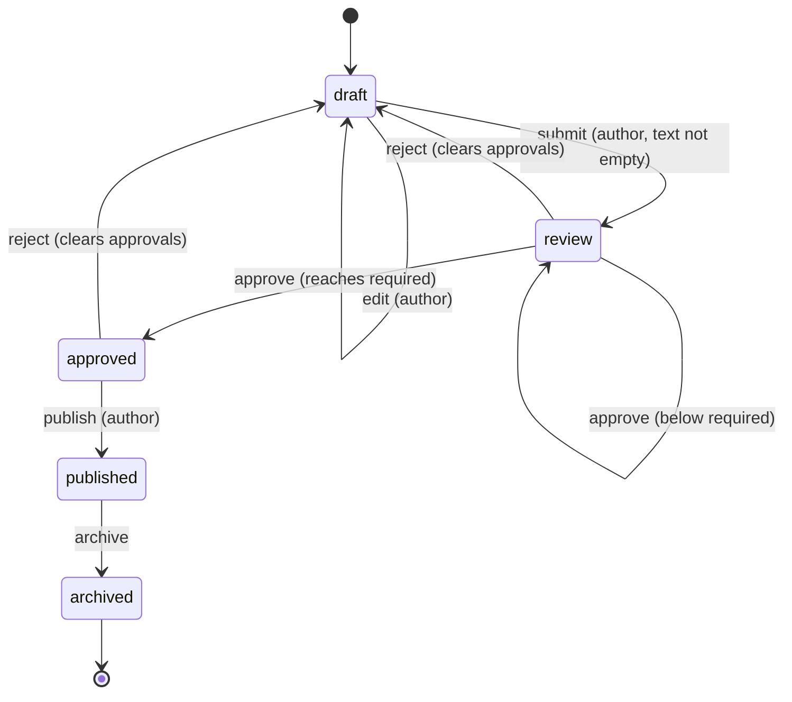

## In one minute
- State lets an object change its behaviour when its internal mode changes, by delegating each operation to a state object. Each state is a small class that knows which operations are legal in that mode and which state comes next.
- It replaces the `switch (status)` repeated at the top of every method. Adding a state becomes one new class instead of an edit to every switch, and illegal operations become explicit, tested errors.
- Keep data on the context and behaviour on the states. States with no fields can be shared singletons, so a transition is a pointer assignment, not an allocation.
- The state object lives in memory; the truth usually lives in a database column. Persist the state name, rebuild the object on load, and make every transition a conditional update so two requests cannot both move the same record.
- For a handful of states and events, an enum with a transition table is often clearer than classes. Reach for State when each state carries real behaviour, not just a yes or no.

## How it works

### The problem
A publishing tool moves articles through a review workflow: an author writes a draft, submits it, two editors approve it, and the author publishes it. Editors can reject at any point before publication, which sends the article back to draft. Published articles can be archived. The first version stored a `status` string and checked it everywhere:

```python
def approve(self, user):
    if self.status != "review":
        raise ValueError("cannot approve in " + self.status)
    if user == self.author:
        raise ValueError("author cannot approve")
    self.approvals.add(user)
    if len(self.approvals) >= 2:
        self.status = "approved"
```

Every method starts with a check like that, and each check encodes part of a state diagram that nobody can see in one place. Adding a "scheduled" state between approved and published means auditing every method. The bug that eventually shipped was predictable: a new API endpoint for bulk editing forgot the status check and let authors change the text of approved articles after review.

### One class per state
State moves the per-mode behaviour into objects:

```python
class Review(DocState):
    name = "review"

    def approve(self, doc, user):
        if user == doc.author:
            raise ValueError("author cannot approve")
        doc.approvals.append(user)
        if len(doc.approvals) >= doc.required:
            doc.transition(APPROVED)
```

The `Document` (the context) forwards every call to its current state: `def approve(self, user): self.state.approve(self, user)`. A base class implements every operation as "cannot do this in this state", and each concrete state overrides only what it allows. Open `Review` and you see everything a document in review can do. The illegal combinations do not need code at all; they inherit the refusal.

### Where the data lives
States should hold behaviour, not data. The text, author, approvals and history stay on the document. That has two benefits. Transitions never copy data between objects, so nothing is lost when the state changes. And states with no fields can be shared: one `REVIEW` instance serves every document in the process, the flyweight trick the vending machine design in this course uses as well.

### Who triggers transitions
In the classic form, states decide the next state themselves (`doc.transition(APPROVED)`). That keeps each transition next to the rule that causes it, at the cost of states knowing about each other. The alternative is a central transition table, `{("review", "reject"): "draft", ...}`, consulted by the context. Tables are easy to draw, validate and generate diagrams from; classes are better when each transition has real logic (counting approvals, checking guards, sending notifications). Many production systems combine them: a table for which transitions exist, and per-state code for what happens.

### State versus Strategy
The two have the same structure. The difference is who swaps the object. A strategy is chosen from outside, usually once, and does not know its siblings. A state is replaced by the states themselves as events arrive, and the set of states forms a closed graph. If your "strategies" start calling `context.set_strategy(...)` on each other, you have a state machine.

### Persisting state machines
A document lives longer than a process. Store the state name in a column, and on load map it back to the state object: `STATES[row.state]`. Two editors clicking "approve" at the same moment are two processes loading the same row, so the in-memory object cannot protect you. Make each transition a conditional write, `UPDATE docs SET state = 'approved', version = version + 1 WHERE id = $1 AND state = 'review' AND version = $2`, and treat zero rows updated as "someone else moved it first". The state pattern decides what is legal; the database decides who wins.

### Reviewing agent-written code
Asked to add a state, agents tend to add one more `elif status == ...` to each method they happen to open and miss the others. Asked to "use the State pattern", they sometimes put data in the states, or create a new state object on every transition. In review, check that every operation is defined for every state (the base class should refuse by default), that data stays on the context, that the state name written to storage round-trips to the same object, and that tests cover the illegal transitions as well as the happy path. A state diagram in the pull request makes missing edges obvious.

### The same shape elsewhere
State is the *multi-step consistency* shape in miniature: a long-lived entity moves through steps, and each step allows a different set of operations. Orders (placed, paid, shipped, delivered, refunded), payment intents, Kubernetes pods (Pending, Running, Succeeded, Failed, per the [pod lifecycle docs](https://kubernetes.io/docs/concepts/workloads/pods/pod-lifecycle/)), TCP connections (LISTEN, SYN-RECEIVED, ESTABLISHED, FIN-WAIT-1 and so on), and pull requests all have the same structure and the same bugs: transitions that skip a guard, two actors racing on one record, and states added without updating every handler.

## Down the stack

### Layer 1: The contract
A state machine promises: every operation is either valid in the current state, in which case it performs its effect and moves to exactly one next state, or invalid, in which case it fails with an error that names the operation and the state and changes nothing. Guards (who may approve, whether the text is empty) are checked before any mutation. The history of states is append-only. Across processes, the contract adds: a transition based on a stale read must fail, not overwrite a newer state. Tests should cover every (state, operation) pair, which for 5 states and 6 operations is 30 cases, most of them refusals.

### Layer 2: The mechanism
The Linux kernel uses the enum form for TCP. `sk->sk_state` holds values such as `TCP_ESTABLISHED`, `TCP_SYN_RECV` and `TCP_FIN_WAIT1`, and `tcp_rcv_state_process` switches on it to decide what an incoming segment means ([tcp_input.c](https://github.com/torvalds/linux/blob/master/net/ipv4/tcp_input.c)). The states and transitions follow the diagram in [RFC 9293](https://www.rfc-editor.org/rfc/rfc9293.html), the 2022 specification that folded decades of RFC 793 updates into one document. The enum form suits the kernel: the set of states is fixed by a standard, and the handling for each segment type is easier to read side by side.

Go's `text/template` lexer, described in Rob Pike's "Lexical Scanning in Go" talk, uses state functions: `type stateFn func(*lexer) stateFn`. Each state is a function that does its work and returns the next state, and the run loop is `for state != nil { state = state(l) }`. It is the State pattern with functions instead of classes, and it has no switch at all. One detail has changed since the talk: the 2011 version ran the lexer in its own goroutine and sent tokens down a channel, while today's source runs the loop on demand inside `nextItem`, called by the parser ([lex.go](https://github.com/golang/go/blob/master/src/text/template/parse/lex.go)). The pattern survived the removal of the goroutine.

Statechart libraries such as XState add what plain state machines lack: hierarchical states (a "review" superstate containing "awaiting first approval" and "awaiting second"), guards on transitions, entry and exit actions, and parallel regions. Workflow engines like AWS Step Functions and Temporal persist the current state and its history durably, so a machine can survive restarts and run for months.

### Layer 3: The machine
An enum state is one byte or one machine word. A `switch` on a dense enum compiles to a bounds check and a jump table: two or three instructions and one indirect jump. A state object is one pointer (8 bytes) on the context, and each operation is an indirect call through the object's vtable (C++, Java), itab (Go) or prototype chain lookup (JavaScript). Predicted, that costs 1 to 2 ns; mispredicted, 15 to 20 cycles. At the rates a workflow sees (a few transitions per document per day) neither number matters. It matters in parsers and protocol stacks that run a transition per byte or per packet, which is why lexers and TCP use tight loops over enums or functions.

Allocation is the other cost. If each transition creates a new state object, a busy service allocates on every event and the garbage collector pays for it. Stateless states shared as singletons remove that cost entirely. In V8, a call site like `this.state.approve(...)` sees a different hidden class per state. With five states it becomes megamorphic (more than four shapes), and V8 falls back to a slower generic property lookup. Using one class with a function table, or keeping hot paths to a few states, keeps the call site fast.

Concurrency belongs at the boundary. Within one process, guard the context with a mutex or confine it to one goroutine or event loop, so a transition's guard check and its write cannot interleave with another. Across processes, the database row is the lock: the conditional `UPDATE` above is a compare-and-set. On Postgres the updater takes a row lock that lasts until its transaction ends ([Postgres docs](https://www.postgresql.org/docs/current/explicit-locking.html)). Under the default Read Committed level, a second updater waits for the first, then re-evaluates the `WHERE` clause against the new row version, so `state = 'review'` no longer matches and zero rows change ([Postgres docs](https://www.postgresql.org/docs/current/transaction-iso.html)).

### Why it's built this way
1. Long-lived entities move through modes, and each mode allows different operations, so the rules form a graph.
2. Encoding that graph as checks scattered across methods hides it, and new states miss checks, so each mode becomes one class that holds its rules.
3. Refusal is the common case, so a base class refuses by default and states override only what they allow.
4. States are behaviour and data lives on the context, so states can be shared singletons and transitions are pointer swaps.
5. The process is not the source of truth, so the state name is persisted and transitions become conditional writes.

## Diagram


## Worked example
A newsroom publishes about 600 articles a day; each passes through 9 statuses on average, so the system handles roughly 5,400 transitions a day plus about 40,000 edits. The original code had a `status` column and 37 places that read it, across the web app, a mobile API and two background jobs. An audit found 4 of those places allowed edits in a state where edits should have been blocked. In one incident a correction was applied to an article after legal review, and the legally reviewed version was never the one readers saw.

The team moved the rules into one module with a state class per status and a base class that refuses everything. Every entry point now loads the article, calls the context method, and saves with a conditional update on `(state, version)`. The test suite enumerates all 12 statuses against all 9 operations, 108 cases, generated from a table. In the first month, conditional updates rejected about 30 transitions a day, almost all of them double clicks and two editors approving at once; before, those had silently overwritten each other. Adding the "scheduled" status later touched one new class, two transitions and the table. The per-operation overhead of the state lookup is under a microsecond against a 4 ms database write, so the refactor cost nothing measurable at runtime.

## In the wild
- **AWS, 2025-10: a transition decided on stale data.** In DynamoDB's DNS automation, a delayed Enactor applied an old plan over a newer one because its freshness check had gone stale while it waited. Another Enactor's cleanup then deleted the old plan, leaving the regional endpoint with no IP addresses and DynamoDB errors for about 2h52m. A guarded transition, "apply only if the current version is still the one I read", is exactly the conditional update this lesson prescribes ([AWS](https://aws.amazon.com/message/101925/)).
- **The TCP state machine, RFC 9293 (2022).** Every TCP stack implements the connection states (LISTEN, SYN-RECEIVED, ESTABLISHED, FIN-WAIT-1 and so on) and the transitions between them as a published diagram. Linux holds the state in `sk->sk_state` and branches on it in `tcp_rcv_state_process`, an enum-based version of the pattern ([RFC 9293](https://www.rfc-editor.org/rfc/rfc9293.html)).
- **Go text/template lexer.** Each lexing state is a function returning the next state, so the machine has no state classes and no switch, and states are cheap enough to run per token ([lex.go](https://github.com/golang/go/blob/master/src/text/template/parse/lex.go)).

## Trade-offs
| Option | Strengths | Weaknesses | Choose when |
| --- | --- | --- | --- |
| Status field and `if` checks | Least code at first | Rules scattered; new states miss checks | Two or three states with trivial rules |
| Enum plus transition table | Whole graph in one place; easy to validate and draw | Behaviour per state ends up in switches elsewhere | Many states, simple transitions, generated diagrams |
| State pattern (class per state) | Behaviour and rules for a mode in one place; refusals by default | More types; states know their successors | Each state has real behaviour and guards |
| State functions | No classes, no switch; very fast | Harder to persist or inspect | Lexers, parsers, protocol loops |
| Statechart library or workflow engine | Hierarchy, guards, durability, visual tools | Dependency and learning curve | Complex or long-running workflows |

## Pitfalls in production
- Data stored in state objects, so a transition loses or duplicates it. Fix: keep all data on the context; states hold only behaviour.
- A new state that some operations do not handle. Fix: a base class that refuses every operation by default, plus a test that runs every operation in every state.
- Two requests racing on the same record, both reading "review" and both transitioning. Fix: a conditional update on state and version, and an error when no row changed.
- Guards checked after mutation, so a failed operation leaves partial changes. Fix: validate first, then mutate, then transition.
- Persisted state names that change with a refactor, so old rows no longer load. Fix: treat stored names as a schema; migrate them explicitly.
- Side effects (emails, webhooks) fired inside the transition before the database commit, so a rolled-back transition still notified people. Fix: emit events after commit, or through an outbox.

## Leadership lens
- Ask for the state diagram in the design review. If nobody can draw it, the code has one anyway, scattered across handlers.
- Make illegal transitions a product decision, not an accident. Product and legal often care more about what must not happen (editing after approval) than about the happy path.
- Treat the state column as an API shared with analytics, support tools and other services. Renaming or splitting a state is a migration with consumers to notify.
- Require concurrency handling for every persisted state machine: which writes are conditional, and what the user sees when they lose a race.
- Give agents the transition table and the refusal tests first. They then add a state by adding a class and table rows, and the tests tell them what they missed.

## Check yourself
1. Why should state objects avoid holding data such as the approval list?
   **Answer:** Data in state objects must be copied on every transition, and a missed copy loses it. With data on the context, states are stateless, can be shared, and transitions are simple pointer swaps.
2. Two editors approve the same document at the same moment from different servers. What prevents a lost update?
   **Answer:** A conditional database write on the expected state and version. One update succeeds; the other affects zero rows and must reload and retry or report the conflict.
3. When is an enum with a transition table better than one class per state?
   **Answer:** When transitions are simple and you value seeing the whole graph in one place, such as a fixed protocol, or when you want to generate diagrams and exhaustive tests from the table.
4. How do you tell whether code you are reading is Strategy or State?
   **Answer:** Look at who swaps the object. If the objects replace each other in response to events, it is State; if the choice comes from outside and stays fixed, it is Strategy.

## Practice
**Task:** Implement a document review workflow with the State pattern. `Document(author, required_approvals)` starts in `draft` with empty text and exposes `state()`, `text()`, `approvals()` (in the order given) and `history()` (every state entered, starting with `draft`). Operations take the acting user: `edit(user, text)` and `submit(user)` are allowed in `draft`; `approve(user)` in `review`; `reject(user)` in `review` and `approved`; `publish(user)` in `approved`; `archive(user)` in `published`. Anything else fails with `cannot <op> in <state>`, checked first. Then the guards: only the author may edit, submit or publish (`only the author can <op>`); the author may not approve or reject (`author cannot <op>`); submitting empty text fails with `empty document`; a second approval by the same user fails with `already approved by <user>`. `submit` moves to `review`; `approve` stays in `review` until the number of approvals reaches `required_approvals`, then moves to `approved`; `reject` clears approvals and moves to `draft`; `publish` moves to `published`; `archive` (by anyone) moves to `archived`. A failed operation changes nothing. Python raises `ValueError`, TypeScript throws `Error`, Go returns an error.

```python starter
class Document:
    def __init__(self, author, required_approvals):
        self.author = author
        self.required = required_approvals
        # TODO: text, approvals, history, current state object

    def state(self):
        raise NotImplementedError

    def text(self):
        raise NotImplementedError

    def approvals(self):
        raise NotImplementedError

    def history(self):
        raise NotImplementedError

    def edit(self, user, text):
        raise NotImplementedError

    def submit(self, user):
        raise NotImplementedError

    def approve(self, user):
        raise NotImplementedError

    def reject(self, user):
        raise NotImplementedError

    def publish(self, user):
        raise NotImplementedError

    def archive(self, user):
        raise NotImplementedError
```

```python tests
def error_of(fn):
    try:
        fn()
    except ValueError as e:
        return str(e)
    return None

def submitted(required=2):
    d = Document("ana", required)
    d.edit("ana", "v1")
    d.submit("ana")
    return d

def test_happy_path():
    d = submitted()
    d.approve("bo")
    assert d.state() == "review" and d.approvals() == ["bo"]
    d.approve("cy")
    assert d.state() == "approved"
    d.publish("ana")
    d.archive("dee")
    assert d.state() == "archived"
    assert d.history() == ["draft", "review", "approved", "published", "archived"]
    assert d.text() == "v1"

def test_illegal_operations_name_the_state():
    d = Document("ana", 1)
    assert error_of(lambda: d.approve("bo")) == "cannot approve in draft"
    assert error_of(lambda: d.publish("ana")) == "cannot publish in draft"
    d = submitted(1)
    assert error_of(lambda: d.edit("ana", "x")) == "cannot edit in review"
    d.approve("bo")
    assert error_of(lambda: d.edit("ana", "x")) == "cannot edit in approved"
    assert error_of(lambda: d.submit("ana")) == "cannot submit in approved"
    d.publish("ana")
    d.archive("ana")
    assert error_of(lambda: d.reject("bo")) == "cannot reject in archived"
    assert d.text() == "v1"

def test_state_checked_before_guards():
    d = submitted(1)
    assert error_of(lambda: d.edit("bo", "x")) == "cannot edit in review"
    assert error_of(lambda: Document("ana", 1).approve("ana")) == "cannot approve in draft"

def test_role_guards():
    d = Document("ana", 2)
    assert error_of(lambda: d.edit("bo", "x")) == "only the author can edit"
    d.edit("ana", "v1")
    assert error_of(lambda: d.submit("bo")) == "only the author can submit"
    d.submit("ana")
    assert error_of(lambda: d.approve("ana")) == "author cannot approve"
    assert error_of(lambda: d.reject("ana")) == "author cannot reject"
    d.approve("bo")
    d.approve("cy")
    assert error_of(lambda: d.publish("bo")) == "only the author can publish"
    assert d.state() == "approved"

def test_empty_and_duplicate_approval():
    d = Document("ana", 2)
    assert error_of(lambda: d.submit("ana")) == "empty document"
    assert d.state() == "draft" and d.history() == ["draft"]
    d.edit("ana", "v1")
    d.submit("ana")
    d.approve("bo")
    assert error_of(lambda: d.approve("bo")) == "already approved by bo"
    assert d.approvals() == ["bo"] and d.state() == "review"

def test_reject_clears_approvals_and_returns_to_draft():
    d = submitted(2)
    d.approve("bo")
    d.reject("cy")
    assert d.state() == "draft" and d.approvals() == []
    d.edit("ana", "v2")
    d.submit("ana")
    d.approve("bo")
    d.approve("cy")
    d.reject("dee")
    assert d.state() == "draft" and d.approvals() == []
    assert d.history() == ["draft", "review", "draft", "review", "approved", "draft"]
    assert d.text() == "v2"

def test_documents_are_independent():
    a, b = submitted(1), submitted(1)
    a.approve("bo")
    assert a.state() == "approved" and b.state() == "review"
    assert b.approvals() == []
    a.approvals().append("hacker")
    assert a.approvals() == ["bo"], "approvals() returns a copy"
```

```python solution
class DocState:
    name = "?"

    def _refuse(self, op):
        raise ValueError("cannot " + op + " in " + self.name)

    def edit(self, doc, user, text):
        self._refuse("edit")

    def submit(self, doc, user):
        self._refuse("submit")

    def approve(self, doc, user):
        self._refuse("approve")

    def reject(self, doc, user):
        self._refuse("reject")

    def publish(self, doc, user):
        self._refuse("publish")

    def archive(self, doc, user):
        self._refuse("archive")

def _author_only(doc, user, op):
    if user != doc.author:
        raise ValueError("only the author can " + op)

def _not_author(doc, user, op):
    if user == doc.author:
        raise ValueError("author cannot " + op)

class Draft(DocState):
    name = "draft"

    def edit(self, doc, user, text):
        _author_only(doc, user, "edit")
        doc._text = text

    def submit(self, doc, user):
        _author_only(doc, user, "submit")
        if doc._text == "":
            raise ValueError("empty document")
        doc._transition(REVIEW)

class Review(DocState):
    name = "review"

    def approve(self, doc, user):
        _not_author(doc, user, "approve")
        if user in doc._approvals:
            raise ValueError("already approved by " + user)
        doc._approvals.append(user)
        if len(doc._approvals) >= doc.required:
            doc._transition(APPROVED)

    def reject(self, doc, user):
        _not_author(doc, user, "reject")
        doc._approvals = []
        doc._transition(DRAFT)

class Approved(DocState):
    name = "approved"

    def reject(self, doc, user):
        _not_author(doc, user, "reject")
        doc._approvals = []
        doc._transition(DRAFT)

    def publish(self, doc, user):
        _author_only(doc, user, "publish")
        doc._transition(PUBLISHED)

class Published(DocState):
    name = "published"

    def archive(self, doc, user):
        doc._transition(ARCHIVED)

class Archived(DocState):
    name = "archived"

DRAFT, REVIEW, APPROVED, PUBLISHED, ARCHIVED = Draft(), Review(), Approved(), Published(), Archived()

class Document:
    def __init__(self, author, required_approvals):
        self.author = author
        self.required = required_approvals
        self._text = ""
        self._approvals = []
        self._history = ["draft"]
        self._state = DRAFT

    def _transition(self, state):
        self._state = state
        self._history.append(state.name)

    def state(self):
        return self._state.name

    def text(self):
        return self._text

    def approvals(self):
        return list(self._approvals)

    def history(self):
        return list(self._history)

    def edit(self, user, text):
        self._state.edit(self, user, text)

    def submit(self, user):
        self._state.submit(self, user)

    def approve(self, user):
        self._state.approve(self, user)

    def reject(self, user):
        self._state.reject(self, user)

    def publish(self, user):
        self._state.publish(self, user)

    def archive(self, user):
        self._state.archive(self, user)
```

```typescript starter
export class Document {
  constructor(public readonly author: string, public readonly required: number) {}
  state(): string { throw new Error("TODO"); }
  text(): string { throw new Error("TODO"); }
  approvals(): string[] { throw new Error("TODO"); }
  history(): string[] { throw new Error("TODO"); }
  edit(user: string, text: string): void { throw new Error("TODO"); }
  submit(user: string): void { throw new Error("TODO"); }
  approve(user: string): void { throw new Error("TODO"); }
  reject(user: string): void { throw new Error("TODO"); }
  publish(user: string): void { throw new Error("TODO"); }
  archive(user: string): void { throw new Error("TODO"); }
}
```

```typescript tests
function errorOf(fn: () => unknown): string | undefined {
  try { fn(); } catch (e) { return (e as Error).message; }
  return undefined;
}

function submitted(required = 2): Document {
  const d = new Document("ana", required);
  d.edit("ana", "v1");
  d.submit("ana");
  return d;
}

test("happy path", () => {
  const d = submitted();
  d.approve("bo");
  assertEqual(d.state(), "review");
  assertEqual(d.approvals(), ["bo"]);
  d.approve("cy");
  assertEqual(d.state(), "approved");
  d.publish("ana");
  d.archive("dee");
  assertEqual(d.state(), "archived");
  assertEqual(d.history(), ["draft", "review", "approved", "published", "archived"]);
  assertEqual(d.text(), "v1");
});

test("illegal operations name the state", () => {
  let d = new Document("ana", 1);
  assertEqual(errorOf(() => d.approve("bo")), "cannot approve in draft");
  assertEqual(errorOf(() => d.publish("ana")), "cannot publish in draft");
  d = submitted(1);
  assertEqual(errorOf(() => d.edit("ana", "x")), "cannot edit in review");
  d.approve("bo");
  assertEqual(errorOf(() => d.edit("ana", "x")), "cannot edit in approved");
  assertEqual(errorOf(() => d.submit("ana")), "cannot submit in approved");
  d.publish("ana");
  d.archive("ana");
  assertEqual(errorOf(() => d.reject("bo")), "cannot reject in archived");
  assertEqual(d.text(), "v1");
});

test("state checked before guards", () => {
  const d = submitted(1);
  assertEqual(errorOf(() => d.edit("bo", "x")), "cannot edit in review");
  assertEqual(errorOf(() => new Document("ana", 1).approve("ana")), "cannot approve in draft");
});

test("role guards", () => {
  const d = new Document("ana", 2);
  assertEqual(errorOf(() => d.edit("bo", "x")), "only the author can edit");
  d.edit("ana", "v1");
  assertEqual(errorOf(() => d.submit("bo")), "only the author can submit");
  d.submit("ana");
  assertEqual(errorOf(() => d.approve("ana")), "author cannot approve");
  assertEqual(errorOf(() => d.reject("ana")), "author cannot reject");
  d.approve("bo");
  d.approve("cy");
  assertEqual(errorOf(() => d.publish("bo")), "only the author can publish");
  assertEqual(d.state(), "approved");
});

test("empty and duplicate approval", () => {
  const d = new Document("ana", 2);
  assertEqual(errorOf(() => d.submit("ana")), "empty document");
  assertEqual(d.state(), "draft");
  assertEqual(d.history(), ["draft"]);
  d.edit("ana", "v1");
  d.submit("ana");
  d.approve("bo");
  assertEqual(errorOf(() => d.approve("bo")), "already approved by bo");
  assertEqual(d.approvals(), ["bo"]);
  assertEqual(d.state(), "review");
});

test("reject clears approvals and returns to draft", () => {
  const d = submitted(2);
  d.approve("bo");
  d.reject("cy");
  assertEqual(d.state(), "draft");
  assertEqual(d.approvals(), []);
  d.edit("ana", "v2");
  d.submit("ana");
  d.approve("bo");
  d.approve("cy");
  d.reject("dee");
  assertEqual(d.state(), "draft");
  assertEqual(d.approvals(), []);
  assertEqual(d.history(), ["draft", "review", "draft", "review", "approved", "draft"]);
  assertEqual(d.text(), "v2");
});

test("documents are independent", () => {
  const a = submitted(1);
  const b = submitted(1);
  a.approve("bo");
  assertEqual(a.state(), "approved");
  assertEqual(b.state(), "review");
  assertEqual(b.approvals(), []);
  a.approvals().push("hacker");
  assertEqual(a.approvals(), ["bo"], "approvals() returns a copy");
});
```

```typescript solution
abstract class DocState {
  abstract readonly name: string;
  private refuse(op: string): never { throw new Error("cannot " + op + " in " + this.name); }
  edit(doc: Document, user: string, text: string): void { this.refuse("edit"); }
  submit(doc: Document, user: string): void { this.refuse("submit"); }
  approve(doc: Document, user: string): void { this.refuse("approve"); }
  reject(doc: Document, user: string): void { this.refuse("reject"); }
  publish(doc: Document, user: string): void { this.refuse("publish"); }
  archive(doc: Document, user: string): void { this.refuse("archive"); }
}

function authorOnly(doc: Document, user: string, op: string): void {
  if (user !== doc.author) throw new Error("only the author can " + op);
}

function notAuthor(doc: Document, user: string, op: string): void {
  if (user === doc.author) throw new Error("author cannot " + op);
}

class Draft extends DocState {
  readonly name = "draft";
  edit(doc: Document, user: string, text: string): void {
    authorOnly(doc, user, "edit");
    doc.body = text;
  }
  submit(doc: Document, user: string): void {
    authorOnly(doc, user, "submit");
    if (doc.body === "") throw new Error("empty document");
    doc.transition(STATES.review);
  }
}

class Review extends DocState {
  readonly name = "review";
  approve(doc: Document, user: string): void {
    notAuthor(doc, user, "approve");
    if (doc.approvers.includes(user)) throw new Error("already approved by " + user);
    doc.approvers.push(user);
    if (doc.approvers.length >= doc.required) doc.transition(STATES.approved);
  }
  reject(doc: Document, user: string): void {
    notAuthor(doc, user, "reject");
    doc.approvers = [];
    doc.transition(STATES.draft);
  }
}

class Approved extends DocState {
  readonly name = "approved";
  reject(doc: Document, user: string): void {
    notAuthor(doc, user, "reject");
    doc.approvers = [];
    doc.transition(STATES.draft);
  }
  publish(doc: Document, user: string): void {
    authorOnly(doc, user, "publish");
    doc.transition(STATES.published);
  }
}

class Published extends DocState {
  readonly name = "published";
  archive(doc: Document, user: string): void { doc.transition(STATES.archived); }
}

class Archived extends DocState {
  readonly name = "archived";
}

const STATES = {
  draft: new Draft(),
  review: new Review(),
  approved: new Approved(),
  published: new Published(),
  archived: new Archived(),
};

export class Document {
  body = "";
  approvers: string[] = [];
  private visited: string[] = ["draft"];
  private current: DocState = STATES.draft;

  constructor(public readonly author: string, public readonly required: number) {}

  transition(next: DocState): void {
    this.current = next;
    this.visited.push(next.name);
  }

  state(): string { return this.current.name; }
  text(): string { return this.body; }
  approvals(): string[] { return [...this.approvers]; }
  history(): string[] { return [...this.visited]; }
  edit(user: string, text: string): void { this.current.edit(this, user, text); }
  submit(user: string): void { this.current.submit(this, user); }
  approve(user: string): void { this.current.approve(this, user); }
  reject(user: string): void { this.current.reject(this, user); }
  publish(user: string): void { this.current.publish(this, user); }
  archive(user: string): void { this.current.archive(this, user); }
}
```

```go starter
package practice

type Document struct {
	Author   string
	Required int
}

func NewDocument(author string, required int) *Document {
	return &Document{Author: author, Required: required}
}

func (d *Document) State() string                   { panic("TODO") }
func (d *Document) Text() string                    { panic("TODO") }
func (d *Document) Approvals() []string             { panic("TODO") }
func (d *Document) History() []string               { panic("TODO") }
func (d *Document) Edit(user, text string) error    { panic("TODO") }
func (d *Document) Submit(user string) error        { panic("TODO") }
func (d *Document) Approve(user string) error       { panic("TODO") }
func (d *Document) Reject(user string) error        { panic("TODO") }
func (d *Document) Publish(user string) error       { panic("TODO") }
func (d *Document) Archive(user string) error       { panic("TODO") }
```

```go tests
package practice

import (
	"reflect"
	"testing"
)

func errText(err error) string {
	if err == nil {
		return ""
	}
	return err.Error()
}

func must(t *testing.T, err error) {
	t.Helper()
	if err != nil {
		t.Fatal(err)
	}
}

func check(t *testing.T, got, want any, msg string) {
	t.Helper()
	if !reflect.DeepEqual(got, want) {
		t.Fatalf("%s: want %v, got %v", msg, want, got)
	}
}

func submitted(t *testing.T, required int) *Document {
	d := NewDocument("ana", required)
	must(t, d.Edit("ana", "v1"))
	must(t, d.Submit("ana"))
	return d
}

func TestHappyPath(t *testing.T) {
	d := submitted(t, 2)
	must(t, d.Approve("bo"))
	check(t, d.State(), "review", "after one approval")
	check(t, d.Approvals(), []string{"bo"}, "approvals")
	must(t, d.Approve("cy"))
	check(t, d.State(), "approved", "after two approvals")
	must(t, d.Publish("ana"))
	must(t, d.Archive("dee"))
	check(t, d.State(), "archived", "final")
	check(t, d.History(), []string{"draft", "review", "approved", "published", "archived"}, "history")
	check(t, d.Text(), "v1", "text")
}

func TestIllegalOperationsNameTheState(t *testing.T) {
	d := NewDocument("ana", 1)
	check(t, errText(d.Approve("bo")), "cannot approve in draft", "approve draft")
	check(t, errText(d.Publish("ana")), "cannot publish in draft", "publish draft")
	d = submitted(t, 1)
	check(t, errText(d.Edit("ana", "x")), "cannot edit in review", "edit review")
	must(t, d.Approve("bo"))
	check(t, errText(d.Edit("ana", "x")), "cannot edit in approved", "edit approved")
	check(t, errText(d.Submit("ana")), "cannot submit in approved", "submit approved")
	must(t, d.Publish("ana"))
	must(t, d.Archive("ana"))
	check(t, errText(d.Reject("bo")), "cannot reject in archived", "reject archived")
	check(t, d.Text(), "v1", "text unchanged")
}

func TestStateCheckedBeforeGuards(t *testing.T) {
	d := submitted(t, 1)
	check(t, errText(d.Edit("bo", "x")), "cannot edit in review", "state first")
	check(t, errText(NewDocument("ana", 1).Approve("ana")), "cannot approve in draft", "state first")
}

func TestRoleGuards(t *testing.T) {
	d := NewDocument("ana", 2)
	check(t, errText(d.Edit("bo", "x")), "only the author can edit", "edit")
	must(t, d.Edit("ana", "v1"))
	check(t, errText(d.Submit("bo")), "only the author can submit", "submit")
	must(t, d.Submit("ana"))
	check(t, errText(d.Approve("ana")), "author cannot approve", "approve")
	check(t, errText(d.Reject("ana")), "author cannot reject", "reject")
	must(t, d.Approve("bo"))
	must(t, d.Approve("cy"))
	check(t, errText(d.Publish("bo")), "only the author can publish", "publish")
	check(t, d.State(), "approved", "unchanged")
}

func TestEmptyAndDuplicateApproval(t *testing.T) {
	d := NewDocument("ana", 2)
	check(t, errText(d.Submit("ana")), "empty document", "empty")
	check(t, d.History(), []string{"draft"}, "history unchanged")
	must(t, d.Edit("ana", "v1"))
	must(t, d.Submit("ana"))
	must(t, d.Approve("bo"))
	check(t, errText(d.Approve("bo")), "already approved by bo", "duplicate")
	check(t, d.Approvals(), []string{"bo"}, "approvals unchanged")
	check(t, d.State(), "review", "still review")
}

func TestRejectClearsApprovalsAndReturnsToDraft(t *testing.T) {
	d := submitted(t, 2)
	must(t, d.Approve("bo"))
	must(t, d.Reject("cy"))
	check(t, d.State(), "draft", "back to draft")
	check(t, len(d.Approvals()), 0, "cleared")
	must(t, d.Edit("ana", "v2"))
	must(t, d.Submit("ana"))
	must(t, d.Approve("bo"))
	must(t, d.Approve("cy"))
	must(t, d.Reject("dee"))
	check(t, d.State(), "draft", "back to draft again")
	check(t, len(d.Approvals()), 0, "cleared again")
	check(t, d.History(), []string{"draft", "review", "draft", "review", "approved", "draft"}, "history")
	check(t, d.Text(), "v2", "text")
}

func TestDocumentsAreIndependent(t *testing.T) {
	a, b := submitted(t, 1), submitted(t, 1)
	must(t, a.Approve("bo"))
	check(t, a.State(), "approved", "a")
	check(t, b.State(), "review", "b")
	check(t, len(b.Approvals()), 0, "b approvals")
	got := a.Approvals()
	got[0] = "hacker"
	check(t, a.Approvals(), []string{"bo"}, "Approvals returns a copy")
}
```

```go solution
package practice

import "errors"

// docState is the State interface. baseState refuses every operation, and each
// concrete state embeds it and overrides only what that state allows.
type docState interface {
	name() string
	edit(d *Document, user, text string) error
	submit(d *Document, user string) error
	approve(d *Document, user string) error
	reject(d *Document, user string) error
	publish(d *Document, user string) error
	archive(d *Document, user string) error
}

type baseState struct{ n string }

func (b baseState) name() string { return b.n }
func (b baseState) refuse(op string) error {
	return errors.New("cannot " + op + " in " + b.n)
}
func (b baseState) edit(d *Document, user, text string) error { return b.refuse("edit") }
func (b baseState) submit(d *Document, user string) error     { return b.refuse("submit") }
func (b baseState) approve(d *Document, user string) error    { return b.refuse("approve") }
func (b baseState) reject(d *Document, user string) error     { return b.refuse("reject") }
func (b baseState) publish(d *Document, user string) error    { return b.refuse("publish") }
func (b baseState) archive(d *Document, user string) error    { return b.refuse("archive") }

func authorOnly(d *Document, user, op string) error {
	if user != d.Author {
		return errors.New("only the author can " + op)
	}
	return nil
}

func notAuthor(d *Document, user, op string) error {
	if user == d.Author {
		return errors.New("author cannot " + op)
	}
	return nil
}

type draftState struct{ baseState }
type reviewState struct{ baseState }
type approvedState struct{ baseState }
type publishedState struct{ baseState }
type archivedState struct{ baseState }

// Stateless states are shared by every document.
var (
	draft     docState = draftState{baseState{"draft"}}
	review    docState = reviewState{baseState{"review"}}
	approved  docState = approvedState{baseState{"approved"}}
	published docState = publishedState{baseState{"published"}}
	archived  docState = archivedState{baseState{"archived"}}
)

func (draftState) edit(d *Document, user, text string) error {
	if err := authorOnly(d, user, "edit"); err != nil {
		return err
	}
	d.text = text
	return nil
}

func (draftState) submit(d *Document, user string) error {
	if err := authorOnly(d, user, "submit"); err != nil {
		return err
	}
	if d.text == "" {
		return errors.New("empty document")
	}
	d.transition(review)
	return nil
}

func (reviewState) approve(d *Document, user string) error {
	if err := notAuthor(d, user, "approve"); err != nil {
		return err
	}
	for _, a := range d.approvals {
		if a == user {
			return errors.New("already approved by " + user)
		}
	}
	d.approvals = append(d.approvals, user)
	if len(d.approvals) >= d.Required {
		d.transition(approved)
	}
	return nil
}

func rejectToDraft(d *Document, user string) error {
	if err := notAuthor(d, user, "reject"); err != nil {
		return err
	}
	d.approvals = nil
	d.transition(draft)
	return nil
}

func (reviewState) reject(d *Document, user string) error   { return rejectToDraft(d, user) }
func (approvedState) reject(d *Document, user string) error { return rejectToDraft(d, user) }

func (approvedState) publish(d *Document, user string) error {
	if err := authorOnly(d, user, "publish"); err != nil {
		return err
	}
	d.transition(published)
	return nil
}

func (publishedState) archive(d *Document, user string) error {
	d.transition(archived)
	return nil
}

type Document struct {
	Author    string
	Required  int
	text      string
	approvals []string
	history   []string
	state     docState
}

func NewDocument(author string, required int) *Document {
	return &Document{Author: author, Required: required, history: []string{"draft"}, state: draft}
}

func (d *Document) transition(s docState) {
	d.state = s
	d.history = append(d.history, s.name())
}

func (d *Document) State() string       { return d.state.name() }
func (d *Document) Text() string        { return d.text }
func (d *Document) Approvals() []string { return append([]string{}, d.approvals...) }
func (d *Document) History() []string   { return append([]string{}, d.history...) }

func (d *Document) Edit(user, text string) error { return d.state.edit(d, user, text) }
func (d *Document) Submit(user string) error     { return d.state.submit(d, user) }
func (d *Document) Approve(user string) error    { return d.state.approve(d, user) }
func (d *Document) Reject(user string) error     { return d.state.reject(d, user) }
func (d *Document) Publish(user string) error    { return d.state.publish(d, user) }
func (d *Document) Archive(user string) error    { return d.state.archive(d, user) }
```

## Mock interview
**Prompt:** Design the order lifecycle for a food delivery app handling 1.5 million orders a day. An order is placed, accepted or declined by the restaurant, prepared, picked up by a courier, and delivered; customers can cancel until pickup, restaurants can mark items unavailable, and refunds can happen after delivery. Several services (restaurant tablet, courier app, payments, support tools) change the same order.

- Follow-up: The restaurant accepts the order at the same moment the customer cancels it. What happens, and what does each side see?
- Follow-up: Support wants a new "on hold" state for fraud review that can be entered from three different states. How does your design absorb it?
- Follow-up: Where do side effects such as charging the card and notifying the courier run, relative to the state change?

**A strong answer covers:**
- An explicit state diagram with named operations, guards (who may cancel, until when) and a refusal for everything else, implemented as state classes or a table plus per-state handlers.
- The order row as the source of truth, with every transition a conditional update on state and version, so the accept and cancel race has exactly one winner and the loser gets a clear error.
- Hierarchical or "return to previous" handling for "on hold", storing the state to resume, rather than duplicating transitions.
- Side effects after commit through an outbox, with idempotency keys on payment calls, so a rolled-back transition never charges or notifies.
- An append-only history of transitions for support and analytics, and tests that enumerate every state and operation pair.

## Sources and further study
**Primary**
- [RFC 9293: Transmission Control Protocol](https://www.rfc-editor.org/rfc/rfc9293.html): the TCP state diagram as a normative specification.
- [Lexical Scanning in Go (Rob Pike)](https://go.dev/talks/2011/lex.slide): state functions as a design technique.
- [PostgreSQL: Transaction isolation](https://www.postgresql.org/docs/current/transaction-iso.html): how a concurrent UPDATE re-checks its WHERE clause in Read Committed.

**Systems docs**
- [Kubernetes: Pod lifecycle](https://kubernetes.io/docs/concepts/workloads/pods/pod-lifecycle/): pod phases and container states as a documented state machine.
- [PostgreSQL: Explicit locking](https://www.postgresql.org/docs/current/explicit-locking.html): row-lock lifetime, which is why conditional updates serialize racing transitions.
- [AWS: DynamoDB service disruption, October 2025](https://aws.amazon.com/message/101925/): a stale-read transition in a production control plane.

**Books**
- *Design Patterns*, Gamma, Helm, Johnson and Vlissides: chapter 5 (Behavioral Patterns), State.
- *Head First Design Patterns*, Freeman and Robson: chapter 10, "The State of Things".
- *Refactoring*, Martin Fowler, 2nd edition: chapter 10 (Simplifying Conditional Logic), the usual route from a status field to State.

**Other curricula**
- [Game Programming Patterns: State](https://gameprogrammingpatterns.com/state.html): walks from flags to finite, hierarchical and pushdown state machines, the same progression this lesson follows.
- [Refactoring.Guru: State](https://refactoring.guru/design-patterns/state): the textbook structure, with the Strategy comparison.

## Watch
- [State Pattern, Design Patterns ep 17 (Christopher Okhravi)](https://www.youtube.com/watch?v=N12L5D78MAA): builds the pattern from a switch-based design and compares it with Strategy.
- [Lexical Scanning in Go (Rob Pike)](https://www.youtube.com/watch?v=HxaD_trXwRE): state functions in Go's template lexer, a fast state machine with no classes and no switch.

## Free resources
- [State (Game Programming Patterns, Robert Nystrom)](https://gameprogrammingpatterns.com/state.html): from flags to finite state machines, hierarchical states and pushdown automata, with honest trade-offs.
- [State pattern (Refactoring.Guru)](https://refactoring.guru/design-patterns/state): the structure and its relation to Strategy, with code in many languages.
- [RFC 9293: Transmission Control Protocol](https://www.rfc-editor.org/rfc/rfc9293): the TCP connection state machine, a standard every kernel implements.
- [Lexical Scanning in Go (slides)](https://go.dev/talks/2011/lex.slide): the `stateFn` technique in a few slides.
- [XState documentation (Stately)](https://stately.ai/docs): statecharts with guards, hierarchy and actions for JavaScript and TypeScript.
- [Finite-state machine (Wikipedia)](https://en.wikipedia.org/wiki/Finite-state_machine): background on states, transitions and transition tables.
