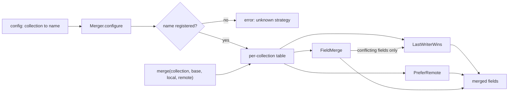

## In one minute
- Strategy puts one varying algorithm behind a small interface, so the code that uses it (the context) can run any of several interchangeable versions without knowing which one it holds.
- In modern languages a strategy is often just a function: a `key=` in Python's `sorted`, a comparator in Java, a `func(a, b T) int` in Go. Reach for an interface or class when the algorithm has a name, configuration, or more than one method.
- The win is that choosing the algorithm and running it become separate decisions. The choice moves to configuration or the composition root; the context stays closed to modification and open to new strategies.
- The costs are an indirect call that blocks inlining, an extra allocation when strategies capture state, and a configuration surface that can name a strategy that does not exist. Validate the choice at startup.
- Agents add "strategies" freely. In review, check that there are at least two real implementations, that the context never asks which one it has, and that every strategy honours the same contract.

## How it works

### The problem
A notes app syncs documents between a phone and a server. When both sides edited the same note while the phone was offline, the sync engine has three versions: the common ancestor (the base), the local copy and the remote copy. The first engine had one rule baked in: keep whichever copy has the later timestamp. That loses work. If you fixed a typo in the title on your phone and your colleague added a paragraph on the laptop, one of those edits vanishes.

The obvious fix is a flag:

```python
def merge(base, local, remote, mode):
    if mode == "lww":
        ...
    elif mode == "server":
        ...
    elif mode == "fields":
        ...   # 40 lines of three-way merge
```

Every new rule edits this function, and its tests grow combinatorially. The checklist collection wants per-field merging, the billing settings must always take the server's copy, and a customer asks for "keep both and let me pick". Soon `merge` has six modes and each mode's bugs can break the others.

### Pull the algorithm out
Strategy names the varying part and gives it an interface:

```python
class LastWriterWins:
    def resolve(self, base, local, remote):
        newer = remote if (remote.ts, remote.node) > (local.ts, local.node) else local
        return dict(newer.fields)

class Merger:
    def __init__(self, strategies, default):
        self.strategies, self.default, self.per_collection = strategies, default, {}

    def merge(self, collection, base, local, remote):
        name = self.per_collection.get(collection, self.default)
        return self.strategies[name].resolve(base, local, remote)
```

`Merger` is the context. It owns everything that does not vary: looking up which rule applies, loading the versions, writing the result. Each strategy owns one algorithm and can be tested alone with three tiny inputs. Adding "keep both" is a new class and one registration.

### Strategies compose
A three-way field merge resolves most conflicts without help: if only one side changed a field, take that side. It still needs a rule for a field that both sides changed differently. Rather than hard-coding one, `FieldMerge` takes another strategy as its fallback and asks it only about the conflicting fields. Strategies that wrap strategies are common in production: a retry policy wraps a backoff policy, a load balancer wraps a health filter around a picking rule, and a cache wraps an eviction policy.

### Functions are strategies too
In Python, TypeScript and Go, a single-method strategy is usually a function. `sorted(rows, key=lambda r: r.price)` passes a strategy. So does `slices.SortFunc(xs, cmp)` in Go and `array.sort((a, b) => a - b)` in JavaScript. Go's standard library shows both styles side by side: `http.Handler` is an interface, and `http.HandlerFunc` is an adapter type that lets any function satisfy it. Use a plain function when the algorithm has no name and no configuration. Use an object when it carries settings (a cap, a fallback), has more than one method, or must be listed by name in configuration and logs.

### Strategy, State and Template Method
Strategy and State have the same class diagram and different intent. A strategy is chosen from outside, usually once, and does not know about its siblings. A state object is swapped by the states themselves as events arrive (see the State lesson). Template Method gets variation through inheritance instead: the base class owns the algorithm and subclasses override steps. Strategy is the composition version of the same idea, and it lets you change the algorithm at runtime without a new subclass.

### Reviewing agent-written code
Ask an agent to "support a second merge mode" and it will often add an `elif` inside the existing function. Ask it to "use the Strategy pattern" and it may produce `MergeStrategy`, `AbstractMergeStrategy`, `MergeStrategyFactory` and one implementation. Steer between the two. A strategy interface is worth it when two implementations exist today, the choice comes from configuration, or tests need a stub. Then check three things: the context never calls `isinstance` or switches on the strategy's type; every strategy has the same failure behaviour (no strategy that silently returns `None` where others raise); and the configuration is validated when it is loaded, not when the first conflict arrives at 3 a.m.

### The same shape elsewhere
Strategy is how systems handle *hot spots* and *overload* without rewriting the hot path. The Linux kernel picks a TCP congestion control algorithm per socket. Kafka producers accept a pluggable `partitioner.class`, and since KIP-794 an unset value means the producer's own built-in sticky logic ([Kafka docs](https://kafka.apache.org/41/configuration/producer-configs/)). Envoy picks a load-balancing policy per upstream cluster, set in that cluster's configuration ([Envoy docs](https://www.envoyproxy.io/docs/envoy/latest/intro/arch_overview/upstream/load_balancing/load_balancers)). Each one keeps the data path fixed and makes the decision pluggable, so operators can change behaviour under load by changing a name in configuration.

## Down the stack

### Layer 1: The contract
Every strategy in a family accepts the same inputs, returns the same kind of output, and fails the same way. For the merge family that means: never mutate the inputs, return a fresh dictionary, be deterministic for the same three versions (so two replicas that merge the same conflict converge), and break ties by a stable rule such as node id rather than by arrival order. The context promises to call only the interface and to validate a strategy name when configuration is loaded. Whether a strategy object may be shared between threads is part of the contract: stateless strategies can be one shared instance; stateful ones (a round-robin counter, a token bucket) need one instance per context or their own lock.

### Layer 2: The mechanism
Linux is a clean real example. A congestion control algorithm is a `struct tcp_congestion_ops` holding function pointers such as `ssthresh`, `cong_avoid`, `cong_control` and `undo_cwnd`, plus a `name` ([tcp.h](https://github.com/torvalds/linux/blob/master/include/net/tcp.h)). Modules call `tcp_register_congestion_control` to add themselves to a list ([tcp_cong.c](https://github.com/torvalds/linux/blob/master/net/ipv4/tcp_cong.c)). The `net.ipv4.tcp_congestion_control` sysctl sets the default, and a single socket can choose another with `setsockopt(fd, IPPROTO_TCP, TCP_CONGESTION, "bbr", 3)`. An unprivileged process may only pick from `tcp_allowed_congestion_control`, which defaults to reno plus the system default ([tcp(7)](https://man7.org/linux/man-pages/man7/tcp.7.html)), so the choice is a policy the operator can restrict. The TCP stack calls `icsk->icsk_ca_ops->cong_avoid(sk, ack, acked)` without knowing whether it is CUBIC or BBR.

In Java, `Collections.sort(list, comparator)` hands a `Comparator` to TimSort, which calls `compare` on every comparison. Python's `sorted(key=...)` calls the key function exactly once per element and caches the results ([Sorting HOWTO](https://docs.python.org/3/howto/sorting.html)), which is why a key function beats `functools.cmp_to_key` for anything but the strangest orders. Go has both generations: `sort.Sort(data sort.Interface)` calls `Len`, `Less` and `Swap` through an interface, and `slices.SortFunc(s, cmp)` takes a generic function.

### Layer 3: The machine
A strategy call is an indirect call. In C++ and Java it loads the vtable pointer from the object, then the method pointer from the vtable. In Go it loads the method from the interface's itab, a table built once per (interface, concrete type) pair and cached. A predicted indirect call costs about 1 to 2 ns; a mispredicted one costs 15 to 20 cycles. The larger cost is lost inlining. A comparator called through an interface 20 million times in a sort cannot be inlined into the loop, so the compiler cannot keep values in registers or vectorise. That is why `slices.Sort` on a `[]int` beats `sort.Sort` on the same data: the generic version compiles the comparison into the loop. Go acknowledged this in 1.22, when `sort.Ints` became a thin call to `slices.Sort` ([sort.go](https://raw.githubusercontent.com/golang/go/master/src/sort/sort.go)).

Runtimes fight back with speculation. The JVM records receiver types at each call site and, if one type dominates, inlines that method behind a type check. V8's inline caches do the same in JavaScript: a call site that has only seen one strategy class is monomorphic and fast, two to four classes is polymorphic, and beyond four it goes megamorphic and falls back to a slower generic lookup through the prototype chain. Go's profile-guided optimisation, on by default when a `default.pgo` file sits in the main package, can devirtualise some interface calls by adding a direct call to the most common callee ([Go 1.21 notes](https://go.dev/doc/go1.21)).

Allocation matters too. A stateless strategy can be a single shared object or a top-level function: zero allocations per call. A closure that captures variables usually escapes to the heap in Go and allocates a function object in JS and Python. Building a fresh strategy per request at 50,000 requests per second is 50,000 small objects per second for the garbage collector. Swapping a strategy at runtime from another thread needs an atomic publish, such as Go's `atomic.Pointer[T]` or a `volatile` field in Java, so readers see either the old or the new object, never a half-written one.

### Why it's built this way
1. Business rules vary along one axis (how to merge, how to price, how to pick a server) while the surrounding code stays the same.
2. Branching on a mode inside that code couples every variant to every other, so the variant moves behind an interface.
3. The choice often depends on configuration or the customer, so it must be a value chosen at runtime, not a compile-time branch.
4. Runtime choice costs an indirect call and lost inlining, so hot inner loops prefer generics or monomorphic call sites, and cold policy decisions use plain interfaces.

## Diagram


## Worked example
A note-taking product with 4 million daily active users runs about 30 million sync merges a day. Roughly 0.5% of them, 150,000, have edits on both sides since the last sync. With last-writer-wins on whole documents, each of those drops one side's edits. Support tickets about "my changes disappeared" averaged 40 a day.

The team split the merge into strategies. Notes and checklists moved to `FieldMerge(LastWriterWins())`. Of the 150,000 concurrent merges, 141,000 touched different fields and now keep both sides' edits. The remaining 9,000 touch the same field; those still fall back to the newer value, and the app now records them so a later "keep both" strategy can show the user a choice. Workspace billing settings use `PreferRemote`, because a phone must never overwrite a plan change made by an admin. Tickets fell to about 4 a day.

The cost check was trivial. A merge is dominated by loading three versions from SQLite on the phone (about 2 ms) and the network round trip. The strategy lookup is one dictionary access and one indirect call, under a microsecond. The one regression was a configuration typo, `field_merge` instead of `field-merge`, that shipped to 2% of users in a canary. The old code fell back to the default silently. The fix was to make `configure` reject unknown names and to load configuration through it at startup, so the bad rollout would have failed the canary health check immediately.

## In the wild
- **Apache Kafka, KIP-480 to KIP-794: the default strategy skewed load.** The sticky partitioner became the default for unkeyed records, but it switched partitions whenever a new batch was created. A slow broker drains batches more slowly, so it kept the "sticky" choice longer and received more data, which slowed it further. In the KIP-794 author's local test (3 brokers, 20 ms injected on one), that broker took about 46.8 MB against about 9 MB on each of the others, with 4,073 ms average latency against 40 ms for the replacement. Kafka moved the default logic into the producer and deprecated the old partitioner classes ([KIP-794](https://cwiki.apache.org/confluence/display/KAFKA/KIP-794%3A+Strictly+Uniform+Sticky+Partitioner)).
- **Google, 2017: BBR swapped in as a congestion-control module.** Because the kernel treats congestion control as a pluggable algorithm, Google could roll out BBR on google.com and YouTube without touching the TCP data path. It reported a 4% average YouTube throughput gain globally and more than 14% in some countries, then offered BBR to Google Cloud customers ([Google Cloud blog](https://cloud.google.com/blog/products/networking/tcp-bbr-congestion-control-comes-to-gcp-your-internet-just-got-faster)).

## Trade-offs
| Option | Strengths | Weaknesses | Choose when |
| --- | --- | --- | --- |
| `if`/`switch` on a mode | Everything in one place; compiler can check exhaustiveness | Every variant edits one function; tests grow together | Two or three small, stable variants |
| Function parameter | Lightest form; no class needed | No name for logs or config; awkward with settings | One-method algorithms such as sort keys |
| Strategy interface | Named, configurable, testable alone; composable | Indirect call; more types to read | Variants chosen by configuration or customer |
| Template Method (subclass) | Base class enforces the skeleton | Inheritance coupling; fixed at construction | A framework owns the algorithm's steps |
| Generics or compile-time policy | Inlined, no dispatch cost | Choice fixed at build time; code bloat | Hot inner loops (sorting, hashing) |

## Pitfalls in production
- Strategies that disagree on edge cases: one returns an empty result on bad input, another raises. Fix: write one shared contract test suite and run every strategy through it.
- An unknown strategy name that falls back silently to the default. Fix: validate names when configuration loads and fail the deploy or reject the reload.
- A stateful strategy (a round-robin index, a rate limiter) shared across contexts or threads, so counters interleave. Fix: document statefulness and create one per context, or guard it with a lock.
- The context inspecting the concrete type (`if isinstance(s, FieldMerge)`) to add a special case. Fix: add the capability to the interface or move the special case into the strategy.
- A non-deterministic strategy (ties broken by arrival order or a random number) in a replicated system, so replicas diverge. Fix: break ties with stable data such as node id.
- Building a fresh strategy object per request in a hot path. Fix: share stateless strategies and construct stateful ones once per context.

## Leadership lens
- Ask what varies, who chooses, and how often. A strategy chosen by the customer or by operations is a product feature; it needs documentation, metrics per strategy and a safe default.
- Treat strategy names as an API. Renaming `lww` breaks every saved configuration, so version names and keep aliases.
- Require a shared contract test for each strategy family. It is the cheapest way to let other teams, or an agent, add strategies safely.
- Push back on speculative strategies. One implementation behind an interface is a cost with no benefit until the second one exists.
- Log which strategy made each important decision. When a merge, price or route looks wrong, the first question on call is "which rule ran?".

## Check yourself
1. Strategy and State have the same class diagram. What is the practical difference?
   **Answer:** A strategy is chosen from outside the context and does not change itself, while state objects replace each other as events arrive. Strategies do not know their siblings; states usually do.
2. Why is `slices.Sort` on a `[]int` faster than `sort.Sort` with a `sort.Interface` on the same data?
   **Answer:** `sort.Sort` makes an indirect call through the itab for every `Less` and `Swap`, which blocks inlining. The generic version compiles the comparison into the loop.
3. A field merge falls back to last-writer-wins for conflicting fields. Why must the tie-break use node id rather than "whichever arrived first"?
   **Answer:** Two replicas can see the versions in different orders. A rule based on data in the versions gives the same answer everywhere, so they converge.
4. When is a plain function a better strategy than an interface?
   **Answer:** When the algorithm has one method, no settings, and does not need a name in configuration or logs, such as a sort key.

## Practice
**Task:** Build the merge strategies for a sync engine. A `Version` has `fields` (string to string), an integer `ts` and a `node` id. Every strategy has `resolve(base, local, remote)` and returns a new dictionary without mutating inputs. `LastWriterWins` returns the fields of whichever of local and remote has the larger `(ts, node)` pair; `PreferRemote` returns the remote fields; `FieldMerge(fallback)` does a three-way merge key by key over the union of keys (a missing key counts as a value "absent"): if local equals remote take it, else if local equals base take remote, else if remote equals base take local, else take the key's value from `fallback.resolve(base, local, remote)`; an absent result means the key is omitted. `Merger(default)` has the built-in names `lww`, `server-wins` and `field-merge` (a `FieldMerge` with `LastWriterWins` fallback), `register(name, strategy)`, `configure(collection, name)` and `merge(collection, base, local, remote)`, which uses the collection's strategy or the default. Unknown names fail with `unknown strategy: <name>` (in the constructor too) and leave the configuration unchanged; a duplicate name fails with `duplicate strategy: <name>`. In TypeScript, return objects with keys in sorted order.

```python starter
class Version:
    def __init__(self, fields, ts, node):
        self.fields = dict(fields)
        self.ts = ts
        self.node = node

class LastWriterWins:
    def resolve(self, base, local, remote):
        # TODO
        raise NotImplementedError

class PreferRemote:
    def resolve(self, base, local, remote):
        # TODO
        raise NotImplementedError

class FieldMerge:
    def __init__(self, fallback):
        self.fallback = fallback

    def resolve(self, base, local, remote):
        # TODO
        raise NotImplementedError

class Merger:
    def __init__(self, default):
        # TODO: built-in strategies, validate default
        raise NotImplementedError

    def register(self, name, strategy):
        raise NotImplementedError

    def configure(self, collection, name):
        raise NotImplementedError

    def merge(self, collection, base, local, remote):
        raise NotImplementedError
```

```python tests
def error_of(fn):
    try:
        fn()
    except ValueError as e:
        return str(e)
    return None

BASE = Version({"title": "a", "body": "x"}, 1, "s")

def test_lww_newer_wins_and_ties_by_node():
    local = Version({"title": "L"}, 5, "phone")
    remote = Version({"title": "R"}, 7, "laptop")
    assert LastWriterWins().resolve(BASE, local, remote) == {"title": "R"}
    tie_local = Version({"title": "L"}, 7, "phone")
    assert LastWriterWins().resolve(BASE, tie_local, remote) == {"title": "L"}, "phone > laptop"

def test_server_wins_even_when_older():
    local = Version({"title": "L"}, 9, "phone")
    remote = Version({"title": "R"}, 2, "server")
    assert PreferRemote().resolve(BASE, local, remote) == {"title": "R"}

def test_field_merge_keeps_both_sides():
    local = Version({"title": "b", "body": "x"}, 3, "phone")
    remote = Version({"title": "a", "body": "y"}, 2, "laptop")
    assert FieldMerge(LastWriterWins()).resolve(BASE, local, remote) == {"title": "b", "body": "y"}

def test_field_merge_additions_and_deletions():
    base = Version({"a": "1", "b": "2"}, 1, "s")
    local = Version({"a": "1"}, 2, "phone")
    remote = Version({"a": "1", "b": "2", "c": "3"}, 3, "laptop")
    assert FieldMerge(LastWriterWins()).resolve(base, local, remote) == {"a": "1", "c": "3"}

def test_field_merge_conflict_uses_fallback():
    base = Version({"t": "a", "n": "1"}, 1, "s")
    local = Version({"t": "L", "n": "2"}, 9, "phone")
    remote = Version({"t": "R", "n": "1"}, 3, "laptop")
    assert FieldMerge(LastWriterWins()).resolve(base, local, remote) == {"t": "L", "n": "2"}
    assert FieldMerge(PreferRemote()).resolve(base, local, remote) == {"t": "R", "n": "2"}
    deleted = Version({}, 9, "phone")
    assert FieldMerge(LastWriterWins()).resolve(Version({"t": "a"}, 1, "s"), deleted, Version({"t": "R"}, 3, "x")) == {}

def test_merger_per_collection_and_default():
    m = Merger("lww")
    m.configure("notes", "field-merge")
    m.configure("billing", "server-wins")
    local = Version({"title": "b", "body": "x"}, 9, "phone")
    remote = Version({"title": "a", "body": "y"}, 2, "laptop")
    assert m.merge("notes", BASE, local, remote) == {"title": "b", "body": "y"}
    assert m.merge("billing", BASE, local, remote) == {"title": "a", "body": "y"}
    assert m.merge("other", BASE, local, remote) == {"title": "b", "body": "x"}

def test_unknown_and_duplicate_names():
    assert error_of(lambda: Merger("nope")) == "unknown strategy: nope"
    m = Merger("lww")
    m.configure("notes", "server-wins")
    assert error_of(lambda: m.configure("notes", "field_merge")) == "unknown strategy: field_merge"
    remote = Version({"k": "r"}, 1, "a")
    assert m.merge("notes", BASE, Version({"k": "l"}, 5, "b"), remote) == {"k": "r"}, "config unchanged"
    assert error_of(lambda: m.register("lww", PreferRemote())) == "duplicate strategy: lww"

class KeepLocal:
    def resolve(self, base, local, remote):
        return dict(local.fields)

def test_custom_strategy_and_no_mutation():
    m = Merger("server-wins")
    m.register("keep-local", KeepLocal())
    m.configure("drafts", "keep-local")
    local = Version({"k": "l"}, 1, "a")
    remote = Version({"k": "r"}, 2, "b")
    assert m.merge("drafts", BASE, local, remote) == {"k": "l"}
    out = m.merge("x", BASE, local, remote)
    out["k"] = "changed"
    assert remote.fields == {"k": "r"}, "result must be a copy"
```

```python solution
class Version:
    def __init__(self, fields, ts, node):
        self.fields = dict(fields)
        self.ts = ts
        self.node = node

class LastWriterWins:
    def resolve(self, base, local, remote):
        newer = remote if (remote.ts, remote.node) > (local.ts, local.node) else local
        return dict(newer.fields)

class PreferRemote:
    def resolve(self, base, local, remote):
        return dict(remote.fields)

class FieldMerge:
    def __init__(self, fallback):
        self.fallback = fallback

    def resolve(self, base, local, remote):
        keys = set(base.fields) | set(local.fields) | set(remote.fields)
        fallback = None
        out = {}
        for key in sorted(keys):
            b = base.fields.get(key)
            l = local.fields.get(key)
            r = remote.fields.get(key)
            if l == r:
                v = l
            elif l == b:
                v = r
            elif r == b:
                v = l
            else:
                if fallback is None:
                    fallback = self.fallback.resolve(base, local, remote)
                v = fallback.get(key)
            if v is not None:
                out[key] = v
        return out

class Merger:
    def __init__(self, default):
        self.strategies = {
            "lww": LastWriterWins(),
            "server-wins": PreferRemote(),
            "field-merge": FieldMerge(LastWriterWins()),
        }
        self._check(default)
        self.default = default
        self.per_collection = {}

    def _check(self, name):
        if name not in self.strategies:
            raise ValueError("unknown strategy: " + name)

    def register(self, name, strategy):
        if name in self.strategies:
            raise ValueError("duplicate strategy: " + name)
        self.strategies[name] = strategy

    def configure(self, collection, name):
        self._check(name)
        self.per_collection[collection] = name

    def merge(self, collection, base, local, remote):
        name = self.per_collection.get(collection, self.default)
        return self.strategies[name].resolve(base, local, remote)
```

```typescript starter
export type Fields = Record<string, string>;

export class Version {
  constructor(public fields: Fields, public ts: number, public node: string) {}
}

export interface Strategy {
  resolve(base: Version, local: Version, remote: Version): Fields;
}

export class LastWriterWins implements Strategy {
  resolve(base: Version, local: Version, remote: Version): Fields { throw new Error("TODO"); }
}

export class PreferRemote implements Strategy {
  resolve(base: Version, local: Version, remote: Version): Fields { throw new Error("TODO"); }
}

export class FieldMerge implements Strategy {
  constructor(private fallback: Strategy) {}
  resolve(base: Version, local: Version, remote: Version): Fields { throw new Error("TODO"); }
}

export class Merger {
  constructor(defaultName: string) { throw new Error("TODO"); }
  register(name: string, strategy: Strategy): void { throw new Error("TODO"); }
  configure(collection: string, name: string): void { throw new Error("TODO"); }
  merge(collection: string, base: Version, local: Version, remote: Version): Fields { throw new Error("TODO"); }
}
```

```typescript tests
function errorOf(fn: () => unknown): string | undefined {
  try { fn(); } catch (e) { return (e as Error).message; }
  return undefined;
}

const BASE = new Version({ body: "x", title: "a" }, 1, "s");

test("lww newer wins and ties by node", () => {
  const local = new Version({ title: "L" }, 5, "phone");
  const remote = new Version({ title: "R" }, 7, "laptop");
  assertEqual(new LastWriterWins().resolve(BASE, local, remote), { title: "R" });
  const tieLocal = new Version({ title: "L" }, 7, "phone");
  assertEqual(new LastWriterWins().resolve(BASE, tieLocal, remote), { title: "L" }, "phone > laptop");
});

test("server wins even when older", () => {
  const local = new Version({ title: "L" }, 9, "phone");
  const remote = new Version({ title: "R" }, 2, "server");
  assertEqual(new PreferRemote().resolve(BASE, local, remote), { title: "R" });
});

test("field merge keeps both sides", () => {
  const local = new Version({ body: "x", title: "b" }, 3, "phone");
  const remote = new Version({ body: "y", title: "a" }, 2, "laptop");
  assertEqual(new FieldMerge(new LastWriterWins()).resolve(BASE, local, remote), { body: "y", title: "b" });
});

test("field merge additions and deletions", () => {
  const base = new Version({ a: "1", b: "2" }, 1, "s");
  const local = new Version({ a: "1" }, 2, "phone");
  const remote = new Version({ a: "1", b: "2", c: "3" }, 3, "laptop");
  assertEqual(new FieldMerge(new LastWriterWins()).resolve(base, local, remote), { a: "1", c: "3" });
});

test("field merge conflict uses fallback", () => {
  const base = new Version({ n: "1", t: "a" }, 1, "s");
  const local = new Version({ n: "2", t: "L" }, 9, "phone");
  const remote = new Version({ n: "1", t: "R" }, 3, "laptop");
  assertEqual(new FieldMerge(new LastWriterWins()).resolve(base, local, remote), { n: "2", t: "L" });
  assertEqual(new FieldMerge(new PreferRemote()).resolve(base, local, remote), { n: "2", t: "R" });
  const deleted = new Version({}, 9, "phone");
  assertEqual(new FieldMerge(new LastWriterWins()).resolve(new Version({ t: "a" }, 1, "s"), deleted, new Version({ t: "R" }, 3, "x")), {});
});

test("merger per collection and default", () => {
  const m = new Merger("lww");
  m.configure("notes", "field-merge");
  m.configure("billing", "server-wins");
  const local = new Version({ body: "x", title: "b" }, 9, "phone");
  const remote = new Version({ body: "y", title: "a" }, 2, "laptop");
  assertEqual(m.merge("notes", BASE, local, remote), { body: "y", title: "b" });
  assertEqual(m.merge("billing", BASE, local, remote), { body: "y", title: "a" });
  assertEqual(m.merge("other", BASE, local, remote), { body: "x", title: "b" });
});

test("unknown and duplicate names", () => {
  assertEqual(errorOf(() => new Merger("nope")), "unknown strategy: nope");
  const m = new Merger("lww");
  m.configure("notes", "server-wins");
  assertEqual(errorOf(() => m.configure("notes", "field_merge")), "unknown strategy: field_merge");
  const remote = new Version({ k: "r" }, 1, "a");
  assertEqual(m.merge("notes", BASE, new Version({ k: "l" }, 5, "b"), remote), { k: "r" }, "config unchanged");
  assertEqual(errorOf(() => m.register("lww", new PreferRemote())), "duplicate strategy: lww");
});

class KeepLocal implements Strategy {
  resolve(base: Version, local: Version, remote: Version): Fields { return { ...local.fields }; }
}

test("custom strategy and no mutation", () => {
  const m = new Merger("server-wins");
  m.register("keep-local", new KeepLocal());
  m.configure("drafts", "keep-local");
  const local = new Version({ k: "l" }, 1, "a");
  const remote = new Version({ k: "r" }, 2, "b");
  assertEqual(m.merge("drafts", BASE, local, remote), { k: "l" });
  const out = m.merge("x", BASE, local, remote);
  out.k = "changed";
  assertEqual(remote.fields, { k: "r" }, "result must be a copy");
});
```

```typescript solution
export type Fields = Record<string, string>;

export class Version {
  constructor(public fields: Fields, public ts: number, public node: string) {}
}

export interface Strategy {
  resolve(base: Version, local: Version, remote: Version): Fields;
}

function sortedCopy(f: Fields): Fields {
  const out: Fields = {};
  for (const k of Object.keys(f).sort()) out[k] = f[k];
  return out;
}

function newer(local: Version, remote: Version): Version {
  if (remote.ts !== local.ts) return remote.ts > local.ts ? remote : local;
  return remote.node > local.node ? remote : local;
}

export class LastWriterWins implements Strategy {
  resolve(base: Version, local: Version, remote: Version): Fields {
    return sortedCopy(newer(local, remote).fields);
  }
}

export class PreferRemote implements Strategy {
  resolve(base: Version, local: Version, remote: Version): Fields {
    return sortedCopy(remote.fields);
  }
}

export class FieldMerge implements Strategy {
  constructor(private fallback: Strategy) {}

  resolve(base: Version, local: Version, remote: Version): Fields {
    const keys = new Set([...Object.keys(base.fields), ...Object.keys(local.fields), ...Object.keys(remote.fields)]);
    const get = (v: Version, k: string): string | undefined =>
      Object.prototype.hasOwnProperty.call(v.fields, k) ? v.fields[k] : undefined;
    let fb: Fields | undefined;
    const out: Fields = {};
    for (const k of [...keys].sort()) {
      const b = get(base, k), l = get(local, k), r = get(remote, k);
      let v: string | undefined;
      if (l === r) v = l;
      else if (l === b) v = r;
      else if (r === b) v = l;
      else {
        if (fb === undefined) fb = this.fallback.resolve(base, local, remote);
        v = Object.prototype.hasOwnProperty.call(fb, k) ? fb[k] : undefined;
      }
      if (v !== undefined) out[k] = v;
    }
    return out;
  }
}

export class Merger {
  private strategies = new Map<string, Strategy>([
    ["lww", new LastWriterWins()],
    ["server-wins", new PreferRemote()],
    ["field-merge", new FieldMerge(new LastWriterWins())],
  ]);
  private perCollection = new Map<string, string>();
  private defaultName: string;

  constructor(defaultName: string) {
    this.check(defaultName);
    this.defaultName = defaultName;
  }

  private check(name: string): void {
    if (!this.strategies.has(name)) throw new Error("unknown strategy: " + name);
  }

  register(name: string, strategy: Strategy): void {
    if (this.strategies.has(name)) throw new Error("duplicate strategy: " + name);
    this.strategies.set(name, strategy);
  }

  configure(collection: string, name: string): void {
    this.check(name);
    this.perCollection.set(collection, name);
  }

  merge(collection: string, base: Version, local: Version, remote: Version): Fields {
    const name = this.perCollection.get(collection) ?? this.defaultName;
    return this.strategies.get(name)!.resolve(base, local, remote);
  }
}
```

```go starter
package practice

type Version struct {
	Fields map[string]string
	TS     int
	Node   string
}

type Strategy interface {
	Resolve(base, local, remote Version) map[string]string
}

// StrategyFunc lets a plain function act as a Strategy, like http.HandlerFunc.
type StrategyFunc func(base, local, remote Version) map[string]string

func (f StrategyFunc) Resolve(base, local, remote Version) map[string]string {
	return f(base, local, remote)
}

type LastWriterWins struct{}

func (LastWriterWins) Resolve(base, local, remote Version) map[string]string { panic("TODO") }

type PreferRemote struct{}

func (PreferRemote) Resolve(base, local, remote Version) map[string]string { panic("TODO") }

type FieldMerge struct {
	Fallback Strategy
}

func (f FieldMerge) Resolve(base, local, remote Version) map[string]string { panic("TODO") }

type Merger struct{}

func NewMerger(defaultName string) (*Merger, error)                      { panic("TODO") }
func (m *Merger) Register(name string, s Strategy) error                 { panic("TODO") }
func (m *Merger) Configure(collection, name string) error                { panic("TODO") }
func (m *Merger) Merge(collection string, base, local, remote Version) map[string]string {
	panic("TODO")
}
```

```go tests
package practice

import (
	"reflect"
	"testing"
)

type F = map[string]string

var base = Version{F{"title": "a", "body": "x"}, 1, "s"}

func eq(t *testing.T, got, want F, msg string) {
	t.Helper()
	if !reflect.DeepEqual(got, want) {
		t.Fatalf("%s: want %v, got %v", msg, want, got)
	}
}

func TestLWWNewerWinsAndTiesByNode(t *testing.T) {
	local := Version{F{"title": "L"}, 5, "phone"}
	remote := Version{F{"title": "R"}, 7, "laptop"}
	eq(t, LastWriterWins{}.Resolve(base, local, remote), F{"title": "R"}, "newer")
	tieLocal := Version{F{"title": "L"}, 7, "phone"}
	eq(t, LastWriterWins{}.Resolve(base, tieLocal, remote), F{"title": "L"}, "phone > laptop")
}

func TestServerWinsEvenWhenOlder(t *testing.T) {
	local := Version{F{"title": "L"}, 9, "phone"}
	remote := Version{F{"title": "R"}, 2, "server"}
	eq(t, PreferRemote{}.Resolve(base, local, remote), F{"title": "R"}, "remote")
}

func TestFieldMergeKeepsBothSides(t *testing.T) {
	local := Version{F{"title": "b", "body": "x"}, 3, "phone"}
	remote := Version{F{"title": "a", "body": "y"}, 2, "laptop"}
	eq(t, FieldMerge{LastWriterWins{}}.Resolve(base, local, remote), F{"title": "b", "body": "y"}, "both")
}

func TestFieldMergeAdditionsAndDeletions(t *testing.T) {
	b := Version{F{"a": "1", "b": "2"}, 1, "s"}
	local := Version{F{"a": "1"}, 2, "phone"}
	remote := Version{F{"a": "1", "b": "2", "c": "3"}, 3, "laptop"}
	eq(t, FieldMerge{LastWriterWins{}}.Resolve(b, local, remote), F{"a": "1", "c": "3"}, "add/delete")
}

func TestFieldMergeConflictUsesFallback(t *testing.T) {
	b := Version{F{"t": "a", "n": "1"}, 1, "s"}
	local := Version{F{"t": "L", "n": "2"}, 9, "phone"}
	remote := Version{F{"t": "R", "n": "1"}, 3, "laptop"}
	eq(t, FieldMerge{LastWriterWins{}}.Resolve(b, local, remote), F{"t": "L", "n": "2"}, "lww fallback")
	eq(t, FieldMerge{PreferRemote{}}.Resolve(b, local, remote), F{"t": "R", "n": "2"}, "remote fallback")
	deleted := Version{F{}, 9, "phone"}
	got := FieldMerge{LastWriterWins{}}.Resolve(Version{F{"t": "a"}, 1, "s"}, deleted, Version{F{"t": "R"}, 3, "x"})
	eq(t, got, F{}, "newer delete wins")
}

func mustMerger(t *testing.T, name string) *Merger {
	t.Helper()
	m, err := NewMerger(name)
	if err != nil {
		t.Fatal(err)
	}
	return m
}

func TestMergerPerCollectionAndDefault(t *testing.T) {
	m := mustMerger(t, "lww")
	if err := m.Configure("notes", "field-merge"); err != nil {
		t.Fatal(err)
	}
	if err := m.Configure("billing", "server-wins"); err != nil {
		t.Fatal(err)
	}
	local := Version{F{"title": "b", "body": "x"}, 9, "phone"}
	remote := Version{F{"title": "a", "body": "y"}, 2, "laptop"}
	eq(t, m.Merge("notes", base, local, remote), F{"title": "b", "body": "y"}, "notes")
	eq(t, m.Merge("billing", base, local, remote), F{"title": "a", "body": "y"}, "billing")
	eq(t, m.Merge("other", base, local, remote), F{"title": "b", "body": "x"}, "default")
}

func TestUnknownAndDuplicateNames(t *testing.T) {
	if _, err := NewMerger("nope"); err == nil || err.Error() != "unknown strategy: nope" {
		t.Fatalf("constructor: %v", err)
	}
	m := mustMerger(t, "lww")
	m.Configure("notes", "server-wins")
	if err := m.Configure("notes", "field_merge"); err == nil || err.Error() != "unknown strategy: field_merge" {
		t.Fatalf("configure: %v", err)
	}
	remote := Version{F{"k": "r"}, 1, "a"}
	eq(t, m.Merge("notes", base, Version{F{"k": "l"}, 5, "b"}, remote), F{"k": "r"}, "config unchanged")
	if err := m.Register("lww", PreferRemote{}); err == nil || err.Error() != "duplicate strategy: lww" {
		t.Fatalf("register: %v", err)
	}
}

func TestCustomStrategyAndNoMutation(t *testing.T) {
	m := mustMerger(t, "server-wins")
	keepLocal := StrategyFunc(func(b, l, r Version) map[string]string {
		out := F{}
		for k, v := range l.Fields {
			out[k] = v
		}
		return out
	})
	if err := m.Register("keep-local", keepLocal); err != nil {
		t.Fatal(err)
	}
	m.Configure("drafts", "keep-local")
	local := Version{F{"k": "l"}, 1, "a"}
	remote := Version{F{"k": "r"}, 2, "b"}
	eq(t, m.Merge("drafts", base, local, remote), F{"k": "l"}, "custom")
	out := m.Merge("x", base, local, remote)
	out["k"] = "changed"
	eq(t, remote.Fields, F{"k": "r"}, "result must be a copy")
}
```

```go solution
package practice

import "errors"

type Version struct {
	Fields map[string]string
	TS     int
	Node   string
}

type Strategy interface {
	Resolve(base, local, remote Version) map[string]string
}

// StrategyFunc lets a plain function act as a Strategy, like http.HandlerFunc.
type StrategyFunc func(base, local, remote Version) map[string]string

func (f StrategyFunc) Resolve(base, local, remote Version) map[string]string {
	return f(base, local, remote)
}

func copyFields(f map[string]string) map[string]string {
	out := make(map[string]string, len(f))
	for k, v := range f {
		out[k] = v
	}
	return out
}

type LastWriterWins struct{}

func (LastWriterWins) Resolve(base, local, remote Version) map[string]string {
	if remote.TS > local.TS || (remote.TS == local.TS && remote.Node > local.Node) {
		return copyFields(remote.Fields)
	}
	return copyFields(local.Fields)
}

type PreferRemote struct{}

func (PreferRemote) Resolve(base, local, remote Version) map[string]string {
	return copyFields(remote.Fields)
}

type FieldMerge struct {
	Fallback Strategy
}

type opt struct {
	v  string
	ok bool
}

func get(m map[string]string, k string) opt {
	v, ok := m[k]
	return opt{v, ok}
}

func (f FieldMerge) Resolve(base, local, remote Version) map[string]string {
	keys := map[string]bool{}
	for _, m := range []map[string]string{base.Fields, local.Fields, remote.Fields} {
		for k := range m {
			keys[k] = true
		}
	}
	var fb map[string]string
	out := map[string]string{}
	for k := range keys {
		b, l, r := get(base.Fields, k), get(local.Fields, k), get(remote.Fields, k)
		var v opt
		switch {
		case l == r:
			v = l
		case l == b:
			v = r
		case r == b:
			v = l
		default:
			if fb == nil {
				fb = f.Fallback.Resolve(base, local, remote)
			}
			v = get(fb, k)
		}
		if v.ok {
			out[k] = v.v
		}
	}
	return out
}

type Merger struct {
	strategies    map[string]Strategy
	perCollection map[string]string
	defaultName   string
}

func NewMerger(defaultName string) (*Merger, error) {
	m := &Merger{
		strategies: map[string]Strategy{
			"lww":         LastWriterWins{},
			"server-wins": PreferRemote{},
			"field-merge": FieldMerge{LastWriterWins{}},
		},
		perCollection: map[string]string{},
	}
	if err := m.check(defaultName); err != nil {
		return nil, err
	}
	m.defaultName = defaultName
	return m, nil
}

func (m *Merger) check(name string) error {
	if _, ok := m.strategies[name]; !ok {
		return errors.New("unknown strategy: " + name)
	}
	return nil
}

func (m *Merger) Register(name string, s Strategy) error {
	if _, dup := m.strategies[name]; dup {
		return errors.New("duplicate strategy: " + name)
	}
	m.strategies[name] = s
	return nil
}

func (m *Merger) Configure(collection, name string) error {
	if err := m.check(name); err != nil {
		return err
	}
	m.perCollection[collection] = name
	return nil
}

func (m *Merger) Merge(collection string, base, local, remote Version) map[string]string {
	name, ok := m.perCollection[collection]
	if !ok {
		name = m.defaultName
	}
	return m.strategies[name].Resolve(base, local, remote)
}
```

## Mock interview
**Prompt:** You own the shipping-quote service for an online retailer: 3,000 quote requests per second at peak, across 12 countries. Each country has a different rule (flat rate, weight bands, carrier API with a fallback table), and marketing wants to run "free shipping over 50" promotions in some countries for a weekend without a deploy. Design how quotes are computed.

- Follow-up: The carrier API strategy has a 300 ms p99 and occasionally times out. Where does that failure handling live?
- Follow-up: Ops pushes a config that names a promotion strategy that does not exist in the running build. What happens?
- Follow-up: Would you model the promotion as its own strategy, as a wrapper around the country strategy, or as data? Why?

**A strong answer covers:**
- A `QuoteStrategy` interface with one method taking the cart, destination and a clock, and a registry from name to strategy, with a per-country table in configuration.
- Composition: a promotion is a wrapper strategy around the country's base strategy, so "free over 50" does not have to be reimplemented for each country.
- Failure behaviour inside the strategy contract: the carrier strategy owns its timeout and falls back to its table, and every strategy returns the same error shape.
- Validation of configuration on load and on every hot reload, keeping the old table live if a name is unknown, with a metric per strategy.
- Cost awareness: strategies are shared stateless instances; the indirect call is irrelevant next to the carrier call, so readability wins.

## Sources and further study
**Primary**
- [Go 1.21 release notes](https://go.dev/doc/go1.21): PGO on by default and devirtualisation of hot interface calls.
- [Sorting HOWTO (Python docs)](https://docs.python.org/3/howto/sorting.html): why a key function is called once per record and when to prefer it to a comparator.
- [KIP-794: Strictly Uniform Sticky Partitioner](https://cwiki.apache.org/confluence/display/KAFKA/KIP-794%3A+Strictly+Uniform+Sticky+Partitioner): a design document that shows a default strategy failing under skew and being replaced.

**Systems docs**
- [Linux tcp.h](https://github.com/torvalds/linux/blob/master/include/net/tcp.h): the `tcp_congestion_ops` table of function pointers.
- [tcp(7) man page](https://man7.org/linux/man-pages/man7/tcp.7.html): `TCP_CONGESTION` and the allowed-algorithms list.
- [Envoy load balancers](https://www.envoyproxy.io/docs/envoy/latest/intro/arch_overview/upstream/load_balancing/load_balancers): pluggable policies chosen per upstream cluster.
- [Kafka producer configs](https://kafka.apache.org/41/configuration/producer-configs/): `partitioner.class` and the built-in default.

**Books**
- *Design Patterns*, Gamma, Helm, Johnson and Vlissides: chapter 5 (Behavioral Patterns), Strategy.
- *Head First Design Patterns*, Freeman and Robson: chapter 1, Strategy as the opening example.
- *Refactoring*, Martin Fowler, 2nd edition: chapter 10 (Simplifying Conditional Logic), Replace Conditional with Polymorphism, the usual route into Strategy.

**Other curricula**
- [Refactoring catalog: Replace Conditional with Polymorphism](https://refactoring.com/catalog/replaceConditionalWithPolymorphism.html): frames the same move as a refactoring of a branching method.

## Watch
- [Strategy Pattern, Design Patterns ep 1 (Christopher Okhravi)](https://www.youtube.com/watch?v=v9ejT8FO-7I): builds the pattern from the problem of duplicated behaviour in a class hierarchy.
- [10 Design Patterns Explained in 10 Minutes (Fireship)](https://www.youtube.com/watch?v=tv-_1er1mWI): a fast tour that shows Strategy next to the patterns it is often confused with.

## Free resources
- [Strategy pattern (Refactoring.Guru)](https://refactoring.guru/design-patterns/strategy): the structure, its relation to State and Template Method, and code in many languages.
- [Composition over inheritance (Brandon Rhodes, python-patterns.guide)](https://python-patterns.guide/gang-of-four/composition-over-inheritance/): why passing behaviour in beats subclassing for each variant.
- [Go Data Structures: Interfaces (Russ Cox)](https://research.swtch.com/interfaces): how itabs are laid out and how an interface method call is dispatched.
- [Shapes and inline caches (Mathias Bynens)](https://mathiasbynens.be/notes/shapes-ics): why a JavaScript call site that sees many strategy classes gets slower.
- [package sort (Go docs)](https://pkg.go.dev/sort): `sort.Interface`, the classic strategy-shaped API, alongside its newer function-based helpers.
