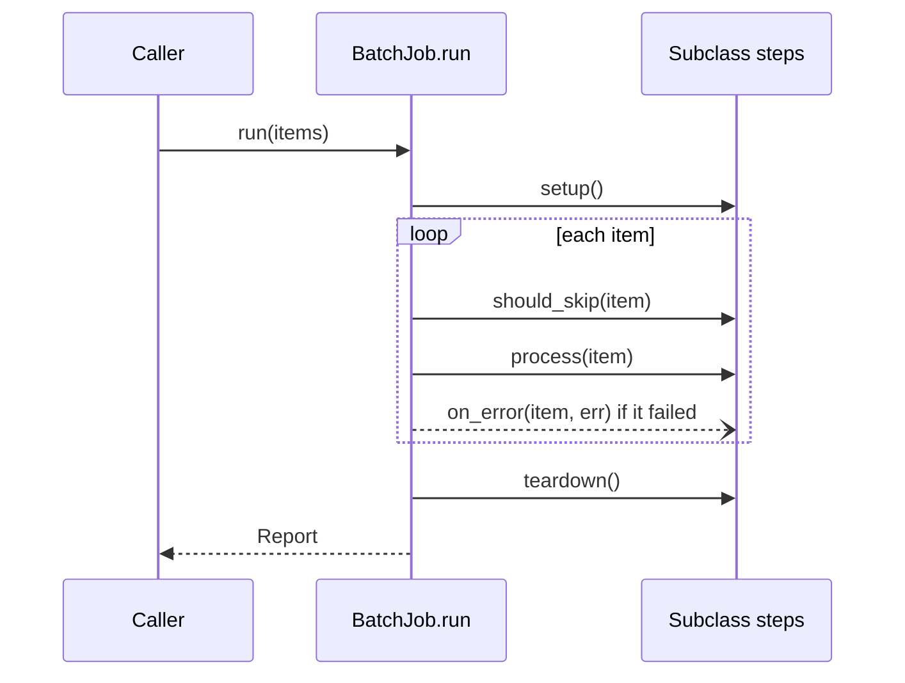

## In one minute
- Template Method puts the fixed outline of an algorithm in one method of a base class and leaves named steps for subclasses to fill in. The base class calls the subclass, not the other way round: "don't call us, we'll call you".
- Steps come in two kinds: *abstract operations* that every subclass must provide, and *hooks* with a sensible default (often doing nothing) that a subclass may override.
- Its real value is invariants. The skeleton is where "teardown always runs after a successful setup", "the lock is released", and "the request is logged" live, so no subclass can forget them.
- It couples through inheritance, so it fits frameworks that own the control flow (test runners, request handlers, collection base classes). In application code, Strategy or plain function parameters give the same variation with less coupling. Go has no inheritance at all and expresses it as a function over an interface.
- Agents copy a 40-line `run()` into each new job class and tweak two lines. Review asks for one skeleton with named steps, and checks that the steps cannot skip the invariants.

## How it works

### The problem
A data platform runs nightly batch jobs: import invoices, recompute loyalty points, expire coupons. Each job class was written by a different engineer, and each has its own `run()`: open a database connection, loop over items, handle errors, close the connection, write a summary. They drifted. The coupon job closes its connection only on success, so a failure leaks it. The invoice job swallows every error. The loyalty job counts skipped items as processed. Every new job copies one of the three and inherits its bugs.

The jobs differ in two or three places: how an item is processed, which items are skipped, and whether one bad item stops the run. Everything else, the order of steps, the error accounting, the guarantee that cleanup happens, should be written once.

### The skeleton and its steps
Template Method moves the outline into a base class method and turns each varying part into a named method call:

```python
class BatchJob:
    def run(self, items):            # the template method
        self.setup()
        try:
            for item in items:
                if self.should_skip(item):    # hook, default False
                    continue
                self.process(item)            # abstract step
        finally:
            self.teardown()                   # hook, default no-op

    def should_skip(self, item): return False
    def setup(self): pass
    def teardown(self): pass
```

A coupon job now overrides `process` and perhaps `should_skip`, and nothing else. It cannot leak the connection, because it never writes the `finally`. Mark the template method so subclasses do not override it: `final` in Java, a non-virtual function in C++, `typing.final` in Python (enforced by type checkers, not at runtime).

### Hooks versus abstract steps
Abstract steps are the parts with no sensible default; leaving one out should fail loudly, when the subclass is instantiated (`abc.abstractmethod`) or at compile time. Hooks are extension points with a safe default, so most subclasses ignore them. Keep the number of steps small. A skeleton with twelve hooks is a framework nobody can reason about, because every subclass is a different program. Name hooks for *when* they run (`before_item`, `on_error`) and document whether their return value changes control flow.

### Where you already use it
- **Python's `unittest`.** `TestCase.run` calls `setUp`, then the test method, then `tearDown` only if `setUp` succeeded, then `doCleanups` regardless. Each test class overrides steps and never writes the sequence.
- **Python's `socketserver`.** `BaseRequestHandler.__init__` calls `setup()`, then `handle()` inside a `try`, with `finish()` in the `finally`.
- **Java collections.** `AbstractList` asks a subclass for `get(int)` and `size()` and builds iteration, `indexOf`, `contains`, `equals` and `hashCode` on top.
- **Servlets.** `HttpServlet.service()` reads the method and dispatches to `doGet`, `doPost` and the rest, which subclasses override.
- **Go's `sort.Sort`.** The skeleton is the sorting algorithm; the steps are `Len`, `Less` and `Swap` from `sort.Interface`. There is no base class, only a function over an interface.

### The composition version
Template Method and Strategy solve the same problem with different tools (see Strategy). Template Method varies steps by subclassing; Strategy passes the varying part in as an object. Spring's `JdbcTemplate` is named after the pattern but uses callbacks: the template owns connection, statement and exception translation, and you pass a `RowMapper`. Callbacks let one class combine steps from different sources and change them at runtime; inheritance gives one fixed combination per subclass. The rule of thumb: inheritance when a framework owns the lifecycle and steps share state on `self`; composition everywhere else.

### Go: embedding is not inheritance
Engineers from Java often try this in Go: a `BaseJob` struct with a `Run` method that calls `j.Process(item)`, embedded in `CouponJob`, which defines its own `Process`. It compiles, and `Run` calls `BaseJob.Process`, not `CouponJob.Process`, because a promoted method's receiver is the embedded value and Go has no virtual dispatch on structs. The idiomatic version is a function `Run(job Steps, items)` that takes an interface for the required steps. Optional hooks become small extra interfaces checked with a type assertion, the same trick `io.Copy` uses when it checks for `WriterTo` and `ReaderFrom`.

### Reviewing agent-written code
Asked to "add a job that expires coupons", an agent will usually find the nearest job, copy its whole class, and change the body of the loop. The diff looks small and the bug surface doubles. When a base class exists, agents also override the template method itself to "add one thing", which silently drops the invariants. Point the agent at the skeleton, list the steps it may override, and in review check three things: the template method is not overridden; subclasses do not call each other's steps out of order; and the skeleton's guarantees (cleanup, accounting, error policy) are covered by tests written against the base class with a fake subclass.

### The same shape elsewhere
Template Method is *multi-step consistency* inside one process: a fixed sequence where some steps must always run once others have. The same shape governs a database transaction (begin, work, then exactly one of commit or rollback), a CI pipeline (checkout, build, test, then upload artifacts and report status even on failure), and Kubernetes pod lifecycle hooks (`postStart` and `preStop` around a container the platform runs). In every case the platform owns the order and the user supplies the middle.

## Down the stack

### Layer 1: The contract
The template method promises an order and a set of guarantees: which steps run, in what sequence, which run on failure, and what happens to errors. For the batch job: `setup` runs first; if it fails, nothing else runs and the run is reported as aborted; once it succeeds, `teardown` runs exactly once whatever happens; each item is skipped, processed or failed, never two of these. Subclasses promise that each step does only its own job and does not call the template method again (re-entrancy is usually unsupported). Hooks promise that their defaults preserve the base behaviour, so a subclass that overrides nothing still behaves correctly.

### Layer 2: The mechanism
In class-based languages the skeleton calls steps through virtual dispatch. In C++ and Java, each object carries a pointer to its class's virtual method table, and `this->process(item)` loads the function pointer from a fixed slot. Herb Sutter's non-virtual interface idiom makes this explicit: the public method is non-virtual and owns the invariants, the customisation points are private virtual functions. Python looks steps up through the class's method resolution order on each call (`type(self).__mro__`), cached per type with a version tag that is invalidated when a class is modified. Java's `AbstractList` shows the cost of a poor primitive choice: its iterator calls `get(i)` per element, which is O(1) for an array but O(n) for a linked structure, so `AbstractSequentialList` exists to flip the primitive to a `listIterator`.

Go's mechanism is the interface: `sort.Sort(data)` calls `data.Less(i, j)` and `data.Swap(i, j)` through the itab, about n log n times each. The generic `slices.Sort` takes the same skeleton and lets the compiler specialise comparisons for the element type, which removes those interface calls; since Go 1.22, `sort.Ints` and friends call into `slices.Sort` for that reason.

### Layer 3: The machine
A virtual call costs a dependent load of the vtable pointer, a load of the function pointer, and an indirect branch: around 1 to 3 ns when predicted, and 10 to 20 ns when the predictor misses. The bigger cost is lost inlining. If `less` is a two-instruction integer compare, calling it indirectly 20 million times while sorting a million items adds tens of milliseconds and blocks vectorisation. JITs recover this: HotSpot uses class hierarchy analysis and call-site profiles to inline a step when only one subclass is loaded or seen, guarded by a cheap type check, and deoptimises if a new subclass appears. C++ compilers devirtualise when the class or method is marked `final`. In CPython, a method call on `self` costs roughly 50 to 100 ns, so a step called per item in a million-item batch adds a fraction of a second, which matters only when the step itself is trivial.

The skeleton is also where resource lifetime is enforced at the machine level. The `finally` that calls `teardown` is what closes the file descriptor or returns the pooled connection. A job that leaks one connection per failed run exhausts a pool of 20 after 20 failures, a common way that "the batch is down" turns into "the API is down" when both share a database.

### Why it's built this way
1. Many tasks share an outline and differ in a few steps, and copies of the outline drift.
2. The outline holds invariants (cleanup, accounting, ordering) that must hold for every variant, so it should exist once and not be overridable.
3. The varying steps must be called *by* the outline, so the outline needs an indirect call: a virtual method, an interface, or a callback.
4. Inheritance makes those calls cheap to write when the framework owns the object's lifecycle, which is why frameworks use it.
5. Inheritance also couples subclass to base and fixes the combination at class definition, so outside frameworks the same idea is expressed with composition.

## Diagram


## Worked example
A payments company had 31 nightly jobs, each with its own copy of the run loop. An outage review found that 9 of them closed their database connection only on success. On the night a schema migration made 7 of those jobs fail, they leaked 7 connections each on retry (5 retries, 35 connections), exhausting the 40-connection pool the jobs shared with the merchant dashboard API, which returned errors for 26 minutes.

The fix introduced a `BatchJob` base class whose `run` is final and owns setup, teardown in a `finally`, error policy and a structured report (processed, skipped, failed, aborted). The 31 jobs were migrated over three weeks: on average each lost 38 lines and kept 12, the code that actually differed. A test suite for the base class uses a recording subclass to assert the order of calls, including "setup fails, teardown not called" and "process raises, teardown still called". Connection leaks from batch jobs have not recurred, and the dashboard and batch pools were split as defence in depth.

The overhead of the extra method calls was measured on the largest job, 4.2 million items: about 0.4 s of a 38-minute run, under 0.02%.

## Trade-offs
| Option | Strengths | Weaknesses | Choose when |
| --- | --- | --- | --- |
| Copy the loop per job | No abstraction to learn | Invariants drift; bugs multiply | One job, or truly different outlines |
| Template Method (base class) | Invariants written once; steps share state on `self` | Inheritance coupling; one combination per subclass | A framework owns the lifecycle |
| Strategy or callbacks | Steps mix and change at runtime; easy to test alone | More wiring; steps cannot share `self` state | Application code; several independent variation points |
| Function over an interface (Go) | No inheritance; optional hooks by type assertion | Hooks less discoverable | Go, or any language favouring composition |
| Context manager or `defer` | Lightweight lifecycle for one resource | Covers setup and cleanup, not a multi-step outline | Only the "always clean up" part is needed |

## Pitfalls in production
- Subclasses overriding the template method to add one line, which drops the base invariants. Fix: mark it final (or `typing.final`), and add the needed extension point as a hook.
- The "call super" trap, where a subclass overrides `setup` and forgets to call the base `setup`. Fix: give the base class its own private setup that always runs, and a separate empty hook for subclasses.
- Too many hooks, so each subclass is effectively a different algorithm. Fix: split the base class by purpose, or move independent variations into strategies.
- A step that calls back into the template method, causing recursion or double cleanup. Fix: document steps as non-re-entrant and guard with a state flag.
- Deep hierarchies (`BaseJob`, `DbJob`, `PaymentsDbJob`, `NightlyPaymentsDbJob`), where nobody knows which override wins. Fix: keep one level of template, compose the rest.
- Go structs that embed a base and expect virtual dispatch, so the base's step runs instead of the outer one. Fix: a skeleton function over an interface.

## Leadership lens
- Ask what the invariants are before approving a base class. A template method earns its place by guaranteeing something (cleanup, auditing, error accounting) that copies got wrong.
- Own the skeleton as a platform: one team maintains the base class, its tests and its changelog; job authors own only steps. Changing the skeleton is a change to every job and gets reviewed that way.
- Prefer composition for new application code and reserve inheritance for framework boundaries; this keeps the codebase testable and the hierarchy shallow.
- Give agents the skeleton as the rule: "new job = subclass `BatchJob`, override `process` and at most these hooks". It turns a copy-paste change into a small, reviewable one.

## Check yourself
1. Why does `unittest` skip `tearDown` when `setUp` raises, but still run cleanups registered with `addCleanup`?
   **Answer:** `tearDown` may assume everything `setUp` created exists, so running it after a partial setup can fail confusingly; cleanups are registered as each resource is created, so they release exactly what was acquired.
2. In Go, a `BaseJob` with method `Run` calling `b.Process()` is embedded in `CouponJob`, which defines `Process`. Which `Process` runs, and how do you fix the design?
   **Answer:** `BaseJob.Process`, because promoted methods have the embedded value as receiver and structs have no virtual dispatch. Write `Run(job Steps, items)` as a function over an interface that `CouponJob` implements.
3. When would you replace a template method with Strategy?
   **Answer:** When variations are independent and should be mixed (for example skip policy and error policy chosen separately), changed at runtime, or tested alone; inheritance gives one fixed combination per subclass.
4. Why can a JIT make a template method's step calls nearly free while CPython cannot?
   **Answer:** The JIT sees which subclass actually reaches a call site and inlines that method behind a type guard; CPython looks up and calls the method dynamically each time.

## Practice
**Task:** Implement a batch-job skeleton with the Template Method pattern. `run(items)` returns a report with `processed`, `skipped`, `failed` (the items whose processing raised, in order) and `aborted`. It calls `setup()`; if setup fails it returns an aborted report with zero counts and calls nothing else. Otherwise, for each item: if `should_skip(item)` is true, count it as skipped; else call `process(item)` and count it as processed if it succeeds; if it fails, record the item as failed and call `on_error(item, err)`, which returns whether to continue; if it returns false, mark the run aborted and stop. `teardown()` then runs exactly once whenever setup succeeded. Defaults: `setup` and `teardown` do nothing, `should_skip` returns false, `on_error` returns false. Also write `SumJob`, which resets `total` to 0 in setup, skips items that are empty after trimming spaces, adds each item parsed as a base-10 integer (an optional leading `-` and digits only; anything else fails), and continues after errors. In Python and TypeScript subclass `BatchJob`; in Go, `Run(job, items)` takes a `Steps` interface and checks for the optional `Skipper` and `ErrorHandler` interfaces.

```python starter
from dataclasses import dataclass, field


@dataclass
class Report:
    processed: int = 0
    skipped: int = 0
    failed: list = field(default_factory=list)
    aborted: bool = False


class BatchJob:
    def run(self, items):
        # TODO: the template method
        raise NotImplementedError

    def setup(self):
        pass

    def process(self, item):
        raise NotImplementedError

    def teardown(self):
        pass

    def should_skip(self, item):
        return False

    def on_error(self, item, err):
        return False


class SumJob(BatchJob):
    def __init__(self):
        self.total = 0
    # TODO: override the steps
```

```python tests
class Recorder(BatchJob):
    def __init__(self, fail_on=(), fail_setup=False):
        self.log = []
        self.fail_on = fail_on
        self.fail_setup = fail_setup

    def setup(self):
        self.log.append("setup")
        if self.fail_setup:
            raise RuntimeError("no db")

    def process(self, item):
        if item in self.fail_on:
            raise ValueError("boom")
        self.log.append("process:" + item)

    def teardown(self):
        self.log.append("teardown")


class Lenient(Recorder):
    def should_skip(self, item):
        return item.startswith("#")

    def on_error(self, item, err):
        self.log.append("error:" + item + ":" + str(err))
        return True


def test_sum_job():
    j = SumJob()
    r = j.run(["1", "2", "  ", "x", "-4", "10"])
    assert r == Report(4, 1, ["x"], False)
    assert j.total == 9

def test_default_hooks_abort_and_still_tear_down():
    j = Recorder(fail_on=("b",))
    r = j.run(["a", "b", "c"])
    assert r == Report(1, 0, ["b"], True)
    assert j.log == ["setup", "process:a", "teardown"]

def test_setup_failure_runs_nothing_else():
    j = Recorder(fail_setup=True)
    r = j.run(["a"])
    assert r == Report(0, 0, [], True)
    assert j.log == ["setup"]

def test_empty_items():
    j = Recorder()
    assert j.run([]) == Report(0, 0, [], False)
    assert j.log == ["setup", "teardown"]

def test_hooks_skip_and_continue():
    j = Lenient(fail_on=("b", "d"))
    r = j.run(["a", "#c", "b", "d", "e"])
    assert r == Report(2, 1, ["b", "d"], False)
    assert j.log == ["setup", "process:a", "error:b:boom", "error:d:boom", "process:e", "teardown"]

def test_sum_job_resets_between_runs():
    j = SumJob()
    j.run(["5"])
    r = j.run(["7", "1.5", "+3"])
    assert j.total == 7 and r.failed == ["1.5", "+3"]
```

```python solution
from dataclasses import dataclass, field


@dataclass
class Report:
    processed: int = 0
    skipped: int = 0
    failed: list = field(default_factory=list)
    aborted: bool = False


class BatchJob:
    def run(self, items):
        report = Report()
        try:
            self.setup()
        except Exception:
            report.aborted = True
            return report
        try:
            for item in items:
                if self.should_skip(item):
                    report.skipped += 1
                    continue
                try:
                    self.process(item)
                except Exception as err:
                    report.failed.append(item)
                    if not self.on_error(item, err):
                        report.aborted = True
                        break
                else:
                    report.processed += 1
        finally:
            self.teardown()
        return report

    def setup(self):
        pass

    def process(self, item):
        raise NotImplementedError

    def teardown(self):
        pass

    def should_skip(self, item):
        return False

    def on_error(self, item, err):
        return False


def parse_int(s):
    digits = s[1:] if s.startswith("-") else s
    if digits == "" or not all(c in "0123456789" for c in digits):
        raise ValueError("not an integer: " + s)
    return int(s)


class SumJob(BatchJob):
    def __init__(self):
        self.total = 0

    def setup(self):
        self.total = 0

    def should_skip(self, item):
        return item.strip(" ") == ""

    def process(self, item):
        self.total += parse_int(item)

    def on_error(self, item, err):
        return True
```

```typescript starter
export interface Report {
  processed: number;
  skipped: number;
  failed: string[];
  aborted: boolean;
}

export abstract class BatchJob {
  run(items: string[]): Report { throw new Error("TODO"); }
  setup(): void {}
  abstract process(item: string): void;
  teardown(): void {}
  shouldSkip(item: string): boolean { return false; }
  onError(item: string, err: unknown): boolean { return false; }
}

export class SumJob extends BatchJob {
  total = 0;
  process(item: string): void { throw new Error("TODO"); }
}
```

```typescript tests
class Recorder extends BatchJob {
  log: string[] = [];
  constructor(public failOn: string[] = [], public failSetup = false) { super(); }
  setup(): void {
    this.log.push("setup");
    if (this.failSetup) throw new Error("no db");
  }
  process(item: string): void {
    if (this.failOn.includes(item)) throw new Error("boom");
    this.log.push("process:" + item);
  }
  teardown(): void { this.log.push("teardown"); }
}

class Lenient extends Recorder {
  shouldSkip(item: string): boolean { return item.startsWith("#"); }
  onError(item: string, err: unknown): boolean {
    this.log.push("error:" + item + ":" + (err as Error).message);
    return true;
  }
}

function rep(processed: number, skipped: number, failed: string[], aborted: boolean): Report {
  return { processed, skipped, failed, aborted };
}

test("sum job", () => {
  const j = new SumJob();
  assertEqual(j.run(["1", "2", "  ", "x", "-4", "10"]), rep(4, 1, ["x"], false));
  assertEqual(j.total, 9);
});

test("default hooks abort and still tear down", () => {
  const j = new Recorder(["b"]);
  assertEqual(j.run(["a", "b", "c"]), rep(1, 0, ["b"], true));
  assertEqual(j.log, ["setup", "process:a", "teardown"]);
});

test("setup failure runs nothing else", () => {
  const j = new Recorder([], true);
  assertEqual(j.run(["a"]), rep(0, 0, [], true));
  assertEqual(j.log, ["setup"]);
});

test("empty items", () => {
  const j = new Recorder();
  assertEqual(j.run([]), rep(0, 0, [], false));
  assertEqual(j.log, ["setup", "teardown"]);
});

test("hooks skip and continue", () => {
  const j = new Lenient(["b", "d"]);
  assertEqual(j.run(["a", "#c", "b", "d", "e"]), rep(2, 1, ["b", "d"], false));
  assertEqual(j.log, ["setup", "process:a", "error:b:boom", "error:d:boom", "process:e", "teardown"]);
});

test("sum job resets between runs", () => {
  const j = new SumJob();
  j.run(["5"]);
  const r = j.run(["7", "1.5", "+3"]);
  assertEqual(j.total, 7);
  assertEqual(r.failed, ["1.5", "+3"]);
});
```

```typescript solution
export interface Report {
  processed: number;
  skipped: number;
  failed: string[];
  aborted: boolean;
}

export abstract class BatchJob {
  run(items: string[]): Report {
    const report: Report = { processed: 0, skipped: 0, failed: [], aborted: false };
    try {
      this.setup();
    } catch {
      report.aborted = true;
      return report;
    }
    try {
      for (const item of items) {
        if (this.shouldSkip(item)) {
          report.skipped++;
          continue;
        }
        try {
          this.process(item);
          report.processed++;
        } catch (err) {
          report.failed.push(item);
          if (!this.onError(item, err)) {
            report.aborted = true;
            break;
          }
        }
      }
    } finally {
      this.teardown();
    }
    return report;
  }

  setup(): void {}
  abstract process(item: string): void;
  teardown(): void {}
  shouldSkip(item: string): boolean { return false; }
  onError(item: string, err: unknown): boolean { return false; }
}

export class SumJob extends BatchJob {
  total = 0;
  setup(): void { this.total = 0; }
  shouldSkip(item: string): boolean { return item.replace(/ /g, "") === ""; }
  process(item: string): void {
    if (!/^-?[0-9]+$/.test(item)) throw new Error("not an integer: " + item);
    this.total += parseInt(item, 10);
  }
  onError(item: string, err: unknown): boolean { return true; }
}
```

```go starter
package practice

type Report struct {
	Processed int
	Skipped   int
	Failed    []string
	Aborted   bool
}

// Steps are required; Skipper and ErrorHandler are optional hooks.
type Steps interface {
	Setup() error
	Process(item string) error
	Teardown()
}

type Skipper interface {
	ShouldSkip(item string) bool
}

type ErrorHandler interface {
	OnError(item string, err error) bool
}

func Run(job Steps, items []string) Report { panic("TODO") }

type SumJob struct {
	Total int
}

func (s *SumJob) Setup() error              { panic("TODO") }
func (s *SumJob) Process(item string) error { panic("TODO") }
func (s *SumJob) Teardown()                 {}
```

```go tests
package practice

import (
	"errors"
	"reflect"
	"strings"
	"testing"
)

type recorder struct {
	log       []string
	failOn    map[string]bool
	failSetup bool
}

func (r *recorder) Setup() error {
	r.log = append(r.log, "setup")
	if r.failSetup {
		return errors.New("no db")
	}
	return nil
}

func (r *recorder) Process(item string) error {
	if r.failOn[item] {
		return errors.New("boom")
	}
	r.log = append(r.log, "process:"+item)
	return nil
}

func (r *recorder) Teardown() { r.log = append(r.log, "teardown") }

type lenient struct{ *recorder }

func (l lenient) ShouldSkip(item string) bool { return strings.HasPrefix(item, "#") }
func (l lenient) OnError(item string, err error) bool {
	l.log = append(l.log, "error:"+item+":"+err.Error())
	return true
}

func sameReport(t *testing.T, got Report, processed, skipped int, failed []string, aborted bool) {
	t.Helper()
	if got.Processed != processed || got.Skipped != skipped || got.Aborted != aborted ||
		len(got.Failed) != len(failed) || (len(failed) > 0 && !reflect.DeepEqual(got.Failed, failed)) {
		t.Fatalf("got %+v", got)
	}
}

func sameLog(t *testing.T, got, want []string) {
	t.Helper()
	if !reflect.DeepEqual(got, want) {
		t.Fatalf("want %q, got %q", want, got)
	}
}

func TestSumJob(t *testing.T) {
	j := &SumJob{}
	sameReport(t, Run(j, []string{"1", "2", "  ", "x", "-4", "10"}), 4, 1, []string{"x"}, false)
	if j.Total != 9 {
		t.Fatalf("total %d", j.Total)
	}
}

func TestDefaultHooksAbortAndStillTearDown(t *testing.T) {
	j := &recorder{failOn: map[string]bool{"b": true}}
	sameReport(t, Run(j, []string{"a", "b", "c"}), 1, 0, []string{"b"}, true)
	sameLog(t, j.log, []string{"setup", "process:a", "teardown"})
}

func TestSetupFailureRunsNothingElse(t *testing.T) {
	j := &recorder{failSetup: true}
	sameReport(t, Run(j, []string{"a"}), 0, 0, nil, true)
	sameLog(t, j.log, []string{"setup"})
}

func TestEmptyItems(t *testing.T) {
	j := &recorder{}
	sameReport(t, Run(j, nil), 0, 0, nil, false)
	sameLog(t, j.log, []string{"setup", "teardown"})
}

func TestHooksSkipAndContinue(t *testing.T) {
	r := &recorder{failOn: map[string]bool{"b": true, "d": true}}
	sameReport(t, Run(lenient{r}, []string{"a", "#c", "b", "d", "e"}), 2, 1, []string{"b", "d"}, false)
	sameLog(t, r.log, []string{"setup", "process:a", "error:b:boom", "error:d:boom", "process:e", "teardown"})
}

func TestSumJobResetsBetweenRuns(t *testing.T) {
	j := &SumJob{}
	Run(j, []string{"5"})
	r := Run(j, []string{"7", "1.5", "+3"})
	if j.Total != 7 {
		t.Fatalf("total %d", j.Total)
	}
	sameReport(t, r, 1, 0, []string{"1.5", "+3"}, false)
}
```

```go solution
package practice

import (
	"errors"
	"strconv"
	"strings"
)

type Report struct {
	Processed int
	Skipped   int
	Failed    []string
	Aborted   bool
}

// Steps are required; Skipper and ErrorHandler are optional hooks.
type Steps interface {
	Setup() error
	Process(item string) error
	Teardown()
}

type Skipper interface {
	ShouldSkip(item string) bool
}

type ErrorHandler interface {
	OnError(item string, err error) bool
}

func Run(job Steps, items []string) Report {
	var r Report
	if err := job.Setup(); err != nil {
		r.Aborted = true
		return r
	}
	defer job.Teardown()
	skipper, _ := job.(Skipper)
	handler, _ := job.(ErrorHandler)
	for _, item := range items {
		if skipper != nil && skipper.ShouldSkip(item) {
			r.Skipped++
			continue
		}
		if err := job.Process(item); err != nil {
			r.Failed = append(r.Failed, item)
			if handler == nil || !handler.OnError(item, err) {
				r.Aborted = true
				break
			}
			continue
		}
		r.Processed++
	}
	return r
}

type SumJob struct {
	Total int
}

func (s *SumJob) Setup() error {
	s.Total = 0
	return nil
}

func (s *SumJob) Process(item string) error {
	digits := strings.TrimPrefix(item, "-")
	if digits == "" || strings.Trim(digits, "0123456789") != "" {
		return errors.New("not an integer: " + item)
	}
	n, err := strconv.Atoi(item)
	if err != nil {
		return err
	}
	s.Total += n
	return nil
}

func (s *SumJob) Teardown() {}

func (s *SumJob) ShouldSkip(item string) bool { return strings.Trim(item, " ") == "" }

func (s *SumJob) OnError(item string, err error) bool { return true }
```

## Mock interview
**Prompt:** Your company runs 200 data pipelines written by 15 teams. Each extracts from a source, validates, transforms and loads into a warehouse, and each team wrote its own runner. Incidents show missing retries, partial loads left behind on failure, and inconsistent metrics. Design a common pipeline framework that teams adopt within a quarter.

- Follow-up: One team needs a custom step between validate and transform. How does the framework allow that without forking?
- Follow-up: A load fails halfway through 50 million rows. What does the skeleton guarantee, and how?
- Follow-up: Would you build this on inheritance or on composition, and why?

**A strong answer covers:**
- A fixed skeleton owned by the platform (extract, validate, transform, load, then commit or clean up) with metrics, retries and a run report written once.
- A small set of required steps and a few named hooks (`before_load`, `on_bad_record`) with safe defaults, rather than dozens of overridable methods.
- Failure guarantees in the skeleton: staging tables or write-then-swap so a partial load is never visible, and cleanup that always runs after a successful start.
- A reasoned choice between subclassing and composition: composition (steps as objects or functions) for mixing policies across teams, inheritance only if the framework owns object lifecycle.
- A migration path: wrap existing runners as a single step first, then split them, with contract tests that every pipeline passes.

## Watch
- [Template Method Pattern, Design Patterns ep 13 (Christopher Okhravi)](https://www.youtube.com/watch?v=7ocpwK9uesw): the pattern on a whiteboard, including hooks and its relation to Strategy.
- [Template Method Design Pattern (Derek Banas)](https://www.youtube.com/watch?v=aR1B8MlwbRI): a short Java implementation with a hook method.

## Free resources
- [Template Method (Refactoring.Guru)](https://refactoring.guru/design-patterns/template-method): the structure, hooks, and comparison with Strategy and Factory Method.
- [Virtuality (Herb Sutter)](http://www.gotw.ca/publications/mill18.htm): the non-virtual interface idiom and why customisation points should be private.
- [Call Super (Martin Fowler)](https://martinfowler.com/bliki/CallSuper.html): why requiring subclasses to call the parent method is fragile, and the template method alternative.
- [unittest (Python docs)](https://docs.python.org/3/library/unittest.html): `setUp`, `tearDown` and `addCleanup` as a template method you use every day.
- [sort package source (Go)](https://go.dev/src/sort/sort.go): a skeleton algorithm calling steps through `sort.Interface`, with no inheritance.
