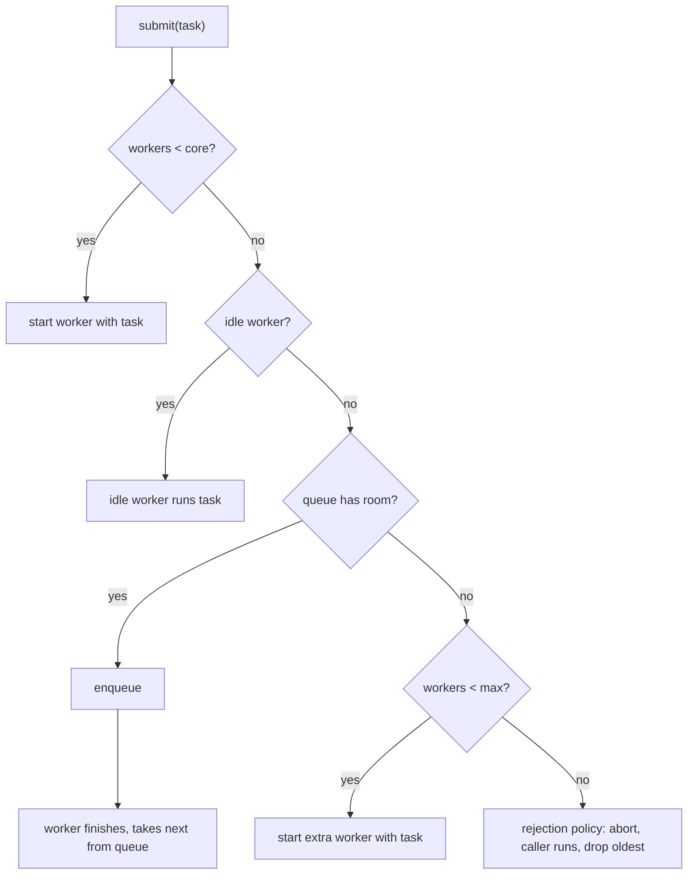

## In one minute
- A thread pool keeps a fixed or bounded set of worker threads alive and feeds them tasks through a queue, so a program pays thread creation once and caps how many things run at the same time.
- Its real job is admission control: it decides what happens when work arrives faster than it can be done. The answer is some mix of queueing, growing the pool, running the task on the caller, or rejecting it.
- Size it from the work: about one thread per core for CPU-bound tasks, more for tasks that block on I/O (cores × (1 + wait time / compute time)), and always with a bounded queue.
- The classic bugs are an unbounded queue that hides overload until memory runs out, a task that waits on another task in the same pool (starvation deadlock), and exceptions that disappear inside futures.
- Java's `ThreadPoolExecutor` grows past its core size only after the queue is full, which surprises almost everyone. Read the admission rules of whatever pool you use before tuning it.

## How it works

### The problem
An image service resizes uploads. The first version starts a new thread per request. At 50 requests per second this works. During a marketing push traffic hits 2,000 per second, the process creates 2,000 threads, each with its own stack, the CPU spends its time switching between them, latency climbs for everyone, and finally thread creation fails with "unable to create native thread". The server did not run out of CPU; it ran out of a way to say "not now".

A thread pool fixes both halves. Threads are created once and reused, so the per-task cost of creating one (tens of microseconds plus stack memory) disappears. And the pool size is a hard limit on concurrency: with 16 workers, at most 16 resizes run at once, and everything else waits in a queue or is turned away.

### The parts
Every pool has the same four pieces:

- **Workers:** long-lived threads that loop forever, taking a task from the queue and running it.
- **Work queue:** a thread-safe queue between submitters and workers. Workers block on it when it is empty.
- **Admission policy:** what `submit` does when all workers are busy and the queue is full.
- **Lifecycle:** how workers start, how idle extra workers are retired, and how shutdown drains or abandons queued work.

A worker's loop is short:

```python
def worker_loop(queue):
    while True:
        task = queue.take()          # blocks while empty
        if task is SHUTDOWN:
            return
        try:
            task.run()
        except Exception as e:
            task.fail(e)             # never let one task kill the worker
```

The queue is the producer-consumer pattern (see [Producer Consumer Pattern](producer-consumer.md)); the pool is that pattern plus a lifecycle and a policy for overload.

### Java's admission rules, the canonical example
`ThreadPoolExecutor` takes a core size, a maximum size, a queue and a keep-alive time. On `execute(task)` it does exactly this:

1. If fewer than `corePoolSize` threads exist, start a new thread with this task, even if other threads are idle.
2. Otherwise, try to put the task in the queue. If it fits, done; an idle worker will take it.
3. If the queue is full and fewer than `maximumPoolSize` threads exist, start a new thread with this task.
4. Otherwise, call the `RejectedExecutionHandler`.

Two consequences matter. First, with an unbounded queue (which `Executors.newFixedThreadPool` uses), step 2 never fails, so the pool never grows beyond core and never rejects; overload turns into an ever-longer queue and rising memory. Second, with a bounded queue, a burst first fills the queue and only then adds threads, so the tasks that arrive last may run before tasks queued earlier. Threads above the core count that stay idle for `keepAliveTime` are retired.

The four built-in rejection handlers are the menu of overload policies: `AbortPolicy` throws, `CallerRunsPolicy` runs the task on the submitting thread (which slows the submitter down, a crude but effective form of backpressure), `DiscardPolicy` silently drops it, and `DiscardOldestPolicy` drops the oldest queued task and retries. Silently dropping is almost never what you want.

### Sizing
For CPU-bound work, more threads than cores only adds context switches; use about the number of cores. For work that blocks, a thread that spends 90 ms waiting on a database for every 10 ms of CPU leaves the core free most of the time, so the rough rule is `cores × (1 + wait / compute)`: 8 × (1 + 9) = 80 threads. Little's law gives the same answer from the outside: to sustain 800 requests per second at 100 ms each, you need 80 in flight. Then check the downstream: 80 threads that each hold a database connection need a connection pool of at least 80, and the database must be able to take it. The pool is usually the cheapest place to enforce the limit of the slowest dependency.

### Separate pools for separate work
One pool for everything means a slow dependency can take every worker, and then fast, unrelated requests wait behind it. Giving each dependency or workload its own pool is the bulkhead pattern (see [Bulkhead Pattern](../sd/bulkhead-pattern.md)). Node.js does a version of this internally: libuv runs file system calls, `dns.lookup`, some crypto and zlib on a thread pool of 4 by default, separate from the event loop, and a burst of slow DNS lookups can delay unrelated file reads because they share those 4 threads.

### Work stealing
A single shared queue becomes a point of contention when tasks are tiny. Work-stealing pools give each worker its own double-ended queue: a worker pushes and pops its own tasks at one end, and an idle worker steals from the other end of someone else's. Java's `ForkJoinPool`, Go's runtime scheduler and Tokio's multi-threaded runtime all work this way. It suits recursive, fine-grained tasks; for coarse request handling a shared queue is simpler and fair.

### Reviewing agent-written code
Agents tend to create a new executor inside a function that is called per request (`with ThreadPoolExecutor() as ex:` in a handler), which recreates threads on every call and defeats the pool. They also call `future.result()` from inside a task running on the same pool, which deadlocks once all workers are doing it. Ask for one pool per workload, created at startup and injected, with a bounded queue, an explicit rejection policy, named threads, and every future's exception either awaited or logged.

### The same shape elsewhere
A thread pool is a limited set of servers in front of a queue, the *overload* shape. A database connection pool, a Kubernetes cluster with a fixed number of nodes, a call centre with 20 agents and a hold queue, and an AWS Lambda concurrency limit all have the same three knobs (how many servers, how long a queue, what to do when both are full) and the same failure: an unbounded queue turns a brief overload into minutes of latency.

## Down the stack

### Layer 1: The contract
A pool promises: every accepted task runs exactly once on some worker; no more than `max` tasks run concurrently; a rejected task is reported to the submitter (by exception, return value, or running it on the caller), never lost without a signal unless the policy says so; a task's exception is delivered to its future and does not kill the worker; after `shutdown`, no new tasks are accepted and queued ones either run or are returned. It does not promise ordering between tasks, and under Java's rules not even FIFO order of submission.

### Layer 2: The mechanism
`ThreadPoolExecutor` packs the run state and the worker count into one `AtomicInteger` called `ctl` (3 bits of state, 29 bits of count) so that "check count and add a worker" is one compare-and-set. Each `Worker` is a small lock around a thread; `getTask()` calls `queue.poll(keepAliveTime)` when the pool has more than core threads and `queue.take()` otherwise, which is how idle extra threads time out. Python's `ThreadPoolExecutor` uses an unbounded `SimpleQueue` and starts threads lazily up to `max_workers`, which defaults to `min(32, CPU count + 4)` in recent versions. Go has no pool in the standard library because goroutines are cheap; the idiom is a fixed number of goroutines ranging over a channel, or a semaphore (a buffered channel or `errgroup.SetLimit`) to cap concurrency. Go's scheduler itself is a work-stealing pool: each P has a local run queue of 256 goroutines plus a global queue, and an idle P steals half of another P's queue.

### Layer 3: The machine
On Linux, `pthread_create` is a `clone()` call with flags such as `CLONE_VM | CLONE_FILES | CLONE_THREAD`, plus an `mmap` for the stack: 8 MB of virtual address space by default for C threads, 1 MB for Java threads unless `-Xss` says otherwise. Physical memory is touched lazily, but each thread still costs kernel structures and tens of microseconds to create and join. A context switch between threads costs roughly 1 to 5 us directly, and more indirectly when the incoming thread finds the caches cold. When a worker blocks on an empty queue, the JVM parks it with a `futex` wait; a submit wakes one sleeper with `futex` wake, a syscall of about a microsecond. Hot pools spin briefly before parking to avoid that cost. Java 21 virtual threads change the arithmetic: they are scheduled by the JVM onto a small `ForkJoinPool` of carrier threads, start with a stack of a few hundred bytes, and make pooling threads unnecessary for blocking I/O, though you still need a semaphore to cap concurrency to a downstream.

### Why it's built this way
1. Creating and destroying OS threads costs syscalls, memory and microseconds, so threads are created once and reused.
2. Each running thread competes for cores and caches, and each blocked one holds memory and often a connection, so concurrency must be capped.
3. Work arrives in bursts, so a queue absorbs short spikes instead of rejecting them.
4. A queue without a bound converts long overload into unbounded latency and memory, so the queue is bounded and the pool needs an explicit policy for the overflow.
5. One shared queue becomes contended with tiny tasks, so high-throughput runtimes split it per worker and steal.

## Diagram


## Worked example
A report service renders PDFs. Each render takes 40 ms of CPU and 160 ms waiting on two internal APIs. The hosts have 8 cores. Sizing: 8 × (1 + 160/40) = 40 threads. At 200 ms per task, 40 threads complete 200 renders per second.

The team first deployed `Executors.newFixedThreadPool(40)`. During month-end, traffic rose to 260 per second for 15 minutes. The pool could not grow or reject, so the unbounded queue grew by 60 tasks per second, reaching 54,000 tasks. Queue wait passed 4 minutes, clients timed out after 30 seconds and retried, and the service kept rendering PDFs nobody was waiting for. Heap filled with queued request bodies and the JVM spent most of its time in GC.

The fix was a `ThreadPoolExecutor(40, 40, ..., new ArrayBlockingQueue<>(400), new AbortPolicy())`. A queue of 400 at 200 per second is two seconds of buffering, well inside the client timeout. Excess requests got an immediate 503 with `Retry-After`, the load balancer moved them to other hosts, and month-end latency stayed under 2.5 seconds. They also dropped tasks whose client deadline had already passed when a worker picked them up, which removed a quarter of the wasted work during the next spike.

## Trade-offs
| Option | Strengths | Weaknesses | Choose when |
| --- | --- | --- | --- |
| Thread per task | Simple; no queueing delay | Unbounded threads; collapses under load | Low, predictable task rates only |
| Fixed pool, unbounded queue | Never rejects; easy | Overload becomes memory and latency growth | Batch jobs where waiting is fine |
| Fixed pool, bounded queue, abort | Predictable latency; fast failure | Callers must handle rejection | Request serving behind a load balancer |
| Bounded queue, caller runs | Natural backpressure on producers | Slows the submitting thread, which may be an I/O loop | Internal pipelines where the producer can slow down |
| Work-stealing pool | Low contention for tiny tasks | No global ordering; harder to reason about | Recursive or fine-grained parallel computation |
| Virtual threads plus semaphore | Cheap blocking; no pool sizing for I/O | Still needs explicit caps for downstreams | Blocking I/O workloads on Java 21 or later |

## Pitfalls in production
- Unbounded queues hiding overload until memory or timeouts explode. Fix: bound the queue to a few seconds of throughput and reject or shed beyond it.
- Starvation deadlock: a task submits a subtask to the same pool and waits for it, and when every worker does that, none are left to run subtasks. Fix: separate pools per stage, or make the parent not block.
- Exceptions lost in futures nobody reads. Fix: always await or attach a callback, and set an uncaught exception handler that logs with the thread name.
- Thread-local state (user IDs, transactions, MDC logging context) leaking from one task to the next on a reused thread. Fix: clear it in a `finally`, or pass context explicitly.
- One slow dependency occupying every worker. Fix: per-dependency pools or semaphores, and timeouts on every blocking call.
- Executors created per request or never shut down, leaking threads. Fix: create pools at startup, inject them, and shut them down on exit.

## Leadership lens
- Ask for every pool: what is its size, its queue bound, its rejection policy, and which metric shows saturation (active threads, queue depth, rejections per second, queue wait time).
- Treat pool size as a contract with downstreams; a pool of 80 against a database that allows 50 connections is a design bug, not a tuning problem.
- Prefer failing fast at the edge over queueing deep inside; a 503 that a load balancer can retry elsewhere is cheaper than a 4-minute queue.
- Standardise pool construction in a shared library with sane defaults (bounded, named, instrumented), so teams and coding agents do not reach for the unbounded convenience constructors.
- Revisit the model when the platform changes: virtual threads, async runtimes and serverless concurrency limits each move where the limit should live.

## Check yourself
1. A `ThreadPoolExecutor` has core 10, max 50 and an unbounded `LinkedBlockingQueue`. How many threads will it ever run, and why?
   **Answer:** 10. Extra threads are only started when the queue rejects an offer, and an unbounded queue never does, so the max size is never reached.
2. Why is `cores × (1 + wait/compute)` a starting point and not the answer?
   **Answer:** It ignores downstream limits such as connection pools and the dependency's own capacity, and the wait and compute times change with load; measure queue wait and saturation and adjust.
3. How does `CallerRunsPolicy` create backpressure, and when is it dangerous?
   **Answer:** The submitting thread runs the task itself, so it cannot submit more until that finishes. It is dangerous when the submitter is an event loop or acceptor thread, because the whole server stalls while it runs one task.
4. A pool of 8 threads hangs with all workers in `future.get()`. What happened?
   **Answer:** Each task submitted a subtask to the same pool and blocked on it; with all 8 workers blocked, no worker is free to run the subtasks, so it is a starvation deadlock.

## Practice
**Task:** Model the admission and lifecycle logic of a bounded thread pool without real threads, driven by explicit events and an injected time. `ThreadPool(core, max_workers, queue_cap, policy, keep_alive)` creates workers with ids 1, 2, 3 and so on, never reusing an id. `submit(task, now)` follows these rules in order: if fewer than `core` workers exist, start a new worker running the task and return `"run:<id>"`; else if a worker is idle, the lowest-id idle worker runs it (`"run:<id>"`); else if the queue has fewer than `queue_cap` tasks, enqueue it (`"queued"`); else if fewer than `max_workers` exist, start a new worker (`"run:<id>"`); else apply `policy`: `"abort"` returns `"rejected"`, `"caller_runs"` returns `"caller"`, and `"discard_oldest"` removes the oldest queued task, enqueues the new one and returns `"dropped:<oldest>"`. `finish(worker, now)` ends the worker's current task; the worker takes the head of the queue and returns its name, or becomes idle since `now` and returns nothing (`None`, `undefined`, or `""` in Go). Finishing a worker that does not exist or is not busy is an error `worker not busy: <id>`. `reap(now)` retires idle workers that have been idle for at least `keep_alive`, longest idle first (ties by lower id), but never below `core` workers, and returns the retired ids. `stats()` returns `(workers, busy, queued)`.

```python starter
class ThreadPool:
    def __init__(self, core, max_workers, queue_cap, policy, keep_alive):
        self.core = core

    def submit(self, task, now):
        # TODO
        raise NotImplementedError

    def finish(self, worker, now):
        # TODO
        raise NotImplementedError

    def reap(self, now):
        # TODO
        raise NotImplementedError

    def stats(self):
        # TODO
        raise NotImplementedError
```

```python tests
def error_of(fn):
    try:
        fn()
    except ValueError as e:
        return str(e)
    return None

def test_queue_fills_before_pool_grows():
    p = ThreadPool(2, 4, 2, "abort", 30)
    got = [p.submit(t, 0) for t in "abcdefg"]
    assert got == ["run:1", "run:2", "queued", "queued", "run:3", "run:4", "rejected"]
    assert p.stats() == (4, 4, 2)

def test_finish_takes_from_queue_then_idles():
    p = ThreadPool(2, 4, 2, "abort", 30)
    for t in "abcdef":
        p.submit(t, 0)
    assert p.finish(1, 5) == "c"
    assert p.finish(3, 6) == "d"
    assert p.finish(4, 10) is None
    assert p.stats() == (4, 3, 0)

def test_core_threads_start_even_when_one_is_idle():
    p = ThreadPool(2, 2, 5, "abort", 30)
    assert p.submit("a", 0) == "run:1"
    p.finish(1, 1)
    assert p.submit("b", 2) == "run:2", "below core: new worker"
    p.finish(2, 3)
    assert p.submit("c", 4) == "run:1", "at core: lowest idle worker"

def test_reap_respects_keep_alive_and_core():
    p = ThreadPool(2, 4, 2, "abort", 30)
    for t in "abcdef":
        p.submit(t, 0)
    p.finish(1, 5)
    p.finish(3, 6)
    p.finish(4, 10)
    p.finish(2, 12)
    assert p.reap(35) == []
    assert p.reap(40) == [4]
    assert p.reap(42) == [2]
    assert p.stats() == (2, 2, 0)
    p.finish(1, 50)
    p.finish(3, 50)
    assert p.reap(500) == [], "never below core"

def test_caller_runs_and_discard_oldest():
    p = ThreadPool(1, 1, 1, "caller_runs", 30)
    assert [p.submit(t, 0) for t in "abc"] == ["run:1", "queued", "caller"]
    q = ThreadPool(1, 1, 1, "discard_oldest", 30)
    assert [q.submit(t, 0) for t in "abc"] == ["run:1", "queued", "dropped:b"]
    assert q.finish(1, 1) == "c"

def test_finish_errors():
    p = ThreadPool(1, 1, 1, "abort", 30)
    assert error_of(lambda: p.finish(9, 0)) == "worker not busy: 9"
    p.submit("a", 0)
    p.finish(1, 1)
    assert error_of(lambda: p.finish(1, 2)) == "worker not busy: 1"
```

```python solution
class ThreadPool:
    def __init__(self, core, max_workers, queue_cap, policy, keep_alive):
        self.core = core
        self.max_workers = max_workers
        self.queue_cap = queue_cap
        self.policy = policy
        self.keep_alive = keep_alive
        self.workers = {}      # id -> current task, or None when idle
        self.idle_since = {}   # id -> time it became idle
        self.queue = []
        self.next_id = 1

    def _start(self, task):
        wid = self.next_id
        self.next_id += 1
        self.workers[wid] = task
        return "run:" + str(wid)

    def submit(self, task, now):
        if len(self.workers) < self.core:
            return self._start(task)
        if self.idle_since:
            wid = min(self.idle_since)
            del self.idle_since[wid]
            self.workers[wid] = task
            return "run:" + str(wid)
        if len(self.queue) < self.queue_cap:
            self.queue.append(task)
            return "queued"
        if len(self.workers) < self.max_workers:
            return self._start(task)
        if self.policy == "caller_runs":
            return "caller"
        if self.policy == "discard_oldest" and self.queue:
            oldest = self.queue.pop(0)
            self.queue.append(task)
            return "dropped:" + oldest
        return "rejected"

    def finish(self, worker, now):
        if self.workers.get(worker) is None:
            raise ValueError("worker not busy: " + str(worker))
        if self.queue:
            task = self.queue.pop(0)
            self.workers[worker] = task
            return task
        self.workers[worker] = None
        self.idle_since[worker] = now
        return None

    def reap(self, now):
        retired = []
        for since, wid in sorted((s, w) for w, s in self.idle_since.items()):
            if len(self.workers) <= self.core:
                break
            if now - since >= self.keep_alive:
                del self.workers[wid]
                del self.idle_since[wid]
                retired.append(wid)
        return retired

    def stats(self):
        busy = len(self.workers) - len(self.idle_since)
        return (len(self.workers), busy, len(self.queue))
```

```typescript starter
export class ThreadPool {
  constructor(core: number, maxWorkers: number, queueCap: number, policy: string, keepAlive: number) {}
  submit(task: string, now: number): string { throw new Error("TODO"); }
  finish(worker: number, now: number): string | undefined { throw new Error("TODO"); }
  reap(now: number): number[] { throw new Error("TODO"); }
  stats(): [number, number, number] { throw new Error("TODO"); }
}
```

```typescript tests
function errorMessage(fn: () => unknown): string | undefined {
  try { fn(); } catch (e) { return (e as Error).message; }
  return undefined;
}

function submitAll(p: ThreadPool, tasks: string, now: number): string[] {
  return tasks.split("").map((t) => p.submit(t, now));
}

test("queue fills before pool grows", () => {
  const p = new ThreadPool(2, 4, 2, "abort", 30);
  assertEqual(submitAll(p, "abcdefg", 0),
    ["run:1", "run:2", "queued", "queued", "run:3", "run:4", "rejected"]);
  assertEqual(p.stats(), [4, 4, 2]);
});

test("finish takes from queue then idles", () => {
  const p = new ThreadPool(2, 4, 2, "abort", 30);
  submitAll(p, "abcdef", 0);
  assertEqual(p.finish(1, 5), "c");
  assertEqual(p.finish(3, 6), "d");
  assert(p.finish(4, 10) === undefined, "idle returns undefined");
  assertEqual(p.stats(), [4, 3, 0]);
});

test("core threads start even when one is idle", () => {
  const p = new ThreadPool(2, 2, 5, "abort", 30);
  assertEqual(p.submit("a", 0), "run:1");
  p.finish(1, 1);
  assertEqual(p.submit("b", 2), "run:2", "below core: new worker");
  p.finish(2, 3);
  assertEqual(p.submit("c", 4), "run:1", "at core: lowest idle worker");
});

test("reap respects keep alive and core", () => {
  const p = new ThreadPool(2, 4, 2, "abort", 30);
  submitAll(p, "abcdef", 0);
  p.finish(1, 5);
  p.finish(3, 6);
  p.finish(4, 10);
  p.finish(2, 12);
  assertEqual(p.reap(35), []);
  assertEqual(p.reap(40), [4]);
  assertEqual(p.reap(42), [2]);
  assertEqual(p.stats(), [2, 2, 0]);
  p.finish(1, 50);
  p.finish(3, 50);
  assertEqual(p.reap(500), [], "never below core");
});

test("caller runs and discard oldest", () => {
  const p = new ThreadPool(1, 1, 1, "caller_runs", 30);
  assertEqual(submitAll(p, "abc", 0), ["run:1", "queued", "caller"]);
  const q = new ThreadPool(1, 1, 1, "discard_oldest", 30);
  assertEqual(submitAll(q, "abc", 0), ["run:1", "queued", "dropped:b"]);
  assertEqual(q.finish(1, 1), "c");
});

test("finish errors", () => {
  const p = new ThreadPool(1, 1, 1, "abort", 30);
  assertEqual(errorMessage(() => p.finish(9, 0)), "worker not busy: 9");
  p.submit("a", 0);
  p.finish(1, 1);
  assertEqual(errorMessage(() => p.finish(1, 2)), "worker not busy: 1");
});
```

```typescript solution
export class ThreadPool {
  private workers = new Map<number, string | null>();
  private idleSince = new Map<number, number>();
  private queue: string[] = [];
  private nextId = 1;

  constructor(private core: number, private maxWorkers: number, private queueCap: number,
              private policy: string, private keepAlive: number) {}

  private start(task: string): string {
    const id = this.nextId++;
    this.workers.set(id, task);
    return "run:" + id;
  }

  submit(task: string, now: number): string {
    if (this.workers.size < this.core) return this.start(task);
    if (this.idleSince.size > 0) {
      const id = Math.min(...this.idleSince.keys());
      this.idleSince.delete(id);
      this.workers.set(id, task);
      return "run:" + id;
    }
    if (this.queue.length < this.queueCap) {
      this.queue.push(task);
      return "queued";
    }
    if (this.workers.size < this.maxWorkers) return this.start(task);
    if (this.policy === "caller_runs") return "caller";
    if (this.policy === "discard_oldest" && this.queue.length > 0) {
      const oldest = this.queue.shift()!;
      this.queue.push(task);
      return "dropped:" + oldest;
    }
    return "rejected";
  }

  finish(worker: number, now: number): string | undefined {
    const current = this.workers.get(worker);
    if (current === undefined || current === null) throw new Error("worker not busy: " + worker);
    const next = this.queue.shift();
    if (next !== undefined) {
      this.workers.set(worker, next);
      return next;
    }
    this.workers.set(worker, null);
    this.idleSince.set(worker, now);
    return undefined;
  }

  reap(now: number): number[] {
    const order = [...this.idleSince.entries()].sort((a, b) => a[1] - b[1] || a[0] - b[0]);
    const retired: number[] = [];
    for (const [id, since] of order) {
      if (this.workers.size <= this.core) break;
      if (now - since >= this.keepAlive) {
        this.workers.delete(id);
        this.idleSince.delete(id);
        retired.push(id);
      }
    }
    return retired;
  }

  stats(): [number, number, number] {
    return [this.workers.size, this.workers.size - this.idleSince.size, this.queue.length];
  }
}
```

```go starter
package practice

type ThreadPool struct{}

func NewThreadPool(core, maxWorkers, queueCap int, policy string, keepAlive int) *ThreadPool {
	return &ThreadPool{}
}

func (p *ThreadPool) Submit(task string, now int) string           { panic("TODO") }
func (p *ThreadPool) Finish(worker, now int) (string, error)        { panic("TODO") }
func (p *ThreadPool) Reap(now int) []int                            { panic("TODO") }
func (p *ThreadPool) Stats() (workers, busy, queued int)            { panic("TODO") }
```

```go tests
package practice

import (
	"reflect"
	"strings"
	"testing"
)

func submitAll(p *ThreadPool, tasks string, now int) []string {
	out := []string{}
	for _, t := range strings.Split(tasks, "") {
		out = append(out, p.Submit(t, now))
	}
	return out
}

func expectStats(t *testing.T, p *ThreadPool, w, b, q int) {
	t.Helper()
	gw, gb, gq := p.Stats()
	if gw != w || gb != b || gq != q {
		t.Fatalf("stats: want (%d,%d,%d), got (%d,%d,%d)", w, b, q, gw, gb, gq)
	}
}

func finishOK(t *testing.T, p *ThreadPool, worker, now int) string {
	t.Helper()
	next, err := p.Finish(worker, now)
	if err != nil {
		t.Fatal(err)
	}
	return next
}

func TestQueueFillsBeforePoolGrows(t *testing.T) {
	p := NewThreadPool(2, 4, 2, "abort", 30)
	got := submitAll(p, "abcdefg", 0)
	want := []string{"run:1", "run:2", "queued", "queued", "run:3", "run:4", "rejected"}
	if !reflect.DeepEqual(got, want) {
		t.Fatalf("got %v", got)
	}
	expectStats(t, p, 4, 4, 2)
}

func TestFinishTakesFromQueueThenIdles(t *testing.T) {
	p := NewThreadPool(2, 4, 2, "abort", 30)
	submitAll(p, "abcdef", 0)
	if finishOK(t, p, 1, 5) != "c" || finishOK(t, p, 3, 6) != "d" || finishOK(t, p, 4, 10) != "" {
		t.Fatal("wrong next tasks")
	}
	expectStats(t, p, 4, 3, 0)
}

func TestCoreThreadsStartEvenWhenOneIsIdle(t *testing.T) {
	p := NewThreadPool(2, 2, 5, "abort", 30)
	if p.Submit("a", 0) != "run:1" {
		t.Fatal("first")
	}
	finishOK(t, p, 1, 1)
	if got := p.Submit("b", 2); got != "run:2" {
		t.Fatalf("below core should start a new worker, got %s", got)
	}
	finishOK(t, p, 2, 3)
	if got := p.Submit("c", 4); got != "run:1" {
		t.Fatalf("at core should use lowest idle worker, got %s", got)
	}
}

func TestReapRespectsKeepAliveAndCore(t *testing.T) {
	p := NewThreadPool(2, 4, 2, "abort", 30)
	submitAll(p, "abcdef", 0)
	finishOK(t, p, 1, 5)
	finishOK(t, p, 3, 6)
	finishOK(t, p, 4, 10)
	finishOK(t, p, 2, 12)
	if got := p.Reap(35); len(got) != 0 {
		t.Fatalf("reap 35: %v", got)
	}
	if got := p.Reap(40); !reflect.DeepEqual(got, []int{4}) {
		t.Fatalf("reap 40: %v", got)
	}
	if got := p.Reap(42); !reflect.DeepEqual(got, []int{2}) {
		t.Fatalf("reap 42: %v", got)
	}
	expectStats(t, p, 2, 2, 0)
	finishOK(t, p, 1, 50)
	finishOK(t, p, 3, 50)
	if got := p.Reap(500); len(got) != 0 {
		t.Fatalf("never below core: %v", got)
	}
}

func TestCallerRunsAndDiscardOldest(t *testing.T) {
	p := NewThreadPool(1, 1, 1, "caller_runs", 30)
	if got := submitAll(p, "abc", 0); !reflect.DeepEqual(got, []string{"run:1", "queued", "caller"}) {
		t.Fatalf("caller runs: %v", got)
	}
	q := NewThreadPool(1, 1, 1, "discard_oldest", 30)
	if got := submitAll(q, "abc", 0); !reflect.DeepEqual(got, []string{"run:1", "queued", "dropped:b"}) {
		t.Fatalf("discard oldest: %v", got)
	}
	if finishOK(t, q, 1, 1) != "c" {
		t.Fatal("c should run next")
	}
}

func TestFinishErrors(t *testing.T) {
	p := NewThreadPool(1, 1, 1, "abort", 30)
	if _, err := p.Finish(9, 0); err == nil || err.Error() != "worker not busy: 9" {
		t.Fatalf("got %v", err)
	}
	p.Submit("a", 0)
	finishOK(t, p, 1, 1)
	if _, err := p.Finish(1, 2); err == nil || err.Error() != "worker not busy: 1" {
		t.Fatalf("got %v", err)
	}
}
```

```go solution
package practice

import (
	"fmt"
	"sort"
)

type worker struct {
	task      string
	busy      bool
	idleSince int
}

type ThreadPool struct {
	core, maxWorkers, queueCap, keepAlive int
	policy                                string
	workers                               map[int]*worker
	queue                                 []string
	nextID                                int
}

func NewThreadPool(core, maxWorkers, queueCap int, policy string, keepAlive int) *ThreadPool {
	return &ThreadPool{core: core, maxWorkers: maxWorkers, queueCap: queueCap, policy: policy,
		keepAlive: keepAlive, workers: map[int]*worker{}, nextID: 1}
}

func (p *ThreadPool) start(task string) string {
	id := p.nextID
	p.nextID++
	p.workers[id] = &worker{task: task, busy: true}
	return fmt.Sprintf("run:%d", id)
}

func (p *ThreadPool) lowestIdle() (int, bool) {
	best, found := 0, false
	for id, w := range p.workers {
		if !w.busy && (!found || id < best) {
			best, found = id, true
		}
	}
	return best, found
}

func (p *ThreadPool) Submit(task string, now int) string {
	if len(p.workers) < p.core {
		return p.start(task)
	}
	if id, ok := p.lowestIdle(); ok {
		p.workers[id].task, p.workers[id].busy = task, true
		return fmt.Sprintf("run:%d", id)
	}
	if len(p.queue) < p.queueCap {
		p.queue = append(p.queue, task)
		return "queued"
	}
	if len(p.workers) < p.maxWorkers {
		return p.start(task)
	}
	switch {
	case p.policy == "caller_runs":
		return "caller"
	case p.policy == "discard_oldest" && len(p.queue) > 0:
		oldest := p.queue[0]
		p.queue = append(p.queue[1:], task)
		return "dropped:" + oldest
	}
	return "rejected"
}

func (p *ThreadPool) Finish(id, now int) (string, error) {
	w, ok := p.workers[id]
	if !ok || !w.busy {
		return "", fmt.Errorf("worker not busy: %d", id)
	}
	if len(p.queue) > 0 {
		w.task = p.queue[0]
		p.queue = p.queue[1:]
		return w.task, nil
	}
	w.task, w.busy, w.idleSince = "", false, now
	return "", nil
}

func (p *ThreadPool) Reap(now int) []int {
	idle := []int{}
	for id, w := range p.workers {
		if !w.busy {
			idle = append(idle, id)
		}
	}
	sort.Slice(idle, func(i, j int) bool {
		a, b := p.workers[idle[i]], p.workers[idle[j]]
		if a.idleSince != b.idleSince {
			return a.idleSince < b.idleSince
		}
		return idle[i] < idle[j]
	})
	retired := []int{}
	for _, id := range idle {
		if len(p.workers) <= p.core {
			break
		}
		if now-p.workers[id].idleSince >= p.keepAlive {
			delete(p.workers, id)
			retired = append(retired, id)
		}
	}
	return retired
}

func (p *ThreadPool) Stats() (workers, busy, queued int) {
	for _, w := range p.workers {
		if w.busy {
			busy++
		}
	}
	return len(p.workers), busy, len(p.queue)
}
```

## Mock interview
**Prompt:** You own an API that calls three downstreams: a fast cache (2 ms), a user service (30 ms) and a slow recommendations service (300 ms, sometimes 5 s). The service runs on 16-core hosts and serves 3,000 requests per second per host at peak. Design the thread pools and their limits.

- Follow-up: Recommendations slows to 5 s for ten minutes. What happens to requests that only need the cache?
- Follow-up: Would you use `CallerRunsPolicy` anywhere here? Where would it hurt?
- Follow-up: The team proposes moving to virtual threads and deleting all pools. What do you keep?

**A strong answer covers:**
- Separate bounded pools (or semaphores) per downstream, sized from Little's law and each downstream's capacity, so a slow dependency cannot occupy workers needed by the others.
- Bounded queues sized to a few seconds of throughput, with fast rejection, timeouts shorter than the client's, and dropping work whose deadline has passed.
- Metrics per pool: active workers, queue depth, queue wait time, rejections, and alerts on saturation rather than CPU.
- Caller-runs only where the producer is a worker that can afford to slow down, never on an event loop or acceptor thread.
- With virtual threads, thread pooling goes away but concurrency limits per downstream stay, as semaphores, along with timeouts and the overload policy.

## Watch
- [Java ExecutorService - Part 1 - Introduction (Defog Tech)](https://www.youtube.com/watch?v=6Oo-9Can3H8): how a fixed pool, its queue and its workers fit together, with sizing advice for CPU and I/O work.

## Free resources
- [ThreadPoolExecutor (Java SE 21 docs)](https://docs.oracle.com/en/java/javase/21/docs/api/java.base/java/util/concurrent/ThreadPoolExecutor.html): the exact admission rules, queuing strategies and rejection policies.
- [concurrent.futures (Python docs)](https://docs.python.org/3/library/concurrent.futures.html): Python's pool API, defaults for `max_workers`, and shutdown semantics.
- [Thread pool work scheduling (libuv docs)](https://docs.libuv.org/en/v1.x/threadpool.html): the small pool behind Node.js file system and DNS calls, and how to size it.
- [Making the Tokio scheduler 10x faster (Tokio blog)](https://tokio.rs/blog/2019-10-scheduler): a detailed walk through a work-stealing pool's queues and wake-ups.
- [JEP 444: Virtual Threads (OpenJDK)](https://openjdk.org/jeps/444): why thread-per-task returns when threads become cheap, and why you should not pool virtual threads.
- [Go runtime scheduler source (proc.go)](https://go.dev/src/runtime/proc.go): per-P run queues and work stealing as implemented.
