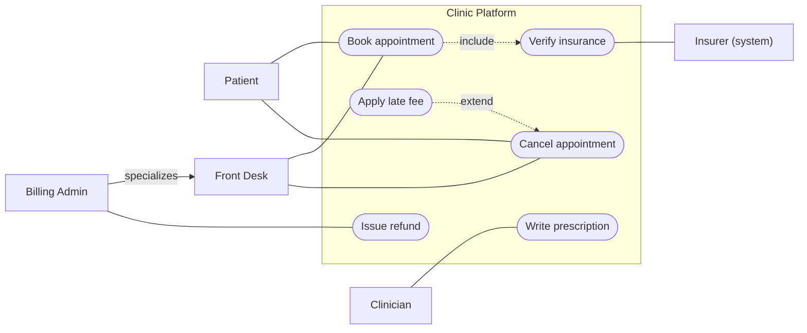

## In one minute
- A use case diagram draws a system boundary, the actors outside it (people, roles or other systems), and the goals each actor can achieve through the system. It says *who can do what*, never *how* or *in what order*.
- Actors are roles, not people. One person can be a Patient on Monday and a Clinician on Tuesday; an external system such as an insurer's eligibility API is an actor too.
- `<<include>>` means the base use case always performs another one (booking always verifies insurance). `<<extend>>` means an optional behaviour may hook into the base at a named extension point (cancelling may charge a late fee).
- The diagram is the first draft of three real artefacts: the API surface (each use case becomes one or more endpoints or commands), the permission model (each actor becomes a role or scope), and the acceptance test list.
- Its value comes from keeping those three in step. A use case with no endpoint is unbuilt, an endpoint with no use case is unowned, and a role holding a permission no use case needs is a security finding.

## How it works

### The four elements
A telehealth clinic is building a booking platform. Its use case diagram has four kinds of things.

The **system boundary** is a rectangle named for the system ("Clinic Platform"). Inside is what the team builds; outside is what it talks to. Drawing it forces the first scope argument: is payments inside, or is the payment provider an actor?

**Actors** stand outside the boundary: stick figures for humans, boxes marked `<<system>>` for machines. The clinic has Patient, Clinician, Front Desk and Billing Admin, plus the Insurer's eligibility service as a secondary actor that the system calls but that never starts anything.

**Use cases** are ovals inside the boundary, each a verb phrase for a goal the actor would recognise: Book appointment, Write prescription. "Save row" is not a use case; nobody opens the app wanting to save a row. **Associations** are plain lines joining an actor to its use cases.

### Include, extend and generalization
Three relationships connect elements to each other, and they are the part most teams get wrong.

`<<include>>` is a dashed arrow from the base to the included use case. Book appointment includes Verify insurance: every booking verifies. Inclusion factors out shared behaviour the way a function does, and Verify insurance needs no actor of its own.

`<<extend>>` is a dashed arrow from the optional extension to the base, the opposite direction ([UML 2.5.1, clause 18](https://www.omg.org/spec/UML/2.5.1/PDF)). Apply late fee extends Cancel appointment at an extension point called "within 24 hours of the visit". The base is complete without the extension and does not know it exists, which is the open-closed principle drawn as a picture.

**Generalization** (solid line, hollow triangle) works on actors and use cases. Billing Admin specializes Front Desk: it can do everything Front Desk can, plus issue refunds. Specialized actors inherit their parent's associations, the same way a subclass inherits methods.

A good rule for spotting misuse: if you would describe the relationship with "sometimes" or "if", it is extend; with "always", it is include; with "first X, then Y", it does not belong on this diagram at all. Sequencing goes on an activity or sequence diagram.

### The text behind each oval
Every oval should point at a short written specification: goal, primary actor, preconditions, the main success scenario as numbered steps, extensions (what happens when step 3 fails), and postconditions, as in Alistair Cockburn's template. The diagram is the index and the text is the content; teams that keep only the diagram lose the failure cases, where most design work lives. Fowler goes further and says the diagrams are of little value next to the text, which UML does not standardise ([Fowler, UseCase](https://martinfowler.com/bliki/UseCase.html)).

### Drawing it in Mermaid
Mermaid 12.0.0 added a native use case diagram, started with the `usecase-beta` keyword. It has actors, use cases, system boundaries and explicit include, extend and generalization operators, and include and extend must join two use cases ([Mermaid docs](https://mermaid.js.org/syntax/usecase.html), [12.0.0 release](https://github.com/mermaid-js/mermaid/releases/tag/mermaid%4012.0.0)). The diagram below uses a flowchart stand-in, which renders on any Mermaid version: a `subgraph` for the boundary, stadium nodes `(["..."])` for use cases, and labelled dotted edges for include and extend. PlantUML supports the notation directly with `actor`, `usecase` and `rectangle`.

### Reviewing agent-written diagrams
Agents make the human mistakes faster: CRUD ovals that mirror tables, extend arrows pointing the wrong way, and actors from the org chart ("Manager") that match no role in the identity provider. Ask for the matrix the diagram implies (actor, use case, endpoint, permission) and check it against the code, which the practice task automates.

### The same shape elsewhere
A use case diagram is a coverage claim, the *trust but verify* shape. An auditor mapping controls to evidence and a gateway route table compared with the OpenAPI spec are the same check: two lists written by different people must agree, and gaps in either direction are the findings.

## Down the stack

### Layer 1: The contract
The diagram makes three testable promises. A principal holding an associated actor's role can complete the use case end to end, inclusions included. Included use cases run whenever the base does, so the base actor needs whatever they need. And an actor with no line to a use case cannot perform it; that negative promise is the one auditors test. Nothing is promised about ordering, timing or data.

### Layer 2: The mechanism
Actors become principals and roles (the OWASP API Security Top 10 asks for a central, deny-by-default module that grants functions by role, [API5:2023](https://api-security.owasp.org/editions/2023/en/0xa5-broken-function-level-authorization)): a `scope` or `roles` claim in an OAuth 2.0 JWT, a Kubernetes `Role` and `RoleBinding`, an AWS IAM role. Actor generalization becomes role inheritance.

Use cases become entry points: REST routes, gRPC methods, GraphQL mutations or queue consumers. Mature teams record the link, for example with an OpenAPI `x-use-case` extension, so tooling can join the two.

Include becomes an internal call on the same request path, and its permission propagates up: if `POST /appointments` calls the eligibility service with the caller's token, that token needs the eligibility scope. Extend becomes a conditional hook (a feature flag, a policy rule, a handler for `AppointmentCancelled`) the base never references. The boundary becomes the authorization perimeter, usually a gateway or mesh.

Tooling does the drawing. PlantUML parses its text into an element graph and hands use case and class diagrams to Graphviz's `dot`. Mermaid parses flowchart text with a Jison-generated grammar into a graph of nodes, edges and subgraphs, then lays it out with ELK, the default since v12.0.0 (set `layout: dagre` for the old engine) ([Mermaid layouts](https://mermaid.js.org/config/layouts.html)). Dagre and ELK's layered algorithm both use the layered method from Sugiyama and colleagues: break cycles, assign each node a rank, order nodes within ranks to reduce edge crossings, then assign coordinates.

### Layer 3: The machine
Each association costs something on every request. A scope check on a validated JWT is a set lookup costing well under a microsecond, but validating the token costs more: an RS256 signature check is roughly tens of microseconds on a modern core, which is why gateways cache validated tokens by hash. Scope strings ride in a header on every call. A role model with one scope per use case and 60 use cases adds over a kilobyte to the token, base64 adds a third more, and nginx's default `large_client_header_buffers 4 8k` rejects any single header field above one 8 KB buffer with a 400 ([nginx docs](https://nginx.org/en/docs/http/ngx_http_core_module.html#large_client_header_buffers)). Calling an external policy engine such as OPA over the network adds a millisecond or so per decision; embedding it keeps decisions in the tens of microseconds.

Layout has its own limit. Minimising edge crossings in a layered drawing is NP-hard, so engines sweep barycenter or median heuristics. With a few hundred edges the result becomes unreadable long before it becomes slow: split the diagram by actor or subsystem.

### Why it's built this way
1. Stakeholders argue about scope and access long before anyone argues about classes, so the first diagram models goals and roles, not structure.
2. Roles change less often than people, so actors are roles, and they map directly onto the role or scope model enforced at runtime.
3. Shared behaviour would otherwise be repeated in every use case text, so include factors it out, and its permissions propagate to every caller.
4. Optional behaviour added later should not force edits to the base, so extend points from the extension to the base.
5. Hand-maintained lists drift, so the diagram, the route table and the role grants are joined into one checked matrix.

## Diagram


## Worked example
The clinic's first release has 9 use cases, 14 endpoints and 5 roles. For the security review an engineer joins three files: the use case list, the OpenAPI spec (each operation tagged with `x-use-case` and a scope), and the identity provider's role export. The join finds four problems:

1. `GET /appointments/export`, added for a one-off migration, has no use case and returns every patient's appointments to any `appt:read` token. It is deleted.
2. Patient lacks `insurance:check`. The booking service forwards the caller's token to the eligibility service, so every patient booking would fail with a 403. Integration tests used an admin token and missed it.
3. Front Desk holds `rx:write`, granted during testing. No front desk use case needs it, and prescription write access for non-clinicians is a reportable audit finding.
4. Reschedule appointment has no endpoint: design assumed cancel-and-rebook, product assumed a dedicated flow. Settled in 20 minutes, before launch.

At 14 endpoints this is a spreadsheet. A year later, at 120 endpoints and 30 roles, the same check runs in CI on every change to the spec or the roles.

## In the wild
- **OWASP, 2023: broken function level authorization is a top API risk.** The API Security Top 10 (2023 edition) lists it as API5. The pattern is exactly the audit finding in this lesson: an administrative or privileged function that an ordinary caller can reach by guessing a URL or changing the HTTP method, because admin endpoints often sit under ordinary paths. The recommended fix is a central authorization module that denies by default and grants functions by role, reviewed against the business logic ([OWASP API5:2023](https://api-security.owasp.org/editions/2023/en/0xa5-broken-function-level-authorization)). A use case to role to endpoint matrix is one way to produce that review.
- **Mermaid, 2026: use case diagrams become a built-in diagram type.** Version 12.0.0 added UML use case diagrams, with boundaries, actors and include, extend and generalization operators, so the notation can live as reviewable text beside the code ([release notes](https://github.com/mermaid-js/mermaid/releases/tag/mermaid%4012.0.0), [syntax docs](https://mermaid.js.org/syntax/usecase.html)). The syntax carries a beta keyword, so pin the Mermaid version your docs build uses.

## Trade-offs
| Option | Strengths | Weaknesses | Choose when |
| --- | --- | --- | --- |
| Use case diagram plus written scenarios | Scope, roles and failure cases agreed early | Two artefacts to keep in step | New product areas, regulated domains |
| User stories only | Small, fits sprint planning | No single view of who can do what | Small teams, low access-control risk |
| Diagram generated from route and role metadata | Always matches the code | Shows what exists, not what was intended | Large APIs, audits |
| Access matrix table, no diagram | Easy to diff and check in CI | Hard to read for non-engineers | Mature systems with many roles |

## Pitfalls in production
- Use cases mirror database tables ("Manage patients"), so the permission model becomes table-level CRUD and over-grants. Fix: name use cases as actor goals and give each its own scope or policy rule.
- An included use case calls a downstream service with the caller's token, and callers lack its scope. Fix: propagate include permissions up to every base actor, or have the base call the inclusion with a service identity and document that choice.
- Debug or migration endpoints outlive their purpose with no owner. Fix: require every route to declare a use case and fail CI when one does not.
- Roles accumulate permissions granted "temporarily" during incidents. Fix: compute least privilege from the matrix and flag every grant no use case needs.
- Extend arrows are drawn backwards, so the base team believes it owns the late-fee logic. Fix: the extension points at the base, and the base exposes a named extension point (an event or hook).

## Leadership lens
- Ask for the access matrix in every design review of a new surface; scope disagreements are cheapest there.
- Make "every endpoint names its use case" a merge rule: one annotation per route, and orphaned endpoints cannot ship.
- Treat over-granted roles as debt with an owner. Least-privilege reviews are cheap when the needed set is computed, not argued.
- Keep the diagram at actor-goal level; steps belong on an activity or sequence diagram.

## Check yourself
1. Booking always checks insurance; cancelling sometimes charges a fee. Which is include and which is extend, and which way does each arrow point?
   **Answer:** Insurance is include, pointing from Book to Verify insurance. The fee is extend, pointing from Apply late fee to Cancel, because the base must not depend on the optional behaviour.
2. Why does an actor need the permissions of use cases it never directly invokes?
   **Answer:** Included use cases run as part of the base, often with the caller's credentials, so their requirements propagate to every actor of the base.
3. Billing Admin specializes Front Desk. What does that mean for access?
   **Answer:** Billing Admin inherits every Front Desk association and grant and adds its own; in RBAC terms its role inherits the Front Desk role.
4. What does a missing line between an actor and a use case promise?
   **Answer:** That the role cannot perform it. That negative claim is what least-privilege checks and audits test.

## Practice
**Task:** Build the use case to endpoint to permission matrix checker. A model has `actors` (name to parent actor, `""` for none; a child inherits its ancestors' associations and grants), `use_cases` (name to `actors` and `includes`), `endpoints` (route to `use_case` and `permission`) and `grants` (actor to its own permissions). `reachable(model, actor)` returns the sorted use cases the actor can perform: those associated with it or an ancestor, plus everything they include, transitively. It fails with `unknown actor: <A>`. `check(model)` returns a sorted, de-duplicated list of findings: `endpoint <E>: unknown use case <U>`, `use case <U>: no endpoint`, `<A> lacks <perm>` when a reachable use case's endpoint needs a permission the actor and its ancestors do not hold, and `<A> over-granted <perm>` when the actor's own grant is needed by none of its reachable use cases. Includes are acyclic and name known use cases. Python raises `ValueError`, TypeScript throws `Error`, Go returns an error.

```python starter
def reachable(model, actor):
    # TODO: associated use cases (with ancestors) plus transitive includes
    raise NotImplementedError

def check(model):
    # TODO: coverage, missing and excess permissions
    raise NotImplementedError
```

```python tests
def clinic():
    return {
        "actors": {"Patient": "", "FrontDesk": "", "Clinician": "", "BillingAdmin": "FrontDesk"},
        "use_cases": {
            "Book": {"actors": ["Patient", "FrontDesk"], "includes": ["VerifyInsurance"]},
            "VerifyInsurance": {"actors": [], "includes": []},
            "Cancel": {"actors": ["Patient", "FrontDesk"], "includes": []},
            "Prescribe": {"actors": ["Clinician"], "includes": []},
            "Refund": {"actors": ["BillingAdmin"], "includes": []},
        },
        "endpoints": {
            "POST /appointments": {"use_case": "Book", "permission": "appt:write"},
            "POST /eligibility": {"use_case": "VerifyInsurance", "permission": "insurance:check"},
            "DELETE /appointments/{id}": {"use_case": "Cancel", "permission": "appt:write"},
            "POST /prescriptions": {"use_case": "Prescribe", "permission": "rx:write"},
            "POST /refunds": {"use_case": "Refund", "permission": "billing:refund"},
        },
        "grants": {
            "Patient": ["appt:write", "insurance:check"],
            "FrontDesk": ["appt:write", "insurance:check"],
            "Clinician": ["rx:write"],
            "BillingAdmin": ["billing:refund"],
        },
    }

def test_clean_model():
    assert check(clinic()) == []

def test_reachable_follows_includes_and_parents():
    m = clinic()
    assert reachable(m, "Patient") == ["Book", "Cancel", "VerifyInsurance"]
    assert reachable(m, "BillingAdmin") == ["Book", "Cancel", "Refund", "VerifyInsurance"]
    assert reachable(m, "Clinician") == ["Prescribe"]

def test_included_permission_is_required():
    m = clinic()
    m["grants"]["Patient"] = ["appt:write"]
    assert check(m) == ["Patient lacks insurance:check"]

def test_over_granted():
    m = clinic()
    m["grants"]["Clinician"] = ["rx:write", "appt:write"]
    assert check(m) == ["Clinician over-granted appt:write"]

def test_child_inherits_parent_gap():
    m = clinic()
    m["grants"]["FrontDesk"] = ["appt:write"]
    assert check(m) == ["BillingAdmin lacks insurance:check", "FrontDesk lacks insurance:check"]

def test_coverage_findings():
    m = clinic()
    m["use_cases"]["Reschedule"] = {"actors": ["Patient"], "includes": []}
    m["endpoints"]["GET /export"] = {"use_case": "Export", "permission": "appt:read"}
    assert check(m) == [
        "endpoint GET /export: unknown use case Export",
        "use case Reschedule: no endpoint",
    ]

def test_duplicate_grants_reported_once():
    m = clinic()
    m["grants"]["Patient"] = ["appt:write", "insurance:check", "rx:write", "rx:write"]
    assert check(m) == ["Patient over-granted rx:write"]

def test_unknown_actor():
    try:
        reachable(clinic(), "Janitor")
        assert False, "expected ValueError"
    except ValueError as e:
        assert str(e) == "unknown actor: Janitor"
```

```python solution
def _chain(actors, actor):
    out = []
    while actor:
        out.append(actor)
        actor = actors[actor]
    return out

def reachable(model, actor):
    actors = model["actors"]
    if actor not in actors:
        raise ValueError("unknown actor: " + actor)
    chain = set(_chain(actors, actor))
    ucs = model["use_cases"]
    stack = [u for u in ucs if chain & set(ucs[u]["actors"])]
    seen = set()
    while stack:
        u = stack.pop()
        if u in seen:
            continue
        seen.add(u)
        stack.extend(ucs[u]["includes"])
    return sorted(seen)

def check(model):
    ucs = model["use_cases"]
    actors = model["actors"]
    grants = model["grants"]
    found = set()
    perms = {}
    for route, spec in model["endpoints"].items():
        u = spec["use_case"]
        if u not in ucs:
            found.add("endpoint %s: unknown use case %s" % (route, u))
            continue
        perms.setdefault(u, set()).add(spec["permission"])
    for u in ucs:
        if u not in perms:
            found.add("use case %s: no endpoint" % u)
    for a in actors:
        needed = set()
        for u in reachable(model, a):
            needed |= perms.get(u, set())
        have = set()
        for x in _chain(actors, a):
            have |= set(grants.get(x, []))
        for p in needed - have:
            found.add("%s lacks %s" % (a, p))
        for p in grants.get(a, []):
            if p not in needed:
                found.add("%s over-granted %s" % (a, p))
    return sorted(found)
```

```typescript starter
export interface UseCase { actors: string[]; includes: string[]; }
export interface Endpoint { useCase: string; permission: string; }
export interface Model {
  actors: Record<string, string>;
  useCases: Record<string, UseCase>;
  endpoints: Record<string, Endpoint>;
  grants: Record<string, string[]>;
}

export function reachable(model: Model, actor: string): string[] {
  throw new Error("TODO");
}

export function check(model: Model): string[] {
  throw new Error("TODO");
}
```

```typescript tests
function clinic(): Model {
  return {
    actors: { Patient: "", FrontDesk: "", Clinician: "", BillingAdmin: "FrontDesk" },
    useCases: {
      Book: { actors: ["Patient", "FrontDesk"], includes: ["VerifyInsurance"] },
      VerifyInsurance: { actors: [], includes: [] },
      Cancel: { actors: ["Patient", "FrontDesk"], includes: [] },
      Prescribe: { actors: ["Clinician"], includes: [] },
      Refund: { actors: ["BillingAdmin"], includes: [] },
    },
    endpoints: {
      "POST /appointments": { useCase: "Book", permission: "appt:write" },
      "POST /eligibility": { useCase: "VerifyInsurance", permission: "insurance:check" },
      "DELETE /appointments/{id}": { useCase: "Cancel", permission: "appt:write" },
      "POST /prescriptions": { useCase: "Prescribe", permission: "rx:write" },
      "POST /refunds": { useCase: "Refund", permission: "billing:refund" },
    },
    grants: {
      Patient: ["appt:write", "insurance:check"],
      FrontDesk: ["appt:write", "insurance:check"],
      Clinician: ["rx:write"],
      BillingAdmin: ["billing:refund"],
    },
  };
}

test("clean model", () => {
  assertEqual(check(clinic()), []);
});

test("reachable follows includes and parents", () => {
  const m = clinic();
  assertEqual(reachable(m, "Patient"), ["Book", "Cancel", "VerifyInsurance"]);
  assertEqual(reachable(m, "BillingAdmin"), ["Book", "Cancel", "Refund", "VerifyInsurance"]);
  assertEqual(reachable(m, "Clinician"), ["Prescribe"]);
});

test("included permission is required", () => {
  const m = clinic();
  m.grants.Patient = ["appt:write"];
  assertEqual(check(m), ["Patient lacks insurance:check"]);
});

test("over granted", () => {
  const m = clinic();
  m.grants.Clinician = ["rx:write", "appt:write"];
  assertEqual(check(m), ["Clinician over-granted appt:write"]);
});

test("child inherits parent gap", () => {
  const m = clinic();
  m.grants.FrontDesk = ["appt:write"];
  assertEqual(check(m), ["BillingAdmin lacks insurance:check", "FrontDesk lacks insurance:check"]);
});

test("coverage findings", () => {
  const m = clinic();
  m.useCases.Reschedule = { actors: ["Patient"], includes: [] };
  m.endpoints["GET /export"] = { useCase: "Export", permission: "appt:read" };
  assertEqual(check(m), ["endpoint GET /export: unknown use case Export", "use case Reschedule: no endpoint"]);
});

test("duplicate grants reported once", () => {
  const m = clinic();
  m.grants.Patient = ["appt:write", "insurance:check", "rx:write", "rx:write"];
  assertEqual(check(m), ["Patient over-granted rx:write"]);
});

test("unknown actor", () => {
  let msg = "";
  try { reachable(clinic(), "Janitor"); } catch (e) { msg = (e as Error).message; }
  assertEqual(msg, "unknown actor: Janitor");
});
```

```typescript solution
export interface UseCase { actors: string[]; includes: string[]; }
export interface Endpoint { useCase: string; permission: string; }
export interface Model {
  actors: Record<string, string>;
  useCases: Record<string, UseCase>;
  endpoints: Record<string, Endpoint>;
  grants: Record<string, string[]>;
}

function chain(actors: Record<string, string>, actor: string): string[] {
  const out: string[] = [];
  while (actor) { out.push(actor); actor = actors[actor]; }
  return out;
}

export function reachable(model: Model, actor: string): string[] {
  if (!(actor in model.actors)) throw new Error("unknown actor: " + actor);
  const mine = new Set(chain(model.actors, actor));
  const stack = Object.keys(model.useCases).filter((u) => model.useCases[u].actors.some((a) => mine.has(a)));
  const seen = new Set<string>();
  while (stack.length) {
    const u = stack.pop()!;
    if (seen.has(u)) continue;
    seen.add(u);
    stack.push(...model.useCases[u].includes);
  }
  return [...seen].sort();
}

export function check(model: Model): string[] {
  const found = new Set<string>();
  const perms = new Map<string, Set<string>>();
  for (const [route, spec] of Object.entries(model.endpoints)) {
    if (!(spec.useCase in model.useCases)) {
      found.add(`endpoint ${route}: unknown use case ${spec.useCase}`);
      continue;
    }
    if (!perms.has(spec.useCase)) perms.set(spec.useCase, new Set());
    perms.get(spec.useCase)!.add(spec.permission);
  }
  for (const u of Object.keys(model.useCases)) {
    if (!perms.has(u)) found.add(`use case ${u}: no endpoint`);
  }
  for (const a of Object.keys(model.actors)) {
    const needed = new Set<string>();
    for (const u of reachable(model, a)) for (const p of perms.get(u) ?? []) needed.add(p);
    const have = new Set<string>();
    for (const x of chain(model.actors, a)) for (const p of model.grants[x] ?? []) have.add(p);
    for (const p of needed) if (!have.has(p)) found.add(`${a} lacks ${p}`);
    for (const p of model.grants[a] ?? []) if (!needed.has(p)) found.add(`${a} over-granted ${p}`);
  }
  return [...found].sort();
}
```

```go starter
package practice

type UseCase struct {
	Actors   []string
	Includes []string
}

type Endpoint struct {
	UseCase    string
	Permission string
}

type Model struct {
	Actors    map[string]string
	UseCases  map[string]UseCase
	Endpoints map[string]Endpoint
	Grants    map[string][]string
}

func Reachable(m Model, actor string) ([]string, error) {
	panic("TODO")
}

func Check(m Model) []string {
	panic("TODO")
}
```

```go tests
package practice

import (
	"reflect"
	"testing"
)

func clinic() Model {
	return Model{
		Actors: map[string]string{"Patient": "", "FrontDesk": "", "Clinician": "", "BillingAdmin": "FrontDesk"},
		UseCases: map[string]UseCase{
			"Book":            {[]string{"Patient", "FrontDesk"}, []string{"VerifyInsurance"}},
			"VerifyInsurance": {nil, nil},
			"Cancel":          {[]string{"Patient", "FrontDesk"}, nil},
			"Prescribe":       {[]string{"Clinician"}, nil},
			"Refund":          {[]string{"BillingAdmin"}, nil},
		},
		Endpoints: map[string]Endpoint{
			"POST /appointments":        {"Book", "appt:write"},
			"POST /eligibility":         {"VerifyInsurance", "insurance:check"},
			"DELETE /appointments/{id}": {"Cancel", "appt:write"},
			"POST /prescriptions":       {"Prescribe", "rx:write"},
			"POST /refunds":             {"Refund", "billing:refund"},
		},
		Grants: map[string][]string{
			"Patient":      {"appt:write", "insurance:check"},
			"FrontDesk":    {"appt:write", "insurance:check"},
			"Clinician":    {"rx:write"},
			"BillingAdmin": {"billing:refund"},
		},
	}
}

func expect(t *testing.T, got, want []string) {
	t.Helper()
	if len(got) == 0 && len(want) == 0 {
		return
	}
	if !reflect.DeepEqual(got, want) {
		t.Fatalf("got %q\nwant %q", got, want)
	}
}

func TestCleanModel(t *testing.T) {
	expect(t, Check(clinic()), nil)
}

func TestReachableFollowsIncludesAndParents(t *testing.T) {
	m := clinic()
	cases := map[string][]string{
		"Patient":      {"Book", "Cancel", "VerifyInsurance"},
		"BillingAdmin": {"Book", "Cancel", "Refund", "VerifyInsurance"},
		"Clinician":    {"Prescribe"},
	}
	for actor, want := range cases {
		got, err := Reachable(m, actor)
		if err != nil {
			t.Fatal(err)
		}
		expect(t, got, want)
	}
}

func TestIncludedPermissionIsRequired(t *testing.T) {
	m := clinic()
	m.Grants["Patient"] = []string{"appt:write"}
	expect(t, Check(m), []string{"Patient lacks insurance:check"})
}

func TestOverGranted(t *testing.T) {
	m := clinic()
	m.Grants["Clinician"] = []string{"rx:write", "appt:write"}
	expect(t, Check(m), []string{"Clinician over-granted appt:write"})
}

func TestChildInheritsParentGap(t *testing.T) {
	m := clinic()
	m.Grants["FrontDesk"] = []string{"appt:write"}
	expect(t, Check(m), []string{"BillingAdmin lacks insurance:check", "FrontDesk lacks insurance:check"})
}

func TestCoverageFindings(t *testing.T) {
	m := clinic()
	m.UseCases["Reschedule"] = UseCase{[]string{"Patient"}, nil}
	m.Endpoints["GET /export"] = Endpoint{"Export", "appt:read"}
	expect(t, Check(m), []string{"endpoint GET /export: unknown use case Export", "use case Reschedule: no endpoint"})
}

func TestDuplicateGrantsReportedOnce(t *testing.T) {
	m := clinic()
	m.Grants["Patient"] = []string{"appt:write", "insurance:check", "rx:write", "rx:write"}
	expect(t, Check(m), []string{"Patient over-granted rx:write"})
}

func TestUnknownActor(t *testing.T) {
	_, err := Reachable(clinic(), "Janitor")
	if err == nil || err.Error() != "unknown actor: Janitor" {
		t.Fatalf("got %v", err)
	}
}
```

```go solution
package practice

import (
	"errors"
	"sort"
)

type UseCase struct {
	Actors   []string
	Includes []string
}

type Endpoint struct {
	UseCase    string
	Permission string
}

type Model struct {
	Actors    map[string]string
	UseCases  map[string]UseCase
	Endpoints map[string]Endpoint
	Grants    map[string][]string
}

func chain(actors map[string]string, actor string) []string {
	var out []string
	for actor != "" {
		out = append(out, actor)
		actor = actors[actor]
	}
	return out
}

func Reachable(m Model, actor string) ([]string, error) {
	if _, ok := m.Actors[actor]; !ok {
		return nil, errors.New("unknown actor: " + actor)
	}
	mine := map[string]bool{}
	for _, a := range chain(m.Actors, actor) {
		mine[a] = true
	}
	var stack []string
	for name, uc := range m.UseCases {
		for _, a := range uc.Actors {
			if mine[a] {
				stack = append(stack, name)
				break
			}
		}
	}
	seen := map[string]bool{}
	for len(stack) > 0 {
		u := stack[len(stack)-1]
		stack = stack[:len(stack)-1]
		if seen[u] {
			continue
		}
		seen[u] = true
		stack = append(stack, m.UseCases[u].Includes...)
	}
	out := make([]string, 0, len(seen))
	for u := range seen {
		out = append(out, u)
	}
	sort.Strings(out)
	return out, nil
}

func Check(m Model) []string {
	found := map[string]bool{}
	perms := map[string]map[string]bool{}
	for route, ep := range m.Endpoints {
		if _, ok := m.UseCases[ep.UseCase]; !ok {
			found["endpoint "+route+": unknown use case "+ep.UseCase] = true
			continue
		}
		if perms[ep.UseCase] == nil {
			perms[ep.UseCase] = map[string]bool{}
		}
		perms[ep.UseCase][ep.Permission] = true
	}
	for u := range m.UseCases {
		if perms[u] == nil {
			found["use case "+u+": no endpoint"] = true
		}
	}
	for a := range m.Actors {
		needed := map[string]bool{}
		ucs, _ := Reachable(m, a)
		for _, u := range ucs {
			for p := range perms[u] {
				needed[p] = true
			}
		}
		have := map[string]bool{}
		for _, x := range chain(m.Actors, a) {
			for _, p := range m.Grants[x] {
				have[p] = true
			}
		}
		for p := range needed {
			if !have[p] {
				found[a+" lacks "+p] = true
			}
		}
		for _, p := range m.Grants[a] {
			if !needed[p] {
				found[a+" over-granted "+p] = true
			}
		}
	}
	out := make([]string, 0, len(found))
	for f := range found {
		out = append(out, f)
	}
	sort.Strings(out)
	return out
}
```

## Mock interview
**Prompt:** You are the tech lead for a pharmacy platform with 4 human roles, 3 partner systems and about 80 API operations. An audit found a pharmacist-only endpoint callable by support staff. Show how you would model who can do what, and how you would keep the model and the running system from drifting apart.

- Follow-up: Dispensing always runs a drug interaction check that calls a partner API. How does that appear on the diagram, and what does it imply for the dispensing role's credentials?
- Follow-up: An emergency "break glass" override lets a supervisor dispense without a prescription. Include, extend or a separate use case?
- Follow-up: Would you generate the diagram from code or hand-draw it, and what does each miss?

**A strong answer covers:**
- Actors named after identity-provider roles, with generalization mapped to role inheritance and partner systems as secondary actors.
- Use cases as goals, each linked to its endpoints through route metadata, so the matrix can be computed.
- Include permissions propagating to the base actor, or an explicit service identity for the inner call.
- Break glass as an extension with its own audited permission, never a silent grant on the base role.
- A CI check for orphan endpoints, uncovered use cases, missing grants and over-grants, plus periodic review of the generated diagram.

## Sources and further study
**Primary**
- [UML 2.5.1 specification, PDF (OMG)](https://www.omg.org/spec/UML/2.5.1/PDF): clause 18 defines UseCase, Actor, Include and Extend, including extension points.
- [Mermaid 12.0.0 release notes](https://github.com/mermaid-js/mermaid/releases/tag/mermaid%4012.0.0): the release that introduced native use case diagrams.

**Systems docs**
- [Mermaid use case diagram syntax](https://mermaid.js.org/syntax/usecase.html): actors, boundaries and the include, extend and generalization operators.
- [OWASP API5:2023 Broken Function Level Authorization](https://api-security.owasp.org/editions/2023/en/0xa5-broken-function-level-authorization): the security failure that an actor-to-use-case matrix is meant to catch.
- [nginx: ngx_http_core_module](https://nginx.org/en/docs/http/ngx_http_core_module.html): `large_client_header_buffers` and the 400 and 414 limits that large scope lists can hit.

**Books**
- *Software Engineering at Google*, Winters, Manshreck and Wright, chapter 10 "Documentation": keeping requirement and design documents small, owned and current.

**Other curricula**
- [donnemartin/system-design-primer](https://github.com/donnemartin/system-design-primer): starts every worked design from use cases and constraints, a short list of who does what, without the diagram notation.

## Watch
- [UML Use Case Diagram Tutorial (Lucid Software)](https://www.youtube.com/watch?v=zid-MVo7M-E): actors, boundaries, include and extend with a worked example.

## Free resources
- [Use case diagram (Wikipedia)](https://en.wikipedia.org/wiki/Use_case_diagram): the notation and the include, extend and generalization relationships.
- [Use case (Wikipedia)](https://en.wikipedia.org/wiki/Use_case): the written templates behind the ovals, including Cockburn's levels.
- [Use Case (Martin Fowler)](https://martinfowler.com/bliki/UseCase.html): why the text matters more than the diagram.
- [Use case diagram (PlantUML)](https://plantuml.com/use-case-diagram): diagram-as-code syntax for actors, use cases and boundaries.
- [Flowchart syntax (Mermaid)](https://mermaid.js.org/syntax/flowchart.html): subgraphs and node shapes used to approximate use case diagrams.
- [UML 2.5.1 specification (OMG)](https://www.omg.org/spec/UML/2.5.1/): the normative definitions of actors, use cases, include and extend.
