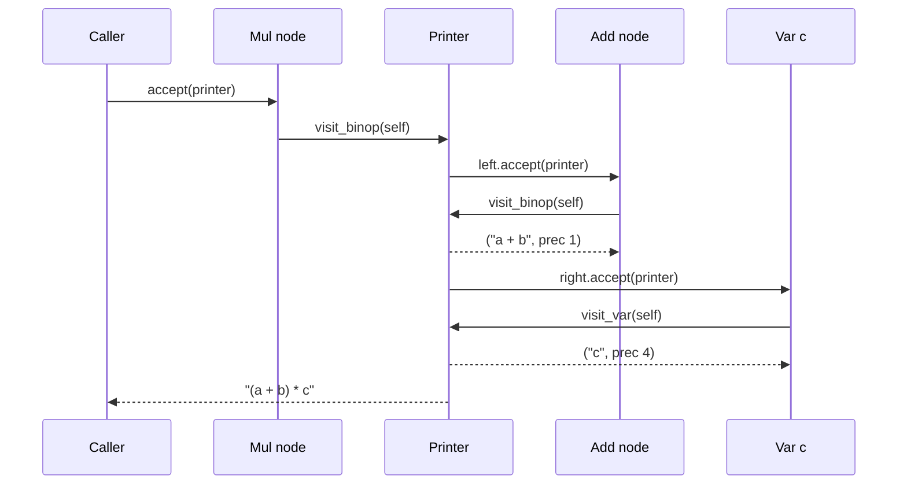

## In one minute
- Visitor moves an operation out of the classes it operates on. Each node type gets one `accept(visitor)` method, and each operation (evaluate, print, type check, lint) becomes a visitor class with one `visit_*` method per node type.
- It works by double dispatch: `node.accept(v)` selects the code for the node's runtime type, and inside it `v.visit_num(self)` selects the code for the visitor's runtime type. Two dynamic calls pick one method from a two-dimensional table.
- The trade is the expression problem in miniature. Visitors make adding operations cheap and adding node types expensive, because every visitor must learn the new type. Use it when the set of types is stable and the set of operations keeps growing, as in compilers, linters and serialisers.
- Exhaustive pattern matching over sealed types (Java 21, TypeScript unions, Rust) now does the same job with less ceremony. The visitor's lasting value is a checked list of cases and a reusable traversal.
- Agents scatter `isinstance` chains, each missing a different node type. Review asks for one place per operation and a new node type that breaks the build or a test, not production.

## How it works

### The problem
A pricing team has a small rules language: expressions such as `(base + fee) * qty` and `-discount`. The parser produces a tree of four node types: numbers, variables, binary operations and negation. The tree needs many operations: evaluate it, print it back for the audit log, list the variables it reads, check it for division by a constant zero, estimate its cost.

Both obvious designs hurt. Putting every operation on every node class (the Composite lesson's approach, where bundles and items both answer `price()`) grows the node classes by a method per feature. Writing each operation as a function with an `isinstance` ladder keeps nodes small, but each function silently ignores node types it forgot, and that shows up as a wrong answer at runtime.

### Double dispatch
Visitor gives each node one method that never changes:

```python
class BinOp:
    def __init__(self, op, left, right):
        self.op, self.left, self.right = op, left, right

    def accept(self, visitor):
        return visitor.visit_binop(self)
```

An operation is a class with a method per node type:

```python
class VarCollector:
    def __init__(self):
        self.names = set()
    def visit_num(self, n): pass
    def visit_var(self, n): self.names.add(n.name)
    def visit_neg(self, n): n.operand.accept(self)
    def visit_binop(self, n):
        n.left.accept(self)
        n.right.accept(self)
```

Calling `tree.accept(VarCollector())` performs two dynamic dispatches: on the node, which runs `BinOp.accept`, and inside it on the visitor, which runs that visitor's `visit_binop`. Single-dispatch languages (Java, C#, C++, Go, TypeScript) choose a method by one receiver's runtime type; chaining two dispatches chooses by two. In a static language there is a further payoff: the `Visitor` interface lists every node type, so adding `visit_call` to it makes every existing visitor fail to compile until someone decides what it does with calls.

### The expression problem
Philip Wadler named the tension in 1998: with types as rows and operations as columns, object-oriented code makes adding a row easy (one new class) and a column hard (edit every class), while functional code with pattern matching is the reverse. Visitor turns an object-oriented design into the functional shape. That is why it lives in compilers: a language's syntax changes rarely, but passes over the syntax tree (desugaring, type checking, optimisation, code generation, formatting, linting) are added constantly, often by different people.

### Returning versus accumulating visitors
A visitor can return a value from each visit (the evaluator returns a number, the printer returns text) or accumulate state in its fields (the collector adds to a set). Returning visitors compose naturally with recursion. Accumulating visitors are the only option when the language cannot express a generic return type on the interface; Go's interfaces cannot have type parameters on methods, so a Go visitor typically stores its last result in a field, as the practice solution does.

### Walkers: separating traversal from action
Real libraries split walking the tree from acting on nodes. Python's `ast.NodeVisitor` has `generic_visit`, which visits all children, so a visitor overrides only the types it cares about; Go has `ast.Walk` and `ast.Inspect`; Babel and ESLint take an object keyed by node type. This removes per-method recursion at the cost of exhaustiveness: a walker silently skips types you did not mention, which is right for a lint rule and wrong for an evaluator.

### Pattern matching as the modern alternative
Java 21's `switch` over a sealed interface is exhaustive: the compiler rejects a switch that misses a permitted subtype. TypeScript gets the same check from a discriminated union and a `never` assignment in the default branch. An operation is then one function with a checked `switch` and no `accept` methods. Prefer that where the language supports it; keep the classic visitor for extension by other packages, a shared traversal, or languages without exhaustive matching.

### When not to use it
- **The node types change often.** Every new type is an edit to every visitor; put the behaviour on the nodes instead.
- **There are one or two operations.** Methods on the nodes are simpler.
- **The structure is not a tree of distinct types.** Iterating a list of identical records needs a loop, not double dispatch.

### Reviewing agent-written code
Asked to "add a check that flags division by zero", an agent usually writes a recursive function with an `isinstance` ladder that handles three of the four node types, and returns `None` for the fourth. Asked to "use the visitor pattern", it may generate `accept` methods on nodes that already have them or a visitor whose methods all recurse by hand when the codebase has a walker. In review, ask: where is the list of node types, and what fails when a new one is added? Is traversal written once? Does the visitor mutate the tree while walking it? Is there a test with every node type in one tree?

### The same shape elsewhere
Visitor is the *fan-out* shape on a type axis: one structure, many independent consumers. The same split appears in a JSON encoder that switches on value kind, in tax calculation where product categories are fixed but jurisdictions keep being added, in query planners that run rewrite rules over a relational algebra tree, and in infrastructure tools that run many checks (cost, security, naming) over one parsed configuration graph.

## Down the stack

### Layer 1: The contract
Each node type promises exactly one `accept` that calls exactly one matching `visit` method and nothing else. Each visitor promises a method for every node type; in static languages the compiler enforces this, and in dynamic ones a test with a tree containing every node type must. The traversal order is part of the contract (the evaluator here walks left before right, so the first error reported is the leftmost), and so is mutation: a plain visitor must not change the tree it walks, while a transformer returns new or replacement nodes and leaves the original intact or replaces it in one defined step.

### Layer 2: The mechanism
Python's `ast.NodeVisitor.visit` builds the method name at runtime, `'visit_' + node.__class__.__name__`, looks it up with `getattr`, and falls back to `generic_visit`, which iterates the node's `_fields` and visits every child node or list of nodes. `ast.NodeTransformer` uses the return value to replace the node, or deletes it when the value is `None`. Go's `ast.Walk(v, node)` calls `v.Visit(node)`; if that returns a non-nil visitor `w`, it walks each child with `w` and then calls `w.Visit(nil)` to signal the end of the subtree, so a visitor can swap itself per subtree or prune by returning nil. ESLint gathers every enabled rule's listeners (keyed by node type or selector, with `:exit` variants) and calls them all during one traversal per file, so 200 rules cost one walk; Babel merges plugin visitors the same way. LLVM's `InstVisitor` uses the curiously recurring template pattern: `visit(Instruction&)` switches on the opcode and calls the derived class's `visitAdd` statically, so there is no virtual call at all.

### Layer 3: The machine
Classic double dispatch costs two indirect calls per node. In Go, `n.Accept(v)` and `v.VisitBin(b)` are each an itab call of about 1 to 2 ns when predicted, so a 10,000-node tree spends tens of microseconds on dispatch. The tree itself costs more: each node is a separate heap object, and a cold walk misses the CPU cache constantly at roughly 80 to 100 ns per miss to DRAM. Compilers that care store nodes in flat arrays indexed by integers (data-oriented design), and dispatch becomes a `switch` on a tag byte.

In CPython, `NodeVisitor` pays for string concatenation, a `getattr` and a bound-method call per node. Recursion is the other limit: CPython's default recursion limit is 1000, and a generated `a + a + ... + a` with 5,000 terms is a left-nested tree 5,000 deep that raises `RecursionError`. Production walkers use an explicit stack or rebalance such chains at parse time.

Concurrency follows from the state. A tree that nobody mutates can be visited by many goroutines or threads at once; a visitor with fields (a result slot, a set of names) cannot be shared, so create one per traversal.

### Why it's built this way
1. Single-dispatch languages choose a method by one runtime type, but an operation over a tree depends on two: the node and the operation.
2. Chaining two single dispatches (`accept`, then `visit_x`) selects by both without type tests.
3. Listing every node type in the visitor interface makes missing cases a compile error, which `isinstance` ladders cannot give.
4. Writing the recursion in every visitor is tedious, so libraries factor the traversal into walkers, trading back some exhaustiveness.
5. Pointer-heavy trees are slow to walk, so performance-critical compilers flatten them and dispatch on a tag instead.

## Diagram


## Worked example
A logistics company prices shipments with a rules DSL: about 3,400 expressions written by analysts, averaging 40 nodes each. The language has had the same 7 node types for three years. Operations, on the other hand, grew from 2 (evaluate, print) to 9: variable listing, unit checking, constant folding, a cost estimator, a deprecation linter, a JSON exporter and a diff renderer.

Each operation was a recursive function with an `isinstance` ladder. When a `Clamp(x, lo, hi)` node was added, 3 of the 7 operations then in use silently returned `None` for it; the unit checker passed every clamped expression unchecked, and a rule mixing kilograms and pounds ran in production for 11 days.

The team introduced a typed visitor interface with seven methods and a shared walker for read-only passes. The next node type, `Lookup(table, key)`, broke the build in exactly the 9 places that had to decide what lookups mean. Evaluating all 3,400 rules took 14 ms in Python before and 16 ms after, against a 200 ms request budget.

## Trade-offs
| Option | Strengths | Weaknesses | Choose when |
| --- | --- | --- | --- |
| Methods on each node (Composite style) | Simple; new node types are local | Every new operation edits every class | Few operations, node types still changing |
| Classic visitor (`accept` + `visit_*`) | New operations are local; exhaustive in static languages | New node types edit every visitor; boilerplate | Stable node types, growing operations |
| Reflective visitor (`ast.NodeVisitor`) | Override only what you need; traversal built in | Missed types are silent; slower dispatch | Read-only analyses and lint rules |
| Walker with callbacks (`ast.Inspect`, Babel, ESLint) | One traversal shared by many passes | Order and pruning rules to learn; not exhaustive | Many independent passes over large trees |
| Exhaustive pattern matching (sealed types, unions) | No `accept`; compiler checks cases | Needs language support; closed set of types | Modern Java, TypeScript, Rust, Kotlin, Scala |

## Pitfalls in production
- A new node type added without updating a reflective visitor, so the pass silently skips it. Fix: a test that builds a tree containing every node type and runs every visitor over it, or a static interface that forces the method.
- Visitors that mutate the tree while walking (deleting a child from a list being iterated). Fix: write a transformer that returns new nodes, or collect edits and apply them after the walk.
- Deep trees overflowing the stack in generated code. Fix: an explicit work stack, or balance long associative chains when parsing.
- Stateful visitors reused across threads or requests, leaking results between traversals. Fix: construct a visitor per traversal; keep shared configuration in an immutable object passed in.
- Each pass walking the whole tree separately, so 30 lint rules cost 30 traversals. Fix: a single walker that fans each node out to all interested passes, as ESLint does.

## Leadership lens
- Decide which axis is meant to grow. If product needs new operations weekly and new node types yearly, visitors pay off; if it is the reverse, they slow every change.
- Ask in design review: "When someone adds a node type, what tells them every place that must change?" A compiler error or a failing exhaustive test is an acceptable answer; a code search is not.
- Treat the visitor interface as a published contract when other teams write passes. Adding a method is a breaking change for them; a default base class with a loud failure for unknown types softens it.
- For agents, "write a new visitor class implementing `Visitor`; do not edit node classes" is a precise, reviewable instruction, and the compiler checks the result.

## Check yourself
1. Why does the visitor need two method calls (`accept` and `visit_x`) instead of one?
   **Answer:** Single-dispatch languages pick a method by one runtime type. The first call dispatches on the node's type, the second on the visitor's type, so together they select by both.
2. A team adds node types monthly and operations rarely. Is Visitor a good fit?
   **Answer:** No. Each new node type requires editing every visitor; methods on the node classes keep that change local.
3. What does Python's `ast.NodeVisitor` give up compared with a statically typed visitor interface?
   **Answer:** Exhaustiveness. It finds methods by name at runtime and falls back to `generic_visit`, so a forgotten node type is silently walked through instead of failing to compile.
4. Why do ESLint and Babel merge visitors from many rules or plugins into one traversal?
   **Answer:** Walking a large tree is the expensive part, mostly in pointer chasing and call overhead, so one walk that calls every interested listener per node is far cheaper than one walk per rule.

## Practice
**Task:** Build an expression tree with visitors. Node types are `Num(value)`, `Var(name)`, `BinOp(op, left, right)` with `op` one of `+ - * /`, and `Neg(operand)`; each has `accept(visitor)` calling the matching `visit_num`, `visit_var`, `visit_binop` or `visit_neg`. `evaluate(node, env)` uses an evaluator visitor: variables come from `env` (fail with `unbound variable: <name>`); a `BinOp` evaluates left, then right, then applies the operator; `/` truncates toward zero and fails with `division by zero`; any other operator fails with `unknown operator: <op>`. `to_source(node)` uses a printer visitor that writes `left op right` with single spaces and the fewest parentheses that keep the tree's shape: precedence is 1 for `+ -`, 2 for `* /`, 3 for `Neg` and 4 for numbers and variables; a left operand gets parentheses when its precedence is lower than the operator's, a right operand when it is lower or equal, and `Neg` writes `-` followed by its operand, parenthesised unless it is a number or variable. `free_vars(node)` returns the sorted, distinct variable names. Python raises `ValueError`, TypeScript throws `Error`, Go returns an error; in Go, use `Eval`, `Source` and `FreeVars` with a `Visitor` interface of `VisitNum`, `VisitVar`, `VisitBin` and `VisitNeg`, each returning `error`.

```python starter
class Num:
    def __init__(self, value):
        self.value = value
    def accept(self, v):
        return v.visit_num(self)

class Var:
    def __init__(self, name):
        self.name = name
    def accept(self, v):
        return v.visit_var(self)

class BinOp:
    def __init__(self, op, left, right):
        self.op, self.left, self.right = op, left, right
    def accept(self, v):
        return v.visit_binop(self)

class Neg:
    def __init__(self, operand):
        self.operand = operand
    def accept(self, v):
        return v.visit_neg(self)

def evaluate(node, env):
    # TODO: an Evaluator visitor
    raise NotImplementedError

def to_source(node):
    # TODO: a Printer visitor returning (text, precedence)
    raise NotImplementedError

def free_vars(node):
    # TODO
    raise NotImplementedError
```

```python tests
def error_of(fn):
    try:
        fn()
    except ValueError as e:
        return str(e)
    return None

a, b, c, x, y = Var("a"), Var("b"), Var("c"), Var("x"), Var("y")

def test_evaluate_basic():
    tree = BinOp("*", BinOp("+", Num(2), Num(3)), x)
    assert evaluate(tree, {"x": 4}) == 20
    assert evaluate(Neg(BinOp("-", Num(1), Num(10))), {}) == 9

def test_division_truncates_toward_zero():
    assert evaluate(BinOp("/", Num(7), Num(2)), {}) == 3
    assert evaluate(BinOp("/", Neg(Num(7)), Num(2)), {}) == -3
    assert evaluate(BinOp("/", Num(7), Neg(Num(2))), {}) == -3

def test_evaluation_errors_left_first():
    assert error_of(lambda: evaluate(BinOp("+", a, b), {})) == "unbound variable: a"
    assert error_of(lambda: evaluate(BinOp("/", x, BinOp("-", y, y)), {"x": 1, "y": 5})) == "division by zero"
    assert error_of(lambda: evaluate(BinOp("%", Num(1), Num(2)), {})) == "unknown operator: %"

def test_printer_minimal_parentheses():
    assert to_source(BinOp("*", BinOp("+", a, b), c)) == "(a + b) * c"
    assert to_source(BinOp("+", a, BinOp("*", b, c))) == "a + b * c"
    assert to_source(BinOp("-", a, BinOp("-", b, c))) == "a - (b - c)"
    assert to_source(BinOp("-", BinOp("-", a, b), c)) == "a - b - c"
    assert to_source(BinOp("/", a, BinOp("*", b, Num(2)))) == "a / (b * 2)"

def test_printer_unary_minus():
    assert to_source(Neg(BinOp("+", a, b))) == "-(a + b)"
    assert to_source(Neg(Neg(x))) == "-(-x)"
    assert to_source(BinOp("*", Neg(a), b)) == "-a * b"
    assert to_source(BinOp("-", a, Neg(Num(3)))) == "a - -3"

def test_free_vars_sorted_and_distinct():
    tree = BinOp("+", BinOp("*", x, a), Neg(x))
    assert free_vars(tree) == ["a", "x"]
    assert free_vars(Num(1)) == []

class Stats:
    """A new operation added without touching any node class."""
    def visit_num(self, n):
        return (1, 1)
    def visit_var(self, n):
        return (1, 1)
    def visit_neg(self, n):
        count, depth = n.operand.accept(self)
        return (count + 1, depth + 1)
    def visit_binop(self, n):
        lc, ld = n.left.accept(self)
        rc, rd = n.right.accept(self)
        return (lc + rc + 1, max(ld, rd) + 1)

def test_new_visitor_plugs_in():
    tree = BinOp("*", BinOp("+", a, b), Neg(c))
    assert tree.accept(Stats()) == (6, 3)
```

```python solution
class Num:
    def __init__(self, value):
        self.value = value
    def accept(self, v):
        return v.visit_num(self)

class Var:
    def __init__(self, name):
        self.name = name
    def accept(self, v):
        return v.visit_var(self)

class BinOp:
    def __init__(self, op, left, right):
        self.op, self.left, self.right = op, left, right
    def accept(self, v):
        return v.visit_binop(self)

class Neg:
    def __init__(self, operand):
        self.operand = operand
    def accept(self, v):
        return v.visit_neg(self)

class Evaluator:
    def __init__(self, env):
        self.env = env

    def visit_num(self, n):
        return n.value

    def visit_var(self, n):
        if n.name not in self.env:
            raise ValueError("unbound variable: " + n.name)
        return self.env[n.name]

    def visit_neg(self, n):
        return -n.operand.accept(self)

    def visit_binop(self, n):
        l = n.left.accept(self)
        r = n.right.accept(self)
        if n.op == "+":
            return l + r
        if n.op == "-":
            return l - r
        if n.op == "*":
            return l * r
        if n.op == "/":
            if r == 0:
                raise ValueError("division by zero")
            q = abs(l) // abs(r)
            return -q if (l < 0) != (r < 0) else q
        raise ValueError("unknown operator: " + n.op)

PREC = {"+": 1, "-": 1, "*": 2, "/": 2}

class Printer:
    def visit_num(self, n):
        return (str(n.value), 4)

    def visit_var(self, n):
        return (n.name, 4)

    def visit_neg(self, n):
        text, prec = n.operand.accept(self)
        if prec < 4:
            text = "(" + text + ")"
        return ("-" + text, 3)

    def visit_binop(self, n):
        prec = PREC[n.op]
        lt, lp = n.left.accept(self)
        rt, rp = n.right.accept(self)
        if lp < prec:
            lt = "(" + lt + ")"
        if rp <= prec:
            rt = "(" + rt + ")"
        return (lt + " " + n.op + " " + rt, prec)

class VarCollector:
    def __init__(self):
        self.names = set()
    def visit_num(self, n):
        pass
    def visit_var(self, n):
        self.names.add(n.name)
    def visit_neg(self, n):
        n.operand.accept(self)
    def visit_binop(self, n):
        n.left.accept(self)
        n.right.accept(self)

def evaluate(node, env):
    return node.accept(Evaluator(env))

def to_source(node):
    return node.accept(Printer())[0]

def free_vars(node):
    v = VarCollector()
    node.accept(v)
    return sorted(v.names)
```

```typescript starter
export interface Visitor<R> {
  visitNum(n: Num): R;
  visitVar(n: Var): R;
  visitBinOp(n: BinOp): R;
  visitNeg(n: Neg): R;
}

export interface Node { accept<R>(v: Visitor<R>): R; }

export class Num implements Node {
  constructor(readonly value: number) {}
  accept<R>(v: Visitor<R>): R { return v.visitNum(this); }
}

export class Var implements Node {
  constructor(readonly name: string) {}
  accept<R>(v: Visitor<R>): R { return v.visitVar(this); }
}

export class BinOp implements Node {
  constructor(readonly op: string, readonly left: Node, readonly right: Node) {}
  accept<R>(v: Visitor<R>): R { return v.visitBinOp(this); }
}

export class Neg implements Node {
  constructor(readonly operand: Node) {}
  accept<R>(v: Visitor<R>): R { return v.visitNeg(this); }
}

export function evaluate(node: Node, env: Record<string, number>): number {
  throw new Error("TODO");
}

export function toSource(node: Node): string {
  throw new Error("TODO");
}

export function freeVars(node: Node): string[] {
  throw new Error("TODO");
}
```

```typescript tests
function errorOf(fn: () => unknown): string | undefined {
  try { fn(); } catch (e) { return (e as Error).message; }
  return undefined;
}

const a = new Var("a"), b = new Var("b"), c = new Var("c"), x = new Var("x"), y = new Var("y");
const bin = (op: string, l: Node, r: Node) => new BinOp(op, l, r);

test("evaluate basic", () => {
  assertEqual(evaluate(bin("*", bin("+", new Num(2), new Num(3)), x), { x: 4 }), 20);
  assertEqual(evaluate(new Neg(bin("-", new Num(1), new Num(10))), {}), 9);
});

test("division truncates toward zero", () => {
  assertEqual(evaluate(bin("/", new Num(7), new Num(2)), {}), 3);
  assertEqual(evaluate(bin("/", new Neg(new Num(7)), new Num(2)), {}), -3);
  assertEqual(evaluate(bin("/", new Num(7), new Neg(new Num(2))), {}), -3);
});

test("evaluation errors left first", () => {
  assertEqual(errorOf(() => evaluate(bin("+", a, b), {})), "unbound variable: a");
  assertEqual(errorOf(() => evaluate(bin("/", x, bin("-", y, y)), { x: 1, y: 5 })), "division by zero");
  assertEqual(errorOf(() => evaluate(bin("%", new Num(1), new Num(2)), {})), "unknown operator: %");
});

test("printer minimal parentheses", () => {
  assertEqual(toSource(bin("*", bin("+", a, b), c)), "(a + b) * c");
  assertEqual(toSource(bin("+", a, bin("*", b, c))), "a + b * c");
  assertEqual(toSource(bin("-", a, bin("-", b, c))), "a - (b - c)");
  assertEqual(toSource(bin("-", bin("-", a, b), c)), "a - b - c");
  assertEqual(toSource(bin("/", a, bin("*", b, new Num(2)))), "a / (b * 2)");
});

test("printer unary minus", () => {
  assertEqual(toSource(new Neg(bin("+", a, b))), "-(a + b)");
  assertEqual(toSource(new Neg(new Neg(x))), "-(-x)");
  assertEqual(toSource(bin("*", new Neg(a), b)), "-a * b");
  assertEqual(toSource(bin("-", a, new Neg(new Num(3)))), "a - -3");
});

test("free vars sorted and distinct", () => {
  assertEqual(freeVars(bin("+", bin("*", x, a), new Neg(x))), ["a", "x"]);
  assertEqual(freeVars(new Num(1)), []);
});

class Stats implements Visitor<[number, number]> {
  visitNum(): [number, number] { return [1, 1]; }
  visitVar(): [number, number] { return [1, 1]; }
  visitNeg(n: Neg): [number, number] {
    const [count, depth] = n.operand.accept(this);
    return [count + 1, depth + 1];
  }
  visitBinOp(n: BinOp): [number, number] {
    const [lc, ld] = n.left.accept(this);
    const [rc, rd] = n.right.accept(this);
    return [lc + rc + 1, Math.max(ld, rd) + 1];
  }
}

test("new visitor plugs in", () => {
  assertEqual(bin("*", bin("+", a, b), new Neg(c)).accept(new Stats()), [6, 3]);
});
```

```typescript solution
export interface Visitor<R> {
  visitNum(n: Num): R;
  visitVar(n: Var): R;
  visitBinOp(n: BinOp): R;
  visitNeg(n: Neg): R;
}

export interface Node { accept<R>(v: Visitor<R>): R; }

export class Num implements Node {
  constructor(readonly value: number) {}
  accept<R>(v: Visitor<R>): R { return v.visitNum(this); }
}

export class Var implements Node {
  constructor(readonly name: string) {}
  accept<R>(v: Visitor<R>): R { return v.visitVar(this); }
}

export class BinOp implements Node {
  constructor(readonly op: string, readonly left: Node, readonly right: Node) {}
  accept<R>(v: Visitor<R>): R { return v.visitBinOp(this); }
}

export class Neg implements Node {
  constructor(readonly operand: Node) {}
  accept<R>(v: Visitor<R>): R { return v.visitNeg(this); }
}

class Evaluator implements Visitor<number> {
  constructor(private env: Record<string, number>) {}
  visitNum(n: Num): number { return n.value; }
  visitVar(n: Var): number {
    if (!(n.name in this.env)) throw new Error("unbound variable: " + n.name);
    return this.env[n.name];
  }
  visitNeg(n: Neg): number { return -n.operand.accept(this); }
  visitBinOp(n: BinOp): number {
    const l = n.left.accept(this);
    const r = n.right.accept(this);
    switch (n.op) {
      case "+": return l + r;
      case "-": return l - r;
      case "*": return l * r;
      case "/":
        if (r === 0) throw new Error("division by zero");
        return Math.trunc(l / r);
    }
    throw new Error("unknown operator: " + n.op);
  }
}

const PREC: Record<string, number> = { "+": 1, "-": 1, "*": 2, "/": 2 };

class Printer implements Visitor<[string, number]> {
  visitNum(n: Num): [string, number] { return [String(n.value), 4]; }
  visitVar(n: Var): [string, number] { return [n.name, 4]; }
  visitNeg(n: Neg): [string, number] {
    const [text, prec] = n.operand.accept(this);
    return ["-" + (prec < 4 ? "(" + text + ")" : text), 3];
  }
  visitBinOp(n: BinOp): [string, number] {
    const prec = PREC[n.op];
    let [lt, lp] = n.left.accept(this);
    let [rt, rp] = n.right.accept(this);
    if (lp < prec) lt = "(" + lt + ")";
    if (rp <= prec) rt = "(" + rt + ")";
    return [lt + " " + n.op + " " + rt, prec];
  }
}

class VarCollector implements Visitor<void> {
  names = new Set<string>();
  visitNum(): void {}
  visitVar(n: Var): void { this.names.add(n.name); }
  visitNeg(n: Neg): void { n.operand.accept(this); }
  visitBinOp(n: BinOp): void { n.left.accept(this); n.right.accept(this); }
}

export function evaluate(node: Node, env: Record<string, number>): number {
  return node.accept(new Evaluator(env));
}

export function toSource(node: Node): string {
  return node.accept(new Printer())[0];
}

export function freeVars(node: Node): string[] {
  const v = new VarCollector();
  node.accept(v);
  return [...v.names].sort();
}
```

```go starter
package practice

type Visitor interface {
	VisitNum(n *Num) error
	VisitVar(n *Var) error
	VisitBin(n *Bin) error
	VisitNeg(n *Neg) error
}

type Node interface {
	Accept(v Visitor) error
}

type Num struct{ Value int }
type Var struct{ Name string }
type Bin struct {
	Op          string
	Left, Right Node
}
type Neg struct{ X Node }

func (n *Num) Accept(v Visitor) error { return v.VisitNum(n) }
func (n *Var) Accept(v Visitor) error { return v.VisitVar(n) }
func (n *Bin) Accept(v Visitor) error { return v.VisitBin(n) }
func (n *Neg) Accept(v Visitor) error { return v.VisitNeg(n) }

func Eval(n Node, env map[string]int) (int, error) { panic("TODO") }
func Source(n Node) string                        { panic("TODO") }
func FreeVars(n Node) []string                    { panic("TODO") }
```

```go tests
package practice

import (
	"reflect"
	"testing"
)

var (
	va, vb, vc = &Var{"a"}, &Var{"b"}, &Var{"c"}
	vx, vy     = &Var{"x"}, &Var{"y"}
)

func num(v int) *Num               { return &Num{v} }
func bin(op string, l, r Node) *Bin { return &Bin{op, l, r} }
func neg(x Node) *Neg               { return &Neg{x} }

func mustEval(t *testing.T, n Node, env map[string]int) int {
	t.Helper()
	v, err := Eval(n, env)
	if err != nil {
		t.Fatalf("eval: %v", err)
	}
	return v
}

func evalErr(n Node, env map[string]int) string {
	_, err := Eval(n, env)
	if err == nil {
		return ""
	}
	return err.Error()
}

func TestEvaluateBasic(t *testing.T) {
	if got := mustEval(t, bin("*", bin("+", num(2), num(3)), vx), map[string]int{"x": 4}); got != 20 {
		t.Fatalf("got %d", got)
	}
	if got := mustEval(t, neg(bin("-", num(1), num(10))), nil); got != 9 {
		t.Fatalf("got %d", got)
	}
}

func TestDivisionTruncatesTowardZero(t *testing.T) {
	cases := map[Node]int{
		bin("/", num(7), num(2)):      3,
		bin("/", neg(num(7)), num(2)): -3,
		bin("/", num(7), neg(num(2))): -3,
	}
	for n, want := range cases {
		if got := mustEval(t, n, nil); got != want {
			t.Errorf("%s: want %d, got %d", Source(n), want, got)
		}
	}
}

func TestEvaluationErrorsLeftFirst(t *testing.T) {
	if got := evalErr(bin("+", va, vb), nil); got != "unbound variable: a" {
		t.Errorf("got %q", got)
	}
	if got := evalErr(bin("/", vx, bin("-", vy, vy)), map[string]int{"x": 1, "y": 5}); got != "division by zero" {
		t.Errorf("got %q", got)
	}
	if got := evalErr(bin("%", num(1), num(2)), nil); got != "unknown operator: %" {
		t.Errorf("got %q", got)
	}
}

func TestPrinterMinimalParentheses(t *testing.T) {
	cases := []struct {
		n    Node
		want string
	}{
		{bin("*", bin("+", va, vb), vc), "(a + b) * c"},
		{bin("+", va, bin("*", vb, vc)), "a + b * c"},
		{bin("-", va, bin("-", vb, vc)), "a - (b - c)"},
		{bin("-", bin("-", va, vb), vc), "a - b - c"},
		{bin("/", va, bin("*", vb, num(2))), "a / (b * 2)"},
	}
	for _, c := range cases {
		if got := Source(c.n); got != c.want {
			t.Errorf("want %q, got %q", c.want, got)
		}
	}
}

func TestPrinterUnaryMinus(t *testing.T) {
	cases := []struct {
		n    Node
		want string
	}{
		{neg(bin("+", va, vb)), "-(a + b)"},
		{neg(neg(vx)), "-(-x)"},
		{bin("*", neg(va), vb), "-a * b"},
		{bin("-", va, neg(num(3))), "a - -3"},
	}
	for _, c := range cases {
		if got := Source(c.n); got != c.want {
			t.Errorf("want %q, got %q", c.want, got)
		}
	}
}

func TestFreeVarsSortedAndDistinct(t *testing.T) {
	if got := FreeVars(bin("+", bin("*", vx, va), neg(vx))); !reflect.DeepEqual(got, []string{"a", "x"}) {
		t.Fatalf("got %v", got)
	}
	if got := FreeVars(num(1)); len(got) != 0 {
		t.Fatalf("got %v", got)
	}
}

// stats is a new operation added without touching any node type.
type stats struct{ count, depth int }

func (s *stats) VisitNum(*Num) error { s.count, s.depth = 1, 1; return nil }
func (s *stats) VisitVar(*Var) error { s.count, s.depth = 1, 1; return nil }
func (s *stats) VisitNeg(n *Neg) error {
	if err := n.X.Accept(s); err != nil {
		return err
	}
	s.count, s.depth = s.count+1, s.depth+1
	return nil
}
func (s *stats) VisitBin(n *Bin) error {
	n.Left.Accept(s)
	lc, ld := s.count, s.depth
	n.Right.Accept(s)
	s.count = lc + s.count + 1
	s.depth = max(ld, s.depth) + 1
	return nil
}

func TestNewVisitorPlugsIn(t *testing.T) {
	s := &stats{}
	bin("*", bin("+", va, vb), neg(vc)).Accept(s)
	if s.count != 6 || s.depth != 3 {
		t.Fatalf("got %+v", *s)
	}
}
```

```go solution
package practice

import (
	"errors"
	"sort"
	"strconv"
)

type Visitor interface {
	VisitNum(n *Num) error
	VisitVar(n *Var) error
	VisitBin(n *Bin) error
	VisitNeg(n *Neg) error
}

type Node interface {
	Accept(v Visitor) error
}

type Num struct{ Value int }
type Var struct{ Name string }
type Bin struct {
	Op          string
	Left, Right Node
}
type Neg struct{ X Node }

func (n *Num) Accept(v Visitor) error { return v.VisitNum(n) }
func (n *Var) Accept(v Visitor) error { return v.VisitVar(n) }
func (n *Bin) Accept(v Visitor) error { return v.VisitBin(n) }
func (n *Neg) Accept(v Visitor) error { return v.VisitNeg(n) }

// evaluator keeps the value of the last visited subtree in result.
type evaluator struct {
	env    map[string]int
	result int
}

func (e *evaluator) VisitNum(n *Num) error { e.result = n.Value; return nil }

func (e *evaluator) VisitVar(n *Var) error {
	v, ok := e.env[n.Name]
	if !ok {
		return errors.New("unbound variable: " + n.Name)
	}
	e.result = v
	return nil
}

func (e *evaluator) VisitNeg(n *Neg) error {
	if err := n.X.Accept(e); err != nil {
		return err
	}
	e.result = -e.result
	return nil
}

func (e *evaluator) VisitBin(n *Bin) error {
	if err := n.Left.Accept(e); err != nil {
		return err
	}
	l := e.result
	if err := n.Right.Accept(e); err != nil {
		return err
	}
	r := e.result
	switch n.Op {
	case "+":
		e.result = l + r
	case "-":
		e.result = l - r
	case "*":
		e.result = l * r
	case "/":
		if r == 0 {
			return errors.New("division by zero")
		}
		e.result = l / r // Go truncates toward zero
	default:
		return errors.New("unknown operator: " + n.Op)
	}
	return nil
}

func Eval(n Node, env map[string]int) (int, error) {
	e := &evaluator{env: env}
	if err := n.Accept(e); err != nil {
		return 0, err
	}
	return e.result, nil
}

var prec = map[string]int{"+": 1, "-": 1, "*": 2, "/": 2}

type printer struct {
	text string
	prec int
}

func (p *printer) VisitNum(n *Num) error {
	p.text, p.prec = strconv.Itoa(n.Value), 4
	return nil
}

func (p *printer) VisitVar(n *Var) error {
	p.text, p.prec = n.Name, 4
	return nil
}

func (p *printer) VisitNeg(n *Neg) error {
	n.X.Accept(p)
	if p.prec < 4 {
		p.text = "(" + p.text + ")"
	}
	p.text, p.prec = "-"+p.text, 3
	return nil
}

func (p *printer) VisitBin(n *Bin) error {
	own := prec[n.Op]
	n.Left.Accept(p)
	lt, lp := p.text, p.prec
	n.Right.Accept(p)
	rt, rp := p.text, p.prec
	if lp < own {
		lt = "(" + lt + ")"
	}
	if rp <= own {
		rt = "(" + rt + ")"
	}
	p.text, p.prec = lt+" "+n.Op+" "+rt, own
	return nil
}

func Source(n Node) string {
	p := &printer{}
	n.Accept(p)
	return p.text
}

type varCollector struct{ names map[string]bool }

func (c *varCollector) VisitNum(*Num) error   { return nil }
func (c *varCollector) VisitVar(n *Var) error { c.names[n.Name] = true; return nil }
func (c *varCollector) VisitNeg(n *Neg) error { return n.X.Accept(c) }
func (c *varCollector) VisitBin(n *Bin) error {
	if err := n.Left.Accept(c); err != nil {
		return err
	}
	return n.Right.Accept(c)
}

func FreeVars(n Node) []string {
	c := &varCollector{names: map[string]bool{}}
	n.Accept(c)
	out := []string{}
	for name := range c.names {
		out = append(out, name)
	}
	sort.Strings(out)
	return out
}
```

## Mock interview
**Prompt:** You own the policy engine for a cloud platform. Customers write access policies in a small language (about 12 node types); the platform stores 2 million policies and must evaluate them, render them for the console, explain denials, and lint them. Product wants three new analyses this year and possibly one new language construct. Design how operations over policies are structured.

- Follow-up: A new `Condition` node type ships. How do you guarantee that the explainer and linter handle it before it reaches customers?
- Follow-up: Linting all 2 million policies takes six hours. Where does the time go and what do you change?
- Follow-up: Your language upgrades to one with exhaustive pattern matching. Do you keep the visitors?

**A strong answer covers:**
- A typed visitor interface (or sealed types with exhaustive matching) so each analysis is its own module and node types are listed once.
- Evaluation, rendering and explanation as separate visitors, with the explainer returning structured reasons.
- A fixture containing every node type run through every visitor, plus compile-time exhaustiveness, so new constructs cannot ship half-supported.
- One shared traversal for many lint rules, cached parsed trees, and parallelism across policies (immutable trees, one visitor per traversal).
- A measured view of migration: exhaustive `switch` removes `accept` boilerplate, but a published visitor interface for other teams may still justify the pattern.

## Watch
- [Double Dispatch: Prelude to the Visitor Pattern (Dave Leeds)](https://www.youtube.com/watch?v=4cUQR7-YV5U): why single dispatch is not enough, building up to the two-call trick.
- [Visitor Design Pattern Is Giving Way To Pattern Matching Expressions (Zoran on C#)](https://www.youtube.com/watch?v=tq5ztZO45-g): replacing a visitor with exhaustive pattern matching and what each approach costs.
- [Visitor, Design Patterns in 5 minutes (levonog)](https://www.youtube.com/watch?v=kyquNfJ-rME): a short visual overview of the structure.

## Free resources
- [Representing Code (Crafting Interpreters, Robert Nystrom)](https://craftinginterpreters.com/representing-code.html): the expression problem and the visitor pattern explained for a real interpreter.
- [ast module (Python docs)](https://docs.python.org/3/library/ast.html): `NodeVisitor`, `generic_visit` and `NodeTransformer`, the reflective visitor in the standard library.
- [go/ast package (Go docs)](https://pkg.go.dev/go/ast): `Walk`, `Visitor` and `Inspect`, Go's walker design.
- [Custom rules (ESLint docs)](https://eslint.org/docs/latest/extend/custom-rules): rule listeners keyed by node type and selector, all run in one traversal.
- [JEP 441: Pattern Matching for switch (OpenJDK)](https://openjdk.org/jeps/441): exhaustive switches over sealed types, the language-level alternative.
- [Expression problem (Wikipedia)](https://en.wikipedia.org/wiki/Expression_problem): the trade-off between adding types and adding operations, with history and solutions.
