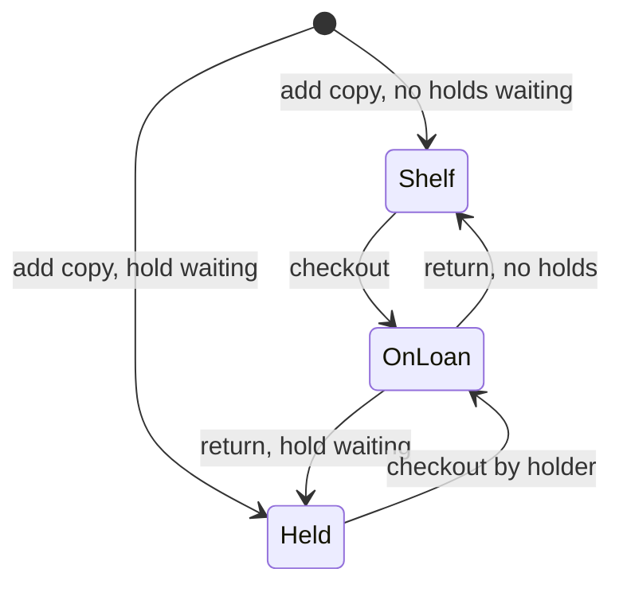

## In one minute
- Low-level design (LLD) decides what happens inside one component: which classes and interfaces exist, what state each one owns, how they relate, what each method promises, and which rules must always hold.
- High-level design picks the boxes and arrows between services; LLD fills in one box. Its unit of failure is a bug or a painful change, not an outage of a data centre.
- The core moves: model the entities and lifecycles, give each rule one owner, and put interfaces only where change is expected.
- A good LLD is correct (its public API cannot break an invariant), testable, and absorbs a likely change in few classes.
- Patterns and UML are tools for this, not the goal. The goal is code a teammate or a coding agent can extend without breaking the rules.

## How it works

### Where LLD sits
Picture a library system. The high-level design says there is a catalogue service, a loans service backed by Postgres, and a notification service. It covers scale and data flow, but not what a loan *is*.

The low-level design of the loans service does. It says a `Title` is the abstract book (one ISBN) and a `Copy` is a physical object with a barcode; a `Member` can hold at most five `Loan`s; a `Loan` links one copy to one member with a due date; a `Hold` queues a member for a title; and returning a copy with a waiting hold puts it on the hold shelf instead of the open shelf. It also says which object enforces each rule and how `checkout` fails.

Below LLD is the code itself. The boundary is fuzzy: LLD is whatever detail you need to agree on before writing code so that the code is easy to write correctly.

### What an LLD contains
- **Entities and value objects.** Things with identity (`Member`, `Copy`, `Loan`) and values compared by content (`Isbn`, `Money`).
- **Relationships.** Who knows and owns whom, with multiplicities: a copy has at most one active loan.
- **Responsibilities and interfaces.** Which class decides each rule, and where behaviour varies behind an interface.
- **State machines.** The legal states of each stateful entity and the transitions between them.
- **Contracts and errors.** Each public method's preconditions, guarantees and failures.
- **Concurrency and time.** What happens if two members try to take the last copy at once, and where "now" comes from.

### From requirements to classes
A classic first pass: nouns in the requirements are candidate classes and verbs are candidate methods. "A *member* can *borrow* up to five *copies* of *titles*; a *loan* is due after fourteen days; a member with an overdue loan cannot borrow; members can *place holds* on titles with no copy available."

That gives `Member`, `Copy`, `Title`, `Loan`, `Hold`, `borrow` and `placeHold`. Then judgement takes over:

- **Split nouns that hide two concepts.** "Book" means both the title and the physical copy. Merging them makes "three copies of one book" impossible to model.
- **Promote relationships that carry data into classes.** A loan is a link between a member and a copy, but it has a due date and a return date, so it becomes its own class rather than a field on either side.
- **Drop nouns that are only attributes.** "Fourteen days" is a configuration value, not a class.
- **Put each verb where its data lives.** "Borrow" needs the member's loan count, the member's overdue status and the copy's availability. No entity owns all three, so a `Library` coordinates while each entity guards its own state: a `Copy` refuses to be loaned twice.

### Invariants first
Before drawing a class diagram, write down the rules that must always hold:

1. A copy is in exactly one state: on the shelf, on loan to one member, or on the hold shelf for one member.
2. A member never has more active loans than the limit.
3. A member with an overdue loan gets no new loans.
4. Holds for a title are served in the order they were placed.

Then make the checking methods the only way to change that state; that is what encapsulation is for. Invariants also show where locks go: rule 1 is a per-copy rule, so a per-copy lock or a conditional `UPDATE ... WHERE state = 'shelf'` is enough; rule 2 spans a member's loans, so the check and the insert must be atomic per member.

### Where patterns come in
Patterns enter when a requirement is expected to vary. If fines differ by member type and the business changes them every year, a `FinePolicy` interface with one class per policy (Strategy) is worth it. If members must be notified when a held copy arrives, an event the notifier subscribes to (Observer) keeps the loan code from knowing about email. If the copy's lifecycle grows to include repair, lost and in-transit states, an explicit state machine (State, or an enum with a transition table) stops `if` chains from multiplying. Without such pressure, a plain method is better.

### The rest of this course
How to Learn LLD? lays out the full path. The OOP lessons (Classes and Objects, Enums, Interfaces, Encapsulation, Abstraction, Inheritance, Polymorphism) give the building blocks; the relationship lessons (Association, Aggregation, Composition, Dependency, Realization) make "who owns whom" precise; the principles (Coupling and Cohesion, SOLID, DRY, KISS, YAGNI, Law of Demeter) judge a split; Class Diagram, Sequence Diagram and State Machine Diagram communicate it; patterns are reusable moves; and Design Parking Lot, Design Vending Machine, Design Movie Booking System and the other design problems put it all together.

### The same shape elsewhere
The library's hardest rule, one copy to at most one borrower, is the **contention** problem shape: many actors competing for one unit. It is one seat per ticket in Design Movie Booking System and one spot per car in Design Parking Lot. The answer is always the same: one object owns the unit's state, and every change is an atomic check-and-change through it.

## Down the stack

### Layer 1: The contract
The contract of an LLD is the set of method contracts plus the invariants. For `checkout(member, isbn, today)`: the precondition is that both exist; on success it returns a copy id, that copy is on loan to that member with `due = today + loan_days`, and the member's loan count went up by one; on failure it raises a specific error (`LimitReached`, `HasOverdue`, `Unavailable`) and changes nothing. "Changes nothing on failure" is the part most designs forget, and it is testable.

### Layer 2: The mechanism
Languages give you different tools to enforce that contract. Private fields and constructors stop outside code from creating a `Loan` without a due date. Enums or sum types make illegal states unrepresentable: a copy's state is `Shelf | OnLoan(member, due) | Held(member)`, so "on loan with no member" cannot be expressed. Interfaces let `Library` call `policy.fine(loan, today)` without knowing which policy it has; the call is resolved at run time through a vtable in C++ or Java, an itab in Go, or a prototype chain lookup in JavaScript. Injecting the clock keeps time out of the rules, which is why the practice task passes `today` in.

### Layer 3: The machine
Each object is an allocation. A Java object has a 12 to 16 byte header; a CPython instance has a 16-byte header plus its attribute storage; a Go struct has none, and a slice of structs is one contiguous block. Ten million copies as small objects fit in about 1 GB of managed heap, and an interface call costs a few nanoseconds, so at library scale clarity wins. What does matter is concurrency: two requests for the last copy on two threads must not both see "available". An uncontended mutex costs around 20 to 50 ns; a contended one can park a thread for microseconds; and once state lives in a database, the equivalent is a row lock or a conditional update, each costing a round trip of a fraction of a millisecond.

### Why it's built this way
1. Requirements change more often than infrastructure, so LLD optimises for cheap, local change.
2. Local change needs each rule to live in one place, so responsibilities are assigned by who owns the data a rule reads.
3. Rules can still be bypassed, so state is encapsulated behind checking methods.
4. Independently varying behaviour would spread `if` statements, so it goes behind an interface at the cost of a negligible indirect call.
5. Several threads or servers may run the same method at once, so the check and change of shared state must be one atomic step, which shapes the design as much as any pattern does.

## Diagram



## Worked example
The coordinating method checks everything before changing anything.

```python
def checkout(self, member_id, isbn, today):
    member = self._member(member_id)            # raises if unknown
    if len(member.loans) >= self.max_loans:
        raise LimitReached(member_id)
    if any(loan.due < today for loan in member.loans):
        raise HasOverdue(member_id)
    copy = self._pick_copy(isbn, member_id)      # held for this member, else on shelf
    if copy is None:
        raise Unavailable(isbn)
    loan = Loan(copy.id, member_id, due=today + self.loan_days)
    copy.lend(loan)                              # Copy enforces its own state machine
    member.loans.append(loan)
    return copy.id
```

Notice the split. `Library` checks the rules that span entities (limits, overdue loans, choosing a copy). `Copy.lend` checks the copy's own state. If a later requirement adds a "lost" state, only `Copy` changes. If fines are added, a `FinePolicy` is called from `return_copy`, and `checkout` does not change. Under concurrency, one lock per branch is plenty for a few hundred checkouts a minute; beyond that, lock per member and per copy in a fixed order.

## Trade-offs

| Choice | Strengths | Weaknesses | Choose when |
|---|---|---|---|
| Rich domain model (entities enforce rules) | Rules live with data; hard to bypass | More classes; ORMs can fight it | Many rules, long-lived product |
| Anemic model plus services | Simple data classes; easy to persist | Rules scatter across services; easy to bypass | CRUD-heavy code with few rules |
| Enum plus transition table for state | Compact; all transitions visible | Per-state behaviour becomes `switch` | Few states, little per-state behaviour |
| State pattern (class per state) | Per-state behaviour is isolated | More classes and indirection | States with very different behaviour |

## Pitfalls in production
- **One class per noun, mechanically.** `Book`, `BookManager`, `BookHelper`, and no owner for any rule. Fix: give each invariant exactly one owning class.
- **Rules enforced only in the controller.** A batch job or a second endpoint calls the repository directly and creates a double loan. Fix: put the check in the entity or in one service that every path goes through, and back it with a database constraint.
- **Check-then-act races.** "Is it available? Then lend it" in two steps lets two requests win. Fix: make check and change atomic with a lock, a conditional update, or a unique constraint on active loans per copy.
- **Hidden time.** Calling the system clock inside domain logic makes overdue rules untestable and flaky near midnight. Fix: inject a clock or pass `today` in.
- **Errors that leave partial state.** The loan is recorded but the copy state update throws. Fix: validate everything first, then mutate, or wrap the mutation in a transaction.

## Leadership lens
- Ask for the invariants list in every design review; it is the shortest document that reveals whether the author understood the domain.
- Record which rules the database also enforces: the domain model guards the common path, constraints guard every path, including 2 a.m. scripts.
- When coding agents implement features, a clear LLD (entities, invariants, interfaces) is the specification that keeps their output consistent across tasks; without one, each agent invents its own structure.
- Budget for the change you can name: if the business says fines will vary by member type next quarter, pay for the interface now; if nobody can name the change, do not.

## Check yourself
1. Why is `Loan` its own class rather than a `borrowed_by` field on `Copy`?
   **Answer:** A loan carries its own data (due date, return date, fines) and history; a field on the copy loses past loans and has nowhere to keep that data.
2. Which class should refuse a second loan of the same copy, and why there?
   **Answer:** `Copy`, because the rule reads only the copy's state; putting it there means every path that lends a copy is checked, not just the one service that remembered to.
3. What makes "check availability, then create the loan" unsafe, and what are two fixes?
   **Answer:** Two concurrent requests can both pass the check before either writes. Make it atomic with a lock around check and change, or with a conditional update or unique constraint in the database.

## Practice
**Task:** Implement the library's loan core with its invariants. `Library(loan_days, max_loans)` supports `add_member(id)` and `add_copy(copy_id, isbn)` (duplicates rejected; a new copy goes to the first waiting hold for its title, else the shelf). `checkout(member, isbn, today)` rejects an unknown member or title, a member at `max_loans`, and a member with any loan whose due day is before `today`; otherwise it lends the lowest-id copy held for this member, else the lowest-id copy on the shelf, else fails, and returns the copy id with `due = today + loan_days`. `return_copy(copy_id, today)` rejects copies not on loan, returns the days late (never negative), and passes the copy to the oldest hold for its title or back to the shelf. `place_hold(member, isbn)` queues a hold, rejected if a copy is on the shelf or the member already waits for that title. `status(copy_id)` returns `("shelf", None)`, `("loan", member)` or `("hold", member)`, and `available(isbn)` counts shelf copies. Every failure leaves state unchanged.

```python starter
class Library:
    def __init__(self, loan_days, max_loans):
        self.loan_days = loan_days
        self.max_loans = max_loans

    def add_member(self, member_id):
        raise NotImplementedError

    def add_copy(self, copy_id, isbn):
        raise NotImplementedError

    def checkout(self, member_id, isbn, today):
        # TODO: check every rule before changing anything
        raise NotImplementedError

    def return_copy(self, copy_id, today):
        raise NotImplementedError

    def place_hold(self, member_id, isbn):
        raise NotImplementedError

    def status(self, copy_id):
        raise NotImplementedError

    def available(self, isbn):
        raise NotImplementedError
```

```python tests
def _raises(fn):
    try:
        fn()
    except ValueError:
        return True
    return False


def _lib():
    lib = Library(14, 2)
    for m in ["ann", "bob", "cy"]:
        lib.add_member(m)
    lib.add_copy("c2", "ddia")
    lib.add_copy("c1", "ddia")
    lib.add_copy("s1", "sicp")
    return lib


def test_checkout_and_on_time_return():
    lib = _lib()
    assert lib.checkout("ann", "ddia", 0) == "c1"
    assert lib.status("c1") == ("loan", "ann")
    assert lib.available("ddia") == 1
    assert lib.return_copy("c1", 10) == 0
    assert lib.status("c1") == ("shelf", None)
    assert lib.available("ddia") == 2


def test_late_return_counts_days():
    lib = _lib()
    lib.checkout("ann", "sicp", 0)
    assert lib.return_copy("s1", 17) == 3


def test_loan_limit_and_failure_changes_nothing():
    lib = _lib()
    lib.checkout("ann", "ddia", 0)
    lib.checkout("ann", "ddia", 0)
    assert _raises(lambda: lib.checkout("ann", "sicp", 0)), "limit"
    assert lib.status("s1") == ("shelf", None)
    lib.return_copy("c1", 1)
    assert lib.checkout("ann", "sicp", 1) == "s1"


def test_overdue_blocks_new_loans():
    lib = _lib()
    lib.checkout("ann", "ddia", 0)  # due 14
    assert lib.checkout("ann", "ddia", 14) == "c2", "due today is not overdue"
    lib.return_copy("c2", 14)
    assert _raises(lambda: lib.checkout("ann", "sicp", 15)), "overdue"
    assert lib.available("sicp") == 1


def test_holds_are_first_come_first_served():
    lib = _lib()
    assert lib.checkout("ann", "sicp", 0) == "s1"
    lib.place_hold("bob", "sicp")
    lib.place_hold("cy", "sicp")
    lib.return_copy("s1", 5)
    assert lib.status("s1") == ("hold", "bob")
    assert lib.available("sicp") == 0
    assert _raises(lambda: lib.checkout("cy", "sicp", 5)), "held for bob"
    assert lib.checkout("bob", "sicp", 6) == "s1"
    lib.return_copy("s1", 7)
    assert lib.status("s1") == ("hold", "cy")


def test_hold_rules_and_new_copy_serves_queue():
    lib = _lib()
    assert _raises(lambda: lib.place_hold("bob", "sicp")), "copy on shelf"
    lib.checkout("ann", "sicp", 0)
    lib.place_hold("bob", "sicp")
    assert _raises(lambda: lib.place_hold("bob", "sicp")), "duplicate hold"
    assert _raises(lambda: lib.place_hold("zed", "sicp")), "unknown member"
    lib.add_copy("s0", "sicp")
    assert lib.status("s0") == ("hold", "bob")


def test_bad_ids_are_rejected():
    lib = _lib()
    assert _raises(lambda: lib.add_member("ann")), "duplicate member"
    assert _raises(lambda: lib.add_copy("c1", "ddia")), "duplicate copy"
    assert _raises(lambda: lib.checkout("ann", "nope", 0)), "unknown title"
    assert _raises(lambda: lib.checkout("zed", "ddia", 0)), "unknown member"
    assert _raises(lambda: lib.return_copy("c1", 0)), "not on loan"
    assert _raises(lambda: lib.status("zz")), "unknown copy"
```

```python solution
class Library:
    def __init__(self, loan_days, max_loans):
        self.loan_days = loan_days
        self.max_loans = max_loans
        self.loans = {}    # member -> {copy_id: due}
        self.copies = {}   # copy_id -> isbn
        self.state = {}    # copy_id -> ("shelf", None) | ("loan", member) | ("hold", member)
        self.due = {}      # copy_id -> due day while on loan
        self.holds = {}    # isbn -> list of waiting members, oldest first

    def add_member(self, member_id):
        if member_id in self.loans:
            raise ValueError("duplicate member")
        self.loans[member_id] = {}

    def add_copy(self, copy_id, isbn):
        if copy_id in self.copies:
            raise ValueError("duplicate copy")
        self.copies[copy_id] = isbn
        self.holds.setdefault(isbn, [])
        self._shelve(copy_id)

    def _shelve(self, copy_id):
        queue = self.holds[self.copies[copy_id]]
        if queue:
            self.state[copy_id] = ("hold", queue.pop(0))
        else:
            self.state[copy_id] = ("shelf", None)

    def _member(self, member_id):
        if member_id not in self.loans:
            raise ValueError("unknown member")
        return self.loans[member_id]

    def _pick(self, isbn, member_id):
        ids = sorted(c for c, i in self.copies.items() if i == isbn)
        for c in ids:
            if self.state[c] == ("hold", member_id):
                return c
        for c in ids:
            if self.state[c][0] == "shelf":
                return c
        return None

    def checkout(self, member_id, isbn, today):
        loans = self._member(member_id)
        if isbn not in self.holds:
            raise ValueError("unknown title")
        if len(loans) >= self.max_loans:
            raise ValueError("loan limit reached")
        if any(due < today for due in loans.values()):
            raise ValueError("member has an overdue loan")
        copy_id = self._pick(isbn, member_id)
        if copy_id is None:
            raise ValueError("no copy available")
        due = today + self.loan_days
        self.state[copy_id] = ("loan", member_id)
        self.due[copy_id] = due
        loans[copy_id] = due
        return copy_id

    def return_copy(self, copy_id, today):
        if self.state.get(copy_id, ("", None))[0] != "loan":
            raise ValueError("copy is not on loan")
        member_id = self.state[copy_id][1]
        due = self.due.pop(copy_id)
        del self.loans[member_id][copy_id]
        self._shelve(copy_id)
        return max(0, today - due)

    def place_hold(self, member_id, isbn):
        self._member(member_id)
        if isbn not in self.holds:
            raise ValueError("unknown title")
        if self.available(isbn) > 0:
            raise ValueError("a copy is on the shelf")
        if member_id in self.holds[isbn]:
            raise ValueError("already waiting")
        self.holds[isbn].append(member_id)

    def status(self, copy_id):
        if copy_id not in self.state:
            raise ValueError("unknown copy")
        return self.state[copy_id]

    def available(self, isbn):
        return sum(1 for c, i in self.copies.items() if i == isbn and self.state[c][0] == "shelf")
```

```typescript starter
export type Status = [string, string | null];

export class Library {
  constructor(public loanDays: number, public maxLoans: number) {}
  addMember(memberId: string): void {
    throw new Error("TODO");
  }
  addCopy(copyId: string, isbn: string): void {
    throw new Error("TODO");
  }
  checkout(memberId: string, isbn: string, today: number): string {
    throw new Error("TODO");
  }
  returnCopy(copyId: string, today: number): number {
    throw new Error("TODO");
  }
  placeHold(memberId: string, isbn: string): void {
    throw new Error("TODO");
  }
  status(copyId: string): Status {
    throw new Error("TODO");
  }
  available(isbn: string): number {
    throw new Error("TODO");
  }
}
```

```typescript tests
function failsWith(fn: () => unknown): boolean {
  try {
    fn();
  } catch (e) {
    return true;
  }
  return false;
}

function makeLib(): Library {
  const lib = new Library(14, 2);
  for (const m of ["ann", "bob", "cy"]) lib.addMember(m);
  lib.addCopy("c2", "ddia");
  lib.addCopy("c1", "ddia");
  lib.addCopy("s1", "sicp");
  return lib;
}

test("checkout and on-time return", () => {
  const lib = makeLib();
  assertEqual(lib.checkout("ann", "ddia", 0), "c1", "lowest id");
  assertEqual(lib.status("c1"), ["loan", "ann"], "on loan");
  assertEqual(lib.available("ddia"), 1, "one left");
  assertEqual(lib.returnCopy("c1", 10), 0, "on time");
  assertEqual(lib.status("c1"), ["shelf", null], "back on shelf");
  assertEqual(lib.available("ddia"), 2, "two on shelf");
});

test("late return counts days", () => {
  const lib = makeLib();
  lib.checkout("ann", "sicp", 0);
  assertEqual(lib.returnCopy("s1", 17), 3, "three days late");
});

test("loan limit and failure changes nothing", () => {
  const lib = makeLib();
  lib.checkout("ann", "ddia", 0);
  lib.checkout("ann", "ddia", 0);
  assert(failsWith(() => lib.checkout("ann", "sicp", 0)), "limit");
  assertEqual(lib.status("s1"), ["shelf", null], "unchanged");
  lib.returnCopy("c1", 1);
  assertEqual(lib.checkout("ann", "sicp", 1), "s1", "allowed after return");
});

test("overdue blocks new loans", () => {
  const lib = makeLib();
  lib.checkout("ann", "ddia", 0);
  assertEqual(lib.checkout("ann", "ddia", 14), "c2", "due today is not overdue");
  lib.returnCopy("c2", 14);
  assert(failsWith(() => lib.checkout("ann", "sicp", 15)), "overdue");
  assertEqual(lib.available("sicp"), 1, "unchanged");
});

test("holds are first come first served", () => {
  const lib = makeLib();
  assertEqual(lib.checkout("ann", "sicp", 0), "s1", "ann borrows");
  lib.placeHold("bob", "sicp");
  lib.placeHold("cy", "sicp");
  lib.returnCopy("s1", 5);
  assertEqual(lib.status("s1"), ["hold", "bob"], "held for bob");
  assertEqual(lib.available("sicp"), 0, "not on shelf");
  assert(failsWith(() => lib.checkout("cy", "sicp", 5)), "held for bob");
  assertEqual(lib.checkout("bob", "sicp", 6), "s1", "bob collects");
  lib.returnCopy("s1", 7);
  assertEqual(lib.status("s1"), ["hold", "cy"], "then cy");
});

test("hold rules and new copy serves queue", () => {
  const lib = makeLib();
  assert(failsWith(() => lib.placeHold("bob", "sicp")), "copy on shelf");
  lib.checkout("ann", "sicp", 0);
  lib.placeHold("bob", "sicp");
  assert(failsWith(() => lib.placeHold("bob", "sicp")), "duplicate hold");
  assert(failsWith(() => lib.placeHold("zed", "sicp")), "unknown member");
  lib.addCopy("s0", "sicp");
  assertEqual(lib.status("s0"), ["hold", "bob"], "new copy goes to hold");
});

test("bad ids are rejected", () => {
  const lib = makeLib();
  assert(failsWith(() => lib.addMember("ann")), "duplicate member");
  assert(failsWith(() => lib.addCopy("c1", "ddia")), "duplicate copy");
  assert(failsWith(() => lib.checkout("ann", "nope", 0)), "unknown title");
  assert(failsWith(() => lib.checkout("zed", "ddia", 0)), "unknown member");
  assert(failsWith(() => lib.returnCopy("c1", 0)), "not on loan");
  assert(failsWith(() => lib.status("zz")), "unknown copy");
});
```

```typescript solution
export type Status = [string, string | null];

export class Library {
  private loans = new Map<string, Map<string, number>>();
  private copies = new Map<string, string>();
  private state = new Map<string, Status>();
  private due = new Map<string, number>();
  private holds = new Map<string, string[]>();

  constructor(public loanDays: number, public maxLoans: number) {}

  addMember(memberId: string): void {
    if (this.loans.has(memberId)) throw new Error("duplicate member");
    this.loans.set(memberId, new Map());
  }

  addCopy(copyId: string, isbn: string): void {
    if (this.copies.has(copyId)) throw new Error("duplicate copy");
    this.copies.set(copyId, isbn);
    if (!this.holds.has(isbn)) this.holds.set(isbn, []);
    this.shelve(copyId);
  }

  private shelve(copyId: string): void {
    const queue = this.holds.get(this.copies.get(copyId)!)!;
    this.state.set(copyId, queue.length > 0 ? ["hold", queue.shift()!] : ["shelf", null]);
  }

  private member(memberId: string): Map<string, number> {
    const loans = this.loans.get(memberId);
    if (!loans) throw new Error("unknown member");
    return loans;
  }

  private copiesOf(isbn: string): string[] {
    const ids: string[] = [];
    this.copies.forEach((i, c) => {
      if (i === isbn) ids.push(c);
    });
    return ids.sort();
  }

  private pick(isbn: string, memberId: string): string | null {
    const ids = this.copiesOf(isbn);
    for (const c of ids) {
      const s = this.state.get(c)!;
      if (s[0] === "hold" && s[1] === memberId) return c;
    }
    for (const c of ids) if (this.state.get(c)![0] === "shelf") return c;
    return null;
  }

  checkout(memberId: string, isbn: string, today: number): string {
    const loans = this.member(memberId);
    if (!this.holds.has(isbn)) throw new Error("unknown title");
    if (loans.size >= this.maxLoans) throw new Error("loan limit reached");
    for (const d of loans.values()) if (d < today) throw new Error("member has an overdue loan");
    const copyId = this.pick(isbn, memberId);
    if (copyId === null) throw new Error("no copy available");
    const due = today + this.loanDays;
    this.state.set(copyId, ["loan", memberId]);
    this.due.set(copyId, due);
    loans.set(copyId, due);
    return copyId;
  }

  returnCopy(copyId: string, today: number): number {
    const s = this.state.get(copyId);
    if (!s || s[0] !== "loan") throw new Error("copy is not on loan");
    const due = this.due.get(copyId)!;
    this.due.delete(copyId);
    this.loans.get(s[1]!)!.delete(copyId);
    this.shelve(copyId);
    return Math.max(0, today - due);
  }

  placeHold(memberId: string, isbn: string): void {
    this.member(memberId);
    const queue = this.holds.get(isbn);
    if (!queue) throw new Error("unknown title");
    if (this.available(isbn) > 0) throw new Error("a copy is on the shelf");
    if (queue.indexOf(memberId) >= 0) throw new Error("already waiting");
    queue.push(memberId);
  }

  status(copyId: string): Status {
    const s = this.state.get(copyId);
    if (!s) throw new Error("unknown copy");
    return [s[0], s[1]];
  }

  available(isbn: string): number {
    return this.copiesOf(isbn).filter((c) => this.state.get(c)![0] === "shelf").length;
  }
}
```

```go starter
package practice

type Library struct {
	LoanDays, MaxLoans int
}

func NewLibrary(loanDays, maxLoans int) *Library {
	return &Library{LoanDays: loanDays, MaxLoans: maxLoans}
}

func (l *Library) AddMember(memberID string) error           { panic("TODO") }
func (l *Library) AddCopy(copyID, isbn string) error          { panic("TODO") }
func (l *Library) Checkout(memberID, isbn string, today int) (string, error) {
	panic("TODO")
}
func (l *Library) Return(copyID string, today int) (int, error) { panic("TODO") }
func (l *Library) PlaceHold(memberID, isbn string) error        { panic("TODO") }

// Status returns ("shelf", ""), ("loan", member) or ("hold", member).
func (l *Library) Status(copyID string) (string, string, error) { panic("TODO") }
func (l *Library) Available(isbn string) int                    { panic("TODO") }
```

```go tests
package practice

import "testing"

func newTestLib(t *testing.T) *Library {
	t.Helper()
	l := NewLibrary(14, 2)
	for _, m := range []string{"ann", "bob", "cy"} {
		if err := l.AddMember(m); err != nil {
			t.Fatal(err)
		}
	}
	for _, c := range [][2]string{{"c2", "ddia"}, {"c1", "ddia"}, {"s1", "sicp"}} {
		if err := l.AddCopy(c[0], c[1]); err != nil {
			t.Fatal(err)
		}
	}
	return l
}

func wantStatus(t *testing.T, l *Library, copyID, state, member string) {
	t.Helper()
	s, m, err := l.Status(copyID)
	if err != nil || s != state || m != member {
		t.Errorf("Status(%s) = %s, %s, %v; want %s, %s", copyID, s, m, err, state, member)
	}
}

func wantCheckout(t *testing.T, l *Library, member, isbn string, today int, want string) {
	t.Helper()
	got, err := l.Checkout(member, isbn, today)
	if err != nil || got != want {
		t.Errorf("Checkout(%s, %s, %d) = %q, %v; want %q", member, isbn, today, got, err, want)
	}
}

func TestCheckoutAndOnTimeReturn(t *testing.T) {
	l := newTestLib(t)
	wantCheckout(t, l, "ann", "ddia", 0, "c1")
	wantStatus(t, l, "c1", "loan", "ann")
	if l.Available("ddia") != 1 {
		t.Error("expected one copy left")
	}
	if late, err := l.Return("c1", 10); err != nil || late != 0 {
		t.Errorf("Return = %d, %v", late, err)
	}
	wantStatus(t, l, "c1", "shelf", "")
	if l.Available("ddia") != 2 {
		t.Error("expected two copies on shelf")
	}
}

func TestLateReturnCountsDays(t *testing.T) {
	l := newTestLib(t)
	wantCheckout(t, l, "ann", "sicp", 0, "s1")
	if late, err := l.Return("s1", 17); err != nil || late != 3 {
		t.Errorf("Return = %d, %v; want 3", late, err)
	}
}

func TestLoanLimitAndFailureChangesNothing(t *testing.T) {
	l := newTestLib(t)
	wantCheckout(t, l, "ann", "ddia", 0, "c1")
	wantCheckout(t, l, "ann", "ddia", 0, "c2")
	if _, err := l.Checkout("ann", "sicp", 0); err == nil {
		t.Error("expected limit error")
	}
	wantStatus(t, l, "s1", "shelf", "")
	l.Return("c1", 1)
	wantCheckout(t, l, "ann", "sicp", 1, "s1")
}

func TestOverdueBlocksNewLoans(t *testing.T) {
	l := newTestLib(t)
	wantCheckout(t, l, "ann", "ddia", 0, "c1")
	wantCheckout(t, l, "ann", "ddia", 14, "c2")
	l.Return("c2", 14)
	if _, err := l.Checkout("ann", "sicp", 15); err == nil {
		t.Error("expected overdue error")
	}
	if l.Available("sicp") != 1 {
		t.Error("state changed on failure")
	}
}

func TestHoldsAreFirstComeFirstServed(t *testing.T) {
	l := newTestLib(t)
	wantCheckout(t, l, "ann", "sicp", 0, "s1")
	if err := l.PlaceHold("bob", "sicp"); err != nil {
		t.Fatal(err)
	}
	if err := l.PlaceHold("cy", "sicp"); err != nil {
		t.Fatal(err)
	}
	l.Return("s1", 5)
	wantStatus(t, l, "s1", "hold", "bob")
	if l.Available("sicp") != 0 {
		t.Error("held copy counted as available")
	}
	if _, err := l.Checkout("cy", "sicp", 5); err == nil {
		t.Error("cy took bob's copy")
	}
	wantCheckout(t, l, "bob", "sicp", 6, "s1")
	l.Return("s1", 7)
	wantStatus(t, l, "s1", "hold", "cy")
}

func TestHoldRulesAndNewCopyServesQueue(t *testing.T) {
	l := newTestLib(t)
	if err := l.PlaceHold("bob", "sicp"); err == nil {
		t.Error("hold allowed while copy on shelf")
	}
	wantCheckout(t, l, "ann", "sicp", 0, "s1")
	if err := l.PlaceHold("bob", "sicp"); err != nil {
		t.Fatal(err)
	}
	if err := l.PlaceHold("bob", "sicp"); err == nil {
		t.Error("duplicate hold allowed")
	}
	if err := l.PlaceHold("zed", "sicp"); err == nil {
		t.Error("unknown member allowed")
	}
	l.AddCopy("s0", "sicp")
	wantStatus(t, l, "s0", "hold", "bob")
}

func TestBadIDsAreRejected(t *testing.T) {
	l := newTestLib(t)
	if l.AddMember("ann") == nil {
		t.Error("duplicate member")
	}
	if l.AddCopy("c1", "ddia") == nil {
		t.Error("duplicate copy")
	}
	if _, err := l.Checkout("ann", "nope", 0); err == nil {
		t.Error("unknown title")
	}
	if _, err := l.Checkout("zed", "ddia", 0); err == nil {
		t.Error("unknown member")
	}
	if _, err := l.Return("c1", 0); err == nil {
		t.Error("return of copy not on loan")
	}
	if _, _, err := l.Status("zz"); err == nil {
		t.Error("unknown copy")
	}
}
```

```go solution
package practice

import (
	"errors"
	"sort"
)

type copyState struct {
	kind   string // "shelf", "loan" or "hold"
	member string
	due    int
}

type Library struct {
	LoanDays, MaxLoans int
	loans              map[string]map[string]int // member -> copy -> due
	copies             map[string]string         // copy -> isbn
	state              map[string]*copyState
	holds              map[string][]string // isbn -> waiting members, oldest first
}

func NewLibrary(loanDays, maxLoans int) *Library {
	return &Library{
		LoanDays: loanDays, MaxLoans: maxLoans,
		loans:  map[string]map[string]int{},
		copies: map[string]string{},
		state:  map[string]*copyState{},
		holds:  map[string][]string{},
	}
}

func (l *Library) AddMember(memberID string) error {
	if _, ok := l.loans[memberID]; ok {
		return errors.New("duplicate member")
	}
	l.loans[memberID] = map[string]int{}
	return nil
}

func (l *Library) AddCopy(copyID, isbn string) error {
	if _, ok := l.copies[copyID]; ok {
		return errors.New("duplicate copy")
	}
	l.copies[copyID] = isbn
	if _, ok := l.holds[isbn]; !ok {
		l.holds[isbn] = []string{}
	}
	l.shelve(copyID)
	return nil
}

func (l *Library) shelve(copyID string) {
	isbn := l.copies[copyID]
	if q := l.holds[isbn]; len(q) > 0 {
		l.state[copyID] = &copyState{kind: "hold", member: q[0]}
		l.holds[isbn] = q[1:]
		return
	}
	l.state[copyID] = &copyState{kind: "shelf"}
}

func (l *Library) copiesOf(isbn string) []string {
	ids := []string{}
	for c, i := range l.copies {
		if i == isbn {
			ids = append(ids, c)
		}
	}
	sort.Strings(ids)
	return ids
}

func (l *Library) pick(isbn, memberID string) (string, bool) {
	ids := l.copiesOf(isbn)
	for _, c := range ids {
		if s := l.state[c]; s.kind == "hold" && s.member == memberID {
			return c, true
		}
	}
	for _, c := range ids {
		if l.state[c].kind == "shelf" {
			return c, true
		}
	}
	return "", false
}

func (l *Library) Checkout(memberID, isbn string, today int) (string, error) {
	loans, ok := l.loans[memberID]
	if !ok {
		return "", errors.New("unknown member")
	}
	if _, ok := l.holds[isbn]; !ok {
		return "", errors.New("unknown title")
	}
	if len(loans) >= l.MaxLoans {
		return "", errors.New("loan limit reached")
	}
	for _, due := range loans {
		if due < today {
			return "", errors.New("member has an overdue loan")
		}
	}
	copyID, ok := l.pick(isbn, memberID)
	if !ok {
		return "", errors.New("no copy available")
	}
	due := today + l.LoanDays
	l.state[copyID] = &copyState{kind: "loan", member: memberID, due: due}
	loans[copyID] = due
	return copyID, nil
}

func (l *Library) Return(copyID string, today int) (int, error) {
	s, ok := l.state[copyID]
	if !ok || s.kind != "loan" {
		return 0, errors.New("copy is not on loan")
	}
	delete(l.loans[s.member], copyID)
	l.shelve(copyID)
	if late := today - s.due; late > 0 {
		return late, nil
	}
	return 0, nil
}

func (l *Library) PlaceHold(memberID, isbn string) error {
	if _, ok := l.loans[memberID]; !ok {
		return errors.New("unknown member")
	}
	q, ok := l.holds[isbn]
	if !ok {
		return errors.New("unknown title")
	}
	if l.Available(isbn) > 0 {
		return errors.New("a copy is on the shelf")
	}
	for _, m := range q {
		if m == memberID {
			return errors.New("already waiting")
		}
	}
	l.holds[isbn] = append(q, memberID)
	return nil
}

func (l *Library) Status(copyID string) (string, string, error) {
	s, ok := l.state[copyID]
	if !ok {
		return "", "", errors.New("unknown copy")
	}
	return s.kind, s.member, nil
}

func (l *Library) Available(isbn string) int {
	n := 0
	for _, c := range l.copiesOf(isbn) {
		if l.state[c].kind == "shelf" {
			n++
		}
	}
	return n
}
```

## Mock interview
**Prompt:** Design the loans module of a library system for a city with 40 branches and 2 million copies. Members borrow, return and place holds; there are loan limits, overdue rules and fines that differ for children and adults. Walk me through your classes and how you guarantee a copy is never lent twice.

- Follow-up: Two members tap "borrow" on the last copy within the same millisecond on two servers. What happens, step by step?
- Follow-up: Next year the library adds e-books with a licence limit of three simultaneous loans per title. What changes in your design?

**A strong answer covers:**
- Separating `Title` from `Copy`, and `Loan` and `Hold` as classes with their own data.
- An explicit invariants list, with each rule owned by one class.
- A copy state machine and a check-then-change that is atomic (lock, conditional update or unique constraint).
- Fine rules behind a policy interface because a second variant is already known, and nothing speculative beyond that.
- How e-books fit: a licence count per title replaces per-copy state, which tests whether the design isolates that difference.

## Watch
- [Introduction - Low Level Design (The Code Mate)](https://www.youtube.com/watch?v=GCTEVZjxznc): how to go from software requirements to a low-level design.
- [How to crack LLD (Low Level Design) Interview? (GeeksforGeeks)](https://www.youtube.com/watch?v=lXTKMnSD_WA): what interviewers expect in object-oriented design rounds.

## Free resources
- [Anemic Domain Model (Martin Fowler)](https://martinfowler.com/bliki/AnemicDomainModel.html): why behaviour belongs with the data it guards.
- [Design by contract (Wikipedia)](https://en.wikipedia.org/wiki/Design_by_contract): preconditions, postconditions and invariants as a design discipline.
- [Class-responsibility-collaboration card (Wikipedia)](https://en.wikipedia.org/wiki/Class-responsibility-collaboration_card): a lightweight technique for assigning responsibilities before drawing diagrams.
- [Go Data Structures: Interfaces (Russ Cox)](https://research.swtch.com/interfaces): how Go interface values and itabs work at run time.
- [Fast properties in V8 (V8 blog)](https://v8.dev/blog/fast-properties): hidden classes and what object shape means for JavaScript performance.
