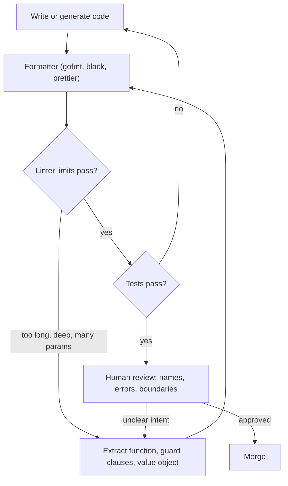

## In one minute
- Clean code is code the next reader can change safely without asking you. It is judged by the reader's time and the defect rate after changes, not by how it looks.
- Names carry most of the meaning. A name should say what a thing is or does at the level its caller thinks, and its length should grow with its scope: `i` in a 3-line loop, `pendingRefundsByCustomer` across a module.
- Functions should do one thing at one level of abstraction, take few parameters, avoid boolean flags, and keep nesting shallow with guard clauses.
- Make errors and side effects visible: specific errors returned or raised at the point of failure, no silent `None`, and a clear split between functions that compute and functions that act.
- Delegate formatting to tools and measure the rest. Linters catch length, nesting and parameter counts; review is for names, boundaries and whether the code says what the domain means.

## How it works

### Who clean code is for
Code is read many more times than it is written: in review, when debugging at 2 a.m., when someone extends it next year, and now when an agent reads it to make a change. Each reader has to rebuild your mental model from the text alone. Clean code minimises that rebuild cost. Every rule below is a way to put more of the model into the code and less into the reader's head.

### Names
Names are the cheapest documentation and the one most often read.

- **Say what it means in the domain.** `eligible_for_refund` beats `check2`; `retry_after_seconds` beats `delay`. Units belong in the name when the type does not carry them.
- **Scale length with scope.** A loop index used in three lines can be `i`. A field visible across a package needs a full phrase. A one-letter name at package scope is a riddle; a 40-character name inside a two-line lambda is noise.
- **Name functions by effect or result.** Functions that act get verbs (`cancel_booking`), functions that compute get nouns or questions (`total_due`, `is_expired`). A function named `get_x` should not write anything.
- **One word per concept.** If the codebase says `fetch` for remote reads, do not add `retrieve` and `load` for the same thing. Readers assume different words mean different things.
- **No encodings.** Hungarian prefixes, `I` on interfaces in Go, `Impl` suffixes and `Manager` or `Helper` classes tell the reader nothing about behaviour.

### Functions
A function is clean when a reader can predict what it does from its name and signature, and confirm it by reading the body once.

- **One thing, one level.** `place_order` should read like the steps of placing an order: validate, reserve stock, charge, record. Parsing a date string in the middle of it drops the reader three levels down.
- **Few parameters.** Three is a lot. Five usually means a missing concept: `(street, city, zip, country)` is an `Address`. Long parameter lists also invite argument-order bugs, which named arguments or a small options struct prevent.
- **No flag arguments.** `render(doc, True)` tells the reader nothing, and the function now does two things. Split it into `render_preview(doc)` and `render_final(doc)`, or pass an enum if there are genuinely more modes.
- **Shallow nesting.** Handle the error and edge cases first and return early (guard clauses), so the main path runs down the left margin. Nesting beyond two or three levels is the clearest sign a function wants to be split.
- **Command-query separation.** A function either answers a question or changes state, not both. `pop()` is a deliberate exception; most are accidents (`validate()` that also normalises and saves).

How long is too long? Length is a symptom, not the disease. A 40-line function that reads top to bottom as one sequence is fine; a 12-line function with four levels of nesting is not. A better test, from Martin Fowler: if you have to read the body to know what a block does, extract it and name it after its intention.

### Errors and side effects
- **Fail at the point of failure, specifically.** Raise or return `InsufficientCredits(needed=3, available=1)`, not `False` or `None`. The caller should be able to decide what to do from the error alone.
- **Do not hide failures.** `except Exception: pass` and `_ = err` turn bugs into data corruption that surfaces days later.
- **Keep side effects at the edges.** Compute in pure functions (easy to test, safe to reuse), then perform I/O in a thin layer that calls them. Separation of Concerns covers the structure; the practical rule is that a function that reads the clock, the database or the network should say so in its name or its parameters.
- **Inject what varies.** Time, randomness and I/O passed in as parameters make behaviour deterministic and testable, which is why every practice task in this course injects a clock.

### Comments
Write comments for what the code cannot say: why this approach, which constraint forced it, what was tried and failed, links to the incident or spec. Do not narrate the code (`# increment i`). When you need a comment to explain *what* a block does, extract the block into a function whose name is that comment. Keep public API documentation accurate; a wrong comment is worse than none.

### Structure and data
- Prefer immutable data and small value types (`Money`, `TimeRange`) to loose primitives. They carry their rules with them; How to Identify Entities and Model Relationships covers when to create one.
- Replace a repeated `switch` on a type code with polymorphism or a table, once the same switch appears in three places (How to choose Design Patterns goes into the decision).
- Keep a file or class about one thing. If its name needs "and" or "Utils", it holds unrelated concerns.

### Consistency and tools
Formatting arguments are a waste of review time. Use the formatter your ecosystem standardised on (`gofmt`, `black` or `ruff format`, `prettier`) and run it in CI. Use a linter for mechanical rules (unused variables, shadowing, complexity limits) so reviewers spend their attention on names and design. In an existing codebase, local consistency beats your preferred style: a reader who learns one pattern should find it everywhere.

### Clean code with coding agents
Agents produce code that looks clean at a glance and fails on substance: long defensive blocks that catch every exception, comments restating each line, generic names like `data`, `result` and `handle`, and new helper functions duplicating ones that already exist two files away. They also follow what they see. A codebase with clear names, small functions and a lint config teaches the agent the house style; a messy one gets messier faster. Put your conventions in the repository (lint config, a short style note), and review generated code for names, error handling and duplication rather than formatting.

### The same shape elsewhere
Clean code is the software version of plain-language writing rules used in law, medicine and aviation: short sentences, one idea per sentence, specific nouns, consistent terms, and the important thing first. A checklist in a cockpit and a clean function share a design goal: a tired reader under pressure must not misread it. The practice task builds the mechanical half of that, a small linter that flags long functions, deep nesting, long parameter lists, flag arguments and cryptic names.

## Down the stack

### Layer 1: The contract
Clean code makes promises to the reader that you can check. Names match behaviour: a query does not mutate, a function named `save` persists. A function's signature lists everything it depends on that can vary (no hidden clock or global). Errors are explicit and specific. Mechanical limits hold across the codebase, for example at most 4 parameters, nesting at most 3, functions at most 50 statements. Those limits are proxies, but they are testable in CI, which turns "write clean code" from advice into a gate.

### Layer 2: The mechanism
Linters parse source into an abstract syntax tree and walk it. Cyclomatic complexity, from Thomas McCabe's 1976 paper, counts independent paths through a function's control-flow graph: edges minus nodes plus 2, in practice one plus the number of decision points (`if`, loop, `case`, `&&`, `||`). Cognitive complexity, defined by SonarSource, adds a penalty for each nesting level, which matches how hard code feels to read better than raw path counts. Tools set defaults: Pylint flags more than 5 arguments (`too-many-arguments`), more than 50 statements and more than 5 nested blocks; ESLint's `max-params` defaults to 3 and `max-depth` to 4; `gocyclo` and Ruff's `C901` report McCabe complexity above a threshold you pick. Formatters such as `gofmt` parse to an AST and print it back in one canonical layout, which is why they can never disagree with themselves and why diffs only show real changes.

### Layer 3: The machine
Clean code is mostly free at runtime. Small functions get inlined: Go's compiler inlines functions under a cost budget of 80 AST nodes, the JVM's JIT and V8's TurboFan inline hot small methods, so extracting a helper usually costs nothing after compilation. CPython does not inline: a Python function call costs roughly 50 to 100 ns, which matters only in loops running millions of times, where you would optimise deliberately anyway. The machine that clean code really optimises for is the reader's brain. Working memory holds about four chunks at once, so a function that needs the reader to track six variables, three nesting levels and a flag overflows it, and the reader starts scrolling back. Code review has a similar limit: reviewers find defects well in about 200 to 400 lines at a sitting and miss them beyond that, so smaller, clearer changes get better reviews.

### Why it's built this way
1. Code lives for years and is changed by people (and agents) who did not write it, so the cost that dominates is reading, not typing.
2. Readers can hold only a few things in mind at once, so functions are kept small and shallow, with few parameters.
3. Most of what a reader needs is in names and signatures, so naming and explicit dependencies get the most care.
4. Hidden failures and side effects cause the most expensive bugs, so errors and I/O are made explicit and pushed to the edges.
5. Humans argue about style forever, so the mechanical part is handed to formatters and linters, leaving review for judgement.

## Diagram


## Worked example
A booking service has this function, written under deadline pressure:

```python
def proc(d, items, rate, region, dry_run=False):
    total = 0
    for it in items:
        if it.qty > 0:
            if it.sku in d:
                p = d[it.sku]
                if region == "EU":
                    p = p * (1 + rate)
                total += p * it.qty
    if not dry_run:
        db.save_invoice(total)
    return total
```

Problems: the name says nothing; `d`, `p` and `it` are cryptic at this scope; five parameters; a flag argument that makes the function both compute and persist; nesting four deep; unknown SKUs are silently skipped, so a typo produces an invoice that is too small; and money is a float. Rewritten:

```python
def invoice_total(lines, prices, tax_rate_bps):
    total_cents = 0
    for line in lines:
        if line.quantity <= 0:
            continue
        if line.sku not in prices:
            raise UnknownSku(line.sku)
        total_cents += prices[line.sku] * line.quantity
    return total_cents + total_cents * tax_rate_bps // 10_000

def issue_invoice(lines, prices, region, invoices):
    total = invoice_total(lines, prices, tax_rate_for(region))
    invoices.save(total)
    return total
```

`invoice_total` is pure, takes three parameters, uses integer cents and basis points, and fails loudly on an unknown SKU. The region rule moved into `tax_rate_for`, so adding a second taxed region is one table entry. The dry run is now simply calling `invoice_total` without `issue_invoice`. Nesting dropped from four to two. Performance did not change in any way that matters: the extra call costs nanoseconds against a database write of about 2 ms. The bug class "typo yields a cheap invoice" is gone.

## Trade-offs
| Option | Strengths | Weaknesses | Choose when |
| --- | --- | --- | --- |
| Many small functions | Each is named, testable, easy to reuse | Readers jump between definitions; names must be good | Logic has distinct steps worth naming |
| One longer linear function | Reads top to bottom, no jumping | Harder to test parts; grows into a mess | A short script or a straight sequence with no reuse |
| Strict lint limits in CI | Consistent; frees review time | Rules fire on reasonable code; people add suppressions | Larger teams and agent-generated code |
| Guidelines only | Flexible, no false positives | Drift; arguments in review | Small, senior teams |
| Comments explaining why | Captures context code cannot | Rots when code changes | Non-obvious constraints, workarounds, links to incidents |
| Self-describing code instead of comments | Cannot go stale | Cannot explain why | Explaining what the code does |

## Pitfalls in production
- **Cleaning without tests.** A "harmless" rename or extraction changes behaviour (an early return skips a side effect). Fix: get characterisation tests in place before refactoring, and keep refactoring commits separate from behaviour changes.
- **Abstraction for its own sake.** Every two lines extracted into a helper, each used once, with names no better than the code. Fix: extract when the name adds meaning or the block repeats; otherwise inline.
- **Swallowed errors.** `try: ... except Exception: log.info(...)` keeps the service up while corrupting data. Fix: catch specific errors you can handle; let the rest propagate to a boundary that fails the request.
- **Lint suppression creep.** `# noqa` and `//nolint` scattered until the linter checks nothing. Fix: require a reason on every suppression and count them on a dashboard.
- **Style churn in diffs.** Reformatting mixed with logic changes hides the real change from reviewers. Fix: run the formatter on the whole repository once, in its own commit, then enforce it in CI.
- **Names that lie after change.** `get_user` now also creates the user if missing. Fix: rename in the same change that alters behaviour; treat a stale name as a bug.

## Leadership lens
- Make the mechanical rules automatic (formatter, linter, limits in CI) so review time goes to design. Arguing about braces in review is a process failure.
- Measure change cost, not beauty: time to first review, review rounds, and how often a file appears in bug fixes. Hotspot files with high churn and high complexity are where clean-up pays.
- Budget refactoring explicitly, attached to features that touch the code ("leave it better than you found it"), rather than as a separate project that never gets prioritised.
- Write the house style down, short, in the repository. Agents and new hires both learn from it, and it settles disputes before they start.
- Hold agent-generated code to the same bar. Volume is not progress if every diff adds duplicated helpers and swallowed errors.

## Check yourself
1. Why is `send_email(user, True)` a problem, and what would you do instead?
   **Answer:** The boolean is meaningless at the call site and means the function does two things. Split it into two well-named functions, or use a named enum if there are more than two modes.
2. When is a one-letter variable name acceptable?
   **Answer:** When its scope is a few lines and its meaning is conventional, such as a loop index or the parameter of a short lambda; name length should grow with scope.
3. A function is 15 lines but has four levels of nesting. Is it clean by length? What would you change?
   **Answer:** Length is fine but nesting is not: use guard clauses for the edge cases and extract the inner loop body into a named function, so the main path reads at one or two levels.
4. Does extracting many small functions slow code down?
   **Answer:** Rarely. Compiled languages and JITs inline small functions, and even in CPython a call costs tens of nanoseconds, which matters only in hot loops that you would profile and optimise deliberately.

## Practice
**Task:** Write a tiny linter for a Python-like source string. `lint(source, limits)` takes the source and limits `max_lines`, `max_params`, `max_depth` and `min_name`, and returns findings as strings in source order. Blank lines and comment lines (first non-space character `#`) are ignored everywhere. Every other line's leading whitespace must be spaces only, a multiple of 4; otherwise fail with `bad indent at line N` (1-based). A line at indent 0 starting with `def ` is a function header of the form `def name(params):`; if it does not contain `(` and `)` and end with `:`, fail with `bad header at line N`. Params are split on commas and trimmed, empties dropped; a param's name is the text before any `=`, and it is a flag if its default is `True` or `False`. Indented lines after a header are its body (other indent-0 lines end the function and are ignored, as are indented lines with no function); a body line at indent `k*4` has depth `k`, and the function's nesting is its maximum body depth minus 1 (0 for an empty body). For each function emit, in this order: `<fn>: short name <fn>` if the name is shorter than `min_name`; `<fn>: too many params (<n> > <max>)`; then for each param in order `<fn>: short name <p>` and `<fn>: flag argument <p>`; `<fn>: too long (<n> > <max> lines)` for body lines over `max_lines`; and `<fn>: nested too deep (<d> > <max>)`.

```python starter
def lint(source, limits):
    """limits has keys max_lines, max_params, max_depth, min_name."""
    # TODO
    raise NotImplementedError
```

```python tests
LIMITS = {"max_lines": 4, "max_params": 3, "max_depth": 2, "min_name": 3}

CLEAN = """import math

def area(radius):
    # a comment
    return math.pi * radius * radius

def grade(score):
    if score >= 90:
        return "A"
    return "B"
"""

MESSY = """def proc(d, items, rate, region, dry_run=False):
    total = 0
    for it in items:
        if it.ok:
            for t in it.tags:
                if t == "x":
                    total += 1
    return total
"""

def raises(src, msg):
    try:
        lint(src, LIMITS)
    except ValueError as e:
        assert str(e) == msg, str(e)
        return
    assert False, "expected ValueError: " + msg

def test_clean_source_has_no_findings():
    assert lint(CLEAN, LIMITS) == []

def test_messy_function_reports_in_order():
    assert lint(MESSY, LIMITS) == [
        "proc: too many params (5 > 3)",
        "proc: short name d",
        "proc: flag argument dry_run",
        "proc: too long (7 > 4 lines)",
        "proc: nested too deep (4 > 2)",
    ]

def test_limits_are_inclusive():
    src = "def run(low, mid, top):\n    if low:\n        if mid:\n            pass\n    return top\n"
    assert lint(src, LIMITS) == []
    assert lint(src, dict(LIMITS, max_lines=3, max_depth=1, max_params=2)) == [
        "run: too many params (3 > 2)",
        "run: too long (4 > 3 lines)",
        "run: nested too deep (2 > 1)",
    ]

def test_short_function_name_and_flags():
    src = "def f(verbose=True, mode = 'x', strict=False):\n    return 1\n"
    assert lint(src, LIMITS) == [
        "f: short name f",
        "f: flag argument verbose",
        "f: flag argument strict",
    ]

def test_blank_and_comment_lines_ignored():
    src = "def main():\n\n  # odd indent comment\n    a = 1\n\n    return a\n"
    assert lint(src, dict(LIMITS, max_lines=2)) == []

def test_top_level_code_ends_function_and_empty_body():
    src = "def empty():\nx = 1\n    y = 2\n    z = 3\n    w = 4\n    v = 5\n    u = 6\n"
    assert lint(src, LIMITS) == []
    assert lint("def fn():\n", dict(LIMITS, min_name=4)) == ["fn: short name fn"]

def test_errors():
    raises("def ok():\n   return 1\n", "bad indent at line 2")
    raises("def ok():\n\treturn 1\n", "bad indent at line 2")
    raises("x = 1\n\ndef broken:\n    pass\n", "bad header at line 3")
```

```python solution
def lint(source, limits):
    funcs = []
    current = None
    for number, line in enumerate(source.split("\n"), start=1):
        stripped = line.strip()
        if stripped == "" or stripped.startswith("#"):
            continue
        lead = line[: len(line) - len(line.lstrip())]
        if lead.replace(" ", "") != "" or len(lead) % 4 != 0:
            raise ValueError("bad indent at line %d" % number)
        if len(lead) == 0:
            current = None
            if line.startswith("def "):
                text = line.rstrip()
                if "(" not in text or ")" not in text or not text.endswith(":"):
                    raise ValueError("bad header at line %d" % number)
                name = text[4:text.index("(")].strip()
                inner = text[text.index("(") + 1:text.rindex(")")]
                params = []
                for part in inner.split(","):
                    part = part.strip()
                    if part == "":
                        continue
                    pname, _, default = part.partition("=")
                    params.append((pname.strip(), default.strip()))
                current = {"name": name, "params": params, "lines": 0, "depth": 0}
                funcs.append(current)
        elif current is not None:
            current["lines"] += 1
            current["depth"] = max(current["depth"], len(lead) // 4)

    out = []
    for fn in funcs:
        name = fn["name"]
        if len(name) < limits["min_name"]:
            out.append("%s: short name %s" % (name, name))
        if len(fn["params"]) > limits["max_params"]:
            out.append("%s: too many params (%d > %d)" % (name, len(fn["params"]), limits["max_params"]))
        for pname, default in fn["params"]:
            if len(pname) < limits["min_name"]:
                out.append("%s: short name %s" % (name, pname))
            if default in ("True", "False"):
                out.append("%s: flag argument %s" % (name, pname))
        if fn["lines"] > limits["max_lines"]:
            out.append("%s: too long (%d > %d lines)" % (name, fn["lines"], limits["max_lines"]))
        nesting = max(fn["depth"] - 1, 0)
        if nesting > limits["max_depth"]:
            out.append("%s: nested too deep (%d > %d)" % (name, nesting, limits["max_depth"]))
    return out
```

```typescript starter
export interface Limits {
  maxLines: number;
  maxParams: number;
  maxDepth: number;
  minName: number;
}

export function lint(source: string, limits: Limits): string[] {
  throw new Error("TODO");
}
```

```typescript tests
const LIMITS: Limits = { maxLines: 4, maxParams: 3, maxDepth: 2, minName: 3 };

const CLEAN = [
  "import math",
  "",
  "def area(radius):",
  "    # a comment",
  "    return math.pi * radius * radius",
  "",
  "def grade(score):",
  "    if score >= 90:",
  '        return "A"',
  '    return "B"',
  "",
].join("\n");

const MESSY = [
  "def proc(d, items, rate, region, dry_run=False):",
  "    total = 0",
  "    for it in items:",
  "        if it.ok:",
  "            for t in it.tags:",
  '                if t == "x":',
  "                    total += 1",
  "    return total",
  "",
].join("\n");

function lintError(src: string): string {
  try {
    lint(src, LIMITS);
  } catch (e) {
    return (e as Error).message;
  }
  return "no error";
}

test("clean source has no findings", () => {
  assertEqual(lint(CLEAN, LIMITS), []);
});

test("messy function reports in order", () => {
  assertEqual(lint(MESSY, LIMITS), [
    "proc: too many params (5 > 3)",
    "proc: short name d",
    "proc: flag argument dry_run",
    "proc: too long (7 > 4 lines)",
    "proc: nested too deep (4 > 2)",
  ]);
});

test("limits are inclusive", () => {
  const src = "def run(low, mid, top):\n    if low:\n        if mid:\n            pass\n    return top\n";
  assertEqual(lint(src, LIMITS), []);
  assertEqual(lint(src, { ...LIMITS, maxLines: 3, maxDepth: 1, maxParams: 2 }), [
    "run: too many params (3 > 2)",
    "run: too long (4 > 3 lines)",
    "run: nested too deep (2 > 1)",
  ]);
});

test("short function name and flags", () => {
  const src = "def f(verbose=True, mode = 'x', strict=False):\n    return 1\n";
  assertEqual(lint(src, LIMITS), ["f: short name f", "f: flag argument verbose", "f: flag argument strict"]);
});

test("blank and comment lines ignored", () => {
  const src = "def main():\n\n  # odd indent comment\n    a = 1\n\n    return a\n";
  assertEqual(lint(src, { ...LIMITS, maxLines: 2 }), []);
});

test("top-level code ends function and empty body", () => {
  const src = "def empty():\nx = 1\n    y = 2\n    z = 3\n    w = 4\n    v = 5\n    u = 6\n";
  assertEqual(lint(src, LIMITS), []);
  assertEqual(lint("def fn():\n", { ...LIMITS, minName: 4 }), ["fn: short name fn"]);
});

test("errors", () => {
  assertEqual(lintError("def ok():\n   return 1\n"), "bad indent at line 2");
  assertEqual(lintError("def ok():\n\treturn 1\n"), "bad indent at line 2");
  assertEqual(lintError("x = 1\n\ndef broken:\n    pass\n"), "bad header at line 3");
});
```

```typescript solution
export interface Limits {
  maxLines: number;
  maxParams: number;
  maxDepth: number;
  minName: number;
}

interface Fn {
  name: string;
  params: [string, string][];
  lines: number;
  depth: number;
}

export function lint(source: string, limits: Limits): string[] {
  const funcs: Fn[] = [];
  let current: Fn | null = null;
  const lines = source.split("\n");
  for (let i = 0; i < lines.length; i++) {
    const line = lines[i];
    const stripped = line.trim();
    if (stripped === "" || stripped.startsWith("#")) continue;
    const lead = line.slice(0, line.length - line.trimStart().length);
    if (lead.replace(/ /g, "") !== "" || lead.length % 4 !== 0) {
      throw new Error(`bad indent at line ${i + 1}`);
    }
    if (lead.length === 0) {
      current = null;
      if (line.startsWith("def ")) {
        const text = line.trimEnd();
        if (!text.includes("(") || !text.includes(")") || !text.endsWith(":")) {
          throw new Error(`bad header at line ${i + 1}`);
        }
        const name = text.slice(4, text.indexOf("(")).trim();
        const inner = text.slice(text.indexOf("(") + 1, text.lastIndexOf(")"));
        const params: [string, string][] = [];
        for (const raw of inner.split(",")) {
          const part = raw.trim();
          if (part === "") continue;
          const eq = part.indexOf("=");
          params.push(eq < 0 ? [part, ""] : [part.slice(0, eq).trim(), part.slice(eq + 1).trim()]);
        }
        current = { name, params, lines: 0, depth: 0 };
        funcs.push(current);
      }
    } else if (current !== null) {
      current.lines += 1;
      current.depth = Math.max(current.depth, lead.length / 4);
    }
  }

  const out: string[] = [];
  for (const fn of funcs) {
    const name = fn.name;
    if (name.length < limits.minName) out.push(`${name}: short name ${name}`);
    if (fn.params.length > limits.maxParams) {
      out.push(`${name}: too many params (${fn.params.length} > ${limits.maxParams})`);
    }
    for (const [pname, def] of fn.params) {
      if (pname.length < limits.minName) out.push(`${name}: short name ${pname}`);
      if (def === "True" || def === "False") out.push(`${name}: flag argument ${pname}`);
    }
    if (fn.lines > limits.maxLines) out.push(`${name}: too long (${fn.lines} > ${limits.maxLines} lines)`);
    const nesting = Math.max(fn.depth - 1, 0);
    if (nesting > limits.maxDepth) out.push(`${name}: nested too deep (${nesting} > ${limits.maxDepth})`);
  }
  return out;
}
```

```go starter
package practice

type Limits struct {
	MaxLines, MaxParams, MaxDepth, MinName int
}

func Lint(source string, limits Limits) ([]string, error) {
	panic("TODO")
}
```

```go tests
package practice

import (
	"reflect"
	"strings"
	"testing"
)

var limits = Limits{MaxLines: 4, MaxParams: 3, MaxDepth: 2, MinName: 3}

var clean = strings.Join([]string{
	"import math",
	"",
	"def area(radius):",
	"    # a comment",
	"    return math.pi * radius * radius",
	"",
	"def grade(score):",
	"    if score >= 90:",
	`        return "A"`,
	`    return "B"`,
	"",
}, "\n")

var messy = strings.Join([]string{
	"def proc(d, items, rate, region, dry_run=False):",
	"    total = 0",
	"    for it in items:",
	"        if it.ok:",
	"            for t in it.tags:",
	`                if t == "x":`,
	"                    total += 1",
	"    return total",
	"",
}, "\n")

func expectFindings(t *testing.T, src string, l Limits, want []string) {
	t.Helper()
	got, err := Lint(src, l)
	if err != nil {
		t.Fatalf("unexpected error: %v", err)
	}
	if len(got) == 0 && len(want) == 0 {
		return
	}
	if !reflect.DeepEqual(got, want) {
		t.Fatalf("got %q, want %q", got, want)
	}
}

func TestCleanSource(t *testing.T) {
	expectFindings(t, clean, limits, nil)
}

func TestMessyFunction(t *testing.T) {
	expectFindings(t, messy, limits, []string{
		"proc: too many params (5 > 3)",
		"proc: short name d",
		"proc: flag argument dry_run",
		"proc: too long (7 > 4 lines)",
		"proc: nested too deep (4 > 2)",
	})
}

func TestLimitsInclusive(t *testing.T) {
	src := "def run(low, mid, top):\n    if low:\n        if mid:\n            pass\n    return top\n"
	expectFindings(t, src, limits, nil)
	expectFindings(t, src, Limits{MaxLines: 3, MaxParams: 2, MaxDepth: 1, MinName: 3}, []string{
		"run: too many params (3 > 2)",
		"run: too long (4 > 3 lines)",
		"run: nested too deep (2 > 1)",
	})
}

func TestShortNameAndFlags(t *testing.T) {
	src := "def f(verbose=True, mode = 'x', strict=False):\n    return 1\n"
	expectFindings(t, src, limits, []string{"f: short name f", "f: flag argument verbose", "f: flag argument strict"})
}

func TestBlankAndCommentLinesIgnored(t *testing.T) {
	src := "def main():\n\n  # odd indent comment\n    a = 1\n\n    return a\n"
	expectFindings(t, src, Limits{MaxLines: 2, MaxParams: 3, MaxDepth: 2, MinName: 3}, nil)
}

func TestTopLevelEndsFunction(t *testing.T) {
	src := "def empty():\nx = 1\n    y = 2\n    z = 3\n    w = 4\n    v = 5\n    u = 6\n"
	expectFindings(t, src, limits, nil)
	expectFindings(t, "def fn():\n", Limits{MaxLines: 4, MaxParams: 3, MaxDepth: 2, MinName: 4}, []string{"fn: short name fn"})
}

func TestErrors(t *testing.T) {
	cases := map[string]string{
		"def ok():\n   return 1\n":             "bad indent at line 2",
		"def ok():\n\treturn 1\n":               "bad indent at line 2",
		"x = 1\n\ndef broken:\n    pass\n":     "bad header at line 3",
	}
	for src, want := range cases {
		_, err := Lint(src, limits)
		if err == nil || err.Error() != want {
			t.Fatalf("err = %v, want %q", err, want)
		}
	}
}
```

```go solution
package practice

import (
	"fmt"
	"strings"
)

type Limits struct {
	MaxLines, MaxParams, MaxDepth, MinName int
}

type param struct{ name, def string }

type function struct {
	name   string
	params []param
	lines  int
	depth  int
}

func Lint(source string, limits Limits) ([]string, error) {
	var funcs []*function
	var current *function
	for i, line := range strings.Split(source, "\n") {
		stripped := strings.TrimSpace(line)
		if stripped == "" || strings.HasPrefix(stripped, "#") {
			continue
		}
		lead := line[:len(line)-len(strings.TrimLeft(line, " \t"))]
		if strings.Trim(lead, " ") != "" || len(lead)%4 != 0 {
			return nil, fmt.Errorf("bad indent at line %d", i+1)
		}
		if len(lead) > 0 {
			if current != nil {
				current.lines++
				if d := len(lead) / 4; d > current.depth {
					current.depth = d
				}
			}
			continue
		}
		current = nil
		if !strings.HasPrefix(line, "def ") {
			continue
		}
		text := strings.TrimRight(line, " \t")
		open, close := strings.Index(text, "("), strings.LastIndex(text, ")")
		if open < 0 || close < 0 || !strings.HasSuffix(text, ":") || close < open {
			return nil, fmt.Errorf("bad header at line %d", i+1)
		}
		fn := &function{name: strings.TrimSpace(text[4:open])}
		for _, raw := range strings.Split(text[open+1:close], ",") {
			part := strings.TrimSpace(raw)
			if part == "" {
				continue
			}
			name, def, _ := strings.Cut(part, "=")
			fn.params = append(fn.params, param{strings.TrimSpace(name), strings.TrimSpace(def)})
		}
		funcs = append(funcs, fn)
		current = fn
	}

	out := []string{}
	for _, fn := range funcs {
		if len(fn.name) < limits.MinName {
			out = append(out, fmt.Sprintf("%s: short name %s", fn.name, fn.name))
		}
		if len(fn.params) > limits.MaxParams {
			out = append(out, fmt.Sprintf("%s: too many params (%d > %d)", fn.name, len(fn.params), limits.MaxParams))
		}
		for _, p := range fn.params {
			if len(p.name) < limits.MinName {
				out = append(out, fmt.Sprintf("%s: short name %s", fn.name, p.name))
			}
			if p.def == "True" || p.def == "False" {
				out = append(out, fmt.Sprintf("%s: flag argument %s", fn.name, p.name))
			}
		}
		if fn.lines > limits.MaxLines {
			out = append(out, fmt.Sprintf("%s: too long (%d > %d lines)", fn.name, fn.lines, limits.MaxLines))
		}
		nesting := fn.depth - 1
		if nesting < 0 {
			nesting = 0
		}
		if nesting > limits.MaxDepth {
			out = append(out, fmt.Sprintf("%s: nested too deep (%d > %d)", fn.name, nesting, limits.MaxDepth))
		}
	}
	return out, nil
}
```

## Mock interview
**Prompt:** You join a team whose 60,000-line payments service has 300-line functions, a `utils.py` with 90 helpers, and frequent regressions after small changes. Half the new code is now written with a coding agent. How do you improve code quality over the next quarter without stopping feature work?

- Follow-up: Which files do you clean up first, and how do you find them?
- Follow-up: A refactor of the refund function shipped and broke partial refunds. What should have prevented it?
- Follow-up: The team wants a strict lint gate on day one. What are the risks, and how would you roll it out?

**A strong answer covers:**
- Finding hotspots by combining churn (files changed most often) with complexity and bug-fix frequency, and starting there rather than everywhere.
- Characterisation tests before refactoring, and refactoring commits kept separate from behaviour changes.
- A formatter run once over the repository, then lint limits introduced as warnings, ratcheted to errors for new and changed code only.
- Concrete rules for the domain: integer cents, specific errors, no swallowed exceptions, pure calculation separated from I/O.
- Putting conventions in the repository (lint config, short style note) so agents follow them, and reviewing generated code for duplication and error handling.

## Watch
- [Clean Code, Lesson 1 (Robert C. Martin)](https://www.youtube.com/watch?v=7EmboKQH8lM): the first of Uncle Bob's lectures on names, functions and why code is read more than written.
- [All the Little Things (Sandi Metz, RailsConf 2014)](https://www.youtube.com/watch?v=8bZh5LMaSmE): a live refactoring of a tangled conditional into small, named pieces, with the reasoning at each step.

## Free resources
- [Function Length (Martin Fowler)](https://martinfowler.com/bliki/FunctionLength.html): the "separate intention from implementation" test for when to extract a function.
- [Flag Argument (Martin Fowler)](https://martinfowler.com/bliki/FlagArgument.html): why boolean parameters hurt call sites and what to use instead.
- [What to look for in a code review (Google engineering practices)](https://google.github.io/eng-practices/review/reviewer/looking-for.html): Google's reviewer guide on design, complexity, naming and comments.
- [Go Code Review Comments](https://go.dev/wiki/CodeReviewComments): concrete naming, error handling and interface conventions for Go.
- [A Complexity Measure (Thomas McCabe, 1976)](http://www.literateprogramming.com/mccabe.pdf): the original paper on cyclomatic complexity, the metric behind most complexity linters.
