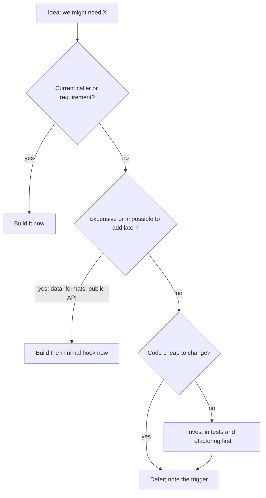

## In one minute
- YAGNI ("You Aren't Gonna Need It") says: build what today's requirements need, and add the rest when a real requirement arrives. It came out of Extreme Programming in the late 1990s, from a conversation between Kent Beck and Chet Hendrickson on the C3 payroll project ([Fowler](https://martinfowler.com/bliki/Yagni.html)).
- It is a bet about economics. Speculative code costs time to build, costs effort to carry every month, and is often wrong when the real need shows up. Deferring costs only the price of building it later.
- YAGNI is not "skip design". It depends on code that is cheap to change: tests, small modules and the habit of refactoring. Without those, deferral really is expensive.
- It does not cover one-way doors: on-disk and wire formats, public APIs, data you cannot recreate later, and security. Decide those carefully up front.
- Agents are speculation machines. Ask one for a payment client and you may get a provider registry, a retry policy hierarchy and six config knobs. Reviewing for YAGNI is now a daily job.

## How it works

### The speculative version
A team builds a notification service. The only requirement is email for password resets. The first design review produces this:

```python
class Channel(ABC):
    @abstractmethod
    def send(self, msg: Message, opts: ChannelOptions) -> DeliveryResult: ...

class ChannelRegistry:
    def register(self, name, factory, priority=0, fallback=None): ...

class EmailChannel(Channel): ...
# SmsChannel, PushChannel: "coming soon"
```

There is also a `ChannelOptions` with 11 fields, a priority-and-fallback system, and a template engine with plugin support. Nine months later SMS arrives. It needs per-country sender IDs and opt-out handling, and the shared `send` signature fits neither. The team spends two weeks bending the abstraction, and the fallback system has still never run in production.

### The YAGNI version
```python
def send_password_reset(email: str, link: str, mailer: Mailer) -> None:
    mailer.send(to=email, subject="Reset your password", body=render_reset(link))
```

When SMS arrives, the team has two real channels to compare, so the shared shape is visible instead of guessed. The extraction takes a day, with tests that already cover the email path.

### Four costs of a speculative feature
Martin Fowler names four costs of a "presumptive feature", one that is built before anyone can use it ([Fowler](https://martinfowler.com/bliki/Yagni.html)). For any capability you are tempted to build early, compare:
- **Cost of build**: the engineering days. If the guess is wrong, all of it is wasted.
- **Cost of delay**: the feature you did not ship while you built this one. People forget this one, and it applies even when the guess is right.
- **Cost of carry**: every reader must understand it, every refactor must preserve it, every dependency upgrade must keep it compiling, every test run executes its tests. The cost lands on every feature built until the speculative one is used or deleted.
- **Cost of repair**: when the need arrives it rarely matches the guess. A wrong abstraction costs more than none, because people bend new code to fit it.

Against these sits the cost of building it later, which is often higher than building it now because the code has grown. You pay it only if the need is real, and you build the right thing. The odds matter: Fowler cites Kohavi's analysis of experiments at Microsoft, where only about a third of carefully chosen features improved the metrics they targeted, so assume your odds of being right are at best one in three.

Building early wins only when the later cost is much higher, the probability of need is high, and the wait before it is used is short. That combination is rarer than it feels in a design meeting. One more filter from Fowler: if preparing for the future adds no complexity today, such as a lookup table for error messages instead of inline strings, there is nothing to defer.

### What YAGNI does not cover
Some decisions are expensive or impossible to reverse:
- **Data you cannot recreate.** If compliance may later ask who changed each price, an audit log started next year cannot tell you about this year.
- **Formats other people depend on.** A wire protocol or file format without a version field is costly to evolve. Adding a version byte now is cheap insurance, not speculation.
- **Public APIs.** Removing a parameter breaks callers; adding one usually does not. Start small.
- **Security and correctness.** Input validation and authorisation are part of today's requirements, not future features.

The test is reversibility. If adding it later costs about the same as adding it now, wait. Fowler also warns that YAGNI does not cover effort to keep code easy to change: refactoring, self-testing code and continuous delivery are what make deferral viable, and without them YAGNI "turns from a beneficial practice into a curse" ([Fowler](https://martinfowler.com/bliki/Yagni.html)).

### Unused code is a liability, not just a cost
Speculative code that ships and is never used does not sit quietly. Google's SRE book argues that code that is never executed, or is gated by a flag that is always off, is a time bomb, names Knight Capital as the example, and recommends routine removal of dead code because source control already remembers it ([SRE book, ch. 9](https://sre.google/sre-book/simplicity/)). The same rule explains why extension points that were never used tend to get in the way of the code that is.

### Reviewing agent-written code
Coding agents add generality because it looks like quality: an interface with one implementation, a `strategy` parameter nobody passes, configuration for values that never change, `**kwargs` passed through "for flexibility". In review, ask for each: which current caller needs this? If none, remove it. Google's reviewer guide says the same in its rule on over-engineering: solve the problem you know about now, and solve the future one when you can see its actual shape ([Google eng-practices](https://google.github.io/eng-practices/review/reviewer/looking-for.html)). Ask agents to "implement only what the tests require", and treat diffs that add abstractions without adding behaviour as a smell.

### The same shape elsewhere
YAGNI is a *speculation* problem: do work early on a prediction, or wait for the fact. A CPU does speculative execution only because branch predictors are right about 95 percent of the time and a miss costs only about 15 to 20 cycles. Manufacturing calls the opposite of over-building "just in time" inventory: stock costs money to hold, and demand forecasts are often wrong. Capacity planning faces the same trade, which is why autoscaling usually beats provisioning for a 100x peak that may never come.

## Down the stack

### Layer 1: The contract
YAGNI promises that every piece of code has a current reason to exist: a caller, a test from a real requirement, or a deliberate one-way-door decision written down. In return the team promises to keep the code cheap to change, so that adding a capability later costs a refactor, not a rewrite. If that second promise breaks, YAGNI stops paying.

### Layer 2: The mechanism
What makes deferral safe is tooling, not willpower:
- **Tests at the behaviour level** let you extract an interface or split a module later without fear.
- **Refactoring tools** (IDE rename, extract interface, `gopls` rename, the TypeScript language service) make "add the seam when the second case arrives" a minutes-long change.
- **Feature flags** let half-built work ship dark, so you build in small slices against real demand.
- **Expand-and-contract migrations** (add a nullable column, backfill, switch reads, drop the old column) make schema changes incremental, which removes the urge to design every column up front.
- **Dead code detection** keeps carrying costs visible: Go's `deadcode` tool reports functions that no execution can reach ([Go blog](https://go.dev/blog/deadcode)), `tsc` flags unused locals with `noUnusedLocals` ([TSConfig reference](https://www.typescriptlang.org/tsconfig/)), and `vulture` finds unused Python code ([Vulture](https://github.com/jendrikseipp/vulture)). Treat reports as leads, not verdicts: code reached only through reflection or plugins can look unused.

### Layer 3: The machine
Speculative generality has a runtime price. A direct Go method call can be inlined to a few instructions. Wrap the same work in an interface "in case of a second implementation" and the call goes through an itab lookup and an indirect branch, roughly 1 to 3 ns, and usually cannot be inlined. Worse, a value passed through an interface often escapes to the heap, adding an allocation (tens of nanoseconds) and garbage collector work per call.

In JavaScript, V8 optimises a call site that always sees one object shape. A plugin system that routes many shapes through one `handle(event)` makes that call site megamorphic, and V8 falls back to a slower generic lookup.

Unused dependencies cost elsewhere: a larger bundle means a slower cold start for a serverless function, more transitive packages to patch when a CVE lands, and longer CI builds on every commit. Configuration knobs that are read on every request are hash map lookups with a branch that the code paths behind them never exercise in tests.

### Why it's built this way
1. Requirements are uncertain, so a large share of features built ahead of need are never used or are used differently than guessed.
2. A wrong guess is worse than no guess, because existing abstractions pull new code toward their shape.
3. Carrying costs are paid on every change, so they compound with the size and age of the codebase.
4. Tests and refactoring tools make the later change cheap, which turns waiting from a risk into the default.
5. Some changes cannot be made cheap (lost data, published formats), so those are the exceptions to decide up front.

## Diagram


## Worked example
An illustrative case, with made-up but plausible numbers: a B2B analytics startup with 6 engineers debated multi-tenant sharding before they had a second large customer. The proposal: 15 engineer-days to build per-tenant database routing now. Estimated cost to add it later, once the codebase was larger: 25 engineer-days. Probability the sales pipeline would actually need it within a year: about 30 percent, and not before month 6. Carrying cost of the routing layer: about 1 engineer-day per month (tests, migrations that must run on every shard, onboarding).

Expected cost of building now: 15 days plus carrying it, about 6 months if needed and 12 months if not, which comes to 15 + (0.3 × 6 + 0.7 × 12) = 25.2 days. Expected cost of waiting: 0.3 × 25 = 7.5 days. They waited, and spent the 15 days on the reporting feature their first customer was asking for.

The same team built the audit log immediately. Building it now cost 3 days. Building it later was effectively 20 days plus permanent loss of history that a regulated customer's contract required, with a 90 percent chance of being asked within 3 months. Expected cost now: 3 days. Expected cost later: 18 days. YAGNI said build it, because the economics, not the slogan, decide.

## In the wild
- **Knight Capital, 2012: the code nobody used anymore.** The "Power Peg" trading logic had been abandoned in 2003 but stayed in the codebase. A 2012 release reused its old flag for new functionality; one of eight servers missed the deploy and ran Power Peg instead. In about 45 minutes Knight made 4 million executions in 154 stocks and lost more than $460 million, and the SEC fined it $12 million ([SEC order](https://www.sec.gov/litigation/admin/2013/34-70694.pdf)). Dead code is a speculative feature whose carrying cost finally came due.
- **OpenSSL, 2014: Heartbleed.** The TLS/DTLS heartbeat extension (RFC 6520) was motivated by DTLS, which has no cheap way to check that a peer is alive or to discover path MTU ([RFC 6520](https://www.rfc-editor.org/rfc/rfc6520)). A missing length check in its OpenSSL implementation, introduced in December 2011 and shipped in 1.0.1 from March 2012, let a client read server memory until 1.0.1g in April 2014. Anyone who could not upgrade was told to recompile with `-DOPENSSL_NO_HEARTBEATS` ([heartbleed.com](https://heartbleed.com)). Every capability you ship is attack surface whether or not your users ever need it.
- **Microsoft experiments, as reported by Fowler.** Kohavi and colleagues found that only about one in three features, even after careful analysis, improved the metric it was built for ([Fowler](https://martinfowler.com/bliki/Yagni.html)). That base rate is the quantitative case for waiting.

## Trade-offs
| Option | Strengths | Weaknesses | Choose when |
| --- | --- | --- | --- |
| Build only for current needs | Least code, right abstractions from real cases | Some later changes cost more | Default, with good tests |
| Build a minimal hook now | Cheap insurance against a costly retrofit | Small carrying cost | Versions, IDs, audit data, extension points in public APIs |
| Build the full feature early | Ready when demand arrives | Carrying cost, often wrong shape | Need is near-certain and imminent |
| Defer without tests | Fast today | Later change is a rewrite | Never; fix the tests first |

## Pitfalls in production
- Using YAGNI to skip design for one-way doors, such as a message format with no version field. Fix: ask "can we add this later for about the same price?" and decide up front when the answer is no.
- Abstractions with one implementation that nobody remembers adding. Fix: inline them, and add the interface back when the second real implementation appears.
- Configuration that has never been changed in production. Fix: audit config values against deploy history and turn unchanged knobs back into constants.
- "Temporary" code with no trigger to revisit it. Fix: record the trigger (the second tenant, 10,000 QPS) next to the deferral so the decision is not lost.
- Deferring with no safety net, so the later change is frightening and keeps getting postponed. Fix: invest in tests at the behaviour level first.
- Agents expanding scope in every diff. Fix: state "only what the failing tests need" in the task and reject unrequested abstractions in review.

## Leadership lens
- In design review, ask for every component: which current requirement needs it, and what would it cost to add in six months? Speculation should come with numbers.
- Separate one-way doors from two-way doors explicitly in design documents, and spend review time on the one-way ones.
- Carrying costs are invisible on roadmaps. Track the size of unused flags, configs and abstractions, and budget time to delete them.
- YAGNI only works on teams that are allowed to refactor. If refactoring needs a ticket and a quarter, people will build everything up front, and they will be rational to do so.

## Check yourself
1. Why does YAGNI depend on having good tests?
   **Answer:** Deferring is only cheap if the later change is cheap. Without tests, adding the capability later means a risky rewrite, so the economics flip toward building early.
2. A colleague says YAGNI means you should not add a version field to a new event schema. What is wrong with that?
   **Answer:** A format other systems depend on is a one-way door; retrofitting versioning across producers and consumers is far costlier than one field now. YAGNI applies to features, not to keeping the system changeable.
3. Why can a wrong early abstraction cost more than no abstraction?
   **Answer:** Later code is bent to fit the existing shape, so the cost is the original build plus the workarounds plus eventually undoing it.
4. A feature is certain to be needed, but only in 10 months. Why might deferral still be right?
   **Answer:** Carrying cost accrues every month until it is used, and the details of a requirement 10 months away often change; if those costs exceed the extra cost of building later, waiting wins.

## Practice
**Task:** Build a YAGNI decision calculator. Each candidate `Feature` has a `name`, `build_now` and `build_later` costs in engineer-days, a monthly `carry` cost in engineer-days, `p_pct` (probability in percent, 0 to 100, that it will be needed) and `month` (when it would be needed, 1 to `horizon`). Work in hundredths of a day to stay in integers: the cost of building now is `build_now*100 + carry*(p_pct*month + (100-p_pct)*horizon)` and the cost of deferring is `p_pct*build_later`. `decide(feature, horizon)` returns a `Decision` with `name`, `choice` (`"build now"` only if strictly cheaper, otherwise `"defer"`), `now` and `defer`. `plan(features, horizon)` returns the decisions in input order plus the total of the cheaper cost of each. Reject `horizon < 1` with `invalid horizon: <h>`, any negative cost, `p_pct` outside 0 to 100 or `month` outside 1 to `horizon` with `invalid feature: <name>`, and a repeated name with `duplicate feature: <name>` (Python `ValueError`, TypeScript `Error`, Go `error`).

```python starter
from dataclasses import dataclass

@dataclass
class Feature:
    name: str
    build_now: int
    build_later: int
    carry: int
    p_pct: int
    month: int

@dataclass
class Decision:
    name: str
    choice: str
    now: int
    defer: int

def decide(feature, horizon):
    # TODO
    raise NotImplementedError

def plan(features, horizon):
    # TODO: return (decisions, total)
    raise NotImplementedError
```

```python tests
def error_of(fn):
    try:
        fn()
    except ValueError as e:
        return str(e)
    return None

def test_speculative_platform_work_is_deferred():
    d = decide(Feature("multi-tenant", 15, 25, 1, 30, 6), 12)
    assert d == Decision("multi-tenant", "defer", 2520, 750)

def test_unrecoverable_data_is_built_now():
    d = decide(Feature("audit-log", 3, 20, 0, 90, 3), 12)
    assert d == Decision("audit-log", "build now", 300, 1800)

def test_tie_defers_and_zero_probability_defers():
    assert decide(Feature("tie", 2, 4, 0, 50, 1), 12).choice == "defer"
    assert decide(Feature("never", 1, 100, 0, 0, 1), 12) == Decision("never", "defer", 100, 0)

def test_carry_cost_can_flip_a_certain_feature():
    assert decide(Feature("sure", 5, 6, 0, 100, 2), 12).choice == "build now"
    d = decide(Feature("sure-carry", 5, 6, 1, 100, 2), 12)
    assert d == Decision("sure-carry", "defer", 700, 600)

def test_plan_keeps_order_and_sums_cheaper_costs():
    ds, total = plan([Feature("multi-tenant", 15, 25, 1, 30, 6),
                      Feature("audit-log", 3, 20, 0, 90, 3)], 12)
    assert [d.name for d in ds] == ["multi-tenant", "audit-log"]
    assert [d.choice for d in ds] == ["defer", "build now"]
    assert total == 1050

def test_validation_errors():
    assert error_of(lambda: plan([], 0)) == "invalid horizon: 0"
    assert error_of(lambda: decide(Feature("x", 1, 1, 0, 120, 1), 12)) == "invalid feature: x"
    assert error_of(lambda: decide(Feature("y", 1, 1, 0, 50, 13), 12)) == "invalid feature: y"
    assert error_of(lambda: decide(Feature("z", -1, 1, 0, 50, 1), 12)) == "invalid feature: z"
    dup = [Feature("a", 1, 1, 0, 50, 1), Feature("a", 2, 2, 0, 50, 1)]
    assert error_of(lambda: plan(dup, 12)) == "duplicate feature: a"

def test_empty_plan():
    assert plan([], 6) == ([], 0)
```

```python solution
from dataclasses import dataclass

@dataclass
class Feature:
    name: str
    build_now: int
    build_later: int
    carry: int
    p_pct: int
    month: int

@dataclass
class Decision:
    name: str
    choice: str
    now: int
    defer: int

def _check_horizon(horizon):
    if horizon < 1:
        raise ValueError("invalid horizon: %d" % horizon)

def decide(feature, horizon):
    _check_horizon(horizon)
    f = feature
    if (f.build_now < 0 or f.build_later < 0 or f.carry < 0
            or f.p_pct < 0 or f.p_pct > 100 or f.month < 1 or f.month > horizon):
        raise ValueError("invalid feature: %s" % f.name)
    now = f.build_now * 100 + f.carry * (f.p_pct * f.month + (100 - f.p_pct) * horizon)
    defer = f.p_pct * f.build_later
    choice = "build now" if now < defer else "defer"
    return Decision(f.name, choice, now, defer)

def plan(features, horizon):
    _check_horizon(horizon)
    seen = set()
    decisions = []
    for f in features:
        d = decide(f, horizon)
        if f.name in seen:
            raise ValueError("duplicate feature: %s" % f.name)
        seen.add(f.name)
        decisions.append(d)
    total = sum(min(d.now, d.defer) for d in decisions)
    return decisions, total
```

```typescript starter
export interface Feature {
  name: string;
  buildNow: number;
  buildLater: number;
  carry: number;
  pPct: number;
  month: number;
}

export interface Decision {
  name: string;
  choice: string;
  now: number;
  defer: number;
}

export function decide(f: Feature, horizon: number): Decision {
  throw new Error("TODO");
}

export function plan(fs: Feature[], horizon: number): { decisions: Decision[]; total: number } {
  throw new Error("TODO");
}
```

```typescript tests
function errorOf(fn: () => void): string | undefined {
  try { fn(); } catch (e) { return (e as Error).message; }
  return undefined;
}

function feat(name: string, buildNow: number, buildLater: number, carry: number, pPct: number, month: number): Feature {
  return { name, buildNow, buildLater, carry, pPct, month };
}

test("speculative platform work is deferred", () => {
  assertEqual(decide(feat("multi-tenant", 15, 25, 1, 30, 6), 12),
    { name: "multi-tenant", choice: "defer", now: 2520, defer: 750 });
});

test("unrecoverable data is built now", () => {
  assertEqual(decide(feat("audit-log", 3, 20, 0, 90, 3), 12),
    { name: "audit-log", choice: "build now", now: 300, defer: 1800 });
});

test("tie defers and zero probability defers", () => {
  assertEqual(decide(feat("tie", 2, 4, 0, 50, 1), 12).choice, "defer");
  assertEqual(decide(feat("never", 1, 100, 0, 0, 1), 12),
    { name: "never", choice: "defer", now: 100, defer: 0 });
});

test("carry cost can flip a certain feature", () => {
  assertEqual(decide(feat("sure", 5, 6, 0, 100, 2), 12).choice, "build now");
  assertEqual(decide(feat("sure-carry", 5, 6, 1, 100, 2), 12),
    { name: "sure-carry", choice: "defer", now: 700, defer: 600 });
});

test("plan keeps order and sums cheaper costs", () => {
  const r = plan([feat("multi-tenant", 15, 25, 1, 30, 6), feat("audit-log", 3, 20, 0, 90, 3)], 12);
  assertEqual(r.decisions.map(d => d.name), ["multi-tenant", "audit-log"]);
  assertEqual(r.decisions.map(d => d.choice), ["defer", "build now"]);
  assertEqual(r.total, 1050);
});

test("validation errors", () => {
  assertEqual(errorOf(() => plan([], 0)), "invalid horizon: 0");
  assertEqual(errorOf(() => decide(feat("x", 1, 1, 0, 120, 1), 12)), "invalid feature: x");
  assertEqual(errorOf(() => decide(feat("y", 1, 1, 0, 50, 13), 12)), "invalid feature: y");
  assertEqual(errorOf(() => decide(feat("z", -1, 1, 0, 50, 1), 12)), "invalid feature: z");
  const dup = [feat("a", 1, 1, 0, 50, 1), feat("a", 2, 2, 0, 50, 1)];
  assertEqual(errorOf(() => plan(dup, 12)), "duplicate feature: a");
});

test("empty plan", () => {
  assertEqual(plan([], 6), { decisions: [], total: 0 });
});
```

```typescript solution
export interface Feature {
  name: string;
  buildNow: number;
  buildLater: number;
  carry: number;
  pPct: number;
  month: number;
}

export interface Decision {
  name: string;
  choice: string;
  now: number;
  defer: number;
}

function checkHorizon(horizon: number): void {
  if (horizon < 1) throw new Error(`invalid horizon: ${horizon}`);
}

export function decide(f: Feature, horizon: number): Decision {
  checkHorizon(horizon);
  if (f.buildNow < 0 || f.buildLater < 0 || f.carry < 0 ||
      f.pPct < 0 || f.pPct > 100 || f.month < 1 || f.month > horizon) {
    throw new Error(`invalid feature: ${f.name}`);
  }
  const now = f.buildNow * 100 + f.carry * (f.pPct * f.month + (100 - f.pPct) * horizon);
  const defer = f.pPct * f.buildLater;
  return { name: f.name, choice: now < defer ? "build now" : "defer", now, defer };
}

export function plan(fs: Feature[], horizon: number): { decisions: Decision[]; total: number } {
  checkHorizon(horizon);
  const seen = new Set<string>();
  const decisions: Decision[] = [];
  for (const f of fs) {
    const d = decide(f, horizon);
    if (seen.has(f.name)) throw new Error(`duplicate feature: ${f.name}`);
    seen.add(f.name);
    decisions.push(d);
  }
  const total = decisions.reduce((n, d) => n + Math.min(d.now, d.defer), 0);
  return { decisions, total };
}
```

```go starter
package practice

type Feature struct {
	Name       string
	BuildNow   int
	BuildLater int
	Carry      int
	PPct       int
	Month      int
}

type Decision struct {
	Name   string
	Choice string
	Now    int
	Defer  int
}

func Decide(f Feature, horizon int) (Decision, error) { panic("TODO") }

func Plan(fs []Feature, horizon int) ([]Decision, int, error) { panic("TODO") }
```

```go tests
package practice

import "testing"

func mustDecide(t *testing.T, f Feature, h int) Decision {
	t.Helper()
	d, err := Decide(f, h)
	if err != nil {
		t.Fatal(err)
	}
	return d
}

func errText(err error) string {
	if err == nil {
		return ""
	}
	return err.Error()
}

func TestSpeculativePlatformWorkIsDeferred(t *testing.T) {
	d := mustDecide(t, Feature{"multi-tenant", 15, 25, 1, 30, 6}, 12)
	if d != (Decision{"multi-tenant", "defer", 2520, 750}) {
		t.Fatalf("got %+v", d)
	}
}

func TestUnrecoverableDataIsBuiltNow(t *testing.T) {
	d := mustDecide(t, Feature{"audit-log", 3, 20, 0, 90, 3}, 12)
	if d != (Decision{"audit-log", "build now", 300, 1800}) {
		t.Fatalf("got %+v", d)
	}
}

func TestTieDefersAndZeroProbabilityDefers(t *testing.T) {
	if d := mustDecide(t, Feature{"tie", 2, 4, 0, 50, 1}, 12); d.Choice != "defer" {
		t.Fatalf("got %+v", d)
	}
	if d := mustDecide(t, Feature{"never", 1, 100, 0, 0, 1}, 12); d != (Decision{"never", "defer", 100, 0}) {
		t.Fatalf("got %+v", d)
	}
}

func TestCarryCostCanFlipACertainFeature(t *testing.T) {
	if d := mustDecide(t, Feature{"sure", 5, 6, 0, 100, 2}, 12); d.Choice != "build now" {
		t.Fatalf("got %+v", d)
	}
	if d := mustDecide(t, Feature{"sure-carry", 5, 6, 1, 100, 2}, 12); d != (Decision{"sure-carry", "defer", 700, 600}) {
		t.Fatalf("got %+v", d)
	}
}

func TestPlanKeepsOrderAndSumsCheaperCosts(t *testing.T) {
	ds, total, err := Plan([]Feature{{"multi-tenant", 15, 25, 1, 30, 6}, {"audit-log", 3, 20, 0, 90, 3}}, 12)
	if err != nil {
		t.Fatal(err)
	}
	if len(ds) != 2 || ds[0].Name != "multi-tenant" || ds[1].Name != "audit-log" {
		t.Fatalf("order %+v", ds)
	}
	if ds[0].Choice != "defer" || ds[1].Choice != "build now" || total != 1050 {
		t.Fatalf("got %+v total %d", ds, total)
	}
}

func TestValidationErrors(t *testing.T) {
	if _, _, err := Plan(nil, 0); errText(err) != "invalid horizon: 0" {
		t.Fatalf("got %v", err)
	}
	cases := map[string]Feature{
		"invalid feature: x": {"x", 1, 1, 0, 120, 1},
		"invalid feature: y": {"y", 1, 1, 0, 50, 13},
		"invalid feature: z": {"z", -1, 1, 0, 50, 1},
	}
	for want, f := range cases {
		if _, err := Decide(f, 12); errText(err) != want {
			t.Fatalf("want %q, got %v", want, err)
		}
	}
	dup := []Feature{{"a", 1, 1, 0, 50, 1}, {"a", 2, 2, 0, 50, 1}}
	if _, _, err := Plan(dup, 12); errText(err) != "duplicate feature: a" {
		t.Fatalf("got %v", err)
	}
}

func TestEmptyPlan(t *testing.T) {
	ds, total, err := Plan(nil, 6)
	if err != nil || len(ds) != 0 || total != 0 {
		t.Fatalf("got %v %d %v", ds, total, err)
	}
}
```

```go solution
package practice

import "fmt"

type Feature struct {
	Name       string
	BuildNow   int
	BuildLater int
	Carry      int
	PPct       int
	Month      int
}

type Decision struct {
	Name   string
	Choice string
	Now    int
	Defer  int
}

func checkHorizon(h int) error {
	if h < 1 {
		return fmt.Errorf("invalid horizon: %d", h)
	}
	return nil
}

func Decide(f Feature, horizon int) (Decision, error) {
	if err := checkHorizon(horizon); err != nil {
		return Decision{}, err
	}
	if f.BuildNow < 0 || f.BuildLater < 0 || f.Carry < 0 ||
		f.PPct < 0 || f.PPct > 100 || f.Month < 1 || f.Month > horizon {
		return Decision{}, fmt.Errorf("invalid feature: %s", f.Name)
	}
	now := f.BuildNow*100 + f.Carry*(f.PPct*f.Month+(100-f.PPct)*horizon)
	deferCost := f.PPct * f.BuildLater
	choice := "defer"
	if now < deferCost {
		choice = "build now"
	}
	return Decision{f.Name, choice, now, deferCost}, nil
}

func Plan(fs []Feature, horizon int) ([]Decision, int, error) {
	if err := checkHorizon(horizon); err != nil {
		return nil, 0, err
	}
	seen := map[string]bool{}
	out := make([]Decision, 0, len(fs))
	total := 0
	for _, f := range fs {
		d, err := Decide(f, horizon)
		if err != nil {
			return nil, 0, err
		}
		if seen[f.Name] {
			return nil, 0, fmt.Errorf("duplicate feature: %s", f.Name)
		}
		seen[f.Name] = true
		out = append(out, d)
		total += min(d.Now, d.Defer)
	}
	return out, total, nil
}
```

## Mock interview
**Prompt:** You lead a team of 5 building an internal deployment tool used by 40 services. A senior engineer proposes a plugin architecture so that "any cloud provider" can be supported; today everything runs on one provider, and there is no plan to change. How do you respond?

- Follow-up: Leadership says a second provider is "possible in the next two years". Does that change your answer?
- Follow-up: Which decisions in this tool would you make carefully now, even under YAGNI?
- Follow-up: The tool was built without the plugin layer, and two years later the second provider arrives. What makes that change cheap or expensive?

**A strong answer covers:**
- Turning the debate into numbers: build cost now, carrying cost per month, probability and timing of need, and the cost of adding it later.
- Noting that a guessed abstraction based on one provider will likely be the wrong shape for the second.
- Identifying one-way doors to get right now: the deployment record format, audit history, and the API services call.
- Keeping provider-specific code behind a narrow module boundary, which is cheap today and makes extraction easy later, without building a plugin system.
- Investing in tests at the behaviour level so the future change is a refactor.
- Writing down the trigger that would justify the work, so the decision is revisited deliberately.

## Sources and further study
**Primary**
- [RFC 6520: TLS and DTLS Heartbeat Extension](https://www.rfc-editor.org/rfc/rfc6520): the stated motivation for a feature that later became Heartbleed.
- [SEC order: Knight Capital Americas](https://www.sec.gov/litigation/admin/2013/34-70694.pdf): the regulator's account of dead code coming back to life.

**Systems docs**
- [Google SRE book, ch. 9: Simplicity](https://sre.google/sre-book/simplicity/): why unused and flag-gated code is a liability.
- [Google eng-practices: what to look for](https://google.github.io/eng-practices/review/reviewer/looking-for.html): the reviewer rule against solving problems you only speculate about.
- [Go blog: finding unreachable functions with deadcode](https://go.dev/blog/deadcode): tooling that makes the carrying cost of dead code visible.
- [Vulture](https://github.com/jendrikseipp/vulture): dead code detection for Python, with its caveats about implicit calls.

**Books**
- *Refactoring*, Fowler (2nd ed.), ch. 3 "Bad Smells in Code" for speculative generality and dead code, and ch. 4 "Building Tests" as the enabler for deferral.
- *Software Engineering at Google*, Winters, Manshreck and Wright, ch. 15 "Deprecation": code as a liability that needs a plan for removal.

**Other curricula**
- [Refactoring.Guru: Speculative Generality](https://refactoring.guru/smells/speculative-generality): lists unused classes, parameters and hooks as a smell, and notes that framework code written for outside users is a legitimate exception.
- [extremeprogramming.org: Never add functionality early](http://www.extremeprogramming.org/rules/early.html): the original XP rule in its plainest form.
- [Ron Jeffries: You're NOT gonna need it](https://ronjeffries.com/xprog/articles/practices/pracnotneed/): a practitioner's argument that the cheapest code is the code you do not write.

## Watch
- [The YAGNI Principle (Venkat Subramaniam, via Dev Tools Made Simple)](https://www.youtube.com/watch?v=QyOQBuHDAoY): a short talk on why postponing speculative work keeps a design easier to change.
- [Do you really need that abstraction or generic code? (CodeOpinion)](https://www.youtube.com/watch?v=_Al7qI4vMt0): a practical look at generic code and abstractions added before there is a need.

## Free resources
- [Yagni (Martin Fowler)](https://martinfowler.com/bliki/Yagni.html): the clearest breakdown of the costs of presumptive features, and why YAGNI depends on refactoring.
- [You Arent Gonna Need It (C2 wiki)](https://wiki.c2.com/?YouArentGonnaNeedIt): the original Extreme Programming discussion, with arguments on both sides.
- [The Wrong Abstraction (Sandi Metz)](https://sandimetz.com/blog/2016/1/20/the-wrong-abstraction): why duplication is cheaper than an abstraction built on a guess.
- [Is Design Dead? (Martin Fowler)](https://martinfowler.com/articles/designDead.html): how evolutionary design and YAGNI fit together, and where up-front design still matters.
- [Beck Design Rules (Martin Fowler)](https://martinfowler.com/bliki/BeckDesignRules.html): "fewest elements" as one of Kent Beck's four rules of simple design.
