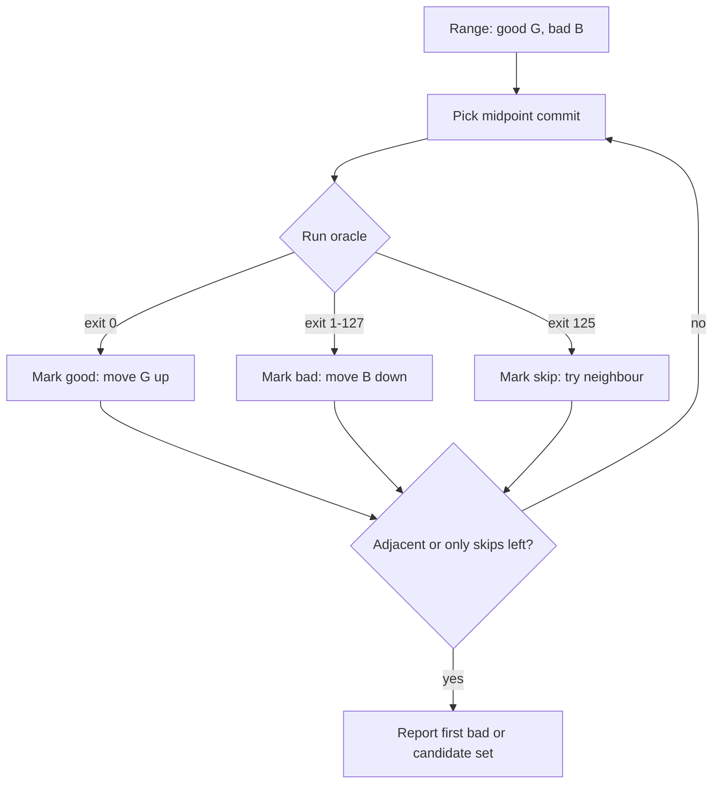

## In one minute
- If something worked at point A and is broken at point B, and you can test any point in between, binary search finds the first broken point in about log2(N) tests: 14 tests for 10,000 commits.
- Bisection needs no theory about the bug. It trades understanding for a reliable oracle, which makes it the best tool when you have no good hypothesis.
- The oracle is everything. It must detect this bug and only this bug, run unattended, and say "skip" when a commit cannot be tested.
- Bisect over anything ordered: commits, dependency versions, config changes, feature flags, deploy timestamps, rows of input, or hosts in a rollout.
- A flaky oracle silently sends the search down the wrong half. Repeat tests or bisect with probabilities when the test is noisy.

## How it works

### When bisection applies
You need three things: a known good point, a known bad point, and a test that tells them apart. The sequence between them should be monotonic for the bug: once broken, it stays broken until the end. Regressions in a linear commit history are the classic case. Performance regressions work too, as long as you turn "slower" into a threshold ("p50 of this benchmark over 40 ms is bad").

### The oracle
`git bisect run ./check.sh` drives the whole search with a script. The exit code is the protocol: 0 means good, 125 means this commit cannot be tested so skip it, codes from 1 to 127 other than 125 mean bad, and anything of 128 or more aborts the bisect ([git-bisect docs](https://git-scm.com/docs/git-bisect)). Git picked 125 because 126 and 127 are the shell's "not executable" and "command not found", which therefore count as bad: a misspelled script path marks every commit bad, so test the script on both endpoints first. The most common bisection mistake is an oracle that fails for the wrong reason, such as a build break, a missing fixture or a network timeout, and so reports "bad" on commits that do not contain the bug. Make the script check for the specific symptom (an exact error string, an assertion, a measured threshold) and exit 125 when the build itself fails.

### Skips and untestable ranges
Real histories contain commits that do not build, or where a dependent feature is half-merged. Skipping them is fine until the skipped commits sit right at the boundary. Then bisect can only say "the first bad commit is one of these", and you inspect that small set by hand; the docs warn that skipping a commit adjacent to the culprit makes Git unable to tell which of them was first ([git-bisect docs](https://git-scm.com/docs/git-bisect)). A team that keeps every commit on main buildable gets sharper answers.

### Bisecting things that are not commits
The same search applies to many spaces. A config file with 200 changed keys between a good and bad environment can be bisected by applying half of the diff. A dependency lockfile upgrade that moved 60 packages can be bisected by package. Feature flags turned on during an incident window can be bisected by toggling half. A fleet where only some hosts misbehave can be bisected by host attributes. Delta debugging generalises this to inputs where several parts must combine to trigger the failure. Russ Cox's hash-based `bisect` tool goes further and bisects over code locations (a function, a rewrite rule, a call stack) instead of commits: in his Go 1.23 timer example it narrowed a failing test to one `time.After()` call site ([Cox, 2024](https://research.swtch.com/bisect)).

### Non-linear history
Git history is a graph with merges. `git bisect` does not walk a list; it chooses a commit that splits the set of candidate commits (ancestors of bad, not ancestors of any good) as evenly as it can. If a merge brought in a long-lived branch, the first bad commit may be on that branch, or the bug may appear only at the merge itself because two individually fine changes conflict. `git bisect --first-parent` follows only the first parent at each merge, so the merge commit is reported as the introduction and the merged branch's own commits are ignored ([git-bisect docs](https://git-scm.com/docs/git-bisect)). That also avoids false positives from non-building commits inside a merged branch.

## Down the stack

### Layer 1: The contract
Given a good commit G, a bad commit B, and an oracle that is deterministic and monotonic along the path, bisection returns the first bad commit using at most about ceil(log2 N) oracle calls for N candidates. If the oracle is not monotonic (the bug appeared, vanished, then reappeared), bisection still returns a good-to-bad transition, just not necessarily the one you care about. If commits are skipped, the result may be a set of candidates instead of a single commit. With a flaky oracle the contract is void: a single wrong answer sends the search into a half that does not contain the cause, and nothing in the output warns you.

### Layer 2: The mechanism
`git bisect` keeps its state as plain refs and files under `.git`: `refs/bisect/bad`, one `refs/bisect/good-<sha>` per good mark, `refs/bisect/skip-<sha>` per skip, plus `BISECT_LOG` and `BISECT_START`. Because state is on disk, you can stop, inspect, and replay a session with `git bisect replay`. When you hunt for a change that is not a regression, `git bisect start --term-old fast --term-new slow` renames good and bad so the commands read correctly (you cannot mix the two vocabularies in one session; [git-bisect docs](https://git-scm.com/docs/git-bisect)). At each step git computes the candidates as commits reachable from bad but not from any good, and for each candidate how many other candidates it can reach. The best pick is the commit whose reachable count is closest to half. When the best pick is skipped, git moves to a nearby candidate instead.

When the oracle is noisy, deterministic bisection breaks down. A probabilistic variant keeps a probability for each candidate being the first bad commit, updates it with Bayes' rule after each test given an assumed false-positive and false-negative rate, and tests where the cumulative probability crosses 50%. It costs more tests but tolerates noise. Several open-source tools implement this idea; check their assumptions before trusting the output.

### Layer 3: The machine
The cost of bisection is not the search, it is each step's build and test. Checking out a commit rewrites the changed files in the working tree, updating their mtimes, which invalidates incremental build outputs that depend on them. In a large C++ or Rust codebase that can mean minutes per step. Practical speed-ups: build each step in a separate `git worktree` so caches survive, use a compiler cache like `ccache` or a remote build cache keyed by content hash, and, best of all, bisect over CI artefacts already built per commit so each step is a download plus a test run. Kernel bisection is the extreme case: each step needs a kernel build, an install and a reboot. The kernel's own guide puts a trimmed build (`make localmodconfig`) at about 10 to 15 minutes on commodity x86 hardware and a bisection between two stable series at about 15 builds, so it is an afternoon of work and an automated test rig pays for itself ([Linux kernel docs](https://docs.kernel.org/admin-guide/verify-bugs-and-bisect-regressions.html)). The same guide says to double-check every verdict, since one wrong label derails the rest.

### Why it's built this way
1. Changes arrive as many small, ordered steps, so the cause of a regression is usually a single step between a good and a bad point.
2. Ordered search spaces admit binary search, so the cost grows with log2 of history length, not with its size.
3. Each step is expensive (build, deploy, test), so you automate the oracle and cache artefacts per commit.
4. Real histories contain untestable and non-linear parts, so the tool supports skips, graph-aware midpoints and first-parent mode.

## Diagram


## Worked example
A service's p99 latency on a synthetic benchmark rose from 18 ms to 31 ms between the release two weeks ago and today. In between are 2,300 commits on main. Building and running the benchmark takes 6 minutes per step, and CI has a container image for every main commit, so steps can skip the build and take about 90 seconds.

The oracle runs the benchmark five times and reports bad if the median p99 is over 25 ms, a threshold far from both modes, so noise rarely crosses it. It exits 125 if the image is missing. log2(2,300) is about 11.2, so expect 12 steps. One image is missing, which costs one extra step. Thirteen steps at 90 seconds is under 20 minutes, unattended. The first bad commit is a logging change that switched a formatter from lazy to eager evaluation in the request path. Nobody had suspected it because the diff touched only a logging helper; the oracle did not need a suspect.

Contrast with a 1-run oracle and a benchmark that is noisy about 5% of the time near the threshold: over 12 steps the chance of at least one wrong answer is about 1 - 0.95^12, roughly 46%. That is why the oracle takes a median of five and uses a threshold well away from both modes.

## In the wild
- **Indeed, 2019: CPU throttling at low usage.** After a move to Linux 4.18 kernels, tail latency rose while CPU usage looked normal and response times tracked throttling. Indeed built a reproducer, ran `git bisect`, and landed on commit 512ac999 ("Fix bandwidth timer clock drift condition"), which expired each CPU's leftover quota every period. The fix lowered worst-case response latency in one Indeed application from over two seconds to 30 ms, and it reached mainline 5.4 and was backported to stable kernels such as 4.14.154 and 4.19.84 ([Indeed Engineering](https://engineering.indeedblog.com/blog/2019/12/unthrottled-fixing-cpu-limits-in-the-cloud/), [part 2](https://engineering.indeedblog.com/blog/2019/12/cpu-throttling-regression-fix/)).
- **Go, 2024: timer change breaks a test.** Russ Cox walks through a failing test after the Go 1.23 timer rewrite. Toggling the `asynctimerchan` GODEBUG setting confirmed the timer change was the cause, and the hash-based `bisect` tool then narrowed it to one call stack, `time.After()` called from `retry.Do()` at `retry.go:37`. The commit-level `git bisect` in the same post started from about 1,360 revisions, roughly 10 steps ([Cox](https://research.swtch.com/bisect)).

## Trade-offs
| Approach | Strengths | Weaknesses | Choose when |
| --- | --- | --- | --- |
| `git bisect run` | Mechanical, needs no hypothesis, log2 cost | Needs good and bad points and a reliable oracle | Clear regressions in code |
| Bisect CI artefacts | Very fast steps, no local builds | Needs per-commit artefacts retained | Large codebases with slow builds |
| Bisect config or flags | Finds non-code causes | Interactions between keys can confuse it | Environment drift, incident flag changes |
| Probabilistic bisect | Tolerates flaky oracles | More steps, needs an error-rate estimate | Intermittent failures |
| Reading the diff | Fast for small ranges | Biased toward suspicious-looking code | Under about 10 commits |

## Pitfalls in production
- Oracle fails for the wrong reason (build break, flaky dependency, missing test data). Fix: match the exact symptom and exit 125 when the commit cannot be tested.
- A known-good point that was never actually good. Fix: run the oracle on both endpoints before starting.
- Squash-merged mega-commits make the answer "this 3,000-line PR". Fix: keep commits small, or bisect the PR's original branch history if retained.
- Bisecting a flaky test with single runs. Fix: repeat per step, use a margin, or switch to a probabilistic method.
- Environment drift: the bug is in a dependency, OS image or config that is not part of the commit. Fix: pin the environment for the oracle and bisect those layers separately.

## Leadership lens
- Keep every commit on main buildable and testable. It is the policy that makes bisect precise.
- Retain CI artefacts per commit for at least a release cycle; it turns hour-long bisects into minutes.
- Version config and flag changes with timestamps, so they can be bisected just like code.
- When an agent produces a large change, prefer a series of small commits over one squash, so a future bisect has resolution.
- Teach the team that bisect is not admitting defeat. It is often faster than the cleverest theory.

## Check yourself
1. Why does a single wrong oracle answer ruin a bisect without any warning?
   **Answer:** Each answer discards half the range permanently, so a wrong one discards the half that contains the cause, and the search converges confidently on an innocent commit.
2. A bisect ends with "the first bad commit could be any of" four commits. What happened?
   **Answer:** The commits next to the boundary were skipped as untestable, so the search cannot place the transition more precisely than that set.
3. Why can the first bad commit be a merge even if both parents are good?
   **Answer:** Two changes that are each fine can conflict semantically when combined, so the bug exists only in the merge result.
4. Your oracle measures latency. How do you make it safe for bisection?
   **Answer:** Repeat the measurement, take a robust statistic like the median, and set a threshold far from both the good and bad distributions.

## Practice
**Task:** Write a bisect driver. `find_first_bad(commits, test)` takes an ordered list where `commits[0]` is known good and `commits[-1]` is known bad (never test them), and an oracle that returns `"good"`, `"bad"` or `"skip"`. Keep `lo` (last known good) and `hi` (first known bad). Pick the midpoint `(lo + hi) // 2`; if it is skipped, try `mid+1`, `mid-1`, `mid+2`, `mid-2` and so on, staying strictly inside `(lo, hi)`. Return `[commits[hi]]` once `hi == lo + 1`, or `commits[lo+1 .. hi]` (inclusive) if every commit strictly between them was skipped. Raise `ValueError` for fewer than two commits. Never test a commit twice.

```python starter
def find_first_bad(commits, test):
    # TODO
    raise NotImplementedError
```

```python tests
def make(n, first_bad, skip=()):
    calls = []
    def test(c):
        calls.append(c)
        i = int(c[1:])
        if i in skip:
            return "skip"
        return "bad" if i >= first_bad else "good"
    return ["c%d" % i for i in range(n)], test, calls

def test_linear_log_steps():
    commits, test, calls = make(100, 37)
    assert find_first_bad(commits, test) == ["c37"]
    assert len(calls) <= 7

def test_adjacent_needs_no_tests():
    commits, test, calls = make(2, 1)
    assert find_first_bad(commits, test) == ["c1"]
    assert calls == []

def test_skip_away_from_boundary_is_harmless():
    commits, test, calls = make(11, 3, skip={5})
    assert find_first_bad(commits, test) == ["c3"]
    assert calls == ["c5", "c6", "c3", "c1", "c2"]

def test_skip_at_boundary_gives_candidates():
    commits, test, _ = make(10, 5, skip={5})
    assert find_first_bad(commits, test) == ["c5", "c6"]

def test_all_skipped():
    commits, test, _ = make(5, 2, skip={1, 2, 3})
    assert find_first_bad(commits, test) == ["c1", "c2", "c3", "c4"]

def test_never_tests_endpoints_or_twice():
    commits, test, calls = make(1000, 999)
    assert find_first_bad(commits, test) == ["c999"]
    assert "c0" not in calls and "c999" not in calls
    assert len(calls) == len(set(calls))

def test_too_short():
    try:
        find_first_bad(["only"], lambda c: "bad")
        assert False, "expected ValueError"
    except ValueError:
        pass
```

```python solution
def find_first_bad(commits, test):
    if len(commits) < 2:
        raise ValueError("need a good and a bad commit")
    lo, hi = 0, len(commits) - 1
    skipped = set()
    while hi - lo > 1:
        mid = (lo + hi) // 2
        pick = None
        for d in range(0, hi - lo):
            for c in ((mid + d, mid - d) if d else (mid,)):
                if lo < c < hi and c not in skipped:
                    pick = c
                    break
            if pick is not None:
                break
        if pick is None:
            return commits[lo + 1:hi + 1]
        verdict = test(commits[pick])
        if verdict == "good":
            lo = pick
        elif verdict == "bad":
            hi = pick
        else:
            skipped.add(pick)
    return [commits[hi]]
```

```typescript starter
export type Verdict = "good" | "bad" | "skip";

export function findFirstBad(commits: string[], test: (c: string) => Verdict): string[] {
  throw new Error("TODO");
}
```

```typescript tests
function make(n: number, firstBad: number, skip: number[] = []) {
  const calls: string[] = [];
  const commits = Array.from({ length: n }, (_, i) => "c" + i);
  const t = (c: string): Verdict => {
    calls.push(c);
    const i = Number(c.slice(1));
    if (skip.includes(i)) return "skip";
    return i >= firstBad ? "bad" : "good";
  };
  return { commits, t, calls };
}

test("linear log steps", () => {
  const { commits, t, calls } = make(100, 37);
  assertEqual(findFirstBad(commits, t), ["c37"]);
  assert(calls.length <= 7, "too many steps");
});
test("adjacent needs no tests", () => {
  const { commits, t, calls } = make(2, 1);
  assertEqual(findFirstBad(commits, t), ["c1"]);
  assertEqual(calls, []);
});
test("skip away from boundary is harmless", () => {
  const { commits, t, calls } = make(11, 3, [5]);
  assertEqual(findFirstBad(commits, t), ["c3"]);
  assertEqual(calls, ["c5", "c6", "c3", "c1", "c2"]);
});
test("skip at boundary gives candidates", () => {
  const { commits, t } = make(10, 5, [5]);
  assertEqual(findFirstBad(commits, t), ["c5", "c6"]);
});
test("all skipped", () => {
  const { commits, t } = make(5, 2, [1, 2, 3]);
  assertEqual(findFirstBad(commits, t), ["c1", "c2", "c3", "c4"]);
});
test("never tests endpoints or twice", () => {
  const { commits, t, calls } = make(1000, 999);
  assertEqual(findFirstBad(commits, t), ["c999"]);
  assert(!calls.includes("c0") && !calls.includes("c999"), "tested an endpoint");
  assert(new Set(calls).size === calls.length, "tested twice");
});
test("too short", () => {
  let threw = false;
  try { findFirstBad(["only"], () => "bad"); } catch (e) { threw = true; }
  assert(threw, "expected error");
});
```

```typescript solution
export type Verdict = "good" | "bad" | "skip";

export function findFirstBad(commits: string[], test: (c: string) => Verdict): string[] {
  if (commits.length < 2) throw new Error("need a good and a bad commit");
  let lo = 0, hi = commits.length - 1;
  const skipped = new Set<number>();
  while (hi - lo > 1) {
    const mid = Math.floor((lo + hi) / 2);
    let pick = -1;
    for (let d = 0; d < hi - lo && pick < 0; d++) {
      const cands = d === 0 ? [mid] : [mid + d, mid - d];
      for (const c of cands) {
        if (c > lo && c < hi && !skipped.has(c)) { pick = c; break; }
      }
    }
    if (pick < 0) return commits.slice(lo + 1, hi + 1);
    const v = test(commits[pick]);
    if (v === "good") lo = pick;
    else if (v === "bad") hi = pick;
    else skipped.add(pick);
  }
  return [commits[hi]];
}
```

```go starter
package practice

import "errors"

var ErrTooShort = errors.New("need a good and a bad commit")

// Test returns "good", "bad" or "skip".
func FindFirstBad(commits []string, test func(string) string) ([]string, error) {
	panic("TODO")
}
```

```go tests
package practice

import (
	"fmt"
	"reflect"
	"strconv"
	"testing"
)

func mk(n, firstBad int, skip map[int]bool) ([]string, func(string) string, *[]string) {
	calls := []string{}
	commits := make([]string, n)
	for i := range commits {
		commits[i] = fmt.Sprintf("c%d", i)
	}
	f := func(c string) string {
		calls = append(calls, c)
		i, _ := strconv.Atoi(c[1:])
		if skip[i] {
			return "skip"
		}
		if i >= firstBad {
			return "bad"
		}
		return "good"
	}
	return commits, f, &calls
}

func TestLinearLogSteps(t *testing.T) {
	c, f, calls := mk(100, 37, nil)
	got, err := FindFirstBad(c, f)
	if err != nil || !reflect.DeepEqual(got, []string{"c37"}) || len(*calls) > 7 {
		t.Fatalf("got %v %v after %d calls", got, err, len(*calls))
	}
}

func TestAdjacentNeedsNoTests(t *testing.T) {
	c, f, calls := mk(2, 1, nil)
	got, _ := FindFirstBad(c, f)
	if !reflect.DeepEqual(got, []string{"c1"}) || len(*calls) != 0 {
		t.Fatalf("got %v calls %v", got, *calls)
	}
}

func TestSkipAwayFromBoundary(t *testing.T) {
	c, f, calls := mk(11, 3, map[int]bool{5: true})
	got, _ := FindFirstBad(c, f)
	if !reflect.DeepEqual(got, []string{"c3"}) || !reflect.DeepEqual(*calls, []string{"c5", "c6", "c3", "c1", "c2"}) {
		t.Fatalf("got %v calls %v", got, *calls)
	}
}

func TestSkipAtBoundary(t *testing.T) {
	c, f, _ := mk(10, 5, map[int]bool{5: true})
	got, _ := FindFirstBad(c, f)
	if !reflect.DeepEqual(got, []string{"c5", "c6"}) {
		t.Fatalf("got %v", got)
	}
}

func TestAllSkipped(t *testing.T) {
	c, f, _ := mk(5, 2, map[int]bool{1: true, 2: true, 3: true})
	got, _ := FindFirstBad(c, f)
	if !reflect.DeepEqual(got, []string{"c1", "c2", "c3", "c4"}) {
		t.Fatalf("got %v", got)
	}
}

func TestNeverTestsEndpointsOrTwice(t *testing.T) {
	c, f, calls := mk(1000, 999, nil)
	got, _ := FindFirstBad(c, f)
	seen := map[string]bool{}
	for _, x := range *calls {
		if x == "c0" || x == "c999" || seen[x] {
			t.Fatalf("bad call %s", x)
		}
		seen[x] = true
	}
	if !reflect.DeepEqual(got, []string{"c999"}) {
		t.Fatalf("got %v", got)
	}
}

func TestTooShort(t *testing.T) {
	if _, err := FindFirstBad([]string{"only"}, func(string) string { return "bad" }); err != ErrTooShort {
		t.Fatalf("expected ErrTooShort, got %v", err)
	}
}
```

```go solution
package practice

import "errors"

var ErrTooShort = errors.New("need a good and a bad commit")

func FindFirstBad(commits []string, test func(string) string) ([]string, error) {
	if len(commits) < 2 {
		return nil, ErrTooShort
	}
	lo, hi := 0, len(commits)-1
	skipped := map[int]bool{}
	for hi-lo > 1 {
		mid := (lo + hi) / 2
		pick := -1
		for d := 0; d < hi-lo && pick < 0; d++ {
			cands := []int{mid}
			if d > 0 {
				cands = []int{mid + d, mid - d}
			}
			for _, c := range cands {
				if c > lo && c < hi && !skipped[c] {
					pick = c
					break
				}
			}
		}
		if pick < 0 {
			return append([]string{}, commits[lo+1:hi+1]...), nil
		}
		switch test(commits[pick]) {
		case "good":
			lo = pick
		case "bad":
			hi = pick
		default:
			skipped[pick] = true
		}
	}
	return []string{commits[hi]}, nil
}
```

## Mock interview
**Prompt:** Since last month's release, 2% of nightly data pipeline runs produce slightly wrong aggregates. There are 1,800 commits across three repositories and a dependency upgrade in between. Each full pipeline run takes 40 minutes. How do you find the cause?

- Follow-up: Your test only shows the wrong result 1 run in 50. How do you bisect with that?
- Follow-up: Bisect points at a merge commit whose two parents are both good. What now?
- Follow-up: How would you make the next bisect take minutes rather than days?

**A strong answer covers:**
- Building a cheap, specific oracle first: a small fixed input that reproduces the wrong aggregate deterministically, rather than bisecting with the 40-minute flaky run.
- Bisecting each axis separately (repositories, dependency versions, config), pinning the others.
- Handling flakiness with repeated runs, thresholds and probabilistic bisection, with the error arithmetic.
- Understanding semantic merge conflicts and inspecting both sides of the merge.
- Investments: buildable commits, retained CI artefacts, versioned config and smaller commits.

## Sources and further study
**Primary**
- [Zeller and Hildebrandt, Simplifying and Isolating Failure-Inducing Input (2002)](https://www.cs.purdue.edu/homes/xyzhang/fall07/Papers/delta-debugging.pdf): the 1-minimal definition and ddmin, the generalisation of bisection to input subsets.
- [Russ Cox, Hash-Based Bisect Debugging in Compilers and Runtimes](https://research.swtch.com/bisect): bisecting code locations instead of commits.

**Systems docs**
- [git-bisect manual](https://git-scm.com/docs/git-bisect): the exit-code protocol, skip, `--first-parent` and custom terms.
- [Linux kernel: verify bugs and bisect regressions](https://docs.kernel.org/admin-guide/verify-bugs-and-bisect-regressions.html): the full kernel workflow, build times and verification by revert.

**Books**
- *Site Reliability Engineering*, Beyer et al., chapter 12 "Effective Troubleshooting": bisecting is the mechanical alternative when no hypothesis is available, and its advice to check recent changes first is the same instinct.
- *Software Engineering at Google*, Winters, Manshreck and Wright: chapter 11 "Testing Overview" prices flakiness (about 0.15% of Google's tests flake) and says tests lose value as flakiness nears 1%, which is exactly what ruins a bisect oracle.

**Other curricula**
- [donnemartin/system-design-primer](https://github.com/donnemartin/system-design-primer): covers benchmark and profile but not bisection, so use the git docs above.

## Watch
- [Using git bisect to track down hard to find issues (Cory Knox, PowerShell + DevOps Summit)](https://www.youtube.com/watch?v=isUz1D2eQl4): a practical session on driving bisect, including automating it.

## Free resources
- [git-bisect documentation](https://git-scm.com/docs/git-bisect): exit-code protocol for `bisect run`, skip, terms and first-parent mode.
- [Delta debugging (Wikipedia)](https://en.wikipedia.org/wiki/Delta_debugging): background on generalising bisection to combinations of changes.
- [The Debugging Book: reducing failure-inducing inputs](https://www.debuggingbook.org/html/DeltaDebugger.html): runnable code for the minimisation side of bisecting.
- [Effective Troubleshooting (Google SRE book)](https://sre.google/sre-book/effective-troubleshooting/): where bisecting fits among other troubleshooting moves.
