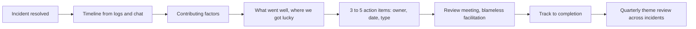

## In one minute
- A postmortem exists to change the system so the next incident is less likely, smaller or shorter. A document that is written, read once and filed has failed, however good it reads.
- Blameless does not mean nobody made a mistake. It means treating mistakes as symptoms of the system: what made the action reasonable at the time, and what made its consequences so large?
- Blame destroys the information you need. People who fear punishment leave out details, and the organisation learns the wrong lesson ("be more careful").
- A good postmortem has a factual timeline, impact in numbers, contributing factors rather than one root cause, what went well, and a small number of action items with owners, dates and a type (prevent, detect, mitigate, process).
- Close the loop: track action items to completion, review themes across incidents, and share the learning beyond the team.

## How it works

### Why blameless
After an incident, it is tempting to find the person who pushed the button. It feels like accountability and it is quick. But it has three costs. People hide information in the next incident, so the organisation learns less. The fix becomes "retrain" or "add an approval", which rarely addresses the conditions that made the mistake easy. And the same mistake happens again with someone else. John Allspaw's writing on blameless postmortems at Etsy, building on the "just culture" idea from aviation and healthcare, made this mainstream in software: people give a full account when they trust it will be used to improve the system rather than to punish them. Google's SRE book makes the same point from the same two industries: you cannot fix people, but you can fix systems and processes ([SRE book, ch. 15](https://sre.google/sre-book/postmortem-culture/)). Richard Cook adds the reason hindsight misleads: knowing the outcome makes the warning signs look more obvious than they were to the people who had to act ([How Complex Systems Fail](https://how.complexsystems.fail/)).

Blameless is not consequence-free. Deliberate harm or repeated reckless disregard of safety is handled separately. The postmortem process covers the vast majority of incidents, which involve competent people making reasonable decisions with the information they had.

### When to write one
Decide the triggers before the incident, not during it. Google's list: user-visible downtime or degradation past a threshold, any data loss, an on-call intervention such as a rollback or traffic reroute, a long time to resolve, and a monitoring failure (the incident was found by a person, not an alert). Any stakeholder may also request one ([SRE book, ch. 15](https://sre.google/sre-book/postmortem-culture/)).

### The structure
1. **Summary:** two or three sentences anyone in the company can understand.
2. **Impact:** in numbers. Users affected, duration, requests failed, revenue, data lost, SLO budget consumed.
3. **Timeline:** times, events and decisions, from first trigger to full recovery, built from logs and chat, written in neutral language.
4. **Contributing factors:** the causal graph from root cause analysis, not a single line. Cook's argument is that overt failure needs several faults that are each insufficient alone, so "the root cause" is a story we choose after the fact ([How Complex Systems Fail](https://how.complexsystems.fail/)).
5. **What went well:** detection that worked, a runbook that helped, a quick rollback. It shows what to protect.
6. **Where we got lucky:** things that would have made it worse. These are free warnings.
7. **Action items:** each with an owner, a due date, a type and a link to the factor it addresses.

### Writing without blame
Language matters. "The engineer failed to check the config" assigns fault. "The config change was applied without a diff preview; the tool does not show the target cluster" describes the system. Avoid "should have", "failed to", "careless", "human error" and counterfactuals that rely on hindsight. Describe what people saw and knew at the time, and why their actions made sense to them.

### Action items that happen
Most postmortems produce too many action items, and most of them never get done. Better: three to five items, prioritised, each with a single owner and a date, covering different layers. **Prevent** (remove the trigger or condition), **detect** (find it faster next time), **mitigate** (limit blast radius or speed recovery) and **process** (change how work is done). Track them in the normal work tracker, review completion weekly, and report the completion rate. An item without an owner is a wish. Check the mix, too. Google's workbook critiques a sample postmortem whose action items were mostly mitigative and whose one "preventative" item was to make humans less error-prone; changing human behaviour is less reliable than changing the system ([SRE workbook, ch. 10](https://sre.google/workbook/postmortem-culture/)). The same chapter notes that action items from the first outage of a kind "dramatically reduced" the blast radius when a similar one happened three years later, which is the payoff you are tracking for.

### Learning across incidents
One postmortem teaches about one incident. Many postmortems together show patterns: the same dependency, the same missing alert, the same kind of change. Tag contributing factors consistently, review them quarterly, and invest in the most common themes. Share widely: a short monthly digest of incidents and lessons is one of the most effective learning tools an engineering organisation has. Google features a "postmortem of the month" in a newsletter, runs reading clubs over old postmortems, and has new SREs re-enact a past incident in the Wheel of Misfortune with the original incident commander present. It also warns that an unreviewed postmortem might as well never have existed, so drafts get a senior review for data collected, impact assessed, depth of root cause and fit of the action plan ([SRE book, ch. 15](https://sre.google/sre-book/postmortem-culture/)).

### The same shape everywhere
Hospitals run morbidity and mortality reviews; aviation runs confidential incident reporting; militaries run after-action reviews. All found the same thing: systems improve when people can report honestly, and the fixes target conditions, not individuals.

## Down the stack

### Layer 1: The contract
The postmortem process promises: every incident above a severity threshold gets a written review within a fixed time (often 5 working days); the review is blameless in language and practice; action items have owners and dates and are tracked to completion; and findings are shared beyond the team.

### Layer 2: The mechanism
Most teams use a template in a shared doc tool and an incident management system that collects the timeline automatically: chat messages, alerts, deploys and flag changes with timestamps. Action items are created as tickets with a label linking them to the incident, so completion can be reported by query. Some organisations add a review meeting, facilitated by someone not involved in the incident, where participants walk through the timeline and the facilitator asks "what made sense at the time?" questions. Etsy published its facilitation guide for this, now archived, under a Creative Commons licence ([Etsy Debriefing Facilitation Guide](https://github.com/etsy/DebriefingFacilitationGuide)).

### Layer 3: The machine
The timeline's accuracy depends on the clocks and logs behind it. Events from different systems carry timestamps from different hosts, synchronised by NTP to within milliseconds usually but sometimes seconds off, and chat timestamps reflect when a message was sent, not when the person saw the alert. Paging systems record exact acknowledgement times; deploy systems record start and finish. When building the timeline, prefer system-generated timestamps from authoritative sources and note when ordering is uncertain, so the analysis does not rest on a sequence that never happened.

### Why it's built this way
1. Incidents come from conditions in the system, so learning requires honest detail about how work actually happened.
2. Honest detail requires safety from blame.
3. Written structure ensures impact, factors and actions are covered consistently.
4. Action items fail without owners, dates and tracking.
5. Patterns appear only across many incidents, so tagging and periodic review matter.

## Diagram


## Worked example
A team's postmortem draft for a 50-minute outage says: "Root cause: Alex deployed a config with a typo. Alex should have tested it. Action items: 1. Alex to be more careful. 2. Add a second approval for config changes. 3. Improve monitoring. 4. Write more tests. 5. Update docs. 6. Consider a config validation tool. 7. Review deploy process."

A reviewer rewrites it. Summary and impact in numbers: 50 minutes, 18 percent of API requests failed, roughly 400,000 errors. Contributing factors: config changes skipped the canary stage that code changes go through; the config schema allowed an unknown key without error; the alert fired after 22 minutes because its window was 20 minutes; rollback of config required a manual edit rather than a revert button. What went well: the on-call engineer declared within 2 minutes of the page. Where we got lucky: the change was made at a low-traffic hour.

Action items, reduced from seven vague ones to four specific ones: route config changes through the canary stage (prevent, owner and date); reject unknown keys in config validation (prevent); a 5-minute burn-rate alert (detect); one-click config revert (mitigate). Alex's name appears only in the timeline as the person who made the change, alongside what the tooling showed them. Six weeks later, all four items are done, and a similar typo by another engineer is caught by validation before deploy.

## In the wild
- **GitLab, 2017: a database deletion, written up with the engineer's name redacted next time.** During a replication problem an engineer ran a delete on the wrong database host, removing about 300 GB of production data. Every backup path then turned out to be broken: `pg_dump` 9.2 was producing errors against a 9.6 server, so the S3 bucket was empty. GitLab restored from a snapshot taken about 6 hours earlier and lost data created between 17:20 and 00:00 UTC. It kept a public working document and streamed the recovery to around 5,000 viewers. The postmortem notes the document had named the engineer, with their consent, and that names would be redacted in future ([GitLab](https://about.gitlab.com/blog/postmortem-of-database-outage-of-january-31/)).
- **AWS, 2017: a typo fixed in the tool, not the person.** An authorised engineer following an established playbook mistyped one input and removed far more S3 servers than intended, taking S3 in us-east-1 down for hours. The published fixes target the tool: it now removes capacity more slowly and refuses to go below a subsystem's minimum, and other tools were audited for the same gap ([AWS](https://aws.amazon.com/message/41926/)).
- **Google, 2014: the "Diskerase" case study.** Google's workbook uses a real outage in which all satellite machines were sent to a disk-erase process, and shows a weak and a strong postmortem of it side by side. The strong version replaces "make humans less error-prone" with preventative changes, and the workbook says the action items cut the blast radius of a similar incident three years later ([SRE workbook, ch. 10](https://sre.google/workbook/postmortem-culture/)).

## Trade-offs
| Practice | Strengths | Weaknesses | Choose when |
| --- | --- | --- | --- |
| Written postmortem for every incident | Complete record | Overhead, fatigue | Small orgs with few incidents |
| Severity threshold for postmortems | Focuses effort | Small incidents' lessons missed | Most orgs |
| Facilitated review meeting | Deeper insight, shared learning | Time from several people | Significant incidents |
| Lightweight review for minor incidents | Cheap, still captures learning | Less depth | Frequent small incidents |
| Many action items | Feels thorough | Most never get done | Avoid; prioritise 3 to 5 |

## Pitfalls in production
- Naming and blaming in the document. Fix: describe systems and decisions; people appear only in the timeline, neutrally.
- A single root cause field. Fix: contributing factors from a causal analysis.
- Action items like "be more careful" or "improve monitoring". Fix: specific, testable items with owners and dates.
- Action items never completed. Fix: track in the normal backlog and report completion rates to leadership.
- Postmortems nobody outside the team reads. Fix: a monthly digest and a searchable archive.

## Leadership lens
- Model blameless language, especially when the mistake was yours; teams copy what leaders do under pressure.
- Protect time for action items: they compete with features, and they lose unless someone senior defends them.
- Run a quarterly review of contributing factors across incidents and pick one theme to invest in.
- Celebrate early declarations and honest accounts, not only fast fixes.

## Check yourself
1. Why does blaming individuals make future incidents more likely?
   **Answer:** People hide details to avoid punishment, so the organisation misses the real conditions, and fixes target individuals instead of the system that will trip someone else.
2. What makes an action item likely to be done?
   **Answer:** It is specific and testable, has one owner and a due date, is tracked in the normal work system, and is one of a small, prioritised set.
3. Why include "where we got lucky"?
   **Answer:** It reveals conditions that would have made the incident worse, giving warnings to act on before they cause a bigger incident.
4. How would you rewrite "the engineer failed to validate the input"?
   **Answer:** Describe the system: "The input was accepted without validation; the form and API do not check the field's format", and ask why validation was missing.

## Practice
**Task:** Build a postmortem linter. A postmortem is a dict with `text` (the narrative), `factors` (list of contributing factors) and `actions` (each with `id`, `owner`, `due`, `type` and `done`). `lint(pm, today)` returns a sorted list of findings: `"blame-language"` if the text contains any of `should have`, `failed to`, `careless`, `human error` (case-insensitive); `"single-cause"` if fewer than two factors; `"no-owner:<id>"` and `"no-due:<id>"` for actions missing an owner or a due date (empty string); `"overdue:<id>"` for actions not done whose due date (ISO `YYYY-MM-DD`) is before `today`; `"no-detect"` if no action has type `detect`; and `"too-many-actions"` if there are more than 5 actions.

```python starter
def lint(pm, today):
    # TODO: return sorted findings
    raise NotImplementedError
```

```python tests
def act(i, owner="ana", due="2026-11-01", typ="prevent", done=False):
    return {"id": i, "owner": owner, "due": due, "type": typ, "done": done}

GOOD = {
    "text": "The config change was applied without a diff preview.",
    "factors": ["no canary for config", "schema allows unknown keys"],
    "actions": [act("A1"), act("A2", typ="detect")],
}

def test_good_postmortem_is_clean():
    assert lint(GOOD, "2026-10-20") == []

def test_blame_language_and_single_cause():
    pm = dict(GOOD, text="Alex should have checked. Human error.", factors=["typo"])
    assert lint(pm, "2026-10-20") == ["blame-language", "single-cause"]

def test_missing_owner_and_due():
    pm = dict(GOOD, actions=[act("A1", owner=""), act("A2", due="", typ="detect")])
    assert lint(pm, "2026-10-20") == ["no-due:A2", "no-owner:A1"]

def test_overdue_only_if_not_done():
    pm = dict(GOOD, actions=[act("A1", due="2026-10-01"), act("A2", due="2026-10-01", typ="detect", done=True)])
    assert lint(pm, "2026-10-20") == ["overdue:A1"]

def test_no_detect_item():
    pm = dict(GOOD, actions=[act("A1"), act("A2", typ="mitigate")])
    assert lint(pm, "2026-10-20") == ["no-detect"]

def test_too_many_actions():
    pm = dict(GOOD, actions=[act("A%d" % i, typ="detect") for i in range(6)])
    assert lint(pm, "2026-10-20") == ["too-many-actions"]
```

```python solution
BLAME = ("should have", "failed to", "careless", "human error")

def lint(pm, today):
    out = set()
    text = pm["text"].lower()
    if any(w in text for w in BLAME):
        out.add("blame-language")
    if len(pm["factors"]) < 2:
        out.add("single-cause")
    for a in pm["actions"]:
        if not a["owner"]:
            out.add("no-owner:" + a["id"])
        if not a["due"]:
            out.add("no-due:" + a["id"])
        elif not a["done"] and a["due"] < today:
            out.add("overdue:" + a["id"])
    if not any(a["type"] == "detect" for a in pm["actions"]):
        out.add("no-detect")
    if len(pm["actions"]) > 5:
        out.add("too-many-actions")
    return sorted(out)
```

```typescript starter
export interface ActionItem { id: string; owner: string; due: string; type: string; done: boolean; }
export interface Postmortem { text: string; factors: string[]; actions: ActionItem[]; }

export function lint(pm: Postmortem, today: string): string[] {
  throw new Error("TODO");
}
```

```typescript tests
const act = (id: string, kw: Partial<ActionItem> = {}): ActionItem =>
  Object.assign({ id, owner: "ana", due: "2026-11-01", type: "prevent", done: false }, kw);
const GOOD: Postmortem = {
  text: "The config change was applied without a diff preview.",
  factors: ["no canary for config", "schema allows unknown keys"],
  actions: [act("A1"), act("A2", { type: "detect" })],
};

test("good postmortem is clean", () => {
  assertEqual(lint(GOOD, "2026-10-20"), []);
});

test("blame language and single cause", () => {
  assertEqual(lint({ ...GOOD, text: "Alex should have checked. Human error.", factors: ["typo"] }, "2026-10-20"), ["blame-language", "single-cause"]);
});

test("missing owner and due", () => {
  assertEqual(lint({ ...GOOD, actions: [act("A1", { owner: "" }), act("A2", { due: "", type: "detect" })] }, "2026-10-20"), ["no-due:A2", "no-owner:A1"]);
});

test("overdue only if not done", () => {
  assertEqual(lint({ ...GOOD, actions: [act("A1", { due: "2026-10-01" }), act("A2", { due: "2026-10-01", type: "detect", done: true })] }, "2026-10-20"), ["overdue:A1"]);
});

test("no detect item", () => {
  assertEqual(lint({ ...GOOD, actions: [act("A1"), act("A2", { type: "mitigate" })] }, "2026-10-20"), ["no-detect"]);
});

test("too many actions", () => {
  assertEqual(lint({ ...GOOD, actions: [0, 1, 2, 3, 4, 5].map(i => act("A" + i, { type: "detect" })) }, "2026-10-20"), ["too-many-actions"]);
});
```

```typescript solution
export interface ActionItem { id: string; owner: string; due: string; type: string; done: boolean; }
export interface Postmortem { text: string; factors: string[]; actions: ActionItem[]; }

const BLAME = ["should have", "failed to", "careless", "human error"];

export function lint(pm: Postmortem, today: string): string[] {
  const out = new Set<string>();
  const text = pm.text.toLowerCase();
  if (BLAME.some(w => text.includes(w))) out.add("blame-language");
  if (pm.factors.length < 2) out.add("single-cause");
  for (const a of pm.actions) {
    if (!a.owner) out.add("no-owner:" + a.id);
    if (!a.due) out.add("no-due:" + a.id);
    else if (!a.done && a.due < today) out.add("overdue:" + a.id);
  }
  if (!pm.actions.some(a => a.type === "detect")) out.add("no-detect");
  if (pm.actions.length > 5) out.add("too-many-actions");
  return Array.from(out).sort();
}
```

```go starter
package practice

type ActionItem struct {
	ID, Owner, Due, Type string
	Done                 bool
}

type Postmortem struct {
	Text    string
	Factors []string
	Actions []ActionItem
}

func Lint(pm Postmortem, today string) []string {
	panic("TODO")
}
```

```go tests
package practice

import (
	"fmt"
	"reflect"
	"testing"
)

func act(id string) ActionItem {
	return ActionItem{ID: id, Owner: "ana", Due: "2026-11-01", Type: "prevent"}
}

func good() Postmortem {
	a2 := act("A2")
	a2.Type = "detect"
	return Postmortem{
		Text:    "The config change was applied without a diff preview.",
		Factors: []string{"no canary for config", "schema allows unknown keys"},
		Actions: []ActionItem{act("A1"), a2},
	}
}

func eqs(t *testing.T, got, want []string) {
	t.Helper()
	if len(got) == 0 && len(want) == 0 {
		return
	}
	if !reflect.DeepEqual(got, want) {
		t.Fatalf("got %v, want %v", got, want)
	}
}

func TestClean(t *testing.T) {
	eqs(t, Lint(good(), "2026-10-20"), nil)
}

func TestBlameSingle(t *testing.T) {
	pm := good()
	pm.Text = "Alex should have checked. Human error."
	pm.Factors = []string{"typo"}
	eqs(t, Lint(pm, "2026-10-20"), []string{"blame-language", "single-cause"})
}

func TestOwnerDue(t *testing.T) {
	pm := good()
	pm.Actions[0].Owner = ""
	pm.Actions[1].Due = ""
	eqs(t, Lint(pm, "2026-10-20"), []string{"no-due:A2", "no-owner:A1"})
}

func TestOverdue(t *testing.T) {
	pm := good()
	pm.Actions[0].Due = "2026-10-01"
	pm.Actions[1].Due = "2026-10-01"
	pm.Actions[1].Done = true
	eqs(t, Lint(pm, "2026-10-20"), []string{"overdue:A1"})
}

func TestNoDetect(t *testing.T) {
	pm := good()
	pm.Actions[1].Type = "mitigate"
	eqs(t, Lint(pm, "2026-10-20"), []string{"no-detect"})
}

func TestTooMany(t *testing.T) {
	pm := good()
	pm.Actions = nil
	for i := 0; i < 6; i++ {
		a := act(fmt.Sprintf("A%d", i))
		a.Type = "detect"
		pm.Actions = append(pm.Actions, a)
	}
	eqs(t, Lint(pm, "2026-10-20"), []string{"too-many-actions"})
}
```

```go solution
package practice

import (
	"sort"
	"strings"
)

type ActionItem struct {
	ID, Owner, Due, Type string
	Done                 bool
}

type Postmortem struct {
	Text    string
	Factors []string
	Actions []ActionItem
}

func Lint(pm Postmortem, today string) []string {
	out := map[string]bool{}
	text := strings.ToLower(pm.Text)
	for _, w := range []string{"should have", "failed to", "careless", "human error"} {
		if strings.Contains(text, w) {
			out["blame-language"] = true
		}
	}
	if len(pm.Factors) < 2 {
		out["single-cause"] = true
	}
	detect := false
	for _, a := range pm.Actions {
		if a.Owner == "" {
			out["no-owner:"+a.ID] = true
		}
		if a.Due == "" {
			out["no-due:"+a.ID] = true
		} else if !a.Done && a.Due < today {
			out["overdue:"+a.ID] = true
		}
		if a.Type == "detect" {
			detect = true
		}
	}
	if !detect {
		out["no-detect"] = true
	}
	if len(pm.Actions) > 5 {
		out["too-many-actions"] = true
	}
	res := []string{}
	for k := range out {
		res = append(res, k)
	}
	sort.Strings(res)
	return res
}
```

## Mock interview
**Prompt:** Your company has had three incidents in two months involving the same payments dependency. Each postmortem blamed a different engineer's change, and each produced around ten action items, few of which were completed. You have been asked to fix the postmortem process. What do you change?

- Follow-up: A director insists that the engineer responsible for the last incident should be named in the company-wide summary. How do you respond?
- Follow-up: How do you get action items done when teams are under feature pressure?
- Follow-up: How do you know, a year later, whether the new process works?

**A strong answer covers:**
- Recognising the pattern: repeated incidents around one dependency show systemic factors that individual-blame postmortems missed.
- A blameless template with impact in numbers, a timeline, contributing factors, what went well and where we got lucky.
- Few, specific, owned and dated action items across prevent, detect and mitigate, tracked in the normal backlog.
- Cross-incident review to find the shared factor around the payments dependency and invest in it.
- Explaining to leadership why naming individuals reduces honest reporting, while still holding the organisation accountable for fixes.
- Metrics: action item completion rate, repeat incidents by theme, time to detect and recover.

## Sources and further study
**Primary**
- [GitLab: postmortem of the database outage of 31 January 2017](https://about.gitlab.com/blog/postmortem-of-database-outage-of-january-31/): a public postmortem with a timeline, recovery steps and the decision to redact names.

**Systems docs**
- [Atlassian: April 2022 outage post-incident review](https://www.atlassian.com/blog/atlassian-engineering/post-incident-review-april-2022-outage): a long public review with a timeline, workstreams and action items.
- [AWS: summary of the S3 service disruption (2017)](https://aws.amazon.com/message/41926/): an example of fixes aimed at tooling.
- [Etsy Debriefing Facilitation Guide](https://github.com/etsy/DebriefingFacilitationGuide): how to run a learning-focused review meeting (archived, read-only).

**Books**
- *Site Reliability Engineering*, Beyer et al.: chapter 15 (Postmortem Culture: Learning from Failure) and chapter 33 (Lessons Learned from Other Industries, including its postmortem culture section).
- *The Site Reliability Workbook*: chapter 10 (Postmortem Culture), with the bad and good postmortem pair.

## Free resources
- [Postmortem Culture: Learning from Failure (Google SRE book)](https://sre.google/sre-book/postmortem-culture/): why blameless postmortems work and how Google runs them.
- [Postmortem Culture (Google SRE workbook)](https://sre.google/workbook/postmortem-culture/): good and bad postmortem examples, side by side.
- [Incident postmortems (Atlassian)](https://www.atlassian.com/incident-management/postmortem): templates and process from a large incident tool vendor.
- [Moving Past Shallow Incident Data (Adaptive Capacity Labs)](https://www.adaptivecapacitylabs.com/blog/2018/03/23/moving-past-shallow-incident-data/): why counts and single causes miss what matters.
- [Howie: The Post-Incident Guide (Jeli)](https://www.jeli.io/howie/welcome): a detailed guide to learning-focused incident reviews.
- [How Complex Systems Fail (Richard Cook)](https://how.complexsystems.fail/): the safety-science basis for blameless analysis.
