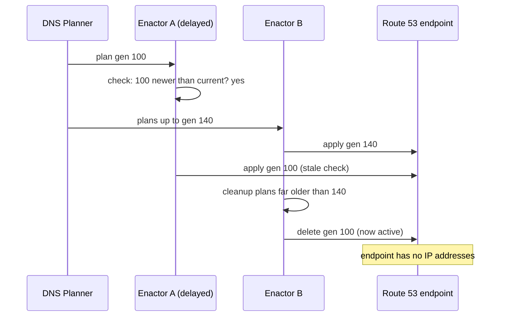

## In one minute
- On 19 to 20 October 2025, DynamoDB in AWS's US-EAST-1 region became unreachable for about three hours (23:48 to 02:40 PDT) because its regional endpoint's DNS record was left empty ([AWS summary](https://aws.amazon.com/message/101925/)). Many AWS services and customers depend on DynamoDB, so the impact spread widely, and some services were affected until 14:20 PDT; Redshift clusters took until 4:05 on 21 October to recover fully ([AWS summary](https://aws.amazon.com/message/101925/)).
- DynamoDB's DNS is managed by automation: a DNS Planner produces versioned plans, and DNS Enactors in three availability zones apply them to Route 53. A race between two Enactors let a delayed one apply a much older plan over a newer one; a cleanup process then deleted that old plan, which was now the active one, removing every IP address from the endpoint.
- The automation was left in an inconsistent state that blocked further updates, so engineers had to repair DNS by hand.
- Recovery triggered second-order failures: EC2's DropletWorkflow Manager, which leases physical servers and depends on DynamoDB, went into congestive collapse when it tried to re-establish every lease at once ([AWS summary](https://aws.amazon.com/message/101925/)); then delayed network state caused Network Load Balancer health checks to flap and remove healthy capacity.
- AWS's fixes: disable the DNS automation worldwide until the race is fixed and safeguards against applying incorrect plans are added; velocity controls on NLB failover; new tests for the EC2 recovery workflow; and throttling based on queue size.

## How it works

### Timeline (PDT, from AWS's summary)
- **19 Oct, 23:48 (06:48 UTC on 20 Oct)** Systems connecting to DynamoDB's public endpoint in US-EAST-1 start getting DNS failures. DynamoDB API error rates rise.
- **20 Oct, 00:38** Engineers identify DynamoDB's DNS state as the source.
- **01:15** Temporary mitigations let some internal services connect and repair key internal tooling.
- **02:25** All DNS information is restored. **02:32** Global table replicas catch up. **02:40** Customer connections recover as cached DNS records expire.
- **From 23:48** EC2's DropletWorkflow Manager (DWFM) cannot complete its periodic state checks, which depend on DynamoDB, so leases on physical servers ("droplets") time out. Running instances are fine, but new launches cannot use those droplets.
- **02:25** As DynamoDB returns, DWFM tries to re-establish leases for the whole fleet. The volume causes work to time out and be retried: congestive collapse. New launches fail with insufficient capacity errors.
- **04:14** Engineers throttle incoming work and selectively restart DWFM hosts; **05:28** all droplets have leases again.
- A backlog in network state propagation means new instances launch without network connectivity until about **10:36**. Other services fell with their dependencies: STS and IAM sign-in recovered around 01:19 to 01:25 but STS was only fully back at 09:59; Lambda, ECS, EKS, Fargate and Amazon Connect were hit and recovered between 11:27 and 14:20; and AWS Support Center case creation was blocked until 02:40 ([AWS summary](https://aws.amazon.com/message/101925/)). Existing EC2 instances kept running.
- **From 05:30** Network Load Balancer health checks run against instances whose network state has not propagated; healthy nodes fail checks, flap, and automatic zone failover removes capacity. **09:36** engineers disable automatic NLB health check failover, restoring capacity.
- **11:23** EC2 throttles start to relax; **13:50** EC2 APIs and launches are normal. **14:09** NLB automatic failover is re-enabled. **14:20** the overall event ends.

### Technical root cause
DynamoDB's DNS automation has two parts ([AWS summary](https://aws.amazon.com/message/101925/)). The **DNS Planner** watches load balancer health and capacity and produces versioned DNS plans: which load balancers, with which weights, for each endpoint. **DNS Enactors**, running redundantly in three availability zones, apply plans to Route 53 using transactions, and a cleanup process removes plans much older than the latest applied one.

The race: one Enactor was unusually slow, retrying updates on several endpoints. Meanwhile, the Planner produced many newer plans, and a second Enactor applied the newest plan quickly, then ran cleanup. The slow Enactor, whose check that its plan was newer than the current one had been made long before, then wrote its much older plan over the regional endpoint. Cleanup deleted that old plan because it was far older than the newest applied one, but it was now the active plan. Deleting it removed all IP addresses for `dynamodb.us-east-1.amazonaws.com`, and the inconsistent state blocked further automatic updates.

### Contributing factors
- **A time-of-check to time-of-use gap.** The "is my plan newer?" check was made before a long delay and not re-checked atomically at write time.
- **Cleanup trusted generation numbers, not the live state.** It deleted a plan that was in use.
- **Shared dependency.** Many AWS control planes, including EC2's server lease management, depend on DynamoDB in the region.
- **Recovery at full volume.** DWFM tried to restore every lease at once, and retries amplified the load into congestive collapse.
- **Health checks during abnormal conditions.** NLB health checks treated not-yet-propagated network state as failure, and automatic failover removed capacity.

### Detection and mitigation
Failures appeared immediately; locating DNS as the source took about 50 minutes (23:48 to 00:38) ([AWS summary](https://aws.amazon.com/message/101925/)). DNS was repaired manually. Each later stage needed its own mitigation: throttling and selective restarts for DWFM, and disabling automatic failover for NLB health checks.

### What changed afterwards (per AWS)
The DynamoDB DNS Planner and Enactor automation was disabled worldwide; before re-enabling it, AWS will fix the race condition and add protections against applying incorrect DNS plans. NLB gets a velocity control limiting how much capacity a single load balancer can remove when health checks trigger zone failover ([AWS summary](https://aws.amazon.com/message/101925/)). EC2 adds a test suite for the DWFM recovery workflow and improves throttling to rate-limit incoming work based on queue size. AWS said it would keep reviewing the event across services.

### What I would have done as the tech lead
Make plan application a single atomic compare-and-set on the generation number at write time, and make cleanup refuse to delete whatever is currently active, checked against live state. Add an invariant monitor that pages when any endpoint has zero records. For dependent systems, design recovery paths that are rate-limited by default and tested at full fleet scale, and cap how much capacity any automatic health mechanism may remove at once.

## Down the stack

### Layer 1: The contract
DynamoDB's regional endpoint promises that its DNS name always resolves to healthy load balancers. The DNS automation's implicit contract is monotonic: the endpoint only ever moves to newer plans, and no step leaves it empty. The race broke both.

### Layer 2: The mechanism
The bug is a classic time-of-check to time-of-use (TOCTOU) race, the same shape as check-then-act in a database. Two safe designs exist. **Compare-and-set**: write the plan only if the stored generation is still lower than mine, in the same transaction as the write; Route 53 change batches are all-or-nothing ([Route 53 API reference](https://docs.aws.amazon.com/Route53/latest/APIReference/API_ChangeResourceRecordSets.html)), but that alone does not compare a generation, and AWS's summary does not say how the Enactors guard their writes, so treat this as a design sketch and not a description of their code. **Fencing tokens**: every writer carries a monotonically increasing token, and the store rejects writes with an older token, which is how [Kleppmann](https://martin.kleppmann.com/2016/02/08/how-to-do-distributed-locking.html) says to protect against a paused or delayed writer. Separately, garbage collection of plans must be relative to the live state: never delete the plan currently referenced by any endpoint, whatever its age.

### Layer 3: The machine
DNS failure spreads through caching. Resolvers and clients cache answers for the record's TTL; when the record became empty, clients that refreshed got no addresses, while some cached good answers until expiry. Recovery works the same way in reverse: after DNS was restored at 02:25, connections recovered over the following minutes as caches expired (02:40). The congestive collapse in DWFM is a queueing phenomenon: when work arrives faster than it can be completed within its timeout, timed-out work is retried, adding load, so useful throughput falls towards zero even though machines are busy. Throttling admission below capacity is the way out ([AWS Builders' Library on load shedding](https://aws.amazon.com/builders-library/using-load-shedding-to-avoid-overload/)), which is what the engineers did at 04:14 and what AWS said it would build into EC2's propagation path as queue-size-based rate limiting. This is the metastable failure pattern described by [Bronson et al.](https://sigops.org/s/conferences/hotos/2021/papers/hotos21-s11-bronson.pdf): a trigger is gone, but a feedback loop keeps the system down until load is removed.

### Why it's built this way
1. DNS automation must react quickly to load balancer health, so it runs continuously and redundantly.
2. Redundant writers need atomic, generation-checked updates, or they race.
3. Cleanup must respect live state, or it can delete what is in use.
4. Shared dependencies turn one service's failure into many, so dependents need graceful degradation.
5. Recovery itself can overload systems, so it must be throttled and rehearsed.

## Diagram


## Worked example
A platform team runs a config distributor: three replicas pull versioned routing configs from a planner and write them into a shared key-value store that edge proxies read. Each replica does `current = get(); if new.version > current.version: put(new)`, and a janitor deletes configs more than 50 versions behind the newest.

After reading AWS's summary, they reproduce the race in a test: replica A reads version 200, pauses (simulating a long GC pause), replica B writes 260, the janitor deletes everything below 210, then A writes 200. The proxies now point at a deleted config and fall back to an empty route table.

Fixes: `put` becomes a conditional write (`put_if(version_greater_than_stored)`), executed atomically by the store; the janitor reads which version is live and never deletes it or anything newer; an invariant check alerts within 30 seconds if any proxy reads an empty or missing config; and proxies keep serving their last good config if the new one is missing (fail static). The reproduction test now ends with version 260 live, and it runs in CI.

## In the wild
- **Google Cloud, 2025: a blank policy row and a retry herd.** A quota policy with blank fields replicated globally within seconds and crashed Service Control, which had no feature flag or error handling on the new path. When tasks restarted in us-central1 without randomized backoff, they overloaded the Spanner table behind it, so that region recovered more slowly than the rest. Google planned fail-open checks and incremental propagation of global data ([Google Cloud status](https://status.cloud.google.com/incidents/ow5i3PPK96RduMcb1SsW)).
- **AWS, 2021: a connection storm in us-east-1.** An automated scaling action made internal clients open a surge of connections that overwhelmed the devices between AWS's internal and main networks. A latent bug stopped clients backing off, so retries sustained the congestion, and monitoring on the same network degraded too; recovery took roughly seven hours ([AWS summary](https://aws.amazon.com/message/12721/)).
- **Slack, 2022: cache churn turned into metastable overload.** A rollout restarted agents one by one, which swapped empty cache nodes in and dropped hit rates. Misses on a query that scattered across every database shard overloaded the databases, and the overload outlasted the trigger ([Slack Engineering](https://slack.engineering/slacks-incident-on-2-22-22/)).

## Trade-offs
| Design | Strengths | Weaknesses | Choose when |
| --- | --- | --- | --- |
| Check then write | Simple | Races with concurrent or delayed writers | Single writer only |
| Atomic compare-and-set on generation | No stale overwrite | Needs store support | Multiple writers to shared state |
| Fencing tokens | Robust to pauses and partitions | Store must check tokens | Leases, leaders, delayed workers |
| Cleanup by age only | Simple | Can delete live data | Never for referenced data |
| Cleanup relative to live references | Safe | Must read live state | Garbage collection of configs or plans |

## Pitfalls in production
- Redundant automation without coordination. Fix: atomic conditional writes or fencing tokens for shared targets.
- Garbage collection that ignores what is in use. Fix: compute live references first.
- No invariant alert for "endpoint has zero targets". Fix: monitor invariants, not just errors.
- Recovery that restores everything at once. Fix: admission control and rate limits built into recovery paths.
- Automatic health-based removal without limits. Fix: velocity controls and fail-static behaviour.

## Leadership lens
- Review every redundant automation writing to shared state for check-then-act races; add conditional writes and race tests.
- Identify your hidden hard dependencies (for many teams, one regional database or DNS) and design degraded modes.
- Test recovery at full scale: what happens when every client reconnects in the same second?
- Cap the capacity any automated system can remove per minute, everywhere.

## Check yourself
1. What made the delayed Enactor's write dangerous?
   **Answer:** Its "is this newer?" check was made long before its write, so by the time it wrote, a much newer plan was active and it overwrote it with an old one.
2. Why did cleanup make the situation worse?
   **Answer:** It deleted plans much older than the newest applied one, without checking which plan was actually active, so it deleted the active plan and left the endpoint empty.
3. What is congestive collapse, and how was it stopped?
   **Answer:** When work arrives faster than it can finish within its timeout, timeouts and retries add load until throughput collapses; engineers throttled incoming work and restarted hosts to drain queues.
4. Why did NLB health checks remove healthy capacity?
   **Answer:** New instances' network state had not propagated, so health checks failed for healthy nodes and automatic zone failover removed them from service.

## Practice
**Task:** Simulate the race and its fix. `simulate(events, safe)` processes events in order and returns `"empty"` if the active plan has been deleted, `"none"` if no plan was ever applied, or `"active:<gen>"` otherwise. Events: `("plan", gen)` creates a plan; `("check", enactor, gen)` records whether `gen` is newer than the active plan at that moment (true if nothing is active); `("write", enactor, gen)` applies the plan: in unsafe mode, if that enactor's earlier check was true; in safe mode, only if, at the moment of writing, nothing is active or `gen` is newer than the active plan (compare-and-set). `("cleanup", keep)` deletes all plans with generation lower than `keep`; in safe mode it never deletes the active plan.

```python starter
def simulate(events, safe):
    # TODO: return "empty", "none" or "active:<gen>"
    raise NotImplementedError
```

```python tests
RACE = [("plan", g) for g in range(1, 11)] + [
    ("check", "A", 1),
    ("check", "B", 10),
    ("write", "B", 10),
    ("write", "A", 1),
    ("cleanup", 5),
]

def test_unsafe_race_empties_endpoint():
    assert simulate(RACE, safe=False) == "empty"

def test_safe_compare_and_set_and_cleanup():
    assert simulate(RACE, safe=True) == "active:10"

def test_normal_sequence_unsafe_is_fine():
    events = [("plan", 1), ("plan", 2), ("check", "A", 1), ("write", "A", 1), ("check", "B", 2), ("write", "B", 2), ("cleanup", 2)]
    assert simulate(events, safe=False) == "active:2"

def test_safe_cleanup_alone_protects_active():
    events = [("plan", 3), ("check", "A", 3), ("write", "A", 3), ("plan", 9), ("cleanup", 9)]
    assert simulate(events, safe=True) == "active:3"
    assert simulate(events, safe=False) == "empty"

def test_nothing_applied():
    assert simulate([("plan", 1)], safe=True) == "none"

def test_stale_write_skipped_in_safe_mode():
    events = [("plan", 1), ("plan", 2), ("check", "A", 1), ("check", "B", 2), ("write", "B", 2), ("write", "A", 1)]
    assert simulate(events, safe=True) == "active:2"
    assert simulate(events, safe=False) == "active:1"
```

```python solution
def simulate(events, safe):
    plans, checks, active = set(), {}, None
    for ev in events:
        kind = ev[0]
        if kind == "plan":
            plans.add(ev[1])
        elif kind == "check":
            _, e, g = ev
            checks[e] = active is None or g > active
        elif kind == "write":
            _, e, g = ev
            if safe:
                if active is None or g > active:
                    active = g
            elif checks.get(e):
                active = g
        elif kind == "cleanup":
            keep = ev[1]
            plans = {p for p in plans if p >= keep or (safe and p == active)}
    if active is None:
        return "none"
    return "active:%d" % active if active in plans else "empty"
```

```typescript starter
export type Ev = [string, ...(string | number)[]];

export function simulate(events: Ev[], safe: boolean): string {
  throw new Error("TODO");
}
```

```typescript tests
const RACE: Ev[] = [];
for (let g = 1; g <= 10; g++) RACE.push(["plan", g]);
RACE.push(["check", "A", 1], ["check", "B", 10], ["write", "B", 10], ["write", "A", 1], ["cleanup", 5]);

test("unsafe race empties endpoint", () => {
  assertEqual(simulate(RACE, false), "empty");
});

test("safe compare and set and cleanup", () => {
  assertEqual(simulate(RACE, true), "active:10");
});

test("normal sequence unsafe is fine", () => {
  assertEqual(simulate([["plan", 1], ["plan", 2], ["check", "A", 1], ["write", "A", 1], ["check", "B", 2], ["write", "B", 2], ["cleanup", 2]], false), "active:2");
});

test("safe cleanup alone protects active", () => {
  const evs: Ev[] = [["plan", 3], ["check", "A", 3], ["write", "A", 3], ["plan", 9], ["cleanup", 9]];
  assertEqual(simulate(evs, true), "active:3");
  assertEqual(simulate(evs, false), "empty");
});

test("nothing applied", () => {
  assertEqual(simulate([["plan", 1]], true), "none");
});

test("stale write skipped in safe mode", () => {
  const evs: Ev[] = [["plan", 1], ["plan", 2], ["check", "A", 1], ["check", "B", 2], ["write", "B", 2], ["write", "A", 1]];
  assertEqual(simulate(evs, true), "active:2");
  assertEqual(simulate(evs, false), "active:1");
});
```

```typescript solution
export type Ev = [string, ...(string | number)[]];

export function simulate(events: Ev[], safe: boolean): string {
  let plans = new Set<number>();
  const checks: Record<string, boolean> = {};
  let active: number | null = null;
  for (const ev of events) {
    const kind = ev[0];
    if (kind === "plan") plans.add(ev[1] as number);
    else if (kind === "check") checks[ev[1] as string] = active === null || (ev[2] as number) > active;
    else if (kind === "write") {
      const g = ev[2] as number;
      if (safe) { if (active === null || g > active) active = g; }
      else if (checks[ev[1] as string]) active = g;
    } else if (kind === "cleanup") {
      const keep = ev[1] as number;
      plans = new Set(Array.from(plans).filter(p => p >= keep || (safe && p === active)));
    }
  }
  if (active === null) return "none";
  return plans.has(active) ? "active:" + active : "empty";
}
```

```go starter
package practice

type Event struct {
	Kind    string // "plan", "check", "write", "cleanup"
	Enactor string
	Gen     int // generation, or the keep threshold for cleanup
}

func Simulate(events []Event, safe bool) string {
	panic("TODO")
}
```

```go tests
package practice

import "testing"

func race() []Event {
	var evs []Event
	for g := 1; g <= 10; g++ {
		evs = append(evs, Event{"plan", "", g})
	}
	return append(evs, Event{"check", "A", 1}, Event{"check", "B", 10}, Event{"write", "B", 10}, Event{"write", "A", 1}, Event{"cleanup", "", 5})
}

func TestUnsafeRace(t *testing.T) {
	if got := Simulate(race(), false); got != "empty" {
		t.Fatalf("got %s", got)
	}
}

func TestSafeRace(t *testing.T) {
	if got := Simulate(race(), true); got != "active:10" {
		t.Fatalf("got %s", got)
	}
}

func TestNormalUnsafe(t *testing.T) {
	evs := []Event{{"plan", "", 1}, {"plan", "", 2}, {"check", "A", 1}, {"write", "A", 1}, {"check", "B", 2}, {"write", "B", 2}, {"cleanup", "", 2}}
	if got := Simulate(evs, false); got != "active:2" {
		t.Fatalf("got %s", got)
	}
}

func TestSafeCleanup(t *testing.T) {
	evs := []Event{{"plan", "", 3}, {"check", "A", 3}, {"write", "A", 3}, {"plan", "", 9}, {"cleanup", "", 9}}
	if Simulate(evs, true) != "active:3" || Simulate(evs, false) != "empty" {
		t.Fatal("cleanup safety wrong")
	}
}

func TestNothing(t *testing.T) {
	if got := Simulate([]Event{{"plan", "", 1}}, true); got != "none" {
		t.Fatalf("got %s", got)
	}
}

func TestStaleWrite(t *testing.T) {
	evs := []Event{{"plan", "", 1}, {"plan", "", 2}, {"check", "A", 1}, {"check", "B", 2}, {"write", "B", 2}, {"write", "A", 1}}
	if Simulate(evs, true) != "active:2" || Simulate(evs, false) != "active:1" {
		t.Fatal("stale write handling wrong")
	}
}
```

```go solution
package practice

import "fmt"

type Event struct {
	Kind    string // "plan", "check", "write", "cleanup"
	Enactor string
	Gen     int // generation, or the keep threshold for cleanup
}

func Simulate(events []Event, safe bool) string {
	plans := map[int]bool{}
	checks := map[string]bool{}
	active, has := 0, false
	for _, e := range events {
		switch e.Kind {
		case "plan":
			plans[e.Gen] = true
		case "check":
			checks[e.Enactor] = !has || e.Gen > active
		case "write":
			if safe {
				if !has || e.Gen > active {
					active, has = e.Gen, true
				}
			} else if checks[e.Enactor] {
				active, has = e.Gen, true
			}
		case "cleanup":
			for p := range plans {
				if p < e.Gen && !(safe && has && p == active) {
					delete(plans, p)
				}
			}
		}
	}
	if !has {
		return "none"
	}
	if plans[active] {
		return fmt.Sprintf("active:%d", active)
	}
	return "empty"
}
```

## Mock interview
**Prompt:** You own a control plane that writes routing configuration for a global service. It runs three redundant writers so that losing a zone does not stop updates, and a janitor cleans up old configs. Using AWS's October 2025 DynamoDB outage as the scenario, review this design and fix it.

- Follow-up: Your store does not support conditional writes. What are your options?
- Follow-up: How would you detect within a minute that an endpoint has no healthy targets?
- Follow-up: Your service depends on a regional database that just failed. How should it behave, and how should it recover when the database returns?

**A strong answer covers:**
- Identifying the time-of-check to time-of-use race between redundant writers and fixing it with atomic compare-and-set or fencing tokens.
- Making cleanup relative to live references, never deleting the active config.
- Alternatives without conditional writes: a single elected writer with leases and fencing, or a serialising queue.
- Invariant monitoring (zero records, empty route tables) that pages quickly, and consumers that fail static on missing config.
- Graceful degradation when a hard dependency fails, and throttled, admission-controlled recovery to avoid congestive collapse.
- Limits on automated capacity removal and tests of recovery at full scale.

## Sources and further study
**Primary**
- [Summary of the Amazon DynamoDB Service Disruption in US-EAST-1 (AWS)](https://aws.amazon.com/message/101925/): the source for the timeline, root cause and fixes.
- [Metastable Failures in Distributed Systems (Bronson et al., HotOS 2021)](https://sigops.org/s/conferences/hotos/2021/papers/hotos21-s11-bronson.pdf): why recovery can be harder than the original failure.
- [How to do distributed locking (Martin Kleppmann)](https://martin.kleppmann.com/2016/02/08/how-to-do-distributed-locking.html): fencing tokens for writers that may be delayed.

**Systems docs**
- [ChangeResourceRecordSets (Route 53 API reference)](https://docs.aws.amazon.com/Route53/latest/APIReference/API_ChangeResourceRecordSets.html): transactional change batches and propagation.
- [Timeouts, retries, and backoff with jitter (AWS Builders' Library)](https://aws.amazon.com/builders-library/timeouts-retries-and-backoff-with-jitter/): why retries amplify load.

**Books**
- *Site Reliability Engineering* (Beyer et al.), Ch 22, [Addressing Cascading Failures](https://sre.google/sre-book/addressing-cascading-failures/): overload, retries and slow recovery.
- *Release It!* (Nygard, 2nd ed.), Ch 4 Stability Antipatterns and Ch 5 Stability Patterns: cascading failures, timeouts and circuit breakers.

**Other curricula**
- [Azure Architecture Center: Retry pattern](https://learn.microsoft.com/en-us/azure/architecture/patterns/retry): bounded, backed-off retries.

## Free resources
- [Time-of-check to time-of-use (Wikipedia)](https://en.wikipedia.org/wiki/Time-of-check_to_time-of-use): the race pattern behind the outage.
- [Using load shedding to avoid overload (AWS Builders' Library)](https://aws.amazon.com/builders-library/using-load-shedding-to-avoid-overload/): admission control and congestive collapse.
- [Handling Overload (Google SRE book)](https://sre.google/sre-book/handling-overload/): per-client limits and graceful degradation.
