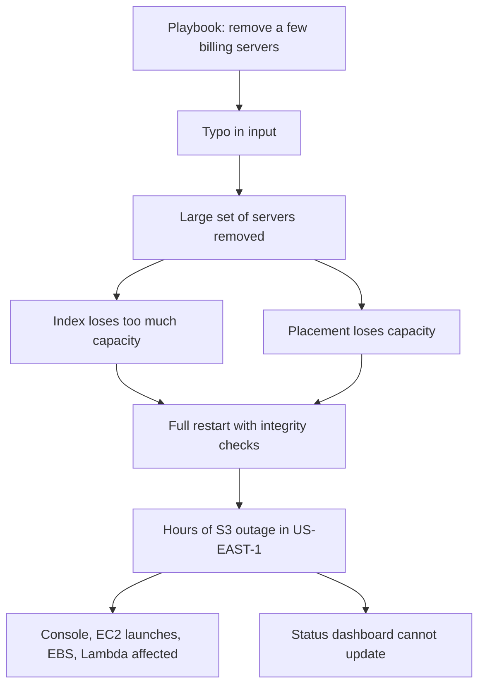

## In one minute
- On 28 February 2017, an engineer running an established playbook to remove a few servers from an S3 billing subsystem in US-EAST-1 entered one input incorrectly, and the command removed a much larger set of servers.
- Those servers supported two core subsystems: index (metadata for every object in the region) and placement (allocating storage for new objects). Both needed a full restart, which had not been done in large regions for years and took far longer than expected ([AWS summary](https://aws.amazon.com/message/41926/)).
- S3 in the region was unavailable or degraded for about four hours (09:37 to 13:54 PST). Services depending on it, including the S3 console, new EC2 launches, some EBS volumes and Lambda, were affected ([AWS summary](https://aws.amazon.com/message/41926/)).
- Even the AWS Service Health Dashboard could not be updated for two hours, because its admin console depended on S3 ([AWS summary](https://aws.amazon.com/message/41926/)).
- AWS's fixes target the system, not the person: tools that remove capacity slowly and refuse to go below minimums, audits of other tools, faster recovery through smaller cells, and a status page that does not depend on the service it reports on.

## How it works

### Timeline (PST, from AWS's summary)
- **09:37** An authorized S3 team member, following an established playbook while debugging slow billing, runs a command to remove a small number of servers. One input is wrong; a much larger set is removed ([AWS summary](https://aws.amazon.com/message/41926/)).
- The removed capacity includes servers for the index and placement subsystems. Both must be fully restarted. While index is down, S3 cannot serve GET, LIST, PUT or DELETE requests in the region.
- **11:37** AWS can again update individual service status on the Service Health Dashboard; until then it communicated through Twitter and a banner.
- **12:26** Index has enough capacity to serve GET, LIST and DELETE.
- **13:18** Index is fully recovered.
- **13:54** Placement finishes recovery; S3 operates normally ([AWS summary](https://aws.amazon.com/message/41926/)). Some dependent services then work through backlogs.

### Technical root cause
The trigger was a mistyped argument. The causes were in the system: the tool allowed removing a large amount of capacity in one step, and it did not check whether the removal would take a subsystem below the minimum it needs to function ([AWS summary](https://aws.amazon.com/message/41926/)). Index and placement shared fate with servers that the billing work targeted, and once they lost too much capacity they could not degrade gracefully; they required a full restart.

### Contributing factors
- **Recovery had not been exercised at scale.** AWS wrote that it had not completely restarted index or placement in its larger regions for many years ([AWS summary](https://aws.amazon.com/message/41926/)). The region had grown massively, so restarts and the safety checks validating metadata integrity took longer than expected.
- **Large blast radius per subsystem.** Index was being partitioned into smaller cells, but not far enough to keep recovery short.
- **Status page dependency.** The dashboard's admin console depended on S3, so the outage hid its own status.
- **Region concentration.** Many customers and AWS services relied on S3 in US-EAST-1 alone, so the impact spread widely across the internet.

### Detection and mitigation
The impact was immediately visible. Mitigation was not a rollback, because there was nothing to roll back: the servers had to be brought back and the subsystems restarted, with integrity checks, in dependency order (index before placement).

### What changed afterwards
AWS listed: the tool now removes capacity more slowly; safeguards prevent removing capacity when it would take any subsystem below its minimum required capacity; other operational tools were audited for similar checks; work to reduce recovery time, including reprioritising further partitioning of index into smaller cells; and moving the dashboard's admin console to run across multiple regions ([AWS summary](https://aws.amazon.com/message/41926/)).

### What I would have done as the tech lead
Beforehand: treat every tool that removes capacity or deletes data as high-stakes, with built-in rate limits, minimum-capacity checks and a dry-run that prints what will be removed. Schedule regular full-restart drills of core subsystems in a large region or a realistic copy, measuring recovery time as the region grows. Make status pages and incident tooling independent of the systems they report on. During: a single incident commander, early and frequent external communication through channels that do not depend on S3, and a clear recovery order. The lesson is not "be careful with commands"; it is "tools must make the dangerous action hard and the recovery practised".

## Down the stack

### Layer 1: The contract
S3 promised high availability and durability within a region, built from many subsystems. Operational tools carried an implicit contract too: running the playbook removes "a small number" of servers. Nothing in the tool enforced that contract, so a typo broke it.

### Layer 2: The mechanism
Systems like S3's index are large distributed metadata services: the mapping from bucket and key to the storage locations of an object's data. When too many members of such a service disappear at once, the remaining ones cannot serve all partitions or maintain quorum, and the safe way back is a controlled restart that reloads state and verifies its integrity before serving traffic. Partitioning into cells bounds how much state any one restart must reload; that is why AWS prioritised further partitioning to shorten recovery.

### Layer 3: The machine
Restart time grows with data size. A metadata store holding information about trillions of objects must read and check a very large amount of state from disk and memory before it can serve again; even at high throughput per server, verification work scales with the data, and the region's growth over the years had multiplied it. A test restart five years earlier would have produced a time that no longer applied.

### Why it's built this way
1. Operators need powerful tools to manage fleets of servers.
2. Powerful tools amplify mistakes, so they need limits that check intent against invariants such as minimum capacity.
3. Large shared subsystems have large blast radii and slow restarts.
4. Recovery time changes as systems grow, so it must be measured repeatedly.
5. The tools you use to communicate and recover must not depend on the failing system.

## Diagram


## Worked example
Apply the lesson to your own platform. A team's Kubernetes tooling has a script, `drain-nodes.sh`, that takes a label selector and drains every matching node. A typo in the selector (`role=ingest` instead of `role=ingest-canary`) would drain all 40 ingestion nodes instead of 2.

Following AWS's fixes: the script now prints the matching nodes and their count and requires confirmation if more than 5 percent of a node pool is selected; it drains at most 2 nodes at a time and waits for pods to become ready elsewhere; and it refuses to proceed if the pool would drop below the minimum required by the ingestion service's capacity plan (here 30 of 40 nodes at peak). A game day then restarts the whole ingestion tier in staging at production scale, measures 26 minutes, and the team splits ingestion into 4 independent cells so a full restart of one cell takes about 7 minutes.

## In the wild
- **Google Cloud, 2019: maintenance automation takes down network control planes.** On 2 June 2019 a rare maintenance event type combined with two normally benign misconfigurations and a bug that let automation deschedule several independent clusters at once, across physical locations. Six regions lost network capacity for hours, and debugging was hampered because tools competed for the congested network, the same shared-fate pattern as S3's status page ([Google Cloud incident 19009](https://status.cloud.google.com/incident/cloud-networking/19009)).
- **Atlassian, 2022: a deletion script given the wrong kind of ID.** On 5 April 2022 a script deleted 883 sites affecting 775 customers, because it was given IDs of whole cloud sites instead of the app to remove and the API did not check which type it received. Backups existed, but restoring many sites by hand took up to 14 days. Fixes included universal soft deletes ([Atlassian post-incident review](https://www.atlassian.com/engineering/post-incident-review-april-2022-outage)).
- **Meta, 2021: audit tool bug lets a backbone command through.** A command meant to assess backbone capacity took down the backbone, and a bug in the audit tool that should have stopped it let it run ([Meta Engineering](https://engineering.fb.com/2021/10/05/networking-traffic/outage-details/)).

## Trade-offs
| Safeguard | Strengths | Weaknesses | Choose when |
| --- | --- | --- | --- |
| Minimum-capacity checks in tools | Blocks the worst mistakes automatically | Needs accurate minimums | Any tool that removes capacity |
| Slow, batched removal | Limits blast radius, gives time to notice | Slower routine operations | Fleet operations |
| Dry run and confirmation | Shows intent before action | Confirmation fatigue | Destructive commands |
| Cell-based architecture | Smaller blast radius, faster restarts | More complexity | Large shared subsystems |
| Regular restart drills | Real recovery times | Effort, some risk | Core subsystems that rarely restart |

## Pitfalls in production
- Trusting playbooks without tool-level guardrails. Fix: encode invariants in the tool itself.
- Recovery times measured once, years ago. Fix: drills at current scale.
- Status pages and incident tooling hosted on the system they report about. Fix: independent hosting, ideally another provider or region.
- Blaming the operator. Fix: ask why the tool allowed it and why recovery took so long.
- Single-region dependency for critical data. Fix: understand which of your services have no cross-region fallback.

## Leadership lens
- Inventory your operational tools that remove capacity or data, and add minimum checks, rate limits and dry runs.
- Track "time since last full restart" for core subsystems and drill when it grows.
- Push for cell-based designs in shared infrastructure; they cap blast radius and recovery time.
- Use this case in onboarding to teach blameless thinking: the typo was the trigger, not the cause.

## Check yourself
1. Why did a mistake in a billing-related command affect all of S3 in the region?
   **Answer:** The removed servers also supported the index and placement subsystems, which every S3 request depends on, and the tool did not stop removal below their minimum capacity.
2. Why did recovery take hours rather than minutes?
   **Answer:** The subsystems required full restarts with metadata integrity checks, which had not been done at that scale for years, and the region's growth made them much slower.
3. What does the status dashboard problem teach?
   **Answer:** Monitoring and communication tools must not depend on the systems they report on, or an outage hides itself.
4. Name two of AWS's systemic fixes.
   **Answer:** Capacity removal is slower and refuses to go below subsystem minimums; index is partitioned further into cells to speed recovery (others: tool audits, multi-region dashboard).

## Practice
**Task:** Build the safeguard AWS added to its capacity tool. `fleet` maps each subsystem to its current server count, `minimums` maps each subsystem to its minimum required count, and `request` maps subsystems to how many servers to remove. `check(fleet, minimums, request)` returns the sorted list of subsystems that would drop below their minimum (an unknown subsystem in the request counts as a violation, and removing more than exist counts too). `batches(request, max_step)` returns the removal plan as a list of `(subsystem, count)` steps, in subsystem order, each step at most `max_step` servers.

```python starter
def check(fleet, minimums, request):
    # TODO
    raise NotImplementedError

def batches(request, max_step):
    # TODO
    raise NotImplementedError
```

```python tests
FLEET = {"billing": 20, "index": 400, "placement": 120}
MINS = {"billing": 10, "index": 360, "placement": 100}

def test_small_removal_allowed():
    assert check(FLEET, MINS, {"billing": 4}) == []

def test_typo_removing_too_much_is_refused():
    assert check(FLEET, MINS, {"billing": 4, "index": 80, "placement": 30}) == ["index", "placement"]

def test_exactly_at_minimum_is_allowed():
    assert check(FLEET, MINS, {"index": 40}) == []

def test_unknown_or_too_many():
    assert check(FLEET, MINS, {"billng": 2, "billing": 25}) == ["billing", "billng"]

def test_batches_are_small():
    assert batches({"billing": 5}, 2) == [("billing", 2), ("billing", 2), ("billing", 1)]

def test_batches_in_subsystem_order():
    assert batches({"placement": 3, "billing": 2}, 3) == [("billing", 2), ("placement", 3)]
```

```python solution
def check(fleet, minimums, request):
    bad = []
    for sub, n in request.items():
        if sub not in fleet or n > fleet[sub] or fleet[sub] - n < minimums.get(sub, 0):
            bad.append(sub)
    return sorted(bad)

def batches(request, max_step):
    plan = []
    for sub in sorted(request):
        left = request[sub]
        while left > 0:
            step = min(max_step, left)
            plan.append((sub, step))
            left -= step
    return plan
```

```typescript starter
export function check(fleet: Record<string, number>, minimums: Record<string, number>, request: Record<string, number>): string[] {
  throw new Error("TODO");
}

export function batches(request: Record<string, number>, maxStep: number): [string, number][] {
  throw new Error("TODO");
}
```

```typescript tests
const FLEET = { billing: 20, index: 400, placement: 120 };
const MINS = { billing: 10, index: 360, placement: 100 };

test("small removal allowed", () => {
  assertEqual(check(FLEET, MINS, { billing: 4 }), []);
});

test("typo removing too much is refused", () => {
  assertEqual(check(FLEET, MINS, { billing: 4, index: 80, placement: 30 }), ["index", "placement"]);
});

test("exactly at minimum is allowed", () => {
  assertEqual(check(FLEET, MINS, { index: 40 }), []);
});

test("unknown or too many", () => {
  assertEqual(check(FLEET, MINS, { billng: 2, billing: 25 }), ["billing", "billng"]);
});

test("batches are small", () => {
  assertEqual(batches({ billing: 5 }, 2), [["billing", 2], ["billing", 2], ["billing", 1]]);
});

test("batches in subsystem order", () => {
  assertEqual(batches({ placement: 3, billing: 2 }, 3), [["billing", 2], ["placement", 3]]);
});
```

```typescript solution
export function check(fleet: Record<string, number>, minimums: Record<string, number>, request: Record<string, number>): string[] {
  return Object.keys(request).filter(sub => {
    const n = request[sub];
    return !(sub in fleet) || n > fleet[sub] || fleet[sub] - n < (minimums[sub] || 0);
  }).sort();
}

export function batches(request: Record<string, number>, maxStep: number): [string, number][] {
  const plan: [string, number][] = [];
  for (const sub of Object.keys(request).sort()) {
    let left = request[sub];
    while (left > 0) {
      const step = Math.min(maxStep, left);
      plan.push([sub, step]);
      left -= step;
    }
  }
  return plan;
}
```

```go starter
package practice

type Step struct {
	Subsystem string
	Count     int
}

func Check(fleet, minimums, request map[string]int) []string {
	panic("TODO")
}

func Batches(request map[string]int, maxStep int) []Step {
	panic("TODO")
}
```

```go tests
package practice

import (
	"reflect"
	"testing"
)

var fleet = map[string]int{"billing": 20, "index": 400, "placement": 120}
var mins = map[string]int{"billing": 10, "index": 360, "placement": 100}

func eqStr(t *testing.T, got, want []string) {
	t.Helper()
	if len(got) == 0 && len(want) == 0 {
		return
	}
	if !reflect.DeepEqual(got, want) {
		t.Fatalf("got %v, want %v", got, want)
	}
}

func TestSmall(t *testing.T) {
	eqStr(t, Check(fleet, mins, map[string]int{"billing": 4}), nil)
}

func TestTypo(t *testing.T) {
	eqStr(t, Check(fleet, mins, map[string]int{"billing": 4, "index": 80, "placement": 30}), []string{"index", "placement"})
}

func TestAtMinimum(t *testing.T) {
	eqStr(t, Check(fleet, mins, map[string]int{"index": 40}), nil)
}

func TestUnknownTooMany(t *testing.T) {
	eqStr(t, Check(fleet, mins, map[string]int{"billng": 2, "billing": 25}), []string{"billing", "billng"})
}

func TestBatches(t *testing.T) {
	if got := Batches(map[string]int{"billing": 5}, 2); !reflect.DeepEqual(got, []Step{{"billing", 2}, {"billing", 2}, {"billing", 1}}) {
		t.Fatalf("got %v", got)
	}
}

func TestBatchOrder(t *testing.T) {
	if got := Batches(map[string]int{"placement": 3, "billing": 2}, 3); !reflect.DeepEqual(got, []Step{{"billing", 2}, {"placement", 3}}) {
		t.Fatalf("got %v", got)
	}
}
```

```go solution
package practice

import "sort"

type Step struct {
	Subsystem string
	Count     int
}

func Check(fleet, minimums, request map[string]int) []string {
	bad := []string{}
	for sub, n := range request {
		have, ok := fleet[sub]
		if !ok || n > have || have-n < minimums[sub] {
			bad = append(bad, sub)
		}
	}
	sort.Strings(bad)
	return bad
}

func Batches(request map[string]int, maxStep int) []Step {
	var subs []string
	for s := range request {
		subs = append(subs, s)
	}
	sort.Strings(subs)
	var plan []Step
	for _, s := range subs {
		for left := request[s]; left > 0; {
			step := maxStep
			if left < step {
				step = left
			}
			plan = append(plan, Step{s, step})
			left -= step
		}
	}
	return plan
}
```

## Mock interview
**Prompt:** You run the platform team for a large object storage service. After an incident like AWS's 2017 S3 outage, leadership asks you to make sure "a typo can never take us down again". What do you change, and how do you prove it?

- Follow-up: How do you decide the minimum capacity for each subsystem?
- Follow-up: Your core metadata service has not been fully restarted in three years. What do you do about it?
- Follow-up: Where should your status page live?

**A strong answer covers:**
- Reframing: the typo was a trigger; the fix is tools and architecture that tolerate it.
- Tool safeguards: dry runs, confirmation thresholds, rate-limited removal, minimum-capacity checks from capacity plans.
- Auditing all operational tools for similar risks, including automation and agents that call them.
- Cell-based partitioning to cap blast radius and restart time.
- Regular full-restart drills at realistic scale, with measured recovery times.
- Independent status and incident tooling, and multi-region options for customers.

## Sources and further study
**Primary**
- [Summary of the Amazon S3 Service Disruption in the Northern Virginia (US-EAST-1) Region (AWS)](https://aws.amazon.com/message/41926/): timeline, root cause and the safeguards AWS added.
- [How Complex Systems Fail (Richard Cook)](https://how.complexsystems.fail/): why "operator error" is rarely the whole story.

**Systems docs**
- [Static stability using Availability Zones (AWS Builders' Library)](https://aws.amazon.com/builders-library/static-stability-using-availability-zones/): keep the data plane working while the control plane or a dependency is impaired.
- [Automating safe, hands-off deployments (AWS Builders' Library)](https://aws.amazon.com/builders-library/automating-safe-hands-off-deployments/): waves, one-box stages and bake time to limit blast radius.

**Books**
- *Release It!*, 2nd ed., Michael Nygard, Ch 4: Stability Antipatterns (cascading failures, chain reactions) and Ch 5: Stability Patterns (bulkheads, fail fast).
- *Site Reliability Engineering* (Google), Ch 15: Postmortem Culture, on [blameless review](https://sre.google/sre-book/postmortem-culture/) that fixes systems instead of people.

**Other curricula**
- [Postmortem Culture, SRE Workbook Ch 10 (Google)](https://sre.google/workbook/postmortem-culture/): frames action items as improving the system instead of improving people.

## Free resources
- [Summary of the Amazon S3 Service Disruption in the Northern Virginia (US-EAST-1) Region (AWS)](https://aws.amazon.com/message/41926/): AWS's own account, timeline and fixes.
- [Workload isolation using shuffle-sharding (AWS Builders' Library)](https://aws.amazon.com/builders-library/workload-isolation-using-shuffle-sharding/): how AWS limits blast radius in shared services.
- [Avoiding overload in distributed systems by putting the smaller service in control (AWS Builders' Library)](https://aws.amazon.com/builders-library/avoiding-overload-in-distributed-systems-by-putting-the-smaller-service-in-control/): control-plane and recovery design at scale.
- [How Complex Systems Fail (Richard Cook)](https://how.complexsystems.fail/): why the operator's error is rarely the root cause.
