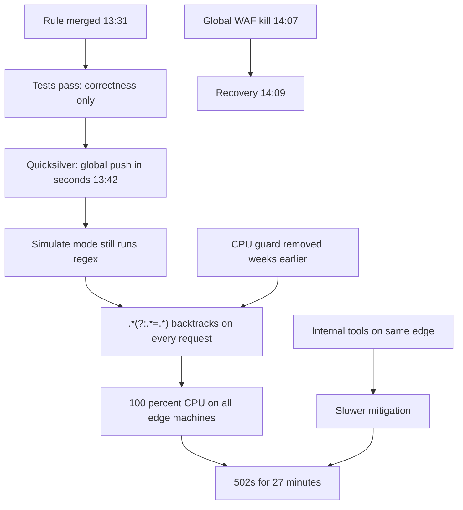

## In one minute
- On 2 July 2019, Cloudflare deployed a new web application firewall (WAF) rule containing a regular expression that backtracked catastrophically. CPU on every machine handling HTTP traffic worldwide went to 100 percent, and customers saw 502 errors for 27 minutes (13:42 to 14:09 UTC; [Cloudflare postmortem](https://blog.cloudflare.com/details-of-the-cloudflare-outage-on-july-2-2019/)).
- The dangerous part was `.*(?:.*=.*)`: two "match anything" pieces around an `=`. On some inputs, a backtracking engine tries a number of paths that grows very quickly with the input length.
- WAF rules were deliberately deployed globally within seconds, skipping the staged rollout used for software, so they could respond to attacks quickly. The rule was in "simulate" mode, but simulate still runs the regex.
- A protection against excessive regex CPU use had been removed by accident during a refactor weeks earlier, and tests checked correctness, not CPU cost.
- Recovery was slowed because the tools engineers needed (internal access, dashboards) ran on the same edge that was down. Fixes included restoring the CPU guard, profiling rules in tests, moving to regex engines with linear-time guarantees, and staged rollouts for rule changes.

## How it works

### Timeline (UTC, from Cloudflare's post)
- **13:31** The engineer's pull request with the new XSS-detection rule is merged.
- **13:37** The build passes its tests.
- **13:42** Automatic deployment of the rule begins; within seconds it is everywhere. About three minutes later the first page fires ([Cloudflare postmortem](https://blog.cloudflare.com/details-of-the-cloudflare-outage-on-july-2-2019/)).
- Engineers initially suspect an attack, because of the global, simultaneous CPU spike.
- **14:00** The WAF is identified as the cause; an attack is ruled out.
- **14:02** The team proposes a global kill of the WAF.
- **14:07** The global WAF termination is executed.
- **14:09** Traffic and CPU return to normal worldwide.
- **14:52** After confirming the cause and the fix, the WAF is re-enabled globally.

### Technical root cause
The rule's regular expression ended with `.*(?:.*=.*)`. In a backtracking regex engine such as PCRE, which Cloudflare's Lua-based WAF used, `.*` first consumes as much as possible and then gives characters back one at a time when the rest of the pattern fails. With two `.*` pieces in sequence and an `=` that is not present, the engine tries every way to split the input between them, for every starting position. Cloudflare's post shows the step count rising sharply: 23 steps for `x=x`, 555 steps for `x=` followed by 20 x's, and 5,353 steps when a trailing character forces more backtracking ([Cloudflare postmortem](https://blog.cloudflare.com/details-of-the-cloudflare-outage-on-july-2-2019/)). Real HTTP requests are much longer, so a single request could cost huge amounts of CPU, and every request was checked.

### Contributing factors
- **Global, instant deployment for rules.** WAF rules were distributed through Quicksilver, which propagates changes worldwide in seconds, without the staged rollout (internal "dogfood" points of presence, then small canary regions) used for software releases ([Cloudflare postmortem](https://blog.cloudflare.com/details-of-the-cloudflare-outage-on-july-2-2019/); compare [AWS Builders' Library on staged deployments](https://aws.amazon.com/builders-library/automating-safe-hands-off-deployments/)). That speed is valuable during an attack and catastrophic for a bad rule.
- **Simulate mode still executes.** Testing a rule in production in "log only" mode still ran its regex on live traffic.
- **A removed safeguard.** Protection against excessive regex CPU had been removed weeks earlier in a refactor intended to reduce CPU use ([Cloudflare postmortem](https://blog.cloudflare.com/details-of-the-cloudflare-outage-on-july-2-2019/)).
- **Tests checked behaviour, not cost.** The rule test suite verified matches, not performance.
- **Shared fate of tools.** Cloudflare Access (for internal tools) and the dashboard and API ran through the same edge. Some engineers' credentials had expired, and the bypass procedure was rarely practised ([Cloudflare postmortem](https://blog.cloudflare.com/details-of-the-cloudflare-outage-on-july-2-2019/)).

### Detection and mitigation
The CPU spike was immediately visible, but the first hypothesis (an attack) cost time. The fastest mitigation was the "global terminate" for the WAF, a kill switch that turned off the whole component, used about 25 minutes after deployment. A plain rollback would have needed the full WAF build to run twice, which was too slow ([Cloudflare postmortem](https://blog.cloudflare.com/details-of-the-cloudflare-outage-on-july-2-2019/)).

### What changed afterwards
Cloudflare listed: re-introducing the excessive-CPU protection; manually inspecting all 3,868 managed rules for backtracking risks; adding performance profiling of every rule to the test suite; switching to the re2 or Rust regex engines, which guarantee run time linear in the input; staged rollouts for rule changes, keeping an emergency global path for active attacks; an emergency way to run the dashboard and API off the edge; and automated status page updates. Longer term, the WAF moved off the Lua engine to a new firewall engine.

### What I would have done as the tech lead
Treat configuration and rules as code with the same rollout safety: staged, with automatic rollback on CPU or error regressions, plus an explicit emergency path that requires a stated reason. Make CPU budgets part of the rule test suite, and use a regex engine with linear-time guarantees for untrusted input by design, not by review. Keep the WAF kill switch fast, documented and practised, and make sure incident tooling does not depend on the system that may be down.

## Down the stack

### Layer 1: The contract
A WAF promises to inspect every request and block attacks while adding little latency, typically well under a millisecond per request. That contract has two halves: correctness (does it match attacks?) and cost (does it stay within a CPU budget?). The test suite checked only the first half.

### Layer 2: The mechanism
Regex engines come in two families. Backtracking engines (PCRE, the default engines in Python, JavaScript, Java and many others) explore one path at a time and back up on failure; they support features such as backreferences, but some patterns take exponential or high-polynomial time on adversarial input. Automata-based engines (RE2, Go's `regexp`, Rust's `regex`) compile the pattern to a state machine and process each input character a bounded number of times, guaranteeing time linear in the input for a fixed pattern, at the cost of not supporting backreferences ([Russ Cox, Regular Expression Matching Can Be Simple And Fast](https://swtch.com/~rsc/regexp/regexp1.html)). For a system that runs thousands of patterns against untrusted input, the linear-time guarantee is worth far more than backreferences.

### Layer 3: The machine
Each backtracking step is a few memory reads and comparisons, perhaps a nanosecond or two, so thousands of steps per request sound harmless. But a proxy handles tens of thousands of requests per second per machine, each checked against many rules, and the step count for this pattern grows roughly with the cube of input length. An input of a few kilobytes can need billions of steps, seconds of CPU for one request. When every core spends its time inside the regex engine, the event loop that should serve other requests never runs, so latency and errors hit all traffic, not just the requests that triggered the pattern.

### Why it's built this way
1. Security rules must deploy fast to respond to attacks, which creates pressure for global, instant pushes.
2. Fast global pushes need strong pre-deployment checks, including cost, not only correctness.
3. Backtracking engines have unbounded worst cases, so either the engine or a CPU guard must bound them.
4. When the edge is down, tools that depend on it are down too, so recovery paths need independence.
5. The best fix removes the failure class: linear-time engines plus staged rollout plus a guard.

## Diagram


## Worked example
A team uses a regex to validate email addresses in a signup API: `^([a-zA-Z0-9]+)*@example\.com$`. A user (or attacker) submits 30 letters followed by an exclamation mark. Each extra letter roughly doubles the work, because the nested quantifier `([a-zA-Z0-9]+)*` can split the letters into groups in exponentially many ways before concluding there is no match. In Python's `re`, a 30-character input can take many seconds; at 40 characters it effectively hangs a worker.

Applying Cloudflare's fixes: switch validation to a linear-time engine (the `re2` bindings, or Go's `regexp` in a Go service) or rewrite the pattern without nested quantifiers (`^[a-zA-Z0-9]+@example\.com$`); add a test that runs each pattern against long adversarial inputs and fails if it takes more than a small budget; cap input length before matching; and roll out validation changes through the same canary process as code.

## In the wild
- **Cloudflare, 2025: a feature file doubles in size.** On 18 November 2025 a database permissions change made a query return duplicate rows, which doubled the Bot Management feature file. It exceeded the proxy's limit of 200 features (about 60 were in use), the proxy panicked, and customers saw HTTP 5xx errors until a known-good file was deployed at 14:30 UTC ([Cloudflare postmortem](https://blog.cloudflare.com/18-november-2025-outage/)).
- **Fastly, 2021: one valid customer config exposes a latent bug.** On 8 June 2021 a customer configuration change triggered a bug shipped in a 12 May software deployment. About 85 percent of the network returned errors, monitoring noticed within a minute, and 95 percent recovered within 49 minutes ([Fastly summary](https://www.fastly.com/blog/summary-of-june-8-outage)).

## Trade-offs
| Approach | Strengths | Weaknesses | Choose when |
| --- | --- | --- | --- |
| Backtracking engine | Rich features (backreferences, lookaround) | Unbounded worst case | Trusted input, small patterns |
| Linear-time engine (RE2, Rust, Go) | Guaranteed run time | Fewer features | Untrusted input, many patterns |
| Step or time budget per match | Bounds damage from any engine | Must decide fail open or closed | Defence in depth |
| Global instant config push | Fast response to attacks | Global blast radius | Emergencies only, with a stated reason |
| Staged config rollout | Catches bad changes on a small slice | Slower | Default for rules and config |

## Pitfalls in production
- Treating config and rules as safer than code. Fix: same staged rollout and automatic rollback.
- "Log-only" or "simulate" modes assumed to be harmless. Fix: they still execute; budget and stage them too.
- Refactors that silently remove safeguards. Fix: tests that assert the safeguard exists and works.
- Regexes on untrusted input in backtracking engines. Fix: linear-time engines, input length limits, budgets.
- Incident tools behind the system they help fix. Fix: independent access paths, practised regularly.

## Leadership lens
- Inventory every place that pushes config or rules globally, and add staging with an emergency override.
- Add performance budgets to tests for anything that runs per request: regexes, templates, scripts.
- Prefer designs that make whole failure classes impossible (linear-time engines) over reviews that try to catch each instance.
- Practise the kill switch and the "edge is down" access path as part of game days.

## Check yourself
1. Why does `.*.*=.*` get so slow on inputs without `=`?
   **Answer:** A backtracking engine tries every way of splitting the input between the two `.*` pieces, at every starting position, before giving up, so work grows roughly with the cube of the input length.
2. Why did "simulate" mode not protect Cloudflare?
   **Answer:** Simulate mode still evaluated the regex on live traffic and only skipped blocking, so the CPU cost was fully present.
3. What does a linear-time regex engine give up, and why is it worth it here?
   **Answer:** Features such as backreferences; in exchange it guarantees time proportional to input length, which bounds the cost of any rule on any request.
4. Why did mitigation take longer than the kill switch itself?
   **Answer:** Engineers first suspected an attack, and the internal tools and access they needed ran through the same failing edge, with a rarely used bypass.

## Practice
**Task:** Build a tiny backtracking matcher with a step budget, to see catastrophic backtracking happen. Patterns use literal characters, `.` (any character) and `*` (zero or more of the previous character or `.`). `search(pattern, text, budget)` tries each start position from 0 to `len(text)` and returns `("match", steps)`, `("no-match", steps)` or `("budget-exceeded", budget + 1)`. Count one step every time the recursive `here(i, j)` function is entered; stop as soon as steps exceed the budget. `here(i, j)`: if the pattern is exhausted, return true. If the next pattern element is followed by `*`, greedily count how many characters from `j` it can match (call that end `k`), then try `here(i + 2, m)` for `m` from `k` down to `j`. Otherwise, if `j` is inside the text and the element matches `text[j]`, return `here(i + 1, j + 1)`; else false.

```python starter
def search(pattern, text, budget):
    # TODO: return (result, steps)
    raise NotImplementedError
```

```python tests
def test_simple_match():
    assert search("a.c", "zzabc", 100) == ("match", 6)

def test_star_on_literal():
    assert search("ab*c", "ac", 100) == ("match", 4)
    assert search("ab*c", "xabbbc", 100) == ("match", 5)
    assert search("ab*c", "abd", 100) == ("no-match", 7)

def test_cloudflare_pattern_matches_quickly_when_equals_present():
    assert search(".*.*=.*", "x=x", 1000) == ("match", 12)

def test_cost_grows_with_input_on_no_match():
    assert search("x=x", "x" * 20, 10**9) == ("no-match", 41)
    assert search(".*=.*", "x" * 20, 10**9) == ("no-match", 252)
    assert search(".*.*=.*", "x" * 20, 10**9) == ("no-match", 2023)

def test_doubling_input_multiplies_cost():
    _, small = search(".*.*=.*", "x" * 20, 10**9)
    _, big = search(".*.*=.*", "x" * 40, 10**9)
    assert big == 13243 and big > 6 * small

def test_budget_stops_runaway():
    assert search(".*.*=.*", "x" * 40, 5000) == ("budget-exceeded", 5001)
```

```python solution
class _Budget(Exception):
    pass

def search(pattern, text, budget):
    steps = [0]

    def here(i, j):
        steps[0] += 1
        if steps[0] > budget:
            raise _Budget()
        if i == len(pattern):
            return True
        if i + 1 < len(pattern) and pattern[i + 1] == "*":
            c, k = pattern[i], j
            while k < len(text) and (c == "." or text[k] == c):
                k += 1
            for m in range(k, j - 1, -1):
                if here(i + 2, m):
                    return True
            return False
        if j < len(text) and (pattern[i] == "." or pattern[i] == text[j]):
            return here(i + 1, j + 1)
        return False

    try:
        for start in range(len(text) + 1):
            if here(0, start):
                return ("match", steps[0])
        return ("no-match", steps[0])
    except _Budget:
        return ("budget-exceeded", budget + 1)
```

```typescript starter
export function search(pattern: string, text: string, budget: number): [string, number] {
  throw new Error("TODO");
}
```

```typescript tests
const xs = (n: number) => "x".repeat(n);

test("simple match", () => {
  assertEqual(search("a.c", "zzabc", 100), ["match", 6]);
});

test("star on literal", () => {
  assertEqual(search("ab*c", "ac", 100), ["match", 4]);
  assertEqual(search("ab*c", "xabbbc", 100), ["match", 5]);
  assertEqual(search("ab*c", "abd", 100), ["no-match", 7]);
});

test("cloudflare pattern matches quickly when equals present", () => {
  assertEqual(search(".*.*=.*", "x=x", 1000), ["match", 12]);
});

test("cost grows with input on no match", () => {
  assertEqual(search("x=x", xs(20), 1e9), ["no-match", 41]);
  assertEqual(search(".*=.*", xs(20), 1e9), ["no-match", 252]);
  assertEqual(search(".*.*=.*", xs(20), 1e9), ["no-match", 2023]);
});

test("doubling input multiplies cost", () => {
  const small = search(".*.*=.*", xs(20), 1e9)[1], big = search(".*.*=.*", xs(40), 1e9)[1];
  assert(big === 13243 && big > 6 * small, "cubic growth");
});

test("budget stops runaway", () => {
  assertEqual(search(".*.*=.*", xs(40), 5000), ["budget-exceeded", 5001]);
});
```

```typescript solution
export function search(pattern: string, text: string, budget: number): [string, number] {
  let steps = 0;
  const OVER = {};
  const here = (i: number, j: number): boolean => {
    steps++;
    if (steps > budget) throw OVER;
    if (i === pattern.length) return true;
    if (i + 1 < pattern.length && pattern[i + 1] === "*") {
      const c = pattern[i];
      let k = j;
      while (k < text.length && (c === "." || text[k] === c)) k++;
      for (let m = k; m >= j; m--) if (here(i + 2, m)) return true;
      return false;
    }
    if (j < text.length && (pattern[i] === "." || pattern[i] === text[j])) return here(i + 1, j + 1);
    return false;
  };
  try {
    for (let s = 0; s <= text.length; s++) if (here(0, s)) return ["match", steps];
    return ["no-match", steps];
  } catch (e) {
    if (e === OVER) return ["budget-exceeded", budget + 1];
    throw e;
  }
}
```

```go starter
package practice

func Search(pattern, text string, budget int) (string, int) {
	panic("TODO")
}
```

```go tests
package practice

import (
	"strings"
	"testing"
)

func expect(t *testing.T, r string, s int, wr string, ws int) {
	t.Helper()
	if r != wr || s != ws {
		t.Fatalf("got (%s, %d), want (%s, %d)", r, s, wr, ws)
	}
}

func TestSimple(t *testing.T) {
	r, s := Search("a.c", "zzabc", 100)
	expect(t, r, s, "match", 6)
}

func TestStar(t *testing.T) {
	r, s := Search("ab*c", "ac", 100)
	expect(t, r, s, "match", 4)
	r, s = Search("ab*c", "xabbbc", 100)
	expect(t, r, s, "match", 5)
	r, s = Search("ab*c", "abd", 100)
	expect(t, r, s, "no-match", 7)
}

func TestCloudflareMatch(t *testing.T) {
	r, s := Search(".*.*=.*", "x=x", 1000)
	expect(t, r, s, "match", 12)
}

func TestGrowth(t *testing.T) {
	x20 := strings.Repeat("x", 20)
	r, s := Search("x=x", x20, 1e9)
	expect(t, r, s, "no-match", 41)
	r, s = Search(".*=.*", x20, 1e9)
	expect(t, r, s, "no-match", 252)
	r, s = Search(".*.*=.*", x20, 1e9)
	expect(t, r, s, "no-match", 2023)
}

func TestDoubling(t *testing.T) {
	_, small := Search(".*.*=.*", strings.Repeat("x", 20), 1e9)
	_, big := Search(".*.*=.*", strings.Repeat("x", 40), 1e9)
	if big != 13243 || big <= 6*small {
		t.Fatalf("small %d big %d", small, big)
	}
}

func TestBudget(t *testing.T) {
	r, s := Search(".*.*=.*", strings.Repeat("x", 40), 5000)
	expect(t, r, s, "budget-exceeded", 5001)
}
```

```go solution
package practice

func Search(pattern, text string, budget int) (string, int) {
	steps := 0
	over := false
	var here func(i, j int) bool
	here = func(i, j int) bool {
		if over {
			return false
		}
		steps++
		if steps > budget {
			over = true
			return false
		}
		if i == len(pattern) {
			return true
		}
		if i+1 < len(pattern) && pattern[i+1] == '*' {
			c, k := pattern[i], j
			for k < len(text) && (c == '.' || text[k] == c) {
				k++
			}
			for m := k; m >= j; m-- {
				if here(i+2, m) {
					return true
				}
				if over {
					return false
				}
			}
			return false
		}
		if j < len(text) && (pattern[i] == '.' || pattern[i] == text[j]) {
			return here(i+1, j+1)
		}
		return false
	}
	for s := 0; s <= len(text); s++ {
		if here(0, s) {
			return "match", steps
		}
		if over {
			return "budget-exceeded", budget + 1
		}
	}
	return "no-match", steps
}
```

## Mock interview
**Prompt:** You own a platform that lets customers write their own filtering rules, including regular expressions, which run on every request through your proxy at 2 million requests per second. After reading about Cloudflare's 2019 outage, design the system so one bad rule cannot take down the platform.

- Follow-up: A large customer needs backreferences, which your linear-time engine does not support. What do you do?
- Follow-up: How do you roll out a new rule safely when a customer is under active attack and needs it now?
- Follow-up: Your proxy is down. How do your engineers and customers reach the dashboards to fix it?

**A strong answer covers:**
- A linear-time regex engine for untrusted patterns, with input length limits and per-request CPU budgets as defence in depth.
- Validation at submission: compile checks, performance tests on adversarial inputs, rejection of known dangerous constructs.
- Per-tenant isolation and budgets so one customer's rule cannot starve others.
- Staged rollout of rules with automatic rollback on CPU or error regressions, plus an audited emergency path for attacks.
- A practised kill switch per rule and per feature.
- Independent access paths for tools and customer dashboards, tested in game days.

## Sources and further study
**Primary**
- [Details of the Cloudflare outage on July 2, 2019 (Cloudflare)](https://blog.cloudflare.com/details-of-the-cloudflare-outage-on-july-2-2019/): timeline, regex step counts, Quicksilver and follow-ups.
- [Regular Expression Matching Can Be Simple And Fast (Russ Cox)](https://swtch.com/~rsc/regexp/regexp1.html): exponential backtracking versus Thompson NFA matching.

**Systems docs**
- [Automating safe, hands-off deployments (AWS Builders' Library)](https://aws.amazon.com/builders-library/automating-safe-hands-off-deployments/): waves, one-box stages, bake time and automatic rollback.
- [Summary of the June 8 outage (Fastly)](https://www.fastly.com/blog/summary-of-june-8-outage): a comparable global config-triggered failure.

**Books**
- *Release It!*, 2nd ed., Michael Nygard, Ch 4: Stability Antipatterns, on cascading failures and shared fate.
- *Site Reliability Engineering* (Google), Ch 15: Postmortem Culture, for how to write and use a review like Cloudflare's.

**Other curricula**
- [Postmortem Culture, SRE Workbook Ch 10 (Google)](https://sre.google/workbook/postmortem-culture/): system-focused action items rather than blame.

## Free resources
- [Details of the Cloudflare outage on July 2, 2019 (Cloudflare)](https://blog.cloudflare.com/details-of-the-cloudflare-outage-on-july-2-2019/): Cloudflare's own full postmortem, including the regex analysis.
- [Regular Expression Matching Can Be Simple And Fast (Russ Cox)](https://swtch.com/~rsc/regexp/regexp1.html): why automata-based engines avoid catastrophic backtracking.
- [Go regexp package](https://pkg.go.dev/regexp): a widely used RE2-style engine that guarantees linear time in the input.
- [ReDoS (OWASP)](https://owasp.org/www-community/attacks/Regular_expression_Denial_of_Service_-_ReDoS): the attack class and mitigations.
