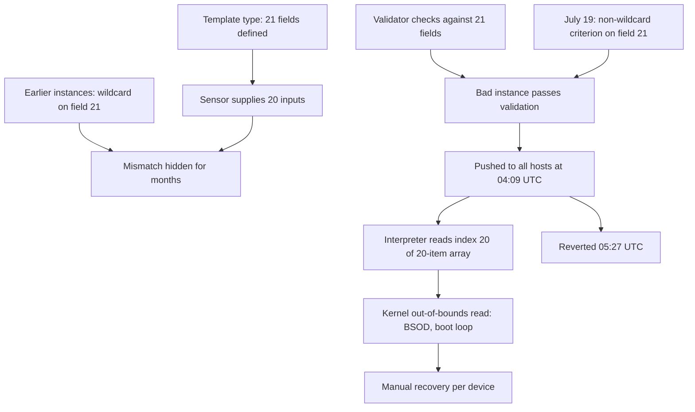

## In one minute
- On 19 July 2024 at 04:09 UTC, CrowdStrike pushed a rapid response content update (Channel File 291) to its Falcon sensor on Windows. Machines that received it crashed with a blue screen and, because the sensor loads at boot, kept crashing on restart. The update was reverted at 05:27 UTC, but machines already affected needed manual repair. Microsoft estimated about 8.5 million Windows devices were affected, under one percent of all Windows machines ([Microsoft](https://blogs.microsoft.com/blog/2024/07/20/helping-our-customers-through-the-crowdstrike-outage/)). Only Windows hosts on sensor 7.11 or later that were online in that 78-minute window were hit; Mac and Linux hosts were not ([CrowdStrike hub](https://www.crowdstrike.com/falcon-content-update-remediation-and-guidance-hub/)).
- The cause was a mismatch: a template type introduced in sensor 7.11 (February 2024) defined 21 input fields, but the sensor code supplied only 20. Earlier content used a wildcard for the 21st field, so it was never read. The July content used a real value there, and the content interpreter read past the end of its input array ([CrowdStrike RCA](https://www.crowdstrike.com/wp-content/uploads/2024/08/Channel-File-291-Incident-Root-Cause-Analysis-08.06.2024.pdf)).
- The content validator checked against 21 fields, not the 20 the sensor actually provided, and the interpreter had no runtime bounds check. Content updates also went to all customers at once rather than in stages.
- Because the code ran in the Windows kernel, an out-of-bounds read crashed the whole operating system rather than one process.
- CrowdStrike's fixes: a bounds check in the interpreter, validation of input counts, wider testing of matching criteria, fixes to the validator, staged deployment of content with canaries, and customer control over when content arrives.

## How it works

### Timeline (from CrowdStrike's preliminary review and root cause analysis)
- **28 February 2024** Sensor 7.11 becomes generally available and introduces a new template type for inter-process communication (IPC) detections. It defines 21 input parameter fields, but the sensor code that feeds it provides 20. Testing and the first template instances use a wildcard criterion for the 21st field, so the gap is invisible ([CrowdStrike hub](https://www.crowdstrike.com/falcon-content-update-remediation-and-guidance-hub/)).
- **5 March to 24 April 2024** The first IPC template instance reaches production on 5 March after stress testing, and three more follow between 8 and 24 April, all without problems.
- **19 July, 04:09 UTC** Two new IPC template instances are deployed in Channel File 291. One uses a non-wildcard criterion on the 21st field. Windows hosts running sensor 7.11 or later that are online receive it and crash.
- **05:27 UTC** CrowdStrike reverts the content. Hosts that came online after this were not affected; hosts that already crashed stay in a boot loop until the bad file is removed, often by hand, and many with BitLocker needed recovery keys. CrowdStrike's remediation guidance was to reboot on a wired network so the host could fetch the reverted file, or to boot recovery media and delete the `C-00000291*.sys` files; cloud VMs could detach the disk or roll back to a snapshot from before 04:09 UTC ([CrowdStrike hub](https://www.crowdstrike.com/falcon-content-update-remediation-and-guidance-hub/)).

### Technical root cause
A content interpreter inside the sensor evaluated template instances against an array of input values. The IPC template type said there were 21 inputs; the sensor built an array of 20. When content asked the interpreter to compare the 21st input with a non-wildcard value, it read the 21st pointer from a 20-element array: an out-of-bounds read of memory that did not hold a valid pointer ([CrowdStrike RCA](https://www.crowdstrike.com/wp-content/uploads/2024/08/Channel-File-291-Incident-Root-Cause-Analysis-08.06.2024.pdf)). In kernel mode, that is a fatal exception for the whole system.

### Contributing factors (CrowdStrike's own findings)
The six findings below are the headings of the RCA's "Findings and Mitigations" section ([CrowdStrike RCA](https://www.crowdstrike.com/wp-content/uploads/2024/08/Channel-File-291-Incident-Root-Cause-Analysis-08.06.2024.pdf)).
1. The number of fields in the IPC template type was not validated at sensor compile time.
2. A runtime array bounds check was missing in the content interpreter for these inputs.
3. Template type testing did not cover non-wildcard criteria for every field.
4. The content validator had a logic error: it validated against the 21 defined fields rather than the 20 provided.
5. Template instance validation did not include running the instance in the content interpreter itself.
6. Template instances were not deployed in stages.

### Detection and mitigation
Crashes started within minutes of the push and were reported worldwide. CrowdStrike reverted the content 78 minutes after release, which stopped new crashes ([CrowdStrike hub](https://www.crowdstrike.com/falcon-content-update-remediation-and-guidance-hub/)). Recovery of affected machines was the long part: each needed booting into safe mode or recovery and deleting the channel file, which for many organisations meant hands on every device.

### What changed afterwards
CrowdStrike added runtime bounds checks and compile-time validation of input counts, backported to sensor 7.11 and later; the validator now only allows wildcard criteria in the 21st field; testing covers non-wildcard criteria for each field; content is deployed in stages with canary testing and successive promotion; customers can choose where and when rapid response content is applied; and CrowdStrike engaged two independent third-party security vendors to review the sensor code, plus a separate review of the end-to-end quality process ([CrowdStrike RCA](https://www.crowdstrike.com/wp-content/uploads/2024/08/Channel-File-291-Incident-Root-Cause-Analysis-08.06.2024.pdf)). The interpreter bounds check was added on 25 July, and by 29 July about 99 percent of Windows sensors were back online week over week ([CrowdStrike hub](https://www.crowdstrike.com/falcon-content-update-remediation-and-guidance-hub/)).

### What I would have done as the tech lead
Treat content and configuration as code: staged rollout through rings (internal machines, a small canary group, then wider), with automatic halt on crash telemetry, as the [SRE Workbook's canarying chapter](https://sre.google/workbook/canarying-releases/) describes. Validate content against the actual consumer, by running every new instance through the real interpreter in test, not just against a schema. Make the interpreter defensive: every array access bounds-checked, so bad content fails safe. And design for recovery: a component that loads at boot should detect repeated crashes and disable the latest content automatically.

## Down the stack

### Layer 1: The contract
The sensor promised customers fast protection against new threats, which is why rapid response content skipped the slower rollout used for sensor code. Implicitly it also promised not to crash the host. The second promise needed the same rigour as the first: content is code-like input to a kernel component, and a bad input must never be able to take the machine down.

### Layer 2: The mechanism
Falcon separates sensor code (shipped as versioned releases) from content (template types defined in code, and template instances delivered as channel files). The content interpreter applies instances to events using a fixed set of inputs per template type. This split is common in security and observability agents: it lets vendors ship detections in minutes without a full release. CrowdStrike itself stresses that rapid response content is configuration data, not code or a kernel driver ([CrowdStrike RCA](https://www.crowdstrike.com/wp-content/uploads/2024/08/Channel-File-291-Incident-Root-Cause-Analysis-08.06.2024.pdf)); the lesson is that data a kernel-mode interpreter evaluates deserves code-grade testing anyway. Its risk is exactly what happened: content can exercise code paths the sensor's own tests never hit, so validation must check content against the real interpreter and the real inputs.

### Layer 3: The machine
In user space, reading an invalid address usually kills one process; the operating system survives. A kernel driver runs in ring 0 with the operating system; an invalid memory access there raises a page fault the kernel cannot recover from, and Windows stops with a bug check (the blue screen) to avoid corrupting data. CrowdStrike's crash dump analysis shows the interpreter loading the 21st entry, at index 0x14, from an array of 20 pointers and dereferencing a value that did not point to valid memory. Because the driver loads early at boot to protect the system, the machine crashed again on every restart until the file was removed ([CrowdStrike RCA](https://www.crowdstrike.com/wp-content/uploads/2024/08/Channel-File-291-Incident-Root-Cause-Analysis-08.06.2024.pdf)).

### Why it's built this way
1. Security agents need kernel access and fast content updates to stop new attacks.
2. Fast, global updates to kernel components multiply the blast radius of any defect.
3. So content must be validated against the real consumer and rolled out in stages.
4. The consumer must also be defensive, failing safe on unexpected input.
5. Recovery must be designed in, because a boot-time crash removes the usual remote fix path.

## Diagram


## Worked example
An observability company ships a log-parsing agent to 400,000 customer servers. Parsing rules are pushed as content several times a day, globally, because customers want new formats supported quickly. A rule that references capture group 5 of a regex with only 4 groups makes the agent crash, and the agent runs as a system service that restarts in a loop.

Applying CrowdStrike's lessons: the rule compiler checks group references against the regex at build time; the agent bounds-checks every group access and skips the rule with an error metric instead of crashing; every rule runs against a corpus of real log samples through the actual agent binary in CI; rollout goes to the company's own fleet first, then 1 percent of customers, then 10, then all, with automatic halt if crash or error rates rise; and the agent disables the most recent content after two crashes within 10 minutes of loading it. A bad rule now produces an error metric on internal hosts and never reaches customers.

## In the wild
- **Cloudflare, 2019: a WAF regex deployed everywhere at once.** A new managed rule shipped globally with no staged rollout, its regex backtracked catastrophically, CPUs serving HTTP traffic hit nearly 100 percent and service was down for 27 minutes; an engineer reported losing about 80 percent of traffic. A CPU guard had been removed weeks earlier; Cloudflare restored it, reviewed all 3,868 rules and added performance profiling to tests ([Cloudflare](https://blog.cloudflare.com/details-of-the-cloudflare-outage-on-july-2-2019/)).
- **Cloudflare, 2025: a generated feature file doubled in size.** A database permissions change made a query return duplicate rows, so the Bot Management feature file passed the proxy's limit of 200 features and the proxy panicked. Core traffic returned 5xx errors from about 11:20 to 14:30 UTC. Cloudflare committed to validating its own generated config as strictly as user input and adding global kill switches ([Cloudflare](https://blog.cloudflare.com/18-november-2025-outage/)).
- **Google Cloud, 2025: a blank policy row crashed every region.** A quota-policy row with blank fields replicated worldwide within seconds and hit a new Service Control code path that had no feature flag and no error handling. API calls returned 503 until a kill switch went out about 40 minutes later; Google planned incremental propagation of global data and flags that default to off ([Google Cloud status](https://status.cloud.google.com/incidents/ow5i3PPK96RduMcb1SsW)).

## Trade-offs
| Control | Strengths | Weaknesses | Choose when |
| --- | --- | --- | --- |
| Global instant content push | Fastest protection | Global blast radius | Only with strong validation and defensive consumers |
| Staged rings with canaries | Bad content reaches few hosts | Slower protection | Default for content and config |
| Validate against real interpreter | Catches consumer mismatches | Test effort and time | Any content consumed by code |
| Runtime bounds checks | Fails safe on bad input | Small overhead | Always in kernel or privileged code |
| Customer control of timing | Customers manage their own risk | Some customers lag on protection | Enterprise environments |

## Pitfalls in production
- Treating content or config as data rather than code. Fix: same testing, staging and rollback as code.
- Validating content against a specification instead of the actual consumer. Fix: run it through the real interpreter in tests.
- Trusting input from your own pipeline inside privileged code. Fix: defensive checks everywhere in the consumer.
- No automatic recovery for boot-time components. Fix: crash-loop detection that disables new content.
- Tests that cover only the common case (wildcards). Fix: test every field with real criteria.

## Leadership lens
- Map every "content", "rule" or "config" channel that bypasses your code release process, and give each one staged rollout and automated halts.
- Require defensive parsing and bounds checks in any component that runs with high privilege or at boot.
- Plan recovery for the worst case: if this crashes every machine at boot, how do we fix them without remote access?
- Use this case to explain why "it's just a config change" is never a reason to skip safety.

## Check yourself
1. Why did the bug stay hidden from February until July?
   **Answer:** Earlier template instances used a wildcard for the 21st field, so the interpreter never read the missing 21st input; the first non-wildcard criterion exposed it.
2. Why did the validator not catch the problem?
   **Answer:** It validated instances against the 21 fields defined by the template type, not against the 20 inputs the sensor actually supplied.
3. Why did an out-of-bounds read crash the whole machine?
   **Answer:** The code ran in a kernel driver, where an invalid memory access causes a fatal system error rather than killing a single process.
4. Name two process changes that limit the blast radius of future bad content.
   **Answer:** Staged deployment with canary rings and automatic halts, and customer control over when content is applied (also: validation inside the real interpreter).

## Practice
**Task:** Build two safeguards. `out_of_bounds(criteria, supplied)` takes a template instance's list of per-field criteria (the string `"*"` is a wildcard that never reads the input) and the number of inputs the sensor supplies, and returns the list of field indices (0-based) that would be read out of bounds: non-wildcard criteria at an index at or beyond `supplied`. `staged(rings, crash_rates, threshold)` takes ring names in rollout order and a dict of observed crash rate per ring after deployment, and returns a tuple `(deployed, halted_at)`: rings are deployed in order, and rollout stops after the first ring whose crash rate exceeds the threshold (that ring is included in `deployed`, and `halted_at` is its name); if no ring exceeds the threshold, `halted_at` is `None`.

```python starter
def out_of_bounds(criteria, supplied):
    # TODO
    raise NotImplementedError

def staged(rings, crash_rates, threshold):
    # TODO: return (deployed, halted_at)
    raise NotImplementedError
```

```python tests
def test_wildcard_in_missing_field_is_safe():
    criteria = ["a"] * 20 + ["*"]
    assert out_of_bounds(criteria, 20) == []

def test_july_19_instance_reads_out_of_bounds():
    criteria = ["*"] * 20 + ["\\\\.\\pipe\\x"]
    assert out_of_bounds(criteria, 20) == [20]

def test_all_fields_supplied():
    assert out_of_bounds(["a", "b", "c"], 3) == []

def test_multiple_bad_fields():
    assert out_of_bounds(["a", "b", "c", "*", "e"], 2) == [2, 4]

def test_staged_rollout_halts_at_canary():
    rings = ["internal", "canary", "early", "general"]
    rates = {"internal": 0.0, "canary": 0.4, "early": 0.0, "general": 0.0}
    assert staged(rings, rates, 0.01) == (["internal", "canary"], "canary")

def test_healthy_rollout_reaches_everyone():
    rings = ["internal", "canary", "general"]
    assert staged(rings, {"internal": 0.0, "canary": 0.001, "general": 0.0}, 0.01) == (rings, None)
```

```python solution
def out_of_bounds(criteria, supplied):
    return [i for i, c in enumerate(criteria) if c != "*" and i >= supplied]

def staged(rings, crash_rates, threshold):
    deployed = []
    for r in rings:
        deployed.append(r)
        if crash_rates.get(r, 0) > threshold:
            return deployed, r
    return deployed, None
```

```typescript starter
export function outOfBounds(criteria: string[], supplied: number): number[] {
  throw new Error("TODO");
}

export function staged(rings: string[], crashRates: Record<string, number>, threshold: number): [string[], string | null] {
  throw new Error("TODO");
}
```

```typescript tests
const fill = (n: number, v: string) => Array(n).fill(v);

test("wildcard in missing field is safe", () => {
  assertEqual(outOfBounds([...fill(20, "a"), "*"], 20), []);
});

test("july 19 instance reads out of bounds", () => {
  assertEqual(outOfBounds([...fill(20, "*"), "pipe-x"], 20), [20]);
});

test("all fields supplied", () => {
  assertEqual(outOfBounds(["a", "b", "c"], 3), []);
});

test("multiple bad fields", () => {
  assertEqual(outOfBounds(["a", "b", "c", "*", "e"], 2), [2, 4]);
});

test("staged rollout halts at canary", () => {
  assertEqual(staged(["internal", "canary", "early", "general"], { internal: 0, canary: 0.4, early: 0, general: 0 }, 0.01),
    [["internal", "canary"], "canary"]);
});

test("healthy rollout reaches everyone", () => {
  const rings = ["internal", "canary", "general"];
  assertEqual(staged(rings, { internal: 0, canary: 0.001, general: 0 }, 0.01), [rings, null]);
});
```

```typescript solution
export function outOfBounds(criteria: string[], supplied: number): number[] {
  const out: number[] = [];
  criteria.forEach((c, i) => { if (c !== "*" && i >= supplied) out.push(i); });
  return out;
}

export function staged(rings: string[], crashRates: Record<string, number>, threshold: number): [string[], string | null] {
  const deployed: string[] = [];
  for (const r of rings) {
    deployed.push(r);
    if ((crashRates[r] || 0) > threshold) return [deployed, r];
  }
  return [deployed, null];
}
```

```go starter
package practice

func OutOfBounds(criteria []string, supplied int) []int {
	panic("TODO")
}

// Staged returns the deployed rings and the ring where rollout halted ("" if none).
func Staged(rings []string, crashRates map[string]float64, threshold float64) ([]string, string) {
	panic("TODO")
}
```

```go tests
package practice

import (
	"reflect"
	"testing"
)

func fill(n int, v string) []string {
	out := make([]string, n)
	for i := range out {
		out[i] = v
	}
	return out
}

func TestWildcardSafe(t *testing.T) {
	if got := OutOfBounds(append(fill(20, "a"), "*"), 20); len(got) != 0 {
		t.Fatalf("got %v", got)
	}
}

func TestJuly19(t *testing.T) {
	if got := OutOfBounds(append(fill(20, "*"), "pipe-x"), 20); !reflect.DeepEqual(got, []int{20}) {
		t.Fatalf("got %v", got)
	}
}

func TestAllSupplied(t *testing.T) {
	if got := OutOfBounds([]string{"a", "b", "c"}, 3); len(got) != 0 {
		t.Fatalf("got %v", got)
	}
}

func TestMultiple(t *testing.T) {
	if got := OutOfBounds([]string{"a", "b", "c", "*", "e"}, 2); !reflect.DeepEqual(got, []int{2, 4}) {
		t.Fatalf("got %v", got)
	}
}

func TestHaltAtCanary(t *testing.T) {
	d, h := Staged([]string{"internal", "canary", "early", "general"}, map[string]float64{"canary": 0.4}, 0.01)
	if !reflect.DeepEqual(d, []string{"internal", "canary"}) || h != "canary" {
		t.Fatalf("got %v %q", d, h)
	}
}

func TestHealthy(t *testing.T) {
	rings := []string{"internal", "canary", "general"}
	d, h := Staged(rings, map[string]float64{"canary": 0.001}, 0.01)
	if !reflect.DeepEqual(d, rings) || h != "" {
		t.Fatalf("got %v %q", d, h)
	}
}
```

```go solution
package practice

func OutOfBounds(criteria []string, supplied int) []int {
	var out []int
	for i, c := range criteria {
		if c != "*" && i >= supplied {
			out = append(out, i)
		}
	}
	return out
}

func Staged(rings []string, crashRates map[string]float64, threshold float64) ([]string, string) {
	var deployed []string
	for _, r := range rings {
		deployed = append(deployed, r)
		if crashRates[r] > threshold {
			return deployed, r
		}
	}
	return deployed, ""
}
```

## Mock interview
**Prompt:** You are the engineering lead for an endpoint agent installed on 2 million enterprise laptops and servers. The agent runs privileged code and receives detection content several times a day. After the CrowdStrike incident, a large customer asks: "How do you guarantee a bad update can never brick our fleet?" Answer them, and describe the changes you would make.

- Follow-up: Your threat research team says staged rollouts will delay protection against active attacks. How do you balance that?
- Follow-up: What happens on a machine if your agent crashes three times in a row at boot?
- Follow-up: How do you test that content and the agent agree on formats?

**A strong answer covers:**
- Honesty: no guarantee is absolute, but layers make a fleet-wide failure very unlikely.
- Defensive agent code: bounds checks, input validation and fail-safe behaviour for every content field.
- Content validated against the real interpreter with realistic and adversarial inputs, plus schema and count checks shared between content and agent builds.
- Staged rings with canaries and automatic halts on crash telemetry, and an expedited but still staged path for urgent threats.
- Boot-loop protection: detect repeated crashes and roll back content automatically, plus documented recovery.
- Customer controls over timing, and transparent release notes.

## Sources and further study
**Primary**
- [Channel File 291 Incident Root Cause Analysis (CrowdStrike, 2024)](https://www.crowdstrike.com/wp-content/uploads/2024/08/Channel-File-291-Incident-Root-Cause-Analysis-08.06.2024.pdf): findings, mitigations and crash-dump analysis.
- [Preliminary Post Incident Review (CrowdStrike, 2024)](https://www.crowdstrike.com/en-us/blog/falcon-content-update-preliminary-post-incident-report/): the first account of the timeline.

**Systems docs**
- [Falcon Content Update remediation and guidance hub (CrowdStrike)](https://www.crowdstrike.com/falcon-content-update-remediation-and-guidance-hub/): UTC timeline, affected sensors and recovery steps.
- [Helping our customers through the CrowdStrike outage (Microsoft)](https://blogs.microsoft.com/blog/2024/07/20/helping-our-customers-through-the-crowdstrike-outage/): the 8.5 million device estimate and Microsoft's recovery work.

**Books**
- *Site Reliability Engineering* (Beyer et al.), Ch 22, [Addressing Cascading Failures](https://sre.google/sre-book/addressing-cascading-failures/): why a fleet-wide defect spreads.
- *The Site Reliability Workbook*, Ch 16, [Canarying Releases](https://sre.google/workbook/canarying-releases/): staged rollout and evaluation.
- *Building Secure and Reliable Systems* (Google, 2020), Ch 8, Design for Resilience, controlling the blast radius ([read free](https://google.github.io/building-secure-and-reliable-systems/raw/ch08.html)).

**Other curricula**
- [Azure Architecture Center: Safe deployment practices](https://learn.microsoft.com/en-us/azure/well-architected/operational-excellence/safe-deployments): progressive rollout in rings.

## Free resources
- [Channel File 291 Incident Root Cause Analysis (CrowdStrike, PDF)](https://www.crowdstrike.com/wp-content/uploads/2024/08/Channel-File-291-Incident-Root-Cause-Analysis-08.06.2024.pdf): CrowdStrike's full findings, mitigations and crash dump analysis.
- [Preliminary Post Incident Review (CrowdStrike)](https://www.crowdstrike.com/en-us/blog/falcon-content-update-preliminary-post-incident-report/): the timeline and first explanation.
- [Helping our customers through the CrowdStrike outage (Microsoft)](https://blogs.microsoft.com/blog/2024/07/20/helping-our-customers-through-the-crowdstrike-outage/): Microsoft's estimate of affected devices and recovery support.
- [Canarying releases (Google SRE workbook)](https://sre.google/workbook/canarying-releases/): staged rollout with automatic evaluation.
