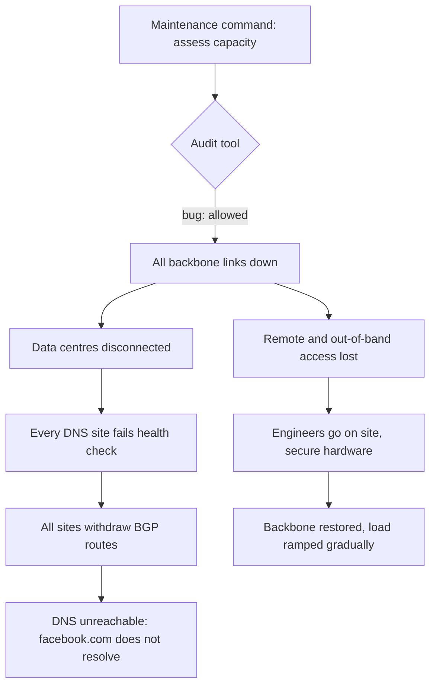

## In one minute
- On 4 October 2021, Facebook, Instagram, WhatsApp and Messenger disappeared from the internet for about six hours. Externally, Cloudflare saw Facebook's routes change at about 15:40 UTC and DNS working again by about 21:28 UTC ([Cloudflare](https://blog.cloudflare.com/october-2021-facebook-outage/)).
- The trigger: during routine maintenance, a command meant to assess global backbone capacity accidentally took down all backbone connections, disconnecting Facebook's data centres from each other. A bug in the audit tool that should have blocked the command let it through ([Meta Engineering](https://engineering.fb.com/2021/10/05/networking-traffic/outage-details/)).
- The amplifier: Facebook's DNS servers withdraw their BGP route announcements when they cannot reach the data centres, a sensible health rule for one site. With the backbone down, every DNS site failed the check at once and withdrew, so the rest of the internet could no longer find Facebook's name servers ([Meta Engineering](https://engineering.fb.com/2021/10/05/networking-traffic/outage-details/)).
- Recovery was slow because remote and out-of-band access depended on the same network, and the data centres are physically secured. Engineers had to go on site, then bring services back gradually to avoid power and load surges.
- The lessons: guard operational commands with checks that actually work, make health-driven automation "fail static" when everything looks unhealthy at once, and keep out-of-band access truly independent.

## How it works

### Timeline (from Facebook's post and Cloudflare's external observations)
- **About 15:40 UTC** A maintenance command intended to assess backbone capacity disconnects all backbone links; Facebook's data centres lose connectivity to each other. Cloudflare sees a burst of BGP updates from Facebook.
- **About 15:50** Resolution of facebook.com through public resolvers starts failing.
- **15:58** Cloudflare observes that Facebook has stopped announcing the routes for its DNS server prefixes (for example 185.89.218.0/23 and 129.134.30.0/23; [Cloudflare](https://blog.cloudflare.com/october-2021-facebook-outage/)). Other Facebook prefixes are still announced, but without DNS nobody can find them.
- Public resolvers return errors; apps and users retry aggressively, and Cloudflare sees query volume to its 1.1.1.1 resolver for these domains rise about 30 times ([Cloudflare](https://blog.cloudflare.com/october-2021-facebook-outage/)).
- Engineers cannot reach the data centres remotely: normal and out-of-band management depended on the network that was down, and many internal tools depended on DNS. Teams travel to data centres, where strict physical and system security slows access to hardware.
- **About 21:00** Facebook's BGP announcements resume. **21:20** facebook.com resolves again on 1.1.1.1; **about 21:28** Facebook appears reconnected to the internet ([Cloudflare](https://blog.cloudflare.com/october-2021-facebook-outage/)). Services are brought back gradually ([Meta Engineering](https://engineering.fb.com/2021/10/05/networking-traffic/outage-details/)).

### Technical root cause
Two mechanisms combined. First, a command issued during backbone maintenance disconnected the entire backbone, and the audit tool meant to catch commands like that had a bug. Second, the DNS servers' health rule (stop announcing my routes if I cannot reach the data centres) was designed for the case where one DNS site has a local problem and traffic should go to healthy sites. When the backbone failed, every site failed the check simultaneously, so all of them withdrew. The safety mechanism removed every path to DNS at once.

### Contributing factors
- **Audit tool bug.** The control intended to prevent this class of command did not work.
- **Correlated health checks.** All DNS sites depended on the same backbone for their health signal, so a single failure made all of them "unhealthy" together.
- **Out-of-band access was not independent enough.** Remote management relied on infrastructure that was affected.
- **Internal tools depended on the same DNS and network.** Diagnosis and coordination tools were also down.
- **Physical security by design.** The protections that keep data centres safe also slowed hands-on recovery; Facebook judged that a worthwhile trade-off.

### Detection and mitigation
Detection was instant from the outside. Mitigation required restoring the backbone, which required physical presence. Once the network was back, Facebook did not switch everything on at once: data centres had seen a large drop in power consumption, and a sudden return of all traffic risked electrical and cache problems ([Meta Engineering](https://engineering.fb.com/2021/10/05/networking-traffic/outage-details/)). Engineers used experience from "storm" drills, which simulate large failures, to bring load back in stages.

### What changed afterwards
Facebook's post describes an ongoing review to make systems more resilient, strengthening testing and drills, and extending storm drills to simulate a global backbone outage. It does not list specific code changes, so this lesson does not invent them.

### What I would have done as the tech lead
Treat any command that can affect the whole backbone as gatekeeper work: a staged execution (one region first), and an audit tool that is itself tested with known-bad commands. Design health-driven withdrawal to fail static: if more than a fraction of sites fail the same check at once, assume the check (or a shared dependency) is the problem and keep announcing. Keep a genuinely independent out-of-band network and access path, and drill using it. Plan the recovery ramp in advance, since restoring huge load all at once can cause a second outage.

## Down the stack

### Layer 1: The contract
Facebook's authoritative DNS promised that its name servers would always be reachable from somewhere on the internet, through anycast: the same IP prefixes announced from many locations, with traffic going to the nearest healthy one. Each site's withdrawal rule served that contract locally, but no rule protected it globally.

### Layer 2: The mechanism
BGP is how networks tell each other which IP prefixes they can reach. An anycast DNS site announces its service prefixes from its routers; if the site withdraws its announcement, neighbours stop sending traffic there and pick another site still announcing. A health check that triggers withdrawal is common: a site that cannot serve correct answers should step aside, and [RFC 4786](https://www.rfc-editor.org/rfc/rfc4786) ties route advertisement to service health, while warning that pessimistic withdrawal can take a whole node offline. The failure mode is correlated health: if the check depends on something every site shares, such as reachability of a central backbone, then one shared failure makes every site withdraw, and the prefix disappears from the global routing table.

### Layer 3: The machine
When a prefix is withdrawn, BGP routers across the internet remove it from their routing tables within seconds to minutes, as withdrawal messages propagate peer to peer. DNS resolvers asking for facebook.com then cannot reach any name server: their packets have no route. Resolvers return SERVFAIL and may cache it briefly; clients retry, multiplying query load on resolvers worldwide. Bringing the routes back is just as fast technically once someone can configure the routers, which is why the hours of the outage were spent on access, not on BGP.

### Why it's built this way
1. Anycast plus health-based withdrawal routes traffic away from a broken site, which is good locally.
2. If every site's health depends on one shared component, the rule fails globally.
3. Systems therefore need a global guard: if too many sites fail at once, keep serving.
4. Recovery tools must not depend on the network they recover.
5. Large systems must also be restarted gradually, because the restart itself can overload them.

## Diagram


## Worked example
A company runs its own anycast DNS from 12 sites. Each site withdraws its route if its health check, a query to the central configuration API, fails three times in a row. A config API outage would make all 12 sites withdraw: the same shape as Facebook's.

The team redesigns the rule. Sites withdraw only for local reasons (the DNS process is down, local answers fail validation). For shared dependencies, each site keeps serving its last known good data (fail static). A coordinator also enforces a global limit: at most 3 of 12 sites may be withdrawn at a time, and at least 9 must always announce; if more sites fail at once, the extra ones keep announcing and an alert pages the on-call, because simultaneous failure usually means a shared cause. They test it in a game day by blocking the config API: all 12 sites keep answering from cached data, and one alert fires. They also verify that the out-of-band network for router access uses a separate provider and authentication path, and run a drill using only that path.

## In the wild
- **Cloudflare, 2019: incident tooling behind the failing edge.** During the 2 July 2019 outage, engineers could not reach the internal control panel because Cloudflare Access ran on the same edge, and the bypass was rarely practised ([Cloudflare postmortem](https://blog.cloudflare.com/details-of-the-cloudflare-outage-on-july-2-2019/)).
- **AWS, 2017: the status page depended on the failing service.** The Service Health Dashboard admin console relied on S3, so AWS could not update service status until 11:37 PST ([AWS summary](https://aws.amazon.com/message/41926/)).
- **Google Cloud, 2019: debugging tools competed for the congested network.** After network control planes were descheduled, tools used to diagnose the problem competed for the same congested network, hampering the response ([Google Cloud incident 19009](https://status.cloud.google.com/incident/cloud-networking/19009)).

## Trade-offs
| Design | Strengths | Weaknesses | Choose when |
| --- | --- | --- | --- |
| Withdraw on any failed health check | Removes broken sites quickly | Correlated failure withdraws everything | Checks that are truly local |
| Fail static on shared dependency failure | Keeps serving through central outages | May serve stale data | Shared config, control planes |
| Global limit on simultaneous withdrawals | Prevents total withdrawal | Can keep a truly bad site in service | Anycast and load balancer pools |
| Independent out-of-band network | Access when production is down | Cost, must be maintained and tested | Any critical infrastructure |
| Staged command execution | Limits blast radius of a bad command | Slower operations | Backbone and fleet-wide changes |

## Pitfalls in production
- Health checks that depend on a shared component. Fix: separate local health from dependency health, and fail static on the latter.
- Safety tooling that is never tested against bad inputs. Fix: test audit tools with known-dangerous commands in CI.
- Out-of-band access that shares DNS, authentication or network with production. Fix: truly independent paths, drilled regularly.
- Restoring all load at once after a big outage. Fix: planned, staged recovery with power and cache warm-up in mind.
- Internal tools that need the production network to work. Fix: identify the minimum tool set for recovery and make it independent.

## Leadership lens
- Review every automatic "remove myself from service" rule for correlated triggers, and add a global cap.
- Include total-network-loss scenarios in drills, including physical access and break-glass authentication.
- Make audit and safety tools first-class software with tests, owners and alerts on their own failures.
- Plan recovery ramps for large systems in advance; the restart can be its own incident.

## Check yourself
1. Why did withdrawing DNS routes make Facebook unreachable even though its servers were running?
   **Answer:** Without route announcements for the DNS server prefixes, nobody on the internet could reach the name servers, so domain names could not be resolved to any address.
2. Why is a health check that depends on a shared backbone dangerous for anycast withdrawal?
   **Answer:** A single backbone failure makes every site fail the check at once, so all sites withdraw together and the service disappears globally.
3. What does "fail static" mean here?
   **Answer:** When a shared dependency fails, sites keep serving with their last known good state instead of withdrawing, because global simultaneous failure usually indicates a shared cause, not bad sites.
4. Why did Facebook bring services back gradually?
   **Answer:** Restoring all traffic at once could cause power surges and overload caches and systems, potentially triggering a second failure.

## Practice
**Task:** Build the withdrawal coordinator for an anycast service. `decide(health, max_withdraw, min_announce)` takes a dict of site name to health (true is healthy), the maximum number of sites that may be withdrawn at once, and the minimum number that must keep announcing. Unhealthy sites withdraw, in alphabetical order, as long as the number withdrawn stays within `max_withdraw` and the number announcing stays at least `min_announce`; remaining unhealthy sites keep announcing (fail static). Return a dict of site to `"announce"` or `"withdraw"`. Also write `fail_static_alert(health, max_withdraw, min_announce)`, which returns true if any unhealthy site was kept announcing.

```python starter
def decide(health, max_withdraw, min_announce):
    # TODO
    raise NotImplementedError

def fail_static_alert(health, max_withdraw, min_announce):
    # TODO
    raise NotImplementedError
```

```python tests
def sites(unhealthy, n=12):
    return {"site%02d" % i: ("site%02d" % i) not in unhealthy for i in range(n)}

def test_all_healthy():
    assert set(decide(sites([]), 3, 9).values()) == {"announce"}

def test_one_bad_site_withdraws():
    d = decide(sites(["site04"]), 3, 9)
    assert d["site04"] == "withdraw"
    assert list(d.values()).count("withdraw") == 1

def test_global_failure_keeps_most_sites_announcing():
    everyone = ["site%02d" % i for i in range(12)]
    d = decide(sites(everyone), 3, 9)
    assert [s for s, v in sorted(d.items()) if v == "withdraw"] == ["site00", "site01", "site02"]
    assert list(d.values()).count("announce") == 9

def test_min_announce_binds_before_max_withdraw():
    d = decide(sites(["site01", "site02", "site03"], n=4), 3, 2)
    assert d == {"site00": "announce", "site01": "withdraw", "site02": "withdraw", "site03": "announce"}

def test_alert_when_failing_static():
    assert fail_static_alert(sites(["site01", "site02", "site03", "site05"]), 3, 9)
    assert not fail_static_alert(sites(["site01"]), 3, 9)

def test_facebook_rule_without_guard():
    everyone = ["site%02d" % i for i in range(12)]
    assert set(decide(sites(everyone), 12, 0).values()) == {"withdraw"}
```

```python solution
def decide(health, max_withdraw, min_announce):
    out = {s: "announce" for s in health}
    withdrawn = 0
    for s in sorted(health):
        if health[s]:
            continue
        announcing_after = len(health) - withdrawn - 1
        if withdrawn + 1 <= max_withdraw and announcing_after >= min_announce:
            out[s] = "withdraw"
            withdrawn += 1
    return out

def fail_static_alert(health, max_withdraw, min_announce):
    d = decide(health, max_withdraw, min_announce)
    return any(not ok and d[s] == "announce" for s, ok in health.items())
```

```typescript starter
export function decide(health: Record<string, boolean>, maxWithdraw: number, minAnnounce: number): Record<string, string> {
  throw new Error("TODO");
}

export function failStaticAlert(health: Record<string, boolean>, maxWithdraw: number, minAnnounce: number): boolean {
  throw new Error("TODO");
}
```

```typescript tests
const name = (i: number) => "site" + String(i).padStart(2, "0");
const sites = (unhealthy: string[], n = 12) => {
  const h: Record<string, boolean> = {};
  for (let i = 0; i < n; i++) h[name(i)] = !unhealthy.includes(name(i));
  return h;
};
const everyone = Array.from({ length: 12 }, (_, i) => name(i));
const count = (d: Record<string, string>, v: string) => Object.values(d).filter(x => x === v).length;

test("all healthy", () => {
  assertEqual(count(decide(sites([]), 3, 9), "announce"), 12);
});

test("one bad site withdraws", () => {
  const d = decide(sites(["site04"]), 3, 9);
  assertEqual(d["site04"], "withdraw");
  assertEqual(count(d, "withdraw"), 1);
});

test("global failure keeps most sites announcing", () => {
  const d = decide(sites(everyone), 3, 9);
  assertEqual(Object.keys(d).sort().filter(s => d[s] === "withdraw"), ["site00", "site01", "site02"]);
  assertEqual(count(d, "announce"), 9);
});

test("min announce binds before max withdraw", () => {
  assertEqual(decide(sites(["site01", "site02", "site03"], 4), 3, 2), { site00: "announce", site01: "withdraw", site02: "withdraw", site03: "announce" });
});

test("alert when failing static", () => {
  assert(failStaticAlert(sites(["site01", "site02", "site03", "site05"]), 3, 9), "should alert");
  assert(!failStaticAlert(sites(["site01"]), 3, 9), "no alert");
});

test("facebook rule without guard", () => {
  assertEqual(count(decide(sites(everyone), 12, 0), "withdraw"), 12);
});
```

```typescript solution
export function decide(health: Record<string, boolean>, maxWithdraw: number, minAnnounce: number): Record<string, string> {
  const names = Object.keys(health).sort();
  const out: Record<string, string> = {};
  names.forEach(s => (out[s] = "announce"));
  let withdrawn = 0;
  for (const s of names) {
    if (health[s]) continue;
    if (withdrawn + 1 <= maxWithdraw && names.length - withdrawn - 1 >= minAnnounce) {
      out[s] = "withdraw";
      withdrawn++;
    }
  }
  return out;
}

export function failStaticAlert(health: Record<string, boolean>, maxWithdraw: number, minAnnounce: number): boolean {
  const d = decide(health, maxWithdraw, minAnnounce);
  return Object.keys(health).some(s => !health[s] && d[s] === "announce");
}
```

```go starter
package practice

func Decide(health map[string]bool, maxWithdraw, minAnnounce int) map[string]string {
	panic("TODO")
}

func FailStaticAlert(health map[string]bool, maxWithdraw, minAnnounce int) bool {
	panic("TODO")
}
```

```go tests
package practice

import (
	"fmt"
	"reflect"
	"testing"
)

func sites(unhealthy []string, n int) map[string]bool {
	bad := map[string]bool{}
	for _, u := range unhealthy {
		bad[u] = true
	}
	h := map[string]bool{}
	for i := 0; i < n; i++ {
		s := fmt.Sprintf("site%02d", i)
		h[s] = !bad[s]
	}
	return h
}

func everyone() []string {
	var out []string
	for i := 0; i < 12; i++ {
		out = append(out, fmt.Sprintf("site%02d", i))
	}
	return out
}

func count(d map[string]string, v string) int {
	n := 0
	for _, x := range d {
		if x == v {
			n++
		}
	}
	return n
}

func TestAllHealthy(t *testing.T) {
	if count(Decide(sites(nil, 12), 3, 9), "announce") != 12 {
		t.Fatal("all should announce")
	}
}

func TestOneBad(t *testing.T) {
	d := Decide(sites([]string{"site04"}, 12), 3, 9)
	if d["site04"] != "withdraw" || count(d, "withdraw") != 1 {
		t.Fatalf("got %v", d)
	}
}

func TestGlobalFailure(t *testing.T) {
	d := Decide(sites(everyone(), 12), 3, 9)
	if d["site00"] != "withdraw" || d["site01"] != "withdraw" || d["site02"] != "withdraw" || count(d, "announce") != 9 {
		t.Fatalf("got %v", d)
	}
}

func TestMinAnnounce(t *testing.T) {
	d := Decide(sites([]string{"site01", "site02", "site03"}, 4), 3, 2)
	want := map[string]string{"site00": "announce", "site01": "withdraw", "site02": "withdraw", "site03": "announce"}
	if !reflect.DeepEqual(d, want) {
		t.Fatalf("got %v", d)
	}
}

func TestAlert(t *testing.T) {
	if !FailStaticAlert(sites([]string{"site01", "site02", "site03", "site05"}, 12), 3, 9) {
		t.Fatal("should alert")
	}
	if FailStaticAlert(sites([]string{"site01"}, 12), 3, 9) {
		t.Fatal("should not alert")
	}
}

func TestNoGuard(t *testing.T) {
	if count(Decide(sites(everyone(), 12), 12, 0), "withdraw") != 12 {
		t.Fatal("without a guard everyone withdraws")
	}
}
```

```go solution
package practice

import "sort"

func Decide(health map[string]bool, maxWithdraw, minAnnounce int) map[string]string {
	var names []string
	for s := range health {
		names = append(names, s)
	}
	sort.Strings(names)
	out := map[string]string{}
	for _, s := range names {
		out[s] = "announce"
	}
	withdrawn := 0
	for _, s := range names {
		if health[s] {
			continue
		}
		if withdrawn+1 <= maxWithdraw && len(names)-withdrawn-1 >= minAnnounce {
			out[s] = "withdraw"
			withdrawn++
		}
	}
	return out
}

func FailStaticAlert(health map[string]bool, maxWithdraw, minAnnounce int) bool {
	d := Decide(health, maxWithdraw, minAnnounce)
	for s, ok := range health {
		if !ok && d[s] == "announce" {
			return true
		}
	}
	return false
}
```

## Mock interview
**Prompt:** You run the edge and DNS platform for a large consumer company, with anycast DNS in 30 locations and a private backbone between data centres. Using Facebook's 2021 outage as the scenario, explain how you would make sure a single bad backbone change cannot make the company disappear from the internet.

- Follow-up: How do you test that your audit tool for network commands actually blocks dangerous ones?
- Follow-up: Your out-of-band network uses the same identity provider as production. Is that a problem?
- Follow-up: After a 6-hour total outage, how do you bring everything back safely?

**A strong answer covers:**
- Staged execution of backbone changes with automatic verification after each stage.
- Audit tooling treated as software: tests with known-bad commands, owners, alerts on its own failures.
- Health checks split into local and shared signals, fail static on shared failures, and a global cap on simultaneous withdrawals.
- Independent out-of-band access: separate network, authentication and DNS, drilled regularly.
- Recovery tooling that works without production DNS and network.
- A planned recovery ramp considering power, caches, retries and dependent services.

## Sources and further study
**Primary**
- [More details about the October 4 outage (Meta Engineering)](https://engineering.fb.com/2021/10/05/networking-traffic/outage-details/): the command, audit tool bug, DNS withdrawal and recovery.
- [Understanding how Facebook disappeared from the Internet (Cloudflare)](https://blog.cloudflare.com/october-2021-facebook-outage/): external timeline, withdrawn prefixes and 30x resolver load.
- [RFC 4786: Operation of Anycast Services](https://www.rfc-editor.org/rfc/rfc4786): health-tied route advertisement and correlated failure.

**Systems docs**
- [Static stability using Availability Zones (AWS Builders' Library)](https://aws.amazon.com/builders-library/static-stability-using-availability-zones/): keep the data plane working when the control plane is impaired.

**Books**
- *Release It!*, 2nd ed., Michael Nygard, Ch 4: Stability Antipatterns and Ch 5: Stability Patterns.
- *Site Reliability Engineering* (Google), Ch 14: Managing Incidents, relevant to recovery when your own tools are down.

**Other curricula**
- [Postmortem Culture, SRE Workbook Ch 10 (Google)](https://sre.google/workbook/postmortem-culture/): blameless reviews that fix systems.

## Free resources
- [More details about the October 4 outage (Meta Engineering)](https://engineering.fb.com/2021/10/05/networking-traffic/outage-details/): Facebook's own explanation of the trigger, DNS withdrawal and recovery.
- [Understanding how Facebook disappeared from the Internet (Cloudflare)](https://blog.cloudflare.com/october-2021-facebook-outage/): the outage as seen from outside, with BGP and DNS timings.
- [Anycast (Wikipedia)](https://en.wikipedia.org/wiki/Anycast): how one address is served from many locations.
- [Border Gateway Protocol (Wikipedia)](https://en.wikipedia.org/wiki/Border_Gateway_Protocol): how networks announce and withdraw routes.
