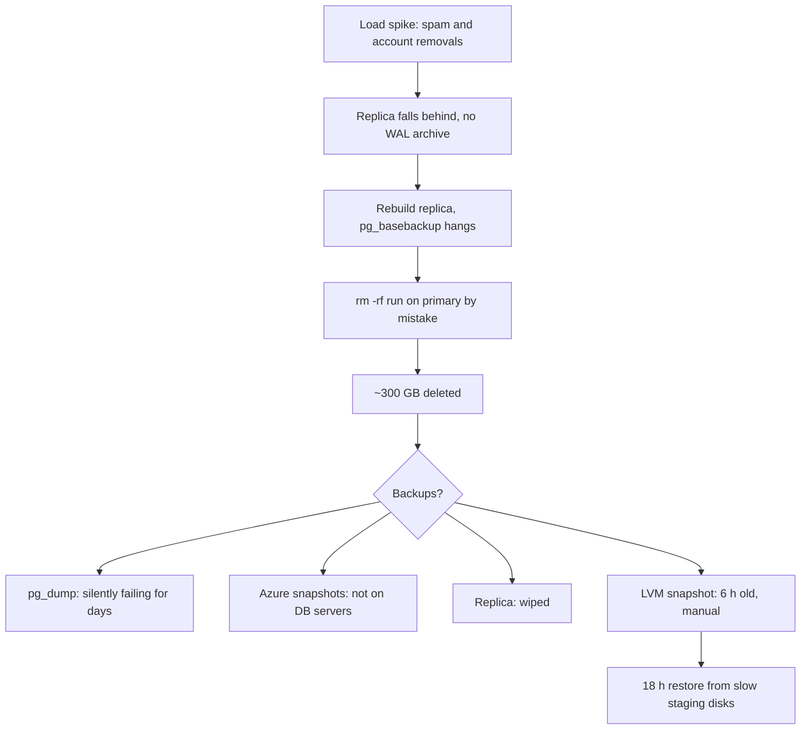

## In one minute
- On 31 January 2017, while fighting a spike in database load and a broken replica, a GitLab.com engineer ran a command to wipe the replica's data directory on the primary database host by mistake. About 300 GB of production data was deleted before the command was stopped ([GitLab postmortem](https://about.gitlab.com/blog/2017/02/10/postmortem-of-database-outage-of-january-31/)).
- GitLab had five backup and replication mechanisms. When they needed one, none worked as expected: daily `pg_dump` backups had been failing silently, disk snapshots were not enabled for the database servers, and replication had just been wiped.
- They restored from a manual LVM snapshot taken about six hours earlier for staging. GitLab.com was down for about 18 hours, and data created in that window was lost (at least 5,000 projects, 5,000 comments and about 700 user accounts by GitLab's estimate; [GitLab postmortem](https://about.gitlab.com/blog/2017/02/10/postmortem-of-database-outage-of-january-31/)).
- GitLab's own root cause: no one owned the backup procedures, so they were never tested.
- They handled it with radical transparency: a public incident document, a live stream of the recovery and a detailed postmortem.

## How it works

### Timeline (UTC, from GitLab's postmortem)
- **31 Jan, ~17:20** An engineer takes a manual LVM snapshot of production to load into staging. This snapshot later saves the day.
- **~19:00** Database load rises, thought to be spam; many users cannot post comments. Bringing load under control takes hours. GitLab later found that an employee account-removal job, triggered by abuse reports, also contributed.
- **~23:00** Replication to the secondary falls behind and breaks, because the primary has already removed write-ahead log segments the secondary needs, and there is no WAL archiving. Resyncing with `pg_basebackup` hangs; configuration changes and restarts follow ([GitLab postmortem](https://about.gitlab.com/blog/2017/02/10/postmortem-of-database-outage-of-january-31/)).
- **~23:30** Trying to clear the secondary's data directory for a fresh resync, an engineer runs the removal on the primary. It is stopped within seconds, but about 300 GB is gone.
- **The search for backups:** the daily `pg_dump` to S3 has produced nothing: the S3 bucket is empty ([GitLab postmortem](https://about.gitlab.com/blog/2017/02/10/postmortem-of-database-outage-of-january-31/)). Azure disk snapshots are not enabled for database servers. The regular LVM snapshot is about 24 hours old. The manual one from 17:20 is about 6 hours old.
- **1 Feb, ~17:00** After copying data from slow staging disks for about 18 hours, the database is restored from the 6-hour-old snapshot; webhooks and verification follow around 18:00.

### Technical root cause
The trigger was a destructive command run on the wrong host during a stressful, late-night recovery. The reason it caused data loss rather than an annoyance was that the safety nets had holes. The `pg_dump` job ran on an application server using PostgreSQL 9.2 tools against a 9.6 database, so it failed ([PostgreSQL docs](https://www.postgresql.org/docs/9.6/app-pgdump.html): pg_dump refuses newer servers); the failure emails were rejected because DMARC was not set up for cron emails, so nobody knew. Disk snapshots covered NFS servers, not databases. LVM snapshots existed for staging, not for disaster recovery. Replication is not a backup: it faithfully copies deletions, and here it had been wiped as part of the repair ([Google SRE book, Data Integrity](https://sre.google/sre-book/data-integrity/)).

### Contributing factors
- **No owner for backups.** GitLab's 5 whys ends here: with nobody responsible, nobody tested restores.
- **No WAL archiving**, so the replica could not catch up after falling behind.
- **Hosts that looked alike.** Two database hosts with similar names and shells, in the middle of the night.
- **Load from abuse handling.** An account-removal process that was too easy to trigger added load.
- **Slow restore path.** Staging used slow disks in another region, so copying data took most of the 18 hours.

### Detection and mitigation
The deletion was noticed immediately by the engineer. The real "detection" problem was earlier and silent: backups had been failing for some time with no working alert. Mitigation was the restore itself, chosen as the least-bad option among broken backups.

### What changed afterwards
GitLab's action items included hourly LVM snapshots and Azure disk snapshots for database servers, automated testing of backup restores, a backup monitoring dashboard, point-in-time recovery with continuous WAL archiving, better replication runbooks, sensible `max_connections`, an owner for data durability, and a redesign of abuse reporting so account removals are not triggered so easily.

### What I would have done as the tech lead
Before: name an owner for data durability and require a scheduled, automated restore test with alerting on the result, not on the backup job's exit status. Enable WAL archiving and point-in-time recovery. Make destructive commands on database hosts require typing the host name, and colour-code production prompts. During: stop and hand off when the person doing recovery has been fighting the incident for hours; destructive steps in a recovery should be read aloud and confirmed by a second person. After: GitLab's transparency is worth copying, with names redacted, as they later decided.

## Down the stack

### Layer 1: The contract
GitLab.com's implied contract was that user data was durably stored and recoverable. Their backup setup looked redundant on paper, five mechanisms, but none of them had a verified contract like "we can restore the production database to within 1 hour of any point in the last 7 days, in under 2 hours". Without a tested restore, a backup is an untested hypothesis.

### Layer 2: The mechanism
PostgreSQL streaming replication sends write-ahead log records from the primary to replicas. The primary keeps only a limited amount of WAL (controlled at the time by `wal_keep_segments`); if a replica falls further behind than that and there is no archive to fetch older segments from, it cannot catch up and must be rebuilt from a fresh base backup with `pg_basebackup`, which copies the whole data directory. `pg_dump` produces a logical backup and must be run by a version of the tools at least as new as the server, which is exactly what failed here. Point-in-time recovery needs a base backup plus continuous WAL archiving, which GitLab did not yet have ([PostgreSQL docs](https://www.postgresql.org/docs/current/continuous-archiving.html)).

### Layer 3: The machine
Recursively removing a data directory unlinks the files; for a database whose files are open, the space may not be freed until the process closes them, but the directory entries are gone and recovery from the file system is not practical. The 18-hour restore was dominated by copying hundreds of gigabytes from slow network-attached staging disks in another region, a throughput problem: at around 5 to 10 MB/s, 300 GB takes 8 to 17 hours. Fast restores need fast storage and a nearby copy, which is why restore time must be measured, not assumed ([Google SRE book, Data Integrity](https://sre.google/sre-book/data-integrity/)).

### Why it's built this way
1. Backups exist to be restored, so only restore tests prove they work.
2. Silent failure is the default for unattended jobs, so success must be actively verified.
3. Replication protects against machine loss, not against deletions, so it is not a backup.
4. Stressful late-night recoveries make mistakes likely, so destructive steps need friction and a second person.
5. Ownership drives testing; without an owner, nothing gets verified.

## Diagram


## Worked example
Apply it to your own team. You have nightly `pg_dump` backups to object storage, a streaming replica, and daily volume snapshots. List each one as GitLab should have: what it protects against, last success, last restore test, alert on failure, and restore time.

The audit finds: `pg_dump` succeeds but has never been restored; the dump of the 600 GB database takes 5 hours to restore. The replica protects against host loss only. Volume snapshots succeed, but the last restore test was 14 months ago. Alerts for backup failure go to an email list nobody reads.

Changes: WAL archiving with point-in-time recovery (RPO about 1 minute); a weekly automated restore of the latest base backup plus WAL to a scratch instance, running row-count checks and alerting on failure through the paging system; a named owner on the database team; and a host prompt that shows `PROD-PRIMARY` in red. The first automated restore test fails, because the archive bucket's lifecycle policy deleted WAL older than 3 days, shorter than the 7-day base backup interval. Exactly the kind of gap that would only have shown up on the worst day.

## In the wild
- **Atlassian, 2022: backups that could not be restored at scale.** After a deletion script removed 883 sites, 30-day backups and point-in-time recovery existed for each data store, but there was no automated way to restore many sites with all their products into the live environment without affecting others. Restoration took up to 14 days for some of the 775 customers ([Atlassian post-incident review](https://www.atlassian.com/engineering/post-incident-review-april-2022-outage)).
- **Google Music, 2012: a restore from tape took nearly a week.** Google's SRE book describes restoring 1.5 petabytes from offsite tape, which took nearly seven days. It contrasts this with the 2011 Gmail restore, which finished within hours of the estimate because the team had rehearsed it ([Google SRE book, Data Integrity](https://sre.google/sre-book/data-integrity/)).

## Trade-offs
| Mechanism | Protects against | Does not protect against | Restore speed |
| --- | --- | --- | --- |
| Streaming replica | Host failure | Deletions, corruption (copied instantly) | Seconds (failover) |
| Logical dump (`pg_dump`) | Deletion, corruption | Data since last dump | Slow for large databases |
| Disk or volume snapshots | Deletion, corruption | Data since last snapshot | Medium |
| Base backup plus WAL archive (PITR) | Deletion, corruption, to any point | Loss of the archive itself | Medium, depends on replay |
| Restore tests | Undetected broken backups | Nothing by themselves; they prove the others work | n/a |

## Pitfalls in production
- Monitoring backup jobs' exit codes instead of restoring. Fix: automated restore tests with verification.
- Treating replication as a backup. Fix: separate, point-in-time-capable backups.
- Alerts delivered to channels nobody reads, or not delivered at all. Fix: route backup alerts through the paging system and test them.
- Look-alike production hosts. Fix: distinct, coloured prompts and confirmation for destructive commands.
- Exhausted engineers performing destructive recovery steps. Fix: hand-offs and two-person confirmation.

## Leadership lens
- Assign an owner for data durability and measure them on restore tests, not backup jobs.
- Make restore time a tracked number for each critical data store.
- Treat destructive commands in production as gatekeeper-zone work: friction, confirmation, a second person.
- Learn from GitLab's transparency: honest public communication rebuilt trust faster than silence would have.

## Check yourself
1. Why did GitLab's replica not help recover the deleted data?
   **Answer:** Replication protects against losing a machine, not against data loss on the primary; in this case the replica had also been cleared as part of the rebuild.
2. Why did the `pg_dump` backups fail silently?
   **Answer:** They ran with PostgreSQL 9.2 tools against a 9.6 server and failed, and the failure emails were rejected because DMARC was not configured, so nobody was alerted.
3. What single organisational gap did GitLab identify as the root cause of the backup failures?
   **Answer:** Nobody owned backups, so nobody was responsible for testing that restores worked.
4. Why did the restore take about 18 hours?
   **Answer:** The usable snapshot was on slow staging storage in another region, so copying hundreds of gigabytes took most of that time.

## Practice
**Task:** Build the backup verifier GitLab lacked. Each mechanism has `name`, `last_success` and `last_restore_test` (hours since epoch, or `None` if never), and `alerting` (whether a failure would page someone). `usable(mechs, now, max_age, max_test_age)` returns the sorted names of mechanisms whose last success is within `max_age` hours and whose last restore test is within `max_test_age` hours. `best_point(...)` with the same arguments returns the newest `last_success` among usable mechanisms, or `None`. `silent_risks(mechs, now, max_age)` returns the sorted names of mechanisms that have not succeeded within `max_age` (or never) and have no alerting.

```python starter
def usable(mechs, now, max_age, max_test_age):
    # TODO
    raise NotImplementedError

def best_point(mechs, now, max_age, max_test_age):
    # TODO
    raise NotImplementedError

def silent_risks(mechs, now, max_age):
    # TODO
    raise NotImplementedError
```

```python tests
def m(name, success, test, alerting):
    return {"name": name, "last_success": success, "last_restore_test": test, "alerting": alerting}

MECHS = [
    m("pg_dump", 900, None, False),
    m("lvm_daily", 994, 600, True),
    m("lvm_manual", 1012, None, False),
    m("disk_snapshots", None, None, False),
    m("pitr", 1017, 1000, True),
]

def test_usable_requires_recent_success_and_restore_test():
    assert usable(MECHS, 1018, 24, 168) == ["pitr"]

def test_older_tests_allowed_with_wider_window():
    assert usable(MECHS, 1018, 30, 500) == ["lvm_daily", "pitr"]

def test_best_point():
    assert best_point(MECHS, 1018, 30, 500) == 1017

def test_no_usable_backup():
    gitlab_2017 = [m("pg_dump", 900, None, False), m("disk_snapshots", None, None, False)]
    assert usable(gitlab_2017, 1018, 24, 168) == []
    assert best_point(gitlab_2017, 1018, 24, 168) is None

def test_silent_risks():
    assert silent_risks(MECHS, 1018, 24) == ["disk_snapshots", "pg_dump"]

def test_alerting_mechanism_is_not_silent():
    assert silent_risks([m("lvm_daily", 900, 600, True)], 1018, 24) == []
```

```python solution
def _fresh(t, now, max_age):
    return t is not None and now - t <= max_age

def usable(mechs, now, max_age, max_test_age):
    return sorted(x["name"] for x in mechs
                  if _fresh(x["last_success"], now, max_age) and _fresh(x["last_restore_test"], now, max_test_age))

def best_point(mechs, now, max_age, max_test_age):
    names = set(usable(mechs, now, max_age, max_test_age))
    points = [x["last_success"] for x in mechs if x["name"] in names]
    return max(points) if points else None

def silent_risks(mechs, now, max_age):
    return sorted(x["name"] for x in mechs if not _fresh(x["last_success"], now, max_age) and not x["alerting"])
```

```typescript starter
export interface Mechanism { name: string; last_success: number | null; last_restore_test: number | null; alerting: boolean; }

export function usable(mechs: Mechanism[], now: number, maxAge: number, maxTestAge: number): string[] {
  throw new Error("TODO");
}

export function bestPoint(mechs: Mechanism[], now: number, maxAge: number, maxTestAge: number): number | null {
  throw new Error("TODO");
}

export function silentRisks(mechs: Mechanism[], now: number, maxAge: number): string[] {
  throw new Error("TODO");
}
```

```typescript tests
const m = (name: string, s: number | null, t: number | null, alerting: boolean): Mechanism => ({ name, last_success: s, last_restore_test: t, alerting });
const MECHS = [
  m("pg_dump", 900, null, false), m("lvm_daily", 994, 600, true), m("lvm_manual", 1012, null, false),
  m("disk_snapshots", null, null, false), m("pitr", 1017, 1000, true),
];

test("usable requires recent success and restore test", () => {
  assertEqual(usable(MECHS, 1018, 24, 168), ["pitr"]);
});

test("older tests allowed with wider window", () => {
  assertEqual(usable(MECHS, 1018, 30, 500), ["lvm_daily", "pitr"]);
});

test("best point", () => {
  assertEqual(bestPoint(MECHS, 1018, 30, 500), 1017);
});

test("no usable backup", () => {
  const g = [m("pg_dump", 900, null, false), m("disk_snapshots", null, null, false)];
  assertEqual(usable(g, 1018, 24, 168), []);
  assertEqual(bestPoint(g, 1018, 24, 168), null);
});

test("silent risks", () => {
  assertEqual(silentRisks(MECHS, 1018, 24), ["disk_snapshots", "pg_dump"]);
});

test("alerting mechanism is not silent", () => {
  assertEqual(silentRisks([m("lvm_daily", 900, 600, true)], 1018, 24), []);
});
```

```typescript solution
export interface Mechanism { name: string; last_success: number | null; last_restore_test: number | null; alerting: boolean; }

const fresh = (t: number | null, now: number, maxAge: number) => t !== null && now - t <= maxAge;

export function usable(mechs: Mechanism[], now: number, maxAge: number, maxTestAge: number): string[] {
  return mechs.filter(x => fresh(x.last_success, now, maxAge) && fresh(x.last_restore_test, now, maxTestAge)).map(x => x.name).sort();
}

export function bestPoint(mechs: Mechanism[], now: number, maxAge: number, maxTestAge: number): number | null {
  const names = usable(mechs, now, maxAge, maxTestAge);
  const points = mechs.filter(x => names.includes(x.name)).map(x => x.last_success as number);
  return points.length ? Math.max(...points) : null;
}

export function silentRisks(mechs: Mechanism[], now: number, maxAge: number): string[] {
  return mechs.filter(x => !fresh(x.last_success, now, maxAge) && !x.alerting).map(x => x.name).sort();
}
```

```go starter
package practice

type Mechanism struct {
	Name                 string
	LastSuccess          int // -1 means never
	LastRestoreTest      int // -1 means never
	Alerting             bool
}

func Usable(mechs []Mechanism, now, maxAge, maxTestAge int) []string {
	panic("TODO")
}

// BestPoint returns the newest usable recovery point and true, or 0 and false.
func BestPoint(mechs []Mechanism, now, maxAge, maxTestAge int) (int, bool) {
	panic("TODO")
}

func SilentRisks(mechs []Mechanism, now, maxAge int) []string {
	panic("TODO")
}
```

```go tests
package practice

import (
	"reflect"
	"testing"
)

var mechs = []Mechanism{
	{"pg_dump", 900, -1, false},
	{"lvm_daily", 994, 600, true},
	{"lvm_manual", 1012, -1, false},
	{"disk_snapshots", -1, -1, false},
	{"pitr", 1017, 1000, true},
}

func same(t *testing.T, got, want []string) {
	t.Helper()
	if len(got) == 0 && len(want) == 0 {
		return
	}
	if !reflect.DeepEqual(got, want) {
		t.Fatalf("got %v, want %v", got, want)
	}
}

func TestUsable(t *testing.T) {
	same(t, Usable(mechs, 1018, 24, 168), []string{"pitr"})
}

func TestWider(t *testing.T) {
	same(t, Usable(mechs, 1018, 30, 500), []string{"lvm_daily", "pitr"})
}

func TestBestPoint(t *testing.T) {
	if p, ok := BestPoint(mechs, 1018, 30, 500); !ok || p != 1017 {
		t.Fatalf("got %d %v", p, ok)
	}
}

func TestNoUsable(t *testing.T) {
	g := []Mechanism{{"pg_dump", 900, -1, false}, {"disk_snapshots", -1, -1, false}}
	same(t, Usable(g, 1018, 24, 168), nil)
	if _, ok := BestPoint(g, 1018, 24, 168); ok {
		t.Fatal("expected none")
	}
}

func TestSilent(t *testing.T) {
	same(t, SilentRisks(mechs, 1018, 24), []string{"disk_snapshots", "pg_dump"})
}

func TestAlertingNotSilent(t *testing.T) {
	same(t, SilentRisks([]Mechanism{{"lvm_daily", 900, 600, true}}, 1018, 24), nil)
}
```

```go solution
package practice

import "sort"

type Mechanism struct {
	Name                 string
	LastSuccess          int // -1 means never
	LastRestoreTest      int // -1 means never
	Alerting             bool
}

func fresh(t, now, maxAge int) bool { return t >= 0 && now-t <= maxAge }

func Usable(mechs []Mechanism, now, maxAge, maxTestAge int) []string {
	out := []string{}
	for _, m := range mechs {
		if fresh(m.LastSuccess, now, maxAge) && fresh(m.LastRestoreTest, now, maxTestAge) {
			out = append(out, m.Name)
		}
	}
	sort.Strings(out)
	return out
}

func BestPoint(mechs []Mechanism, now, maxAge, maxTestAge int) (int, bool) {
	best, found := 0, false
	for _, m := range mechs {
		if fresh(m.LastSuccess, now, maxAge) && fresh(m.LastRestoreTest, now, maxTestAge) && (!found || m.LastSuccess > best) {
			best, found = m.LastSuccess, true
		}
	}
	return best, found
}

func SilentRisks(mechs []Mechanism, now, maxAge int) []string {
	out := []string{}
	for _, m := range mechs {
		if !fresh(m.LastSuccess, now, maxAge) && !m.Alerting {
			out = append(out, m.Name)
		}
	}
	sort.Strings(out)
	return out
}
```

## Mock interview
**Prompt:** You join a company as the first infrastructure lead. They tell you they have "four kinds of backups" for their 2 TB production database. Using what happened at GitLab in 2017, how do you find out whether they can actually recover, and what do you build?

- Follow-up: The CTO asks why you want to spend engineering time on restore testing when "the backup jobs are green". What do you say?
- Follow-up: Your first restore test takes 11 hours. Is that a problem?
- Follow-up: How do you make destructive production commands safer for tired engineers at 2 a.m.?

**A strong answer covers:**
- Inventorying each mechanism by what it protects against, last success, last restore test, alerting and restore time.
- Distinguishing replication from backups, and logical dumps from point-in-time recovery.
- Automated restore tests with verification and paging alerts, plus a named owner.
- Comparing measured restore time and recovery point with business RTO and RPO.
- Friction for destructive commands: distinct host prompts, typed confirmations, two-person rule during incidents, hand-offs for tired responders.
- Communicating risk to leadership with GitLab's example: green jobs, empty bucket.

## Sources and further study
**Primary**
- [Postmortem of database outage of January 31 (GitLab)](https://about.gitlab.com/blog/2017/02/10/postmortem-of-database-outage-of-january-31/): timeline, failed backups and action items.

**Systems docs**
- [pg_dump, PostgreSQL 9.6 docs](https://www.postgresql.org/docs/9.6/app-pgdump.html): the version rule that made the nightly dump fail.
- [Continuous archiving and point-in-time recovery (PostgreSQL)](https://www.postgresql.org/docs/current/continuous-archiving.html): base backup plus an unbroken WAL archive, set up and tested first.

**Books**
- *Site Reliability Engineering* (Google), Ch 26: Data Integrity, on layered defences (soft deletion, tiered backups, early detection) and why restores are the goal.
- *Release It!*, 2nd ed., Michael Nygard, Ch 3: Stabilize Your System, on failure modes and stopping crack propagation.

**Other curricula**
- [Postmortem Culture, SRE Workbook Ch 10 (Google)](https://sre.google/workbook/postmortem-culture/): blameless reviews that improve the system, which GitLab's public document followed.

## Free resources
- [Postmortem of database outage of January 31 (GitLab)](https://about.gitlab.com/blog/2017/02/10/postmortem-of-database-outage-of-january-31/): GitLab's own detailed postmortem, timeline and action items.
- [Continuous archiving and point-in-time recovery (PostgreSQL)](https://www.postgresql.org/docs/current/continuous-archiving.html): the capability GitLab lacked.
- [pg_basebackup (PostgreSQL)](https://www.postgresql.org/docs/current/app-pgbasebackup.html): taking base backups for replicas and recovery.
- [Data Integrity (Google SRE book)](https://sre.google/sre-book/data-integrity/): why restores, not backups, are what matter.
