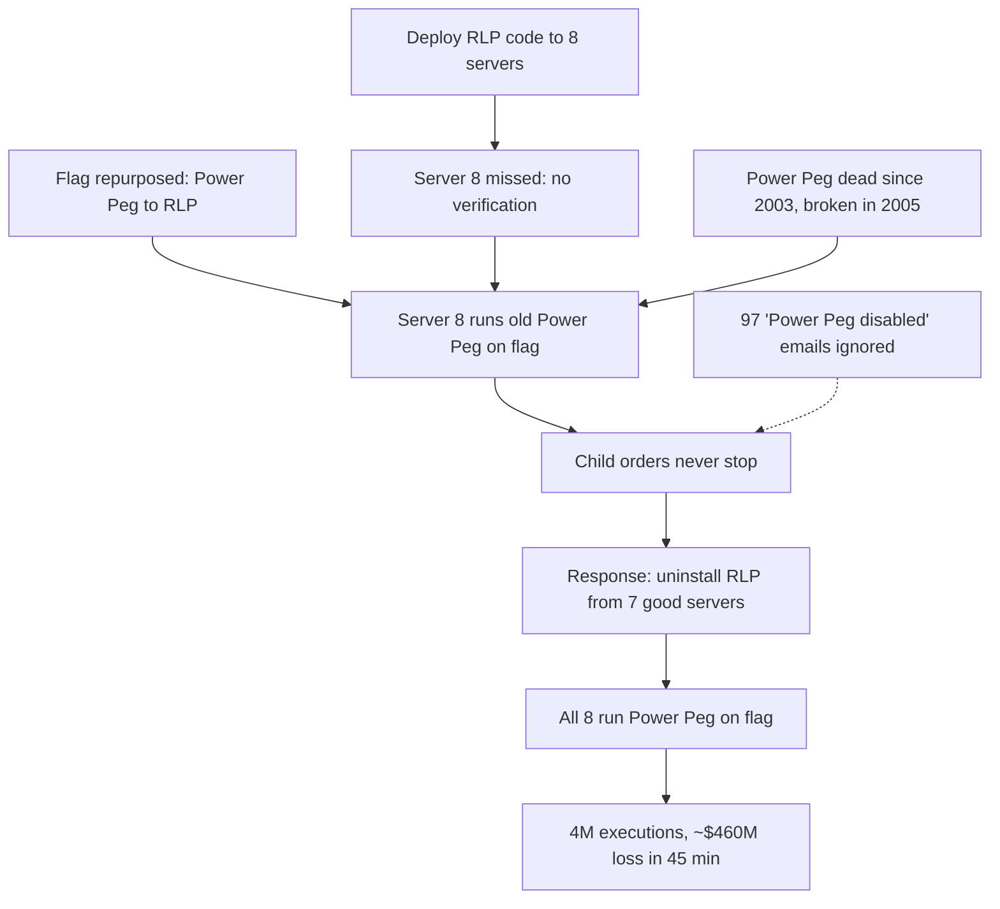

## In one minute
- On 1 August 2012, Knight Capital's order router, SMARS, sent millions of unintended orders to the US stock market in about 45 minutes, producing over 4 million executions in 154 stocks for more than 397 million shares. Knight lost about 460 million dollars, according to the SEC's order ([SEC order](https://www.sec.gov/litigation/admin/2013/34-70694.pdf)).
- New code for a retail liquidity programme (RLP) was deployed to eight servers, but a technician failed to copy it to one of them. Nobody noticed, and there was no second review.
- The new code reused a flag that used to activate "Power Peg", old functionality unused since 2003 but still present. On the eighth server, the flag woke up Power Peg, which no longer tracked filled orders correctly, so it kept sending child orders.
- Warnings existed: 97 automated emails reading "Power Peg disabled" were sent before the market opened, but they were not designed or treated as alerts.
- During the response, the team uninstalled the new code from the seven correct servers, which made the problem worse. The SEC fined Knight 12 million dollars for inadequate controls. The lessons are about deployment verification, dead code, flag reuse and kill switches.

## How it works

### Timeline (from the SEC order)
- **2003** Knight stops using Power Peg, but the code stays in SMARS and remains callable.
- **2005** A change moves Power Peg's cumulative-quantity tracking earlier in the code path. Power Peg is not retested, so it no longer knows when a parent order has been filled.
- **From 27 July 2012** The new RLP code is deployed to SMARS servers in stages. A technician does not copy it to one of the eight servers. No second technician reviews the deployment, and no written procedure requires it.
- **1 August, from about 08:01 ET** Pre-market orders produce 97 automated "BNET reject" emails mentioning SMARS and "Power Peg disabled". They go to a group of staff but are not designed as alerts and are not acted upon.
- **09:30 ET** The market opens. 212 small retail parent orders carrying the repurposed flag, received before the open for the opening auction, are processed by the eighth server, which still runs Power Peg. Another part of Knight's system knows the parents are filled, but that fact never reaches SMARS, so Power Peg keeps sending child orders.
- **Over about 45 minutes** SMARS routes millions of orders. In the response, Knight uninstalls the new RLP code from the seven correctly deployed servers, so incoming orders with the flag now trigger Power Peg there too.
- **Afterwards** Knight holds a net long position of about 3.5 billion dollars in 80 stocks and a net short position of about 3.15 billion dollars in 74 stocks, and realises a loss of about 460 million dollars. The damage reached other traders too: in 75 stocks Knight's executions were over 20 percent of volume and moved prices by more than 5 percent.

### Technical root cause
Three things met: an incomplete deployment (one of eight servers still ran old code), a repurposed flag whose meaning depended on which code was running, and dead code that was still reachable and had been broken by an untested change seven years earlier. Any one of them alone would have been harmless.

### Contributing factors
- **No deployment verification.** Nothing checked that all eight servers ran the same version after deploying.
- **No second review and no written procedure** for deployments.
- **Dead code left in place** and still callable, rather than removed.
- **Flag reuse.** A flag that meant "Power Peg" to old code meant "RLP" to new code, so a version mismatch changed behaviour silently.
- **Warnings not designed as alerts.** The 97 emails were real-time evidence of the problem but went to people who did not normally read them.
- **No kill switch or automated limits.** The SEC found Knight lacked controls to prevent orders exceeding pre-set limits and procedures to halt SMARS in response to its own malfunction. Nothing compared orders leaving SMARS with orders entering it ([SEC order](https://www.sec.gov/litigation/admin/2013/34-70694.pdf)).
- **The controls that did exist missed this case.** A price-collar check capped child orders at 9.5 percent from the best bid or offer, but it did not apply to pre-open orders bound for the opening auction. Unmatched executions piled into a holding account (the "33 Account") with a 2 million dollar limit that was not wired to any automated stop. The risk monitor, PMON, was post-trade, relied on humans watching it, did not display limits and lagged under the day's volume.
- **An earlier warning was fixed narrowly.** In October 2011 a desk kept quoting from disaster-recovery test data and lost nearly 7.5 million dollars. Knight patched that one system and did not ask whether any system could send erroneous orders.
- **Response without a clear picture.** Rolling back the new code from the healthy servers was a reasonable-sounding move that spread the failure.

### What changed afterwards
On 6 August 2012 a group of six firms, including Jefferies, Blackstone and Getco, injected 400 million dollars for roughly 70 percent of the company ([NBC News / Reuters](https://www.nbcnews.com/business/markets/knight-capital-gets-400-million-lifeline-flna926363)). On 1 July 2013 Knight's parent combined with Getco to form KCG Holdings. The SEC's October 2013 order found violations of the market access rule (Rule 15c3-5, adopted in 2010), which requires brokers to have automated pre-trade risk controls that prevent erroneous orders ([SEC final rule](https://www.sec.gov/rules/final/2010/34-63241.pdf)). It imposed a 12 million dollar penalty, the SEC's first enforcement action under that rule ([SEC press release](https://www.sec.gov/newsroom/press-releases/2013-222)). Knight also undertook to hire an independent consultant to review its software development lifecycle, code deployment, order routers, automated pre-trade capital thresholds and incident response ([SEC order](https://www.sec.gov/litigation/admin/2013/34-70694.pdf)). The public record does not detail which engineering changes followed, so this lesson does not invent them.

### What I would have done as the tech lead
Make deployments verifiable by machine: after any deploy, every server reports its version and the deploy is not complete until all match. Delete dead code instead of leaving it callable; Google's SRE book cites Knight when it calls flag-gated dead code a time bomb ([Google SRE book, Simplicity](https://sre.google/sre-book/simplicity/)). Never reuse a flag or field for a new meaning; add a new one, and change message semantics in two phases so readers understand the new meaning everywhere before any writer sends it ([AWS Builders' Library](https://aws.amazon.com/builders-library/ensuring-rollback-safety-during-deployments/)). Turn messages like "Power Peg disabled" into real alerts that page someone. Build pre-trade limits and a single, practised kill switch that stops order flow, so the first move in a runaway is "stop", not "roll back and hope". During the incident, stop the system before trying to understand it.

## Down the stack

### Layer 1: The contract
A market-access broker promises regulators and the market that its systems cannot send orders beyond pre-set credit and capital limits, and that erroneous orders are prevented. Knight's controls sat mostly upstream of SMARS and assumed SMARS behaved correctly; no control compared what left SMARS with what entered it.

### Layer 2: The mechanism
SMARS received parent orders and split them into child orders sent to trading venues. Power Peg was designed to keep sending child orders until a cumulative quantity reached the parent's size. After the 2005 change, the cumulative count was no longer updated where Power Peg read it, so from Power Peg's point of view the parent was never filled and it never stopped. Flags in order messages selected behaviour; with old code present on one server, the same flag selected two different behaviours depending on routing.

### Layer 3: The machine
Automated trading runs at machine speed: each server could send many orders per second, and the market matched them in microseconds to milliseconds. Over 45 minutes, a loop that never terminates turns 212 parent orders into millions of child orders. Human reaction time, minutes to understand and decide, is far slower than the damage rate, which is why limits and kill switches must be automatic and enforced in the order path, not left to people watching screens.

### Why it's built this way
1. Distributed deployments can partially fail, so consistency must be verified, not assumed.
2. Dead code remains a hazard while it is reachable, especially after untested changes.
3. Reused flags make behaviour depend on version, turning drift into misbehaviour.
4. Automation acts faster than people, so limits and kill switches must be automatic.
5. Signals only help if they are designed and routed as alerts to someone who acts.

## Diagram


## Worked example
A food delivery platform reuses a boolean field `priority` in its order messages. It used to mean "express courier" in an old dispatch module that is no longer called; a new release makes it mean "VIP support". The release is deployed to 20 dispatch pods with a rolling update, but 2 pods are stuck on the old image because of a registry timeout.

A deployment check after rollout compares each pod's reported version with the expected one and finds the 2 stale pods. A flag-safety rule in CI notices that `priority` changed meaning between versions and fails the build: reused fields must be renamed (`vip_support`) and the old one retired. A kill switch in dispatch caps courier assignments per order at 2, so even if old code ran, it could not dispatch dozens of couriers. Each check alone would have prevented a Knight-style failure; together they make it very unlikely.

## In the wild
- **Knight Capital, 2011: the rehearsal nobody generalised.** Ten months earlier, after a weekend disaster-recovery test, Knight's market-making desk kept generating quotes from the test data on Monday morning and lost nearly 7.5 million dollars. Knight limited that system to market hours and added a checklist item, but did not look for the same class of failure in other order-sending systems such as SMARS ([SEC order](https://www.sec.gov/litigation/admin/2013/34-70694.pdf)).
- **Google Cloud, 2016: config drift and a canary result that was ignored.** Removing an unused IP block left two configuration files briefly out of sync. A bug turned that inconsistency into a config with no GCE IP blocks, and a second bug kept the canary's "unsafe" verdict from stopping the rollout. Inbound traffic to Compute Engine fell by more than 95 percent for about 18 minutes; fixes included before-and-after checks of announced routes and semantic config checks ([Google Cloud incident 16007](https://status.cloud.google.com/incident/compute/16007)).
- **Stripe, 2019: the rollback that caused the second outage.** A latent failover bug left one database shard unable to elect a primary, and the API failed from 16:35 to 17:02 UTC. Engineers then rolled back the election protocol, which clashed with a recent configuration setting, starved CPU and took the API down again from 21:14 to 22:47. Like Knight's uninstall, a plausible "go back to the old version" made things worse; Stripe added safer tooling for config changes during incidents ([Stripe RCA](https://stripe.com/rcas/2019-07-10)).

## Trade-offs
| Control | Strengths | Weaknesses | Choose when |
| --- | --- | --- | --- |
| Post-deploy version verification | Catches partial deployments | Needs version reporting | Every fleet deployment |
| Delete dead code | Removes latent hazards | Effort, fear of breaking things | Always, with tests |
| Never reuse flags or fields | Behaviour cannot depend on drift | More fields over time | Messages and config shared across versions |
| Automated limits and kill switch | Stops runaways at machine speed | Can block legitimate activity | Anything that can spend money or send at scale |
| Alerts from anomaly messages | Early warning | Noise if poorly designed | Errors that indicate misconfiguration |

## Pitfalls in production
- Assuming a deployment succeeded everywhere because the tool exited cleanly. Fix: verify versions on every node.
- Leaving old code paths callable "just in case". Fix: delete them; version control keeps the history.
- Reusing flags, enum values or fields with new meanings. Fix: add new ones and retire old ones explicitly.
- Error emails nobody reads. Fix: route actionable errors to paging with owners.
- Rolling back during a runaway without understanding which version is safe. Fix: kill switch first, then diagnose.

## Leadership lens
- Make "all nodes on the expected version" a deploy gate, and alert on drift continuously.
- Run regular dead-code removal, and forbid repurposing flags in code review guidelines.
- For any system that moves money or sends at scale, require automated limits and a tested kill switch.
- Use this case to teach that small process gaps (no second review, no verification) combine into disasters.

## Check yourself
1. Why was a partial deployment so dangerous here?
   **Answer:** Because a reused flag meant different things to old and new code, the one server with old code interpreted normal orders as instructions to run broken Power Peg logic.
2. Why did removing the new code from seven servers make things worse?
   **Answer:** Those servers then also had old code that responded to the flag with Power Peg, so more incoming orders triggered the runaway behaviour.
3. What should have turned the 97 emails into an early warning?
   **Answer:** Designing them as alerts, routed to an on-call person with authority to stop trading before the open.
4. What control would have limited the damage regardless of the bug?
   **Answer:** Automated pre-set limits on orders or positions and a kill switch to halt SMARS, enforced in the order path.

## Practice
**Task:** Build the deploy gate that would have caught Knight's failure. `drift(servers, expected)` takes a dict of server to deployed version and returns the sorted list of servers not on `expected`. `reused_flags(old, new)` takes two dicts mapping flag names to their meaning in the old and new versions and returns the sorted list of flags present in both with different meanings. `safe_to_release(servers, expected, old, new)` returns true only if there is no drift and no reused flags.

```python starter
def drift(servers, expected):
    # TODO
    raise NotImplementedError

def reused_flags(old, new):
    # TODO
    raise NotImplementedError

def safe_to_release(servers, expected, old, new):
    # TODO
    raise NotImplementedError
```

```python tests
SERVERS = {"smars%d" % i: "rlp-1.0" for i in range(1, 9)}
SERVERS["smars8"] = "legacy-0.9"
OLD = {"rlp_flag": "power_peg", "iso": "intermarket_sweep"}
NEW = {"rlp_flag": "retail_liquidity", "iso": "intermarket_sweep", "tag": "client_tag"}

def test_drift_finds_missed_server():
    assert drift(SERVERS, "rlp-1.0") == ["smars8"]

def test_no_drift():
    assert drift({"a": "v2", "b": "v2"}, "v2") == []

def test_reused_flag_detected():
    assert reused_flags(OLD, NEW) == ["rlp_flag"]

def test_new_flags_are_fine():
    assert reused_flags({"a": "x"}, {"a": "x", "b": "y"}) == []

def test_knight_setup_is_unsafe():
    assert not safe_to_release(SERVERS, "rlp-1.0", OLD, NEW)

def test_safe_when_consistent_and_no_reuse():
    fixed = dict(SERVERS, smars8="rlp-1.0")
    renamed = {"retail_liquidity_flag": "retail_liquidity", "iso": "intermarket_sweep"}
    assert safe_to_release(fixed, "rlp-1.0", OLD, renamed)
```

```python solution
def drift(servers, expected):
    return sorted(s for s, v in servers.items() if v != expected)

def reused_flags(old, new):
    return sorted(f for f in old if f in new and old[f] != new[f])

def safe_to_release(servers, expected, old, new):
    return not drift(servers, expected) and not reused_flags(old, new)
```

```typescript starter
export function drift(servers: Record<string, string>, expected: string): string[] {
  throw new Error("TODO");
}

export function reusedFlags(oldFlags: Record<string, string>, newFlags: Record<string, string>): string[] {
  throw new Error("TODO");
}

export function safeToRelease(servers: Record<string, string>, expected: string,
                              oldFlags: Record<string, string>, newFlags: Record<string, string>): boolean {
  throw new Error("TODO");
}
```

```typescript tests
const SERVERS: Record<string, string> = {};
for (let i = 1; i <= 8; i++) SERVERS["smars" + i] = "rlp-1.0";
SERVERS["smars8"] = "legacy-0.9";
const OLD = { rlp_flag: "power_peg", iso: "intermarket_sweep" };
const NEW = { rlp_flag: "retail_liquidity", iso: "intermarket_sweep", tag: "client_tag" };

test("drift finds missed server", () => {
  assertEqual(drift(SERVERS, "rlp-1.0"), ["smars8"]);
});

test("no drift", () => {
  assertEqual(drift({ a: "v2", b: "v2" }, "v2"), []);
});

test("reused flag detected", () => {
  assertEqual(reusedFlags(OLD, NEW), ["rlp_flag"]);
});

test("new flags are fine", () => {
  assertEqual(reusedFlags({ a: "x" }, { a: "x", b: "y" }), []);
});

test("knight setup is unsafe", () => {
  assert(!safeToRelease(SERVERS, "rlp-1.0", OLD, NEW), "unsafe");
});

test("safe when consistent and no reuse", () => {
  const fixed = { ...SERVERS, smars8: "rlp-1.0" };
  assert(safeToRelease(fixed, "rlp-1.0", OLD, { retail_liquidity_flag: "retail_liquidity", iso: "intermarket_sweep" }), "safe");
});
```

```typescript solution
export function drift(servers: Record<string, string>, expected: string): string[] {
  return Object.keys(servers).filter(s => servers[s] !== expected).sort();
}

export function reusedFlags(oldFlags: Record<string, string>, newFlags: Record<string, string>): string[] {
  return Object.keys(oldFlags).filter(f => f in newFlags && oldFlags[f] !== newFlags[f]).sort();
}

export function safeToRelease(servers: Record<string, string>, expected: string,
                              oldFlags: Record<string, string>, newFlags: Record<string, string>): boolean {
  return drift(servers, expected).length === 0 && reusedFlags(oldFlags, newFlags).length === 0;
}
```

```go starter
package practice

func Drift(servers map[string]string, expected string) []string {
	panic("TODO")
}

func ReusedFlags(oldFlags, newFlags map[string]string) []string {
	panic("TODO")
}

func SafeToRelease(servers map[string]string, expected string, oldFlags, newFlags map[string]string) bool {
	panic("TODO")
}
```

```go tests
package practice

import (
	"fmt"
	"reflect"
	"testing"
)

func knightServers() map[string]string {
	s := map[string]string{}
	for i := 1; i <= 8; i++ {
		s[fmt.Sprintf("smars%d", i)] = "rlp-1.0"
	}
	s["smars8"] = "legacy-0.9"
	return s
}

var oldFlags = map[string]string{"rlp_flag": "power_peg", "iso": "intermarket_sweep"}
var newFlags = map[string]string{"rlp_flag": "retail_liquidity", "iso": "intermarket_sweep", "tag": "client_tag"}

func TestDrift(t *testing.T) {
	if got := Drift(knightServers(), "rlp-1.0"); !reflect.DeepEqual(got, []string{"smars8"}) {
		t.Fatalf("got %v", got)
	}
}

func TestNoDrift(t *testing.T) {
	if got := Drift(map[string]string{"a": "v2", "b": "v2"}, "v2"); len(got) != 0 {
		t.Fatalf("got %v", got)
	}
}

func TestReused(t *testing.T) {
	if got := ReusedFlags(oldFlags, newFlags); !reflect.DeepEqual(got, []string{"rlp_flag"}) {
		t.Fatalf("got %v", got)
	}
}

func TestNewFlagsFine(t *testing.T) {
	if got := ReusedFlags(map[string]string{"a": "x"}, map[string]string{"a": "x", "b": "y"}); len(got) != 0 {
		t.Fatalf("got %v", got)
	}
}

func TestKnightUnsafe(t *testing.T) {
	if SafeToRelease(knightServers(), "rlp-1.0", oldFlags, newFlags) {
		t.Fatal("should be unsafe")
	}
}

func TestSafe(t *testing.T) {
	s := knightServers()
	s["smars8"] = "rlp-1.0"
	renamed := map[string]string{"retail_liquidity_flag": "retail_liquidity", "iso": "intermarket_sweep"}
	if !SafeToRelease(s, "rlp-1.0", oldFlags, renamed) {
		t.Fatal("should be safe")
	}
}
```

```go solution
package practice

import "sort"

func Drift(servers map[string]string, expected string) []string {
	out := []string{}
	for s, v := range servers {
		if v != expected {
			out = append(out, s)
		}
	}
	sort.Strings(out)
	return out
}

func ReusedFlags(oldFlags, newFlags map[string]string) []string {
	out := []string{}
	for f, meaning := range oldFlags {
		if n, ok := newFlags[f]; ok && n != meaning {
			out = append(out, f)
		}
	}
	sort.Strings(out)
	return out
}

func SafeToRelease(servers map[string]string, expected string, oldFlags, newFlags map[string]string) bool {
	return len(Drift(servers, expected)) == 0 && len(ReusedFlags(oldFlags, newFlags)) == 0
}
```

## Mock interview
**Prompt:** You lead engineering for a payments platform that sends payouts to merchants automatically, about 2 billion dollars a day. Using Knight Capital's 2012 failure as the scenario, design the deployment and runtime controls that would stop a partial deploy or a dormant code path from sending runaway payouts.

- Follow-up: A deploy finishes and one pod is on the old version. What happens automatically?
- Follow-up: A teammate wants to reuse an existing enum value for a new payout type to avoid a schema change. What do you say?
- Follow-up: Payouts start going out at 10 times the normal rate. What stops them, and who decides to restart?

**A strong answer covers:**
- Post-deploy version verification on every node as a gate, plus continuous drift alerts.
- Dead code removal and a rule against repurposing flags, enums or fields; new names for new meanings.
- Automated limits in the payout path (per merchant, per minute, global) and a tested kill switch.
- Comparing outputs with inputs (payouts sent versus payouts requested) as an invariant check.
- Turning warning messages into paged alerts with owners.
- Incident response that stops first and diagnoses second, with a clear decision owner for restarting.

## Sources and further study
**Primary**
- [SEC, Risk Management Controls for Brokers or Dealers with Market Access (Rule 15c3-5 final rule, 2010)](https://www.sec.gov/rules/final/2010/34-63241.pdf): the rule Knight broke, and why the SEC demanded automated pre-trade controls.
- [FINRA: Market Access](https://www.finra.org/rules-guidance/key-topics/market-access): FINRA's guidance on the rule, with links to its regulatory notices and yearly oversight-report findings on market-access controls.

**Systems docs**
- [AWS Builders' Library: Ensuring rollback safety during deployments](https://aws.amazon.com/builders-library/ensuring-rollback-safety-during-deployments/): the prepare-then-activate pattern that makes mixed-version fleets safe.
- [Kubernetes: Deployments](https://kubernetes.io/docs/concepts/workloads/controllers/deployment/): rollout status, progress deadlines and how a controller knows every replica is on the new version.
- [Google SRE Workbook: Canarying Releases](https://sre.google/workbook/canarying-releases/): comparing a canary with a control before the rest of the fleet changes.

**Books**
- *Site Reliability Engineering*, Beyer et al., chapter 9 "Simplicity": dead code as a liability, with Knight as the example; chapter 8 "Release Engineering" on hermetic, reproducible deploys.
- *Software Engineering at Google*, Winters, Manshreck and Wright, chapter 15 "Deprecation": how to actually remove old systems and code paths.
- *Release It!* (2nd edition), Michael Nygard, chapter 14 "Handling Versions": keeping old and new versions compatible during rollout.

**Other curricula**
- [Azure Well-Architected: Safe deployment practices](https://learn.microsoft.com/en-us/azure/well-architected/operational-excellence/safe-deployments): frames deployment as progressive exposure with health gates and fast rollback.
- [roadmap.sh DevOps](https://roadmap.sh/devops): places deployment strategies, configuration management and monitoring on one path, without covering version drift as its own risk.

## Free resources
- [SEC Order: Knight Capital Americas LLC (Release 34-70694)](https://www.sec.gov/litigation/admin/2013/34-70694.pdf): the official findings, timeline and penalty.
- [SEC press release on the Knight Capital charges](https://www.sec.gov/newsroom/press-releases/2013-222): the SEC's summary of the case.
- [Feature Toggles (Pete Hodgson on martinfowler.com)](https://martinfowler.com/articles/feature-toggles.html): managing flags so they do not become hazards.
- [Automating safe, hands-off deployments (AWS Builders' Library)](https://aws.amazon.com/builders-library/automating-safe-hands-off-deployments/): verification and rollback in automated deployment.
