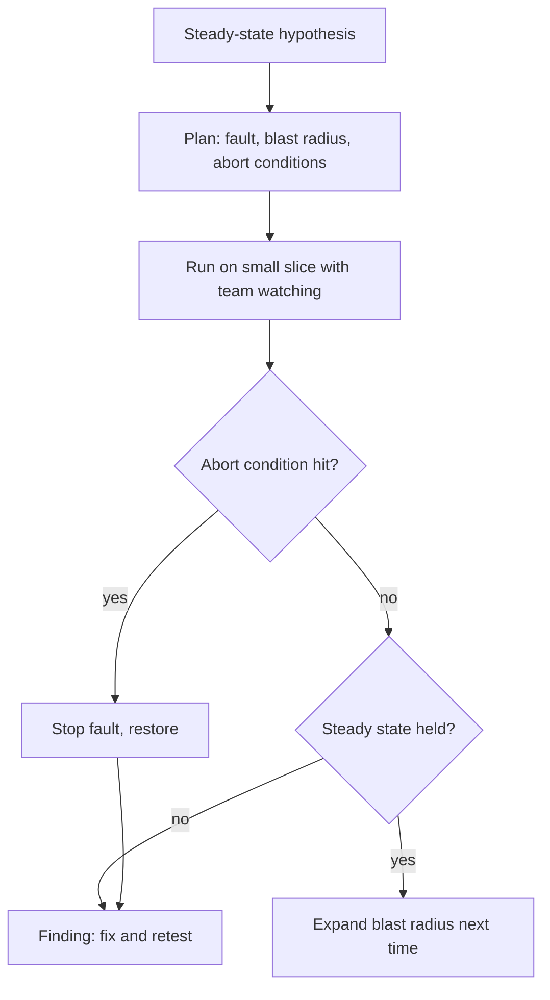

## In one minute
- Chaos engineering is running experiments that inject failure on purpose, to find weaknesses before they cause unplanned incidents. Game days are scheduled exercises where a team practises responding to such a failure.
- An experiment has a steady-state hypothesis ("checkout success stays above 99.5 percent"), a fault ("terminate 1 of 3 database replicas"), a small blast radius, abort conditions, and someone ready to stop it.
- Start small and safe: staging first, then a small share of production traffic, during working hours, with the team watching. Expand only when the system and the team have earned it.
- The output is not "it survived". It is what you learned: missing alerts, wrong timeouts, runbooks that do not work, dependencies nobody knew about.
- Game days test people and process as much as software: who gets paged, whether dashboards answer the question, whether the runbook's commands still exist.

## How it works

### Why break things on purpose
Systems have failure modes nobody has seen yet: a timeout that is too long, a retry that amplifies load, a cache that becomes a single point of failure, a fallback that was never exercised. You will discover them either during an incident, at 3 a.m., with customers affected, or during an experiment, at 2 p.m., with a stop button and the team watching. Netflix popularised the idea with Chaos Monkey, which randomly terminates production instances so engineers build services that tolerate it; it is configured per application through Spinnaker ([Chaos Monkey docs](https://netflix.github.io/chaosmonkey/)). Google runs annual DiRT (Disaster Recovery Testing) drills that push production to its limits and cause real outages, on the principle that hope is not a strategy ([SRE book, ch. 33](https://sre.google/sre-book/lessons-learned/)). The same chapter notes that other industries rely on live drills too, and that "what if" thought exercises alone are not considered enough.

### The experiment loop
The [Principles of Chaos Engineering](https://principlesofchaos.org/) describe the method:

1. **Define steady state** as measurable output: request success rate, latency percentiles, orders per minute. Not "CPU is fine", but what users experience. The Principles say to focus on the system's measurable output rather than internal attributes.
2. **Hypothesise** that steady state continues in both a control group and an experimental group.
3. **Introduce real-world faults:** instance termination, network latency or packet loss, a dependency returning errors, a disk filling up, clock skew, a region becoming unreachable.
4. **Look for a difference** between control and experiment. A difference is a finding.
5. **Minimise blast radius:** affect a small fraction of traffic or hosts, have automatic abort conditions, and be able to stop instantly.

The Principles add three "advanced" practices on top. Run experiments in production, because systems behave differently under real traffic and the Principles say chaos "strongly prefers" production traffic. Automate experiments to run continuously, so a fix cannot silently rot. And vary the events you inject, as any event that can disrupt steady state is a candidate. This is why the advice below to start in staging is a way to build confidence and tooling, not the end state.

### Game days
A game day is a planned session, often half a day, where a team runs one or more scenarios. A facilitator injects the failure (or announces a simulated one), the on-call responds as they would for real, and observers note what happens: time to detect, time to diagnose, confusion, missing access, wrong documentation. Afterwards, a short review turns observations into action items, exactly like a postmortem. Scenarios can be technical ("the primary database fails over") or organisational ("the only engineer who knows the billing system is unreachable").

### Safety first
Experiments in production need guardrails: a clear owner, a time window, stakeholders informed, abort conditions tied to steady-state metrics (for example, stop if checkout success drops below 99 percent for 1 minute), automatic rollback of the fault, and a small starting blast radius. Never run an experiment you cannot stop, and do not run chaos experiments during an ongoing incident or a big launch.

### Game days for the AI era
Agents and LLM features add scenarios worth practising: the model provider is down or slow (does the feature degrade gracefully?), an agent is prompt-injected (do the guardrails hold?), an agent runs a destructive command (does the kill switch work, and how long does restore take?). These are cheap to simulate and expensive to discover live.

### The same shape everywhere
Fire drills, flight simulators and military exercises follow the same logic: rehearse failure in controlled conditions, measure the response, fix what failed. The goal is that the real event feels familiar.

## Down the stack

### Layer 1: The contract
A chaos programme promises: every experiment has a written hypothesis, blast radius, abort conditions and owner; experiments run with monitoring and the ability to stop within seconds; findings are tracked like postmortem action items; and critical failure modes (instance loss, zone loss, dependency failure, database failover) are exercised on a regular schedule.

### Layer 2: The mechanism
Fault injection tools work at different layers. Instance and process faults: terminate VMs or pods (Chaos Monkey, `kubectl delete pod`). Network faults: add latency or loss with Linux traffic control (`tc qdisc add dev eth0 root netem delay 200ms loss 1%`), or block traffic with security groups. Application faults: service meshes such as Envoy can inject HTTP errors or delays for a percentage of requests by route. Envoy's fault filter can abort or delay requests with chosen status codes, scoped to an upstream cluster or to requests carrying certain headers ([Envoy docs](https://www.envoyproxy.io/docs/envoy/latest/configuration/http/http_filters/fault_filter)). Managed tools such as AWS Fault Injection Service orchestrate these with stop conditions bound to CloudWatch alarms, so an experiment halts automatically when a metric crosses a threshold; a stopped experiment cannot be resumed ([AWS FIS docs](https://docs.aws.amazon.com/fis/latest/userguide/stop-conditions.html)).

### Layer 3: The machine
`netem` works in the kernel's queueing discipline layer: outgoing packets are held in a queue and released after the configured delay, or dropped with the configured probability, before reaching the network card's driver. Applications see real TCP behaviour as a result: dropped segments trigger retransmissions after the retransmission timeout, congestion windows shrink, and latency tails grow far more than the injected average suggests. That is why a "small" 1 percent loss experiment often reveals large effects: timeouts tuned for the average case fail on the tail that retransmissions create.

### Why it's built this way
1. Complex systems have failure modes that only appear under real faults.
2. Finding them in an incident is costly; finding them in an experiment is cheap.
3. Experiments in production find what staging cannot, but need strict blast-radius control.
4. Responders also need practice, which game days provide.
5. Findings matter only if they become fixes, so they are tracked like incident actions.

## Diagram


## Worked example
A team runs its first game day on the order service: 3 API pods, a Postgres primary with one replica, and Redis for sessions. Hypothesis: if one API pod is terminated, order success stays above 99.5 percent and p99 latency below 800 ms. Abort if success drops below 98 percent for 60 seconds.

Experiment 1, terminate one pod: success stays at 99.9 percent; p99 rises briefly to 650 ms. Hypothesis holds. Experiment 2, inject 300 ms latency on Redis for 25 percent of connections: success falls to 97 percent within 40 seconds and the abort fires. Finding: the session lookup has a 250 ms timeout with three retries and no fallback, so slow Redis turned into failed orders. Experiment 3, fail over Postgres: the failover completes in 35 seconds, but the on-call engineer cannot find the runbook (it moved to a new wiki), and the alert for replica lag points to a dashboard that no longer exists.

Action items: a single retry with a 400 ms budget and a fallback to re-authenticate via the token for session lookups; fix runbook links and add them to alerts; repair the dashboard. A follow-up game day a month later reruns experiment 2 and holds at 99.6 percent.

## In the wild
- **AWS, 2017: a restart nobody had rehearsed.** An S3 capacity-removal command with a mistyped input took out the index and placement subsystems in us-east-1. AWS wrote that S3 is built to survive removal of capacity, but that it had not completely restarted those two subsystems in its larger regions for many years, and that the restart and its safety checks took longer than expected because of growth. S3 was unavailable for hours, and EC2 launches, EBS restores and Lambda were affected. A game day that restarts a whole subsystem is the experiment that would have measured this ([AWS](https://aws.amazon.com/message/41926/)).
- **AWS Lambda, 2023: a size nobody had run.** On 13 June, normal growth pushed one Lambda Frontend cell past a capacity threshold it had never reached, which triggered a latent defect: execution environments were allocated but never used, so invocations in that cell saw errors and latency. Services such as STS, console sign-in and EventBridge were degraded for hours. AWS fixed the bug and planned to keep cells to well-tested sizes. Scale is a fault you can inject on purpose ([AWS](https://aws.amazon.com/message/061323/)).
- **Google, ongoing: DiRT as a standing programme.** Instead of waiting for such surprises, Google SREs run annual drills that cause real outages, to confirm systems react as expected and to find weaknesses before an uncontrolled outage does ([SRE book, ch. 33](https://sre.google/sre-book/lessons-learned/)).

## Trade-offs
| Approach | Strengths | Weaknesses | Choose when |
| --- | --- | --- | --- |
| Staging experiments | Safe, easy to start | Staging differs from production | Learning, new systems |
| Production, small blast radius | Real traffic and dependencies | Some user risk | Mature monitoring and rollback |
| Automated continuous chaos | Constant pressure to stay resilient | Needs strong safeguards | Large, mature platforms |
| Tabletop game day (simulated) | No system risk, tests people and process | Does not test software | Early stage, sensitive systems |
| Full game day with real faults | Tests everything together | Planning effort | Critical systems, quarterly |

## Pitfalls in production
- Experiments without abort conditions. Fix: bind stop conditions to steady-state metrics, automatically.
- Starting with a big blast radius. Fix: one host, one percent, one zone, then expand.
- Treating "nothing broke" as the goal. Fix: write down what was learned, including gaps in monitoring and runbooks.
- Findings never fixed. Fix: track them in the backlog with owners, like postmortem items.
- Surprising people. Fix: announce game days to stakeholders, and keep a clear stop authority.

## Leadership lens
- Start with a quarterly game day per critical service; the first one almost always finds something important.
- Make steady-state metrics user-facing and the same ones used for SLOs and alerts.
- Include people scenarios: the expert is unavailable, the usual tool is down, it is a new on-call's first shift.
- Add agent and LLM failure scenarios to the rotation as those features grow.

## Check yourself
1. Why define steady state as user-facing output rather than CPU or memory?
   **Answer:** User-facing metrics show whether the system still does its job; internal metrics may change without affecting users, or stay normal while users suffer.
2. What is the purpose of a control group in a chaos experiment?
   **Answer:** To compare against the experimental group at the same time, so changes caused by the fault are separated from normal variation in traffic.
3. Why can 1 percent injected packet loss cause much larger latency effects?
   **Answer:** Lost segments wait for retransmission timeouts, and congestion control slows the connection, so the latency tail grows far beyond the average delay.
4. What should you do if an experiment's abort condition fires?
   **Answer:** Stop the fault immediately, confirm recovery, and treat it as a finding to investigate and fix, not a failed experiment.

## Practice
**Task:** Build the evaluator a chaos tool runs during an experiment. `first_abort(samples, abort_below, window)` takes per-minute success rates during the experiment and returns the index of the minute at which the abort fires, which is the first minute where the last `window` samples (including this one) are all below `abort_below`; return `None` if it never fires. `verdict(control, experiment, max_drop, abort_below, window)` returns `"abort"` if the abort fires on the experiment samples, otherwise `"fail"` if the experiment's mean success is more than `max_drop` below the control's mean, otherwise `"pass"`.

```python starter
def first_abort(samples, abort_below, window):
    # TODO
    raise NotImplementedError

def verdict(control, experiment, max_drop, abort_below, window):
    # TODO
    raise NotImplementedError
```

```python tests
CONTROL = [0.999, 0.998, 0.999, 0.999, 0.998]

def test_abort_needs_consecutive_window():
    assert first_abort([0.99, 0.97, 0.99, 0.97, 0.96], 0.98, 2) == 4

def test_no_abort():
    assert first_abort([0.99, 0.985, 0.99], 0.98, 2) is None

def test_window_of_one_fires_immediately():
    assert first_abort([0.999, 0.95], 0.98, 1) == 1

def test_verdict_pass():
    assert verdict(CONTROL, [0.998, 0.997, 0.999, 0.998, 0.998], 0.005, 0.98, 2) == "pass"

def test_verdict_fail_on_degradation():
    assert verdict(CONTROL, [0.99, 0.985, 0.99, 0.988, 0.99], 0.005, 0.98, 2) == "fail"

def test_verdict_abort_wins():
    assert verdict(CONTROL, [0.999, 0.97, 0.96, 0.999], 0.5, 0.98, 2) == "abort"
```

```python solution
def first_abort(samples, abort_below, window):
    run = 0
    for i, s in enumerate(samples):
        run = run + 1 if s < abort_below else 0
        if run >= window:
            return i
    return None

def verdict(control, experiment, max_drop, abort_below, window):
    if first_abort(experiment, abort_below, window) is not None:
        return "abort"
    c = sum(control) / len(control)
    e = sum(experiment) / len(experiment)
    return "fail" if c - e > max_drop + 1e-12 else "pass"
```

```typescript starter
export function firstAbort(samples: number[], abortBelow: number, window: number): number | null {
  throw new Error("TODO");
}

export function verdict(control: number[], experiment: number[], maxDrop: number, abortBelow: number, window: number): string {
  throw new Error("TODO");
}
```

```typescript tests
const CONTROL = [0.999, 0.998, 0.999, 0.999, 0.998];

test("abort needs consecutive window", () => {
  assertEqual(firstAbort([0.99, 0.97, 0.99, 0.97, 0.96], 0.98, 2), 4);
});

test("no abort", () => {
  assertEqual(firstAbort([0.99, 0.985, 0.99], 0.98, 2), null);
});

test("window of one fires immediately", () => {
  assertEqual(firstAbort([0.999, 0.95], 0.98, 1), 1);
});

test("verdict pass", () => {
  assertEqual(verdict(CONTROL, [0.998, 0.997, 0.999, 0.998, 0.998], 0.005, 0.98, 2), "pass");
});

test("verdict fail on degradation", () => {
  assertEqual(verdict(CONTROL, [0.99, 0.985, 0.99, 0.988, 0.99], 0.005, 0.98, 2), "fail");
});

test("verdict abort wins", () => {
  assertEqual(verdict(CONTROL, [0.999, 0.97, 0.96, 0.999], 0.5, 0.98, 2), "abort");
});
```

```typescript solution
export function firstAbort(samples: number[], abortBelow: number, window: number): number | null {
  let run = 0;
  for (let i = 0; i < samples.length; i++) {
    run = samples[i] < abortBelow ? run + 1 : 0;
    if (run >= window) return i;
  }
  return null;
}

export function verdict(control: number[], experiment: number[], maxDrop: number, abortBelow: number, window: number): string {
  if (firstAbort(experiment, abortBelow, window) !== null) return "abort";
  const mean = (xs: number[]) => xs.reduce((a, b) => a + b, 0) / xs.length;
  return mean(control) - mean(experiment) > maxDrop + 1e-12 ? "fail" : "pass";
}
```

```go starter
package practice

// FirstAbort returns the index and true, or 0 and false if the abort never fires.
func FirstAbort(samples []float64, abortBelow float64, window int) (int, bool) {
	panic("TODO")
}

func Verdict(control, experiment []float64, maxDrop, abortBelow float64, window int) string {
	panic("TODO")
}
```

```go tests
package practice

import "testing"

var control = []float64{0.999, 0.998, 0.999, 0.999, 0.998}

func TestAbortWindow(t *testing.T) {
	if i, ok := FirstAbort([]float64{0.99, 0.97, 0.99, 0.97, 0.96}, 0.98, 2); !ok || i != 4 {
		t.Fatalf("got %d %v", i, ok)
	}
}

func TestNoAbort(t *testing.T) {
	if _, ok := FirstAbort([]float64{0.99, 0.985, 0.99}, 0.98, 2); ok {
		t.Fatal("should not abort")
	}
}

func TestWindowOne(t *testing.T) {
	if i, ok := FirstAbort([]float64{0.999, 0.95}, 0.98, 1); !ok || i != 1 {
		t.Fatalf("got %d %v", i, ok)
	}
}

func TestPass(t *testing.T) {
	if v := Verdict(control, []float64{0.998, 0.997, 0.999, 0.998, 0.998}, 0.005, 0.98, 2); v != "pass" {
		t.Fatal(v)
	}
}

func TestFail(t *testing.T) {
	if v := Verdict(control, []float64{0.99, 0.985, 0.99, 0.988, 0.99}, 0.005, 0.98, 2); v != "fail" {
		t.Fatal(v)
	}
}

func TestAbortWins(t *testing.T) {
	if v := Verdict(control, []float64{0.999, 0.97, 0.96, 0.999}, 0.5, 0.98, 2); v != "abort" {
		t.Fatal(v)
	}
}
```

```go solution
package practice

func FirstAbort(samples []float64, abortBelow float64, window int) (int, bool) {
	run := 0
	for i, s := range samples {
		if s < abortBelow {
			run++
		} else {
			run = 0
		}
		if run >= window {
			return i, true
		}
	}
	return 0, false
}

func mean(xs []float64) float64 {
	sum := 0.0
	for _, x := range xs {
		sum += x
	}
	return sum / float64(len(xs))
}

func Verdict(control, experiment []float64, maxDrop, abortBelow float64, window int) string {
	if _, ok := FirstAbort(experiment, abortBelow, window); ok {
		return "abort"
	}
	if mean(control)-mean(experiment) > maxDrop+1e-12 {
		return "fail"
	}
	return "pass"
}
```

## Mock interview
**Prompt:** Your company has never done chaos engineering. Leadership wants to start after a painful outage where a cache cluster failure took down the whole site. Design the first three months of a chaos and game day programme for a platform of 25 services.

- Follow-up: The payments team refuses to run experiments in production. How do you handle it?
- Follow-up: What would make you stop an experiment, and who decides?
- Follow-up: How do you show leadership the programme is worth it?

**A strong answer covers:**
- Starting from the real outage: a hypothesis about cache failure and a scenario to test it, first in staging.
- Steady-state metrics tied to user experience and SLOs, with automatic abort conditions.
- Gradual expansion: staging, then small production slices during working hours, with announcements and stop authority.
- Game days that test people and process: paging, runbooks, dashboards, access.
- Respecting the payments team's risk: tabletop exercises and staging first, production only with very small blast radius and their agreement.
- Measuring value: findings fixed, repeat incidents avoided, detection and recovery times in game days and real incidents.

## Sources and further study
**Primary**
- [AWS: summary of the S3 service disruption (2017)](https://aws.amazon.com/message/41926/): a primary account of a recovery path that had not been exercised for years.

**Systems docs**
- [AWS Fault Injection Service: stop conditions](https://docs.aws.amazon.com/fis/latest/userguide/stop-conditions.html): alarms that halt an experiment automatically.
- [Envoy fault injection filter](https://www.envoyproxy.io/docs/envoy/latest/configuration/http/http_filters/fault_filter): injected delays and aborts at the proxy.

**Books**
- *Site Reliability Engineering*, Beyer et al.: chapter 33 (Lessons Learned from Other Industries), on DiRT and live drills in aviation, the nuclear Navy and lifeguarding.
- *Release It!* (2nd ed.), Nygard: chapter 17 (Chaos Engineering).
- *Building Secure and Reliable Systems*, Adkins et al.: chapter 16 (Disaster Planning), on rehearsing responses before an incident.

**Other curricula**
- [Google SRE book: Lessons Learned from Other Industries](https://sre.google/sre-book/lessons-learned/): frames drills as the only convincing test, since thought exercises alone are not enough.

## Free resources
- [Principles of Chaos Engineering](https://principlesofchaos.org/): the definition and the experiment method.
- [Chaos Monkey (Netflix)](https://netflix.github.io/chaosmonkey/): the original instance-termination tool and how it is used.
- [AWS Fault Injection Service](https://docs.aws.amazon.com/fis/latest/userguide/what-is.html): managed fault injection with stop conditions.
- [How to run a GameDay (Gremlin)](https://www.gremlin.com/community/tutorials/how-to-run-a-gameday): planning, roles and running the session.
- [Game days (AWS Well-Architected)](https://wa.aws.amazon.com/wellarchitected/2020-07-02T19-33-23/wat.concept.gameday.en.html): game days as part of operational excellence.
