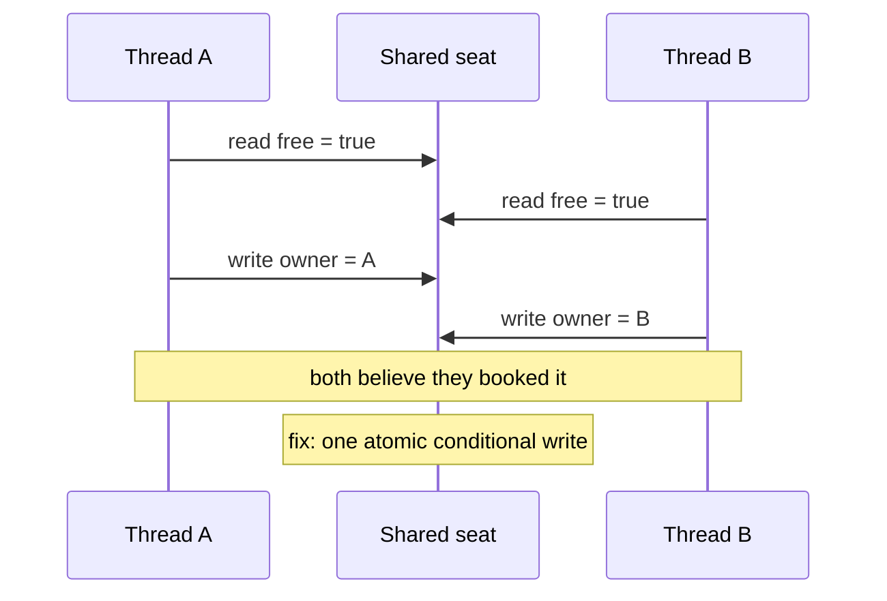

## In one minute
- A race condition is when correctness depends on the timing of operations that run concurrently. It is the contention and ordering shapes at the scale of threads, processes or services.
- The classic patterns: check-then-act (two threads both see "seat free" and both book it), read-modify-write (two increments, one lost), and unsafe publication (one thread sees a half-initialised object).
- Races are timing-dependent, so they hide in tests and appear under load. Make them reproducible: stress tests, injected delays, and race detectors that reason about happens-before rather than luck.
- Fix by removing the gap: atomic operations, locks held across the whole check and act, single-writer ownership, or database constraints and conditional updates.
- Deadlocks are the opposite failure: too much locking in inconsistent order. Acquire locks in one global order and keep critical sections short.

## How it works

### Three patterns
**Check-then-act.** `if seat.free: seat.book(user)`. Two threads both run the check before either acts; both book. The same bug appears in "create the user if the email does not exist", "send the welcome email if not already sent" and "start the job if no other worker has".

**Read-modify-write.** `count = count + 1` is three steps: read, add, write. Two threads read 10, both write 11, and one increment is lost. Inventory counters, balances and rate limiters suffer from this.

**Unsafe publication.** One thread creates an object and stores a reference; another thread reads the reference and uses the object. Without a synchronisation point, compilers and CPUs may reorder writes, so the reader can see the reference before the object's fields are written. Language memory models define which operations create the ordering that makes publication safe. Go's model states that data-race-free programs behave as if operations were interleaved in some sequential order, and that programs with races are incorrect ([Go memory model](https://go.dev/ref/mem)).

### Happens-before
Two operations are ordered if one *happens before* the other: they are in the same thread in program order, or connected through synchronisation, such as a lock release followed by an acquire of the same lock, a channel send followed by the matching receive ([Go memory model](https://go.dev/ref/mem)), or a thread start. If two accesses to the same variable, at least one a write, are not ordered by happens-before, that is a data race, whatever the timing on a particular run. This idea comes from Lamport's 1978 paper on logical clocks, and it is exactly what race detectors check.

### Making races visible
- **Race detectors:** Go's `-race` flag and ThreadSanitizer for C, C++ and others instrument memory accesses and track happens-before with vector clocks, reporting races even when the bad interleaving did not happen on that run. They only see code that actually executes, and they cost roughly 2 to 20 times in CPU and 5 to 10 times in memory ([Go race detector](https://go.dev/doc/articles/race_detector)), so they run in tests and staging under a realistic workload.
- **Stress tests:** run the operation from 100 threads or 1,000 concurrent requests and check invariants (exactly 100 seats sold, final counter equals operations performed).
- **Injected delays:** put a short sleep between the check and the act in a test build to widen the window from nanoseconds to milliseconds, which turns a one-in-a-million race into an every-time failure.
- **Database-level evidence:** duplicate rows that a unique rule should have prevented, or counts that disagree with event logs.

### Fixes
Remove the gap between check and act. Use atomic operations for counters (`atomic.AddInt64`, `UPDATE stock SET qty = qty - 1 WHERE qty > 0`). Hold a lock across the whole critical section, not just the write. Give each piece of state a single owner (one goroutine, one actor, one partition) and send it messages. In databases, use unique constraints, conditional updates or `SELECT ... FOR UPDATE`, and know which isolation level you run: Postgres's default, Read Committed, does not prevent lost updates in read-modify-write done in application code. An `UPDATE` that meets a concurrently updated row waits, then re-checks its `WHERE` clause against the new version, which is why putting the condition in the `WHERE` works. Repeatable Read instead aborts the second writer with SQLSTATE 40001, and the application must retry the whole transaction ([Postgres docs](https://www.postgresql.org/docs/current/transaction-iso.html)).

### Deadlocks
A deadlock needs a cycle: thread A holds lock 1 and waits for lock 2 while thread B holds lock 2 and waits for lock 1. Prevent it by always acquiring locks in a fixed global order (for example by account ID when transferring between two accounts), by holding locks briefly, and by using timeouts. Databases detect deadlock cycles and abort one transaction; Postgres checks only after a lock wait exceeds `deadlock_timeout` (1 second by default, because the check is expensive) and reports "deadlock detected" with both statements ([Postgres docs](https://www.postgresql.org/docs/current/runtime-config-locks.html)); retry the transaction, as with serialization failures.

## Down the stack

### Layer 1: The contract
A concurrent component promises that its invariants hold under any interleaving of its operations, not just the ones tests happened to produce. For shared data that means every access is either confined to one thread or ordered by synchronisation; for database state it means the invariant is enforced by a constraint, a conditional write or a lock, at a documented isolation level.

### Layer 2: The mechanism
Race detectors keep a vector clock per thread: a counter for every thread, recording how much of each other thread's history it has "seen" through synchronisation. Releasing a lock stores the releasing thread's clock in the lock; acquiring it merges that clock into the acquirer's. Each memory access is recorded with the accessing thread's clock. A new access races with a previous one if they come from different threads, at least one is a write, and neither clock is less than or equal to the other in every component. ThreadSanitizer keeps a compact shadow memory of recent accesses per 8-byte word to make this affordable.

### Layer 3: The machine
Races exist because hardware runs threads truly in parallel and reorders memory operations for speed. Each core has store buffers and caches; a write may sit in a store buffer before becoming visible to other cores, and x86 allows a later load to complete before an earlier store to a different address, while ARM allows even more reordering. Atomic instructions such as `LOCK XADD` or `CMPXCHG` on x86, or load-exclusive and store-exclusive pairs on ARM, make a read-modify-write indivisible by holding the cache line in exclusive state, at a cost of tens of nanoseconds when the line is contended across cores. Locks are built on these instructions plus memory barriers that force ordering, which is why correctly synchronised code is safe on every CPU and racy code may work on x86 and fail on ARM.

### Why it's built this way
1. Parallel hardware and reordering make the order of memory effects unpredictable without synchronisation.
2. Correctness must therefore rest on happens-before, not on observed timing.
3. Testing samples only a few interleavings, so races hide.
4. Detectors that track happens-before find races that did not manifest on that run.
5. The robust fix removes the window entirely: atomic operations, single owners or enforced constraints.

## Diagram


## Worked example
A ticketing service sells 5,000 seats for a concert. In a load test with 20,000 concurrent buyers, it sells 5,047. The code checks `SELECT status FROM seats WHERE id = $1`, and if the seat is free, runs `UPDATE seats SET status = 'sold', buyer = $2 WHERE id = $1`. Both statements are inside a transaction at Read Committed isolation, which the team assumed made it safe.

It does not: at Read Committed, two transactions can both read "free" before either updates, then both update in turn; the second update simply overwrites the first. With 20,000 buyers competing for the most popular seats, 47 seats were double-sold. The time between check and act was only about 2 ms, but at 4 attempts per millisecond on the hottest seats, overlaps were common.

The fix collapses check and act into one statement: `UPDATE seats SET status = 'sold', buyer = $2 WHERE id = $1 AND status = 'free'`, then check the affected row count; 0 means someone else won. The rerun sells exactly 5,000. The team adds the load test to CI with an invariant check (sold seats equals 5,000, no seat with two buyers in the payments table), and a reconciliation query in production that alerts on any seat with more than one successful payment.

## In the wild
- **AWS DynamoDB, 2025: a stale check in DNS automation.** Redundant DNS Enactors apply plans to Route 53. One was delayed, and its check that its plan was newer went stale; a second Enactor applied a newer plan and its cleanup then deleted the older plan, which the delayed Enactor had just made active. The regional endpoint was left with no IP addresses and manual repair was needed. DynamoDB errors lasted from 11:48 PM PDT on 19 October to 2:40 AM on 20 October, with downstream effects until about 2:20 PM. AWS disabled the automation worldwide pending a fix ([AWS summary](https://aws.amazon.com/message/101925/)). It is check-then-act across machines.
- **Google Cloud, 2021: a race after validation.** A race in the pipeline that pushes load-balancer configuration, in the code for about six months, could corrupt a config file after validation had already run. On 16 November it hit an unpatched cluster and external load balancers returned 404 for about half an hour until a rollback to the last good config; the incident record counts 1 hour 53 minutes in total. Google closed the race, added input validation, alerting and stronger pre-apply checks ([Google Cloud incident report](https://status.cloud.google.com/incidents/6PM5mNd43NbMqjCZ5REh)).

## Trade-offs
| Fix | Strengths | Weaknesses | Choose when |
| --- | --- | --- | --- |
| Atomic operation or conditional update | Fast, no lock to manage | Limited to simple operations | Counters, compare-and-set, single-row rules |
| Mutex around the critical section | General, easy to reason about | Contention, deadlock risk | In-process shared state |
| Single owner (actor, partition) | No shared state at all | Throughput per owner is limited | Hot entities, complex per-entity logic |
| Database constraint | Enforced for every writer | Error handling on conflict | Invariants that must never break |
| Serializable isolation | Strongest guarantees | Retries on serialization failures | Complex multi-row invariants |

## Pitfalls in production
- Assuming a transaction prevents races. Fix: know your isolation level and use conditional writes or row locks.
- Locking only the write, not the read that decided it. Fix: the lock or atomic operation must cover check and act together.
- Inconsistent lock order across code paths. Fix: one global order, documented and enforced in review.
- Tests that never run concurrently. Fix: stress tests with invariant checks and the race detector in CI.
- "Fixing" a race with a sleep. Fix: a sleep changes timing, not ordering; add real synchronisation.

## Leadership lens
- Run race detectors in CI for languages that have them, and treat any report as a bug.
- Ask in design review: which state is shared, who owns it, and what enforces each invariant under concurrency?
- Prefer designs that avoid shared mutable state: single owners, immutable data, idempotent operations.
- Watch for generated code that does check-then-act in application code; it is a very common pattern in agent output.

## Check yourself
1. Why doesn't wrapping a check and an update in a Read Committed transaction prevent double booking?
   **Answer:** Read Committed lets both transactions read the row before either writes; nothing blocks the second reader, so both proceed and the second update overwrites the first.
2. What makes two memory accesses a data race in happens-before terms?
   **Answer:** They touch the same location from different threads, at least one is a write, and neither happens before the other through program order or synchronisation.
3. How do you prevent deadlocks when transferring money between two accounts?
   **Answer:** Always lock the two accounts in a fixed order, such as by account ID, so no cycle of waiting can form.
4. Why can racy code work on a developer's x86 laptop and fail on ARM servers?
   **Answer:** ARM allows more memory reordering than x86, so missing synchronisation that happened to be harmless on x86 becomes visible on ARM.

## Practice
**Task:** Build a happens-before race detector over an event log. Each event is `(thread, op, target)` where op is `"acquire"` or `"release"` (target is a lock) or `"read"` or `"write"` (target is a variable), in the order they happened. Track a vector clock per thread: each thread starts with its own component at 1. On acquire, merge the lock's stored clock into the thread's clock; on release, store a copy of the thread's clock in the lock; on read or write, record the access with a copy of the thread's clock. After every event, increment the thread's own component. Two accesses race if they are on the same variable, from different threads, at least one is a write, and neither clock is less than or equal to the other in every component. `races(events)` returns the sorted list of variables with at least one race.

```python starter
def races(events):
    # TODO: return sorted variable names with races
    raise NotImplementedError
```

```python tests
def test_unsynchronised_writes_race():
    events = [("A", "write", "count"), ("B", "write", "count")]
    assert races(events) == ["count"]

def test_lock_orders_accesses():
    events = [("A", "acquire", "m"), ("A", "write", "count"), ("A", "release", "m"),
              ("B", "acquire", "m"), ("B", "write", "count"), ("B", "release", "m")]
    assert races(events) == []

def test_reads_alone_never_race():
    events = [("A", "read", "cfg"), ("B", "read", "cfg")]
    assert races(events) == []

def test_check_then_act_race():
    events = [("A", "read", "seat"), ("B", "read", "seat"), ("A", "write", "seat"), ("B", "write", "seat")]
    assert races(events) == ["seat"]

def test_different_locks_do_not_synchronise():
    events = [("A", "acquire", "m1"), ("A", "write", "x"), ("A", "release", "m1"),
              ("B", "acquire", "m2"), ("B", "write", "x"), ("B", "release", "m2")]
    assert races(events) == ["x"]

def test_same_thread_never_races_and_sorted_output():
    events = [("A", "write", "z"), ("A", "write", "z"), ("A", "write", "b"), ("B", "read", "b"), ("C", "write", "a"), ("B", "write", "a")]
    assert races(events) == ["a", "b"]
```

```python solution
def _leq(a, b):
    return all(v <= b.get(k, 0) for k, v in a.items())

def races(events):
    clocks, locks, accesses = {}, {}, []
    for thread, op, target in events:
        c = clocks.setdefault(thread, {thread: 1})
        if op == "acquire":
            for k, v in locks.get(target, {}).items():
                c[k] = max(c.get(k, 0), v)
        elif op == "release":
            locks[target] = dict(c)
        else:
            accesses.append((target, thread, op, dict(c)))
        c[thread] += 1
    found = set()
    for i in range(len(accesses)):
        for j in range(i + 1, len(accesses)):
            v1, t1, op1, c1 = accesses[i]
            v2, t2, op2, c2 = accesses[j]
            if v1 != v2 or t1 == t2 or (op1 == "read" and op2 == "read"):
                continue
            if not _leq(c1, c2) and not _leq(c2, c1):
                found.add(v1)
    return sorted(found)
```

```typescript starter
export type Event = [string, string, string];

export function races(events: Event[]): string[] {
  throw new Error("TODO");
}
```

```typescript tests
test("unsynchronised writes race", () => {
  assertEqual(races([["A", "write", "count"], ["B", "write", "count"]]), ["count"]);
});

test("lock orders accesses", () => {
  assertEqual(races([["A", "acquire", "m"], ["A", "write", "count"], ["A", "release", "m"],
    ["B", "acquire", "m"], ["B", "write", "count"], ["B", "release", "m"]]), []);
});

test("reads alone never race", () => {
  assertEqual(races([["A", "read", "cfg"], ["B", "read", "cfg"]]), []);
});

test("check then act race", () => {
  assertEqual(races([["A", "read", "seat"], ["B", "read", "seat"], ["A", "write", "seat"], ["B", "write", "seat"]]), ["seat"]);
});

test("different locks do not synchronise", () => {
  assertEqual(races([["A", "acquire", "m1"], ["A", "write", "x"], ["A", "release", "m1"],
    ["B", "acquire", "m2"], ["B", "write", "x"], ["B", "release", "m2"]]), ["x"]);
});

test("same thread never races and output sorted", () => {
  assertEqual(races([["A", "write", "z"], ["A", "write", "z"], ["A", "write", "b"], ["B", "read", "b"], ["C", "write", "a"], ["B", "write", "a"]]), ["a", "b"]);
});
```

```typescript solution
export type Event = [string, string, string];
type Clock = Record<string, number>;

const leq = (a: Clock, b: Clock) => Object.keys(a).every(k => a[k] <= (b[k] || 0));

export function races(events: Event[]): string[] {
  const clocks: Record<string, Clock> = {}, locks: Record<string, Clock> = {};
  const accesses: { v: string; t: string; op: string; c: Clock }[] = [];
  for (const [thread, op, target] of events) {
    const c = clocks[thread] || (clocks[thread] = { [thread]: 1 });
    if (op === "acquire") {
      const l = locks[target] || {};
      for (const k of Object.keys(l)) c[k] = Math.max(c[k] || 0, l[k]);
    } else if (op === "release") {
      locks[target] = { ...c };
    } else {
      accesses.push({ v: target, t: thread, op, c: { ...c } });
    }
    c[thread] += 1;
  }
  const found = new Set<string>();
  for (let i = 0; i < accesses.length; i++)
    for (let j = i + 1; j < accesses.length; j++) {
      const a = accesses[i], b = accesses[j];
      if (a.v !== b.v || a.t === b.t || (a.op === "read" && b.op === "read")) continue;
      if (!leq(a.c, b.c) && !leq(b.c, a.c)) found.add(a.v);
    }
  return Array.from(found).sort();
}
```

```go starter
package practice

type Event struct{ Thread, Op, Target string }

func Races(events []Event) []string {
	panic("TODO")
}
```

```go tests
package practice

import (
	"reflect"
	"testing"
)

func check(t *testing.T, got, want []string) {
	t.Helper()
	if len(got) == 0 && len(want) == 0 {
		return
	}
	if !reflect.DeepEqual(got, want) {
		t.Fatalf("got %v, want %v", got, want)
	}
}

func TestUnsynchronised(t *testing.T) {
	check(t, Races([]Event{{"A", "write", "count"}, {"B", "write", "count"}}), []string{"count"})
}

func TestLockOrders(t *testing.T) {
	check(t, Races([]Event{{"A", "acquire", "m"}, {"A", "write", "count"}, {"A", "release", "m"},
		{"B", "acquire", "m"}, {"B", "write", "count"}, {"B", "release", "m"}}), nil)
}

func TestReadsOnly(t *testing.T) {
	check(t, Races([]Event{{"A", "read", "cfg"}, {"B", "read", "cfg"}}), nil)
}

func TestCheckThenAct(t *testing.T) {
	check(t, Races([]Event{{"A", "read", "seat"}, {"B", "read", "seat"}, {"A", "write", "seat"}, {"B", "write", "seat"}}), []string{"seat"})
}

func TestDifferentLocks(t *testing.T) {
	check(t, Races([]Event{{"A", "acquire", "m1"}, {"A", "write", "x"}, {"A", "release", "m1"},
		{"B", "acquire", "m2"}, {"B", "write", "x"}, {"B", "release", "m2"}}), []string{"x"})
}

func TestSameThreadAndSorted(t *testing.T) {
	check(t, Races([]Event{{"A", "write", "z"}, {"A", "write", "z"}, {"A", "write", "b"}, {"B", "read", "b"}, {"C", "write", "a"}, {"B", "write", "a"}}), []string{"a", "b"})
}
```

```go solution
package practice

import "sort"

type Event struct{ Thread, Op, Target string }

type clock map[string]int

func (c clock) copy() clock {
	out := clock{}
	for k, v := range c {
		out[k] = v
	}
	return out
}

func leq(a, b clock) bool {
	for k, v := range a {
		if v > b[k] {
			return false
		}
	}
	return true
}

type access struct {
	v, t, op string
	c        clock
}

func Races(events []Event) []string {
	clocks, locks := map[string]clock{}, map[string]clock{}
	var accesses []access
	for _, e := range events {
		c, ok := clocks[e.Thread]
		if !ok {
			c = clock{e.Thread: 1}
			clocks[e.Thread] = c
		}
		switch e.Op {
		case "acquire":
			for k, v := range locks[e.Target] {
				if v > c[k] {
					c[k] = v
				}
			}
		case "release":
			locks[e.Target] = c.copy()
		default:
			accesses = append(accesses, access{e.Target, e.Thread, e.Op, c.copy()})
		}
		c[e.Thread]++
	}
	found := map[string]bool{}
	for i := range accesses {
		for j := i + 1; j < len(accesses); j++ {
			a, b := accesses[i], accesses[j]
			if a.v != b.v || a.t == b.t || (a.op == "read" && b.op == "read") {
				continue
			}
			if !leq(a.c, b.c) && !leq(b.c, a.c) {
				found[a.v] = true
			}
		}
	}
	out := []string{}
	for v := range found {
		out = append(out, v)
	}
	sort.Strings(out)
	return out
}
```

## Mock interview
**Prompt:** A wallet service lets users transfer money between accounts. At about 2,000 transfers a second, finance finds a few balances each day that do not match the sum of their transactions, and occasionally the service logs "deadlock detected". Find the causes and fix them.

- Follow-up: A colleague suggests switching the whole database to Serializable isolation. What are the trade-offs?
- Follow-up: How would you prove the fix works before production?
- Follow-up: How would you design this so the problem cannot come back?

**A strong answer covers:**
- Naming the shapes: lost updates from read-modify-write in application code, and deadlocks from inconsistent lock order.
- Evidence: reconciliation queries comparing balances with ledger sums, Postgres deadlock logs showing the two statements.
- Fixes: atomic conditional updates (`balance = balance - $1 WHERE balance >= $1`), or `SELECT ... FOR UPDATE` on both accounts in ID order.
- Serializable isolation as an option with retry handling and throughput cost.
- Proof: concurrent stress tests with invariant checks (total money conserved), and the race detector for in-process state.
- Design: a double-entry ledger as the source of truth, balances derived or reconciled, single-writer per account if contention is extreme.

## Sources and further study
**Primary**
- [AWS: DynamoDB service disruption, October 2025](https://aws.amazon.com/message/101925/): the Planner and Enactor race in the provider's own words.
- [Google Cloud incident report, 16 November 2021](https://status.cloud.google.com/incidents/6PM5mNd43NbMqjCZ5REh): timeline of the pipeline race and its patches.

**Systems docs**
- [Lock Management settings (PostgreSQL)](https://www.postgresql.org/docs/current/runtime-config-locks.html): `deadlock_timeout`.

**Books**
- *Designing Data-Intensive Applications*, 1st ed. (Kleppmann), Ch 7: Transactions, for lost updates, write skew and what each isolation level prevents.
- *Release It!*, 2nd ed. (Nygard), Ch 4: Stability Antipatterns (Blocked Threads), for lock-related stalls in production.

**Other curricula**
- The Jepsen consistency map (linked under Free resources) frames isolation levels as a hierarchy of which anomalies each one permits.

## Free resources
- [Data Race Detector (Go)](https://go.dev/doc/articles/race_detector): using `-race`, its overhead and how to read reports.
- [The Go Memory Model](https://go.dev/ref/mem): what happens-before means for goroutines and channels.
- [ThreadSanitizer (Clang)](https://clang.llvm.org/docs/ThreadSanitizer.html): race detection for C and C++.
- [Time, Clocks, and the Ordering of Events (Lamport)](https://lamport.azurewebsites.net/pubs/time-clocks.pdf): the original happens-before paper.
- [Transaction Isolation (PostgreSQL)](https://www.postgresql.org/docs/current/transaction-iso.html): what each isolation level does and does not prevent.
- [Consistency models (Jepsen)](https://jepsen.io/consistency): a map of isolation and consistency guarantees.
