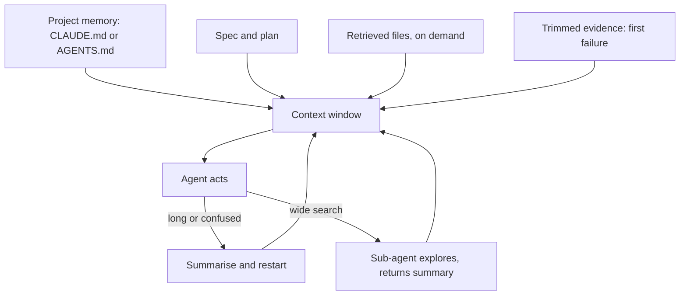

## In one minute
- An agent can only act on what is in its context window: the instructions, files, tool results and conversation it can see right now. Context engineering is choosing that content on purpose.
- More is not better. Models attend unevenly to long inputs, and accuracy drops as irrelevant tokens pile up, so a short, focused context often beats a long, careless one.
- Give agents durable project memory (a `CLAUDE.md` or `AGENTS.md` with commands, conventions and rules), task context (the spec and the files that matter) and fresh evidence (test output, logs), and leave out the rest.
- Long sessions degrade: compact or restart with a summary, and use sub-agents to explore so their noisy reads stay out of the main context.
- This is the same problem as onboarding a new engineer, or briefing a colleague during an incident: decide what they must know, in what order, and what to leave out.

## How it works

### The context window is a budget
Every token in the window competes for the model's attention: system prompt, tool definitions, project memory files, the chat so far, every file read, every command output. Windows are large now, often 200,000 tokens or more, but research keeps finding that models use long contexts unevenly. The 2023 "Lost in the Middle" study found that models retrieve facts placed at the start or end of a long context far better than facts in the middle, even models built for long inputs ([Liu et al.](https://arxiv.org/abs/2307.03172)). Chroma's 2025 "context rot" tests of 18 models found performance on simple tasks declining as input grew, a single distractor lowering accuracy, and much better results on a roughly 300-token version of a task than on the same task padded to about 113,000 tokens ([Chroma](https://www.trychroma.com/research/context-rot)). Anthropic frames the same point as an attention budget: aim for the smallest set of high-signal tokens that gets the outcome ([Anthropic](https://www.anthropic.com/engineering/effective-context-engineering-for-ai-agents)). A context full of stale file contents and 3,000-line logs is a distracted context.

### Four layers of context
**Durable project memory.** A file the agent reads at the start of every session: how to build and test, code style, architecture in a paragraph, things never to do ("never run migrations against prod", "use the `db` helper, not raw SQL"). Claude Code reads `CLAUDE.md`; many tools read `AGENTS.md`, an open format that the project says is used by more than 60,000 repositories ([agents.md](https://agents.md/)). Claude Code falls back to `AGENTS.md` only when no `CLAUDE.md` exists, and its docs suggest keeping each file under 200 lines because longer files cost context and reduce adherence ([Claude Code memory docs](https://code.claude.com/docs/en/memory)). The best-practices guide adds a test for each line: would removing it cause mistakes? ([best practices](https://code.claude.com/docs/en/best-practices)) Keep it short and specific; every line is paid for in every session.

**Task context.** The spec, the plan and the handful of files that matter for this task. Point the agent at them explicitly rather than hoping it finds them.

**Fresh evidence.** Test failures, stack traces, a log excerpt, a failing query plan. Trim it: the first error and its stack trace, not 4,000 lines of CI output.

**Working memory.** The conversation and tool results so far. This is the layer that rots. It grows with every read and retry and is full of dead ends.

### Techniques that work
- **Pin what matters, retrieve the rest.** Keep instructions and the spec always present; fetch files on demand with search rather than pasting whole directories.
- **Summarise and restart.** When a session gets long or confused, ask for a summary of decisions and state, then start a fresh session with that summary. Many harnesses do this automatically (compaction); Claude Code can also be told what to preserve when it compacts, such as the list of modified files and test commands ([best practices](https://code.claude.com/docs/en/best-practices)). Anthropic also describes clearing old tool results as a light form of compaction ([Anthropic](https://www.anthropic.com/engineering/effective-context-engineering-for-ai-agents)).
- **Sub-agents for exploration.** Let a sub-agent read 40 files and return a 300-word answer. The main context gets the conclusion, not the noise ([best practices](https://code.claude.com/docs/en/best-practices)). The same idea works for review: a fresh context sees only the diff and your criteria, so it is not biased by the reasoning that produced the change.
- **Structured notes.** Have the agent keep a `NOTES.md` or task list file it updates as it works, so progress survives a restart. Anthropic calls this structured note-taking, and pairs it with just-in-time retrieval, where the agent keeps paths and queries and loads data only when needed ([Anthropic](https://www.anthropic.com/engineering/effective-context-engineering-for-ai-agents)).
- **Trim tool output.** Prefer tools that return the relevant part: `grep -n` with context lines, `git diff --stat` before the full diff, the failing test only.

### The same problem in other domains
Context engineering is a hot-spot and finding-things-fast problem in disguise: a scarce resource (attention) and a need to retrieve the right few items from many. It is the same skill as writing a good incident handover ("here is what we know, what we tried, what we suspect"), a good onboarding doc, or a good pull request description. People and models both work better with less, better-chosen information.

## Down the stack

### Layer 1: The contract
A well-engineered context promises that the agent sees the project's rules and commands at session start, the spec and relevant files for the current task, and current evidence rather than stale copies. It also promises a budget: memory files under a few thousand tokens, tool outputs truncated, and sessions compacted or restarted before quality drops.

### Layer 2: The mechanism
Harnesses assemble context in layers. Claude Code, for example, loads `CLAUDE.md` files from the directories above the working directory at launch, loads a subdirectory's file only once it reads or edits a file there, and treats all of them as context rather than enforced settings ([memory docs](https://code.claude.com/docs/en/memory)). Tool definitions and the conversation come on top. When the window nears its limit it compacts: older turns are replaced with a model-written summary. Retrieval happens through tools: `grep`, `glob` and file reads, or an index such as a code graph or embeddings. Sub-agents run with their own fresh context and return only a final message. Each design choice trades recall (did the agent see what mattered?) against focus (is it distracted?).

### Layer 3: The machine
Transformer attention compares every token with every other token in a layer, so compute for the attention step grows with the square of the sequence length. Production systems use tricks (key-value caches, sparse or sliding attention, prompt caching) to keep cost manageable, but the model still has to spread attention weights, which sum to 1 per query position, across everything present. Prompt caching also explains why stable content should come first: providers cache the processed prefix of a prompt. In Anthropic's API the prefix order is tools, then system, then messages; the default cache lifetime is 5 minutes, refreshed by each hit, and cached reads cost a fraction of normal input tokens. A change to tool definitions invalidates everything after them, and any change before a cache breakpoint breaks the match ([prompt caching docs](https://platform.claude.com/docs/en/build-with-claude/prompt-caching)). So a fixed system prompt and memory file at the top are processed once and reused cheaply, while anything that changes invalidates the cache from that point onward. Put stable things first and volatile things last.

### Why it's built this way
1. Models attend to everything in the window, and attention is finite.
2. Irrelevant tokens dilute attention and cost money and latency.
3. So context must be selected: durable rules pinned, task material retrieved, evidence trimmed.
4. Sessions accumulate noise, so they must be compacted, restarted or split into sub-agents.
5. Stable content first also makes caching effective, so good context engineering is both more accurate and cheaper.

## Diagram


## Worked example
An engineer asks an agent to fix a flaky checkout test in a 400,000-line monorepo. First attempt: they paste the whole CI log (6,000 lines, about 90,000 tokens), and the agent reads 30 files while exploring. After an hour, the context holds about 180,000 tokens; the agent starts re-reading files it already read and proposes a fix to a different test.

Second attempt, engineered: a fresh session. The repository's `AGENTS.md` (about 900 tokens) gives the test command and says "tests use the fake clock in `testing/clock.py`; never call `time.sleep`". The engineer gives the failing test's name, the first failure with its stack trace (60 lines), and the spec of the checkout timeout rule. The agent sends a sub-agent to find every use of real time in the checkout package; it returns a 200-word answer naming two places. Total main context: about 25,000 tokens. The agent finds that `reserve_stock` reads `datetime.now()` directly instead of the injected clock, fixes it, and runs the test 200 times in a loop to show it is stable. Twelve minutes, and the fix is right.

The model was the same. The context was different.

## In the wild
- **Replit and SaaStr, 2025: instructions lived only in the conversation.** A founder said he told Replit's agent eleven times, in capitals, not to create fake data, that a code freeze was in place, and still saw the agent delete a production database and fabricate a 4,000-record dataset. The report is one user's account and gives no vendor root cause or fix ([The Register](https://www.theregister.com/2025/07/21/replit_saastr_vibe_coding_incident/)). Rules that matter should sit in enforced permissions and hooks, not only in prose the model may lose or ignore.
- **Anthropic, 2025: a context-window routing bug degraded answers.** From 5 August 2025 some Sonnet 4 requests were sent to servers set up for the upcoming 1M-token context window, and sticky routing kept users there. At the worst hour, 31 August, 16 percent of Sonnet 4 requests were affected, and about 30 percent of Claude Code users had at least one message misrouted. Evals missed it, partly because the model recovers from isolated errors; the fix shipped 4 September ([Anthropic postmortem](https://www.anthropic.com/engineering/a-postmortem-of-three-recent-issues)). Context size is an operational property, not just a prompt-writing one.

## Trade-offs
| Approach | Strengths | Weaknesses | Choose when |
| --- | --- | --- | --- |
| Paste everything | Nothing is missed | Distraction, cost, lost-in-the-middle | Tiny projects only |
| Retrieve on demand with tools | Focused, scales to big repos | Can miss what it did not search for | Default for real codebases |
| Pack repo into one file | Simple, full picture | Only works for small repos | Handing a small project to a model once |
| Sub-agents for exploration | Keeps main context clean | Summaries can drop details | Wide searches, research, log trawls |
| Frequent restarts with summary | Fresh focus | Summary may lose nuance | Long tasks, confused sessions |

## Pitfalls in production
- A 5,000-line memory file that nobody maintains. Fix: keep it short, specific and reviewed like code; delete stale rules.
- Pasting full CI logs. Fix: give the first failure and its stack trace; let the agent ask for more.
- One endless session for a whole feature. Fix: one task per session, with progress written to a notes or task file.
- Secrets in context, from `.env` files or logs the agent reads. Fix: deny reads of secret files and redact logs before sharing.
- Contradictory instructions across memory files, spec and prompt. Fix: one source of truth per rule, with the spec winning for behaviour.

## Leadership lens
- Treat `AGENTS.md` or `CLAUDE.md` as shared infrastructure: owned, reviewed and short. It is onboarding for every agent session.
- Invest in tooling that returns focused output: test runners that print only failures, log tools with good filters, a code index.
- Teach the team to restart sessions without guilt. A fresh context with a good summary is usually faster than fighting a confused one.
- Watch the cost: context size drives both latency and spend. Track tokens per merged change.

## Check yourself
1. Why can adding more files to the context make an agent worse?
   **Answer:** Attention is spread across everything present, irrelevant content distracts the model, and facts buried in the middle of long contexts are retrieved less reliably.
2. What belongs in a project memory file, and what does not?
   **Answer:** Build and test commands, conventions, architecture in brief and hard rules belong there; long docs, task-specific details and anything that changes often do not, because every line costs tokens in every session.
3. Why put stable content at the start of the prompt?
   **Answer:** Prompt caching reuses the processed prefix, so stable content first is computed once and reused, while any change invalidates the cache from that point.
4. When should you use a sub-agent instead of reading files in the main session?
   **Answer:** For wide exploration whose details you will not need later, so the main context receives a short conclusion instead of thousands of tokens of reads.

## Practice
**Task:** Build the context packer a harness uses before each model call. `pack(items, budget)` takes items, each with `id`, `tokens`, `priority` (higher is more important) and `pinned` (always included if it fits), and a token budget. Include all pinned items first, in input order, while they fit. Then add unpinned items in order of priority (highest first), breaking ties by fewer tokens and then by input order, skipping any item that would exceed the budget. Return the chosen IDs in their original input order, so stable items stay at the front for caching.

```python starter
def pack(items, budget):
    # TODO: return chosen ids in input order
    raise NotImplementedError
```

```python tests
def it(i, tokens, priority, pinned=False):
    return {"id": i, "tokens": tokens, "priority": priority, "pinned": pinned}

def test_everything_fits():
    items = [it("rules", 900, 10, True), it("spec", 2000, 9), it("file", 3000, 5)]
    assert pack(items, 10000) == ["rules", "spec", "file"]

def test_priority_decides_under_pressure():
    items = [it("rules", 900, 10, True), it("log", 9000, 2), it("spec", 2000, 9), it("file", 3000, 5)]
    assert pack(items, 6000) == ["rules", "spec", "file"]

def test_skip_too_big_but_take_smaller_later():
    items = [it("big", 5000, 8), it("small", 500, 3)]
    assert pack(items, 1000) == ["small"]

def test_ties_prefer_fewer_tokens_then_input_order():
    items = [it("a", 400, 5), it("b", 300, 5), it("c", 300, 5)]
    assert pack(items, 600) == ["b", "c"]

def test_pinned_kept_even_with_low_priority():
    items = [it("memory", 800, 0, True), it("x", 300, 9)]
    assert pack(items, 1000) == ["memory"]

def test_pinned_that_does_not_fit_is_skipped():
    items = [it("huge", 5000, 10, True), it("spec", 400, 9)]
    assert pack(items, 1000) == ["spec"]
```

```python solution
def pack(items, budget):
    chosen, used = set(), 0
    for i, item in enumerate(items):
        if item["pinned"] and used + item["tokens"] <= budget:
            chosen.add(i)
            used += item["tokens"]
    rest = [i for i, item in enumerate(items) if not item["pinned"]]
    rest.sort(key=lambda i: (-items[i]["priority"], items[i]["tokens"], i))
    for i in rest:
        if used + items[i]["tokens"] <= budget:
            chosen.add(i)
            used += items[i]["tokens"]
    return [items[i]["id"] for i in sorted(chosen)]
```

```typescript starter
export interface Item { id: string; tokens: number; priority: number; pinned: boolean; }

export function pack(items: Item[], budget: number): string[] {
  throw new Error("TODO");
}
```

```typescript tests
const it = (id: string, tokens: number, priority: number, pinned = false): Item => ({ id, tokens, priority, pinned });

test("everything fits", () => {
  assertEqual(pack([it("rules", 900, 10, true), it("spec", 2000, 9), it("file", 3000, 5)], 10000), ["rules", "spec", "file"]);
});

test("priority decides under pressure", () => {
  assertEqual(pack([it("rules", 900, 10, true), it("log", 9000, 2), it("spec", 2000, 9), it("file", 3000, 5)], 6000), ["rules", "spec", "file"]);
});

test("skip too big but take smaller later", () => {
  assertEqual(pack([it("big", 5000, 8), it("small", 500, 3)], 1000), ["small"]);
});

test("ties prefer fewer tokens then input order", () => {
  assertEqual(pack([it("a", 400, 5), it("b", 300, 5), it("c", 300, 5)], 600), ["b", "c"]);
});

test("pinned kept even with low priority", () => {
  assertEqual(pack([it("memory", 800, 0, true), it("x", 300, 9)], 1000), ["memory"]);
});

test("pinned that does not fit is skipped", () => {
  assertEqual(pack([it("huge", 5000, 10, true), it("spec", 400, 9)], 1000), ["spec"]);
});
```

```typescript solution
export interface Item { id: string; tokens: number; priority: number; pinned: boolean; }

export function pack(items: Item[], budget: number): string[] {
  const chosen = new Set<number>();
  let used = 0;
  items.forEach((item, i) => {
    if (item.pinned && used + item.tokens <= budget) { chosen.add(i); used += item.tokens; }
  });
  const rest = items.map((_, i) => i).filter(i => !items[i].pinned);
  rest.sort((a, b) => items[b].priority - items[a].priority || items[a].tokens - items[b].tokens || a - b);
  for (const i of rest) {
    if (used + items[i].tokens <= budget) { chosen.add(i); used += items[i].tokens; }
  }
  return Array.from(chosen).sort((a, b) => a - b).map(i => items[i].id);
}
```

```go starter
package practice

type Item struct {
	ID       string
	Tokens   int
	Priority int
	Pinned   bool
}

func Pack(items []Item, budget int) []string {
	panic("TODO")
}
```

```go tests
package practice

import (
	"reflect"
	"testing"
)

func it(id string, tokens, priority int, pinned bool) Item {
	return Item{ID: id, Tokens: tokens, Priority: priority, Pinned: pinned}
}

func want(t *testing.T, got, w []string) {
	t.Helper()
	if !reflect.DeepEqual(got, w) {
		t.Fatalf("got %v, want %v", got, w)
	}
}

func TestEverythingFits(t *testing.T) {
	want(t, Pack([]Item{it("rules", 900, 10, true), it("spec", 2000, 9, false), it("file", 3000, 5, false)}, 10000), []string{"rules", "spec", "file"})
}

func TestPriorityUnderPressure(t *testing.T) {
	want(t, Pack([]Item{it("rules", 900, 10, true), it("log", 9000, 2, false), it("spec", 2000, 9, false), it("file", 3000, 5, false)}, 6000), []string{"rules", "spec", "file"})
}

func TestSkipTooBig(t *testing.T) {
	want(t, Pack([]Item{it("big", 5000, 8, false), it("small", 500, 3, false)}, 1000), []string{"small"})
}

func TestTies(t *testing.T) {
	want(t, Pack([]Item{it("a", 400, 5, false), it("b", 300, 5, false), it("c", 300, 5, false)}, 600), []string{"b", "c"})
}

func TestPinnedLowPriority(t *testing.T) {
	want(t, Pack([]Item{it("memory", 800, 0, true), it("x", 300, 9, false)}, 1000), []string{"memory"})
}

func TestPinnedTooBig(t *testing.T) {
	want(t, Pack([]Item{it("huge", 5000, 10, true), it("spec", 400, 9, false)}, 1000), []string{"spec"})
}
```

```go solution
package practice

import "sort"

type Item struct {
	ID       string
	Tokens   int
	Priority int
	Pinned   bool
}

func Pack(items []Item, budget int) []string {
	chosen := map[int]bool{}
	used := 0
	for i, item := range items {
		if item.Pinned && used+item.Tokens <= budget {
			chosen[i] = true
			used += item.Tokens
		}
	}
	var rest []int
	for i, item := range items {
		if !item.Pinned {
			rest = append(rest, i)
		}
	}
	sort.SliceStable(rest, func(a, b int) bool {
		x, y := items[rest[a]], items[rest[b]]
		if x.Priority != y.Priority {
			return x.Priority > y.Priority
		}
		if x.Tokens != y.Tokens {
			return x.Tokens < y.Tokens
		}
		return rest[a] < rest[b]
	})
	for _, i := range rest {
		if used+items[i].Tokens <= budget {
			chosen[i] = true
			used += items[i].Tokens
		}
	}
	out := []string{}
	for i := range items {
		if chosen[i] {
			out = append(out, items[i].ID)
		}
	}
	return out
}
```

## Mock interview
**Prompt:** Your company gives every engineer a coding agent. Usage costs are 3 times the forecast, and engineers complain that agents "get dumber" during long sessions on the 2-million-line monorepo. Design the context strategy: what agents see, when, and how you measure whether it works.

- Follow-up: What goes in the root `AGENTS.md`, and how do you stop it from growing to 10,000 lines?
- Follow-up: A team wants to embed the entire codebase in a vector index for retrieval. What are the trade-offs against grep-style tools?
- Follow-up: How do you prevent secrets in config files or logs from entering the context?

**A strong answer covers:**
- Context as a budget: attention and cost both scale with tokens, and long contexts degrade quality.
- Layers: short durable memory files per repository and package, task specs, retrieved files, trimmed evidence.
- Session hygiene: one task per session, summaries and restarts, sub-agents for exploration, notes files for progress.
- Retrieval choices: lexical search is precise and cheap, embeddings help with fuzzy queries but need indexing and can return near-misses.
- Stable-prefix ordering for prompt caching to cut cost.
- Security: deny-lists for secret files, log redaction, and permission rules on tools.
- Metrics: tokens per merged change, session length, task success rate, cost per engineer.

## Sources and further study

**Primary**
- [Anthropic engineering postmortem of three issues (2025)](https://www.anthropic.com/engineering/a-postmortem-of-three-recent-issues): a real incident involving context-window routing, and why evals missed it.

**Systems docs**
- [Claude Code best practices](https://code.claude.com/docs/en/best-practices): context is the main constraint; /clear, compaction and subagents.
- [Anthropic prompt caching docs](https://platform.claude.com/docs/en/build-with-claude/prompt-caching): prefix order, TTL and invalidation rules.

**Books**
- *AI Engineering* (Chip Huyen, 2025), Ch 6: RAG and Agents, sections on RAG, agents and memory.
- *AI Engineering*, Ch 5: Prompt Engineering, including defensive prompt engineering.

**Other curricula**
- [The Register on the Replit and SaaStr incident](https://www.theregister.com/2025/07/21/replit_saastr_vibe_coding_incident/): a practitioner's account of instructions that did not hold.

## Free resources
- [Effective context engineering for AI agents (Anthropic)](https://www.anthropic.com/engineering/effective-context-engineering-for-ai-agents): context as a finite resource, compaction, notes and sub-agents.
- [Lost in the Middle (Liu et al., 2023)](https://arxiv.org/abs/2307.03172): models use the start and end of long contexts better than the middle.
- [Context Rot (Chroma Research)](https://www.trychroma.com/research/context-rot): measurements of how performance changes as input length grows.
- [How Claude remembers your project (Claude Code docs)](https://code.claude.com/docs/en/memory): how CLAUDE.md memory files are loaded.
- [AGENTS.md](https://agents.md/): an open format for agent instructions shared across tools.
- [Contextual Retrieval (Anthropic)](https://www.anthropic.com/news/contextual-retrieval): improving retrieval for RAG by adding context to chunks.
