## In one minute
- Data incidents are worse than outages: an outage ends when you roll back; corrupted data stays wrong, spreads to downstream systems and backups, and may not be noticed for days.
- Contain first: stop the bad writer (roll back, flag off, pause the job) so the damage stops growing. Then scope: which rows, which fields, which time window, which downstream copies.
- Prefer surgical repair over a full restore. Restore a backup or point-in-time copy into a separate instance, compute the correct values for affected rows only, and patch production, so legitimate writes made since then survive.
- Rows changed again after the bad window need human decisions; a repair plan must find these conflicts rather than overwrite them.
- Prevent with expand-and-contract migrations, dry runs and row-count checks on backfills, invariants checked continuously, and audit trails (change data capture, history tables) that tell you what each row used to be.

## How it works

### Why data incidents are special
A bad deploy that returns errors is visible within minutes and fixed by rolling back. A bad deploy that writes subtly wrong values, for example prices in cents stored as dollars or a timezone shift on dates, returns success, passes health checks and keeps writing. By the time someone notices, the wrong values have been read by reports, copied into the warehouse, emailed to customers and included in last night's backup. Google's SRE book makes the point that what people really want is not backups but restores: the ability to get correct data back ([Google SRE book](https://sre.google/sre-book/data-integrity/)). It also notes that replication copies corruption and accidental deletes to every replica, so a replica is not a backup.

### Detect
Corruption is found by checks, not by errors. Invariants: totals that must balance, counts that must match between two systems, fields that must be within a range. Reconciliation jobs that compare your data with an independent source (the payment provider's report, the inventory system). Checksums and row counts before and after migrations. Customer reports are a detection method too, but the slowest one.

### Contain
Stop the writer first: roll back the code, turn off the flag, pause the backfill or the consumer. Consider stopping downstream propagation as well: pause the export to the warehouse, hold outbound emails or invoices generated from the affected data. Note the time containment happened; it closes the corruption window.

### Scope
Find exactly what changed. Good sources: an audit or history table (each row's previous values with timestamps), change data capture streams (Debezium reading the database's log and publishing every change), application logs with entity IDs and the deploy version that wrote them, and comparing current data with a point-in-time copy. The output is a list of affected keys, fields and the window between the first bad write and containment.

### Repair
Three options, in order of preference:

1. **Recompute** from a source of truth if one exists (re-derive totals from a ledger, re-fetch from the provider).
2. **Surgical restore:** restore a point-in-time copy from just before the first bad write into a separate instance, read the old values for affected keys, and patch them into production. Rows created during the window may need deleting or fixing. Rows changed by legitimate writers after the window are conflicts for a human to resolve.
3. **Full restore** of the whole database to before the incident, discarding everything written since. Simple but destructive to all legitimate work after that point; acceptable only if little happened since or nothing else is possible.

Always run the repair as a reviewed script, first as a dry run that reports what it would change, on a copy, with counts that match expectations.

### Prevent
Make bad migrations hard and recoverable. Expand and contract: add new columns or tables, write to both, backfill, switch reads, then remove the old, so each step is reversible. Backfills in small batches, with a dry run, a sample check and a kill switch. Keep history: audit tables or CDC retained for at least as long as it takes to notice problems. Google describes three layers of defence: soft deletion (commonly a 15 to 60 day delay before data is really removed), tiered backups, and out-of-band validators that catch inconsistencies early, which its Gmail validators do within 24 hours ([Google SRE book](https://sre.google/sre-book/data-integrity/)). Stripe's pattern for moving data is four steps: dual write plus backfill, switch reads, switch writes, then remove the old data, with GitHub's Scientist library comparing old and new reads before each switch ([Stripe](https://stripe.com/blog/online-migrations)).

### The same shape everywhere
This is the multi-step consistency and trust-but-verify shapes together: data copied into many places must be repaired in all of them, and only independent checks catch silent errors. Finance teams do the same with journal corrections, and supply chains with recalls: contain, trace where the bad batch went, repair, then fix the process.

## Down the stack

### Layer 1: The contract
A system that handles important data promises: invariants checked continuously with alerts; history sufficient to reconstruct any row's previous values for N days; point-in-time recovery to any second within the retention window; and a tested procedure to repair a subset of rows without discarding legitimate later writes.

### Layer 2: The mechanism
Point-in-time recovery restores a base backup and replays the write-ahead log to a chosen time, producing a copy of the database as it was then. The target must be after the base backup ended, the WAL sequence must be unbroken from the backup's start, and each recovery starts a new timeline ([PostgreSQL docs](https://www.postgresql.org/docs/current/continuous-archiving.html)). Change data capture tools read the same log (Postgres logical decoding, MySQL binlog) and emit a stream of row changes with before and after values. A repair job joins three things by primary key: the list of affected keys from the scope step, the old values from the point-in-time copy, and the current production values. For each key it decides: restore the old value, delete a row created during the window, or flag a conflict because the row was changed again after containment.

### Layer 3: The machine
Not all corruption is logical. Storage can return wrong bytes: firmware bugs, bit flips in memory without ECC, torn writes when power fails in the middle of an 8 KB database page written as two 4 KB disk sectors. Databases defend with checksums: Postgres page checksums (on by default for new clusters since PostgreSQL 18, where `initdb --no-data-checksums` opts out; older versions needed `initdb --data-checksums`; an existing cluster can be switched offline with `pg_checksums`; [release notes](https://www.postgresql.org/docs/release/18.0/), [PostgreSQL docs](https://www.postgresql.org/docs/current/checksums.html)) store a 16-bit checksum in each page header and verify it on read, and full-page writes put a complete page image into the WAL after each checkpoint so a torn page can be rebuilt. File systems such as ZFS checksum every block. A checksum failure is a hardware or software bug signal, and the repair path is a replica or backup copy of the page, not the application.

### Why it's built this way
1. Wrong data looks like right data, so it must be detected by independent checks.
2. It spreads to copies and backups over time, so speed of containment matters.
3. Later legitimate writes are valuable, so repairs should be surgical rather than wholesale.
4. Surgical repair needs to know old values, which requires history or point-in-time copies.
5. Migrations and backfills are the most common cause, so they are made reversible and gradual.

## Diagram

```mermaid
flowchart LR
  B["Bad writer starts"] --> D["Detected by invariant or report"]
  D --> C["Contain: stop writer and downstream exports"]
  C --> S["Scope: keys, fields, window from CDC or audit"]
  S --> P["Restore point-in-time copy to side instance"]
  P --> R["Repair plan: restore, delete or conflict"]
  R --> DR["Dry run, counts check, review"]
  DR --> A["Apply to production and downstream"]
```


## Worked example
A backfill job is meant to convert a `price` column from dollars (decimal) to cents (integer) by writing `price_cents = price * 100`. A bug multiplies by 10,000 for products in one currency with three decimal places. It runs from 02:00 to 02:40 and touches 180,000 of 4 million products. At 07:15, a customer complains about a 4,800 dollar phone case. The storefront reads `price_cents`, so for five hours 180,000 products showed prices 100 times too high, and 23 orders were placed at those prices.

Containment at 07:30: the storefront switches back to reading the old `price` column with a flag, and the warehouse export is paused. Scope: the backfill logged batch IDs and product IDs; CDC confirms 180,000 rows changed between 02:00 and 02:40 by the backfill user. Of these, 1,200 were edited again by merchants after 02:40.

Repair: no point-in-time restore is needed because the old `price` column is the source of truth. A script recomputes `price_cents` correctly for the 178,800 untouched rows. The 1,200 rows merchants edited are recomputed from their new `price` values, because merchants edited `price` through the admin, which still wrote the old column. The 23 orders are refunded the difference with an apology. The dry run reports 180,000 updates and zero conflicts, a sample of 500 is checked by hand, and the patch runs in batches of 5,000. The fixes afterwards: backfills must run a dry run on a production copy with a value distribution check (no price should increase by more than 10 times), and the read switch happens only after an invariant check passes.

## In the wild
- **GitLab, 2017: four backup methods, only one that restored.** An engineer wiped the wrong database directory during a replication fix and about 300 GB was gone before the command stopped. The daily dump had been failing on a version mismatch, disk snapshots did not cover the database servers, and replication had never been meant as a backup. The only usable copy was an LVM snapshot, taken about 6 hours earlier for refreshing staging; the restore came from it, copying it back took about 18 hours, and roughly 5,000 projects, 5,000 comments and 700 users were lost ([GitLab postmortem](https://about.gitlab.com/blog/2017/02/10/postmortem-of-database-outage-of-january-31/)).
- **Google Music, 2012: a bad deletion repaired from tape.** A bug wrongly removed about 600,000 audio references for 21,000 users. Recovery drew on 1.5 petabytes and over 5,000 tapes, and about 161,000 files turned out never to have been backed up. Google uses it to argue for soft deletion and tested restores ([Google SRE book](https://sre.google/sre-book/data-integrity/)).
- **GitHub, 2018: choosing correctness over availability.** A 43-second partition caused a failover to West Coast primaries that took about 40 minutes of writes the East Coast never saw. GitHub deliberately accepted heavy degradation, restored clusters from backups, and reconciled the writes that had not replicated (954 in the busiest cluster). Degraded service lasted 24 hours 11 minutes and no user data was lost ([GitHub](https://github.blog/news-insights/company-news/oct21-post-incident-analysis/)).

## Trade-offs
| Repair approach | Strengths | Weaknesses | Choose when |
| --- | --- | --- | --- |
| Recompute from source of truth | Exact, keeps later writes | Needs a reliable source | Derived data, ledgers, external records |
| Surgical restore from point-in-time copy | Keeps legitimate later writes | Effort, conflict handling | Most corruption of primary data |
| Full point-in-time restore | Simple and complete | Loses all later writes | Corruption everywhere, little activity since |
| Fix forward manually | No restore needed | Error-prone at scale | A handful of rows |

## Pitfalls in production
- Rushing to restore the whole database and losing hours of legitimate orders. Fix: contain, scope, then repair surgically.
- Forgetting downstream copies: warehouse, caches, search index, emails, partner feeds. Fix: list every consumer in the scope step.
- No history, so old values are unknowable. Fix: audit tables or CDC retention, and point-in-time recovery enabled.
- Repair scripts run once, untested, on production. Fix: dry run on a copy, expected counts, sample review, batches.
- Backups that already contain corrupted data. Fix: retain backups longer than your typical detection time.

## Leadership lens
- Treat migrations and backfills as high-stakes changes: gatekeeper review, dry runs, and expand-and-contract by default.
- Fund continuous invariant checks and reconciliation for money, inventory and user data; they are the only way to detect silent corruption.
- Drill a surgical repair at least yearly: restore a point-in-time copy and patch a subset of rows.
- Measure detection time for data incidents and make retention of history and backups longer than it.

## Check yourself
1. Why is a full point-in-time restore often the wrong first choice?
   **Answer:** It discards all legitimate writes made after the restore point, such as orders and edits, turning a partial problem into a total loss of recent work.
2. What is a conflict in a repair plan, and why not overwrite it?
   **Answer:** A row that was legitimately changed again after the corruption window; overwriting it with the pre-incident value would destroy a valid later change.
3. How does expand and contract make migrations recoverable?
   **Answer:** Old and new structures coexist while data is copied and verified, so you can switch back to the old one at any step before the final removal.
4. What do Postgres page checksums protect against, and what do they not?
   **Answer:** They detect bytes corrupted by storage or memory between write and read; they do nothing about logically wrong values written correctly by buggy code.

## Practice
**Task:** Build the repair planner. `history` is a list of writes `(key, t, value, writer)`, in any order; a value of `None` means the row was deleted. Writes by `bad_writer` with `bad_start <= t < bad_end` are corrupt. `repair_plan(history, bad_writer, bad_start, bad_end)` returns a dict mapping each key the bad writer touched in the window to an action: `("conflict", None)` if any write by a different writer to that key has a time later than the key's first bad write (a human must decide); otherwise `("restore", value)` with the last value written before `bad_start`, or `("delete", None)` if the row did not exist before `bad_start` (no earlier write, or the last earlier write was a deletion). In Go, a deletion is a write with `Deleted` set.

```python starter
def repair_plan(history, bad_writer, bad_start, bad_end):
    # TODO
    raise NotImplementedError
```

```python tests
H = [
    ("p1", 10, 999, "admin"),
    ("p1", 100, 99900, "backfill"),
    ("p2", 20, 500, "admin"),
    ("p2", 30, 550, "admin"),
    ("p2", 110, 55000, "backfill"),
    ("p3", 105, 70000, "backfill"),
    ("p4", 15, 300, "admin"),
    ("p4", 120, 30000, "backfill"),
    ("p4", 200, 320, "admin"),
    ("p5", 50, 10, "admin"),
]

def test_restore_last_good_value():
    plan = repair_plan(H, "backfill", 100, 150)
    assert plan["p1"] == ("restore", 999)
    assert plan["p2"] == ("restore", 550)

def test_row_created_in_window_is_deleted():
    assert repair_plan(H, "backfill", 100, 150)["p3"] == ("delete", None)

def test_later_edit_is_conflict():
    assert repair_plan(H, "backfill", 100, 150)["p4"] == ("conflict", None)

def test_untouched_keys_not_in_plan():
    assert sorted(repair_plan(H, "backfill", 100, 150)) == ["p1", "p2", "p3", "p4"]

def test_writes_outside_window_ignored():
    assert repair_plan(H, "backfill", 0, 100) == {}

def test_history_order_does_not_matter():
    assert repair_plan(list(reversed(H)), "backfill", 100, 150) == repair_plan(H, "backfill", 100, 150)
```

```python solution
def repair_plan(history, bad_writer, bad_start, bad_end):
    ordered = sorted(history, key=lambda w: (w[1], w[0]))
    first_bad = {}
    for key, t, value, writer in ordered:
        if writer == bad_writer and bad_start <= t < bad_end and key not in first_bad:
            first_bad[key] = t
    plan = {}
    for key, t_bad in first_bad.items():
        writes = [w for w in ordered if w[0] == key]
        if any(w[3] != bad_writer and w[1] > t_bad for w in writes):
            plan[key] = ("conflict", None)
            continue
        before = [w for w in writes if w[1] < bad_start]
        if not before or before[-1][2] is None:
            plan[key] = ("delete", None)
        else:
            plan[key] = ("restore", before[-1][2])
    return plan
```

```typescript starter
export type Write = [string, number, number | null, string];
export type Action = [string, number | null];

export function repairPlan(history: Write[], badWriter: string, badStart: number, badEnd: number): Record<string, Action> {
  throw new Error("TODO");
}
```

```typescript tests
const H: Write[] = [
  ["p1", 10, 999, "admin"], ["p1", 100, 99900, "backfill"],
  ["p2", 20, 500, "admin"], ["p2", 30, 550, "admin"], ["p2", 110, 55000, "backfill"],
  ["p3", 105, 70000, "backfill"],
  ["p4", 15, 300, "admin"], ["p4", 120, 30000, "backfill"], ["p4", 200, 320, "admin"],
  ["p5", 50, 10, "admin"],
];

test("restore last good value", () => {
  const plan = repairPlan(H, "backfill", 100, 150);
  assertEqual(plan["p1"], ["restore", 999]);
  assertEqual(plan["p2"], ["restore", 550]);
});

test("row created in window is deleted", () => {
  assertEqual(repairPlan(H, "backfill", 100, 150)["p3"], ["delete", null]);
});

test("later edit is conflict", () => {
  assertEqual(repairPlan(H, "backfill", 100, 150)["p4"], ["conflict", null]);
});

test("untouched keys not in plan", () => {
  assertEqual(Object.keys(repairPlan(H, "backfill", 100, 150)).sort(), ["p1", "p2", "p3", "p4"]);
});

test("writes outside window ignored", () => {
  assertEqual(repairPlan(H, "backfill", 0, 100), {});
});

test("history order does not matter", () => {
  assertEqual(repairPlan(H.slice().reverse(), "backfill", 100, 150), repairPlan(H, "backfill", 100, 150));
});
```

```typescript solution
export type Write = [string, number, number | null, string];
export type Action = [string, number | null];

export function repairPlan(history: Write[], badWriter: string, badStart: number, badEnd: number): Record<string, Action> {
  const ordered = history.slice().sort((a, b) => a[1] - b[1] || (a[0] < b[0] ? -1 : a[0] > b[0] ? 1 : 0));
  const firstBad: Record<string, number> = {};
  for (const [key, t, , writer] of ordered) {
    if (writer === badWriter && badStart <= t && t < badEnd && !(key in firstBad)) firstBad[key] = t;
  }
  const plan: Record<string, Action> = {};
  for (const key of Object.keys(firstBad).sort()) {
    const writes = ordered.filter(w => w[0] === key);
    if (writes.some(w => w[3] !== badWriter && w[1] > firstBad[key])) { plan[key] = ["conflict", null]; continue; }
    const before = writes.filter(w => w[1] < badStart);
    const last = before[before.length - 1];
    plan[key] = !last || last[2] === null ? ["delete", null] : ["restore", last[2]];
  }
  return plan;
}
```

```go starter
package practice

type Write struct {
	Key     string
	T       int
	Value   int
	Deleted bool
	Writer  string
}

type Action struct {
	Kind  string // "restore", "delete" or "conflict"
	Value int
}

func RepairPlan(history []Write, badWriter string, badStart, badEnd int) map[string]Action {
	panic("TODO")
}
```

```go tests
package practice

import (
	"reflect"
	"testing"
)

func w(key string, t, v int, writer string) Write { return Write{Key: key, T: t, Value: v, Writer: writer} }

var hist = []Write{
	w("p1", 10, 999, "admin"), w("p1", 100, 99900, "backfill"),
	w("p2", 20, 500, "admin"), w("p2", 30, 550, "admin"), w("p2", 110, 55000, "backfill"),
	w("p3", 105, 70000, "backfill"),
	w("p4", 15, 300, "admin"), w("p4", 120, 30000, "backfill"), w("p4", 200, 320, "admin"),
	w("p5", 50, 10, "admin"),
}

func TestRestore(t *testing.T) {
	p := RepairPlan(hist, "backfill", 100, 150)
	if p["p1"] != (Action{"restore", 999}) || p["p2"] != (Action{"restore", 550}) {
		t.Fatalf("got %v", p)
	}
}

func TestDelete(t *testing.T) {
	if p := RepairPlan(hist, "backfill", 100, 150); p["p3"].Kind != "delete" {
		t.Fatalf("got %v", p["p3"])
	}
}

func TestConflict(t *testing.T) {
	if p := RepairPlan(hist, "backfill", 100, 150); p["p4"].Kind != "conflict" {
		t.Fatalf("got %v", p["p4"])
	}
}

func TestOnlyTouched(t *testing.T) {
	if p := RepairPlan(hist, "backfill", 100, 150); len(p) != 4 {
		t.Fatalf("got %v", p)
	}
}

func TestOutsideWindow(t *testing.T) {
	if p := RepairPlan(hist, "backfill", 0, 100); len(p) != 0 {
		t.Fatalf("got %v", p)
	}
}

func TestOrder(t *testing.T) {
	rev := make([]Write, len(hist))
	for i := range hist {
		rev[len(hist)-1-i] = hist[i]
	}
	if !reflect.DeepEqual(RepairPlan(rev, "backfill", 100, 150), RepairPlan(hist, "backfill", 100, 150)) {
		t.Fatal("order should not matter")
	}
}
```

```go solution
package practice

import "sort"

type Write struct {
	Key     string
	T       int
	Value   int
	Deleted bool
	Writer  string
}

type Action struct {
	Kind  string // "restore", "delete" or "conflict"
	Value int
}

func RepairPlan(history []Write, badWriter string, badStart, badEnd int) map[string]Action {
	ordered := append([]Write(nil), history...)
	sort.SliceStable(ordered, func(i, j int) bool {
		if ordered[i].T != ordered[j].T {
			return ordered[i].T < ordered[j].T
		}
		return ordered[i].Key < ordered[j].Key
	})
	firstBad := map[string]int{}
	for _, wr := range ordered {
		if _, seen := firstBad[wr.Key]; !seen && wr.Writer == badWriter && badStart <= wr.T && wr.T < badEnd {
			firstBad[wr.Key] = wr.T
		}
	}
	plan := map[string]Action{}
	for key, tBad := range firstBad {
		conflict := false
		var last *Write
		for i := range ordered {
			wr := ordered[i]
			if wr.Key != key {
				continue
			}
			if wr.Writer != badWriter && wr.T > tBad {
				conflict = true
			}
			if wr.T < badStart {
				last = &ordered[i]
			}
		}
		switch {
		case conflict:
			plan[key] = Action{Kind: "conflict"}
		case last == nil || last.Deleted:
			plan[key] = Action{Kind: "delete"}
		default:
			plan[key] = Action{Kind: "restore", Value: last.Value}
		}
	}
	return plan
}
```

## Mock interview
**Prompt:** On Monday morning, finance reports that about 2 percent of last week's invoices show tax amounts of zero. A billing service release went out the previous Tuesday. Invoices were already emailed to customers and exported to the accounting system. Walk me through the response.

- Follow-up: Some affected customers have already paid the incorrect invoice. What now?
- Follow-up: Your backups are nightly and point-in-time recovery is not enabled. How does that change the repair?
- Follow-up: How do you make sure this cannot run for six days unnoticed again?

**A strong answer covers:**
- Containment: rolling back or flagging off the billing change, pausing invoice generation and exports if needed.
- Scoping: which invoices, which customers, which window, by release version and invariant checks (tax should be non-zero for taxable regions).
- Repair by recomputation from source data (orders, tax rules) rather than restore, with dry runs and review.
- Downstream handling: corrected invoices, communication to customers, adjustments in accounting, handling paid invoices with finance and legal.
- Without point-in-time recovery: history tables, logs and recomputation become essential.
- Prevention: invariant checks and reconciliation on every billing run, canary releases with business metrics, faster alerts.

## Sources and further study
**Primary**
- [Google SRE book, "Data Integrity: What You Read Is What You Wrote"](https://sre.google/sre-book/data-integrity/): the Gmail 2011 and Google Music 2012 cases, soft deletion, tiered backups and validators.
- [GitLab: postmortem of the 31 January 2017 database outage](https://about.gitlab.com/blog/2017/02/10/postmortem-of-database-outage-of-january-31/): what untested backups look like in practice.
- [GitHub: October 21 post-incident analysis](https://github.blog/news-insights/company-news/oct21-post-incident-analysis/): data repair after split-brain, with the reasoning for prioritising integrity.

**Systems docs**
- [PostgreSQL: data checksums](https://www.postgresql.org/docs/current/checksums.html): what checksums cover (data pages only) and how to enable them offline.
- [PostgreSQL 18 release notes](https://www.postgresql.org/docs/release/18.0/): checksums became the `initdb` default.

**Books**
- *Site Reliability Engineering* (Beyer et al.), chapter 26 "Data Integrity".
- *Designing Data-Intensive Applications* (Kleppmann, 1st edition), chapter 11 "Stream Processing" for change data capture, and chapter 7 "Transactions" for what a database can and cannot guarantee.

**Other curricula**
- [Azure Well-Architected: incident management process](https://learn.microsoft.com/en-us/azure/well-architected/operational-excellence/incident-response): treats audit trails of configuration and administrative actions as an operational requirement, and recommends verifying RTO and RPO by drills.

## Free resources
- [Data Integrity: What You Read Is What You Wrote (Google SRE book)](https://sre.google/sre-book/data-integrity/): why restores, not backups, are what matter.
- [Online migrations at scale (Stripe)](https://stripe.com/blog/online-migrations): the dual-write, backfill and switch pattern in production.
- [Continuous archiving and point-in-time recovery (PostgreSQL)](https://www.postgresql.org/docs/current/continuous-archiving.html): restoring to an exact moment.
- [Debezium documentation](https://debezium.io/documentation/reference/stable/index.html): change data capture for row-level history.
- [pg_checksums (PostgreSQL)](https://www.postgresql.org/docs/current/app-pgchecksums.html): page checksums for detecting storage corruption.
- [Backward compatible database changes (PlanetScale)](https://planetscale.com/blog/backward-compatible-databases-changes): expand-and-contract in practice.
